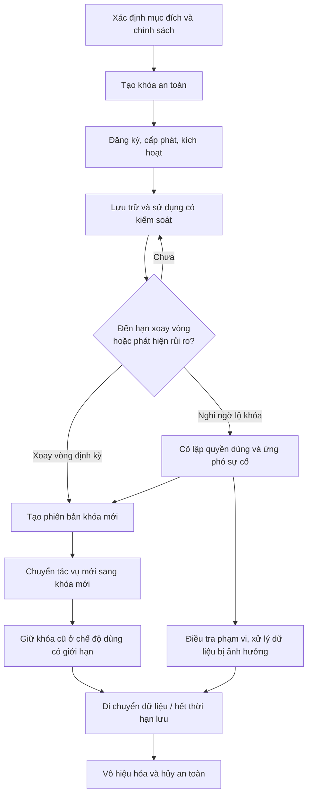
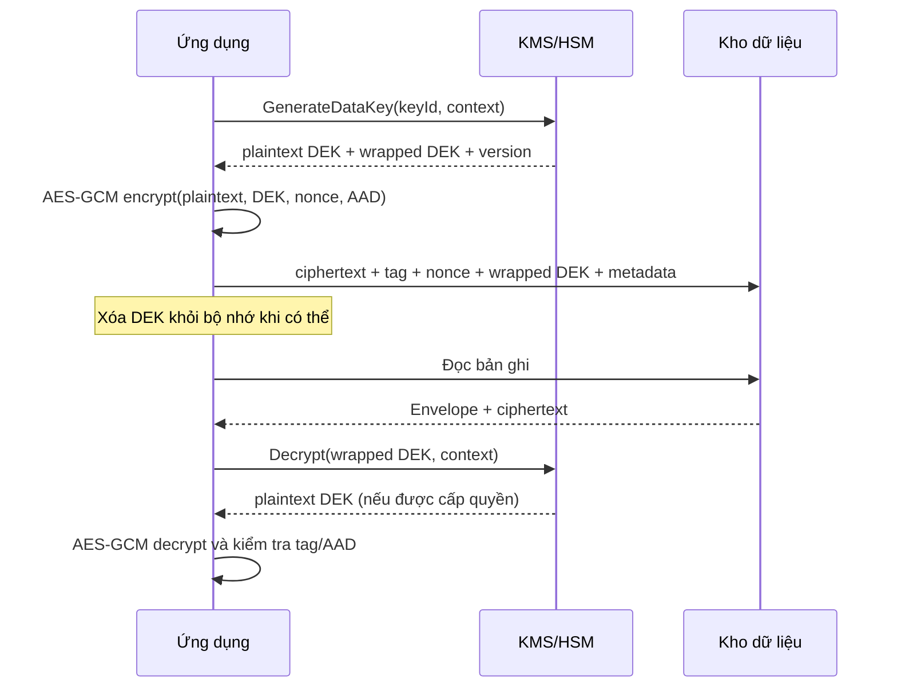

# Cryptographic key lifecycle

Trong chương **Nền tảng key management**, *cryptographic key lifecycle* là vòng đời của một khóa mật mã: từ lúc xác định nhu cầu, tạo khóa, cấp phát, lưu trữ và sử dụng, đến khi xoay vòng, ngừng dùng, thu hồi và hủy. Bảo mật dữ liệu không chỉ phụ thuộc vào AES, RSA hay thuật toán chữ ký số. Nếu khóa bị lộ, bị dùng sai mục đích, không thể khôi phục hoặc vẫn còn hoạt động sau khi đáng lẽ phải bị vô hiệu hóa, hệ thống có thể mất tính bí mật, toàn vẹn hoặc khả năng kiểm chứng dù thuật toán hoàn toàn an toàn.

Bài này trình bày vòng đời khóa theo góc nhìn thiết kế hệ thống: kết nối mật mã đối xứng, bất đối xứng, chữ ký số, KMS/HSM, *envelope encryption*, kiểm soát truy cập và kiểm toán.

## 1. Mục tiêu học tập

Sau bài học, bạn có thể:

- Mô tả các giai đoạn và trạng thái của khóa, phân biệt việc **ngừng tạo dữ liệu mới bằng khóa cũ** với việc **ngừng cho phép giải mã dữ liệu cũ**.
- Xác định nơi khóa được tạo, ai có quyền sử dụng, cách bảo vệ khóa khi lưu trữ và khi truyền giữa các thành phần.
- Giải thích cách xoay vòng khóa đối xứng, cặp khóa bất đối xứng và khóa dùng trong chữ ký số mà không làm mất khả năng đọc hoặc xác minh dữ liệu lịch sử.
- Thiết kế luồng dùng KMS/HSM và envelope encryption, có phân quyền, nhật ký kiểm toán, phương án khôi phục và quy trình ứng phó khi khóa bị lộ.

## 2. Khóa có vòng đời riêng với dữ liệu

**Khóa mật mã** là giá trị bí mật hoặc một thành phần của cặp khóa dùng cùng thuật toán để mã hóa, giải mã, tạo/kiểm tra mã xác thực, ký hoặc xác minh chữ ký. Có nhiều loại khóa với đặc tính quản lý khác nhau:

| Loại khóa | Công dụng thường gặp | Yêu cầu bảo vệ |
| --- | --- | --- |
| Khóa đối xứng (*symmetric key*) | AES-GCM mã hóa dữ liệu; HMAC xác thực thông điệp | Giữ bí mật; hạn chế số thực thể được phép dùng; kiểm soát nguy cơ dùng lại nonce với cùng khóa. |
| Khóa công khai (*public key*) | Mã hóa tới bên nhận; xác minh chữ ký số | Có thể phân phối rộng nhưng phải xác thực nguồn gốc và tính toàn vẹn. |
| Khóa riêng (*private key*) | Giải mã hoặc ký số tùy mục đích của cặp khóa | Giữ bí mật, hạn chế xuất khóa, ưu tiên thao tác ký/giải mã trong vùng bảo vệ. |
| Khóa mã hóa dữ liệu (*DEK — Data Encryption Key*) | Mã hóa bản ghi, tệp, đối tượng hoặc một tập dữ liệu | Thường sống ngắn hoặc giới hạn phạm vi; được bọc bằng khóa khác khi lưu. |
| Khóa mã hóa khóa (*KEK — Key Encryption Key*) | Bọc/mở bọc DEK hoặc một khóa cấp dưới | Kiểm soát truy cập chặt chẽ; thường quản lý bằng KMS/HSM. |
| Khóa gốc (*root/master key*) | Thiết lập gốc tin cậy hoặc bảo vệ hệ phân cấp khóa | Ít được dùng trực tiếp; có chính sách quản trị, sao lưu và khôi phục đặc biệt. |

Một **chứng chỉ số** không đồng nghĩa với khóa riêng: chứng chỉ gắn khóa công khai với danh tính qua cơ chế tin cậy. Gia hạn chứng chỉ, đổi chứng chỉ, xoay cặp khóa và thu hồi chứng chỉ là các hành động có liên hệ nhưng không phải một.

Ví dụ: cơ sở dữ liệu lưu thông tin khách hàng đã được mã hóa AES-256-GCM. Nếu ứng dụng để lộ DEK trong log, người có log có thể đọc bản mã dù không biết mật khẩu cơ sở dữ liệu. Ngược lại, nếu hệ thống xóa KEK trước khi đã chuyển toàn bộ DEK sang khóa mới, dữ liệu vẫn còn nhưng có thể không giải mã được.

## 3. Bản đồ vòng đời khóa

Không có một sơ đồ trạng thái bắt buộc cho mọi nền tảng. Cách chia dưới đây giúp nhóm triển khai xác định rõ trách nhiệm, kiểm soát và đường xử lý ngoại lệ.



Các hệ thống thực tế có thể đặt tên trạng thái khác nhau. Quan trọng nhất là phân biệt **trạng thái khóa** với **phiên bản khóa**, và phân biệt *còn được phép dùng để bảo vệ dữ liệu mới* với *còn cần dùng để xử lý dữ liệu cũ*.

| Trạng thái logic | Hành vi mong muốn |
| --- | --- |
| `PENDING` | Khóa đã tồn tại nhưng chưa được phép phục vụ ứng dụng. |
| `ACTIVE` | Được dùng đúng mục đích đã cấp phép, chẳng hạn mã hóa mới hoặc ký mới. |
| `DECRYPT_ONLY` / `VERIFY_ONLY` | Không tạo bản mã hoặc chữ ký mới; có thể dùng khóa cũ để đọc hoặc kiểm chứng dữ liệu lịch sử theo chính sách. |
| `SUSPENDED` / `DISABLED` | Tạm thời chặn thao tác trong lúc điều tra hoặc chờ quyết định. |
| `REVOKED` | Quyền sử dụng bị thu hồi theo quy trình; với chứng chỉ còn liên quan tới CRL/OCSP hoặc cơ chế công bố thu hồi của PKI. |
| `DESTROYED` | Vật liệu khóa đã được loại bỏ theo phạm vi và mức bảo đảm quy định; các bản sao lưu cũng cần được xử lý. |

Các trạng thái trên là mô hình kiến trúc để trao đổi giữa các nhóm; không phải mọi KMS đều hỗ trợ đúng các tên hoặc chuyển trạng thái này.

## 4. Từng giai đoạn và kiểm soát tương ứng

### 4.1. Xác định mục đích và chính sách

Trước khi tạo khóa, cần trả lời:

1. Khóa phục vụ **mã hóa**, **giải mã**, **ký**, **xác minh chữ ký**, **HMAC** hay **bọc khóa**? Không dùng một khóa cho nhiều mục đích không tương thích nếu không có thiết kế và kiểm soát rõ ràng.
2. Dữ liệu thuộc hệ thống, môi trường và tenant nào? Ai là *owner* chịu trách nhiệm phê duyệt quyền và xử lý sự cố?
3. Thuật toán, độ dài khóa và cách dùng có phù hợp mô hình đe dọa và chính sách bảo mật không? Ví dụ AES-256-GCM là lựa chọn phổ biến cho mã hóa có xác thực; cặp Ed25519 phục vụ chữ ký, không được đem dùng như khóa mã hóa AES.
4. Khóa tồn tại bao lâu, khi nào xoay, dữ liệu cần giữ bao lâu, làm sao phục hồi, và khi nào mới được hủy?
5. Mức độ dự phòng và khả năng sẵn sàng của KMS/HSM thế nào? Nếu dịch vụ quản lý khóa ngừng hoạt động, phần mềm nên báo lỗi hay có thể tạm sử dụng cache với thời gian và phạm vi được giới hạn?

Chính sách cần chỉ rõ quyền **tạo**, **dùng**, **xoay**, **tắt**, **xóa** và **khôi phục** khóa. Đó thường là các quyền riêng, không mặc định trao hết cho tài khoản ứng dụng.

### 4.2. Tạo khóa (*generation*)

Khóa phải được tạo bằng **nguồn ngẫu nhiên phù hợp mật mã** (CSPRNG) hoặc cơ chế tạo khóa được thiết kế/đánh giá phù hợp của KMS/HSM; không lấy từ chuỗi đoán được, thời gian hệ thống, UUID tùy tiện hoặc `java.util.Random`. Với cặp khóa bất đối xứng, thuật toán sinh khóa phải tạo ra các tham số hợp lệ theo chuẩn của thuật toán.

Các quyết định tại thời điểm tạo gồm:

- **Thuật toán và độ dài:** gắn với loại thao tác, ví dụ AES-256 cho khóa đối xứng; dùng thư viện đáng tin cậy cho RSA/ECC thay vì tự triển khai nguyên thủy mật mã.
- **Nguồn và nơi tạo:** HSM có thể tạo và giữ khóa riêng/KEK bên trong thiết bị, giảm nhu cầu đưa vật liệu khóa thô ra bộ nhớ của ứng dụng.
- **Siêu dữ liệu:** ghi `keyId`, phiên bản, mục đích, chủ sở hữu, phạm vi, thời điểm tạo, ngày dự kiến xoay/hủy; không ghi giá trị khóa bí mật vào hệ thống quản trị.
- **Phân tách môi trường:** khóa production không tái sử dụng trong test/dev; tùy yêu cầu có thể tách khóa theo tenant, ứng dụng hoặc vùng dữ liệu.

Nếu sinh khóa hoặc seed từ dữ liệu ngẫu nhiên yếu, việc lưu trong HSM sau đó không làm khóa trở nên mạnh hơn.

### 4.3. Đăng ký, cấp phát và kích hoạt (*registration, distribution, activation*)

Khóa được đăng ký trong kho quản lý, gắn định danh ổn định và chính sách truy cập. Ứng dụng nhận **quyền gọi thao tác mật mã** hoặc một bản bọc khóa được bảo vệ; không mặc nhiên nhận khóa gốc ở dạng rõ.

Ví dụ luồng cấp phát:

1. Dịch vụ `payment-service` xác thực với KMS bằng danh tính workload (không dùng thông tin đăng nhập cố định ghi trong mã nguồn).
2. KMS kiểm tra vai trò và điều kiện như môi trường, định danh khóa, loại hành động và encryption context.
3. KMS cho phép `Encrypt` hoặc `GenerateDataKey` theo phạm vi được cấp, đồng thời tạo bản ghi audit.
4. Ứng dụng chỉ lưu mã định danh/phiên bản khóa cùng bản mã; mọi yêu cầu sử dụng tiếp theo vẫn đi qua bước kiểm soát.

Nếu buộc phải xuất hoặc trao đổi một khóa bí mật, kênh vận chuyển cần có bảo mật, xác thực hai phía khi phù hợp, thao tác bọc khóa và biện pháp chống tráo đổi. **Phân phối khóa công khai** cũng cần kiểm tra tính xác thực: kẻ tấn công có thể thay khóa công khai để nhận dữ liệu hoặc làm sai quá trình xác minh.

### 4.4. Lưu trữ, sao lưu và phục hồi (*storage, backup, recovery*)

Khóa ở trạng thái *at rest* cần một ranh giới bảo vệ độc lập với dữ liệu mà nó mã hóa. Với KEK và khóa riêng nhạy cảm, kiến trúc phổ biến là KMS/HSM quản lý việc lưu giữ và thực hiện thao tác; quyền xuất khóa có thể bị cấm hoàn toàn. Nếu ứng dụng buộc giữ khóa, cần kho secrets hoặc cơ chế bảo vệ tương xứng và hạn chế quyền truy cập hệ thống.

- **Không nhúng khóa** vào mã nguồn, image container, file cấu hình commit lên Git, log, crash dump hoặc nội dung telemetry.
- **Tách miền lỗi:** tránh đặt toàn bộ ciphertext, bản bọc DEK và mọi khóa có khả năng mở bọc trong cùng miền quyền truy cập.
- **Sao lưu có kiểm soát:** phải biết khóa nào cần phục hồi để đọc bản backup; bản sao khóa cũng cần phân quyền, mã hóa, kiểm kê và chính sách hủy.
- **Khôi phục có diễn tập:** chỉ định người phê duyệt, cơ chế kiểm tra tính toàn vẹn, khả năng truy cập liên vùng và cách xác nhận dữ liệu có thể giải mã sau phục hồi.

Không phải mọi khóa đều nên sao lưu theo cùng cách. Chẳng hạn, một số khóa riêng chuyên dùng để ký trong HSM được chủ động thiết kế không thể xuất; thay vào đó cần kiến trúc dự phòng của HSM và quy trình tái cấp khóa. Sao lưu và phục hồi phải phù hợp khả năng thực của nhà cung cấp.

### 4.5. Sử dụng khóa (*operation*)

Ứng dụng chỉ dùng khóa cho **mục đích**, **dữ liệu** và **thời gian** được cho phép. Các biện pháp quan trọng:

- Kiểm tra quyền theo danh tính workload thay vì chia sẻ tài khoản quản trị; áp dụng quyền tối thiểu và tách nhiệm vụ.
- Với chế độ mã hóa có xác thực như AES-GCM, đảm bảo **nonce/IV không bị lặp dưới cùng khóa**. IV là tham số công khai, không phải một khóa thứ hai; có thể lưu cùng ciphertext. Dùng thêm *associated authenticated data* (AAD) để ràng buộc ngữ cảnh như `tenantId` và `recordId`.
- Không đưa khóa rõ, plaintext nhạy cảm hoặc dữ liệu xác thực vào log. Bộ nhớ vẫn có rủi ro: rút ngắn thời gian tồn tại của vật liệu khóa, xóa buffer khi khả thi và tránh giữ trong `String` bất biến.
- Giới hạn tốc độ gọi API mật mã, giám sát mẫu truy cập bất thường và xử lý lỗi xác thực/tag thất bại theo cách không làm rò thông tin.
- Cấp quyền **ký** và **giải mã** riêng với quyền chỉ **xác minh** bằng khóa công khai.

KMS/HSM giảm phạm vi tiếp xúc với khóa nhưng không thay thế IAM, đánh giá thiết kế mật mã hay bảo vệ máy chạy ứng dụng: workload bị chiếm quyền có thể lạm dụng những API mà danh tính của nó đang được phép gọi.

### 4.6. Xoay vòng (*rotation*) và quản lý phiên bản

**Rotation** là chuyển sang khóa hoặc phiên bản khóa mới theo lịch, theo rủi ro hoặc khi thay đổi môi trường/quyền truy cập. Đó là một quá trình điều phối, không chỉ là nút “rotate”.

1. Tạo khóa/phiên bản mới và kiểm tra trạng thái sẵn sàng.
2. Chuyển toàn bộ thao tác **mã hóa mới** hoặc **ký mới** sang khóa mới.
3. Giữ đường truy cập có giới hạn để giải mã/xác minh dữ liệu cũ khi vẫn còn nhu cầu hợp pháp.
4. Di chuyển dữ liệu hoặc bọc lại DEK nếu chính sách yêu cầu; kiểm chứng tỷ lệ thành công và tính toàn vẹn.
5. Hết thời hạn cần sử dụng thì vô hiệu hóa, sau đó hủy theo chính sách và xác minh không còn phụ thuộc.

Hai chiến lược dễ nhầm lẫn:

| Chiến lược | Điều gì thay đổi? | Hệ quả cần kiểm soát |
| --- | --- | --- |
| **Rewrap** DEK | Bản mã dữ liệu vẫn dùng DEK cũ; chỉ DEK được bọc lại dưới KEK mới. | Thích hợp khi xoay KEK mà DEK vẫn được tin cậy. Phải bảo toàn bản mã DEK và metadata tương ứng trong quá trình chuyển đổi. |
| **Re-encrypt** dữ liệu | Tạo DEK mới và mã hóa lại plaintext (hoặc thiết kế tương đương). | Cần thiết hơn khi DEK cũ đã lộ hoặc phải đổi thuật toán/phạm vi. Tốn chi phí đọc/ghi và cần phương án tránh mất dữ liệu. |

Một số nền tảng KMS tự giữ lại các phiên bản cũ để giải mã và không tự mã hóa lại dữ liệu của ứng dụng. **Tự động xoay KEK không đồng nghĩa với tự động xoay DEK hoặc xử lý xong sự cố lộ DEK**.

**Cryptoperiod** là khoảng thời gian khóa được phép dùng cho hoạt động mật mã đã định, có thể khác với thời gian cần lưu khóa để giải mã hoặc kiểm chứng quá khứ. Lịch xoay cần dựa vào mức độ nhạy cảm, lượng dữ liệu, khối lượng sử dụng, rủi ro thuật toán, nghĩa vụ lưu trữ và khả năng chuyển đổi; không có một con số ngày cố định phù hợp mọi hệ thống.

### 4.7. Tạm dừng, thu hồi và ứng phó khi lộ khóa

Khi nghi ngờ khóa bị lộ, phải coi đây là sự cố đối với **khả năng tin cậy của những dữ liệu/hoạt động đã dùng khóa**. Thay khóa có thể chặn sử dụng tương lai, nhưng không thu hồi được plaintext hoặc chữ ký giả mà kẻ tấn công đã lấy/tạo.

Trình tự hành động thường gồm:

1. Cô lập danh tính/phiên làm việc liên quan; chặn thao tác mới bằng khóa nghi vấn nếu phù hợp mức độ khẩn cấp và yêu cầu sẵn sàng.
2. Khoanh vùng các bản mã, chữ ký, tenant, dịch vụ và bản sao lưu có liên quan dựa trên `keyId`, phiên bản, thời gian và log audit.
3. Cấp khóa thay thế, chuyển luồng ghi/ký mới và thay chứng chỉ hoặc vật liệu tin cậy liên quan khi cần.
4. Với khóa mã hóa bị lộ, đánh giá nguy cơ dữ liệu **đã** bị đọc; thực hiện re-encrypt đối với dữ liệu còn nhạy cảm và các bước ứng phó theo chính sách. Với khóa ký bị lộ, phải xử lý nguy cơ **chữ ký giả** và cơ chế thông báo/thu hồi khóa tin cậy.
5. Kiểm chứng hệ thống phục hồi, xác nhận tiến độ di chuyển và kết thúc sự cố bằng biên bản kiểm toán.

Thu hồi **chứng chỉ số** thường được công bố qua cơ chế PKI thích hợp; việc xóa private key trên một máy không tự động thông báo cho các bên xác minh rằng chứng chỉ đó không còn đáng tin.

### 4.8. Lưu trữ lịch sử và hủy khóa (*archive, destruction*)

Một số khóa cần được giữ ở chế độ hạn chế để **giải mã dữ liệu đã lưu**, **khôi phục backup** hoặc **xác minh bằng chứng lịch sử**. Không nên duy trì khả năng tạo bản mã/chữ ký mới bằng khóa đó. Đối với chữ ký bất đối xứng, nhiều trường hợp chỉ cần giữ khóa công khai/chứng chỉ và thông tin xác thực thời điểm ký để xác minh; không cần giữ khóa riêng cũ ở trạng thái hoạt động.

Khi mọi phụ thuộc đã hết, tiến hành hủy bằng quy trình tương ứng với nơi chứa khóa: xóa an toàn vật liệu được phép xuất, xóa phiên bản theo chính sách KMS/HSM, xử lý backup/replica và kiểm tra các bản sao được quản lý. **Cryptographic erasure** (*crypto-shredding*) dựa trên giả định mọi bản sao khóa có khả năng mở bản mã đã bị hủy; nếu còn bản backup của KEK hoặc plaintext từng bị xuất, không thể khẳng định dữ liệu đã mất khả năng giải mã. Với một số dịch vụ KMS, thao tác xóa còn có thời gian chờ và khả năng phục hồi theo chính sách nhà cung cấp.

Hủy khóa quá sớm có thể gây mất dữ liệu không thể phục hồi; hủy quá muộn làm tăng thời gian phơi nhiễm. Do đó cần bằng chứng đã kết thúc quyền sử dụng và không còn dữ liệu phụ thuộc trước khi quyết định.

## 5. Envelope encryption: ghép vòng đời KEK và DEK

*Envelope encryption* chia trách nhiệm:

- **DEK** mã hóa dữ liệu thực tế bằng một thuật toán đối xứng, ví dụ AES-GCM.
- **KEK** do KMS/HSM quản lý dùng để bọc DEK. Ứng dụng lưu **wrapped DEK** cạnh ciphertext, nhưng không lưu plaintext DEK lâu dài.



Đây là **giả mã minh họa**, không phải API sẵn có của một nhà cung cấp cụ thể:

```text
encryptRecord(tenantId, recordId, plaintext):
    context = { "tenantId": tenantId, "recordId": recordId }
    (dek, wrappedDek, keyVersion) = KMS.generateDataKey(kekId, context)
    try:
        nonce = secureRandomBytes(12)              // 96-bit cho AES-GCM
        aad = canonicalEncode(context)             // Mã hóa ngữ cảnh nhất quán
        ciphertextAndTag = AES_GCM.encrypt(dek, nonce, plaintext, aad)
        database.save({
            keyId: kekId, keyVersion: keyVersion,
            wrappedDek: wrappedDek, nonce: nonce,
            aadVersion: 1, ciphertextAndTag: ciphertextAndTag
        })
    finally:
        bestEffortWipe(dek)

decryptRecord(tenantId, recordId):
    envelope = database.load(recordId)
    context = { "tenantId": tenantId, "recordId": recordId }
    require envelope.belongsTo(tenantId, recordId)
    dek = KMS.unwrap(envelope.wrappedDek, context)
    try:
        aad = canonicalEncode(context, envelope.aadVersion)
        return AES_GCM.decryptAndVerify(
            dek, envelope.nonce, envelope.ciphertextAndTag, aad
        )
    finally:
        bestEffortWipe(dek)
```

Trong hệ thống Java, các thao tác `generateDataKey`/`unwrap` phải gắn với SDK cụ thể và thư viện mật mã đã được kiểm thử. `bestEffortWipe` chỉ giảm thời gian tồn tại của mảng byte; không bảo đảm xóa mọi bản sao trong heap, thanh ghi, crash dump hoặc môi trường thực thi. Không chuyển plaintext DEK thành `String` hay xuất ra log.

Để giải mã về sau, bản ghi cần đủ thông tin: **định danh/phiên bản khóa hoặc cơ chế để KMS chọn đúng khóa, wrapped DEK, thuật toán, nonce, authentication tag, định dạng AAD**. Thông tin công khai như IV và key ID có thể lưu cùng bản mã, còn việc thay AAD hoặc làm mất tag khiến giải mã có xác thực thất bại.

Khi xoay KEK, hệ thống có thể **rewrap** hàng loạt wrapped DEK mà không mã hóa lại toàn bộ nội dung. Khi một DEK đã lộ, chỉ rewrap dưới KEK khác không giải quyết rủi ro từ DEK đó; cần tạo DEK mới và mã hóa lại dữ liệu liên quan. Với dữ liệu nhiều tenant, quyền KMS và AAD phải ngăn việc dùng wrapped DEK từ tenant A ở ngữ cảnh tenant B.

## 6. Tình huống thiết kế: mã hóa hồ sơ thanh toán

Giả sử một nền tảng có `payment-service`, cơ sở dữ liệu và KMS. Từng hồ sơ thanh toán chứa dữ liệu nhạy cảm; mỗi hồ sơ được mã hóa bằng DEK riêng.

| Thời điểm | Hành động | Quy tắc quan trọng |
| --- | --- | --- |
| Tạo hệ thống | Nhóm bảo mật tạo KEK `payments-prod` trong KMS. | Gắn owner, chính sách thuật toán, môi trường, phân quyền và lịch xoay; ứng dụng không có quyền xóa KEK. |
| Ghi hồ sơ | Service được phép gọi tạo DEK; mã hóa hồ sơ bằng AES-GCM rồi lưu wrapped DEK. | Mỗi bản ghi gắn `keyId`, version và nonce; không ghi DEK rõ vào database/log. |
| Đọc hồ sơ | Service xác thực, KMS kiểm tra `Decrypt` và context, ứng dụng kiểm tra tag. | Quyền đọc business data và quyền gọi KMS đều phải được kiểm soát. |
| Xoay KEK | Chuyển thao tác mới sang phiên bản KEK mới; xử lý rewrap theo chính sách. | Đường đọc cũ cần vẫn hoạt động trong thời gian chuyển đổi. |
| Phát hiện lộ DEK | Khoanh vùng hồ sơ liên quan, tạo DEK mới và re-encrypt bản ghi. | Đổi KEK đơn thuần không làm DEK đã lộ trở nên an toàn. |
| Ngừng lưu hồ sơ | Xác nhận hết nhu cầu truy cập và ràng buộc lưu giữ trước khi hủy DEK/KEK liên quan. | Phải tính cả backup, bản sao và khả năng khôi phục. |

Nếu một phiên bản KEK cũ phải được giữ để đọc bản backup, nên giới hạn quyền sử dụng và đặt điều kiện giải mã cụ thể. Nếu yêu cầu ứng phó bắt buộc xóa ngay KEK đã lộ, nhóm phải chấp nhận và xử lý tác động đến các bản backup không còn giải mã được, hoặc đã chuẩn bị bản backup được bọc lại trước đó.

## 7. Kiểm soát truy cập, phân tách nhiệm vụ và kiểm toán

Vòng đời khóa nên được thực thi bằng **chính sách kỹ thuật** thay vì chỉ bằng tài liệu:

| Nhóm thao tác | Chủ thể phù hợp | Kiểm soát tiêu biểu |
| --- | --- | --- |
| `CreateKey`, cấu hình chính sách | Nhóm bảo mật / quản trị nền tảng | Quyền riêng, xét duyệt thay đổi, MFA cho tài khoản quản trị. |
| `Encrypt`, `GenerateDataKey` | Danh tính workload ghi dữ liệu | Giới hạn theo key, môi trường, tenant/context nếu dịch vụ hỗ trợ. |
| `Decrypt`, `UnwrapKey` | Danh tính workload đọc dữ liệu | Quyền tối thiểu, kiểm soát mục đích và quan sát tần suất. |
| `Sign` | Dịch vụ ký được ủy quyền | Khóa riêng không xuất được khi khả thi; log mục đích và định danh giao dịch. |
| `RotateKey`, `DisableKey`, `ScheduleKeyDeletion` | Nhân sự/vai trò vận hành được ủy quyền | Phê duyệt phù hợp mức độ rủi ro, phân tách nhiệm vụ, hạn chế thao tác xóa. |
| Xem audit và điều tra | Nhóm giám sát/kiểm toán | Nhật ký chống sửa đổi, đồng bộ thời gian, khả năng tra cứu theo key/version. |

Log audit nên thể hiện **ai**, **khi nào**, **gọi API nào**, **với key ID/version nào**, **kết quả**, và các thuộc tính ngữ cảnh được phép ghi. Không log plaintext, khóa rõ, secret, hoặc AAD chứa dữ liệu cá nhân không cần thiết. Các tín hiệu bất thường cần cảnh báo gồm: giải mã tăng đột biến, thao tác từ workload lạ, thay policy không được phê duyệt, nhiều lỗi giải mã hoặc yêu cầu xóa khóa không theo quy trình.

KMS cung cấp giao diện quản lý khóa; HSM cung cấp ranh giới bảo vệ bằng phần cứng và thường hỗ trợ thao tác mật mã. Một hệ thống KMS có thể dùng HSM phía dưới, nhưng tính chất bảo vệ, khả năng xuất khóa, cơ chế sao lưu và bằng chứng tuân thủ phụ thuộc sản phẩm và cấu hình. Không suy diễn rằng mọi KMS đều có cùng bảo đảm phần cứng.

## 8. Lỗi thiết kế thường gặp

| Lỗi | Hậu quả | Cách phòng tránh |
| --- | --- | --- |
| Dùng chung một khóa cho mọi tenant và nhiều mục đích | Mở rộng phạm vi ảnh hưởng khi lộ khóa; khó thu hồi có chọn lọc | Tách khóa/DEK theo dữ liệu, tenant hoặc nhiệm vụ tùy mô hình đe dọa. |
| Commit khóa, cấu hình bí mật hoặc plaintext DEK lên Git | Bí mật có thể nằm mãi trong lịch sử repo và các bản sao | Cấp khóa qua KMS/secrets manager, quét secret, thu hồi và thay khóa nếu đã lộ. |
| Dùng nonce GCM trùng với cùng khóa | Có thể phá vỡ bảo đảm bảo mật và toàn vẹn của GCM | Quản lý nonce đúng chuẩn, dùng DEK mới hoặc phương án bảo đảm tính duy nhất. |
| Xóa KEK khi còn wrapped DEK cần đọc | Mất khả năng giải mã và phục hồi | Kiểm kê phụ thuộc, diễn tập recovery, xác nhận di chuyển dữ liệu trước khi hủy. |
| Xoay KEK nhưng giữ DEK đã bị lộ | Dữ liệu tiếp tục dễ bị giải mã nếu kẻ tấn công có ciphertext | Re-encrypt bằng DEK mới và xử lý phạm vi sự cố. |
| Chỉ bảo vệ khóa mà bỏ qua IAM ứng dụng | Workload bị chiếm quyền có thể gọi KMS hợp lệ để giải mã hàng loạt | Giới hạn quyền theo workload/context, bảo vệ runtime, audit và cảnh báo. |
| Chỉ gia hạn chứng chỉ khi khóa ký đã bị lộ | Bên thứ ba vẫn có thể tin vào chữ ký/cặp khóa cũ | Thay cặp khóa, xử lý thu hồi chứng chỉ và thông báo hệ thống phụ thuộc. |
| Không quản lý phiên bản khóa/bản mã | Rotation làm dữ liệu cũ không thể giải mã | Lưu metadata đủ để định tuyến đến phiên bản và định dạng mã hóa đúng. |
| Sao lưu ciphertext mà quên khả năng phục hồi khóa | Backup tồn tại nhưng vô dụng khi khôi phục | Thử khôi phục cả đường KMS/HSM và quyền truy cập định kỳ. |

## 9. Checklist đánh giá một thiết kế key lifecycle

Trước khi đưa ứng dụng vào production, nên xác nhận:

1. **Mục đích:** mỗi loại khóa, owner, phạm vi dữ liệu, thuật toán và cryptoperiod đã rõ.
2. **Sinh khóa:** khóa được tạo bằng cơ chế mật mã phù hợp, tách môi trường và tránh xuất bí mật không cần thiết.
3. **Cấp quyền:** workload dùng danh tính riêng; quyền sử dụng khóa tách khỏi quyền quản trị, xóa và thay chính sách.
4. **Lưu trữ và vận hành:** có KMS/HSM hoặc biện pháp tương đương, không rò khóa qua log/source, sử dụng IV/nonce và AAD đúng cách.
5. **Xoay vòng:** có phiên bản, lộ trình chuyển tác vụ mới và giải pháp đọc dữ liệu lịch sử; phân biệt rewrap với re-encrypt.
6. **Sự cố:** có cách chặn khóa, xác định dữ liệu ảnh hưởng, thay khóa/cặp khóa/chứng chỉ và đánh giá thiệt hại trước đó.
7. **Phục hồi và hủy:** backup được kiểm tra, quy trình xóa tính đến bản sao, dữ liệu lưu trữ và thời gian chờ của dịch vụ.
8. **Kiểm toán:** ghi sự kiện vòng đời và các lần sử dụng cần thiết; phát hiện truy cập bất thường nhưng không lộ dữ liệu bí mật qua log.

## 10. Câu hỏi tự kiểm tra

1. Vì sao đổi KEK không bảo đảm an toàn khi plaintext DEK đã bị lộ? Khi nào có thể chỉ rewrap?
2. Điều gì xảy ra nếu tắt hoặc hủy phiên bản khóa cũ ngay sau khi kích hoạt phiên bản mới?
3. Khác biệt giữa xoay cặp khóa dùng để ký và gia hạn chứng chỉ số là gì? Bên xác minh cần biết thông tin thu hồi qua kênh nào?
4. Nếu một pod bị chiếm quyền nhưng vẫn có thể gọi `KMS.Decrypt`, HSM có đủ để ngăn dữ liệu bị lộ không? Bạn sẽ giảm phạm vi truy cập như thế nào?
5. Muốn chứng minh cryptographic erasure thành công, bạn cần kiểm kê thêm những bản sao khóa và dữ liệu nào?

**Điểm cần nhớ:** vòng đời khóa là một quy trình vận hành và quản trị gắn với dữ liệu, quyền truy cập và khôi phục. Tạo khóa mạnh chỉ là bước đầu; tính an toàn lâu dài phụ thuộc vào cách khóa được cấp quyền, sử dụng, xoay vòng, thu hồi, kiểm toán và hủy một cách có kiểm chứng.
