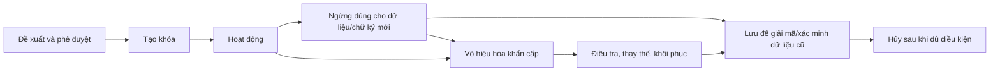
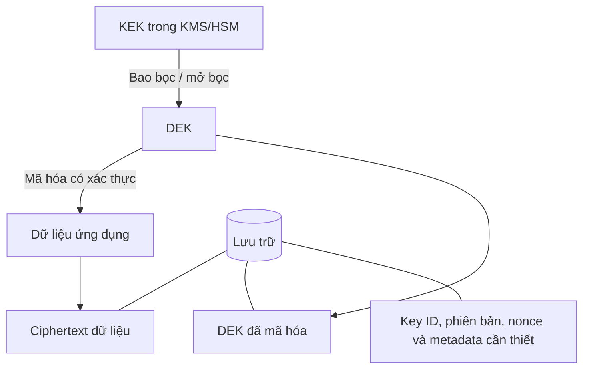

# Key management policy

## 1. Key management policy là gì?

**Key management policy (chính sách quản lý khóa mật mã)** là tập hợp các quy tắc có thể kiểm tra được để trả lời: tổ chức được tạo những loại khóa nào, ai được thao tác với chúng, khóa được bảo vệ ở đâu, sử dụng cho mục đích gì, khi nào phải xoay vòng hoặc vô hiệu hóa, và làm thế nào chứng minh các quy tắc đó đã được tuân thủ.

Một hệ thống có thể dùng thuật toán mã hóa mạnh nhưng vẫn rò rỉ dữ liệu nếu khóa được nhúng trong mã nguồn, cấp quyền giải mã quá rộng hoặc không được thu hồi khi nhân sự rời dự án. Vì vậy, **an toàn của dữ liệu phụ thuộc vào cả thuật toán lẫn chính sách quản lý khóa**.

Bài học này thuộc phần **Nền tảng key management** của module `SECURITY_KEY_MANAGEMENT_FUNDAMENTALS`. Các quy tắc sẽ được kết nối với mật mã đối xứng, bất đối xứng, chữ ký số, KMS/HSM, envelope encryption, kiểm soát truy cập và kiểm toán trong suốt vòng đời từ tạo, cấp phát, lưu trữ, sử dụng, xoay vòng đến thu hồi và hủy khóa.

Sau bài học, người học có thể:

- Phân biệt một yêu cầu chính sách với cấu hình kỹ thuật hoặc hướng dẫn vận hành.
- Xác định chủ sở hữu, phạm vi và quyền thao tác đối với từng loại khóa.
- Đặt quy tắc cho từng giai đoạn vòng đời, đặc biệt là xoay vòng, vô hiệu hóa và hủy.
- Chuyển chính sách thành kiểm soát thực thi, sự kiện kiểm toán và tiêu chí đánh giá.

### 1.1. Chính sách, tiêu chuẩn và quy trình khác nhau thế nào?

| Tầng | Trả lời câu hỏi | Ví dụ |
| --- | --- | --- |
| **Policy — chính sách** | Điều gì bắt buộc phải được bảo đảm? | Khóa riêng dùng ký số phải được bảo vệ, không được xuất ở dạng rõ. |
| **Standard — tiêu chuẩn nội bộ** | Dùng cơ chế/giới hạn kỹ thuật nào để đáp ứng chính sách? | Khóa ký được tạo và sử dụng qua HSM hoặc dịch vụ KMS hỗ trợ ký, với thuật toán nằm trong danh mục phê duyệt. |
| **Procedure/runbook — quy trình** | Ai thao tác, theo thứ tự nào, xử lý lỗi ra sao? | Cách tạo phiên bản khóa, cập nhật tập public key cho bộ xác minh, giám sát rồi ngừng sử dụng khóa cũ. |

Một câu như “hãy xoay khóa thường xuyên” không đủ để vận hành. Chính sách cần nêu **đối tượng**, **người chịu trách nhiệm**, **điều kiện kích hoạt**, **hành động**, **ngoại lệ** và **bằng chứng thực hiện**. Thời hạn cụ thể phụ thuộc phân loại dữ liệu, hệ thống, yêu cầu pháp lý, mô hình đe dọa và khả năng phục hồi; không có một chu kỳ xoay khóa phù hợp với mọi trường hợp.

## 2. Đối tượng quản lý và mục tiêu bảo vệ

### 2.1. Phải kiểm kê những gì?

Chính sách bao phủ tất cả khóa và vật liệu mật mã có thể ảnh hưởng đến tính **bí mật**, **toàn vẹn**, **xác thực** hoặc **khả năng kiểm chứng** của hệ thống. Một danh mục tối thiểu cần nêu:

| Đối tượng | Vai trò | Quy tắc cần quan tâm |
| --- | --- | --- |
| **DEK** (*Data Encryption Key*) | Khóa đối xứng trực tiếp mã hóa dữ liệu | Được tạo ngẫu nhiên bằng cơ chế mật mã đáng tin cậy; giảm tối đa thời gian tồn tại dạng rõ. |
| **KEK** (*Key Encryption Key*) | Khóa bao bọc/mã hóa DEK | Quản lý trong KMS/HSM; phân quyền giải mã riêng và theo dõi phiên bản. |
| **Khóa riêng bất đối xứng** | Ký số, xác thực hoặc giải mã tùy thuật toán | Không xuất dạng rõ nếu có thể; tách quyền `sign` khỏi quyền quản trị; bảo vệ đặc biệt nghiêm ngặt. |
| **Khóa công khai/chứng chỉ** | Xác minh chữ ký hoặc mã hóa cho chủ sở hữu khóa riêng | Có thể phân phối công khai nhưng phải bảo đảm nguồn gốc, tính toàn vẹn, thời hạn và trạng thái tin cậy. |
| **Khóa gốc/root hoặc khóa chủ** | Bảo vệ các tầng khóa khác | Phạm vi truy cập rất hẹp; kiểm soát khôi phục và quản trị đặc quyền chặt chẽ. |
| **Khóa dùng cho sao lưu và phục hồi** | Khôi phục dữ liệu/khóa khi có sự cố | Bảo vệ tách biệt hợp lý với hệ thống chính; kiểm tra khả năng phục hồi định kỳ. |

Không được đánh đồng **khóa mật mã**, **mật khẩu**, **API token** và **secret ứng dụng**: chúng đều là bí mật cần quản trị, nhưng có cách tạo, sử dụng, xoay và thu hồi khác nhau. Chính sách khóa mật mã cần liên kết với chính sách quản lý secret và danh tính máy, tránh bỏ sót thành phần có thể cấp quyền sử dụng khóa.

Mỗi khóa hoặc phiên bản khóa cần có bản ghi kiểm kê, tối thiểu gồm `key_id`, `version`, loại/thuật toán, mục đích cho phép, hệ thống sở hữu, môi trường, phân loại dữ liệu, nơi lưu giữ, trạng thái, ngày tạo, thời điểm dự kiến ngừng **mã hóa/ký mới**, điều kiện còn được **giải mã/xác minh**, người phê duyệt và liên kết đến nhật ký kiểm toán. Không ghi giá trị khóa dạng rõ vào danh mục.

### 2.2. Đe dọa mà chính sách phải xử lý

Các rủi ro thường gặp gồm: khóa bị lộ qua Git hoặc log; quyền `decrypt` quá rộng; cùng một khóa được dùng cho nhiều mục đích; khóa tồn tại sau khi ứng dụng đã ngừng; bản sao khóa trong backup không được kiểm soát; sự cố xoay khóa khiến dữ liệu cũ không thể đọc; và quyền quản trị KMS bị chiếm để vô hiệu hóa hoặc xóa khóa hàng loạt.

Đặc biệt, một HSM không tự giải quyết mọi rủi ro: nếu danh tính của ứng dụng bị chiếm quyền và vẫn được phép gọi `decrypt` hoặc `sign`, kẻ tấn công có thể lạm dụng **dịch vụ mật mã** ngay cả khi không xuất được vật liệu khóa. Chính sách phải bảo vệ cả khóa, danh tính sử dụng khóa và hoạt động quản trị.

## 3. Nguyên tắc nền tảng của policy

1. **Mục đích riêng biệt:** khóa chỉ được dùng cho công dụng được phê duyệt (mã hóa, giải mã, ký hoặc xác minh); hạn chế dùng lại một khóa cho nhiều mục đích, dịch vụ hay môi trường.
2. **Đặc quyền tối thiểu:** cấp đúng thao tác và đúng tài nguyên cho đúng danh tính; tránh quyền wildcard hoặc quyền quản trị rộng không cần thiết.
3. **Tách nhiệm vụ:** người quản trị vòng đời khóa, ứng dụng sử dụng khóa và người đọc bằng chứng kiểm toán phải có phạm vi quyền khác nhau.
4. **Không để lộ vật liệu khóa:** ưu tiên tạo, lưu và thực hiện phép toán trong KMS/HSM; cấm nhúng khóa rõ vào mã nguồn, tệp cấu hình, CI log, ticket hoặc bản ghi giám sát.
5. **Phòng vệ nhiều lớp:** kết hợp IAM, xác thực mạnh, ranh giới mạng, mã hóa khi truyền, giới hạn truy cập và giám sát; không dựa vào một biện pháp đơn lẻ.
6. **Có kế hoạch thay thế và phục hồi:** trước khi vô hiệu hóa/hủy khóa, phải biết dữ liệu nào cần khóa đó và đã xác minh đường khôi phục.
7. **Có thể truy vết:** mọi thay đổi quyền và sự kiện vòng đời trọng yếu phải gắn được với chủ thể, thời điểm, tài nguyên, kết quả và yêu cầu thay đổi tương ứng.
8. **Ngoại lệ có hạn:** mọi ngoại lệ phải có lý do, người chấp thuận, rủi ro được ghi nhận, biện pháp bù đắp và ngày hết hạn.

## 4. Quy định trách nhiệm và phân quyền

Một chính sách có hiệu lực phải chỉ ra **ai sở hữu quyết định** và **ai thực thi**. Bảng sau minh họa phân công có thể điều chỉnh theo tổ chức:

| Vai trò | Trách nhiệm chính | Giới hạn cần duy trì |
| --- | --- | --- |
| **Data/System Owner** | Phân loại dữ liệu, xác định mục đích khóa, chấp thuận nhu cầu truy cập và kế hoạch thay đổi | Không mặc nhiên được lấy hoặc xuất khóa. |
| **Key Administrator** | Tạo, gắn nhãn, bật/tắt, lên lịch xoay, cấu hình key policy theo quy trình | Không mặc nhiên có quyền xem dữ liệu đã giải mã hoặc ký thay ứng dụng. |
| **Service Identity** | Gọi đúng thao tác mã hóa/giải mã/ký theo nghiệp vụ | Chỉ dùng khóa được phép trong môi trường và ngữ cảnh đã định. |
| **Security/Compliance** | Duyệt tiêu chuẩn thuật toán, đánh giá quyền, theo dõi sự cố, kiểm tra bằng chứng | Quyền đọc log không kéo theo quyền sử dụng khóa. |
| **Incident Responder** | Cô lập, thu hồi quyền, thay thế khóa và phối hợp khôi phục khi có dấu hiệu lộ khóa | Quyền khẩn cấp có thời hạn, được ghi log và xem xét sau sự cố. |

Ví dụ, dịch vụ `billing-prod` có thể được cấp quyền mã hóa và giải mã với một KEK cụ thể của môi trường `prod`. Dịch vụ `analytics-dev` không được thừa hưởng quyền ấy. Người triển khai ứng dụng có thể được quyền cập nhật cấu hình tham chiếu `key_id`, nhưng không vì thế được quyền xóa khóa.

Với tài khoản khẩn cấp (*break glass*), nên có xác thực mạnh, phê duyệt bổ sung theo mức rủi ro, phiên truy cập ngắn, cảnh báo ngay khi kích hoạt và kiểm tra hậu kiểm. Cần thử quy trình này trước khi sự cố thật xảy ra.

## 5. Chính sách theo vòng đời khóa

Một mô hình trạng thái hữu ích:



Đây là mô hình khái niệm; KMS/HSM thực tế có thể dùng tên trạng thái khác. Cần phân biệt **ngừng dùng để mã hóa hoặc ký mới**, **vô hiệu hóa mọi thao tác** và **hủy không thể phục hồi**. Chúng tác động rất khác nhau đến tính sẵn sàng.

### 5.1. Đề xuất, phân loại và tạo khóa

Yêu cầu tạo khóa phải nêu chủ sở hữu, ứng dụng sử dụng, loại dữ liệu, mục đích, môi trường, vùng lưu trữ nếu có yêu cầu về nơi cư trú dữ liệu, thời gian lưu giữ và phương án xử lý khi khóa bị lộ. Người hoặc nhóm có thẩm quyền duyệt yêu cầu trước khi tạo.

- Tạo khóa bằng bộ sinh số ngẫu nhiên an toàn mật mã (CSPRNG) hoặc cơ chế tạo khóa của KMS/HSM; không tự chọn chuỗi dễ đoán, thời gian hệ thống, `UUID` hoặc mật khẩu người dùng làm khóa mã hóa trực tiếp.
- Dùng thuật toán, kích thước khóa và chế độ hoạt động thuộc danh mục được tổ chức phê duyệt. Chẳng hạn, mã hóa dữ liệu ứng dụng thường cần cơ chế mã hóa có xác thực như **AES-GCM**, trong đó việc quản lý nonce/IV đúng cách là bắt buộc.
- Gắn `key_id`, `version`, `owner`, `purpose`, `environment`, `classification` từ khi tạo; bật audit trước khi cấp quyền sử dụng.
- Nếu phải đưa vật liệu khóa từ bên ngoài vào KMS/HSM, quy định kênh nhập, kiểm tra nguồn gốc, trách nhiệm và giới hạn xuất; mặc định ưu tiên khóa được tạo bên trong dịch vụ quản lý khóa.

### 5.2. Lưu trữ, cấp phát và sử dụng

**KMS** cung cấp API, kiểm soát truy cập và kiểm toán các thao tác khóa; **HSM** tạo ranh giới bảo vệ phần cứng cho những phép toán và khóa được hỗ trợ. Dùng KMS/HSM theo mức độ rủi ro, yêu cầu tuân thủ, khả năng vận hành và chức năng cần thiết; không giả định mọi nhà cung cấp có cùng mô hình quyền hoặc hỗ trợ xoay tự động giống nhau.

Với **envelope encryption**, chính sách nên quy định rõ thứ bậc khóa:



Luồng điển hình là: ứng dụng yêu cầu KMS tạo DEK; dùng bản DEK dạng rõ **trong bộ nhớ và trong thời gian ngắn** để mã hóa dữ liệu; lưu ciphertext dữ liệu cùng DEK đã được KEK bao bọc, mã định danh KEK và metadata thuật toán; xóa tham chiếu DEK dạng rõ ngay khi hoàn tất nếu môi trường cho phép. Khi giải mã, ứng dụng có quyền phù hợp yêu cầu KMS mở bọc DEK, rồi giải mã và kiểm tra tính xác thực của ciphertext. Không ghi plaintext DEK vào log hoặc đĩa.

Đối với mã hóa có xác thực như AES-GCM, phải bảo đảm nonce không lặp với cùng khóa theo yêu cầu của cơ chế sử dụng; kiểm tra authentication tag trước khi chấp nhận plaintext. Chính sách cũng phải quy định đường truyền an toàn, giới hạn quyền truy cập và kiểm soát bộ nhớ/tiến trình vì DEK dạng rõ vẫn tồn tại tại điểm sử dụng.

Đối với **khóa ký số**, dịch vụ ký chỉ được phép gọi `sign` cho nội dung và phạm vi đã phê duyệt. Thành phần xác minh dùng public key/chứng chỉ tin cậy và phải kiểm tra thuật toán, định danh khóa, thời hạn, chuỗi tin cậy/trạng thái thu hồi nếu áp dụng. Việc public key không phải bí mật không có nghĩa là có thể nhận public key từ nguồn không được xác thực.

### 5.3. Xoay vòng và chuyển tiếp phiên bản

**Rotation** thay khóa hoặc phiên bản khóa đang dùng cho hoạt động mới. Chính sách cần nêu **hai kiểu kích hoạt**:

- **Theo kế hoạch:** hết cryptoperiod (khoảng thời gian được phép dùng khóa cho thao tác mật mã mới), thay đổi tiêu chuẩn hoặc chu kỳ nội bộ dựa trên đánh giá rủi ro.
- **Theo sự kiện:** nghi ngờ lộ khóa, tài khoản dịch vụ bị xâm nhập, quyền truy cập sai, thuật toán không còn được chấp thuận, thay đổi ranh giới tin cậy hoặc mất khả năng bảo đảm quyền kiểm soát khóa.

Quy trình xoay an toàn thường đi theo thứ tự: tạo khóa/phiên bản mới → kiểm tra quyền và đường sử dụng → chuyển các thao tác **mã hóa/ký mới** sang phiên bản mới → bảo đảm dữ liệu/chữ ký cũ vẫn đọc/xác minh được trong thời gian cần thiết → di chuyển hoặc tái mã hóa nếu có yêu cầu → ngừng và cuối cùng hủy phiên bản cũ khi đủ điều kiện. Việc xoay có thể cần triển khai tuần tự nhiều ứng dụng, người tiêu thụ dữ liệu và bộ nhớ đệm.

**Xoay KEK không đồng nghĩa đã mã hóa lại dữ liệu bằng DEK mới.** Nếu yêu cầu chỉ thay khóa bao bọc, có thể *rewrap* các DEK đã mã hóa, tùy tính năng KMS và định dạng lưu trữ. Nếu DEK bị lộ hoặc thuật toán mã hóa dữ liệu có vấn đề, phải xem xét sinh DEK mới và **tái mã hóa dữ liệu**, vì rewrap không sửa được rủi ro của DEK cũ. Chính sách phải phân biệt hai mục tiêu này.

Với khóa ký JWT hoặc tài liệu, cần công bố khóa công khai mới trước khi chuyển sang ký mới, gắn `kid`/định danh phiên bản cho chữ ký, và giữ khả năng xác minh khóa cũ đến khi các token/tài liệu hợp lệ hết thời hạn hoặc được xử lý theo chính sách. Với chữ ký cần kiểm chứng lâu dài, thời hạn lưu giữ chứng chỉ và bằng chứng xác minh có thể dài hơn nhiều so với thời gian được ký mới.

### 5.4. Vô hiệu hóa, thu hồi và ứng cứu lộ khóa

Khi phát hiện sự cố, quy trình phải phân biệt:

| Hành động | Tác dụng | Điểm cần cân nhắc |
| --- | --- | --- |
| **Thu hồi quyền truy cập** | Chặn một danh tính tiếp tục gọi API khóa | Có thể là phản ứng nhanh nhất khi chỉ một danh tính bị xâm nhập. |
| **Disable/suspend khóa** | Chặn các phép toán qua dịch vụ quản lý khóa | Có thể khiến ứng dụng không đọc được dữ liệu đang hoạt động; cần đánh giá phạm vi ảnh hưởng. |
| **Rotate/thay khóa** | Chuyển hoạt động mới sang khóa sạch | Khóa cũ bị lộ vẫn có thể giải được ciphertext cũ nếu kẻ tấn công đã lấy cả khóa/ciphertext. |
| **Re-encrypt/re-sign/re-issue** | Thay thế dữ liệu mã hóa, chữ ký hoặc token chịu ảnh hưởng | Cần xác định đầy đủ tài sản và người tiêu thụ bị ảnh hưởng. |
| **Revoke certificate/token** | Hủy hoặc rút sự tin cậy của chứng chỉ/token theo cơ chế tương ứng | Phải bảo đảm hệ thống xác minh thực sự kiểm tra trạng thái thu hồi hoặc hạn sử dụng. |

Trình tự ứng cứu mẫu: ghi nhận tín hiệu và danh tính nghi vấn → khoanh vùng khóa và dữ liệu phụ thuộc → chặn quyền hoặc tạm dừng thao tác nguy hiểm → tạo khóa thay thế từ nguồn sạch → chuyển ứng dụng sang khóa mới → tái mã hóa/thu hồi token khi cần → kiểm tra truy cập và khả năng phục hồi → ghi bằng chứng, thông báo theo quy định và đóng sự cố. Không xóa vĩnh viễn khóa đang cần để giải mã trước khi có kế hoạch khôi phục đã kiểm thử.

**Lưu ý:** rotation không xóa được một bản khóa rõ mà kẻ tấn công đã sao chép. Thu hồi quyền gọi KMS cũng không thể lấy lại vật liệu khóa từng bị xuất. Phạm vi dữ liệu đã bị lộ phải được đánh giá riêng.

### 5.5. Lưu giữ, sao lưu, hủy và cryptographic erasure

Thời điểm hủy phải xét thời hạn giữ dữ liệu, bản sao lưu, yêu cầu kiểm toán, nghĩa vụ pháp lý, phụ thuộc giữa các ứng dụng và nhu cầu xác minh chữ ký cũ. Hủy khóa để làm dữ liệu không thể giải mã (*cryptographic erasure*) chỉ có giá trị khi **mọi bản sao có thể sử dụng của khóa** và đường khôi phục liên quan đều được kiểm soát theo thiết kế; backup, replica, bản xuất khóa hoặc cache còn sót có thể làm giả định này sai.

Trước khi hủy, cần có xác nhận của chủ sở hữu dữ liệu, danh sách tài sản phụ thuộc, bằng chứng đã chuyển dữ liệu/khóa nếu cần, thời gian chờ phù hợp khả năng phục hồi của nền tảng và bản ghi thao tác. Nếu có cơ chế hẹn giờ xóa của nhà cung cấp, ghi rõ điều kiện có thể hủy yêu cầu xóa trong khoảng chờ và ai được phép làm điều đó.

Chính sách sao lưu/khôi phục cần được kiểm thử: một hệ thống có backup ciphertext nhưng mất KEK không nhất thiết khôi phục được dữ liệu. Ngược lại, bản sao KEK không được bảo vệ có thể vô hiệu hóa toàn bộ ý nghĩa của mã hóa dữ liệu.

## 6. Ví dụ: lập chính sách cho dịch vụ lưu thông tin khách hàng

Giả sử dịch vụ `customer-profile-prod` lưu số điện thoại và địa chỉ, dùng AES-GCM để mã hóa dữ liệu tại tầng ứng dụng, KMS quản lý KEK và envelope encryption cho DEK. Các quyết định dưới đây là **ví dụ minh họa**, cần điều chỉnh trước khi áp dụng cho hệ thống thật.

| Hạng mục | Quy tắc chính sách minh họa | Bằng chứng kiểm tra |
| --- | --- | --- |
| Chủ sở hữu | Nhóm quản lý dữ liệu khách hàng phê duyệt mục đích và phạm vi | Bản ghi owner và ticket duyệt. |
| Môi trường | Production và development dùng khóa và quyền tách biệt | Danh sách `key_id`, môi trường và cấu hình IAM. |
| Tạo khóa | KEK tạo trong KMS; DEK sinh qua cơ chế mật mã của KMS; không export KEK dạng rõ | Cấu hình khóa và sự kiện tạo khóa. |
| Sử dụng | Danh tính của dịch vụ chỉ có quyền thao tác cần thiết trên KEK được chỉ định | Key policy/IAM policy và thử nghiệm từ chối truy cập ngoài phạm vi. |
| Dữ liệu lưu | Lưu ciphertext, DEK đã bao bọc và metadata cần thiết; không lưu plaintext DEK | Kiểm tra cấu trúc bản ghi và logging. |
| Xoay | Ví dụ đánh giá KEK mỗi 180 ngày; xoay ngay khi có sự kiện rủi ro; có kế hoạch xử lý dữ liệu cũ | Lịch, bản ghi phiên bản và kết quả migration. |
| Kiểm toán | Ghi thao tác quản trị khóa và các yêu cầu mật mã trọng yếu ở mức metadata | Nhật ký tập trung, cảnh báo và truy vấn kiểm toán. |
| Phục hồi | Diễn tập đọc lại dữ liệu từ bản sao lưu cùng cơ chế truy cập KEK được cấp phép | Biên bản restore và kết quả giải mã mẫu. |
| Hủy | Chỉ xóa KEK sau khi xác minh không còn ciphertext hợp lệ phụ thuộc | Phê duyệt xóa, báo cáo kiểm kê, sự kiện hủy. |

### 6.1. Một mô tả policy dạng cấu hình

Ví dụ dưới đây diễn đạt *ý định quản trị* để đội vận hành chuyển thành guardrail hoặc kiểm thử tự động. Đây **không phải** cú pháp cấu hình triển khai trực tiếp cho bất kỳ nhà cung cấp KMS nào; các con số và tên vai trò chỉ mang tính minh họa.

```yaml
policy_id: customer-profile-key-policy-v1
scope:
  service: customer-profile
  environment: production
  data_classification: confidential

ownership:
  data_owner: customer-data-team
  key_administrator: platform-security
  auditor: security-audit

encryption:
  data_algorithm: AES-256-GCM
  dek_generation: trusted-kms
  dek_storage: encrypted-only
  kek_storage: managed-kms
  kek_plaintext_export: forbidden
  separate_keys_per_environment: true

access:
  crypto_callers:
    - customer-profile-prod-identity
  minimum_permissions:
    - generate-data-key
    - decrypt-wrapped-data-key
  separate_key_administration: true
  emergency_access: time-bounded-and-audited

rotation:
  scheduled_review_days: 180  # Ví dụ, không phải chuẩn áp dụng chung
  immediate_review_triggers:
    - suspected-key-exposure
    - unauthorized-key-use
    - algorithm-deprecation
  old_version_use: decrypt-existing-data-only
  destruction_requires: owner-approval-and-recovery-check

assurance:
  audit_events:
    - key-created
    - permission-changed
    - crypto-operation
    - key-rotated
    - key-disabled
    - key-destroyed
  never_log:
    - plaintext-keys
    - plaintext-customer-data
```

`scheduled_review_days` là chu kỳ **đánh giá** trong ví dụ, không mặc nhiên là ngày phải xóa khóa. Khi chuyển thành chính sách thật, phải bổ sung thời hạn cụ thể cho từng loại khóa, điều kiện được phép giải mã dữ liệu cũ, yêu cầu log retention, người duyệt ngoại lệ và quy trình khôi phục. Các thao tác như `generate-data-key` hoặc `decrypt-wrapped-data-key` cần ánh xạ sang tên API và mô hình IAM thực tế.

### 6.2. Kiểm thử chính sách bằng một kịch bản

Một lập trình viên vô tình cấp cho `analytics-dev` quyền giải mã bằng KEK production. Chỉ nhìn vào sơ đồ mã hóa, hệ thống vẫn có vẻ an toàn; nhưng chính sách đã bị vi phạm.

1. **Phòng ngừa:** kiểm thử IaC/IAM từ chối grant chéo môi trường và thay đổi chưa duyệt; hệ thống tự kiểm tra định kỳ danh sách người có quyền `decrypt`.
2. **Phát hiện:** log thay đổi quyền ghi lại chủ thể, thời điểm, KEK liên quan; cảnh báo với grant ngoài danh sách danh tính cho phép.
3. **Ứng phó:** thu hồi grant sai; truy vấn audit xem danh tính đó đã gọi giải mã hay chưa; đánh giá dữ liệu có nguy cơ lộ; thay khóa hoặc tái mã hóa nếu kết quả điều tra yêu cầu.
4. **Phòng tái diễn:** bổ sung kiểm thử đối với đường tạo grant và cập nhật phê duyệt chính sách.

Kịch bản cho thấy chính sách cần cả **kiểm soát phòng ngừa**, **phát hiện** và **quy trình khắc phục**. Riêng việc ghi “chỉ cấp quyền tối thiểu” trong một tài liệu không đủ để bảo vệ hệ thống.

## 7. Từ văn bản chính sách đến kiểm soát có thể đo lường

Một policy vận hành tốt phải liên kết mỗi yêu cầu với cơ chế chặn hoặc xác minh tương ứng:

| Yêu cầu chính sách | Cơ chế thực thi hoặc kiểm tra | Tín hiệu cần theo dõi |
| --- | --- | --- |
| Không lưu khóa rõ trong repo/log | Secret scanning, kiểm tra CI, quy tắc logging, rà soát bản dựng | Phát hiện secret, sự kiện chặn commit/build. |
| Không dùng chung khóa giữa môi trường | Phân tách KMS/IAM theo môi trường, kiểm thử truy cập âm tính | Grant chéo môi trường, yêu cầu bị từ chối. |
| Không cấp quyền quá rộng | IAM/key policy theo tài nguyên và hành động; phê duyệt thay đổi | Grant mới, wildcard, tài khoản không còn owner. |
| Xoay khóa theo rủi ro | Kiểm kê cryptoperiod, lịch thay thế, runbook migration | Khóa quá hạn đánh giá, phiên bản cũ còn mã hóa mới. |
| Thu hồi khi có sự cố | Quy trình vô hiệu hóa/revoke quyền, diễn tập khôi phục | Thời gian phát hiện và xử lý, kết quả diễn tập. |
| Không hủy khi còn dữ liệu phụ thuộc | Inventory liên kết khóa–ciphertext, phê duyệt xóa, restore test | Yêu cầu xóa bị chặn, tài sản chưa được chuyển. |
| Có thể kiểm toán | Log tập trung, kiểm soát chỉnh sửa log, phân quyền người xem | Khoảng trống log, sự kiện quản trị không gắn danh tính. |

Khi ghi log thao tác mật mã, chỉ ghi metadata đủ phục vụ điều tra như danh tính, `key_id`, loại thao tác, thời điểm, kết quả, request/correlation ID và môi trường. Tránh ghi plaintext, DEK hoặc nội dung dữ liệu. Tần suất ghi log, thời gian lưu giữ và khả năng giám sát phải tương xứng rủi ro và khả năng của dịch vụ; cần kiểm tra giới hạn log của KMS thực tế.

Các chỉ số hữu ích gồm tỷ lệ khóa có owner hợp lệ, số khóa/quyền vượt ngày đánh giá, số grant sai phạm vi, số khóa không còn người dùng nhưng vẫn hoạt động, kết quả diễn tập phục hồi và độ trễ phản ứng khi có nghi vấn lộ khóa. Đừng lấy “đã xoay bao nhiêu lần” làm thước đo an toàn duy nhất: xoay liên tục nhưng mất khả năng giải mã hoặc không xử lý khóa đã lộ vẫn là thất bại.

### 7.1. Quy trình phê duyệt và ngoại lệ

Một yêu cầu thay đổi hoặc ngoại lệ nên lưu: khóa/hệ thống bị ảnh hưởng, yêu cầu chính sách không đáp ứng, lý do kỹ thuật/nghiệp vụ, rủi ro, biện pháp bù đắp, thời gian có hiệu lực, người chấp thuận, phương án quay lại tuân thủ và bằng chứng đóng ngoại lệ. Ví dụ: hệ thống cũ tạm thời không hỗ trợ chuyển KEK mà không gián đoạn; ngoại lệ chỉ kéo dài đến đợt migration đã được duyệt, kèm hạn chế quyền và giám sát bổ sung.

Policy cũng phải có **phiên bản**, **người ban hành**, **ngày hiệu lực**, **chu kỳ rà soát** và cơ chế cập nhật khi công nghệ, thuật toán hoặc quy định thay đổi. Nếu policy tồn tại trong tài liệu nhưng cấu hình KMS/IAM chưa được cập nhật, cần coi đó là khoảng trống cần xử lý.

## 8. Những sai lầm phổ biến

| Sai lầm | Vì sao nguy hiểm | Hướng xử lý |
| --- | --- | --- |
| “Dùng AES-256 là đủ an toàn.” | Không giải quyết được khóa lưu trong repo hoặc quyền giải mã không kiểm soát. | Kết hợp quản trị khóa, IAM, logging, KMS/HSM và quản lý vòng đời. |
| Xoay KEK rồi tuyên bố mọi dữ liệu đã an toàn với khóa mới | DEK hoặc dữ liệu có thể vẫn được bảo vệ bằng lớp khóa cũ. | Phân biệt rewrap DEK và tái mã hóa dữ liệu; kiểm tra version và phụ thuộc. |
| Xóa khóa ngay khi hết ngày sử dụng mới | Có thể làm dữ liệu cũ và bản sao lưu không thể giải mã. | Tách *encrypt/sign period* khỏi *decrypt/verify retention period*. |
| Người quản trị KMS đồng thời có mọi quyền giải mã | Vi phạm tách nhiệm vụ, tăng mức ảnh hưởng khi tài khoản bị chiếm. | Tách role và chỉ cấp thao tác cần thiết. |
| Thu hồi public key ký ngay khi phát hành khóa ký mới | Chữ ký/token hợp lệ được tạo bởi khóa cũ có thể không còn xác minh được. | Có giai đoạn chồng lấn và chính sách lưu giữ khả năng xác minh. |
| Chỉ backup ciphertext | Nếu mất KEK hoặc quyền khôi phục, bản backup có thể vô dụng. | Diễn tập restore đầy đủ bao gồm đường truy cập khóa. |
| Log nội dung giải mã để dễ debug | Làm lộ dữ liệu và có thể làm vô nghĩa việc mã hóa. | Log metadata, dùng môi trường thử nghiệm với dữ liệu giả. |

## 9. Khung tự rà soát trước khi phê duyệt policy

Một bản key management policy đủ dùng cần trả lời được các câu hỏi sau:

- **Phạm vi:** đã liệt kê các loại khóa, môi trường, phân loại dữ liệu và hệ thống phụ thuộc chưa?
- **Sở hữu:** từng khóa có owner, người phê duyệt và người vận hành rõ ràng chưa?
- **Mật mã:** mục đích, thuật toán, cách sinh khóa, ràng buộc sử dụng và tiêu chuẩn phê duyệt đã rõ chưa?
- **Bảo vệ:** khóa lưu ở đâu, có được export không, bí mật được đưa tới ứng dụng theo cách nào, ai có quyền `decrypt`/`sign`?
- **Vòng đời:** quy tắc chuyển phiên bản, cryptoperiod, retention, vô hiệu hóa, điều kiện hủy và cách khôi phục đã kiểm thử chưa?
- **Sự cố:** khi nghi ngờ lộ khóa, có cách cô lập, thay thế, đánh giá dữ liệu ảnh hưởng và thu hồi token/chứng chỉ không?
- **Kiểm toán:** sự kiện nào phải log, bằng chứng nằm ở đâu, ai được xem, làm sao phát hiện quyền hoặc hoạt động sai lệch?
- **Thực thi:** có guardrail IAM, kiểm tra cấu hình tự động, diễn tập và cơ chế ngoại lệ có thời hạn không?

Một chính sách tốt không chỉ mô tả cách giữ bí mật khóa. Nó điều phối toàn bộ **người, dịch vụ, thuật toán, dữ liệu, phiên bản, quyền truy cập và bằng chứng** để hệ thống vẫn bảo mật và phục hồi được khi khóa phải thay đổi hoặc bị nghi ngờ xâm phạm.
