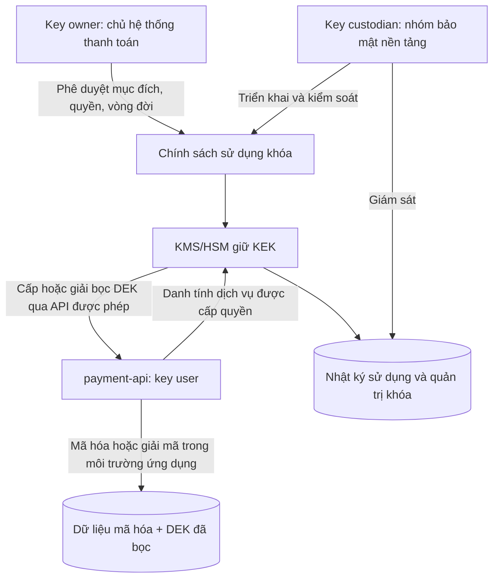

# Key owner và key custodian

## 1. Vì sao cần phân định người chịu trách nhiệm và người giữ khóa?

Trong hệ thống bảo mật, **khóa mật mã** có thể dùng để mã hóa dữ liệu (AES), bảo vệ khóa dữ liệu khác, tạo chữ ký số (RSA, ECDSA, EdDSA) hoặc xác thực giữa các dịch vụ. Nếu khóa bị lộ, bị dùng sai mục đích, bị xóa quá sớm hoặc không thể khôi phục, hệ quả có thể là mất bí mật dữ liệu, giả mạo chữ ký hoặc không thể đọc dữ liệu hợp lệ.

Quản lý khóa vì thế không chỉ là lựa chọn thuật toán và nơi lưu khóa. Một câu hỏi quan trọng hơn là: **ai có quyền quyết định khóa được dùng để làm gì, và ai có nhiệm vụ vận hành, bảo vệ khóa?** Hai vai trò thường dùng để trả lời là **key owner** và **key custodian**.

Ví dụ, hệ thống thanh toán dùng một khóa trong KMS để bảo vệ thông tin nhạy cảm. Trưởng nhóm chịu trách nhiệm về dữ liệu thanh toán cần quyết định mục đích sử dụng, các ứng dụng được phép giải mã và thời hạn lưu dữ liệu. Nhóm an ninh nền tảng có thể chịu trách nhiệm tạo khóa, cấu hình KMS, vận hành xoay vòng, kiểm soát truy cập và ghi nhật ký. Nếu hai nhóm không có ranh giới rõ ràng, một thay đổi quyền hoặc một thao tác xóa khóa có thể vượt qua cả kiểm soát nghiệp vụ lẫn kiểm soát kỹ thuật.

> **Nguyên tắc cốt lõi:** Key owner chịu trách nhiệm về **quyết định và rủi ro gắn với khóa**; key custodian chịu trách nhiệm về **việc quản trị, gìn giữ và vận hành khóa theo chính sách đã được phê duyệt**. Tên chức danh cụ thể có thể khác nhau giữa các tổ chức; điều quan trọng là trách nhiệm và quyền hạn được xác định bằng văn bản.

## 2. Key owner là ai?

**Key owner (chủ sở hữu khóa theo nghĩa trách nhiệm)** là cá nhân, nhóm hoặc đơn vị được giao trách nhiệm cuối cùng đối với một khóa hoặc một tập khóa. Trong doanh nghiệp, đó có thể là chủ hệ thống, chủ dữ liệu, chủ sản phẩm hoặc bộ phận được ủy quyền. *Owner* không nhất thiết là người đã tạo khóa, đang giữ vật liệu khóa (key material) hoặc có quyền xem khóa ở dạng rõ.

Các quyết định điển hình của key owner gồm:

- **Mục đích và phạm vi sử dụng:** Khóa dùng để mã hóa dữ liệu gì, ký loại thông điệp nào, cho môi trường production hay test; không tái sử dụng tùy tiện cho mục đích khác.
- **Phân loại và yêu cầu bảo vệ:** Dữ liệu/khóa có mức nhạy cảm nào; cần KMS, HSM, khóa không xuất được, xác thực bổ sung hay kiểm soát nhiều người hay không.
- **Ai được phép sử dụng:** Xác nhận dịch vụ, hệ thống hoặc nhóm nào có nhu cầu nghiệp vụ hợp lệ để mã hóa, giải mã hoặc ký; yêu cầu phê duyệt khi cấp quyền nhạy cảm.
- **Vòng đời:** Chấp thuận kích hoạt, lịch xoay vòng, thời gian giữ phiên bản cũ, kế hoạch thay thế, thu hồi, ngừng sử dụng và tiêu hủy khi không còn phụ thuộc dữ liệu.
- **Rủi ro và ngoại lệ:** Quyết định phương án ứng phó khi nghi lộ khóa; phê duyệt hoặc chuyển cấp phê duyệt các ngoại lệ theo quy định; bảo đảm đáp ứng yêu cầu lưu giữ, kiểm toán và liên tục kinh doanh.

Owner phải có **trách nhiệm giải trình**: nếu được hỏi vì sao một dịch vụ có quyền giải mã, dữ liệu nào phụ thuộc vào khóa hoặc tại sao khóa vẫn còn hoạt động, phải xác định được ai chịu trách nhiệm đưa ra quyết định và bằng chứng phê duyệt tương ứng.

## 3. Key custodian là ai?

**Key custodian (người/bộ phận quản giữ khóa)** là vai trò được giao **thực thi việc bảo vệ và vận hành** khóa trong suốt vòng đời. Custodian có thể là quản trị viên KMS/HSM, nhóm bảo mật hạ tầng, nhóm vận hành PKI hoặc một tập hợp người được chỉ định trong một quy trình kiểm soát vật lý. Một dịch vụ KMS tự động hóa nhiều thao tác lưu giữ, nhưng tổ chức vẫn cần người hoặc nhóm chịu trách nhiệm vận hành dịch vụ và cấu hình chính sách.

Những công việc điển hình của key custodian:

- Tạo hoặc nhập khóa theo quy trình đã duyệt; ưu tiên tạo bên trong KMS/HSM khi cần tránh xuất vật liệu khóa.
- Quản trị kho khóa, phân vùng môi trường, phiên bản, chính sách truy cập, bản sao lưu và kế hoạch khôi phục phù hợp.
- Cấp, cập nhật hoặc gỡ quyền **theo yêu cầu được phê duyệt**; triển khai nguyên tắc đặc quyền tối thiểu và tách quyền quản trị khóa khỏi quyền dùng khóa.
- Thực hiện xoay vòng, chuyển đổi phiên bản, vô hiệu hóa, thu hồi hoặc hủy khóa theo runbook đã được thẩm định.
- Theo dõi sự kiện sử dụng khóa, thao tác quản trị, cảnh báo bất thường và bằng chứng kiểm toán.
- Tham gia xử lý sự cố, diễn tập khôi phục và bàn giao trách nhiệm khi thay đổi nhân sự.

**Custodian không mặc nhiên có quyền đọc khóa ở dạng rõ hoặc giải mã dữ liệu nghiệp vụ.** Với khóa không xuất được trong HSM/KMS, custodian có thể quản lý chính sách và trạng thái khóa mà không bao giờ nhận private key/plaintext key. Ngược lại, quyền quản trị sai thiết kế vẫn có thể cho phép custodian tự cấp quyền giải mã; vì vậy cần kiểm soát cả khả năng sửa chính sách lẫn quyền dùng khóa.

## 4. Phân biệt hai vai trò và những vai trò liên quan

| Khía cạnh | Key owner | Key custodian |
| --- | --- | --- |
| Trọng tâm | Chính sách, mục đích sử dụng, chấp nhận rủi ro | Bảo vệ, thao tác kỹ thuật, vận hành và lưu dấu |
| Câu hỏi phải trả lời | **Vì sao và ai được phép dùng khóa?** | **Làm cách nào giữ và vận hành khóa an toàn?** |
| Quyền điển hình | Phê duyệt yêu cầu, phạm vi truy cập, thay đổi vòng đời | Triển khai cấu hình KMS/HSM, vòng đời và giám sát theo phê duyệt |
| Quyền truy cập vật liệu khóa | Không bắt buộc | Không bắt buộc; ưu tiên không xuất khóa |
| Khi có sự cố | Quyết định ưu tiên nghiệp vụ và phạm vi thay thế, phối hợp xử lý rủi ro | Cô lập khóa, khóa quyền, thu thập nhật ký, thực hiện kế hoạch xử lý |
| Bằng chứng cần có | Quyết định/phê duyệt và tài liệu phân loại, thời hạn sử dụng | Nhật ký thay đổi, sự kiện KMS/HSM, kiểm thử khôi phục |

Ngoài hai vai trò này, một hệ thống thường có:

| Vai trò | Trách nhiệm chính | Ví dụ quyền |
| --- | --- | --- |
| **Key user / cryptographic user** | Dùng khóa cho chức năng ứng dụng được cấp phép | `Encrypt`, `Decrypt`, `Sign`, `Verify` trong phạm vi cần thiết |
| **Key administrator** | Thực hiện cấu hình kỹ thuật, thường thuộc nhóm custodian | Quản trị vòng đời và cấu hình, không tự động có quyền giải mã |
| **Security approver / reviewer** | Phê duyệt kiểm soát nhạy cảm, xem xét ngoại lệ, kiểm tra phân tách nhiệm vụ | Xem yêu cầu, phê duyệt, kiểm tra tuân thủ |
| **Auditor** | Kiểm tra tính hợp lệ của quyết định và lịch sử thao tác | Quyền đọc metadata và log, không sửa khóa hay chính sách |

Một người có thể kiêm nhiều vai trò ở hệ thống nhỏ, nhưng **không nên tự mình vừa yêu cầu, tự phê duyệt, cấp quyền và sử dụng khóa nhạy cảm**. Với hệ thống có yêu cầu cao, cần phân tách trách nhiệm (*separation of duties*) cùng phê duyệt độc lập.

### Tách nhiệm vụ, dual control và split knowledge

- **Separation of duties:** Một cá nhân không kiểm soát trọn chuỗi ra quyết định và thực thi thao tác nhạy cảm.
- **Dual control:** Một thao tác trọng yếu cần có sự tham gia hoặc xác nhận của ít nhất hai người được ủy quyền, chẳng hạn thay đổi quyền quản trị hoặc nghi thức nhập khóa vào HSM.
- **Split knowledge:** Chia bí mật thành nhiều phần theo sơ đồ được thiết kế an toàn; không một người riêng lẻ nắm đủ thông tin để tái tạo bí mật. Cách này thường xuất hiện trong nghi thức quản lý khóa đặc biệt, không phải yêu cầu mặc định cho mọi khóa KMS.

**Dual control không đồng nghĩa split knowledge.** Hai người cùng xác nhận một lệnh hủy khóa là dual control, nhưng không có nghĩa khóa đã được chia thành các mảnh bí mật. Nếu áp dụng chia mảnh, phải dùng cơ chế mật mã thích hợp, không tự chia chuỗi khóa thành các đoạn rồi gọi là an toàn.

## 5. Áp dụng vào từng giai đoạn vòng đời khóa

Một cách thiết kế là coi key owner là người chịu trách nhiệm về nhu cầu và quyết định, còn custodian là người triển khai có kiểm chứng. Bảng dưới chỉ là **mẫu phân công**; tổ chức cần điều chỉnh theo quyền và quy trình thật.

| Giai đoạn | Key owner | Key custodian | Kiểm soát/bằng chứng |
| --- | --- | --- | --- |
| **Đề xuất** | Xác định dữ liệu, mục đích, mức nhạy cảm, thời hạn | Tư vấn loại khóa, KMS/HSM, ràng buộc kỹ thuật | Hồ sơ khóa và phê duyệt |
| **Tạo/nhập** | Phê duyệt chính sách và phạm vi | Tạo/nhập bằng nguồn ngẫu nhiên an toàn, trong vùng bảo vệ phù hợp | Audit sự kiện tạo khóa, cấu hình không xuất khóa |
| **Cấp phát/kích hoạt** | Xác nhận dịch vụ và hành động được phép | Gắn quyền cụ thể cho danh tính dịch vụ, đặt ràng buộc | Quyết định cấp quyền, IAM/key policy, log thay đổi |
| **Lưu trữ/sử dụng** | Theo dõi nhu cầu nghiệp vụ và sự phụ thuộc | Duy trì KMS/HSM, bảo vệ metadata, giám sát sự kiện | Log thao tác; cảnh báo bất thường; kiểm tra quyền định kỳ |
| **Xoay vòng** | Chọn thời điểm, chấp thuận kế hoạch tương thích dữ liệu | Tạo phiên bản/khóa mới, chuyển ứng dụng, kiểm thử đọc dữ liệu cũ | Kế hoạch chuyển đổi, kết quả kiểm thử và rollback |
| **Nghi lộ/thu hồi** | Quyết định mức ưu tiên thay thế theo ảnh hưởng dữ liệu | Hạn chế quyền, tắt sử dụng, tạo khóa thay thế, lưu chứng cứ | Biên bản sự cố, thời gian phát hiện và xử lý |
| **Ngừng dùng/hủy** | Xác nhận hết phụ thuộc, hết thời hạn lưu, không vướng pháp lý | Vô hiệu hóa, chờ thời gian an toàn, hủy theo quy trình | Phê duyệt hủy, kiểm tra backup, log hủy |

Không nên dùng một từ “thu hồi” để thay thế mọi thao tác. **Vô hiệu hóa** thường ngăn sử dụng khóa trong lúc vẫn còn metadata và khả năng phục hồi. **Thu hồi** quyền dùng khóa hoặc chứng thư có ý nghĩa khác tùy hệ thống (ví dụ CRL/OCSP với chứng thư số). **Hủy khóa** có thể là hành động không thể đảo ngược, dẫn đến mất khả năng giải mã vĩnh viễn; phải được xử lý theo quy trình riêng.

### Lưu ý theo loại khóa

- **Khóa đối xứng:** Ai có quyền giải mã bằng khóa có thể tiếp cận dữ liệu đã mã hóa tương ứng. Cần hạn chế cả quyền gọi giải mã trong KMS, quyền truy cập bản mã và quyền truy cập dữ liệu rõ của ứng dụng.
- **Cặp khóa bất đối xứng:** Public key có thể phân phối rộng theo mục đích; private key cần được bảo vệ. Với khóa ký, quyền `Sign` thường nhạy cảm hơn `Verify`; cần giới hạn loại dữ liệu được ký và ghi nhật ký sử dụng.
- **Khóa ký/chứng thư:** Xoay private key và thay chứng thư phải xét đến xác thực của chữ ký cũ, chuỗi chứng thực, phân phối public key và quy tắc xác minh chữ ký lịch sử. Hủy private key quá sớm có thể ảnh hưởng nghiệp vụ hoặc yêu cầu lưu trữ.
- **Khóa bọc khóa (KEK) và khóa dữ liệu (DEK):** Chủ sở hữu phải biết dữ liệu nào phụ thuộc vào KEK và cách phục hồi DEK. Custodian phải bảo đảm phiên bản cũ còn sử dụng được trong quá trình chuyển đổi.

## 6. Ví dụ thực tế: mã hóa dữ liệu bằng KMS và envelope encryption

Giả sử dịch vụ `payment-api` lưu hồ sơ giao dịch trong cơ sở dữ liệu. Tổ chức sử dụng **envelope encryption**: dữ liệu được mã hóa bằng **DEK** (Data Encryption Key); DEK được bọc bằng một **KEK** (Key Encryption Key) do KMS/HSM quản lý. Ứng dụng lưu bản mã dữ liệu và DEK đã được bọc, không lưu DEK dạng rõ lâu dài.

**Luồng ghi dữ liệu**, ở mức khái niệm:

1. `payment-api` xác thực bằng danh tính dịch vụ và yêu cầu KMS cấp một DEK; KMS trả về DEK dạng rõ cho phiên làm việc được cấp quyền và bản DEK đã bọc bằng KEK.
2. Ứng dụng dùng DEK để mã hóa dữ liệu bằng thuật toán được xác thực, chẳng hạn AES-GCM với nonce duy nhất theo khóa và kiểm soát dữ liệu xác thực bổ sung (AAD) khi phù hợp.
3. Ứng dụng lưu `ciphertext`, thông tin cần cho giải mã (ví dụ nonce, tag, key ID/version hoặc encryption context), và **DEK đã bọc**. Không ghi DEK dạng rõ vào log, cơ sở dữ liệu hoặc file cấu hình.
4. Ứng dụng giảm thời gian DEK ở trong bộ nhớ và xóa bản sao có thể kiểm soát được sau khi dùng; việc xóa khỏi bộ nhớ không phải lúc nào cũng được bảo đảm tuyệt đối bởi runtime.

**Luồng đọc**: ứng dụng đọc bản mã và DEK đã bọc, gọi KMS để giải bọc DEK nếu được phép, rồi giải mã dữ liệu trong tiến trình. Quyền `Decrypt` ở KMS là quyền nhạy cảm: nó có thể cho phép lấy DEK dạng rõ để đọc dữ liệu tương ứng. Do đó không thể chỉ dựa vào việc “khóa nằm trong KMS” để kết luận mọi ứng dụng đều an toàn.

Phân công trách nhiệm trong ví dụ:

| Chủ thể | Được phép làm | Không nên tự làm |
| --- | --- | --- |
| **Owner của hệ thống thanh toán** | Quy định dữ liệu cần bảo vệ, xác nhận `payment-api` cần `GenerateDataKey`/`Decrypt`, phê duyệt thay đổi | Lấy KEK dạng rõ hoặc tự cấp quyền KMS cho chính mình |
| **Custodian KMS** | Tạo KEK không xuất được, cấu hình policy, rotation, giám sát, bảo vệ bản sao lưu theo quy trình | Tự cấp `Decrypt` để đọc hồ sơ thanh toán hoặc bỏ qua phê duyệt |
| **Danh tính `payment-api`** | Gọi API mật mã cần thiết với đúng khóa và ngữ cảnh đã cho phép | Tạo/xóa khóa, sửa policy, cấp quyền cho dịch vụ khác |
| **Auditor** | Đọc lịch sử thay đổi và sự kiện sử dụng phù hợp | Giải mã dữ liệu nghiệp vụ, sửa chính sách |

Nếu KMS hỗ trợ **encryption context** hoặc ràng buộc tương đương, có thể dùng thuộc tính như mã môi trường, tenant hoặc loại dữ liệu để thu hẹp phép toán được cấp. Context phải được xác minh phù hợp với dữ liệu và chính sách; giá trị do client tự khai báo không tự biến thành một cơ chế xác thực người dùng.

### Khi xoay vòng KEK, dữ liệu cũ có đọc được không?

Điều này phụ thuộc cách hệ thống quản lý **phiên bản khóa**. Nhiều KMS giữ phiên bản cũ để giải mã DEK đã bọc trước đó; vì vậy xoay vật liệu KEK có thể không yêu cầu mã hóa lại toàn bộ dữ liệu ngay lập tức. Tuy nhiên, đổi sang **một khóa KMS hoàn toàn mới**, thay hệ thống hoặc hủy phiên bản cũ có thể cần **rewrap DEK** hoặc mã hóa lại dữ liệu. Owner phải chấp thuận yêu cầu tương thích và thời hạn lưu phiên bản; custodian phải kiểm thử dữ liệu cũ trước khi loại bỏ khóa cũ.

## 7. Thiết kế phân quyền để vai trò không vượt ranh giới

Một sai lầm phổ biến là gắn nhãn “owner” và “custodian” trong tài liệu nhưng trao cho cả hai quyền quản trị KMS toàn phần. Khi đó sự phân tách chỉ tồn tại trên giấy. Cần hiện thực hóa ranh giới bằng danh tính riêng, chính sách KMS và chính sách IAM/ABAC, quy trình phê duyệt và nhật ký không dễ bị sửa.

**Ma trận quyền tối thiểu tham khảo** (tên API thay đổi theo nền tảng):

| Khả năng | Owner | Custodian | Ứng dụng | Auditor |
| --- | :---: | :---: | :---: | :---: |
| Xem metadata, phân loại và mục đích | Có | Có | Khi cần | Có |
| Phê duyệt cấp quyền/hủy khóa | Có | Theo quy trình riêng | Không | Kiểm tra bằng chứng |
| Tạo khóa, xoay vòng, vô hiệu hóa | Không cần | Có, theo phê duyệt | Không | Không |
| Sửa chính sách/quyền KMS | Không cần | Có giới hạn và có kiểm soát độc lập | Không | Không |
| Gọi `Encrypt`/`GenerateDataKey` | Theo nhu cầu cụ thể | Không mặc định | Có, theo phạm vi | Không |
| Gọi `Decrypt`/`Sign` | Không mặc định | Không mặc định | Chỉ khi nghiệp vụ cần | Không |
| Xem audit log | Có liên quan | Có | Giới hạn | Có, chỉ đọc |

Trong một số nền tảng, **quản trị viên có thể sửa policy rồi cấp cho mình quyền sử dụng khóa**. Vì vậy, phải xem xét quyền sửa policy, tạo grant, sửa IAM, giả mạo danh tính dịch vụ và tắt ghi log như các đường **leo thang đặc quyền**. Các biện pháp thường dùng là phê duyệt độc lập, hạn chế quyền cấp lại, phân tách tài khoản/quyền quản trị, giám sát thay đổi nhạy cảm và cơ chế tạm cấp quyền có thời hạn.

**Dual control** phù hợp cho những thao tác tác động rộng hoặc không đảo ngược như xuất/nhập vật liệu khóa đặc biệt, thay đổi chính sách quản trị gốc, hoặc lên lịch hủy KEK đang bảo vệ dữ liệu quan trọng. Không phải thao tác mã hóa thông thường nào cũng cần hai người phê duyệt; điều đó sẽ khiến hệ thống khó vận hành và tạo động cơ vượt quy trình.

## 8. Quy trình phối hợp giữa owner và custodian

Một quy trình vận hành đơn giản nhưng có thể kiểm toán:

1. **Đăng ký khóa:** Owner tạo yêu cầu nêu dữ liệu, mục đích, phân loại, môi trường, chủ thể được dùng, thời hạn và yêu cầu khôi phục.
2. **Thẩm định:** Custodian hoặc nhóm bảo mật kiểm tra thuật toán, vị trí lưu, yêu cầu KMS/HSM, khả năng sao lưu/khôi phục và tác động đến khóa liên quan.
3. **Phê duyệt độc lập:** Người được ủy quyền xác nhận phạm vi; thao tác đặc biệt có thêm người phê duyệt theo chính sách.
4. **Triển khai:** Custodian tạo khóa, gắn metadata, cấp quyền tối thiểu, cấu hình log và cảnh báo. Khóa thử nghiệm và production tách biệt.
5. **Kiểm chứng:** Ứng dụng thử đúng chức năng cần thiết; thử từ chối với danh tính không có quyền; xác nhận lịch sử thao tác được ghi.
6. **Rà soát định kỳ:** Owner xác nhận dịch vụ còn cần khóa và quyền nào; custodian rà soát sự kiện, quyền dư thừa, trạng thái phiên bản và kế hoạch xoay vòng.
7. **Chấm dứt:** Owner xác nhận hết nhu cầu và không còn bản mã hoặc yêu cầu lưu giữ phụ thuộc; custodian thực hiện vô hiệu hóa, thời gian chờ và tiêu hủy theo quy trình, lưu lại chứng cứ.

Mỗi khóa quan trọng nên có một **sổ đăng ký (key inventory)** tối thiểu gồm: định danh khóa và phiên bản, hệ thống/môi trường, mục đích và loại thuật toán, phân loại dữ liệu, owner và custodian hiện tại, ứng dụng có quyền, nơi lưu, ngày tạo/kích hoạt, chu kỳ xoay vòng, kế hoạch thu hồi/hủy, dữ liệu phụ thuộc, trạng thái backup/DR và liên kết các phê duyệt. Sổ này không chứa private key, secret hay DEK dạng rõ.

### Quy trình khẩn cấp khi nghi khóa bị lộ

Giả sử log cho thấy một danh tính lạ liên tục gọi giải mã. Custodian cần kịp thời giới hạn/quarantine quyền liên quan, bảo toàn log và báo nhóm ứng cứu sự cố; owner xác định dữ liệu và dịch vụ có thể bị ảnh hưởng, ưu tiên liên tục kinh doanh và phê duyệt thay khóa. Các bước kỹ thuật có thể bao gồm vô hiệu hóa grant, đổi thông tin xác thực bị chiếm, tạo khóa mới, chuyển ứng dụng, rewrap/re-encrypt dữ liệu nếu cần và đánh giá việc dữ liệu đã bị giải mã trái phép.

Không nên **xóa vĩnh viễn khóa ngay khi phát hiện bất thường**: nếu chưa biết dữ liệu nào còn phụ thuộc, hành động này có thể làm mất dữ liệu hợp lệ và bằng chứng điều tra. Nhưng cũng không nên trì hoãn khóa quyền đang bị lạm dụng chỉ vì chờ một cuộc họp. Quy trình cần quy định trước quyền **cô lập khẩn cấp** cho custodian/incident responder, thời điểm thông báo owner và yêu cầu phê duyệt sau sự kiện.

## 9. Các lỗi thường gặp và hậu quả

| Tình huống | Rủi ro | Hướng xử lý |
| --- | --- | --- |
| Không chỉ định owner hoặc owner đã chuyển bộ phận | Không ai quyết định có tiếp tục giữ, xoay hoặc hủy khóa hay không | Gắn owner bắt buộc vào inventory; có quy trình bàn giao và rà soát |
| Custodian tự duyệt, tự cấp quyền giải mã | Đọc dữ liệu trái phép dù khóa nằm trong KMS | Phân tách phê duyệt, quản trị và sử dụng; giám sát thay đổi policy/grant |
| Chia sẻ tài khoản quản trị KMS | Không xác định được cá nhân thực hiện thay đổi | Danh tính riêng, MFA, quyền tạm thời và audit trail |
| Nhúng private key/DEK vào source code hoặc log | Rò rỉ qua repository, CI, bản sao lưu | Sinh/lưu khóa bằng cơ chế phù hợp; ngăn xuất và quét phát hiện rò rỉ |
| Xoay khóa nhưng bỏ qua dữ liệu cũ | Không giải mã được giao dịch, bản sao lưu hoặc dữ liệu lưu trữ | Lập bản đồ phụ thuộc, kiểm thử rewrap/restore và giữ phiên bản cần thiết |
| Giữ khóa vĩnh viễn “phòng khi cần” | Tăng thời gian phơi nhiễm và phạm vi ảnh hưởng khi lộ | Xác định cryptoperiod, thời hạn lưu và lịch review/hủy |
| Hủy khóa khi còn bản backup phụ thuộc | Backup không thể phục hồi; có thể mất dữ liệu vĩnh viễn | Kiểm thử phục hồi, kiểm tra retention/legal hold trước khi hủy |
| Chỉ giám sát lệnh dùng khóa, bỏ qua lệnh sửa policy | Kẻ tấn công tự cấp quyền rồi giải mã mà không bị phát hiện sớm | Cảnh báo cả thao tác quản trị, grant, disable log và hoạt động bất thường |

## 10. Checklist tự đánh giá khi thiết kế hệ thống

Trước khi đưa một khóa quan trọng vào production, đội ngũ nên trả lời được:

1. Ai là **key owner**, ai là **key custodian** và ai thay thế khi họ vắng mặt?
2. Owner đã phê duyệt **mục đích**, **ứng dụng sử dụng**, **thao tác mật mã** và **thời hạn** chưa?
3. Custodian có thể tự cấp cho mình `Decrypt` hoặc `Sign`, sửa IAM/grant hay tắt log không? Nếu có, kiểm soát độc lập nào ngăn lạm dụng?
4. Vật liệu khóa được tạo và lưu ở đâu? Khóa nào có thể xuất; khóa nào phải nằm trong KMS/HSM?
5. Có audit cho **cả sử dụng khóa lẫn thay đổi quyền/trạng thái** không? Ai xem cảnh báo và ai có quyền xử lý khẩn cấp?
6. Khi xoay hoặc hủy khóa, **bản mã cũ, bản sao lưu, chữ ký lịch sử** và dịch vụ phụ thuộc sẽ được xử lý ra sao?
7. Có bằng chứng của phê duyệt, kiểm thử phục hồi, rà soát định kỳ và bàn giao vai trò không?

### Ghi nhớ

**Key owner** chịu trách nhiệm giải trình về nhu cầu sử dụng, chính sách và rủi ro của khóa. **Key custodian** bảo vệ, quản trị và vận hành khóa theo những quyết định được phép, với quyền tối thiểu và thao tác có thể kiểm toán. Mô hình này chỉ phát huy tác dụng khi ranh giới trách nhiệm được phản ánh trong **quyền thực tế ở KMS/HSM, quy trình phê duyệt, kiểm soát độc lập và kế hoạch vòng đời khóa**.
