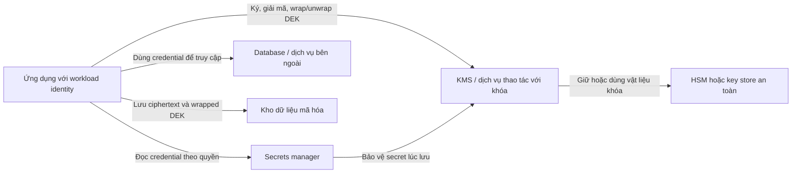

# Ranh giới giữa key management và secrets management

> **Chương:** Nền tảng key management  
> **Phạm vi:** SECURITY_KEY_MANAGEMENT_FUNDAMENTALS

Trong hệ thống bảo mật, **khóa mật mã (cryptographic key)** và **secret** đều có thể là dữ liệu nhạy cảm. Vì vậy, hai cụm từ *key management* và *secrets management* thường bị dùng thay nhau. Sự nhầm lẫn này dẫn đến những thiết kế như lưu khóa mã hóa gốc trong biến môi trường, dùng KMS như kho mật khẩu, hoặc cho ứng dụng quyền đọc khóa riêng trong khi ứng dụng chỉ cần ký dữ liệu.

**Key management** quản lý vòng đời và quyền **sử dụng khóa cho các phép toán mật mã**: tạo khóa, cấp phát, lưu trữ, sử dụng, xoay vòng, vô hiệu hóa, thu hồi và hủy. **Secrets management** quản lý vòng đời và việc **cấp phát giá trị bí mật cho thành phần cần sử dụng**: lưu, phiên bản hóa, phân phối, làm mới, thu hồi và kiểm toán mật khẩu, token hoặc thông tin xác thực khác. Hai phạm vi giao nhau, nhưng câu hỏi an ninh cốt lõi của chúng khác nhau.

Sau bài học, người đọc có thể:

- Phân loại đúng một đối tượng là khóa mật mã, secret vận hành, hay đối tượng thuộc cả hai phạm vi.
- Phân biệt quyền **thực hiện phép toán với khóa** và quyền **đọc giá trị secret**.
- Giải thích vai trò của KMS, HSM, secrets manager và envelope encryption trong cùng một kiến trúc.
- Thiết kế quy trình xoay vòng, thu hồi và kiểm toán phù hợp với từng loại tài sản.

## 1. Định nghĩa bắt đầu từ chức năng, không bắt đầu từ tên gọi

### 1.1. Key management quản lý cái gì?

Một **khóa mật mã** là vật liệu được thuật toán mật mã sử dụng để mã hóa, giải mã, tạo hoặc kiểm tra chữ ký, xác thực thông điệp, dẫn xuất khóa, v.v. Ví dụ:

- Khóa AES dùng trong mã hóa đối xứng.
- Khóa HMAC dùng để tạo và kiểm tra mã xác thực thông điệp.
- Cặp khóa RSA hoặc elliptic curve: **private key** dùng để ký hoặc giải mã tùy thuật toán; **public key** dùng để xác minh hoặc mã hóa.
- Key-encryption key (**KEK**) dùng để bảo vệ khóa dữ liệu; data-encryption key (**DEK**) dùng để mã hóa dữ liệu thực tế.

Key management chú trọng nguồn sinh ngẫu nhiên an toàn, mục đích và thuật toán được phép dùng, nơi vật liệu khóa tồn tại, trạng thái và phiên bản của khóa, quyền thực hiện phép toán mật mã, khả năng khôi phục dữ liệu cũ, cũng như việc vô hiệu hóa/hủy khóa khi đến hạn.

**Không phải mọi khóa mật mã đều bí mật:** public key được thiết kế để công khai; private key và khóa đối xứng cần được bảo vệ. Vì thế, không thể định nghĩa key management đơn giản là “cất chuỗi bí mật”.

### 1.2. Secrets management quản lý cái gì?

Một **secret** trong vận hành hệ thống thường là giá trị nhạy cảm mà một tiến trình hay tác nhân cần dùng để xác thực, truy cập dịch vụ hoặc chứng minh quyền hạn. Ví dụ:

- Mật khẩu cơ sở dữ liệu, tài khoản dịch vụ, mật khẩu của message broker.
- OAuth client secret, API token, bearer token, thông tin đăng nhập của hệ thống bên thứ ba.
- Chuỗi kết nối có nhúng mật khẩu, credential do hệ thống tạo động với thời hạn ngắn.
- Private key ở dạng có thể xuất/đọc được nếu một ứng dụng buộc phải tải vật liệu khóa để tự xử lý phép toán.

Secrets management tập trung vào **ai được nhận giá trị nào, nhận lúc nào, trong bao lâu, bằng cách nào, và khi giá trị đó bị thay thế hoặc thu hồi thì bên sử dụng cập nhật ra sao**. Một secrets manager có thể có cơ chế lưu phiên bản, cấp secret theo danh tính workload, thuê (lease) credential ngắn hạn, tự động rotation hoặc ghi nhật ký lần đọc.

Điểm quan trọng: **“API key” thường là một credential**, dù tên chứa chữ *key*. Nó thường được secrets manager quản lý. Ngược lại, **AES key** là khóa mật mã thực thụ; dù cũng là chuỗi byte bí mật, nó cần chính sách sử dụng và vòng đời thuộc key management.

### 1.3. Bảng ranh giới

| Khía cạnh | Key management | Secrets management |
|---|---|---|
| Tài sản điển hình | AES key, HMAC key, RSA/EC private key, KEK, DEK | Mật khẩu DB, OAuth client secret, API token, credential dịch vụ |
| Nghiệp vụ chính | Thực hiện và kiểm soát phép toán mật mã | Cấp phát, làm mới và thu hồi giá trị nhạy cảm |
| Câu hỏi về quyền | “Workload này có được ký/giải mã bằng khóa X không?” | “Workload này có được đọc secret Y không?” |
| Hình thức truy cập ưu tiên | Sử dụng bằng định danh/handle; khóa gốc dài hạn có thể không được xuất | Trả secret cho bên tiêu thụ đã xác thực, hoặc cấp credential động |
| Công cụ thường gặp | KMS, HSM, key store, dịch vụ ký/mã hóa | Secrets manager, vault, hệ thống cấp credential |
| Xoay vòng | Đổi phiên bản khóa và duy trì khả năng giải mã/xác minh dữ liệu cũ khi cần | Đổi giá trị credential và đồng bộ bên phát hành với bên tiêu thụ |
| Rủi ro nghiêm trọng | Lộ khóa, dùng khóa trái phép, mất khả năng giải mã khi hủy khóa quá sớm | Rò rỉ credential, cấp quyền sai, ứng dụng ngừng hoạt động vì secret hết hạn |
| Dấu vết kiểm toán | Ai tạo/sửa trạng thái khóa; ai gọi Sign/Decrypt/GenerateDataKey | Ai đọc/thay/thu hồi secret; phiên bản hoặc lease nào được cấp |

Đây là **ranh giới trách nhiệm**, không nhất thiết là hai sản phẩm hay hai nhóm vận hành tách biệt. Một nền tảng có thể cung cấp cả hai dịch vụ, và một secrets manager thường dùng khóa do KMS quản lý để mã hóa các secret khi lưu.

## 2. Ranh giới quan trọng nhất: quyền dùng khóa và quyền thấy khóa

Giả sử dịch vụ thanh toán cần ký một thông điệp. Có hai cách cấp quyền:

1. Cho dịch vụ tải private key rồi tự ký. Tiến trình sẽ nắm vật liệu khóa; nếu bị chiếm quyền, private key có thể bị sao chép ra ngoài.
2. Giữ private key trong KMS/HSM có hỗ trợ thuật toán tương ứng. Dịch vụ chỉ gửi dữ liệu hoặc digest hợp lệ đến API `Sign`; vật liệu private key có thể được thiết kế để **không xuất ra ngoài**.

Cách thứ hai giảm nhu cầu phân phối private key. Dịch vụ vẫn có thể **lạm dụng quyền ký** nếu danh tính của nó bị xâm nhập. Vì vậy, chính sách IAM, phạm vi khóa, giới hạn use case và kiểm toán từng phép toán vẫn rất quan trọng. **“Không đọc được khóa” không đồng nghĩa “không thể gây hại bằng khóa”.**

Với mật khẩu database, tình huống thường khác: ứng dụng hoặc driver phải cung cấp credential cho hệ quản trị cơ sở dữ liệu để đăng nhập. Secrets manager xác thực danh tính ứng dụng rồi trả credential theo quyền được cấp. Credential có thể xuất hiện trong bộ nhớ của tiến trình, cho dù secret được mã hóa an toàn khi lưu.

Hai quyền này cần được thiết kế riêng:

- `secrets.read("prod/orders/db")`: đọc một giá trị xác thực, thường trả plaintext cho ứng dụng.
- `kms.sign(keyId, digest)` hoặc `kms.decrypt(keyId, ciphertext)`: yêu cầu hệ thống quản lý khóa thực hiện phép toán được phép. API có thể trả kết quả ký hoặc plaintext của **dữ liệu** được giải mã, không cần tiết lộ khóa gốc.

Không nên cấp quyền đọc secret hàng loạt chỉ vì ứng dụng cần dùng một khóa để ký. Tương tự, không nên cấp quyền quản trị hoặc xóa khóa KMS cho ứng dụng chỉ cần đọc mật khẩu DB.

## 3. KMS, HSM và secrets manager phối hợp ra sao?

**KMS (Key Management Service)** cung cấp API và chính sách để tạo, định danh, sử dụng, xoay vòng, vô hiệu hóa và đôi khi nhập/xuất khóa tùy sản phẩm, loại khóa và chính sách. Nó có thể cung cấp các phép toán `Encrypt`, `Decrypt`, `Sign`, `Verify`, `GenerateDataKey` hoặc wrap/unwrap. Không phải KMS nào cũng hỗ trợ mọi phép toán hay thuật toán.

**HSM (Hardware Security Module)** là ranh giới phần cứng chuyên dùng để bảo vệ khóa và thực hiện các phép toán nhạy cảm. KMS có thể được xây trên HSM hoặc nền tảng lưu khóa an toàn khác. HSM là một thành phần thực thi bảo vệ khóa; bản thân nó không thay thế toàn bộ quy trình phân phối mật khẩu, phiên bản hóa secret hoặc rotation credential.

**Secrets manager** cung cấp kho secret, cơ chế phân quyền đọc/cập nhật, phiên bản, lịch sử, cấp credential hoặc rotation. Secret thường được mã hóa khi lưu, có thể bằng một KEK do KMS quản lý. Khi có yêu cầu đọc hợp lệ, dịch vụ xử lý giải mã theo chính sách và trả secret cho client. Chi tiết quyền KMS cần cấp cho caller hay cho chính secrets manager **phụ thuộc cách tích hợp và nhà cung cấp**.



Sơ đồ mô tả một kiến trúc phổ biến, **không phải đường đi bắt buộc** của mọi nhà cung cấp. Một số dịch vụ lưu trữ có thể gọi KMS thay ứng dụng; một số KMS không dùng HSM riêng biệt; một số secrets manager tích hợp cơ chế mã hóa bên trong.

Chỗ giao nhau chính là: **KMS bảo vệ khóa dùng để mã hóa secret, nhưng secrets manager vẫn chịu trách nhiệm cấp phát secret và điều phối vòng đời credential**. Mã hóa at rest không tự giải quyết vấn đề cấp quyền đọc sai, token quá hạn, credential không được thu hồi hay secret bị ghi ra log.

## 4. Ba tình huống minh họa

### Tình huống A: ứng dụng cần mật khẩu PostgreSQL

Ứng dụng `orders-service` phải kết nối cơ sở dữ liệu. Tài sản cần quản lý là một username/password hoặc credential ngắn hạn, nên **secrets management là giao diện chính**:

1. Bộ phận quản trị hoặc cơ chế cấp credential đưa mật khẩu/credential vào secrets manager.
2. Secrets manager lưu secret đã mã hóa, phân quyền và gắn phiên bản hoặc thời hạn.
3. `orders-service` chứng thực bằng workload identity, chỉ được đọc secret của chính nó.
4. Ứng dụng dùng credential để đăng nhập DB; tránh log, truyền tiếp hoặc giữ nó lâu hơn cần thiết.
5. Khi rotation, hệ thống phải đổi credential tại DB, đưa phiên bản mới đến ứng dụng và ngừng chấp nhận credential cũ theo trình tự có kiểm soát.

KMS có thể bảo vệ khóa mã hóa kho secret, nhưng ứng dụng **không cần quyền tạo/xóa KEK** để kết nối DB. Đưa mật khẩu DB trực tiếp vào một API KMS rồi tự quản lý ciphertext trong cấu hình sẽ bỏ qua nhiều chức năng hữu ích của secrets management như phiên bản, phân phối, rotation và audit lần đọc.

### Tình huống B: mã hóa dữ liệu cá nhân bằng envelope encryption

Ứng dụng cần mã hóa số giấy tờ hoặc dữ liệu khách hàng trước khi lưu vào database. Đây là bài toán **key management**:

1. KMS quản lý **KEK** dài hạn và chính sách ai được dùng KEK.
2. Ứng dụng hoặc dịch vụ lưu trữ tạo **DEK** ngẫu nhiên thích hợp, thường khác nhau theo đối tượng hoặc phạm vi dữ liệu.
3. Dữ liệu được mã hóa bằng DEK và thuật toán mã hóa có xác thực (ví dụ AES-GCM). DEK được **wrap** bằng KEK; KMS có thể thực hiện `GenerateDataKey` hoặc wrap/unwrap.
4. Hệ thống lưu **ciphertext dữ liệu**, **wrapped DEK**, cùng metadata cần để giải mã (thuật toán, nonce/IV, phiên bản/định danh khóa hoặc thông tin định tuyến phù hợp).
5. Khi đọc, một workload được cấp quyền dùng KEK để unwrap DEK, sau đó giải mã dữ liệu; plaintext DEK chỉ nên tồn tại trong bộ nhớ trong khoảng thời gian thật sự cần.

```text
Dữ liệu gốc --mã hóa bằng DEK--> Ciphertext dữ liệu
DEK         --wrap bằng KEK-----> Wrapped DEK
                                  |
Lưu trữ: [Ciphertext dữ liệu, Wrapped DEK, nonce, metadata]

KEK dài hạn được KMS quản lý theo quyền và trạng thái khóa.
```

**Khi xoay KEK**, hệ thống có thể cần **rewrap** các DEK bằng khóa mới; dữ liệu đã được mã hóa bằng DEK không nhất thiết phải mã hóa lại toàn bộ. Tuy nhiên, nếu **DEK bị lộ** hoặc thuật toán/chế độ mã hóa dữ liệu không còn phù hợp, chỉ rewrap DEK là chưa đủ: cần đánh giá phạm vi và có thể phải **reencrypt dữ liệu**. Với một số KMS, cơ chế xoay phiên bản vật liệu khóa được cung cấp tự động và khóa cũ vẫn phục vụ giải mã; cách migrate phụ thuộc dịch vụ.

Không đưa KEK plaintext vào tệp cấu hình, biến môi trường hay secrets manager chỉ để mọi ứng dụng tự làm phép toán, khi KMS/HSM có thể giữ KEK dưới dạng không xuất được.

### Tình huống C: ký JWT và quản lý token

Một dịch vụ định danh ký JWT bằng private key RSA/ECDSA trong KMS/HSM (nếu hỗ trợ), trong khi dịch vụ kiểm tra chữ ký dùng public key tương ứng. **Private key** thuộc key management; quyền `Sign`, phiên bản khóa và thời điểm ngừng chấp nhận chữ ký cũ cần được kiểm soát. Khi thay khóa ký, public key mới phải được công bố phù hợp, và public key cũ thường được giữ để xác minh token còn hạn trong giai đoạn chuyển tiếp.

Một **bearer access token** do dịch vụ phát hành lại là credential: ai cầm token hợp lệ có thể dùng quyền tương ứng trong giới hạn của token. Nó phải được bảo vệ như secret khi truyền/lưu, giới hạn thời gian sống và có cơ chế thu hồi thích hợp. Nhưng token ngắn hạn phát sinh khi chạy **không nhất thiết phải lưu vào secrets manager**; lưu trong bộ nhớ an toàn và cấp lại bằng workload identity có thể phù hợp hơn.

Với JWT dùng **HMAC**, khóa dùng để ký/xác minh là khóa mật mã đối xứng nên thuộc phạm vi key management; nếu các dịch vụ buộc phải nhận cùng vật liệu khóa, secrets management cũng tham gia phân phối. Khi có thể, giới hạn số bên giữ khóa HMAC và cân nhắc cơ chế ký bất đối xứng để bên xác minh chỉ cần public key.

## 5. Những trường hợp nằm ở vùng giao nhau

| Đối tượng | Phân loại chính | Quyết định thiết kế |
|---|---|---|
| API key của cổng thanh toán | Credential/secret | Lưu và cấp phát qua secrets manager; rotation phối hợp với cổng thanh toán |
| AES-256 KEK dùng để wrap DEK | Khóa mật mã | Đặt trong KMS/HSM, giới hạn quyền wrap/unwrap, theo dõi khả năng giải mã lịch sử |
| DEK dùng để mã hóa đối tượng | Khóa mật mã | Tạo an toàn, dùng ngắn hạn và lưu bản wrapped DEK kèm ciphertext |
| Private key ký chứng từ | Khóa mật mã bí mật | Ưu tiên KMS/HSM cho phép ký mà không xuất private key; kiểm toán quyền ký |
| Public key để kiểm tra chữ ký | Khóa mật mã công khai | Quản lý tính toàn vẹn, định danh và phiên bản; không cần coi là secret |
| Private key TLS kèm certificate | Giao nhau giữa key management và quản lý chứng chỉ | Giữ private key an toàn; quản lý cấp mới, triển khai, hết hạn và thu hồi chứng chỉ theo PKI/certificate management |
| Mật khẩu DB do vault cấp động | Secret/credential | Giới hạn TTL/lease, đồng bộ quyền tại DB và thu hồi khi lease kết thúc |
| Khóa HMAC dùng xác thực webhook | Khóa mật mã đồng thời có thể là secret cần phân phối | Bảo vệ vật liệu khóa và phiên bản; nếu ứng dụng cần nhận raw key, secrets manager phải kiểm soát việc cấp phát |
| Chuỗi kết nối chứa mật khẩu | Secret/credential | Lưu như secret; ưu tiên tách thông tin không nhạy cảm khỏi credential nếu có thể |

**Tên gọi không đủ để phân loại.** Một “key” có thể là mã truy cập API; một “secret” có thể là private key mật mã. Hãy xem **giá trị đó được tiêu thụ để làm gì**, **có cần lộ byte gốc cho client không**, và **quy trình rotation/thu hồi của bên phụ thuộc là gì**.

## 6. Vòng đời khác nhau ở đâu?

### 6.1. Vòng đời khóa mật mã

| Giai đoạn | Việc cần kiểm soát |
|---|---|
| **Tạo khóa** | Sinh đủ entropy từ CSPRNG/HSM; chọn thuật toán, độ dài và mục đích sử dụng; gắn owner và metadata |
| **Cấp phát/đăng ký** | Đặt định danh khóa, alias, key policy, phạm vi workload; ưu tiên cấp quyền sử dụng khóa thay vì phân phối khóa gốc |
| **Lưu trữ** | Bảo vệ vật liệu trong KMS/HSM hoặc kho khóa phù hợp; phân định loại exportable/non-exportable, quản trị backup và khôi phục nếu có |
| **Sử dụng** | Giới hạn Encrypt/Decrypt/Sign/Verify/GenerateDataKey theo nhu cầu; chống dùng nhầm khóa/mục đích; theo dõi phép toán |
| **Xoay vòng** | Dùng phiên bản mới cho dữ liệu/chữ ký mới; giữ khả năng đọc/xác minh dữ liệu cũ theo chính sách; rewrap/reencrypt khi cần |
| **Vô hiệu hóa/thu hồi quyền** | Disable key hoặc revoke grant/policy để chặn lần sử dụng tiếp theo; đánh giá ảnh hưởng đến dữ liệu đang lưu |
| **Hủy khóa** | Chỉ hủy sau khi hết hạn lưu giữ, kiểm chứng dữ liệu đã được migrate hoặc không còn cần; mất khóa có thể làm dữ liệu mã hóa không thể phục hồi |

Trong bước **thu hồi**, cần phân biệt “thu hồi quyền gọi API khóa” với “hủy vật liệu khóa”. Vô hiệu hóa khóa thường có thể khôi phục theo quy trình; xóa/hủy vật liệu khóa có thể **không thể đảo ngược**. Bảo mật mạnh không có nghĩa là xóa khóa càng sớm càng tốt.

### 6.2. Vòng đời secret/credential

| Giai đoạn | Việc cần kiểm soát |
|---|---|
| **Tạo hoặc nhận secret** | Tạo mật khẩu/token đủ mạnh hoặc nhận credential an toàn từ hệ thống phát hành; gắn service owner |
| **Lưu trữ** | Mã hóa at rest, kiểm soát phiên bản, tránh hard-code và rò rỉ qua CI/CD, log, issue hoặc repository |
| **Cấp phát** | Xác thực workload, chỉ cấp đúng secret; giảm số bản sao và thời gian secret tồn tại ngoài kho |
| **Sử dụng** | Chỉ dùng với đích được phép; không in giá trị trong trace, lỗi, URL hoặc telemetry |
| **Xoay vòng** | Tạo credential mới ở **hệ thống đích**, cập nhật secret và consumer; hỗ trợ giai đoạn song song nếu cần |
| **Thu hồi/hết hạn** | Revoke token, vô hiệu hóa mật khẩu cũ hoặc kết thúc lease **tại nơi kiểm tra credential**; xóa bản lưu trong vault thôi chưa đủ |
| **Xóa** | Dọn các phiên bản không cần thiết theo chính sách lưu giữ và bảo đảm credential đã bị vô hiệu hóa ở hệ thống đích |

Sự khác biệt rất dễ thấy ở rotation: **đổi secret trong vault không tự đổi mật khẩu đang có hiệu lực ở PostgreSQL**. Ngược lại, **đổi KEK không đồng nghĩa tất cả ciphertext cũ tự dùng KEK mới**; phải hiểu cơ chế key version hoặc migration của giải pháp.

### 6.3. So sánh sự cố

**Mật khẩu DB bị lộ:** vô hiệu hóa credential tại DB hoặc hệ thống IAM, cấp credential mới, cập nhật ứng dụng, rà soát truy cập bất thường và nơi secret có thể đã bị ghi ra ngoài.

**Quyền KMS `Decrypt` bị lạm dụng:** thu hồi quyền/phiên của workload, khoanh vùng ciphertext đã bị giải mã, kiểm tra log phép toán và dữ liệu có thể đã lộ. Xoay key đơn thuần không “lấy lại” plaintext đã bị đọc.

**Vật liệu KEK bị lộ:** đánh giá ciphertext và wrapped DEK bị ảnh hưởng, thay KEK và triển khai rewrap hoặc reencrypt theo mức độ, kiểm tra đường xuất khóa và quyền dùng khóa. Chỉ thay credential truy cập KMS có thể chưa đủ nếu kẻ tấn công đã có byte khóa gốc.

**Khóa bị xóa nhầm:** thu hồi hoặc thay credential không giải quyết được khả năng giải mã. Cần kế hoạch backup/khôi phục khóa nếu loại dịch vụ và chính sách cho phép, cũng như thời gian chờ xóa và quy trình phê duyệt trước khi hủy vĩnh viễn.

## 7. Thiết kế ranh giới trong một hệ thống thực tế

### 7.1. Phân quyền theo hành động cụ thể

Giả sử có `orders-service`, `billing-service` và một tài khoản quản trị:

- `orders-service` chỉ đọc credential `prod/orders/db` và chỉ được `Decrypt/GenerateDataKey` trên khóa bảo vệ dữ liệu đơn hàng nếu có nhu cầu.
- `billing-service` chỉ đọc credential của mình và được `Sign` bằng khóa ký hóa đơn; không cần quyền đọc private key hay quản trị key policy.
- Tài khoản rotation có quyền thay credential tại hệ thống đích và cập nhật phiên bản secret theo quy trình; không nên đồng thời mặc định được xóa mọi khóa KMS.
- Quyền tạo, đổi chính sách và hủy KEK nên được quản lý riêng với quyền gọi phép toán sử dụng khóa trong thời gian chạy.

Những quyền này cần gắn với **danh tính workload**, có thể thông qua IAM role, workload identity hoặc cơ chế xác thực tương đương. Khi ứng dụng phải giữ sẵn một mật khẩu tĩnh để đăng nhập vào secrets manager, bài toán tạo ra **secret khởi đầu (secret zero)**. Nên ưu tiên danh tính nền tảng/cấp token ngắn hạn và cơ chế cấp phát an toàn để hạn chế phụ thuộc vào một secret tĩnh mới.

### 7.2. Minh họa luồng gọi API

Đoạn dưới là **mã giả minh họa trách nhiệm**, không phải SDK của một nhà cung cấp cụ thể:

```text
// Luồng 1: đọc credential cho kết nối DB
credential = secretsManager.read("prod/orders/db", workloadIdentity)
database.connect(credential.username, credential.password)

// Luồng 2: mã hóa dữ liệu với envelope encryption
(plainDEK, wrappedDEK, keyId) = kms.generateDataKey("orders-data-kek")
(ciphertext, nonce, tag) = aead.encrypt(plainDEK, customerData, aad)
storage.save(ciphertext, nonce, tag, wrappedDEK, keyId, aad)
disposePlainDEKAsSoonAsPossible()

// Luồng 3: giải mã dữ liệu
record = storage.load(recordId)
plainDEK = kms.unwrap(record.wrappedDEK, record.keyId)
customerData = aead.decrypt(
    plainDEK, record.ciphertext, record.nonce, record.tag, record.aad
)
disposePlainDEKAsSoonAsPossible()
```

Trong luồng 1, ứng dụng **nhận secret** và phải bảo vệ nó khi dùng. Trong luồng 2–3, ứng dụng **gọi dịch vụ khóa** để có hoặc giải mã DEK; KEK dài hạn có thể ở lại trong KMS. Với AEAD như AES-GCM, nonce phải được tạo đúng quy tắc của thuật toán và **không tái sử dụng với cùng khóa**; dữ liệu xác thực bổ sung (AAD) dùng khi giải mã phải nhất quán với lúc mã hóa. Mã giả lược bỏ xử lý lỗi, bộ nhớ, timeout, kiểm soát nonce và các chi tiết giao thức để tập trung vào ranh giới trách nhiệm.

Trong Java, không thể bảo đảm xóa mọi bản sao secret khỏi bộ nhớ của JVM. Hạn chế thời gian giữ credential/DEK, tránh chuyển sang `String` hoặc log khi không cần, và dùng API/thư viện mật mã đã được kiểm chứng thay vì tự viết thuật toán.

### 7.3. Ghi log và kiểm toán đúng lớp

Ở **secrets manager**, cần biết workload nào đã đọc/ghi/rotate secret nào, phiên bản nào được truy cập, kết quả thành công hay bị từ chối. Ở **KMS**, cần biết danh tính nào đã gọi phép toán với key ID nào, thay đổi policy hoặc trạng thái nào đã xảy ra, và có bất thường về tần suất/vùng chạy hay không.

Hai nguồn log này cần liên kết bằng request ID, workload identity và thời gian khi có sự cố. **Không ghi giá trị secret, plaintext data, private key, DEK hoặc token vào log**. Với dữ liệu nhạy cảm, metadata kiểm toán cũng phải được hạn chế quyền xem theo nhu cầu.

### 7.4. Những anti-pattern thường gặp

| Anti-pattern | Vì sao nguy hiểm | Hướng xử lý |
|---|---|---|
| Lưu KEK gốc dưới dạng biến môi trường trên mọi máy chạy ứng dụng | Bản sao khóa lan rộng, khó thu hồi, một máy lộ có thể ảnh hưởng nhiều dữ liệu | Giữ KEK trong KMS/HSM khi có thể; cấp quyền dùng khóa theo workload |
| Dùng KMS Encrypt cho từng password rồi để ciphertext ở config, tự quản lý rotation | Có mã hóa nhưng thiếu cơ chế cấp phát/phiên bản/đổi credential tại hệ thống đích | Dùng secrets manager hoặc nền tảng quản lý credential phù hợp |
| Đưa private key ký số cho tất cả service xác minh | Tăng mạnh số nơi có thể giả mạo chữ ký | Chỉ dịch vụ phát hành được `Sign`; bên xác minh nhận public key |
| Đổi mật khẩu trong vault mà không đổi ở DB | Secret mới và credential thực tế lệch nhau, gây lỗi đăng nhập hoặc credential cũ vẫn dùng được | Thiết kế rotation phối hợp giữa đích, kho secret và consumer |
| Hủy khóa cũ ngay khi tạo khóa mới | Ciphertext cũ hoặc chữ ký còn hạn có thể không dùng được | Duy trì khả năng giải mã/xác minh theo thời gian lưu giữ, sau đó retire |
| Ghi token, secret hoặc plaintext DEK vào log debug | Log trở thành một kênh rò rỉ credential/dữ liệu | Redact ở đầu vào, hạn chế telemetry và quyền xem log |
| Dùng chung một quyền quản trị toàn bộ KMS và vault cho mọi ứng dụng | Xâm nhập một workload có thể dẫn đến lộ credential và lạm dụng khóa diện rộng | Least privilege, phân tách vai trò runtime/rotation/admin, kiểm toán |

## 8. Checklist để chọn đúng giải pháp

Khi thiết kế một chức năng mới, hãy trả lời tuần tự:

1. **Đối tượng phục vụ mục đích gì?** Nếu dùng làm đầu vào cho thuật toán AES, HMAC, RSA, ECDSA… thì thuộc key management. Nếu dùng để đăng nhập hoặc gọi API thì thuộc secrets management. Có thể đồng thời thuộc cả hai.
2. **Ứng dụng cần byte gốc hay chỉ cần một phép toán?** Nếu chỉ cần ký/mã hóa/unwrap, cân nhắc API KMS/HSM và khóa không xuất được. Nếu cần cung cấp credential cho hệ thống đích, thiết kế luồng cấp secret.
3. **Ai phát hành và xác thực giá trị đó?** Rotation secret thường cần phối hợp với database/API provider; rotation khóa cần bảo đảm khả năng xử lý dữ liệu/chữ ký cũ.
4. **Giá trị có thời hạn và trạng thái nào?** Phân biệt TTL của token, lease của credential, key version, disable key, revoke grant và destroy key.
5. **Nếu mất hoặc lộ thì hậu quả gì?** Có thể bị đăng nhập trái phép, giả mạo chữ ký, giải mã dữ liệu, hay mất dữ liệu vĩnh viễn? Đặt biện pháp ngăn chặn/khôi phục phù hợp.
6. **Ai cần được kiểm toán?** Xác định log lần đọc secret, lần sử dụng khóa, lần thay chính sách, lần rotate và lần revoke; không ghi plaintext.
7. **Làm thế nào để ứng dụng xác thực với kho?** Ưu tiên workload identity/credential ngắn hạn, tránh tích lũy thêm secret tĩnh chỉ để đọc secret khác.

Quy tắc ra quyết định thực dụng:

- **Mã hóa dữ liệu, ký số, bảo vệ DEK:** ưu tiên key management với KMS/HSM hoặc kho khóa phù hợp.
- **Cấp mật khẩu, token, credential cho dịch vụ:** ưu tiên secrets management với cơ chế cấp phát, phiên bản, rotation và thu hồi.
- **Secret cần mã hóa khi lưu:** thường **kết hợp** secrets manager và khóa do KMS quản lý.
- **Private key cần vừa bảo vệ vừa phân phối:** xác định rõ ai thực sự cần vật liệu khóa. Chỉ dùng secrets manager để phân phối nếu không thể giữ phép toán trong ranh giới khóa bảo vệ, đồng thời thắt chặt quyền và vòng đời.

## 9. Kết luận và liên hệ toàn bộ vòng đời khóa

**Key management kiểm soát việc tạo và sử dụng năng lực mật mã; secrets management kiểm soát việc cấp phát và thu hồi các giá trị bí mật phục vụ vận hành.** Một private key có thể vừa là khóa mật mã vừa là secret, nhưng quyết định kiến trúc phải dựa trên chức năng, hình thức truy cập và hậu quả nếu bị lộ hoặc bị mất.

Trong hệ thống an toàn, KMS/HSM giúp bảo vệ khóa và điều tiết phép toán; envelope encryption tách KEK khỏi DEK và dữ liệu; secrets manager điều tiết credential; IAM/workload identity kiểm soát ai được gọi; audit ghi nhận ai đã đọc secret hoặc sử dụng khóa. Các lớp này bổ trợ cho nhau xuyên suốt vòng đời **tạo → cấp phát → lưu trữ → sử dụng → xoay vòng → thu hồi/vô hiệu hóa → hủy**. Phân định đúng trách nhiệm giúp tránh cả hai thất bại nguy hiểm: **rò rỉ quyền truy cập** và **mất khả năng sử dụng hoặc khôi phục dữ liệu**.
