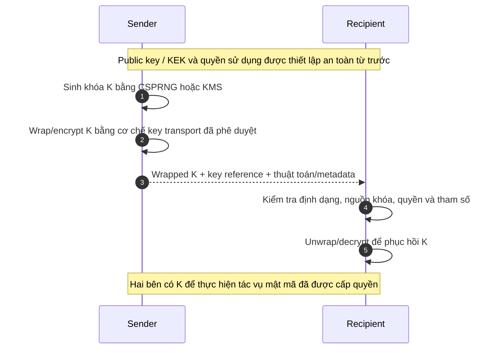
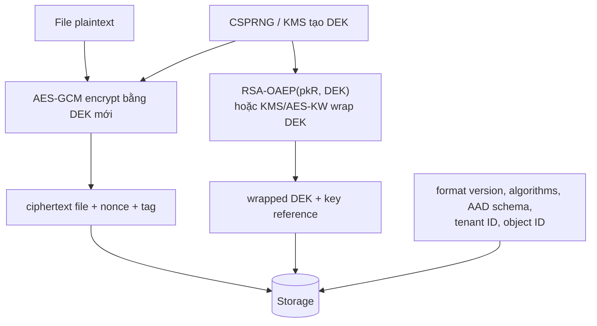
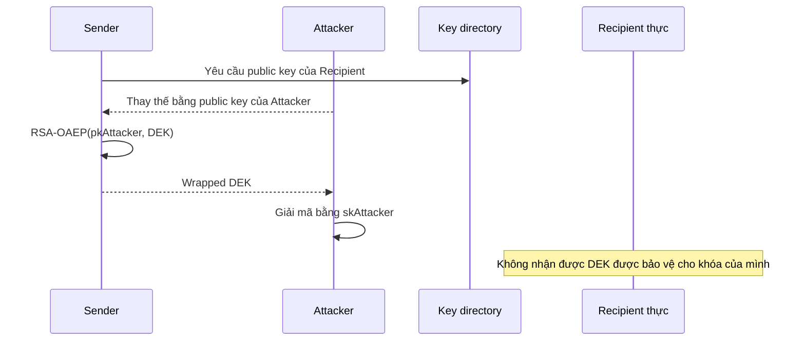

# Key transport — Thiết lập khóa bằng chuyển giao khóa

> **Chương:** Key establishment  
> **Module:** SECURITY_KEY_MANAGEMENT_FUNDAMENTALS — tìm hiểu vòng đời khóa mật mã từ tạo, cấp phát, lưu trữ, sử dụng, xoay vòng đến thu hồi và hủy; kết nối mật mã đối xứng, bất đối xứng, chữ ký số, KMS/HSM, envelope encryption, kiểm soát truy cập và kiểm toán để thiết kế hệ thống bảo vệ khóa an toàn.

## 1. Mục tiêu học tập

Sau bài học, bạn có thể:

1. Giải thích **key establishment** và **key transport**, nhận biết khi nào một bên chọn/sinh khóa rồi bảo vệ để bên nhận phục hồi cùng khóa.
2. Phân biệt **key transport**, **key agreement**, **KEM (Key Encapsulation Mechanism)** và **envelope encryption**, tránh coi các thuật ngữ là đồng nghĩa.
3. Mô tả một luồng chuyển giao DEK bằng **RSA-OAEP** và một luồng **AES Key Wrap (AES-KW/KWP)** với KEK đã được chia sẻ hoặc quản lý.
4. Hiểu vì sao phải **xác thực khóa công khai của người nhận**, kiểm tra key usage, tham số mật mã, metadata và quyền truy cập trước khi chuyển khóa.
5. Sử dụng API **Java JCA** để minh họa RSA-OAEP với SHA-256, MGF1-SHA-256, sau đó giải bọc khóa trong ranh giới được cấp quyền.
6. Thiết kế key transport qua **KMS/HSM** kết hợp **DEK, KEK, envelope encryption, IAM, audit và backup/DR**.
7. Lập kế hoạch **rotation, rewrap, re-encrypt, thu hồi và hủy khóa**, đồng thời đánh giá hậu quả nếu private key/KEK hoặc DEK bị lộ.
8. Nhận diện lỗi phổ biến: **RSA/PKCS#1 v1.5 encryption**, dùng RSA trực tiếp cho file lớn, key substitution, decryption oracle, thiếu sender authentication, replay và thiếu quản lý khóa lịch sử.

## 2. Key transport nằm ở đâu trong key establishment?

**Key establishment** là quá trình giúp hai hoặc nhiều bên có được vật liệu khóa chung để sử dụng trong những hoạt động mật mã tiếp theo. Trong thiết kế hệ thống, có hai cách tiếp cận thường được phân biệt:

- **Key transport:** một bên tạo/chọn vật liệu khóa rồi **bảo vệ và chuyển** để bên nhận có thể phục hồi vật liệu đó.
- **Key agreement:** hai hoặc nhiều bên tham gia tính toán để tạo bí mật chung từ đóng góp mật mã tương ứng, thay vì đơn giản gửi một DEK đã tạo sẵn.

Một hệ thống có thể dùng cả hai trong cùng một kiến trúc: ECDH để thiết lập một KEK tạm thời, rồi dùng KEK đó bọc một DEK; hoặc dùng public key của người nhận để chuyển DEK phục vụ mã hóa file.

### 2.1. Ví dụ đơn giản

Giả sử dịch vụ **Billing** sinh một DEK ngẫu nhiên 256 bit để mã hóa file hóa đơn. Dịch vụ **Archive** cần đọc file đó, nhưng không được nhận DEK qua email, log hoặc API plaintext không được bảo vệ.

Billing có thể:

1. Lấy **khóa công khai đáng tin cậy** của Archive.
2. Sinh DEK bằng CSPRNG/KMS phù hợp.
3. Mã hóa file bằng **AES-GCM** sử dụng DEK.
4. Dùng **RSA-OAEP** với public key Archive để **bảo vệ byte DEK**.
5. Lưu/gửi ciphertext file cùng bản DEK đã được bảo vệ, key reference và metadata.
6. Archive dùng private key tương ứng để phục hồi DEK, rồi giải mã file khi người gọi có quyền.

Đây là một ví dụ về **key transport bằng mã hóa khóa công khai** kết hợp **envelope encryption**.

### 2.2. Bên nào chọn khóa?

Trong mô hình key transport cơ bản, **bên gửi** tạo hoặc chọn khóa được chuyển. Điều này có hệ quả bảo mật quan trọng:

- Sender **biết DEK ở thời điểm tạo/chuyển**, nên Recipient không thể suy ra rằng chỉ mình Recipient từng biết DEK.
- Nếu Sender là bên không tin cậy, Recipient phải đánh giá **nguồn gốc, mục đích, độ mạnh và cách sử dụng** của DEK.
- Việc Recipient giải bọc thành công **không chứng minh Sender được cấp quyền**; bất cứ ai biết public key Recipient cũng có thể tạo một gói mã hóa cho khóa đó.
- Nếu cần cả hai bên cùng đóng góp vào việc hình thành bí mật, có thể cần **key agreement** hoặc giao thức thiết lập khóa có xác thực và key confirmation thích hợp.

### 2.3. Sơ đồ tổng quát



**Cảnh báo:** sơ đồ chỉ minh họa chuyển giao vật liệu khóa. Nó **không** tự mô tả xác thực Sender, chứng thư PKI, chống phát lại, quyền truy cập object hay cơ chế lưu giữ khóa.

## 3. Phân biệt key transport, key agreement, KEM và key wrapping

| Khái niệm | Cơ chế chính | Ví dụ | Điều không nên nhầm |
| --- | --- | --- | --- |
| **Key transport** | Một bên lựa chọn/sinh keying material rồi chuyển được bảo vệ cho bên khác | Sender mã hóa DEK bằng RSA-OAEP cho Recipient | Không tự xác thực Sender hoặc tạo forward secrecy |
| **Key agreement** | Các bên đóng góp thông tin để tính bí mật chung | Authenticated (EC)DHE trong giao thức phù hợp | Không phải chỉ gửi DEK plaintext qua TLS |
| **KEM** | Encapsulate/decapsulate để hai phía có chung một secret theo đặc tả | DHKEM trong HPKE, RSA-KEM trong những cấu trúc khác | Không đồng nhất mọi KEM với RSA-OAEP mã hóa DEK trực tiếp |
| **Key wrapping** | Bảo vệ một khóa bằng một key-wrapping key (KEK) hoặc cơ chế tương đương | AES-KW, AES-KWP, KMS WrapKey | Là **cơ chế bảo vệ vật liệu khóa**, có thể được dùng trong key transport |
| **Envelope encryption** | Mã hóa dữ liệu bằng DEK và bảo vệ DEK bằng KEK/public key | AES-GCM(file) + RSA-OAEP(DEK) | Là **kiến trúc sử dụng khóa**, không phải một thuật toán riêng |
| **Key confirmation** | Chứng minh một bên thực sự nắm được bí mật đã thiết lập theo giao thức | MAC trên transcript/context đã ràng buộc | Không mặc nhiên có chỉ vì ciphertext giải mã thành công |

### 3.1. KEM có phải key transport không?

**KEM** là một primitive/khung xây dựng mà bên encapsulate tạo dữ liệu `enc` để bên decapsulate, dùng private key, thu được cùng bí mật chung. Trong những hệ thống và chuẩn nhất định, KEM có thể là thành phần của **key establishment** theo mô hình transport hoặc hybrid.

Điểm phải nhớ là:

- **RSA-OAEP mã hóa DEK trực tiếp:** Sender đã có byte DEK rồi mã hóa chúng thành ciphertext RSA.
- **KEM-based encryption:** Sender thực hiện encapsulation để hai phía có một shared secret, rồi **KDF** dẫn xuất keying material; một giao thức như HPKE còn sử dụng **AEAD** và key schedule chuẩn.

Không tự coi `enc` của HPKE là “RSA-encrypted DEK”, hoặc lấy một ciphertext RSA-OAEP đưa vào hàm decapsulation của DHKEM.

### 3.2. Key transport khác key agreement ECDH

Với một giao thức ECDH có xác thực:

```text
Alice: private ephemeral a  ---> public A ----+
                                             +--> shared secret --> KDF --> key
Bob:   private ephemeral b  <--- public B ----+
```

Mỗi bên dùng private key riêng cùng public key của bên kia để tính bí mật. Nếu không xác thực các public key/transcript, ECDH vẫn có thể bị **man-in-the-middle**.

Với RSA-OAEP key transport:

```text
Sender: sinh DEK --> RSA-OAEP(pkR, DEK) --> wrapped DEK
Recipient: RSA-OAEP-Decrypt(skR, wrapped DEK) --> cùng DEK
```

Sender chủ động chọn DEK; Recipient phục hồi nó. Hai kiểu thiết lập khóa có **mô hình tin cậy và tính chất an ninh khác nhau**.

## 4. Tại sao phải chuyển khóa thay vì gửi plaintext?

**DEK (Data Encryption Key)** có thể giải mã dữ liệu; vì vậy một DEK bị đọc trái phép thường nguy hiểm hơn việc chỉ bị lộ key reference hoặc ciphertext.

Những kênh **không an toàn** để giao DEK gồm:

- Log ứng dụng, monitoring, tracing và lỗi exception.
- Email/chat, file cấu hình và các ticket vận hành.
- Query string hoặc JSON plaintext gửi qua kênh không được bảo vệ.
- Database/object storage lưu raw DEK cạnh ciphertext.
- Repository, container image, CI artifact hoặc biến môi trường có quyền đọc quá rộng.

Key transport dùng cơ chế mật mã để **bảo vệ vật liệu khóa khi lưu/chuyển**, nhưng vẫn cần:

1. **Danh tính và quyền** của các bên tham gia.
2. **Khóa công khai/KEK đáng tin cậy** đúng người nhận và đúng mục đích.
3. **Thuật toán bảo vệ khóa** đúng chuẩn, không dùng padding yếu hoặc tự viết.
4. **Lưu vết và metadata** đủ để giải bọc lại khóa theo phiên bản đúng.
5. **Vòng đời** của cả khóa được chuyển và khóa dùng để bảo vệ nó.

Dữ liệu nhạy cảm đã được bảo vệ trong TLS **không đồng nghĩa** tất cả bước xử lý/log/backup sau khi nhận plaintext DEK đều an toàn. TLS giúp bảo vệ kênh truyền; key wrapping/envelope encryption còn giải quyết việc lưu giữ và phân quyền sử dụng khóa qua thời gian.

## 5. Key transport bằng RSA-OAEP

**RSA-OAEP** là một cơ chế mã hóa khóa công khai được chuẩn hóa trong PKCS #1 / RFC 8017. Khi dùng để bảo vệ DEK ngắn, Sender mã hóa byte DEK bằng **RSA public key** của Recipient; Recipient giải mã bằng **RSA private key** tương ứng.

Điểm quan trọng:

- **Public key phải được xác thực**: RSA-OAEP mã hóa cho khóa được cung cấp, không tự khẳng định khóa ấy thuộc đúng Recipient.
- **OAEP phải được cấu hình đầy đủ**, gồm digest, MGF/MGF digest và label khi profile có yêu cầu.
- **RSA-OAEP không phải thuật toán mã hóa file lớn**. Nó xử lý thông điệp có độ dài giới hạn bởi modulus và digest.
- **RSA-OAEP encryption không xác thực Sender**. Bất kỳ ai sở hữu public key đều có thể mã hóa một DEK để gửi Recipient.
- **Không dùng private signing key RSA làm khóa giải mã** chỉ vì cả hai đều là RSA; phải tách mục đích/key usage theo policy.

### 5.1. Những dữ liệu nào đi qua RSA-OAEP?

Ví dụ một hệ thống có:

- DEK: 32 byte (AES-256).
- RSA public key Recipient: 3072 bit, đúng identity/policy.
- RSA-OAEP: SHA-256, MGF1-SHA-256, label theo profile.
- Dữ liệu file: mã hóa riêng bằng AES-GCM.

Gói lưu có thể chứa:

```text
recipientKeyId
wrapAlgorithm = RSA-OAEP-SHA256-MGF1-SHA256
wrappedDek = RSA-OAEP(publicKeyRecipient, 32-byte DEK)
dataAlgorithm = AES-256-GCM
dataNonce
dataCiphertextAndTag
aadSchemaVersion
objectId
formatVersion
```

**Không lưu DEK plaintext trong gói này.** `wrappedDek` là ciphertext chứa **khóa**, còn `dataCiphertextAndTag` là ciphertext của **dữ liệu**.

### 5.2. Giới hạn kích thước plaintext RSA-OAEP

Với RSAES-OAEP, nếu modulus dài `k` byte và hash có đầu ra `hLen` byte, giới hạn plaintext là:

\[
mLen \le k - 2hLen - 2
\]

Ví dụ RSA 2048-bit có `k = 256` byte; khi OAEP dùng SHA-256 có `hLen = 32` byte:

\[
mLen \le 256 - 64 - 2 = 190\text{ byte}
\]

Một DEK 32 byte phù hợp giới hạn này. Một file PDF hàng MB **không phù hợp** để mã hóa trực tiếp bằng RSA-OAEP.

Dùng **envelope encryption**: RSA-OAEP chỉ bảo vệ DEK, AES-GCM bảo vệ file.

### 5.3. OAEP digest và MGF digest không được để mơ hồ

Đối với Java JCA, chuỗi transformation như:

```java
"RSA/ECB/OAEPWithSHA-256AndMGF1Padding"
```

không phải bằng chứng chắc chắn rằng **MGF1 digest cũng là SHA-256 trong mọi provider**. Một số môi trường/provider có default khác nhau.

Khi profile yêu cầu OAEP SHA-256 **và** MGF1 SHA-256, phải cấu hình tường minh bằng **`OAEPParameterSpec`** thay vì tin mặc định. Tầng giao thức cần ghi nhận thuật toán và tham số được phép.

Tên `ECB` trong một số transformation string RSA/JCA là quy ước đặt tên API/provider; **không có nghĩa RSA-OAEP đang mã hóa file theo AES-ECB**.

### 5.4. OAEP label và định dạng dữ liệu

RSA-OAEP có tham số **label** (`PSource` trong Java). Nhiều profile dùng label rỗng mặc định. Nếu hệ thống sử dụng một label có ý nghĩa, hai phía phải cấu hình **đúng byte label**; sai label sẽ làm giải mã thất bại.

Label có thể hỗ trợ phân tách mục đích sử dụng theo thiết kế, nhưng **không thay thế** xác thực Sender, identity Recipient, quyền đối tượng hoặc key reference. Không tự thay đổi label giữa phiên bản phần mềm mà không có format version/migration.

## 6. Java JCA: minh họa RSA-OAEP chuyển một DEK AES

Ví dụ sau dùng Java để:

1. Sinh một DEK AES-256 bằng `KeyGenerator` và `SecureRandom`.
2. Bảo vệ DEK bằng RSA-OAEP SHA-256/MGF1-SHA-256.
3. Giải bọc DEK bằng private key tương ứng.
4. Kiểm tra kích thước DEK trước khi tạo `SecretKeySpec`.

**Giả định bảo mật:** public/private RSA key đã được tạo, phân phối và lưu giữ theo chính sách; caller đã qua authentication/authorization; public key được lấy từ **nguồn tin cậy**, không trực tiếp từ JSON do người lạ cung cấp. Mã chỉ minh họa **key transport**, không phải dịch vụ KMS/PKI hoàn chỉnh.

```java
import java.security.GeneralSecurityException;
import java.security.InvalidKeyException;
import java.security.PrivateKey;
import java.security.PublicKey;
import java.security.SecureRandom;
import java.security.interfaces.RSAPublicKey;
import java.security.spec.MGF1ParameterSpec;
import java.util.Arrays;
import java.util.Objects;

import javax.crypto.Cipher;
import javax.crypto.KeyGenerator;
import javax.crypto.SecretKey;
import javax.crypto.spec.OAEPParameterSpec;
import javax.crypto.spec.PSource;
import javax.crypto.spec.SecretKeySpec;

public final class RsaOaepKeyTransport {
    private static final int AES_256_BYTES = 32;
    private static final int MIN_RSA_BITS = 2048; // Mốc minh họa, do policy quyết định.

    private static final SecureRandom RANDOM = new SecureRandom();

    private static final OAEPParameterSpec OAEP_SHA256 = new OAEPParameterSpec(
        "SHA-256",
        "MGF1",
        MGF1ParameterSpec.SHA256,
        PSource.PSpecified.DEFAULT
    );

    private RsaOaepKeyTransport() {}

    public static SecretKey newDataKey() throws GeneralSecurityException {
        KeyGenerator generator = KeyGenerator.getInstance("AES");
        generator.init(256, RANDOM);
        return generator.generateKey();
    }

    public static byte[] wrapDek(
            SecretKey dek,
            PublicKey trustedRecipientKey)
            throws GeneralSecurityException {

        Objects.requireNonNull(dek);
        Objects.requireNonNull(trustedRecipientKey);

        if (!(trustedRecipientKey instanceof RSAPublicKey rsaPublic)) {
            throw new InvalidKeyException("Recipient key must be RSA");
        }
        if (rsaPublic.getModulus().bitLength() < MIN_RSA_BITS) {
            throw new InvalidKeyException("RSA modulus below approved policy");
        }

        byte[] dekBytes = dek.getEncoded();
        if (dekBytes == null || dekBytes.length != AES_256_BYTES) {
            throw new InvalidKeyException("Expected exportable AES-256 DEK");
        }

        try {
            Cipher cipher = Cipher.getInstance(
                "RSA/ECB/OAEPWithSHA-256AndMGF1Padding"
            );
            cipher.init(
                Cipher.ENCRYPT_MODE,
                rsaPublic,
                OAEP_SHA256,
                RANDOM
            );
            return cipher.doFinal(dekBytes);
        } finally {
            Arrays.fill(dekBytes, (byte) 0);
        }
    }

    public static SecretKey unwrapDek(
            byte[] wrappedDek,
            PrivateKey authorizedRecipientKey)
            throws GeneralSecurityException {

        Objects.requireNonNull(wrappedDek);
        Objects.requireNonNull(authorizedRecipientKey);

        Cipher cipher = Cipher.getInstance(
            "RSA/ECB/OAEPWithSHA-256AndMGF1Padding"
        );
        cipher.init(
            Cipher.DECRYPT_MODE,
            authorizedRecipientKey,
            OAEP_SHA256
        );

        // Chỉ trả DEK nếu RSA-OAEP giải mã/kiểm tra thành công.
        byte[] candidate = cipher.doFinal(wrappedDek);
        try {
            if (candidate.length != AES_256_BYTES) {
                throw new InvalidKeyException("Unexpected DEK length");
            }
            return new SecretKeySpec(candidate, "AES");
        } finally {
            Arrays.fill(candidate, (byte) 0);
        }
    }
}
```

### 6.1. Vì sao ví dụ dùng `OAEPParameterSpec` tường minh?

Hai phía phải thống nhất:

| Tham số | Giá trị minh họa | Ý nghĩa |
| --- | --- | --- |
| RSA encryption scheme | RSAES-OAEP | Mã hóa khóa ngắn với public key |
| Main digest | SHA-256 | Hàm băm dùng trong OAEP |
| Mask generation | MGF1 | Cơ chế sinh mặt nạ |
| MGF1 digest | SHA-256 | Digest của MGF1 |
| Label | Empty | Không dùng label tùy biến trong ví dụ |
| DEK | 32 byte AES key | Đầu ra ứng dụng muốn chuyển |
| Recipient key | RSA public/private pair | Đúng khóa/owner/key usage đã xác thực |

Chỉ cần **một thành phần khác đi** cũng có thể khiến giải bọc thất bại; tệ hơn, fallback âm thầm sang thuật toán không thuộc policy có thể tạo rủi ro an toàn.

### 6.2. Những giới hạn không được bỏ qua

- `dek.getEncoded()` chỉ hoạt động với khóa có **biểu diễn xuất được**. Nếu DEK nằm trong HSM/non-exportable, cần dùng **API wrap/unwrap của provider/KMS**, không cố trích byte khóa.
- `SecretKeySpec` là khóa ứng dụng trong bộ nhớ, không phải bằng chứng DEK được bảo vệ bởi phần cứng. Việc xóa mảng byte `candidate` không bảo đảm JVM hoặc provider không còn các bản sao nội bộ.
- `MIN_RSA_BITS` chỉ là ví dụ. Hệ thống thật phải chọn độ mạnh và thuật toán theo chính sách, thời hạn bảo vệ và yêu cầu tuân thủ.
- `Cipher.doFinal(...)` có thể throw khi ciphertext sai. Không trả lỗi khác biệt chi tiết cho attacker nếu nó tạo điều kiện xây dựng **decryption oracle**.
- Mã chưa mã hóa dữ liệu file, chưa lưu key ID/format version, chưa kiểm tra chứng thư, chưa có IAM, audit, replay protection, rate limit hay backup.
- Không dùng `RSA/ECB/PKCS1Padding` làm đường dự phòng khi OAEP giải mã thất bại. RSAES-PKCS1-v1_5 encryption có lịch sử rủi ro padding oracle khi tích hợp sai.
- Một số JCA provider/HSM không hỗ trợ transformation và tham số OAEP mong muốn; phải kiểm thử và xác minh trên môi trường production thay vì đổi tham số chỉ để “chạy được”.

### 6.3. Không tự thực hiện “RSA raw”

Không xây dựng key transport kiểu:

```text
ciphertext = DEK^e mod n
DEK = ciphertext^d mod n
```

Đó là phép toán RSA thô, **không phải RSA-OAEP an toàn**. Việc encoding/padding, ngẫu nhiên hóa và kiểm tra lỗi phải do thư viện mật mã được thẩm định thực hiện.

## 7. Key transport bằng KEK đối xứng: AES Key Wrap

Không phải lúc nào Sender cũng dùng RSA. Nếu hai thành phần có quyền sử dụng cùng **KEK (Key-Encryption Key)** được thiết lập an toàn từ trước, có thể dùng một cơ chế **key wrapping** đã được chuẩn hóa để chuyển DEK.

### 7.1. AES-KW (RFC 3394)

**AES Key Wrap (AES-KW)** là thuật toán sử dụng AES để bọc vật liệu khóa có độ dài phù hợp. RFC 3394 định nghĩa cách bọc các khóa theo những đơn vị **64 bit**, với ràng buộc kích thước đầu vào.

Ví dụ:

```text
DEK-A (256 bit) --> AES-KW dưới KEK-X --> wrapped-DEK-A
wrapped-DEK-A  --> AES-KW unwrap bằng KEK-X --> DEK-A
```

Một lợi ích của AES-KW là nó được thiết kế **để bảo vệ khóa**, với cơ chế kiểm tra tính toàn vẹn của wrapped output theo thuật toán. Tuy nhiên:

- Cơ chế kiểm tra tích hợp **không phải chữ ký số hoặc xác thực danh tính Sender**.
- Không được dùng một KEK làm chìa khóa chung cho mọi service/tenant không giới hạn.
- Không tự tạo vòng lặp AES-ECB để “bọc key theo RFC 3394”.
- Kích thước và định dạng input phải khớp yêu cầu thuật toán/thư viện.

### 7.2. AES-KWP (RFC 5649)

**AES Key Wrap with Padding (AES-KWP)** mở rộng cách bọc để hỗ trợ vật liệu đầu vào không đáp ứng trực tiếp yêu cầu độ dài của AES-KW, đồng thời lưu thông tin về độ dài dữ liệu.

Cần phân biệt rõ **KW và KWP** khi ghi metadata:

| Cơ chế | Trường hợp sử dụng | Chú ý |
| --- | --- | --- |
| AES-KW (RFC 3394) | Vật liệu khóa có độ dài hợp lệ, theo khối 64 bit và giới hạn của RFC | Không phải cơ chế mã hóa văn bản/file tùy ý |
| AES-KWP (RFC 5649) | Vật liệu khóa độ dài không chia hết 64 bit hoặc có định dạng cần padding | Không tự ghép padding rồi coi là AES-KW |
| AES-GCM bảo vệ key blob | Có thể dùng nếu thiết kế dùng AEAD đúng chuẩn | Quản lý nonce/tag/AAD theo key và giải pháp |
| RSA-OAEP | Dùng public key Recipient để bảo vệ byte khóa ngắn | Đúng recipient key, SHA/MGF/label và giới hạn modulus |

**Chọn cơ chế theo API và chuẩn hỗ trợ của KMS/HSM**, không theo chuỗi thuật toán nghe giống nhau.

### 7.3. Cần có KEK bằng cách nào?

Một trong các cách:

- KEK được tạo/lưu trong **KMS/HSM**, hai bên có quyền sử dụng những thao tác wrap/unwrap phù hợp.
- KEK đã được phân phối trước đó qua **kênh key establishment** được thiết kế và xác thực.
- Một giao thức **key agreement/KEM** tạo shared secret rồi dẫn xuất KEK theo KDF chuẩn.

Trong mọi trường hợp, phải kiểm tra **who can use KEK** và **for what purpose**. Nếu cả Sender và Recipient đều có toàn quyền dùng cùng KEK, mỗi bên có thể bọc/giải bọc nhiều DEK; cần phân tích trust boundary, tenant isolation và quyền đối tượng.

## 8. Key transport trong envelope encryption

**Envelope encryption** tách vai trò khóa:

- **DEK:** mã hóa dữ liệu bằng thuật toán đối xứng, ví dụ AES-GCM.
- **KEK hoặc recipient public key:** bảo vệ DEK.
- **Wrapped DEK:** bản mã của DEK để lưu/chuyển.
- **Metadata:** thuật toán, key ID, phiên bản, nonce/tag/AAD của dữ liệu và tham số bọc khóa.
- **KMS/HSM:** nơi có thể quản lý KEK/private key, quyền sử dụng, audit và lifecycle.

### 8.1. Luồng lưu một file



Các bước:

1. Xác thực và **kiểm tra quyền ghi file** của caller.
2. Tạo một DEK đúng độ mạnh bằng CSPRNG/KMS.
3. Mã hóa dữ liệu bằng **AEAD** với nonce đúng quy tắc và AAD có nguồn tin cậy.
4. Bọc DEK bằng recipient public key hoặc KEK đúng quyền.
5. Lưu atomically ciphertext, wrapped DEK, key reference và metadata.
6. Không ghi DEK plaintext vào database/log; dọn buffer ứng dụng khi có thể.

### 8.2. Luồng đọc một file

1. Xác thực người dùng/workload và kiểm tra **quyền đọc object**.
2. Tải ciphertext, wrapped DEK, key ID, phiên bản và metadata.
3. Đối chiếu thuật toán/key type với allowlist; lấy đúng key handle từ nguồn tin cậy.
4. Gọi KMS/HSM hoặc RSA-OAEP/AES-KW để phục hồi DEK.
5. Dùng DEK giải mã bằng AEAD và **kiểm tra authentication tag/AAD**.
6. Chỉ trả plaintext nếu tất cả kiểm tra thành công.
7. Giới hạn thời gian tồn tại DEK, không log nội dung nhạy cảm.

Nếu hệ thống đã có **KMS GenerateDataKey/Decrypt** tương ứng, nên ưu tiên khả năng được quản lý của dịch vụ thay vì tự export/import KEK hoặc private key trong ứng dụng.

### 8.3. Metadata ví dụ

```json
{
  "formatVersion": 2,
  "objectId": "invoice-4026",
  "tenantId": "tenant-27",
  "dataEncryption": {
    "algorithm": "AES-256-GCM",
    "nonce": "<base64-12-byte-nonce>",
    "ciphertextAndTag": "<base64-file-ciphertext-and-tag>",
    "aadSchema": "invoice-v2"
  },
  "keyTransport": {
    "type": "RSA-OAEP",
    "recipientKeyId": "archive-prod-rsa-v3",
    "rsaOaepHash": "SHA-256",
    "mgf": "MGF1",
    "mgfHash": "SHA-256",
    "labelProfile": "empty",
    "wrappedDek": "<base64-encrypted-32-byte-dek>"
  }
}
```

Đây là **định dạng minh họa** để giải thích trách nhiệm metadata, không phải một chuẩn on-wire bắt buộc.

- `recipientKeyId` phải trỏ đến khóa mà Recipient thực sự có thể dùng để giải bọc.
- Không tin key ID hoặc thuật toán do client tự khai báo để nạp khóa/algorithm ngoài chính sách.
- `tenantId`, `objectId` giúp ràng buộc ngữ cảnh, nhưng **không thay authorization**.
- Nếu metadata được dùng để xác định AAD hoặc khóa, cần kiểm soát nguồn gốc và tính toàn vẹn/nhất quán của nó. Không chỉ lưu nó dưới dạng JSON rồi tin mọi giá trị.
- Muốn đổi encoding, hash hoặc label, cần **version hóa format** để giải mã lịch sử.

## 9. Xác thực khóa công khai người nhận: bước không thể bỏ qua

RSA-OAEP bảo vệ DEK cho **public key được cung cấp**. Nếu Sender mã hóa bằng public key của attacker, RSA-OAEP vẫn có thể hoạt động hoàn hảo về mặt mật mã — nhưng **chuyển DEK cho sai người**.

### 9.1. Tấn công thay thế public key



Sơ đồ minh họa trường hợp kênh phân phối khóa **không được xác thực**. Việc dùng TLS đến một endpoint danh bạ khóa có thể là một phần giải pháp, nhưng cần đảm bảo danh bạ khóa và nội dung key record gắn đúng **identity, scope và phiên bản**.

### 9.2. Cách kiểm tra recipient public key

- Lấy public key từ **key directory đã xác thực**, chứng thư PKI tin cậy hoặc pinned fingerprint hợp lệ.
- Kiểm tra **chủ thể/identity**, tenant, môi trường, mục đích sử dụng, phiên bản và trạng thái.
- Với X.509, kiểm tra certificate path, trust anchor, thời hạn, name/policy và **KeyUsage** như `keyEncipherment` đối với profile RSA key transport khi áp dụng.
- Kiểm tra **RSA modulus size**, key type và thuật toán/mục đích được phép.
- Không trộn khóa ký số với khóa mã hóa chỉ vì chúng đều là RSA.
- Không tự động fetch public key từ URL do payload/attacker đưa vào.
- Có cơ chế phê duyệt và audit cho thao tác thay thế public key.

**Public key có thể công khai, nhưng tính xác thực của public key phải được bảo vệ.**

## 10. Ai xác thực Sender trong key transport?

Key transport bằng RSA-OAEP hoặc AES-KW **không mặc nhiên xác thực danh tính Sender**. Receiver có thể phục hồi DEK thành công mà vẫn không biết gói được gửi bởi workload hợp lệ nào.

Ví dụ: một endpoint chấp nhận “gói DEK mã hóa bằng RSA-OAEP” rồi tự động cấp quyền truy cập khi giải bọc được. Bất kỳ ai có public key Recipient đều có thể tạo một gói ciphertext hợp lệ để gửi. Điều này không chứng minh người gửi có quyền yêu cầu tác vụ đó.

### 10.1. Cần những lớp gì?

Tùy mô hình đe dọa:

- **mTLS/workload identity** giữa các dịch vụ và authorization tại endpoint.
- **Chữ ký số** trên thông điệp/protocol transcript và metadata quan trọng khi cần xác minh nguồn gốc gói đã lưu/chuyển qua hàng đợi.
- **MAC** bằng khóa được quản lý độc lập nếu mô hình symmetric trust cho phép.
- **KMS IAM/grants** giới hạn ai có quyền wrap/unwrap bằng những khóa cụ thể.
- **AAD và context binding** ở những cơ chế hỗ trợ để ràng buộc object/tenant/purpose.
- **Replay/idempotency control** ở lớp nghiệp vụ.

**Chữ ký số, MAC và mã hóa giải quyết các thuộc tính khác nhau.** Không thể coi “ciphertext đọc được” là bằng chứng ai đã gửi, hoặc “có chữ ký” là bằng chứng nội dung đã được giữ bí mật.

### 10.2. Tách key transport khỏi key confirmation

Recipient giải mã RSA-OAEP thành công có thể biết ciphertext phù hợp với private key của mình. Tuy nhiên, Sender chưa chắc biết Recipient đã nhận và nắm DEK; không có **explicit key confirmation** nếu giao thức không thiết kế bước xác nhận.

Nếu hệ thống cần bằng chứng hai phía đã sở hữu keying material và đồng ý cùng **session/context**, có thể thiết kế cơ chế **key confirmation có xác thực** bằng MAC/chữ ký trên transcript, định danh hai phía, suite và nonces theo giao thức đã được kiểm thử.

**Không tự gửi lại DEK plaintext làm “xác nhận”**.

## 11. Chống sửa đổi, decryption oracle và replay

### 11.1. Vì sao phải fail closed?

Khi Recipient nhận wrapped key hỏng, sai thuật toán, sai key ID hoặc ciphertext không hợp lệ:

- Từ chối thao tác, không thử tuần tự mọi khóa/scheme cho đến khi có kết quả.
- Không trả thông tin chi tiết cho attacker như “padding byte thứ N sai” hoặc “đã qua bước OAEP nhưng DEK length sai”.
- Ghi log nội bộ đủ phục vụ vận hành mà **không lưu raw key hoặc plaintext DEK**.
- Giới hạn số request, nguồn gọi và quyền dùng private key/KEK.

Đặc biệt, **RSAES-PKCS1-v1_5 encryption** có lịch sử bị tấn công kiểu **Bleichenbacher padding oracle** khi hệ thống tiết lộ khác biệt kết quả giải mã. Với thiết kế mới, ưu tiên RSA-OAEP theo profile phù hợp và các API/protocol được thẩm định; nhưng **OAEP cũng cần xử lý lỗi an toàn và kiểm soát truy cập**.

### 11.2. AES-KW bảo vệ integrity không chống replay

Một wrapped DEK hợp lệ có thể bị gửi lại nguyên vẹn. Key wrapping có kiểm tra tính toàn vẹn vẫn **không tự phát hiện một gói hợp lệ cũ** được phát lại.

Ví dụ một job được phê duyệt lần đầu có thể bị xử lý lại nếu hệ thống không kiểm tra request ID, object version hoặc trạng thái hoàn thành.

Cần:

- Nonce/message ID **ở tầng nghiệp vụ**.
- TTL hoặc thời hạn hợp lệ phù hợp.
- **Idempotency key và trạng thái đã xử lý**.
- Ràng buộc tới object ID, tenant ID, key reference và version khi cần.
- Kiểm tra quyền cho **mỗi lần truy cập/giải bọc**, kể cả khi ciphertext cũ từng hợp lệ.

### 11.3. Xác thực ciphertext file là bước riêng

RSA-OAEP bảo vệ DEK, không phải authentication tag của file. Nếu file dùng AES-GCM, Receiver phải kiểm tra **tag và AAD của file** trước khi trả plaintext. Nếu dùng CBC/CTR thuần, hệ thống cần thêm thiết kế kiểm tra toàn vẹn phù hợp; không được suy luận RSA-OAEP của DEK đã bảo vệ được toàn bộ ciphertext file khỏi sửa đổi.

## 12. Key transport cho nhiều người nhận

Giả sử một file phải được đọc bởi:

- **BillingService**;
- **AuditService**;
- **ArchiveService**.

Một kiến trúc có thể mã hóa file **một lần** bằng DEK, sau đó tạo **ba bản wrapped DEK**, mỗi bản cho đúng người nhận:

```text
                         +--> RSA-OAEP(pkBilling, DEK) --> wrappedDEK1
File --AES-GCM(DEK)-------+
                         +--> RSA-OAEP(pkAudit, DEK)   --> wrappedDEK2
                         +--> RSA-OAEP(pkArchive, DEK) --> wrappedDEK3
```

Một object lưu ba mục `recipientKeyId + wrapAlgorithm + wrappedDEK` cùng ciphertext file.

### 12.1. Lợi ích

- Không cần sao chép/mã hóa lại file cho từng recipient.
- Mỗi người nhận dùng private key riêng để phục hồi cùng DEK.
- Có thể thêm một recipient mới bằng cách wrap lại DEK **trong vùng tin cậy** mà không cần re-encrypt file.
- Có thể phân quyền key handle/rotation riêng cho từng người nhận.

### 12.2. Rủi ro và giới hạn thu hồi

Nếu một recipient đã giải bọc DEK, họ có thể đã giữ **DEK plaintext** hoặc bản sao file. Việc xóa riêng bản wrappedDEK của họ **không thể khiến họ quên khóa đã biết**.

Khi cần thu hồi quyền đọc phiên bản dữ liệu tương lai:

1. Đánh giá cần sinh **DEK mới** và mã hóa lại file hay không.
2. Chỉ bọc DEK mới cho các recipient còn được cấp quyền.
3. Thu hồi API/credential/quyền KMS của recipient đã bị loại.
4. Kiểm soát các bản snapshot/backup và các bản sao file đã phân phối.
5. Ghi audit và lý do thay đổi key recipients.

**Đừng coi key transport là cơ chế DRM** có thể thu hồi những bản sao plaintext hoặc khóa đã trao trước đó.

### 12.3. Multi-tenant isolation

Nếu dùng cùng KEK cho nhiều tenant, phải kiểm tra:

- Workload tenant A có thể giải bọc wrapped DEK của tenant B không?
- KMS có hỗ trợ context/grant/policy để giới hạn scope không?
- Ứng dụng có xác định tenant từ **identity tin cậy** thay vì request body không?
- Wrapped DEK và metadata có được ràng buộc với object/tenant để chống hoán đổi gói không?
- Khi một tenant kết thúc hợp đồng, có thể thực hiện retention/erasure riêng không?

Không có một cấu trúc khóa chung phù hợp mọi hệ thống; phạm vi khóa phải dựa trên **data classification, blast radius, chi phí quản trị và yêu cầu pháp lý**.

## 13. KMS/HSM trong key transport

### 13.1. Vai trò KMS

KMS có thể cung cấp API:

- Tạo DEK hoặc khóa cấp cao.
- Wrap/unwrap, encrypt/decrypt key blob theo khả năng dịch vụ.
- Quản lý quyền, key state, rotation, key version và audit.
- Giới hạn workload được phép dùng khóa trong môi trường cụ thể.
- Hỗ trợ backup/DR hoặc đa vùng theo khả năng được công bố của sản phẩm.

**Không phải KMS nào cũng hỗ trợ RSA-OAEP hoặc AES-KW theo giao diện giống nhau.** Một API `Encrypt` bất đối xứng, một API `GenerateDataKey` và một API `WrapKey` có thể có quy tắc rất khác. Trước khi thiết kế, phải xem thuật toán, format ciphertext, metadata, grants, key material và khả năng export/import được hỗ trợ thực tế.

### 13.2. Vai trò HSM

HSM có thể giữ private key hoặc KEK trong ranh giới phần cứng và thực hiện phép **decrypt/unwrap** mà không cho ứng dụng xuất nguyên liệu khóa ở dạng rõ.

Nhưng cần phân biệt:

- **Khóa được đánh dấu non-exportable:** không được xuất raw key material theo API/chính sách liên quan.
- **Quyền dùng khóa:** workload vẫn có thể gọi Decrypt/Unwrap để làm lộ DEK nếu được cấp quyền quá rộng.
- **Plaintext DEK đầu ra:** nhiều API có thể trả DEK về ứng dụng; cần kiểm soát memory, process, log và quyền caller.
- **Khả năng khôi phục:** khóa không xuất được không có nghĩa không thể mất khả năng truy cập; cần đánh giá backup/replica/quorum/DR.

HSM **không tự xác thực identity của mọi file được giải mã** hoặc kiểm tra authorization của từng hóa đơn nếu giao thức/ứng dụng không cung cấp ngữ cảnh tin cậy.

### 13.3. Phân tách nhiệm vụ

| Vai trò | Nên được phép | Không nên mặc định có |
| --- | --- | --- |
| Key owner | Phê duyệt scope, thuật toán, lifecycle, thay quyền | Raw DEK hoặc quyền giải mã toàn bộ dữ liệu |
| KMS/HSM admin | Cấu hình tài nguyên và policy theo quy trình | Quyền unwrap mọi dữ liệu nghiệp vụ |
| Sender workload | Wrap DEK cho những recipient được duyệt | Thay key policy, export private key, hủy KEK |
| Recipient workload | Unwrap DEK và đọc object hợp lệ | Giải bọc DEK của tenant/service khác |
| Auditor/SOC | Đọc audit, cảnh báo và bằng chứng thay đổi | Quyền trích xuất key material |
| Incident responder | Quyền khẩn cấp có kiểm soát và thời hạn | Đường break-glass không có log/hậu kiểm |

Phân quyền phải đi kèm **quy tắc thuật toán/key usage**, không chỉ với tên tài nguyên khóa. Ví dụ một khóa ký riêng không nên đồng thời là khóa cho RSA-OAEP key transport nếu thiết kế và policy không cho phép.

## 14. Key transport và vòng đời khóa

**Key transport không kết thúc khi DEK đến được Recipient.** Cả DEK và khóa dùng để bảo vệ DEK đều có vòng đời riêng.

| Giai đoạn | DEK được chuyển | KEK/private key người nhận |
| --- | --- | --- |
| **Tạo** | Sinh ngẫu nhiên từ nguồn được duyệt, đúng key length | Tạo trong KMS/HSM hoặc provider tin cậy, đúng thuật toán/usage |
| **Cấp phát** | Gắn DEK với object/tenant/scope cụ thể | Phân phối key reference/public key qua kênh tin cậy |
| **Lưu trữ** | Chỉ giữ wrapped DEK khi có thể | Bảo vệ private key/KEK; không lưu plaintext trong app config |
| **Sử dụng** | Mã hóa/giải mã trong phạm vi cần thiết | Wrap/unwrap theo IAM và key usage |
| **Xoay vòng** | Thay DEK nếu cần, có thể re-encrypt dữ liệu | Thay KEK/key pair; rewrap DEK để di chuyển |
| **Thu hồi** | Ngăn dùng DEK có nguy cơ nếu có thể | Disable/thu hồi quyền, rotate key, ngừng tin public key cũ |
| **Khôi phục** | Wrapped DEK/metadata phải còn nguyên | Có khả năng giải bọc bản cũ trong DR theo retention |
| **Hủy** | Mất khả năng giải mã dữ liệu phụ thuộc sau khi xử lý bản sao | Chỉ hủy khi không còn phụ thuộc hợp lệ |

### 14.1. Cryptoperiod

**Cryptoperiod** là khoảng sử dụng khóa cho hoạt động mật mã nhất định. Với khóa recipient/KEK:

- Có thể **ngừng dùng để wrap DEK mới** khi hết thời gian được phép.
- Có thể vẫn cần **unwrap DEK lịch sử** để đọc file cũ.
- Có thể cần giữ khóa trong một ranh giới giới hạn chỉ phục vụ **backup/DR/retention**.
- Thời điểm hủy hoàn toàn phụ thuộc vào việc mọi DEK/ciphertext còn cần đọc đã được di chuyển hay chưa.

Không tự áp dụng mốc “90 ngày” cho mọi cặp khóa/DEK. Phải căn cứ tiêu chuẩn, mức độ rủi ro, lượng dữ liệu, yêu cầu kinh doanh và khả năng rewrap/re-encrypt thực tế.

## 15. Rotation, rewrap và re-encrypt: ba thao tác khác nhau

| Thao tác | Điều gì thay đổi? | Điều gì không tự thay đổi? |
| --- | --- | --- |
| **Rotate KEK hoặc recipient key pair** | Khóa dùng để wrap/unwrap mới cho dữ liệu mới | Wrapped DEK lịch sử có thể vẫn cần khóa cũ |
| **Rewrap DEK** | Cùng byte DEK được bọc lại dưới KEK/public key mới | **Không thay DEK và ciphertext file** |
| **Replace DEK + re-encrypt** | Sinh DEK mới và mã hóa lại dữ liệu | Không tự sửa policy IAM hay thu hồi bản sao đã lộ |
| **Disable key/thu hồi IAM** | Chặn một số quyền dùng khóa tiếp theo | Không xóa các DEK plaintext đã sao chép |
| **Destroy key** | Hủy khả năng sử dụng khóa theo quy trình | Có thể làm mất quyền đọc backup còn phụ thuộc |

### 15.1. Migration RSA recipient key v1 sang v2

Một runbook điển hình:

1. **Kiểm kê** object, wrapped DEK, key ID, algorithm/profile, backup và recipient.
2. Tạo key pair **v2** trong ranh giới tin cậy; xác thực và công bố public key v2.
3. Chuyển **luồng ghi mới** sang public key v2.
4. Với object cũ, **unwrap bằng private key v1** trong môi trường được cấp quyền, rồi wrap cùng DEK bằng **public key v2**.
5. Cập nhật wrapped DEK và key ID một cách **nguyên tử/idempotent**, không log plaintext DEK.
6. Kiểm thử giải mã object cũ, mới và bản backup từ nhiều thời điểm.
7. Giới hạn quyền dùng v1, sau đó hủy **chỉ khi** không còn phụ thuộc hợp lệ và có phê duyệt.

Một số KMS quản lý key material/version bên trong cùng tài nguyên; **đừng giả định rotation tự rewrap hoặc re-encrypt tất cả dữ liệu**. Cơ chế thay đổi theo provider và loại khóa.

### 15.2. Khi recipient private key bị lộ

Giả sử attacker lấy được `skR-v1` và đã sao chép nhiều `wrappedDek` lịch sử. Họ có thể giải bọc DEK cũ từ những ciphertext đã lưu.

**Chỉ rewrap cùng DEK dưới public key v2 không làm attacker quên DEK cũ**. Cần:

- Ngừng gửi khóa mới dưới public key v1 và thu hồi quyền dùng private key v1.
- Đánh giá attacker có `wrappedDek`/ciphertext file nào trong tay.
- Xác định phạm vi DEK có thể đã bị giải bọc.
- Khi cần, **sinh DEK mới và re-encrypt dữ liệu**, quản lý bản sao/backup.
- Điều tra log KMS, IAM và nguồn lộ private key; thông báo theo chính sách.

### 15.3. Khi DEK bị lộ nhưng KEK vẫn an toàn

Nếu plaintext DEK đã bị lộ (qua log, memory dump hoặc compromised workload), việc đổi KEK/private key **không làm dữ liệu đang dùng DEK đó an toàn trở lại**.

Phải đánh giá thay DEK, mã hóa lại dữ liệu, xóa các bản sao plaintext có thể kiểm soát và ngăn tái diễn đường lộ DEK.

## 16. Backup, DR và cryptographic erasure

### 16.1. Backup ciphertext thôi chưa đủ

Một bản backup chứa file ciphertext và wrapped DEK có thể **vô dụng** nếu private key/KEK dùng để mở bọc không còn tồn tại hoặc không khả dụng ở vùng khôi phục.

Cần lưu được:

- Ciphertext file, nonce/tag/AAD schema và version thuật toán.
- Wrapped DEK và algorithm/key reference của key transport.
- Bằng chứng key version/recipient identity và cấu hình trust.
- Phương án **dùng khóa cũ trong DR** theo chính sách, không nhất thiết xuất raw private key.
- Runbook, owner, IAM/quorum/break-glass và thời gian khôi phục được kiểm thử.

Một alias `archive-key` ở region B **không bảo đảm** nó chứa cùng key material với `archive-key` ở region A. Phải xác nhận tính tương thích của cơ chế bọc khóa/ciphertext trên hệ thống thực.

### 16.2. Cryptographic erasure không tự động toàn diện

Hủy private key/KEK có thể khiến những wrapped DEK chỉ phụ thuộc khóa đó không giải bọc được. Tuy nhiên, điều này chỉ đạt hiệu ứng mong muốn khi:

1. Không còn bản sao private key/KEK hoặc cơ chế khôi phục có thể phục hồi khóa.
2. Không còn DEK plaintext đã được lưu ở nơi khác.
3. Không còn một wrapped DEK được bọc dưới KEK/recipient khác.
4. Không còn plaintext file ở cache, backup, export hoặc endpoint khác.
5. Retention và nghĩa vụ pháp lý đã cho phép hủy.

**Schedule deletion** và **actual destruction** có thể là các trạng thái khác nhau trong KMS/HSM. Cần có bằng chứng xác nhận thay vì suy luận dữ liệu đã bị xóa ngay khi thao tác lên lịch thành công.

## 17. Những lỗi thiết kế thường gặp

| Sai lầm | Nguy cơ | Hướng xử lý |
| --- | --- | --- |
| Gửi DEK plaintext qua log/email/ticket | Mọi người đọc được DEK có thể giải mã dữ liệu | Bọc DEK bằng chuẩn phù hợp, không log raw secret |
| Mã hóa cả file bằng RSA-OAEP | Vượt giới hạn kích thước và kém phù hợp kiến trúc | Mã hóa file bằng AEAD, RSA-OAEP chỉ bọc DEK |
| Dùng RSAES-PKCS1-v1_5 encryption cho thiết kế mới | Rủi ro padding oracle/protocol legacy | Ưu tiên RSA-OAEP hoặc cơ chế được phê duyệt |
| Không xác thực public key Recipient | Mã hóa DEK cho public key do attacker thay | Key directory/chứng thư/pinning đáng tin |
| Dùng khóa RSA ký số làm khóa key transport | Lẫn key usage và phạm vi rủi ro | Tách khóa theo mục đích và policy |
| OAEP digest SHA-256 nhưng MGF1 digest default SHA-1 | Không khớp profile, interoperability sai | Khai báo tham số OAEP đầy đủ |
| Nhận thuật toán từ request không qua allowlist | Downgrade hoặc confusion | Cấu hình suite theo policy và key type |
| Thử tất cả key/scheme khi unwrap lỗi | Tăng bề mặt oracle và bỏ qua policy | Key ID tin cậy, fail closed, lỗi an toàn |
| Cho rằng OAEP xác thực Sender | Chấp nhận gói từ bên không được phép | Chữ ký/mTLS/authorization theo mô hình đe dọa |
| Cho rằng AES-KW chống replay | Gói hợp lệ cũ có thể được gửi lại | Message ID, version, trạng thái/idempotency |
| Dùng một KEK cho mọi tenant | Blast radius khi lộ KEK/quyền unwrap | Key scope/IAM/encryption context phù hợp |
| Dùng DEK như API token hoặc khóa ký | Trộn key usage, tăng rủi ro | Phân tách khóa và chức năng |
| Lưu DEK plaintext cạnh ciphertext | Mã hóa at rest mất hiệu quả | Wrapped DEK, hạn chế memory/log |
| Rewrap DEK sau khi chính DEK bị lộ | Attacker vẫn biết DEK cũ | Sinh DEK mới và re-encrypt |
| Xóa private key cũ ngay khi rotate | Không mở được wrapped DEK trong backup | Inventory, migration, restore test |
| Tin non-exportable loại bỏ nguy cơ lạm dụng | Workload có thể gọi unwrap oracle | Least privilege, rate limit, audit |
| Không lưu key ID/format/thuật toán | Không giải mã được dữ liệu lịch sử | Metadata có version, kiểm tra tính nhất quán |
| Coi TLS là đủ bảo vệ mọi bản sao DEK | Ứng dụng/storage vẫn có thể làm lộ DEK | Kết hợp bảo vệ kênh, wrap, IAM, vận hành khóa |

## 18. Case study: chuyển DEK hóa đơn sang hệ thống lưu trữ

**Bối cảnh:** một nền tảng SaaS lưu hóa đơn đã được mã hóa. **BillingService** tạo hóa đơn, còn **ArchiveService** là bên nhận cần lưu và đọc lại trong thời gian dài.

### 18.1. Yêu cầu an ninh

1. Kẻ lấy được object storage **không** tự giải mã được hóa đơn.
2. BillingService phải xác minh đúng public key của ArchiveService.
3. ArchiveService chỉ giải mã file thuộc tenant và nghiệp vụ được cấp quyền.
4. Dữ liệu có thể đọc lại qua vòng đời thay khóa và backup/DR.
5. Không dùng private key ArchiveService ở môi trường development/staging.
6. Có audit khi tạo, bọc, giải bọc và thay quyền sử dụng khóa.
7. Khi khóa bị lộ, có phương án khoanh vùng và mã hóa lại.

### 18.2. Giải pháp

- **DEK:** mỗi file một khóa AES-256 ngẫu nhiên từ nguồn được phê duyệt.
- **Data encryption:** AES-GCM, nonce theo quy tắc per-key, AAD gắn với tenant/file/version.
- **Transport:** RSA-OAEP SHA-256/MGF1-SHA-256 bọc DEK cho public key ArchiveService đã xác thực.
- **Recipient private key:** quản lý trong KMS/HSM nếu provider hỗ trợ đúng RSA-OAEP profile.
- **Authentication:** BillingService xác thực workload, request được phân quyền; nếu gói đi qua storage/queue và cần nguồn gốc bền vững, có cơ chế chữ ký/chứng thực phù hợp.
- **Storage:** chỉ lưu ciphertext, wrapped DEK, nonce/tag và metadata.
- **Audit:** key ID, actor, thao tác, thời gian, kết quả và lý do phê duyệt, không log DEK.

### 18.3. Pseudocode nghiệp vụ

```text
function archiveInvoice(request, plaintextInvoice):
    authorizeWrite(request.identity, request.tenantId, request.invoiceId)

    recipientKey = trustedDirectory.getVerifiedPublicKey(
        recipient = "ArchiveService",
        environment = "production",
        purpose = "key-transport"
    )
    requireSupportedRsaOaepProfile(recipientKey)

    dek = approvedKeyGenerator.newAes256Dek()
    dataAad = canonicalEncode("invoice-v2", request.tenantId, request.invoiceId)
    encryptedFile = aesGcmEncrypt(dek, plaintextInvoice, freshNonce(), dataAad)

    wrappedDek = rsaOaepWrap(
        publicKey = recipientKey,
        dek = dek,
        digest = SHA256,
        mgf = MGF1_SHA256,
        label = EMPTY
    )

    saveAtomically(
        invoiceId,
        encryptedFile,
        wrappedDek,
        recipientKey.id,
        supportedTransportProfileId,
        formatVersion = 2
    )
    clearOwnedDekBufferIfPossible(dek)

function readArchivedInvoice(identity, invoiceId):
    authorizeRead(identity, invoiceId)
    record = storage.load(invoiceId)

    verifyFormatProfileAndMetadata(record)
    handle = authorizedKeyService.getRecipientPrivateKeyHandle(
        identity, record.recipientKeyId
    )

    dek = rsaOaepUnwrap(handle, record.wrappedDek, approvedProfile)
    invoice = aesGcmDecryptAndVerify(
        dek, record.ciphertext, record.nonce, trustedAadFor(record)
    )
    clearOwnedDekBufferIfPossible(dek)
    return invoice
```

Đây là **pseudocode mô tả kiến trúc**, không phải một bộ SDK có thể chạy nguyên trạng. Trong hệ thống thật cần xử lý concurrency, giới hạn kích thước, lỗi mật mã, timeout KMS/HSM, lưu dữ liệu nguyên tử, access logs, retry và khôi phục.

### 18.4. Hai sự cố minh họa

**Sự cố A — ArchiveService thay khóa RSA v1 sang v2.** BillingService chuyển sang public key mới cho hóa đơn mới. Các wrapped DEK lịch sử vẫn cần private key v1 hoặc quy trình rewrap được kiểm thử. Không được xóa v1 chỉ vì alias đã trỏ sang v2.

**Sự cố B — một workload bị chiếm quyền có thể gọi unwrap hàng loạt.** Private key non-exportable vẫn có thể bị lạm dụng qua API. Cần thu hồi quyền/credential, xem audit, xác định DEK/ciphertext đã truy cập, đánh giá thay DEK và re-encrypt theo phạm vi ảnh hưởng.

## 19. Checklist triển khai key transport

| Hạng mục | Câu hỏi cần trả lời | Bằng chứng mong đợi |
| --- | --- | --- |
| **Mục đích** | Chuyển DEK cho ai, thuộc object/tenant nào? | Data classification, key inventory |
| **Cơ chế** | RSA-OAEP, AES-KW/KWP hay KMS-managed wrap? | Thuật toán và policy được phê duyệt |
| **Recipient identity** | Public key/KEK có đúng chủ sở hữu? | Certificate/key directory/pinning |
| **Tham số** | OAEP digest, MGF, label, key size có đúng? | Test vectors, provider config |
| **Sender authorization** | Sender có quyền yêu cầu chuyển key không? | IAM/mTLS, signed request hoặc policy |
| **Key generation** | DEK sinh từ CSPRNG/KMS phù hợp và đủ mạnh? | Key generation API/config |
| **Data encryption** | File dùng AEAD và nonce/tag/AAD đúng quy tắc? | Mã hóa/giải mã và negative tests |
| **Metadata** | Format, key ID, version, algorithm và context có đủ? | Định dạng version hóa và readback |
| **KMS/HSM** | Khóa có cần non-exportable và API hỗ trợ không? | HSM/KMS specification, policy |
| **Least privilege** | Workload có thể unwrap dữ liệu ngoài scope không? | IAM/key grants/tenant tests |
| **Error handling** | Sai ciphertext có fail closed, không oracle/fallback? | Negative tests, rate limit |
| **Replay** | Gói hợp lệ cũ có được xử lý lại trái phép không? | Idempotency/message-state tests |
| **Rotation** | Có rewrap/re-encrypt theo đúng nguy cơ không? | Runbook, inventory, migration tests |
| **DR/backup** | Backup còn cần key nào, đã thử restore chưa? | Restore evidence |
| **Audit** | Ghi ai dùng khóa, key ID và kết quả mà không lộ secret? | Log review và alert rules |
| **Incident** | Khi private key/KEK/DEK lộ, có kế hoạch ứng phó? | Diễn tập, key revocation workflow |

## 20. Bài tập tự kiểm tra

**Câu 1.** BillingService tạo một DEK 32 byte rồi mã hóa nó bằng RSA-OAEP public key của ArchiveService. Đây là key agreement hay key transport?

**Gợi ý:** Là **key transport**: BillingService chọn DEK trước rồi bảo vệ nó để ArchiveService có thể phục hồi. Hai bên không cùng đóng góp để tính ra DEK đó như một giao thức ECDH.

**Câu 2.** Có thể dùng RSA-OAEP trực tiếp mã hóa file 10 MB không?

**Gợi ý:** Không phù hợp. RSA-OAEP có giới hạn mLen theo modulus và digest; dùng AEAD như AES-GCM để mã hóa file, RSA-OAEP chỉ bọc DEK.

**Câu 3.** Một public key lấy từ body HTTP request có đúng định dạng RSA-3072. Điều đó đủ chứng minh nó thuộc đúng ArchiveService không?

**Gợi ý:** Không. Phải xác thực identity của public key qua directory, chứng thư hoặc pinning đáng tin, kiểm tra key usage, scope và trạng thái.

**Câu 4.** Trong Java, transformation ghi `OAEPWithSHA-256AndMGF1Padding`. Có thể chắc chắn MGF1 digest là SHA-256 trên mọi provider không?

**Gợi ý:** Không. Cần cấu hình tường minh `OAEPParameterSpec` với SHA-256, MGF1-SHA-256, label đã thống nhất và kiểm thử provider.

**Câu 5.** RSA 2048-bit với OAEP SHA-256 cho phép mã hóa plaintext tối đa bao nhiêu byte?

**Gợi ý:** `k = 256`, `hLen = 32`, nên giới hạn là `256 - 2×32 - 2 = 190 byte`.

**Câu 6.** Nếu Recipient giải bọc RSA-OAEP DEK thành công, có chứng minh gói do Sender có quyền ký hoặc quản trị tạo ra không?

**Gợi ý:** Không. Public key có thể được sử dụng bởi bất kỳ ai; cần xác thực/authorization Sender và, nếu yêu cầu, chữ ký số hoặc giao thức tương ứng.

**Câu 7.** Một hệ thống dùng AES-KW để bọc DEK. Bản wrapped DEK được gửi lại nguyên vẹn sau một tháng. AES-KW có tự từ chối không?

**Gợi ý:** Không tự chống replay. Cần message ID, version, trạng thái đã xử lý, TTL/authorization ở lớp ứng dụng.

**Câu 8.** KEK đã được xoay từ v1 sang v2, nhưng 20.000 object vẫn lưu wrapped DEK bằng v1. Có thể hủy KEK v1 không?

**Gợi ý:** Chưa. Phải kiểm kê phụ thuộc, rewrap khi cần, kiểm thử đọc lại dữ liệu và restore backup trước khi hủy.

**Câu 9.** Một attacker lấy được plaintext DEK hôm qua. Hôm nay đội vận hành chỉ rewrap cùng DEK dưới KEK mới. Dữ liệu hôm qua đã an toàn trở lại chưa?

**Gợi ý:** Chưa. Rewrap không đổi DEK; cần đánh giá sinh DEK mới, re-encrypt và xử lý dữ liệu/bản sao có nguy cơ.

**Câu 10.** Ba recipient có ba bản RSA-OAEP-wrapped DEK cho cùng một file. Xóa bản wrapped của Recipient A có bảo đảm A không thể đọc file nữa không?

**Gợi ý:** Không. A có thể đã phục hồi/giữ DEK và plaintext trước đó. Cần đánh giá thay DEK và tái mã hóa/điều chỉnh phân phối nếu yêu cầu thu hồi mạnh.

**Câu 11.** Public key của Recipient được tin cậy, nhưng private key của họ nằm trong HSM. Vì sao vẫn cần IAM/rate limit và kiểm toán?

**Gợi ý:** Workload có quyền gọi HSM/KMS Decrypt có thể lạm dụng API unwrap để nhận DEK, dù private key không xuất được.

**Câu 12.** Một bản backup chứa ciphertext và wrapped DEK nhưng private key recipient đã bị hủy. Có thể khôi phục được dữ liệu không?

**Gợi ý:** Có thể không, nếu không có bản sao/đường khôi phục khóa đúng. Backup phải được kiểm thử cùng khả năng sử dụng key material lịch sử.

**Câu 13.** Tại sao đổi từ RSA key transport sang ECDH key agreement không thể chỉ thay tên thuật toán trong metadata?

**Gợi ý:** Hai cơ chế thiết lập bí mật khác nhau về thông điệp, đóng góp của mỗi bên, KDF, xác thực và key confirmation. Cần thay giao thức, định dạng và cách xử lý khóa, không chỉ đổi nhãn.

**Câu 14.** Hệ thống truyền DEK qua TLS rồi lưu DEK plaintext vào database cạnh ciphertext. Key transport đã giải quyết vấn đề bảo mật dữ liệu at rest chưa?

**Gợi ý:** Chưa. TLS bảo vệ kênh truyền, nhưng lưu plaintext DEK cạnh ciphertext làm mất ý nghĩa bảo vệ ở tầng storage. Cần key wrapping/envelope encryption và phân tách quyền.

## 21. Ghi nhớ

1. **Key transport là cách thiết lập khóa trong đó một bên tạo/chọn vật liệu khóa rồi chuyển nó dưới dạng được bảo vệ**. Nó khác với key agreement, nơi các bên cùng đóng góp để tính bí mật chung.
2. **RSA-OAEP phù hợp để bảo vệ DEK ngắn**, không phải để mã hóa file lớn. Cấu hình digest, MGF1 digest, label và key usage phải đúng profile; không fallback sang RSAES-PKCS1-v1_5.
3. **AES-KW/AES-KWP là cơ chế bọc khóa bằng KEK đối xứng**. Chúng yêu cầu quản lý KEK, phạm vi sử dụng và format chính xác; không tự chống replay hoặc chứng minh Sender.
4. **Envelope encryption tách DEK và KEK/recipient key:** AEAD mã hóa dữ liệu, key transport bảo vệ DEK. Luôn lưu nonce/tag/AAD, wrapped DEK và metadata có version.
5. **Public key phải được xác thực và Sender phải được phân quyền.** Giải bọc thành công không tự chứng minh danh tính người gửi hoặc quyền thao tác.
6. **KMS/HSM bảo vệ vật liệu khóa nhưng không thay thế IAM, audit hay business authorization.** Quyền Decrypt/Unwrap có thể bị lạm dụng dù private key non-exportable.
7. **Rotation, rewrap và re-encrypt là ba thao tác khác nhau**. Rewrap không xử lý được DEK đã bị lộ; hủy key cũ trước khi kiểm tra backup có thể gây mất dữ liệu.
8. **Key transport là một phần của vòng đời khóa**: tạo, cấp phát, lưu trữ, sử dụng, xoay, thu hồi, backup/DR và hủy phải được thiết kế như một quy trình có kiểm toán.

### Tài liệu tham khảo

- **NIST SP 800-56B:** các kỹ thuật thiết lập khóa dựa trên RSA, gồm những cấu trúc key establishment và yêu cầu bảo mật liên quan.
- **NIST SP 800-56A:** các cơ chế key establishment sử dụng mật mã logarithm rời rạc, hỗ trợ phân biệt key agreement với RSA-based thiết lập khóa.
- **NIST SP 800-57 Part 1:** vai trò khóa, cryptoperiod, key usage, vòng đời và quản trị khóa.
- **RFC 8017 — PKCS #1:** đặc tả RSAES-OAEP, tham số và giới hạn thông điệp RSA.
- **RFC 3394 — Advanced Encryption Standard (AES) Key Wrap Algorithm:** cấu trúc AES-KW.
- **RFC 5649 — AES Key Wrap with Padding Algorithm:** cơ chế AES-KWP.
- **RFC 9180 — Hybrid Public Key Encryption (HPKE):** một cấu trúc dùng KEM, KDF và AEAD để mã hóa cho recipient public key.
- **NIST SP 800-38D:** quy tắc AES-GCM, nonce/IV và authentication tag.
- **OWASP Key Management Cheat Sheet:** nguyên tắc quản lý, phân quyền, lưu trữ và sử dụng khóa.
- **OWASP Cryptographic Storage Cheat Sheet:** khuyến nghị về mã hóa dữ liệu và cách chọn cơ chế mật mã phù hợp.
- **Java Cryptography Architecture (JCA) và Java Cryptography Extension (JCE):** `Cipher`, `OAEPParameterSpec`, `KeyGenerator` và provider behavior.

Khi triển khai thực tế, cần kiểm tra phiên bản tiêu chuẩn, tài liệu của provider KMS/HSM và chính sách mật mã đang áp dụng. Bài cung cấp khung kỹ thuật và ví dụ; kiểm tra QA chuyên môn và tương thích sản phẩm được thực hiện ở giai đoạn kế tiếp.
