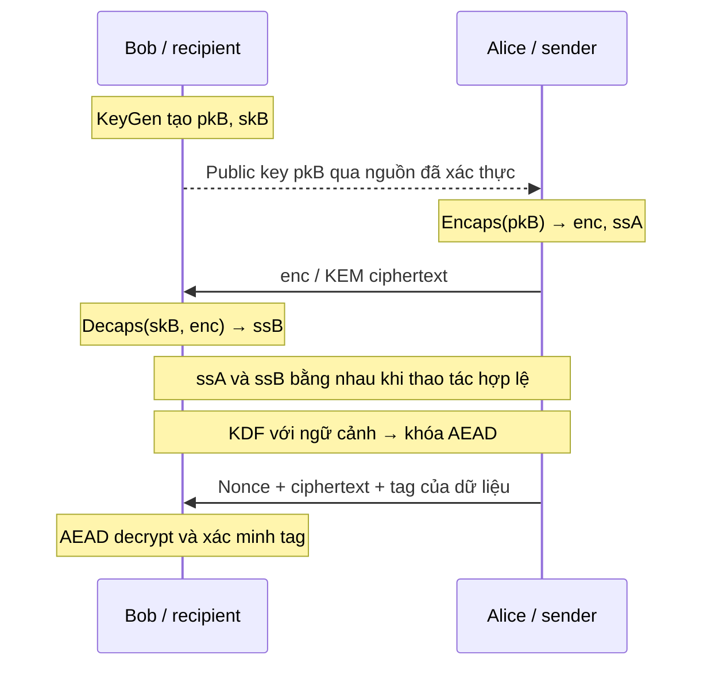
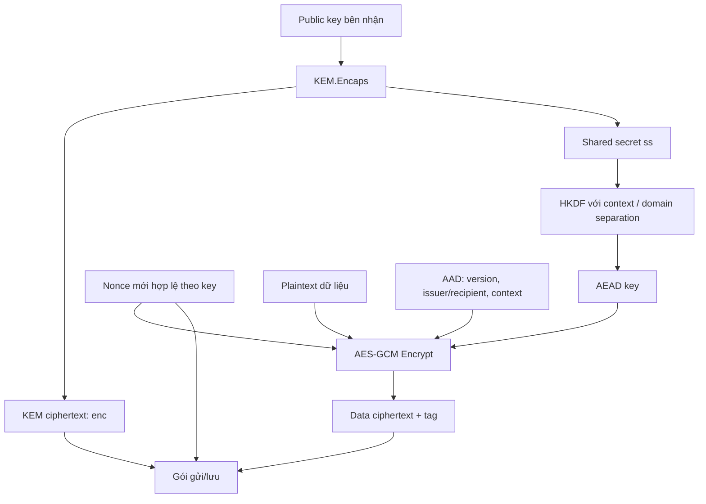
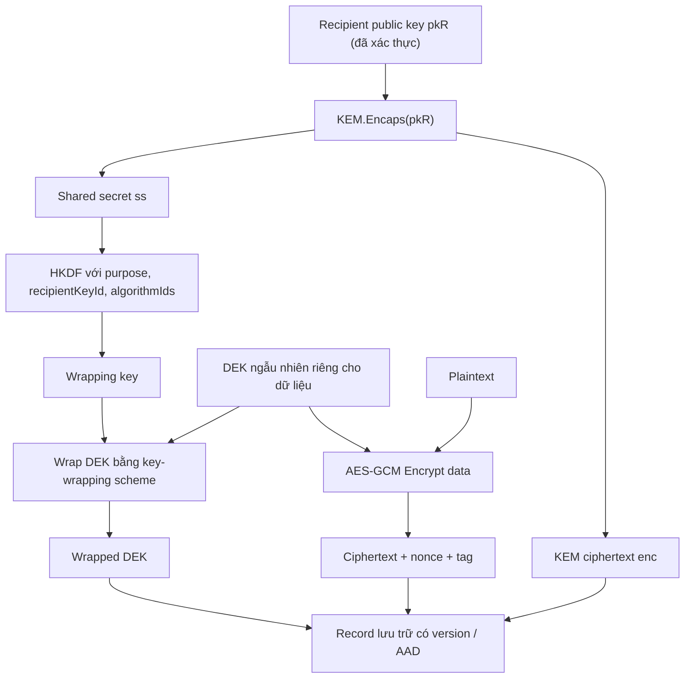
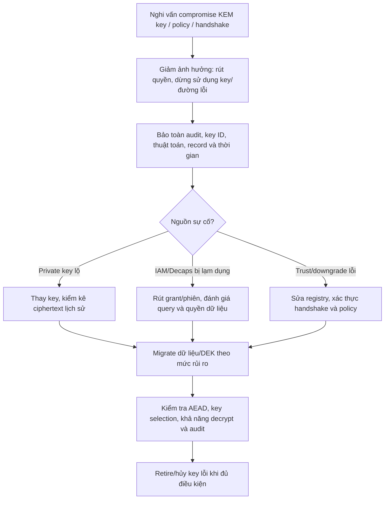

# KEM (Key Encapsulation Mechanism): thiết lập bí mật chung bằng cơ chế đóng gói khóa

> **Chương:** Key establishment  
> **Module:** SECURITY_KEY_MANAGEMENT_FUNDAMENTALS

Khi một ứng dụng cần gửi dữ liệu mã hóa cho một bên nhận, câu hỏi đầu tiên không phải “dùng AES ở chế độ nào?” mà là **“hai bên có được cùng một khóa bí mật mà không gửi trực tiếp khóa đó qua một kênh không an toàn như thế nào?”**. Một trong những công cụ giải quyết bài toán này là **KEM — Key Encapsulation Mechanism**, thường dịch là **cơ chế đóng gói khóa**.

KEM cho phép một bên biết **public key của bên nhận** tạo ra hai kết quả: **KEM ciphertext** (để truyền cho bên nhận) và **shared secret** (bí mật chung). Bên nhận dùng **private key tương ứng** cùng KEM ciphertext để tái tạo cùng shared secret. Hai bên sau đó có thể đưa shared secret vào **KDF** để dẫn xuất khóa mã hóa đối xứng và sử dụng thuật toán như **AES-GCM** hoặc **ChaCha20-Poly1305** để bảo vệ dữ liệu.

**KEM không phải thuật toán mã hóa tệp, không tự chứng minh danh tính người gửi và không tự đảm bảo forward secrecy.** Những thuộc tính đó phải đến từ cách thiết kế giao thức, vòng đời khóa, xác thực đối tác, lựa chọn KDF/AEAD và các kiểm soát vận hành.

Trong **SECURITY_KEY_MANAGEMENT_FUNDAMENTALS**, KEM kết nối trực tiếp các chủ đề: mật mã bất đối xứng, khóa đối xứng, **KMS/HSM**, envelope encryption, thỏa thuận khóa, chữ ký số, vòng đời khóa từ tạo đến hủy, quyền truy cập và kiểm toán. Khi mở rộng sang mật mã hậu lượng tử, **ML-KEM** là một cơ chế KEM được chuẩn hóa để thiết lập bí mật chung với mục tiêu chống lại các dạng tấn công lượng tử đã biết.

Sau bài học, bạn sẽ có thể:

- Mô tả chính xác ba phép toán **KeyGen**, **Encaps** và **Decaps**, cùng vai trò public/private key, encapsulation ciphertext và shared secret.
- Phân biệt **KEM**, **Diffie–Hellman key agreement**, **public-key encryption (PKE)**, **KDF**, **DEM/AEAD** và **chữ ký số**.
- Hiểu yêu cầu **IND-CCA**, kiểm tra ciphertext, xử lý lỗi decapsulation và việc dùng **KDF với ngữ cảnh được ràng buộc**.
- Nhận diện **DHKEM/HPKE**, **ML-KEM**, và cách triển khai **hybrid key establishment** trong quá trình chuyển đổi hậu lượng tử.
- Phân tích **authentication, forward secrecy, downgrade, key compromise** và giới hạn bảo mật khi private key bên nhận là khóa dài hạn.
- Lập thiết kế sử dụng KEM với **envelope encryption**, KMS/HSM, IAM, key rotation, audit và xử lý sự cố.

## 1. Vấn đề KEM giải quyết: thiết lập shared secret

Giả sử **Alice** muốn gửi dữ liệu nhạy cảm cho **Bob**. Bob có một cặp khóa bất đối xứng:

- **Public key \(pk_B\)**: có thể được công bố qua một nguồn đáng tin để Alice sử dụng.
- **Private key \(sk_B\)**: Bob giữ bí mật, chỉ dùng trong phạm vi được phép.

Alice muốn lấy một bí mật chung mới \(ss\) sao cho Bob có thể tái tạo \(ss\), còn người quan sát mạng chỉ thấy thông tin công khai mà khó tìm được \(ss\).

KEM tạo cơ chế này mà Alice **không cần biết private key** của Bob:

```text
Bob:   (pkB, skB) = KEM.KeyGen()
Alice: (enc, ssA) = KEM.Encaps(pkB)
Alice -> Bob: enc
Bob:   ssB = KEM.Decaps(skB, enc)

Kết quả đúng mong đợi: ssA == ssB.
Người quan sát có: pkB, enc.
Người quan sát không được suy ra shared secret ss.
```

Ở đây:

| Giá trị | Vai trò | Có thể công khai? | Lưu ý quản lý |
|---|---|---|---|
| \(pk_B\) | Public key của Bob để bên khác encapsulate | Có | **Phải xác thực thuộc đúng Bob** nếu cần bí mật gửi đúng người |
| \(sk_B\) | Private key của Bob để decapsulate | **Không** | Bảo vệ bằng policy/keystore/KMS/HSM, giới hạn quyền và cryptoperiod |
| \(enc\) hoặc \(ct_{\mathrm{KEM}}\) | KEM ciphertext/encapsulation gửi cho Bob | Có | Phải giữ đúng byte, thuật toán, phiên bản và key ID để decapsulate |
| \(ss_A,ss_B\) | Bí mật chung sinh từ KEM | **Không** | Dùng qua KDF; hạn chế thời gian hiện diện và không log |
| \(K_{\mathrm{AEAD}}\) | Khóa mã hóa dữ liệu được dẫn xuất từ shared secret | **Không** | Dùng đúng algorithm/mode, nonce và mục đích |

**KEM ciphertext không phải ciphertext của file hoặc API payload.** Nó thường là một giá trị tương đối ngắn phục vụ việc **khôi phục shared secret**. Dữ liệu lớn được bảo vệ bằng cơ chế mã hóa đối xứng ở một lớp khác.

### 1.1. Sơ đồ một lượt đóng gói khóa



Sơ đồ lược giản một chiều: Bob công bố public key, Alice encapsulate, Bob decapsulate. Nó **chưa cung cấp** bằng chứng Alice là ai; nếu cần xác thực hai chiều, chống MITM hoặc forward secrecy, phải bổ sung cơ chế thích hợp.

## 2. Ba thuật toán cốt lõi: KeyGen, Encaps, Decaps

Một KEM thường được mô hình hóa bằng bộ ba thuật toán:

\[
\begin{aligned}
(pk,sk)&\leftarrow \operatorname{KeyGen}(),\\
(ct,ss)&\leftarrow \operatorname{Encaps}(pk),\\
ss'&\leftarrow \operatorname{Decaps}(sk,ct).
\end{aligned}
\]

Trong đó \(ct\) chính là encapsulation ciphertext và \(ss\) là shared secret.

**Correctness (tính đúng đắn)** mong muốn:

\[
\operatorname{Decaps}(sk,ct)=ss
\]

khi \((pk,sk)\) là cặp khóa hợp lệ và \((ct,ss)\) được tạo đúng từ \(\operatorname{Encaps}(pk)\).

### 2.1. KeyGen: tạo cặp khóa

**KeyGen** dùng nguồn ngẫu nhiên mật mã được kiểm chứng và tham số của KEM để tạo **public key** và **private key**. Khóa không phải chỉ là hai mảng byte tùy ý: định dạng, độ dài, tính hợp lệ và phạm vi phép toán phụ thuộc **thuật toán cụ thể**.

Ví dụ, **ML-KEM-768** phải được tạo theo đặc tả ML-KEM, không thể lấy một cặp RSA hoặc X25519 rồi đặt tên thành ML-KEM. Một số thư viện cung cấp API riêng theo parameter set; cần lưu **algorithm/parameter set/version** cùng key metadata.

### 2.2. Encaps: đóng gói secret bằng public key

**Encaps(pk)** tạo đồng thời:

1. **Shared secret \(ss\)** để phía gửi dùng trong KDF hoặc protocol key schedule.
2. **KEM ciphertext \(ct\)** để phía nhận decapsulate.

Bên gửi phải sử dụng **public key của đúng bên nhận đã xác thực**. Nếu attacker tráo \(pk_B\) bằng public key của chính họ, Alice vẫn có thể encapsulate thành công — nhưng chỉ attacker sở hữu private key tương ứng mới decapsulate được. **Tính bảo mật của KEM không thay thế tính xác thực của public key**.

### 2.3. Decaps: lấy lại secret bằng private key

**Decaps(sk,ct)** dùng private key để tái tạo shared secret. Private key cần được giới hạn quyền, tần suất và nơi thực thi: đối tượng bị chiếm có quyền decapsulation có thể lấy secret cho nhiều KEM ciphertext mà nó truy cập được, ngay cả khi không export được byte private key.

**Không tự giả định rằng ciphertext bị sửa luôn khiến Decaps ném một lỗi rõ ràng.** Một số KEM được thiết kế để trả ra một secret giả ngẫu nhiên khi ciphertext không hợp lệ (*implicit rejection*), nhằm giảm rò rỉ từ kênh lỗi. Lớp mã hóa dữ liệu phía sau phải kiểm tra **AEAD tag** và từ chối nội dung nếu khóa hoặc ciphertext không khớp. Cách xử lý chi tiết phải theo **thuật toán và API đã được kiểm chứng**.

### 2.4. Shared secret không tự là khóa ứng dụng cuối cùng

Không nên trực tiếp dùng mọi shared secret KEM như AES key hoặc HMAC key mà không hiểu quy tắc giao thức. Thường cần dẫn xuất:

\[
K_{\mathrm{app}}=\operatorname{HKDF}(ss,\;\mathrm{context},\;\mathrm{purpose})
\]

để tạo những key riêng cho **mã hóa**, **kiểm tra dữ liệu**, **hai hướng truyền**, hoặc **các giai đoạn phiên**. KDF và cách ràng buộc transcript/định danh phải dựa trên thiết kế được chuẩn hóa. **HKDF không tự xác thực public key hoặc danh tính đối tác.**

## 3. KEM khác gì Diffie–Hellman, PKE và key transport?

Các công cụ trong **key establishment** có điểm chung là tạo bí mật chung, nhưng khác nhau về mô hình và API.

| Cơ chế | Luồng cơ bản | Đặc điểm chính |
|---|---|---|
| **KEM** | Sender: `Encaps(pkR) → (ct, ss)`; recipient: `Decaps(skR, ct) → ss` | Tạo shared secret và encapsulation ciphertext, thường dùng kết hợp KDF + AEAD |
| **Diffie–Hellman / ECDH** | Mỗi bên kết hợp private key của mình với public key peer để tính shared secret | Key agreement; có thể dùng cặp tạm thời **(EC)DHE** để hỗ trợ forward secrecy |
| **PKE — public-key encryption** | `Encrypt(pk, plaintext) → ciphertext`; `Decrypt(sk, ciphertext) → plaintext` | Mã hóa một plaintext cụ thể, thường có giới hạn kích thước/phương thức padding |
| **Key transport** | Một bên sinh key rồi đưa key sang bên nhận thông qua một cơ chế bảo vệ | Bên sinh key quyết định giá trị trước; có thể dùng PKE/wrap, cần chống lạm dụng và giả mạo |
| **KDF** | `Derive(secret, salt, info) → derived keys` | **Không tự chuyển secret giữa các bên**; làm chuẩn hóa/tách biệt key theo mục đích |
| **Chữ ký số** | `Sign(sk, message)`, `Verify(pk, ...)` | Xác thực nguồn và toàn vẹn theo public key được tin, **không phải KEM** |

### 3.1. Từ ECDH đến DHKEM

Một KEM có thể được **xây dựng trên Diffie–Hellman**. Ví dụ nguyên lý của một **DH-based KEM (DHKEM)**:

1. Bob có cặp khóa nhận \(pk_R,sk_R\).
2. Alice tạo **cặp DH tạm thời** \(pk_E,sk_E\).
3. Alice tính shared secret DH từ \(sk_E\) và \(pk_R\), sau đó dùng KDF với ngữ cảnh; **encapsulation** có thể chứa \(pk_E\).
4. Bob dùng \(sk_R\) và \(pk_E\) để có cùng shared secret.

Do đó, **DHKEM** vẫn có giao diện Encaps/Decaps nhưng bên trong dựa trên tính toán DH. **ML-KEM** lại có thiết kế toán học hậu lượng tử khác; không nên suy luận ML-KEM hoạt động bằng elliptic curve chỉ vì API giống nhau.

### 3.2. KEM khác “RSA-OAEP dùng để mã hóa DEK”

Với **RSA-OAEP**, bên gửi có thể sinh một DEK AES rồi mã hóa DEK bằng RSA public key của bên nhận. Đó là **mô hình public-key encryption/key transport**, trừ khi được đóng gói thành một KEM theo cấu trúc/chuẩn cụ thể.

**RSA-KEM** có các construction riêng, nhưng không thể gọi mọi phép `RSA-OAEP Encrypt(DEK)` là chính xác thuật toán RSA-KEM. Phân biệt này quan trọng khi chọn chuẩn, chứng nhận và đánh giá khả năng chống chosen-ciphertext attacks.

## 4. KEM/DEM: tại sao không mã hóa file trực tiếp bằng KEM?

KEM chỉ tạo **bí mật chung** và **encapsulation ciphertext**; phần bảo vệ plaintext thường do một **Data Encapsulation Mechanism (DEM)** hay cơ chế mã hóa đối xứng như AEAD đảm nhận.

Một luồng **KEM + KDF + DEM** khái niệm:



Bên nhận lấy **enc**, dùng private key decapsulate, dẫn xuất **cùng khóa AEAD** và giải mã data ciphertext bằng nonce/AAD/tag đi kèm. Nếu tag sai, dữ liệu phải bị **từ chối**, không được dùng plaintext chưa xác thực.

Lợi ích: cơ chế bất đối xứng chủ yếu làm nhiệm vụ thiết lập key, còn AES-GCM/ChaCha20-Poly1305 xử lý dữ liệu lớn hiệu quả hơn. **KEM/DEM** là cách tổ chức chức năng, không phải một “thuật toán KEM” đơn lẻ hoàn chỉnh; các ràng buộc bảo mật phải được thiết kế cùng nhau.

### 4.1. Bảo vệ metadata và chống tráo gói

Gói lưu cần đủ thông tin:

```text
KemProtectedRecord {
  formatVersion: 1
  kemAlgorithm: "ML-KEM-768"   // Ví dụ lựa chọn thuật toán
  recipientKeyId: "recipient-key-v3"
  encapsulation: <KEM ciphertext bytes>
  aeadAlgorithm: "AES-256-GCM"
  nonce: <12-byte nonce>
  encryptedData: <ciphertext + authentication tag>
  context: <purpose, issuer/recipient, object ID, version...>
}
```

Đây là **định dạng minh họa**, không phải chuẩn giao thức. Các trường có ảnh hưởng tới danh tính, lựa chọn thuật toán và cách dùng dữ liệu cần được **ràng buộc bằng KDF info, AAD, transcript hoặc cấu trúc được chuẩn hóa**. Nếu attacker có thể tráo key ID, thuật toán hoặc recipient mà bên giải mã không phát hiện, hệ thống có thể mở ra đường tấn công **confusion/downgrade**.

### 4.2. Key confirmation và kiểm tra kết quả

**KEM correctness** không đồng nghĩa hai bên đã **xác thực lẫn nhau** hoặc có **key confirmation** ở tầng giao thức. Trong ứng dụng KEM+AEAD, tag hợp lệ có thể giúp bên nhận kiểm tra rằng ciphertext dữ liệu được tạo bởi ai đó biết khóa dẫn xuất, nhưng điều đó **không chứng minh người gửi là một danh tính xác định** nếu bất kỳ ai cũng có thể encapsulate bằng public key.

Khi cần xác nhận song phương rằng cả hai bên có cùng phiên và danh tính, giao thức phải cung cấp thêm **authenticated handshake, signatures/MACs, transcript binding hoặc các bước xác nhận khóa** được thiết kế đúng.

## 5. Các mục tiêu bảo mật: IND-CPA, IND-CCA và decapsulation oracle

Khi đánh giá một KEM, không chỉ hỏi “hai bên có ra cùng secret không?”. Cần xét **kẻ tấn công chủ động** có thể sửa, chọn và gửi KEM ciphertext cho hệ thống decapsulate.

| Thuật ngữ | Ý nghĩa ở mức khái niệm |
|---|---|
| **IND-CPA** | Bảo mật trước đối thủ có khả năng chủ động tạo/chọn dữ liệu thử trong mô hình thụ động hơn, chưa có quyền truy vấn decapsulation tùy ý theo mô hình mạnh |
| **IND-CCA / IND-CCA2** | Bảo mật trước **chosen-ciphertext attack**: đối thủ có thể truy vấn decapsulation oracle trên các ciphertext khác, trong giới hạn trò chơi an ninh |
| **Decapsulation oracle** | Dịch vụ hoặc API dùng private key xử lý KEM ciphertext do caller gửi; có thể trở thành nguồn rò rỉ nếu lỗi/thời gian/đầu ra xử lý sai |
| **Implicit rejection** | Thiết kế decapsulation có thể trả secret giả ngẫu nhiên khi nhận ciphertext không hợp lệ thay vì lộ một nhánh lỗi phân biệt được |
| **Key confirmation** | Bằng chứng ở tầng giao thức rằng bên kia thực sự sở hữu khóa phiên/đã hoàn thành trao đổi như kỳ vọng |

**IND-CCA** là mục tiêu quan trọng của nhiều KEM dùng trong môi trường có attacker chủ động. Dù vậy, thuộc tính của KEM không tự bảo vệ toàn bộ ứng dụng nếu **lộ thông tin qua side channel, quên xác thực public key, sai KDF context, dùng nonce AEAD sai hoặc rò rỉ shared secret**.

### 5.1. Vì sao không nên tự viết Decaps?

Những lỗi thường gặp:

- Trả thông báo khác biệt quá chi tiết cho các kiểu ciphertext hỏng; một số khác biệt có thể tạo thành **oracle** khi lặp nhiều lần.
- Rẽ nhánh theo secret data, thời gian xử lý hoặc bộ nhớ truy cập phụ thuộc bí mật.
- Không kiểm tra độ dài/định dạng public key và ciphertext theo đặc tả.
- Dùng **raw shared secret** làm khóa trực tiếp, không có context binding hoặc key separation.
- Tiếp tục giải mã dữ liệu sau khi **AEAD tag bị lỗi** hoặc trả một phần plaintext trước khi xác minh.

Đặc biệt với thuật toán hậu lượng tử, một implementation cần được thiết kế để chống **timing/cache/power side-channel** theo môi trường sử dụng. Hãy chọn thư viện đã được đánh giá phù hợp, không sao chép công thức toán học để tự dựng KEM trong ứng dụng.

### 5.2. Giới hạn của “implicit rejection”

Không phải mọi KEM đều báo “ciphertext invalid” bằng exception. Ví dụ trong những thiết kế kiểu ML-KEM, cách xử lý decapsulation có thể **sinh secret dự phòng** khi đầu vào không hợp lệ, giảm khả năng attacker phân biệt qua lỗi.

Hệ thống **không được coi việc Decaps trả ra 32 byte là bằng chứng gói dữ liệu đáng tin**. Bước kế tiếp như AEAD decrypt phải **xác minh tag**; sai tag → từ chối, xử lý lỗi thống nhất và không xuất secret/đầu ra giải mã chưa xác thực.

## 6. KEM có tự cung cấp authentication và forward secrecy không?

**Không.** Một base KEM với public key bên nhận chỉ cho phép **bất kỳ bên nào biết public key** tạo shared secret/encapsulation hướng tới bên nhận. Nó không nói **ai đã tạo ciphertext**. Ngoài ra, việc bí mật phiên cũ có giữ được sau khi private key dài hạn bị lộ hay không phụ thuộc **khóa nhận có tạm thời không, bản mã KEM có được ghi lại không và key schedule**.

### 6.1. Public key bị tráo: mất bí mật theo đúng đối tượng

Alice tin nhầm public key attacker là của Bob. Alice tạo `Encaps(pkAttacker)`, gửi ciphertext và dữ liệu được mã hóa. Attacker dùng private key của mình để decapsulate và lấy shared secret. **KEM vẫn vận hành đúng**, nhưng Alice đã mã hóa cho **sai người**.

Giải pháp phải bao gồm **public-key authentication**: certificate/PKI, key pinning, registry đã xác thực, key fingerprint được kiểm tra hoặc một giao thức handshake có xác thực phù hợp. KEM không tạo chữ ký số cho danh tính người nhận.

### 6.2. Private key bên nhận dài hạn bị lộ về sau

Giả sử Bob dùng **cùng private key KEM trong nhiều năm**, còn attacker đã lưu toàn bộ các `enc` và ciphertext ứng dụng. Nếu attacker lấy được `sk_B` về sau, họ có thể **decapsulate các bản ghi KEM cũ** và có nguy cơ giải mã dữ liệu lịch sử.

Vì thế **ephemeral randomness phía sender** không tự tạo **forward secrecy** nếu private key nhận dài hạn vẫn đủ để giải mã encapsulation cũ. Đây là một giới hạn đặc biệt quan trọng khi dùng KEM cho **envelope encryption at rest**: tính dễ khôi phục dữ liệu cũ và tính forward secrecy có thể kéo theo các lựa chọn vòng đời khóa khác nhau.

### 6.3. Khi nào KEM góp phần tạo forward secrecy?

Nếu **key pair nhận được sinh tạm thời cho một handshake**, private key đó được xóa an toàn khi không còn cần và giao thức xác thực/đảm bảo key schedule phù hợp, việc lộ khóa xác thực dài hạn về sau có thể **không đủ** để tái tạo secret của phiên cũ.

Một giao thức **hybrid (EC)DHE + KEM** có thể tận dụng bí mật tạm thời từ cả hai thành phần để tăng khả năng chống lại các lớp đe dọa, **nếu cách kết hợp, xác thực, cập nhật khóa và hủy state đều đúng**. Không suy ra forward secrecy chỉ từ từ “KEM” hoặc “post-quantum”.

### 6.4. So sánh bối cảnh

| Tình huống | Secret cũ khi private key dài hạn bị lộ sau này |
|---|---|
| **KEM recipient static key** dùng để đóng gói DEK lưu trữ | Có thể bị khôi phục từ KEM ciphertext đã lưu nếu key đủ để decapsulate |
| **TLS dùng (EC)DHE ephemeral** và xác thực bằng key dài hạn | Thường có forward secrecy cho phiên đã kết thúc khi ephemeral secrets không lộ và giao thức đúng |
| **KEM với recipient ephemeral key cho từng handshake** | Có thể hỗ trợ forward secrecy nếu secret phiên đã hủy, không có đường khác tiết lộ và giao thức đúng |
| **KEM ciphertext được lưu cùng dữ liệu at rest** để đọc lại lâu dài | Thiết kế chủ động duy trì khả năng decapsulate; cần quản lý rủi ro key compromise và kế hoạch migration |

**Forward secrecy** hướng tới bảo vệ một số dữ liệu phiên đã kết thúc khi key dài hạn lộ sau này; nó không bảo vệ khi **traffic key, plaintext, endpoint hoặc ephemeral secret bị lấy trong lúc đang sử dụng**.

## 7. HPKE: một kiến trúc chuẩn kết hợp KEM, KDF và AEAD

**HPKE (Hybrid Public Key Encryption)** theo **RFC 9180** là một cấu trúc mã hóa công khai kết hợp các thành phần:

1. **KEM** để thiết lập shared secret.
2. **KDF** để dẫn xuất key, nonce/base nonce và vật liệu cần thiết theo ngữ cảnh.
3. **AEAD** để mã hóa/xác thực plaintext.

HPKE hữu ích khi một bên cần mã hóa một hoặc nhiều thông điệp cho public key của bên nhận mà không tự phát minh một giao thức KEM+AES mới.

```text
Alice:
  recipientPublicKey = trustedKeyRegistry.lookup(Bob)
  (enc, senderContext) = HPKE.SetupBaseS(
      recipientPublicKey, info
  )
  ciphertext = senderContext.Seal(aad, plaintext)
  send(enc, ciphertext, info, metadata)

Bob:
  recipientPrivateKey = protectedKeyStore.getKey(keyId)
  recipientContext = HPKE.SetupBaseR(
      enc, recipientPrivateKey, info
  )
  plaintext = recipientContext.Open(aad, ciphertext)
```

Đây là **mã giả theo mô hình API**, không phải lời gọi có sẵn của Java 17. Các hàm Setup tạo ngữ cảnh mã hóa và quản lý key schedule/nonce theo chuẩn; không được dùng lại ngữ cảnh trái với giới hạn của thư viện.

### 7.1. “Hybrid” trong HPKE không đồng nghĩa hybrid hậu lượng tử

Trong tên **Hybrid Public Key Encryption**, từ *hybrid* nghĩa là kết hợp **cơ chế bất đối xứng để thiết lập khóa** với **mã hóa đối xứng cho dữ liệu**. Còn trong **hybrid post-quantum key establishment**, từ *hybrid* thường chỉ việc **kết hợp hai hoặc nhiều đóng góp bí mật**, ví dụ một thành phần classical ECDHE với một thành phần ML-KEM. Đây là hai ý nghĩa khác nhau của cùng một từ.

RFC 9180 mô tả các DHKEM và các bộ thuật toán KDF/AEAD. **Không được tự kết luận rằng một triển khai HPKE theo RFC 9180 mặc định hỗ trợ ML-KEM**, vì tích hợp KEM hậu lượng tử cần bộ thuật toán, đăng ký định danh và đặc tả tương thích của hệ sinh thái thực tế.

### 7.2. HPKE base mode và xác thực người gửi

Ở **base mode**, HPKE không tự ràng buộc shared secret với danh tính người gửi. Bất kỳ ai biết public key Bob đều có thể tạo ciphertext hợp lệ hướng đến Bob. **Integrity của ciphertext dưới AEAD** không đồng nghĩa **authenticity của Alice**.

HPKE có các chế độ như **PSK**, **Auth** và **AuthPSK** với điều kiện và mô hình key riêng. Nếu cần sender authentication, phải dùng chế độ/thủ tục được hỗ trợ và xác thực key của người gửi, hoặc thiết kế xác thực ở tầng giao thức như chữ ký số trên transcript/thông điệp. Không thể lấy một chữ ký tùy ý sau mã hóa rồi mặc định nó cung cấp đầy đủ các thuộc tính của một giao thức authenticated HPKE.

### 7.3. Vì sao dùng chuẩn quan trọng?

Các vấn đề dễ bị bỏ sót khi tự kết hợp primitive:

- Domain separation giữa khóa mã hóa, export secret, hai chiều truyền hoặc nhiều mục đích.
- Ràng buộc **public key, encapsulation và ngữ cảnh giao thức** vào KDF.
- Xác định nonce và sequence cho từng AEAD record.
- Kiểm tra kích thước/kiểu public key, ciphertext và version.
- Xử lý lỗi decapsulation/AEAD tag mà không tạo oracle.
- Quản lý key update, giới hạn số message, replay và thay key.

Ưu tiên **HPKE hoặc giao thức đã chuẩn hóa** khi nhu cầu phù hợp; không sử dụng ví dụ Java tự dựng KEM như giao thức truyền dữ liệu thực tế.

## 8. ML-KEM: KEM hậu lượng tử được chuẩn hóa

**ML-KEM (Module-Lattice-Based Key-Encapsulation Mechanism)** là cơ chế đóng gói khóa hậu lượng tử được NIST chuẩn hóa trong **FIPS 203** (2024), phát triển từ họ thuật toán **CRYSTALS-Kyber**. ML-KEM dựa trên bài toán lattice/module lattice thay vì bài toán logarit rời rạc trên elliptic curve như X25519.

ML-KEM nhằm cung cấp khả năng chống lại các lớp tấn công cổ điển và lượng tử đã biết trong mô hình thiết kế. Điều này **không có nghĩa thuật toán được bảo đảm an toàn tuyệt đối trong tương lai**: implementation, thông số và phát triển phân tích mật mã vẫn cần được theo dõi.

### 8.1. Các bộ tham số ML-KEM

| Bộ tham số | Mức an ninh NIST mục tiêu | Đánh đổi chính |
|---|---|---|
| **ML-KEM-512** | Category 1 | Kích thước và chi phí nhỏ hơn trong họ ML-KEM |
| **ML-KEM-768** | Category 3 | Lựa chọn cân bằng thường được xem xét cho các giao thức |
| **ML-KEM-1024** | Category 5 | Mức an ninh mục tiêu cao hơn, key/ciphertext và chi phí lớn hơn |

Các category là **mục tiêu an ninh theo khung đánh giá của NIST**, không phải tuyên bố rằng thuật toán có đúng 128/192/256 bit an toàn trong mọi mô hình và trường hợp. Các kích thước key/ciphertext tùy parameter set; khi chọn nên xét băng thông handshake, giới hạn message, bộ nhớ, hiệu năng decapsulation và hỗ trợ của hệ thống.

Đối với các bộ tham số ML-KEM chuẩn hóa, kết quả shared secret có độ dài **32 byte**. Public key và encapsulation ciphertext được xử lý theo định dạng của parameter set; không được thay thế bằng public key X25519 hoặc chuỗi byte tự cắt ghép.

### 8.2. ML-KEM và tên gọi Kyber

Nhiều thư viện hoặc tài liệu cũ nhắc tới **Kyber512, Kyber768 hoặc Kyber1024**. ML-KEM được phát triển từ Kyber nhưng là **chuẩn có đặc tả và định dạng thực thi riêng**. Đừng giả định key, ciphertext, test vector hay API tên “Kyber” tự tương thích với **ML-KEM FIPS 203** nếu nhà cung cấp không xác nhận.

Khi thiết kế record hoặc handshake, lưu rõ:

- **Algorithm identifier** và đúng tên parameter set.
- **Version** của định dạng/protocol, nếu cần.
- **KEM ciphertext length** và giới hạn đầu vào theo đặc tả.
- Nguồn public key và quy tắc **tin cậy/đăng ký khóa**.
- Khả năng **migration** nếu bộ thuật toán bị loại bỏ hoặc thay đổi.

### 8.3. ML-KEM không thay cho chữ ký hậu lượng tử

ML-KEM dùng để **thiết lập bí mật chung**, không phải để ký thông điệp. Các thuật toán như **ML-DSA** thuộc nhóm chữ ký số hậu lượng tử, có vai trò khác. Một giao thức có thể dùng **ML-KEM để thiết lập session secret** và dùng chữ ký số để xác thực peer, nhưng phải kiểm tra tính an toàn của **toàn bộ tổ hợp**.

**Không dùng KEM ciphertext như chữ ký** và không lấy shared secret KEM làm “bằng chứng danh tính người gửi” khi bất kỳ ai có public key cũng encapsulate được.

### 8.4. Decapsulation và triển khai constant-time

ML-KEM có yêu cầu xử lý toán học và kiểm tra ciphertext rất cụ thể, bao gồm các biện pháp được thiết kế để chống chosen-ciphertext attacks. Vấn đề như **timing leakage, fault injection, sai nhánh xử lý secret, thay đổi lỗi trả về** có thể làm suy yếu mức bảo mật mà thuật toán chuẩn mong đợi.

Ở Java 17, **JCA/JCE tiêu chuẩn của JDK không cung cấp sẵn một API ML-KEM thống nhất** như `KeyAgreement.getInstance("X25519")`. Nếu muốn dùng ML-KEM, cần một **thư viện/provider có hỗ trợ rõ thuật toán và parameter set**, được đánh giá theo môi trường sử dụng. Không lấy mã demo X25519 dưới đây rồi đổi tên sang ML-KEM.

## 9. Hybrid key establishment: classical + post-quantum

Giai đoạn chuyển đổi hậu lượng tử thường cần kết hợp một đóng góp bí mật từ **thuật toán classical** và một đóng góp từ **KEM hậu lượng tử**, nhằm giảm phụ thuộc vào một họ giả định bảo mật duy nhất.

Ví dụ ở mức khái niệm:

```text
Classical side:
    dhSecret  = X25519(privateEphemeral, publicPeerEphemeral)

Post-quantum side:
    (mlKemCiphertext, pqSecret) = MLKEM.Encaps(publicKemKey)

Combiner / protocol key schedule:
    handshakeSecret = DeriveUsingSpecifiedHybridConstruction(
        dhSecret, pqSecret, transcript, algorithmIds
    )

    trafficKeys = DeriveTrafficKeys(handshakeSecret, protocolContext)
```

**Đây không phải một bản đặc tả có thể tự triển khai.** Việc kết hợp hai secret cần một **combiner/KDF được giao thức quy định**, tách domain, xử lý chiều dài/định dạng và ràng buộc transcript. Chỉ nối chuỗi hai secret rồi gọi một lần hash tùy ý không đủ để tuyên bố an toàn hybrid.

### 9.1. Hybrid được kỳ vọng bảo vệ điều gì?

Một thiết kế hybrid có thể được xây dựng để giữ bí mật phiên khi **ít nhất một thành phần đóng góp còn an toàn** trong mô hình đe dọa xác định. Nhưng điều kiện đó phụ thuộc **cách kết hợp**, xác thực, ephemeral key lifecycle và giả định giao thức.

Không nói chung chung “dùng hai thuật toán thì an toàn gấp đôi”. Hai nguồn secret có thể bị **cùng lỗi triển khai, cùng trạng thái RNG bị lộ, cùng key policy quá rộng hoặc downgrade ở bước thương lượng**. Hybrid không tự bảo vệ trước việc endpoint bị chiếm và lấy trực tiếp traffic key/ plaintext.

### 9.2. Downgrade là nguy cơ thật

Nếu một kết nối dự định dùng hybrid nhưng attacker có thể sửa handshake để hai bên rơi về chế độ **chỉ classical** mà không bị phát hiện, lợi ích hậu lượng tử bị vô hiệu hóa. Cần:

- **Algorithm negotiation** theo bộ thuật toán được phê duyệt.
- Ràng buộc lựa chọn thuật toán và **transcript** vào kết quả xác thực.
- Chính sách rõ về fallback: khi nào được chấp nhận classical-only, khi nào phải fail closed.
- Kiểm thử liên thông và quan sát phương thức **thực sự được thương lượng**, không chỉ cấu hình được khai báo.

### 9.3. Hỗ trợ của giao thức và thư viện quan trọng hơn tên marketing

Một thư viện quảng cáo “PQC-ready” chưa chắc tương thích với chính xác **ML-KEM FIPS 203**, bộ tham số hoặc wire format mà đối tác dùng. Cần thử nghiệm:

1. Hai bên có thể **KeyGen/Encaps/Decaps** ra cùng secret qua các implementation khác nhau không?
2. Transcript có chống tráo thuật toán/public key không?
3. Session key có được dẫn xuất bằng **KDF được chuẩn hóa** không?
4. Các giới hạn kích thước message/certificate, CPU, bộ nhớ và gateway có bị vượt không?
5. Có cơ chế update/rollback **an toàn** khi triển khai bị lỗi không?

Khi thiết kế cho hệ thống dài hạn, **crypto agility** (khả năng thay thuật toán/key version có kiểm soát) quan trọng hơn việc gắn cứng một bộ tên thuật toán rồi không thể migrate.

## 10. Thực tế TLS và các giao thức kết nối

Không phải mọi giao thức sử dụng KEM theo cùng chiều. Với key exchange (EC)DHE truyền thống, **cả hai bên** có thể sinh key pair tạm thời và trao đổi public shares. Với một luồng KEM, **một phía cần public KEM key của phía nhận**, phía còn lại encapsulate và gửi ciphertext.

Trong những giao thức handshake hỗ trợ **KEM hoặc hybrid key exchange**, các vai trò sinh public KEM key và bên encapsulate được giao thức quy định rõ. **Đừng mặc định người mở kết nối luôn là bên KeyGen hay server luôn là bên Decaps** khi không có đặc tả của giao thức cụ thể.

### 10.1. TLS 1.3 và xác thực

Trong TLS 1.3 cổ điển, (EC)DHE đóng vai trò key establishment và certificate/chữ ký hỗ trợ authentication. Các thiết kế hybrid TLS kết hợp một thành phần hậu lượng tử với thành phần classical qua handshake và key schedule được quy định.

Từ góc độ an toàn:

- Secret từ key establishment phải đi vào **key schedule của giao thức** đúng định dạng.
- Thuật toán và thông điệp handshake phải được **ràng buộc với xác thực transcript**.
- Cần sử dụng **key pair tạm thời** và loại bỏ secret khi không còn cần để hỗ trợ forward secrecy.
- **Authentication vẫn cần thiết**: key establishment tự nó chưa chứng minh server/client đáng tin.
- Cần đánh giá PSK resumption/early data và các lựa chọn phiên theo **thuộc tính bảo mật thực tế** thay vì suy từ tên “TLS 1.3 + PQC”.

### 10.2. Khi nào không cần tự dùng KEM?

Nếu ứng dụng chỉ cần gửi HTTPS giữa service và API, chọn TLS stack được cập nhật và cấu hình đúng thường tốt hơn tự viết một KEM+AEAD trên TCP. KEM/HPKE hữu ích khi:

- Dữ liệu cần **mã hóa tới public key của bên nhận**, kể cả khi trung gian lưu trữ hoặc chuyển tiếp.
- Một gói nội dung phải được **bảo vệ end-to-end ở tầng thông điệp** ngoài TLS.
- Có nhu cầu **hybrid/PQ key establishment** được giao thức hỗ trợ.
- Cần xây **envelope encryption** hoặc hệ phân phối khóa có mô hình public/private key rõ ràng.

Chỉ thêm lớp mã hóa ứng dụng khi có **mô hình đe dọa, quản lý khóa và định dạng dữ liệu** rõ ràng; hai lớp mật mã có thể tăng độ phức tạp nếu không biết chúng bảo vệ điều gì.

## 11. KEM trong envelope encryption và lưu trữ dữ liệu

Một nhu cầu phổ biến: ứng dụng mã hóa tệp lớn bằng **DEK đối xứng**, rồi cần bảo vệ DEK để chỉ Bob có thể mở. Có hai cách tư duy:

**Cách A — Dẫn xuất khóa dữ liệu từ KEM:** Alice encapsulate, dùng KDF tạo một khóa AEAD, dùng khóa đó mã hóa dữ liệu; Bob decapsulate và dẫn xuất cùng khóa.

**Cách B — Dùng KEM để dẫn xuất một key-wrapping key:** Alice tạo **DEK mới**, mã hóa dữ liệu bằng DEK, dùng KEM shared secret qua KDF để dẫn xuất **wrapping key** rồi wrap DEK. Bob decapsulate, dẫn xuất wrapping key và unwrap DEK.

Cả hai cách phải tuân thủ thuật toán cụ thể, nonce/IV của AEAD và **ràng buộc ngữ cảnh**. Cách B giúp tách **vòng đời DEK** khỏi secret KEM và có thể hữu ích khi một đối tượng được chia sẻ cho nhiều recipient.



### 11.1. Khi dữ liệu được lưu lâu dài

Nếu muốn giải mã lại trong tương lai, cần giữ:

| Thành phần | Lý do cần giữ |
|---|---|
| **KEM ciphertext \(enc\)** | Recipient cần để decapsulate |
| **Recipient key ID/version + algorithm** | Chọn đúng private key và định dạng |
| **Wrapped DEK** (nếu dùng cách B) | Lấy lại DEK phục vụ giải mã dữ liệu |
| **Data ciphertext + nonce + tag** | AEAD decrypt và xác minh tính toàn vẹn |
| **AAD/metadata có ngữ nghĩa mật mã** | Tái lập đúng ngữ cảnh và chống tráo dữ liệu |
| **Private key nhận còn hợp lệ hoặc đường migration** | Nếu key đã bị hủy không có phương án khôi phục, dữ liệu có thể mất |

Không được chỉ lưu `enc` và nghĩ đó đã là toàn bộ ciphertext dữ liệu. Cũng không được xóa private key nhận khi vẫn còn dữ liệu cần decapsulate mà chưa có kế hoạch chuyển đổi.

### 11.2. Rotation key nhận không tự bảo vệ lại record cũ

Nếu một record còn chứa `enc` được tạo với public key cũ, việc ứng dụng đổi sang public key mới cho **record mới** không thay đổi shared secret hoặc ciphertext của record cũ. Nếu private key cũ bị lộ, attacker có thể đã ghi lại những encapsulation cũ.

Tùy thiết kế và rủi ro, cần **migrate/rewrap DEK hoặc mã hóa lại dữ liệu** dưới key nhận mới; không giả định chỉ đổi alias/key ID trong metadata là đủ. Việc chuyển đổi phải kiểm tra tính toàn vẹn dữ liệu, quyền truy cập và khả năng rollback an toàn.

### 11.3. Một dữ liệu cho nhiều recipient

Một tệp có thể được mã hóa **một lần bằng một DEK**, sau đó tạo **nhiều bản wrapped DEK** cho những recipient khác nhau qua KEM/KEK phù hợp. Mỗi recipient cần encapsulation và metadata của riêng mình, cùng chính sách truy cập.

Điểm cần lưu ý: **thu hồi một recipient** không tự làm họ mất khả năng đọc bản ciphertext họ đã lưu và DEK họ từng lấy được. Khi cần cắt quyền truy cập trong tương lai, có thể phải **thay DEK, mã hóa lại dữ liệu** và kiểm soát bản sao/phân phối; không thể “thu hồi” một secret đã bị bên nhận lưu riêng chỉ bằng xóa một dòng access list.

## 12. Java 17: minh họa cơ chế giống DHKEM bằng X25519 và HKDF

Để hiểu luồng **Encaps/Decaps** mà không cần thư viện hậu lượng tử, ta có thể dùng **X25519** có trong Java 17. Ví dụ này tạo cặp khóa tạm thời ở phía sender và gửi public key tạm thời như một **encapsulation**; recipient kết hợp nó với private key của mình để tạo cùng shared secret.

**Cảnh báo bắt buộc:** đoạn code sau chỉ mô tả nguyên lý **KEM-like dựa trên ECDH**, **không phải một implementation HPKE/DHKEM chuẩn RFC 9180**, **không phải ML-KEM** và **không đủ để làm giao thức bảo mật production**. Nó chưa có chứng nhận danh tính bên nhận, xác thực người gửi, transcript hoàn chỉnh, bảo vệ chống downgrade, AEAD, thông báo lỗi theo chuẩn hoặc đánh giá chống side-channel.

```java
import java.nio.ByteBuffer;
import java.nio.charset.StandardCharsets;
import java.security.KeyFactory;
import java.security.KeyPair;
import java.security.KeyPairGenerator;
import java.security.MessageDigest;
import java.security.PrivateKey;
import java.security.PublicKey;
import java.security.spec.X509EncodedKeySpec;
import java.util.Arrays;
import javax.crypto.KeyAgreement;
import javax.crypto.Mac;
import javax.crypto.spec.SecretKeySpec;

public final class KemLikeX25519Demo {
    // Encapsulation là public key tạm thời đã encode.
    // sharedSecret phải giữ kín và loại bỏ khi không còn dùng.
    record Encapsulation(byte[] enc, byte[] sharedSecret) {}

    private static byte[] deriveDh(PrivateKey ownKey, PublicKey peerKey)
            throws Exception {
        KeyAgreement agreement = KeyAgreement.getInstance("X25519");
        agreement.init(ownKey);
        agreement.doPhase(peerKey, true);
        return agreement.generateSecret();
    }

    // Demo HKDF Extract + Expand một block 32 byte, không dùng
    // thay thế key schedule/labeled HKDF chuẩn của HPKE.
    private static byte[] hkdf32(byte[] ikm, byte[] info)
            throws Exception {
        final String algorithm = "HmacSHA256";
        byte[] zeroSalt = new byte[32];
        Mac extract = Mac.getInstance(algorithm);
        extract.init(new SecretKeySpec(zeroSalt, algorithm));
        byte[] prk = extract.doFinal(ikm);

        try {
            Mac expand = Mac.getInstance(algorithm);
            expand.init(new SecretKeySpec(prk, algorithm));
            expand.update(info);
            expand.update((byte) 0x01);
            return expand.doFinal(); // 32 bytes.
        } finally {
            Arrays.fill(prk, (byte) 0);
        }
    }

    // Ràng buộc public key bên nhận và encapsulation vào KDF info.
    // Đây vẫn chỉ là context encoding minh họa, không phải HPKE.
    private static byte[] context(byte[] enc, byte[] recipientPublic) {
        byte[] domain = "kem-like-x25519-demo:v1"
                .getBytes(StandardCharsets.UTF_8);
        return ByteBuffer
                .allocate(12 + domain.length + enc.length
                        + recipientPublic.length)
                .putInt(domain.length).put(domain)
                .putInt(enc.length).put(enc)
                .putInt(recipientPublic.length).put(recipientPublic)
                .array();
    }

    static Encapsulation encaps(PublicKey recipientPublic)
            throws Exception {
        KeyPairGenerator generator =
                KeyPairGenerator.getInstance("X25519");
        KeyPair ephemeral = generator.generateKeyPair();

        byte[] enc = ephemeral.getPublic().getEncoded();
        byte[] rawDh = deriveDh(
                ephemeral.getPrivate(), recipientPublic
        );
        try {
            byte[] sharedSecret = hkdf32(
                    rawDh, context(enc, recipientPublic.getEncoded())
            );
            return new Encapsulation(enc, sharedSecret);
        } finally {
            Arrays.fill(rawDh, (byte) 0);
        }
    }

    static byte[] decaps(PrivateKey recipientPrivate,
                         PublicKey recipientPublic,
                         byte[] enc) throws Exception {
        PublicKey ephemeralPublic =
                KeyFactory.getInstance("X25519").generatePublic(
                        new X509EncodedKeySpec(enc)
                );
        byte[] rawDh = deriveDh(
                recipientPrivate, ephemeralPublic
        );
        try {
            return hkdf32(
                    rawDh, context(enc, recipientPublic.getEncoded())
            );
        } finally {
            Arrays.fill(rawDh, (byte) 0);
        }
    }

    public static void main(String[] args) throws Exception {
        KeyPairGenerator generator =
                KeyPairGenerator.getInstance("X25519");
        KeyPair bob = generator.generateKeyPair();

        // Alice phải nhận đúng public key của Bob từ một nguồn tin cậy.
        Encapsulation fromAlice = encaps(bob.getPublic());
        byte[] fromBob = decaps(
                bob.getPrivate(), bob.getPublic(), fromAlice.enc()
        );

        boolean same = MessageDigest.isEqual(
                fromAlice.sharedSecret(), fromBob
        );
        System.out.println("Cung shared secret: " + same);

        // Không in secret và không dùng trực tiếp demo này để
        // mã hóa dữ liệu thật. Hãy dùng giao thức/thư viện chuẩn.
        Arrays.fill(fromAlice.sharedSecret(), (byte) 0);
        Arrays.fill(fromBob, (byte) 0);
    }
}
```

### 12.1. Diễn giải từng bước

| Dòng xử lý | Ý nghĩa theo mô hình KEM |
|---|---|
| `bob = generator.generateKeyPair()` | Bên nhận tạo cặp khóa — tương tự **KeyGen** |
| `encaps(bob.getPublic())` | Sender sinh key pair tạm thời, tính DH secret và KDF — tương tự **Encaps** |
| `fromAlice.enc()` | Public key tạm thời được encode để gửi — đóng vai trò **encapsulation ciphertext** trong demo |
| `decaps(bob.getPrivate(), ..., enc)` | Recipient tính cùng DH secret rồi KDF — tương tự **Decaps** |
| `MessageDigest.isEqual(...)` | Kiểm chứng hai bên dẫn xuất cùng byte shared secret trong demo |

Đoạn code dùng **X.509 SubjectPublicKeyInfo encoding** của public key để truyền bytes. Trong giao thức thật, định dạng encapsulation có thể **hoàn toàn khác** và cần tuân thủ đặc tả, byte length và validation tương ứng.

### 12.2. Những giới hạn phải ghi nhớ

1. **Không có authentication:** attacker thay public key của Bob có thể làm Alice thiết lập secret với sai recipient. KDF context chứa public key **không tự chứng minh danh tính** của nó.
2. **Không có sender authentication:** bất cứ ai biết public key Bob đều có thể gọi hàm giống `encaps` để tạo secret riêng của họ.
3. **Không có authenticated data encryption:** ví dụ chỉ tính một shared secret, chưa mã hóa payload, nonce/AAD/tag hoặc kiểm tra tính toàn vẹn dữ liệu.
4. **Không phải forward-secret cho recipient static key:** nếu Bob giữ private key dài hạn và attacker có encapsulation đã ghi lại, lộ khóa Bob về sau có thể cho phép tái tính shared secret cũ.
5. **Không phải HPKE thực:** HPKE có **labeled KDF**, suite IDs, transcript/context và key schedule cụ thể. Phần `hkdf32` chỉ cho thấy cơ chế **HKDF Extract/Expand**, không thay chuẩn.
6. **Không có key validation/side-channel hardening đầy đủ:** phụ thuộc provider JCA khi xử lý điểm công khai không hợp lệ; ứng dụng production phải dùng implementation chuyên dụng đã được đánh giá.
7. **Không bảo đảm zeroization:** xóa mảng `rawDh` do ứng dụng nắm giữ không bảo đảm mọi bản sao secret trong JVM, provider hoặc vùng native memory đã bị xóa.

Nếu cần thực sự dùng KEM trong sản phẩm, hãy chọn **HPKE** hoặc thư viện KEM được hỗ trợ chính thức theo protocol và yêu cầu an ninh, thay vì xây dựng thêm AEAD lên ví dụ tự viết.

## 13. Giao diện ML-KEM ở mức mã giả

Vì Java 17 không có sẵn API ML-KEM chuẩn thống nhất trong JDK, dưới đây chỉ là **mã giả**, không phải Java runnable, nhằm nhấn mạnh đúng giao diện KEM:

```text
recipient:
    (publicKey, privateKey) = ML_KEM_768.KeyGen(approvedRng)
    publishAuthentically(publicKey, keyId, algorithmId)
    protect(privateKey, policy=decapsulate_only)

sender:
    publicKey = trustedKeyRegistry.get(recipientId, keyId)
    (kemCiphertext, sharedSecret) = ML_KEM_768.Encaps(publicKey)
    aeadKey = protocolKdf(sharedSecret, recipientId, keyId, context)
    encryptedData = AEAD.Seal(aeadKey, nonce, aad, plaintext)
    send(keyId, kemCiphertext, nonce, aad, encryptedData)

recipient:
    privateKey = protectedKeyStore.get(keyId)
    sharedSecret = ML_KEM_768.Decaps(privateKey, kemCiphertext)
    aeadKey = protocolKdf(sharedSecret, recipientId, keyId, context)
    plaintext = AEAD.Open(aeadKey, nonce, aad, encryptedData)
    // Nếu tag sai: từ chối, không xuất dữ liệu.
```

Để triển khai đúng, cần lấy **đúng thuật toán, KDF, AAD/transcript, wire format, thuật toán AEAD và kiểm soát lỗi** từ một giao thức/thiết kế đã được phân tích. Mã giả không định nghĩa chính xác key schedule hay việc xử lý những nhánh decapsulation không hợp lệ.

## 14. KMS/HSM: quyền sử dụng private KEM key quan trọng hơn tên dịch vụ

Với KEM, public key bên nhận thường được phân phối rộng, còn **private key decapsulation** phải được bảo vệ. Nếu private key nằm trong KMS/HSM có **API Decapsulate** tương ứng với thuật toán, ứng dụng có thể gọi phép toán mà không lấy byte raw key.

Tuy nhiên, khả năng **KeyGen, Encaps, Decaps cho ML-KEM/X25519** không đồng đều giữa các KMS/HSM, thuật toán và phiên bản sản phẩm. Không được giả định:

- Mọi KMS hỗ trợ ML-KEM hoặc mọi parameter set của ML-KEM.
- Một key non-exportable tự động chống được **lạm dụng quyền Decapsulate**.
- API có tên `Decrypt` của một KMS luôn thực thi KEM Decapsulate theo FIPS 203.
- Key policy kiểm tra được người gọi có quyền đọc một đối tượng nghiệp vụ cụ thể.

### 14.1. Ví dụ nguyên tắc phân quyền

| Chủ thể | Quyền có thể cần | Quyền nên tách/chặn |
|---|---|---|
| **KEM key administrator** | Tạo key, khai báo thuật toán/purpose, đặt policy theo quy trình | Không tự có quyền giải mã mọi object |
| **Recipient decrypt service** | Decapsulate trên một key ID đã phê duyệt để giải mã dữ liệu có quyền | Export private key, đổi policy, schedule deletion |
| **Sender encryption service** | Đọc/kiểm tra public key của recipient, chạy Encaps | Truy cập private key recipient |
| **Verifier/identity service** | Xác thực certificate/key registry và issuer/recipient mapping | Tùy tiện cho phép client tự thêm trust key |
| **Key rotation operator** | Điều phối tạo key mới, công bố public key và migration | Ngầm có quyền Decrypt toàn bộ dữ liệu |
| **Security auditor** | Đọc cấu hình, key ID/version, request/authorization log | Đọc shared secret, private key hoặc plaintext DEK |

Một dịch vụ có quyền decapsulate với key non-exportable có thể trở thành **decapsulation oracle** nếu attacker điều khiển được yêu cầu. Cần kết hợp **IAM theo workload identity, giới hạn key ID, authorization ở tầng dữ liệu, rate limit, chống lạm dụng và audit**.

### 14.2. Key compromise không chỉ là đọc được private key

Hai tình huống cần phân biệt:

**Lộ private KEM key bytes:** attacker có thể dùng khóa ở ngoài ranh giới dịch vụ để decapsulate bất kỳ encapsulation hợp lệ nào họ có được; rút quyền IAM của workload ban đầu **không thu hồi được những byte đã lộ**.

**Lạm dụng quyền Decapsulate nhưng key vẫn non-exportable:** attacker có thể gửi ciphertext tới API để lấy kết quả phép toán nếu API trả shared secret hoặc kết quả dẫn xuất cho caller. Cần rút grant/phiên, điều tra request đã thực hiện và đánh giá dữ liệu có thể giải mã. Có những thiết kế chỉ cho KMS dùng secret nội bộ thay vì trả raw secret, nhưng phạm vi bảo vệ phải được xác nhận theo hợp đồng API.

## 15. Vòng đời khóa KEM: từ tạo đến hủy

KEM đòi hỏi quản lý ít nhất **hai nhóm bí mật**: private key nhận (có thể dài hạn hoặc tạm thời) và **shared secret/session keys** sinh cho từng lần encapsulation.

| Giai đoạn | Yêu cầu đối với KEM |
|---|---|
| **Tạo (KeyGen)** | Chọn algorithm/parameter set, entropy/CSPRNG đúng; xác định key purpose, owner, môi trường và cryptoperiod |
| **Cấp phát** | Công bố public key có xác thực; gán key ID/version và kiểm soát ai được Decapsulate |
| **Lưu trữ** | Private key ở KMS/HSM hoặc kho khóa được bảo vệ; không log raw key/seed; backup và khôi phục theo chính sách |
| **Sử dụng** | Encaps với đúng trusted public key, Decaps với đúng private key; KDF context/domain separation, AEAD tag/nonce đúng |
| **Xoay vòng** | Đưa public key mới vào hệ thống, chuyển sender, hỗ trợ decrypt dữ liệu cũ hoặc migrate có kiểm soát |
| **Thu hồi** | Rút quyền key/grant, ngừng tin public key bị compromise, chặn tạo encapsulation mới theo key lỗi |
| **Hủy** | Loại bỏ private key khi hết nhu cầu retention/khôi phục; xóa secret tạm thời theo khả năng runtime/provider |

### 15.1. Khóa KEM tạm thời khác khóa phục vụ lưu trữ lâu dài

Một **ephemeral recipient KEM key pair** có thể tồn tại trong một lần handshake, sau đó private key được hủy. Một **recipient key dùng đọc tài liệu lưu trữ** có thể cần tồn tại nhiều năm để decapsulate các ciphertext cũ.

Không thể áp dụng chính sách “hủy private key ngay sau encapsulation” cho cả hai tình huống. Với dữ liệu lưu dài hạn, nếu chưa rewrap/migrate, xóa private key có thể khiến dữ liệu **không thể giải mã**.

### 15.2. Shared secret có nên lưu không?

Thông thường, không nên lưu raw KEM shared secret hoặc session key khi không cần. Shared secret được dùng để dẫn xuất key theo context, sau đó nên giải phóng các buffer thích hợp. Nhưng đối với dữ liệu at rest cần truy cập lại, hệ thống có thể lưu **encapsulation ciphertext** và duy trì recipient private key để decapsulate **lại** khi được cấp quyền.

Nếu secret đã xuất hiện trong heap/core dump hoặc log, việc xóa biến hiện tại không bảo đảm lấy lại bí mật. Phải phòng ngừa bằng **quyền tiến trình, giảm secret lifetime, bảo vệ dump/log, provider có bảo đảm phù hợp và giám sát**.

### 15.3. Rotation và việc giữ khả năng giải mã

Ví dụ dữ liệu cũ có:

```text
kemAlgorithm = ML-KEM-768
recipientKeyId = R-v1
encapsulation = encV1
dataCiphertext = C

Sau rotation, dữ liệu mới dùng R-v2.
Record cũ vẫn cần R-v1 hoặc phương án migrate phù hợp.
```

Sender mới chỉ nên encapsulate đến public key đang active theo chính sách. Recipient có thể cần dùng private key cũ ở chế độ **decapsulate/decrypt-only có kiểm soát** trong quá trình chuyển đổi. Khi key bị compromise, kế hoạch phải ưu tiên ngừng dùng key bị lộ và đánh giá toàn bộ ciphertext lịch sử có nguy cơ.

## 16. Kiểm toán và vận hành an toàn hệ thống KEM

Với KEM, mục tiêu audit không phải lưu shared secret mà là **truy vết ai đã dùng key nào, để làm gì và điều gì xảy ra sau đó**.

| Thành phần | Metadata nên ghi | Không nên ghi |
|---|---|---|
| **Key registry** | Key ID/version, owner, algorithm, parameter set, public-key fingerprint, thời điểm active/retire | Private key, seed KeyGen, raw secret |
| **Sender** | Recipient/key ID đã chọn, suite KEM/KDF/AEAD, message/operation ID, kết quả Encaps/Seal | Shared secret, plaintext key, dữ liệu khách hàng không cần thiết |
| **Recipient/KMS** | Principal/workload, action Decaps/Decrypt, key ID, request ID, timestamp, kết quả/phạm vi quyền | Private key, shared secret, DEK plaintext |
| **Trust service** | Ai đăng ký/đổi public key, kết quả xác minh certificate, hành động revoke | Credential quản trị, token bearer còn hiệu lực |
| **Key rotation** | Key cũ/mới, kế hoạch cutover, tỷ lệ migrate, phê duyệt, kiểm tra khả năng giải mã | Bản copy private key không được phép |

### 16.1. Metrics quan trọng

Hệ thống có thể theo dõi:

- Số lần **Encaps/Decaps** theo key ID và thuật toán.
- Tần suất lỗi **định dạng record, AEAD tag, KEM parameter mismatch** và các kiểu lỗi được phép ghi.
- Những người gọi Decaps không thuộc baseline, tăng đột ngột về số lượng hoặc truy cập ngoài tenant.
- Thời điểm key **active, retire, disable, delete** và các lần thay đổi IAM/grant.
- Phiên bản thuật toán **thực sự** dùng trong các kết nối; cảnh báo downgrade hoặc cấu hình fallback không mong muốn.
- Tỷ lệ record còn phụ thuộc private key cũ trước kế hoạch hủy.

Không phải mọi KEM đều có API rõ “decapsulation failed”; như đã phân tích, một ciphertext không hợp lệ có thể tạo secret dự phòng rồi khiến **AEAD Open thất bại**. Giám sát phải tuân theo **semantics của thư viện** thay vì cố phân loại mọi ciphertext bằng một lỗi do ứng dụng tự suy đoán.

### 16.2. Kiểm soát quyền với dữ liệu, không chỉ quyền dùng key

Nếu KMS cho phép workload gọi Decaps bằng một private key bảo vệ **hàng triệu object**, việc chỉ có quyền trên key không đảm bảo workload được phép đọc mọi object. Phải kiểm tra **object authorization, tenant isolation, ownership, purpose và phiên nghiệp vụ** trước khi dùng khóa mở dữ liệu.

Một kiến trúc có thể dùng **recipient key riêng cho tenant**, hoặc thêm lớp khóa dữ liệu (DEK) riêng cho object để giảm ảnh hưởng khi key hoặc quyền bị lộ. Nhưng việc tách key tăng số lượng key/version và khối lượng quản trị; nên chọn theo **blast radius và khả năng vận hành**.

## 17. Những lỗi triển khai KEM thường gặp

| Anti-pattern | Vì sao nguy hiểm | Cách làm phù hợp |
|---|---|---|
| Tin public key bất kỳ do sender/client đưa vào | Attacker có thể tráo recipient key, khiến secret hướng đến sai đối tượng | Dùng PKI/registry/fingerprint đã xác thực và key mapping theo danh tính |
| Dùng KEM như chữ ký số | Encaps không chứng minh người gửi là ai | Thêm authenticated protocol/chữ ký số/PSK mode theo thiết kế chuẩn |
| Dùng shared secret KEM trực tiếp làm mọi key | Thiếu key separation, ràng buộc purpose/transcript | KDF và key schedule được chuẩn hóa |
| Gọi KEM ciphertext là ciphertext dữ liệu | Thiếu lớp DEM/AEAD, dễ làm mất hoặc xử lý sai dữ liệu | Dùng KEM+KDF+AEAD/HPKE đúng quy tắc |
| Cho rằng sender ephemeral thì mặc nhiên có forward secrecy | Lộ recipient static private key có thể mở encapsulation cũ | Thiết kế ephemeral recipient key/handshake đúng hoặc xử lý rủi ro lưu trữ |
| Tự implement ML-KEM bằng toán học từ bài viết | Dễ sai CCA, timing, fault handling, encoding | Thư viện/provider được đánh giá và đúng FIPS 203 |
| Xem Kyber và ML-KEM luôn tương thích | Khác phiên bản/đặc tả/định dạng có thể gây lỗi hoặc downgrade | Chọn đúng algorithm ID, parameter set, test vector và migration |
| Chỉ nối DH secret và PQ secret rồi hash tùy ý | Có thể thiếu phân tách context/giả định hybrid security | Dùng hybrid combiner và transcript binding do giao thức chỉ định |
| Cho attacker tự quyết định fallback classical-only | Mất lợi ích PQ vì downgrade | Policy allowlist, authenticated negotiation, fail-closed khi cần |
| Decaps xong coi mọi dữ liệu đáng tin | Một số KEM trả secret dự phòng nếu ct lỗi; dữ liệu vẫn có thể giả | AEAD Open và kiểm tra tag, xác thực peer/metadata |
| Trả lỗi chi tiết theo secret-dependent branches | Có nguy cơ tạo decapsulation oracle/side channel | Xử lý lỗi theo đặc tả, constant-time implementation phù hợp |
| Dùng KMS để giữ key nhưng cấp quyền Decaps quá rộng | IAM bị chiếm có thể mở nhiều record mà không export private key | Least privilege, object authorization, audit và rate limit |
| Rotate key mới nhưng đổi key ID của record cũ | Secret/ciphertext cũ không tương thích key mới | Migrate/re-encrypt theo quy trình, giữ metadata nguyên vẹn |
| Hủy recipient private key khi còn data ciphertext phụ thuộc | Không thể decapsulate để giải mã dữ liệu hợp lệ | Inventory phụ thuộc, chuyển đổi và xác minh trước khi hủy |
| Dùng nonce AEAD cố định trong nhiều record với cùng derived key | Có thể phá vỡ confidentiality/integrity | Nonce hợp lệ theo key và giao thức; kiểm soát budget |
| Log shared secret, private key hoặc DEK | Tạo nguồn lộ key bên ngoài ranh giới bảo vệ | Chỉ ghi key ID, request ID, action, context và kết quả |

## 18. Khi KEM private key hoặc giao thức bị compromise

Cần phân biệt **lộ vật liệu private key**, **lạm dụng quyền API**, **tráo public key** và **lỗi giao thức**. Không phải mọi sự cố đều chỉ cần “rotate key”.

### 18.1. Lộ recipient private key dài hạn

Kịch bản: Bob dùng cùng private key ML-KEM để mở dữ liệu at rest trong một năm. Attacker đã lấy được nhiều `enc` và ciphertext từ một backup. Sau đó attacker chiếm được file private key hoặc bản export.

**Ảnh hưởng:** attacker có thể decapsulate encapsulation liên quan tới key đó và dẫn xuất các khóa cần thiết để giải mã dữ liệu, nếu có đủ ciphertext/metadata. Không thể giả định những bản ghi cũ vẫn bảo mật chỉ vì sender từng dùng randomness tạm thời.

**Ứng phó:**

1. Ngừng xuất bản public key cũ cho dữ liệu mới; tạo key mới với nguồn ngẫu nhiên và policy phù hợp.
2. Thu hồi quyền truy cập, xác định bản sao private key bị lộ và các ciphertext attacker có thể đã lấy.
3. Đánh giá record phụ thuộc key cũ, mức độ dữ liệu nhạy cảm, vòng đời backup và nhu cầu thông báo sự cố.
4. Khi phù hợp, chuyển sang recipient key mới và **mã hóa/rewrap lại DEK hoặc dữ liệu** bằng quy trình có kiểm tra toàn vẹn.
5. Chỉ loại bỏ key cũ sau khi xử lý phụ thuộc và nhu cầu khôi phục hợp lệ; không coi xóa local key là thu hồi được bản sao đã lộ.

### 18.2. Lạm dụng quyền Decapsulate nhưng key không xuất được

Kịch bản: một service account có quyền Decaps bằng key được giữ trong HSM bị chiếm. Attacker gửi các encapsulation có sẵn tới dịch vụ. Nếu API trả shared secret hoặc kết quả giải mã đủ mạnh cho caller, dữ liệu vẫn có nguy cơ.

**Ứng phó:** thu hồi phiên/credential và grants, cô lập workload, bảo toàn audit, tìm các lời gọi bất thường, đánh giá object authorization và dữ liệu bị đọc. Tùy khả năng xác định phạm vi, có thể cần **thay recipient key** hoặc **migrate dữ liệu**.

**Non-exportable không đồng nghĩa non-abusable** — không xuất byte khóa giúp hạn chế một dạng mất bí mật, nhưng không loại bỏ quyền sử dụng sai.

### 18.3. Public key bị tráo trong registry

Kịch bản: attacker sửa bản đồ `recipientId → publicKey`. Sender mã hóa cho key của attacker và tin rằng ciphertext dành cho Bob.

**Ứng phó:** khôi phục registry từ nguồn đáng tin, khóa quyền cập nhật, kiểm tra lịch sử thay key/certificate và **phạm vi các bản ghi được encapsulate trong thời gian bị tráo**. Đổi private key Bob đơn thuần không làm vô hiệu hóa ciphertext đã mã hóa cho public key của attacker.

### 18.4. Hybrid bị downgrade

Kịch bản: hệ thống dự kiến thương lượng (EC)DHE + ML-KEM, nhưng một đường fallback không được xác thực khiến một số phiên trở thành classical-only.

**Ứng phó:** kiểm tra transcript/telemetry thuật toán đã thương lượng, sửa policy và handshake, vô hiệu hóa fallback không được chấp nhận, đánh giá phiên đã xảy ra. Đừng tuyên bố mọi phiên đều đạt mức hậu lượng tử dựa trên cấu hình danh nghĩa.

### 18.5. Quy trình sự cố tổng quát



Lưu ý rằng nếu attacker **đã nhận plaintext hoặc shared secret**, không có API nào “thu hồi lại” những byte đó. Rotation chủ yếu giảm khả năng khai thác **tương lai**; dữ liệu đã bị lấy cần xử lý ở tầng nghiệp vụ, quyền truy cập và ứng phó sự cố.

## 19. Tình huống thiết kế: trao đổi tài liệu giữa hai tổ chức

Một hệ thống xuất tài liệu kiểm toán cho tổ chức đối tác. Dữ liệu được lưu ở object storage và đi qua một dịch vụ trung gian có thể đọc metadata nhưng **không được đọc nội dung**.

### 19.1. Yêu cầu

- Chỉ **tổ chức nhận đúng danh tính** mới mở được nội dung.
- Dữ liệu được mã hóa at rest và truyền qua HTTPS; trung gian không có DEK.
- Tài liệu có thể cần đọc lại sau vài năm theo retention.
- Có cơ chế **thay khóa nhận và thuật toán KEM** mà không làm mất dữ liệu.
- Phải phát hiện **tráo public key, sửa ciphertext, downgrade và truy cập sai quyền**.

### 19.2. Phương án kiến trúc

**Bước 1 — Công bố public KEM key có xác thực.** Đối tác tạo recipient key pair từ thư viện/thiết bị phù hợp; đăng ký `recipientId, keyId, algorithm, parameterSet, publicKey` qua một quy trình xác thực. Hệ thống gửi không chấp nhận key công khai đến từ input tự do.

**Bước 2 — Mã hóa dữ liệu bằng DEK.** Với mỗi tệp hoặc nhóm tệp, sender sinh một DEK độc lập, dùng AES-GCM để mã hóa, tạo nonce mới hợp lệ và lưu ciphertext + tag.

**Bước 3 — Bảo vệ DEK bằng KEM.** Sender `Encaps(pkRecipient)` tạo `enc, ss`; dùng KDF với purpose, recipientId, keyId, algorithmId và objectId để dẫn xuất wrapping key; wrap DEK bằng cơ chế wrap/AEAD thích hợp với nonce/AAD riêng nếu yêu cầu.

**Bước 4 — Ràng buộc nguồn phát hành.** Bên gửi ký **manifest** bằng private key ký số riêng, gồm hash/định danh của gói dữ liệu, recipient, thuật toán, phiên bản, thời hạn/chính sách nếu có. Bên nhận xác minh chữ ký manifest bằng public key đáng tin của **bên gửi**.

**Bước 5 — Giải mã có kiểm soát.** Bên nhận xác minh manifest/trust và quyền đọc object, dùng đúng private KEM key để decapsulate, dẫn xuất wrapping key, unwrap DEK, giải mã AES-GCM và kiểm tra tag. Không xuất shared secret hoặc DEK vào log.

**Bước 6 — Vận hành vòng đời.** Quản lý key ID, thư mục public key tin cậy, retention của private key nhận, audit, backup và migration. Nếu private key nhận bị lộ, đánh giá dữ liệu cũ đã lưu cùng `enc`; thay key và rewrap/reencrypt theo rủi ro.

### 19.3. Mô hình record minh họa

```text
ProtectedDocument {
  documentId: "DOC-2026-0042"
  formatVersion: 2
  senderId: "organization-A"
  recipientId: "organization-B"
  recipientKeyId: "kem-key-b-v3"
  kemAlgorithm: "ML-KEM-768"
  kemCiphertext: <enc bytes>
  keyWrapAlgorithm: <approved scheme>
  wrappedDek: <ciphertext of DEK + metadata>
  dataAlgorithm: "AES-256-GCM"
  dataNonce: <96-bit nonce>
  dataCiphertextWithTag: <data bytes + tag>
  signedManifest: <canonical metadata / digest>
  senderSignature: <digital signature bytes>
}
```

Ví dụ chỉ mô tả **các thành phần cần liên kết**. Việc chọn encoding, chuẩn wrap key, AAD, transcript và thuật toán chữ ký phải theo giao thức thực tế được thẩm định; đừng tự suy từ JSON minh họa rằng toàn bộ định dạng đã chống tampering.

### 19.4. Điểm đánh đổi

Nếu private key nhận được giữ nhiều năm, hệ thống duy trì khả năng đọc lại dữ liệu nhưng phải quản lý nguy cơ **lộ key mở các ciphertext lịch sử**. Nếu muốn forward secrecy cho từng lần trao đổi, cần mô hình **handshake có key tạm thời và hủy secret**; điều này không thay thế ngay nhu cầu **khôi phục dữ liệu lưu trữ dài hạn**. Hai mục tiêu có thể đòi hỏi hai vòng đời khóa khác nhau.

## 20. Checklist rà soát KEM trước khi triển khai

1. **Mục tiêu key establishment:** vì sao cần KEM? Đang bảo vệ kênh, thông điệp end-to-end hay DEK cho dữ liệu at rest?
2. **Lựa chọn chuẩn:** dùng HPKE/DHKEM hay ML-KEM? Thuật toán, parameter set, thư viện/provider, wire format và khả năng tương thích đã được kiểm tra chưa?
3. **Public key authentication:** lấy public key từ nguồn nào; có certificate, pinning hoặc registry được xác thực không? Có bảo vệ quy trình thay key?
4. **Private key protection:** key được lưu ở đâu? Có hỗ trợ non-exportable, Decaps API, phân tách principal/admin và hạn chế sao chép?
5. **KEM security:** implementation có đáp ứng yêu cầu CCA, input validation và side-channel resilience theo môi trường không?
6. **KDF/context:** có dùng key schedule được quy định, domain separation và ràng buộc key ID, thuật toán, recipient, purpose, transcript không?
7. **DEM/AEAD:** có chọn AEAD phù hợp, cấp nonce đúng, lưu tag/AAD, từ chối hoàn toàn khi authentication thất bại không?
8. **Authentication:** KEM có được kết hợp chữ ký/PKI/PSK hoặc authenticated handshake phù hợp để xác thực sender và recipient không?
9. **Forward secrecy:** recipient private key là static hay ephemeral? Nếu bị lộ sau này, có thể mở được ciphertext cũ không?
10. **Hybrid/PQ:** nếu chuyển đổi hậu lượng tử, có combiner đúng chuẩn, negotiated suite được xác thực và chống downgrade không?
11. **Key lifecycle:** có owner, cryptoperiod, key version, cutover, migration, decrypt-only state, thu hồi và hủy an toàn không?
12. **Quyền sử dụng:** workload nào được Encaps/Decaps? Đã kiểm tra object/tenant authorization trước khi mở dữ liệu chưa?
13. **Lưu trữ record:** có đầy đủ KEM ciphertext, recipient key ID, thuật toán, wrapped DEK (nếu dùng), nonce, tag, context và version không?
14. **Audit:** có theo dõi KeyGen, policy changes, Decaps, số lần lỗi, migration và key use bất thường mà không lộ secret không?
15. **Ứng phó sự cố:** đã thử kịch bản lộ recipient key, decapsulation oracle, tráo public key, downgrade và hủy key quá sớm chưa?

## 21. Câu hỏi tự kiểm tra

**1. KEM có trực tiếp mã hóa một tệp lớn không?**  
Không. KEM tạo **encapsulation ciphertext và shared secret**. Dữ liệu lớn thường được mã hóa bằng AEAD/DEM với key được dẫn xuất từ shared secret hoặc bằng DEK được wrap.

**2. Bên gửi có cần private key của bên nhận để encapsulate không?**  
Không. Bên gửi dùng **public key của bên nhận**; bên nhận dùng private key tương ứng để decapsulate.

**3. Một ciphertext KEM có thể công khai không?**  
Có. KEM ciphertext được thiết kế để truyền/lưu công khai. Nhưng nó phải được giữ **đúng byte và đúng metadata**; shared secret và private key phải giữ bí mật.

**4. Khi Decaps trả secret, có chắc người gửi là Alice không?**  
Không. Trong base KEM, bất kỳ ai biết public key cũng có thể encapsulate. Cần **sender authentication** ở tầng giao thức/chữ ký/PSK mode thích hợp.

**5. KEM có forward secrecy chỉ vì Encaps dùng randomness mới không?**  
Không. Nếu public key thuộc **recipient private key dài hạn**, attacker có key đó về sau cùng encapsulation cũ có thể tái tạo secret lịch sử. Forward secrecy phụ thuộc key lifecycle và giao thức.

**6. ML-KEM-768 có phải X25519 hoặc Ed25519 đổi tên không?**  
Không. ML-KEM là KEM hậu lượng tử dựa trên module lattice; X25519 là cơ chế ECDH classical, Ed25519 là thuật toán chữ ký.

**7. ML-KEM và CRYSTALS-Kyber có tự tương thích ở mọi phiên bản không?**  
Không được giả định. Cần đúng **standard FIPS 203, parameter set, wire format và thư viện** hỗ trợ.

**8. Vì sao phải dùng KDF sau khi có KEM shared secret?**  
Để dẫn xuất key theo **mục đích/ngữ cảnh, tách biệt thuật toán và giao thức**, tránh dùng raw secret sai cách. Cách KDF phải theo giao thức chuẩn.

**9. Một gói KEM có thể decapsulate thành secret nhưng AEAD tag vẫn sai không?**  
Có. Ciphertext KEM hỏng hoặc dữ liệu/metadata sai có thể dẫn tới secret khác, trong một số thiết kế còn có **implicit rejection**. Chỉ chấp nhận plaintext khi AEAD Open xác minh thành công.

**10. Rotate KEK trong KMS có tự làm KEM ciphertext cũ an toàn nếu recipient private key đã lộ không?**  
Không. Phải xem ciphertext cũ phụ thuộc **KEM private key nào và DEK nào**. Có thể cần chuyển recipient KEM key và rewrap/reencrypt; chỉ thay KEK khác lớp không đủ.

**11. Hybrid classical + ML-KEM có nghĩa dữ liệu chắc chắn an toàn trước mọi máy tính lượng tử không?**  
Không. Cần giao thức kết hợp chuẩn, xác thực, chống downgrade, implementation đúng và theo dõi tiến bộ phân tích mật mã. Hybrid được thiết kế để giảm rủi ro phụ thuộc một họ thuật toán, không bảo đảm tuyệt đối.

**12. Có thể xóa ngay recipient private key sau khi lưu một tệp được mã hóa bằng KEM không?**  
Không nếu còn cần **đọc tệp về sau** và chưa có cơ chế khác để khôi phục/migrate secret. Xóa key sớm có thể khiến dữ liệu không thể giải mã.

**13. KMS/HSM non-exportable KEM key đã đủ ngăn lộ dữ liệu chưa?**  
Chưa. Quyền Decaps/Decrypt có thể bị lạm dụng; còn cần IAM, object authorization, key scope, kiểm toán và bảo vệ host/workload.

## 22. Ghi nhớ

**KEM (Key Encapsulation Mechanism)** giúp hai phía thiết lập **shared secret** bằng ba thao tác **KeyGen → Encaps → Decaps**. Sender dùng public key của recipient để nhận **KEM ciphertext + secret**; recipient dùng private key để tái tạo secret. KEM thường kết hợp với **KDF và AEAD** để bảo vệ dữ liệu, nhưng **không tự xác thực người gửi, không tự cung cấp chữ ký số và không bảo đảm forward secrecy**.

**HPKE** là một cấu trúc chuẩn kết hợp KEM–KDF–AEAD; **ML-KEM** là KEM hậu lượng tử được chuẩn hóa theo FIPS 203; **hybrid key establishment** kết hợp đóng góp classical và hậu lượng tử theo một giao thức/combiner đã được phân tích. Khi triển khai, phải xác thực public key, quản lý **recipient private key, shared secret, DEK/KEK**, giới hạn quyền Decaps, audit, chống downgrade và lựa chọn vòng đời thích hợp.

Một thiết kế KEM an toàn luôn gắn kết **mật mã và key management**: tạo khóa đúng → công bố public key đáng tin → encapsulate/decapsulate đúng thuật toán → dẫn xuất key có ngữ cảnh → mã hóa/kiểm tra AEAD → xoay vòng, thu hồi và hủy có kiểm soát. Không được chỉ dựa vào tên một thuật toán hậu lượng tử hoặc việc có KMS/HSM để kết luận toàn bộ hệ thống đã an toàn.
