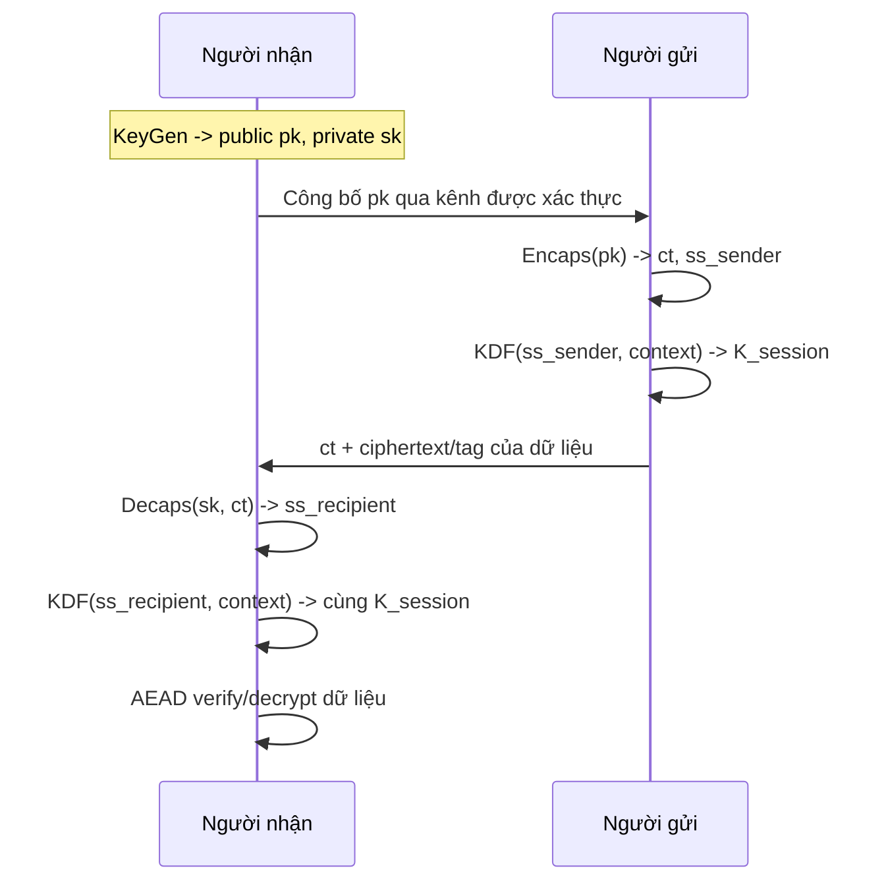
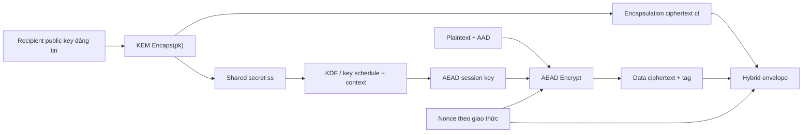
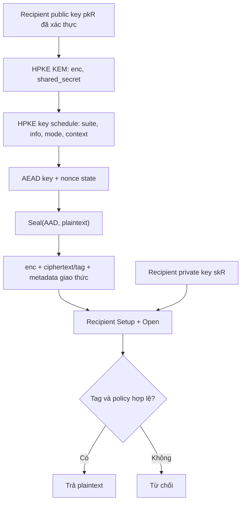
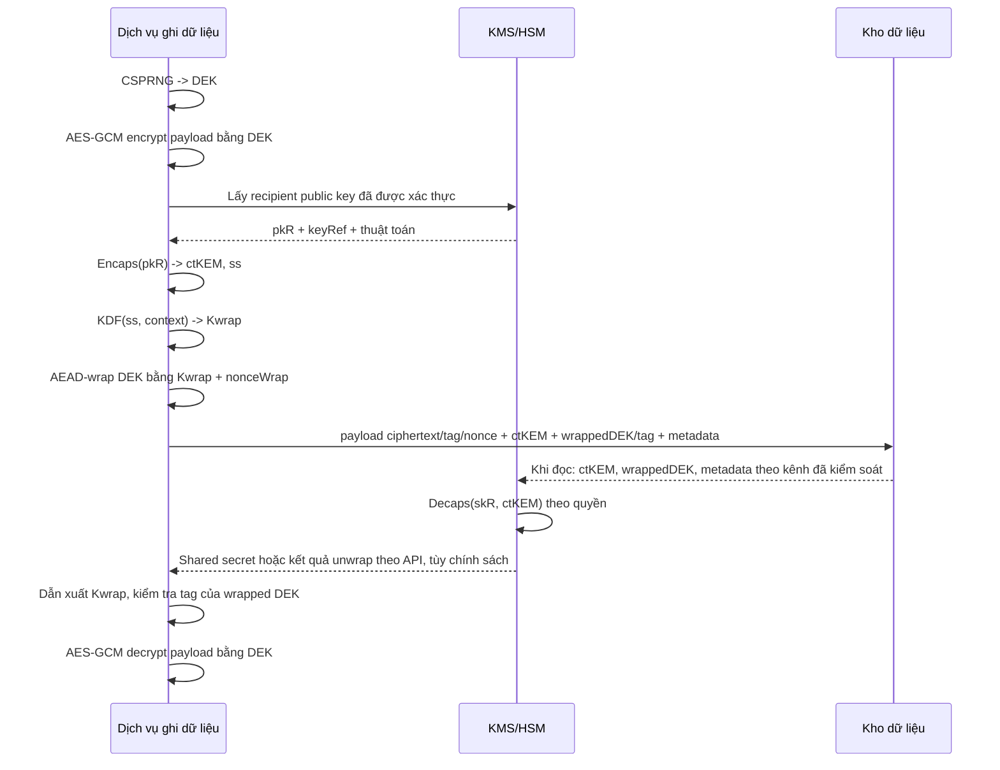

# Encapsulation (Đóng gói bí mật dùng để thiết lập khóa)

Trong chương **Key establishment** của module **SECURITY_KEY_MANAGEMENT_FUNDAMENTALS**, **encapsulation** thường nói đến thao tác **đóng gói khóa/bí mật dùng chung bằng một Key Encapsulation Mechanism (KEM)**. KEM cho phép một bên dùng **public encapsulation key** của người nhận tạo ra một **shared secret** và một **encapsulation ciphertext**; người nhận dùng **private decapsulation key** tương ứng để khôi phục cùng shared secret. Từ bí mật chung này, giao thức có thể dẫn xuất khóa phiên để mã hóa dữ liệu bằng AES-GCM hoặc AEAD tương đương.

Điểm quan trọng: **KEM không phải phép mã hóa dữ liệu tùy ý, và encapsulation không có nghĩa là lấy một khóa AES có sẵn rồi mã hóa trực tiếp nó bằng public key**. Việc mã hóa/bọc một DEK đã có sẵn là bài toán *key transport* hoặc *key wrapping*; một KEM đúng nghĩa thường sinh ra shared secret **trong lúc encapsulation**. Hai cách có thể được kết hợp khi xây dựng **envelope encryption** nhưng không nên nhập nhằng.

Đối với quản lý khóa, thiết kế an toàn còn phải xử lý xác thực public key, KDF, AEAD, bối cảnh giao thức, xử lý ciphertext giả mạo, quyền `Encapsulate`/`Decapsulate` thực tế của SDK, KMS/HSM, xoay vòng khóa và khả năng mở dữ liệu cũ. Bài này đi từ nguyên lý đến triển khai, vận hành và các lỗi bảo mật thường gặp.

## 1. Mục tiêu học tập

Sau bài học, bạn có thể:

- Mô tả ba thuật toán **KeyGen**, **Encaps** và **Decaps**, cùng vai trò `pk`, `sk`, `ct` và `ss`.
- Phân biệt **KEM**, **ECDH/DHKEM**, **RSA-OAEP key transport**, **key wrapping**, **HKDF** và **AEAD**.
- Giải thích điều KEM cung cấp và những điều **không tự bảo đảm**, nhất là xác thực người gửi, chống replay và forward secrecy.
- Hiểu các vấn đề lựa chọn thuật toán cổ điển và hậu lượng tử, bao gồm **ML-KEM** và cơ chế kết hợp hybrid có chuẩn.
- Phân tích kiến trúc tạo khóa phiên/DEK, dùng KMS/HSM, IAM, audit, key ID và rotation mà không làm mất khả năng đọc ciphertext lịch sử.
- Nhận diện lỗi decapsulation, xử lý ciphertext độc hại, khóa sai miền tin cậy và nguy cơ khi private key bị lộ.

## 2. Mô hình KEM tối giản

Một KEM có ba thao tác khái niệm:

```text
KeyGen() -> (pk, sk)

Encaps(pk) -> (ct, ss_sender)

Decaps(sk, ct) -> ss_recipient

Khi key pair và ciphertext hợp lệ:
    ss_sender == ss_recipient
```

Ở đây:

| Ký hiệu | Ý nghĩa | Cần bí mật? |
| --- | --- | --- |
| `pk` | Public key để **encapsulate**; thuộc đúng người nhận và thuật toán. | Không bí mật, **nhưng phải xác thực nguồn gốc**. |
| `sk` | Private key để **decapsulate**. | **Có**; cần quyền tối thiểu, bảo vệ trong KMS/HSM/keystore phù hợp. |
| `ct` | Encapsulation ciphertext, phần gửi cho người nhận để hai bên tạo cùng secret. | Thường công khai; phải được xử lý như **đầu vào không đáng tin**. |
| `ss` | Shared secret do thuật toán KEM tạo ra. | **Có**; không log và không truyền rõ. |
| `enc` | Một số giao thức như HPKE gọi dữ liệu encapsulated key là `enc`. | Công khai; không nhầm với ciphertext dữ liệu ứng dụng. |
| `K_session` | Khóa phiên dẫn xuất từ `ss` qua KDF của giao thức. | **Có**; chỉ sử dụng đúng purpose. |



**Tính đúng đắn (correctness)** của KEM có nghĩa khi tạo key pair và encapsulation hợp lệ, `Decaps(sk, ct)` cho cùng secret mà sender có được. Bảo mật được định nghĩa chặt chẽ hơn qua các mô hình tấn công; không thể lấy việc hai bên tạo cùng secret để suy ra **tính xác thực của mọi thông điệp**.

### 2.1. Vì sao có thể trao đổi bí mật mà không gửi bí mật?

Người gửi không cần biết `sk`. Thuật toán `Encaps(pk)` sinh `ct` và `ss`; với public key cùng các tham số chuẩn, đối thủ quan sát `ct` không dễ suy ra `ss`. Người nhận sở hữu private key tương ứng có thể xử lý `ct` và lấy `ss`.

Cơ chế bảo mật dựa trên thuật toán KEM, tham số, nguồn ngẫu nhiên và triển khai đúng. Public key không phải secret, nhưng nếu bên gửi nhận **nhầm public key của kẻ tấn công**, bên đó sẽ tạo bí mật mà đối thủ có thể decapsulate bằng private key của mình.

### 2.2. KEM không tự mã hóa payload

KEM cung cấp **khóa/bí mật chung**, không tự cung cấp tính toàn vẹn của JSON, tệp PDF hay thông điệp nghiệp vụ. Để bảo vệ dữ liệu, giao thức thường:

1. Thực hiện `Encaps(pk)` để có `ct` và `ss`.
2. Áp dụng KDF như HKDF hoặc **key schedule được bộ giao thức chỉ định** để tạo khóa phiên, nonce base và/hoặc khóa phụ trợ.
3. Mã hóa dữ liệu bằng **AEAD**, ví dụ AES-GCM.
4. Truyền `ct`, metadata thuật toán, nonce, ciphertext và authentication tag.
5. Bên nhận decapsulate, dẫn xuất lại khóa và **chỉ sử dụng plaintext sau khi AEAD xác thực thành công**.

Nếu `ss` có đủ entropy nhưng không có key schedule và context đúng, các bên có thể dùng nhầm một khóa cho nhiều mục đích hoặc không ràng buộc danh tính/phiên.

## 3. Encapsulation khác key transport, ECDH và key wrapping ra sao?

Các thuật ngữ gần nhau nhưng khác bản chất:

| Cơ chế | Bên gửi bắt đầu với gì? | Đầu ra chính | Ghi chú |
| --- | --- | --- | --- |
| **KEM** | Public key người nhận và nguồn ngẫu nhiên theo thuật toán. | `ct` + **shared secret mới được tạo**. | Định nghĩa `KeyGen/Encaps/Decaps`, có mô hình bảo mật riêng. |
| **RSA-OAEP key transport** | **Một DEK/secret đã có**, public RSA key người nhận. | RSA ciphertext bọc secret đầu vào. | Không tự động là một KEM tiêu chuẩn; cần đúng OAEP parameters/metadata. |
| **ECDH** | Private key của một phía và public key phía còn lại. | Shared secret từ phép thỏa thuận khóa. | ECDH thuần không xác thực người còn lại; thường cần HKDF. |
| **DHKEM** | Public key người nhận, ephemeral sender key pair, KDF. | Encapsulation `enc` và shared secret theo giao thức. | Có thể được định nghĩa dựa trên ECDH; **HPKE** dùng các DHKEM suite. |
| **Symmetric key wrap** | DEK có sẵn và KEK bí mật. | Wrapped DEK. | Bảo vệ khóa khi lưu/vận chuyển trong hệ dùng key đối xứng. |
| **AEAD như AES-GCM** | Key đối xứng, nonce, plaintext và AAD. | Ciphertext + tag. | Bảo vệ **payload**, không tự tạo public-key shared secret. |
| **HKDF** | Input key material có entropy phù hợp và context. | Key material dẫn xuất. | Không phải phép encapsulation hoặc mã hóa payload. |

**Ví dụ dễ nhầm:** hệ thống tạo ngẫu nhiên AES-256 DEK rồi RSA-OAEP encrypt 32 byte DEK. Đây là **bọc/chuyển DEK bằng RSA-OAEP**. Hệ thống khác gọi `Encaps(pk)`, lấy `ss` và `ct` rồi HKDF dẫn xuất AES key. Đây là **KEM-based key establishment**. Cả hai có thể xây được cơ chế mã hóa lai, nhưng cần kiểm chứng bảo đảm mật mã theo **giao thức cụ thể**, không tự gọi mọi phép RSA encrypt là một KEM.

### 3.1. Sơ đồ mã hóa lai (hybrid encryption)



Trong mô hình này có **hai phần dữ liệu dễ nhầm**: `ct` là **encapsulation ciphertext**, còn `PAY` là **ciphertext dữ liệu**. Chúng phục vụ mục đích khác nhau và cần lưu/serialise rõ ràng.

## 4. Tiêu chí bảo mật của KEM

### 4.1. Confidentiality trước đối thủ quan sát

Một KEM an toàn phải khiến đối thủ chỉ biết `pk` và `ct` không suy ra được `ss` với xác suất đáng kể. Tính ngẫu nhiên và thuật toán đúng là thiết yếu; một seed tầm thường hoặc cặp khóa được sinh sai có thể phá bảo mật.

Đừng đồng nhất “`ct` không đọc được bằng mắt” với tính an toàn. Phải dùng primitive đã được đánh giá và tham số chính xác.

### 4.2. Chosen-ciphertext resistance: IND-CCA

Khi bên nhận xử lý `ct` do mạng cung cấp, attacker có thể tạo **encapsulation ciphertext giả mạo** và quan sát phản hồi. Các ứng dụng thực thường cần **IND-CCA** (*indistinguishability under chosen-ciphertext attacks*) cho KEM, hoặc tính an toàn tương đương do giao thức chỉ định.

Các nguyên tắc triển khai:

- Dùng **KEM/SDK đã được chuẩn hóa và kiểm thử**, không tự viết phép toán modulo, lattice hoặc quy tắc decapsulation.
- Kiểm tra độ dài và encoding đầu vào theo spec, tránh giải mã hoặc cấp phát không giới hạn.
- Không trả **shared secret, vật liệu trung gian, thông tin nhạy cảm** hoặc tín hiệu phân biệt lỗi ở mức có thể tạo oracle.
- Phải xử lý ciphertext không hợp lệ theo **đúng quy tắc thuật toán**; không tự chế “nếu lỗi thì trả secret toàn zero” hoặc một chuỗi cố định.
- Lớp AEAD phải **fail closed**: tag sai hoặc context sai thì không trả plaintext.

**Đặc biệt với ML-KEM:** cơ chế decapsulation chuẩn có quy tắc **implicit rejection** cho một số ciphertext không hợp lệ, có thể dẫn tới một secret giả ngẫu nhiên thay vì báo lỗi trực tiếp. Ứng dụng không được suy ra “decapsulation trả về bytes” nghĩa là đối tác hợp lệ; lớp xác thực dữ liệu/chốt khóa ở giao thức phía trên vẫn cần được kiểm tra. Không tự thay quy tắc rejection của thư viện.

### 4.3. KEM thuần không xác thực người gửi

Đối thủ bất kỳ biết public key của người nhận thường có thể gọi `Encaps(pk)` để tạo một shared secret và gửi `ct` cho người nhận. Điều đó **không chứng minh danh tính người gửi**.

Nếu cần xác thực:

- Bên gửi phải xác thực **public key của người nhận** (chứng chỉ X.509, trust store, pinning hoặc danh bạ khóa có bảo vệ).
- Bên nhận có thể cần xác thực sender qua **chữ ký số**, chứng thực kênh, khóa chia sẻ trước hoặc một chế độ authenticated KEM/HPKE phù hợp.
- Context/AAD nên ràng buộc `senderId`, `recipientId`, `tenantId`, `protocolVersion`, key references và mục đích khi giao thức cho phép; **metadata không được xác thực vẫn có thể bị tráo**.
- Nếu ứng dụng dễ bị phát lại thông điệp cũ, cần **replay protection** ở tầng giao thức/nghiệp vụ; AEAD tag hợp lệ không tự chứng minh thông điệp chưa từng được gửi.

Một shared secret giống nhau ở hai phía không bằng chứng rằng một bên đã được **ủy quyền gửi lệnh thanh toán**.

### 4.4. Forward secrecy không mặc định

Giả sử một bản tin được encapsulate tới **public key tĩnh** của người nhận và `ct` được ghi lại. Nếu **private decapsulation key tĩnh bị lộ trong tương lai**, đối thủ có `ct` đã lưu thường có thể decapsulate và khôi phục secret quá khứ theo cơ chế đó. Việc sender đã dùng ngẫu nhiên khi encapsulate **không tự tạo forward secrecy đối với rò rỉ private recipient key**.

Forward secrecy đòi hỏi thiết kế giao thức phù hợp, chẳng hạn một hình thức **ephemeral authenticated key exchange** có vòng đời khóa phiên đúng. Một số cơ chế kết hợp KEM với khóa tạm thời hoặc prekeys có thể đạt tính chất khác nhau; không tự gắn nhãn “forward secret” cho mọi KEM-based encryption.

## 5. Thuật toán và chuẩn thường gặp

### 5.1. DHKEM: encapsulation dựa trên Diffie–Hellman

Một **Diffie–Hellman-based KEM (DHKEM)** có thể dùng ECDH/X25519 bên trong:

1. Người nhận tạo cặp khóa tĩnh `(skR, pkR)` theo suite.
2. Người gửi tạo **ephemeral key pair** `(skE, pkE)`.
3. Người gửi tính ECDH với `skE` và `pkR`, sử dụng KDF theo suite để tạo shared secret.
4. Người gửi truyền `pkE` được mã hóa theo giao thức làm `enc`.
5. Người nhận tính ECDH từ `skR` với `pkE` để dẫn xuất cùng secret.

Đây là **mô hình khái niệm**. Không thể tự thay bằng `HKDF(ECDH)` chung chung rồi khẳng định tương thích **DHKEM của HPKE**: chuẩn còn quy định encoding, validation, KEM context, suite ID, salt/info và key schedule. Đối với **X25519**, thư viện/giao thức phải xử lý giá trị shared secret **all-zero** đúng quy định.

### 5.2. ML-KEM: cơ chế KEM hậu lượng tử

**ML-KEM (Module-Lattice-Based Key Encapsulation Mechanism)** là cơ chế KEM dựa trên bài toán lattice, được NIST chuẩn hóa trong **FIPS 203**. Bộ tham số gồm **ML-KEM-512**, **ML-KEM-768** và **ML-KEM-1024** với mục tiêu mức an toàn khác nhau theo tiêu chuẩn.

| Bộ tham số ML-KEM | Public encapsulation key (byte) | Encapsulation ciphertext (byte) | Shared secret (byte) |
| --- | ---: | ---: | ---: |
| ML-KEM-512 | 800 | 768 | 32 |
| ML-KEM-768 | 1184 | 1088 | 32 |
| ML-KEM-1024 | 1568 | 1568 | 32 |

Các giá trị trong bảng giúp hình dung **chi phí lưu trữ và truyền dữ liệu** của ML-KEM; không phải chỉ tiêu chọn cấu hình duy nhất. Cần xét mức an toàn, hiệu năng, hỗ trợ của thư viện, quy định chuẩn và toàn bộ giao thức.

**ML-KEM không phải chữ ký số.** Để xác thực người gửi hoặc ký chứng cứ, cần thêm signature scheme/chứng chỉ hoặc cơ chế xác thực phù hợp. Chuyển thuật toán thỏa thuận khóa sang ML-KEM cũng không tự thay **RSA-PSS, ECDSA, Ed25519**, và không tự biến mọi giao thức thành giải pháp hậu lượng tử hoàn chỉnh.

### 5.3. So sánh theo use case

| Tình huống | Lựa chọn xem xét | Điểm kiểm tra |
| --- | --- | --- |
| Hệ thống đang có HPKE dùng X25519 | **DHKEM(X25519, HKDF-SHA256)** theo suite HPKE tương ứng. | Xác thực recipient key; dùng thư viện HPKE, không viết key schedule riêng. |
| Cần bảo vệ trao đổi secret trước rủi ro lượng tử dài hạn | **ML-KEM** theo tiêu chuẩn và hệ sinh thái hỗ trợ. | Lưu trữ lớn hơn ECC, version/algorithm ID, chính sách mật mã hậu lượng tử. |
| Giai đoạn chuyển tiếp classical + post-quantum | **Hybrid/composite key establishment** theo giao thức đã được đánh giá. | Kết hợp secret an toàn, phân tách context, kiểm tra cả hai nhánh, chống downgrade. |
| Ứng dụng Java 17 muốn bọc một DEK bằng RSA | **RSA-OAEP key transport** (không gọi là KEM chuẩn). | OAEP hash/MGF parameters, RSA key size, xử lý lỗi/AEAD và tin cậy public key. |
| Chỉ cần mã hóa bản ghi trong một dịch vụ với KMS | **AES-GCM + symmetric DEK/KEK envelope** có thể đơn giản hơn. | KMS `GenerateDataKey`, quản lý nonce, quyền unwrap, rewrap/re-encrypt. |

### 5.4. Kết hợp hybrid classical + post-quantum

Một thiết kế hybrid có thể kết hợp một shared secret từ cơ chế cổ điển (ví dụ ECDH/DHKEM) và một secret từ ML-KEM, sau đó dẫn xuất khóa cuối qua **combiner/KDF được đặc tả và phân tích**.

```text
Classical branch:    ss_classical
Post-quantum branch: ss_pq
                         |
                         v
      Authenticated protocol-specific combiner
        with lengths, context, suite labels
                         |
                         v
                  final session key
```

**Không tự nối `ss_classical || ss_pq` rồi tùy tiện SHA-256 nếu không có đặc tả bảo mật.** Quy tắc kết hợp phải bảo vệ độ dài/encoding, chống tráo transcript, phân biệt miền thuật toán và xử lý lỗi từng nhánh. Bên nhận cần từ chối việc bên kia ép dùng chỉ nhánh yếu hơn khi chính sách yêu cầu hybrid (*downgrade protection*).

Cơ chế hybrid không tự bảo đảm **sender authentication**, bảo vệ ciphertext dữ liệu, tính sẵn sàng của KMS hay an toàn vòng đời private key.

## 6. HPKE: KEM chỉ là một phần của mã hóa lai chuẩn

**Hybrid Public Key Encryption (HPKE)** định nghĩa cách kết hợp KEM, KDF và AEAD thành bộ giao thức mã hóa công khai có chuẩn. Trong HPKE, thao tác như `SetupBaseS` và `SetupBaseR` tạo ngữ cảnh sender/recipient, từ đó dùng `Seal`/`Open` cho dữ liệu.



HPKE có nhiều **mode** với mức bảo đảm khác nhau. **Base mode** giúp sender mã hóa đến recipient public key đã biết, nhưng **không tự xác thực danh tính người gửi**. Các mode có xác thực người gửi hoặc PSK có điều kiện và yêu cầu quản lý khóa khác; chọn mode theo mô hình tin cậy và policy.

Khi dùng HPKE production:

- Chọn **suite** (KEM ID, KDF ID, AEAD ID) tương thích và được hỗ trợ.
- Xác thực recipient public key qua kênh đáng tin; nếu cần sender authentication, dùng **mode/kiến trúc phù hợp**.
- Ràng buộc `info`, AAD và context vào tenant, vai trò, protocol version và đối tượng nghiệp vụ theo chuẩn.
- Không tự sinh/đặt lại nonce của ngữ cảnh HPKE ngoài quy tắc được định nghĩa; tránh reuse state sai.
- Xử lý sai tag, sai context, sai public key hoặc dữ liệu lỗi theo nguyên tắc fail closed.
- Lưu và version hóa dữ liệu `enc` và metadata cần thiết nếu ciphertext phải được giải mã sau nhiều năm.

## 7. KEM và envelope encryption trong hệ thống lưu trữ

Một thiết kế dùng **KEM để bảo vệ DEK** thường có hai lớp khóa:

- **DEK** ngẫu nhiên dùng AES-GCM để mã hóa tài liệu.
- **KEM-derived wrapping key** được tạo nhờ Encaps với public key người nhận, sau đó bảo vệ DEK bằng một AEAD khác.



Sơ đồ minh họa **khái niệm**, không khẳng định một API KMS cụ thể hỗ trợ thao tác `Decaps` hoặc trả shared secret. Có hệ thống chỉ hỗ trợ wrapping đối xứng hoặc ký, có HSM cho phép derivation trong thiết bị, và có sản phẩm hỗ trợ các thuật toán KEM nhất định.

### 7.1. Metadata cần lưu trong envelope

Ví dụ cấu trúc logic:

```json
{
  "formatVersion": 1,
  "purpose": "encrypted-record",
  "recipientKeyId": "tenant-42/kem-v3",
  "kemSuite": "profile-defined-kem",
  "kdfSuite": "profile-defined-kdf",
  "aeadSuite": "AES-256-GCM",
  "encapsulation": "<base64url-ctKEM>",
  "wrappedDek": "<base64url-ciphertext-and-tag>",
  "nonceWrap": "<base64url-12-byte-nonce>",
  "nonceData": "<base64url-12-byte-nonce>",
  "ciphertextData": "<base64url-ciphertext-and-tag>"
}
```

Đây là **schema minh họa, không phải một chuẩn có thể triển khai trực tiếp**. Những chuỗi `profile-defined-...` phải được thay bằng **suite ID đã đăng ký và kiểm soát phía ứng dụng**. Bộ mã hóa cần bảo vệ hoặc xác thực các trường ảnh hưởng bảo mật bằng KDF context/AAD theo định dạng không mơ hồ; không để attacker tự chọn một thuật toán yếu hơn bằng cách sửa JSON.

**Hai lớp AEAD khác nhau** cần hai miền dùng khóa/nonce phù hợp: lớp bọc DEK dùng `Kwrap`, lớp mã hóa payload dùng `DEK`. Không lấy cùng một khóa và cùng nonce để dùng cho cả hai lớp. Nên dùng một thư viện/protocol có đặc tả serialization nếu có thể.

### 7.2. Rotation recipient key

Khi đổi cặp `(pkR, skR)` sang cặp mới:

1. Public key mới phải được công bố và xác thực trước khi bên gửi bắt đầu encapsulate.
2. Phần **bản mã mới** dùng recipient key ID mới.
3. Dữ liệu cũ vẫn cần private decapsulation key cũ **hoặc** đã được chuyển lớp bảo vệ DEK sang recipient key mới.
4. Nếu chỉ chuyển **encapsulation/wrapping layer** mà giữ DEK, ciphertext payload có thể không đổi, nếu giao thức hỗ trợ và dữ liệu DEK cũ chưa bị lộ.
5. Nếu **recipient private key cũ bị lộ và các encapsulation ciphertext cũ đã bị thu thập**, coi những DEK có thể được mở bọc bằng khóa cũ là bị đe dọa; **chỉ rewrap DEK không làm mất kiến thức của đối thủ**. Cần đánh giá phạm vi lộ và **re-encrypt bằng DEK mới** khi cần khôi phục tính bí mật cho dữ liệu còn bảo vệ.

**Phân biệt rõ:** rotation theo lịch bảo trì có thể giữ khả năng mở ciphertext cũ; rotation do compromise đòi hỏi đánh giá nguy cơ dữ liệu lịch sử. Một KEM với recipient private key dài hạn bị lộ không tự che được bản mã quá khứ mà attacker đã ghi lại.

### 7.3. Key lifecycle và phụ thuộc backup

| Giai đoạn | Việc cần làm |
| --- | --- |
| **Generate** | Sinh `pk/sk` theo suite phù hợp, bằng nguồn random an toàn/provider/KMS. |
| **Register** | Gắn `keyId`, version, purpose, owner, tenant, thuật toán, thời hạn và trạng thái. |
| **Publish** | Phân phối public key có xác thực, có cơ chế thay đổi khóa đáng tin. |
| **Encapsulate** | Chỉ dùng đúng recipient public key và suite; ràng buộc context. |
| **Decapsulate** | Bảo vệ private key, áp dụng IAM, kiểm tra đầu vào và giới hạn sử dụng. |
| **Rotate** | Công bố khóa mới, chuyển traffic mới, xử lý ciphertext lịch sử. |
| **Revoke/disable** | Ngăn dùng private key nghi bị lộ; cập nhật trust/cert/quyền theo hệ thống. |
| **Destroy** | Kiểm kê ciphertext, key backup và phụ thuộc trước khi xóa private key. |

Không hủy `skR` cũ chỉ vì không còn nhận ciphertext mới, nếu chưa có bản giải mã/unwrap hợp lệ cho dữ liệu cần lưu lâu dài. Một hệ thống lưu ciphertext trong backup có thể cần phương án khôi phục private key phù hợp; với non-exportable HSM key, phải dùng cơ chế backup/replication đã được nhà cung cấp và chính sách cho phép.

## 8. Ví dụ Java 17: bọc DEK bằng RSA-OAEP và mã hóa dữ liệu

**Java 17 tiêu chuẩn không cung cấp API KEM tổng quát như `javax.crypto.KEM` của các JDK mới hơn.** Do đó ví dụ chạy được bằng JCA dưới đây minh họa **key transport bằng RSA-OAEP**, một ý tưởng gần với cách mã hóa lai nhưng **không phải hiện thực một KEM chuẩn**. Khi cần ML-KEM/DHKEM/HPKE, hãy dùng provider và thư viện tương thích, đã được đánh giá, đúng bộ tham số và đúng giao thức.

### 8.1. Quy trình ví dụ

1. Người nhận có cặp khóa RSA 3072 bit; public key đã được xác thực.
2. Sender tạo ngẫu nhiên **DEK AES-256**.
3. Sender dùng **RSA-OAEP-SHA256 với MGF1-SHA256** bọc DEK.
4. Sender dùng **AES-GCM** mã hóa payload, AAD và nonce mới.
5. Recipient dùng private RSA key mở bọc DEK, sau đó AES-GCM verify/decrypt payload.

```java
import java.nio.charset.StandardCharsets;
import java.security.KeyPair;
import java.security.KeyPairGenerator;
import java.security.SecureRandom;
import java.security.spec.MGF1ParameterSpec;
import javax.crypto.Cipher;
import javax.crypto.KeyGenerator;
import javax.crypto.SecretKey;
import javax.crypto.spec.GCMParameterSpec;
import javax.crypto.spec.OAEPParameterSpec;
import javax.crypto.spec.PSource;
import javax.crypto.spec.SecretKeySpec;

public class RsaOaepTransportDemo {
    record Envelope(byte[] wrappedKey, byte[] nonce, byte[] encryptedData) {}

    static final OAEPParameterSpec OAEP256 = new OAEPParameterSpec(
            "SHA-256", "MGF1", MGF1ParameterSpec.SHA256,
            PSource.PSpecified.DEFAULT);

    static Envelope encrypt(
            byte[] plaintext, byte[] aad,
            java.security.PublicKey recipientPublic,
            SecureRandom rng) throws Exception {

        KeyGenerator generator = KeyGenerator.getInstance("AES");
        generator.init(256, rng);
        SecretKey dek = generator.generateKey();

        Cipher wrap = Cipher.getInstance("RSA/ECB/OAEPPadding");
        wrap.init(Cipher.ENCRYPT_MODE, recipientPublic, OAEP256, rng);
        byte[] wrappedDek = wrap.doFinal(dek.getEncoded());

        byte[] nonce = new byte[12];
        rng.nextBytes(nonce);
        Cipher gcm = Cipher.getInstance("AES/GCM/NoPadding");
        gcm.init(Cipher.ENCRYPT_MODE, dek, new GCMParameterSpec(128, nonce));
        gcm.updateAAD(aad);
        byte[] encryptedData = gcm.doFinal(plaintext);
        return new Envelope(wrappedDek, nonce, encryptedData);
    }

    static byte[] decrypt(
            Envelope envelope, byte[] aad,
            java.security.PrivateKey recipientPrivate) throws Exception {

        if (envelope.nonce().length != 12) {
            throw new SecurityException("Invalid envelope");
        }
        Cipher unwrap = Cipher.getInstance("RSA/ECB/OAEPPadding");
        unwrap.init(Cipher.DECRYPT_MODE, recipientPrivate, OAEP256);
        byte[] rawDek = unwrap.doFinal(envelope.wrappedKey());
        if (rawDek.length != 32) {
            throw new SecurityException("Invalid envelope");
        }

        SecretKeySpec dek = new SecretKeySpec(rawDek, "AES");
        try {
            Cipher gcm = Cipher.getInstance("AES/GCM/NoPadding");
            gcm.init(Cipher.DECRYPT_MODE, dek,
                    new GCMParameterSpec(128, envelope.nonce()));
            gcm.updateAAD(aad);
            return gcm.doFinal(envelope.encryptedData());
        } finally {
            java.util.Arrays.fill(rawDek, (byte) 0);
        }
    }

    public static void main(String[] args) throws Exception {
        SecureRandom rng = new SecureRandom();

        KeyPairGenerator rsa = KeyPairGenerator.getInstance("RSA");
        rsa.initialize(3072, rng);
        KeyPair recipient = rsa.generateKeyPair();

        byte[] aad = "tenant=t17|record=r99|schema=v1"
                .getBytes(StandardCharsets.UTF_8);
        byte[] message = "Thông tin đơn hàng"
                .getBytes(StandardCharsets.UTF_8);

        Envelope sealed = encrypt(message, aad, recipient.getPublic(), rng);
        byte[] recovered = decrypt(sealed, aad, recipient.getPrivate());
        System.out.println(new String(recovered, StandardCharsets.UTF_8));

        // Thay AAD sẽ khiến xác thực AES-GCM thất bại.
        byte[] wrongAad = "tenant=t18|record=r99|schema=v1"
                .getBytes(StandardCharsets.UTF_8);
        try {
            decrypt(sealed, wrongAad, recipient.getPrivate());
            throw new AssertionError("Tampered context accepted");
        } catch (javax.crypto.AEADBadTagException expected) {
            System.out.println("Changed AAD rejected");
        }
    }
}
```

Ví dụ dùng `OAEPParameterSpec` để **khóa chính xác cả hash OAEP và MGF1-SHA256**, tránh dựa vào mặc định provider. DEK có entropy từ `KeyGenerator`, không phải mật khẩu. GCM cung cấp tag xác thực nội dung. Nếu AAD thay đổi, bước giải mã dữ liệu sẽ thất bại.

**Giới hạn học thuật/production:**

- Đây là **RSA-OAEP key transport**, **không phải một KEM `Encaps/Decaps` tiêu chuẩn** và không dùng để chứng minh an toàn của ML-KEM.
- Public RSA key phải được liên kết với recipient đáng tin; ví dụ chỉ tạo cặp khóa trong cùng tiến trình để minh họa.
- Không phân phối private key bằng cách `getEncoded()` rồi ghi log/file không bảo vệ; production ưu tiên HSM/KMS khi yêu cầu.
- Với ciphertext độc hại, một ứng dụng thực phải kiểm soát định dạng, phiên bản, kích thước, loại lỗi và hành vi phản hồi để tránh padding/error oracles; ví dụ đơn giản vẫn có thể rò loại lỗi nếu dùng trực tiếp làm API trả ra Internet.
- `record Envelope` giữ các mảng byte có thể bị sửa; code production nên dùng định dạng serialization đã kiểm soát và sao chép phòng sửa đổi ngoài ý muốn.
- Bài viết không chạy Java/Gradle trong STEP 4; cần kiểm tra provider/JDK và đưa test vectors, negative tests vào quy trình kiểm thử trước khi vận hành.
- Với dữ liệu lớn hoặc luồng, cần thiết kế streaming, giới hạn dung lượng, protocol versioning và bảo vệ toàn bộ metadata có ý nghĩa bảo mật.

### 8.2. Vì sao không tự viết "ML-KEM trong Java" ở tầng ứng dụng?

ML-KEM có cấu trúc và quy tắc sinh/decapsulation chặt chẽ; một ví dụ vài dòng tự tạo ma trận hoặc hash không thể thay thư viện chuẩn. Nếu cần API Java trong sản phẩm:

1. Chọn provider hỗ trợ **đúng ML-KEM suite** được cho phép và nắm rõ phiên bản JDK/API.
2. Dùng API **KEM `encapsulate`/`decapsulate`** của provider hoặc giao thức HPKE/hybrid được hỗ trợ.
3. Giữ shared secret trong miền tin cậy, đưa vào đúng key schedule và không xuất ra log.
4. Xác minh ciphertext có đúng suite, key reference, format và giới hạn kích thước.
5. Kiểm tra AEAD/authentication layer, phản hồi lỗi và thao tác rotation với dữ liệu lịch sử.

Đừng biến “có một library ML-KEM” thành khẳng định “giao thức của tôi kháng lượng tử và xác thực”. Giao thức còn phụ thuộc sender authentication, trust model, AEAD, key lifecycle và lựa chọn hybrid.

## 9. KMS/HSM, IAM và giới hạn lạm dụng

Một thiết kế tốt cần trả lời **ai được phép encapsulate**, **ai có quyền decapsulate**, và **ai được quyền thay public key hoặc xóa private key**.

| Vai trò | Quyền nên có | Quyền không cấp mặc định |
| --- | --- | --- |
| Sender/encrypt workload | Lấy **public key đã xác thực**, encapsulate/mã hóa theo policy. | Trích xuất recipient private key, tự sửa trust anchor, xóa key. |
| Recipient/decrypt workload | Decapsulate/unwrap cho đúng tenant, object và purpose. | Quản trị policy hoặc đọc mọi khóa của tenant khác. |
| Security key administrator | Tạo cặp khóa, quản lý version, rotate, disable/destroy theo xét duyệt. | Trực tiếp giải mã dữ liệu nghiệp vụ nếu không được cấp riêng. |
| Auditor | Xem key ID, thuật toán, thao tác quản trị, số lần thành công/thất bại. | Lấy shared secret/private key hay plaintext dữ liệu. |
| Backup/recovery operator | Sao lưu ciphertext, metadata và phục hồi thông qua quy trình có quyền. | Vượt policy để xuất private key hoặc tự ý hủy key. |

**Audit hữu ích** có thể có `actor`, `operation`, `keyId`, `algorithmSuite`, `tenant`, `requestId`, `timestamp`, `result`; không log `ss`, private key, plaintext DEK hoặc nội dung nhạy cảm. Đừng log một KEM ciphertext rồi tự coi việc đó là bí mật; ciphertext được thiết kế có thể công khai, nhưng metadata liên quan vẫn có thể nhạy cảm và cần chính sách lưu/ẩn phù hợp.

**HSM không thể ngăn mọi lạm dụng:** workload bị chiếm quyền có thể gọi API `Decapsulate`/`Decrypt` nếu vẫn có quyền. Phải kiểm soát cả **quyền nghiệp vụ**, chứng cứ truy cập, hạn mức, bộ lọc tenant và hành vi bất thường.

## 10. Các lỗi thiết kế thường gặp

| Sai lầm | Hậu quả | Cách phòng tránh |
| --- | --- | --- |
| Gọi RSA-OAEP encrypt một DEK có sẵn là KEM chuẩn. | Nhầm mô hình bảo mật và API, triển khai sai giao thức. | Phân biệt key transport/key wrap với `Encaps/Decaps` đúng spec. |
| Tin public key lấy từ request chưa xác thực. | Sender encapsulate cho attacker, làm lộ session key cho đối thủ. | Xác thực recipient key bằng trust store/PKI/định danh cố định. |
| Coi KEM chứng minh ai gửi dữ liệu. | Ai biết public key đều có thể encapsulate, gửi thông điệp giả mạo. | Sender authentication/chữ ký/chế độ HPKE phù hợp, kiểm tra ủy quyền. |
| Dùng `ss` trực tiếp và tái sử dụng cho nhiều mục đích. | Thiếu domain separation và khả năng liên thông an toàn. | Dùng KDF/key schedule theo chuẩn, context và nhãn purpose. |
| Bỏ AEAD authentication tag hoặc dùng plaintext trước verify. | Dữ liệu có thể bị sửa/misuse. | AEAD fail closed; xác thực metadata và payload trước sử dụng. |
| Không ràng buộc suite và key ID trong context được xác thực. | Tráo metadata, downgrade, nhầm recipient/tenant. | Protocol version, AAD/KDF context rõ và suite allowlist. |
| Tự tạo phản hồi lỗi khác nhau cho OAEP/decapsulation khi nhận ciphertext từ mạng. | Có thể hình thành error oracle trong một số thiết kế. | Theo spec của primitive, lỗi thống nhất ở biên API, hạn chế quan sát không cần thiết. |
| Tự thay implicit rejection của ML-KEM bằng secret zero cố định. | Phá tính chất bảo mật đã được đánh giá. | Dùng thư viện chuẩn, không sửa xử lý ciphertext không hợp lệ. |
| Dùng một KEM key tĩnh và tuyên bố có forward secrecy. | Khi private key lộ, ciphertext quá khứ đã ghi lại có thể bị mở. | Thiết kế ephemeral authenticated key exchange khi cần FS. |
| Tự nối classical + PQ secret rồi hash không có spec. | Rủi ro thiếu context binding, downgrade hoặc combiner sai. | Dùng hybrid key establishment được phân tích/chuẩn hóa. |
| Hủy recipient private key ngay sau rotation. | Dữ liệu cũ không thể decapsulate để giải mã. | Kiểm kê dữ liệu, backup và chuyển lớp bảo vệ hoặc giữ key theo policy. |
| Khi private key bị lộ chỉ rewrap DEK cũ rồi tuyên bố dữ liệu an toàn. | Attacker đã có secret/DEK có thể tiếp tục đọc dữ liệu tương ứng. | Đánh giá phạm vi lộ, thay DEK và re-encrypt khi cần. |
| Log shared secret, plaintext DEK hoặc private key. | Rò vật liệu khóa vượt qua mục tiêu KMS/HSM. | Chỉ ghi metadata thao tác, xóa secret trong bộ nhớ khi khả thi. |
| Trộn encapsulation ciphertext và payload ciphertext trong cùng trường. | Lỗi parsing, chuyển đổi giao thức và audit. | Envelope có schema rõ, version, lengths, key reference, nonce/tag riêng. |

## 11. Kịch bản áp dụng: dịch vụ chia sẻ tài liệu giữa hai tổ chức

Một hệ thống A gửi tệp đến tổ chức B. B có public encapsulation key đã được công bố qua trust registry được kiểm soát. A muốn bảo vệ nội dung tệp, nhưng **B chỉ nên giải mã khi đúng tenant và chính sách truy cập**.

1. B tạo recipient key pair theo một KEM suite được phép. Private key nằm trong KMS/HSM hoặc vùng bí mật được bảo vệ; public key gắn với organization ID và key ID.
2. A xác thực public key B và suite từ trust registry; không tin URL key tự khai trong yêu cầu.
3. A tạo DEK AES ngẫu nhiên, mã hóa tệp bằng AEAD, tính tag cho dữ liệu và metadata quan trọng.
4. A encapsulate tới B, dẫn xuất khóa bọc qua KDF, bọc DEK bằng AEAD và tạo envelope có version.
5. A có thể **ký manifest** hoặc sử dụng một chế độ xác thực người gửi đã được thỏa thuận để B biết dữ liệu thực sự từ A; **KEM thuần không đảm bảo điều đó**.
6. B kiểm tra quyền truy cập, tenant, thông tin issuer/trust và cấu trúc envelope trước khi gọi decapsulation.
7. B dẫn xuất khóa bọc, xác thực wrapped DEK, lấy DEK rồi giải mã payload sau khi kiểm tra AEAD tag.
8. Audit ghi key ID/version, danh tính workload, đối tượng dữ liệu, kết quả; không ghi DEK/private key/`ss`.
9. Khi đổi khóa B, tài liệu mới dùng public key mới, tài liệu cũ được chuyển/lưu quyền mở theo chính sách và kiểm thử bản backup.
10. Nếu khóa riêng của B bị lộ, A/B điều tra bản mã đã phát hành và cân nhắc tạo DEK mới/re-encrypt, không chỉ đổi public key cho dữ liệu mới.

Sơ đồ vai trò giúp tách **bí mật**, **xác thực**, **ủy quyền** và **khả năng phục hồi**: một primitive không giải quyết tất cả.

## 12. Checklist triển khai Encapsulation an toàn

1. **Xác định nhu cầu:** thật sự cần KEM hay chỉ cần RSA-OAEP key transport / symmetric key wrap / TLS?
2. **Chọn suite:** thuật toán KEM, KDF, AEAD, version và khả năng tương thích đã được đặc tả và cho phép?
3. **Key generation:** cặp `pk/sk` được sinh đúng thuật toán, CSPRNG/entropy phù hợp, có provenance và owner?
4. **Trust:** public key recipient gắn đúng danh tính, tenant và purpose thông qua PKI/trust store/cấu hình tin cậy?
5. **Sender authentication:** nếu nghiệp vụ cần, đã có chữ ký/mode xác thực phù hợp; không nhầm `Encaps(pk)` với chứng minh người gửi?
6. **Context binding:** `keyId`, suite, tenant, recipient, object ID và protocol version có được ràng buộc vào dữ liệu xác thực?
7. **KDF/AEAD:** shared secret được dùng đúng key schedule, nonce/tag theo giao thức, ciphertext sai bị từ chối trước khi dùng plaintext?
8. **Ciphertext validation:** có giới hạn độ dài, encoding, xử lý lỗi/implicit rejection đúng spec và chống oracle không?
9. **Private key control:** decapsulation private key ở HSM/KMS/keystore phù hợp, quyền ít nhất, phân tách admin và workload?
10. **Rotation:** có giai đoạn công bố khóa mới, chuyển sender và duy trì giải mã ciphertext cũ trong thời gian cần thiết?
11. **Compromise response:** đã phân biệt routine rotation với rò private key; có kế hoạch re-encrypt DEK/payload nếu bí mật lịch sử đã bị lộ?
12. **Audit và backup:** ghi thao tác, key version, actor, kết quả; tránh log secret, kiểm thử phục hồi và hủy khóa có kiểm kê?
13. **Migration:** nếu chuyển sang ML-KEM/hybrid, có thiết kế chống downgrade và giao thức combiner được đánh giá?
14. **Kiểm thử:** đã thử sai key, sai tag, tampered ciphertext/context, input quá cỡ, provider không sẵn sàng và rotation lịch sử?

## 13. Câu hỏi tự kiểm tra

1. Viết ba thao tác `KeyGen`, `Encaps`, `Decaps` và mô tả vì sao người nhận tạo được cùng shared secret mà không nhận secret dưới dạng rõ.
2. Phân biệt **KEM encapsulation ciphertext** và **AEAD ciphertext** của payload. Tại sao cần cả hai trong mã hóa lai?
3. Vì sao bọc một DEK đã có sẵn bằng RSA-OAEP là key transport chứ không tự động là KEM chuẩn?
4. Nếu người gửi encapsulate đến public key giả mạo, chuyện gì xảy ra dù thuật toán ML-KEM hoàn toàn đúng?
5. Vì sao **KEM không tự xác thực sender**, và cần thêm cơ chế nào trong hệ thống thanh toán?
6. IND-CCA quan trọng thế nào khi attacker có thể gửi ciphertext không hợp lệ vào API decapsulation? Vì sao không nên tự thay quy tắc implicit rejection của ML-KEM?
7. HPKE base mode có tự chứng minh danh tính người gửi không? Các thành phần KEM, KDF, AEAD trong HPKE làm nhiệm vụ gì?
8. Tại sao dùng recipient KEM private key tĩnh thường không đem lại forward secrecy trước việc key bị lộ trong tương lai?
9. Trong envelope encryption dùng KEM, vì sao cần phân tách `Kwrap` và `DEK`? Rotation recipient key khác re-encrypt payload ở đâu?
10. Nếu recipient private key đã bị lộ và attacker lưu các encapsulation ciphertext cũ, chỉ rewrap các DEK dưới public key mới đã đủ khôi phục bí mật chưa?
11. Một hệ thống muốn kết hợp ECDH và ML-KEM: vì sao không nên tự nối secret rồi hash tùy ý, và cần kiểm soát downgrade ra sao?
12. Một HSM giữ private decapsulation key non-exportable: tại sao workload bị chiếm quyền vẫn là nguy cơ và IAM/audit cần giới hạn gì?

**Ghi nhớ:** **encapsulation trong key establishment là cơ chế tạo và đóng gói một shared secret để người nhận khôi phục bằng private key**, không phải thuật toán mã hóa payload hay bảo đảm xác thực người gửi. Thiết kế an toàn phải kết hợp **KEM đúng chuẩn, public-key trust, KDF/key schedule, AEAD, kiểm soát truy cập, audit và vòng đời khóa**; đặc biệt cần phân biệt rotation thông thường với việc xử lý bí mật đã bị lộ và bảo vệ dữ liệu lịch sử.
