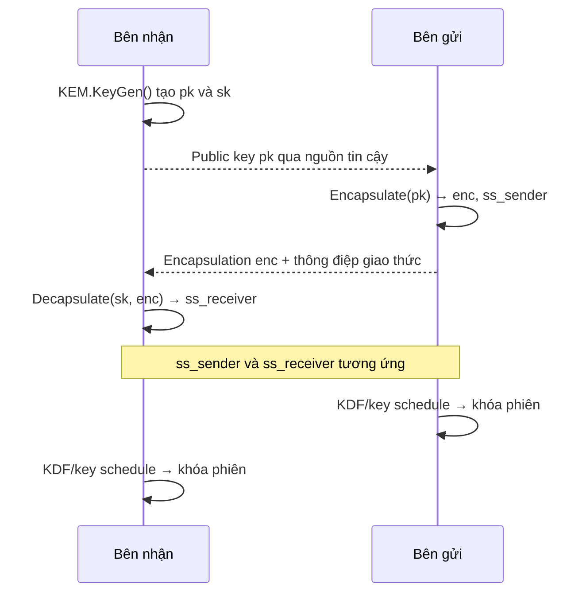
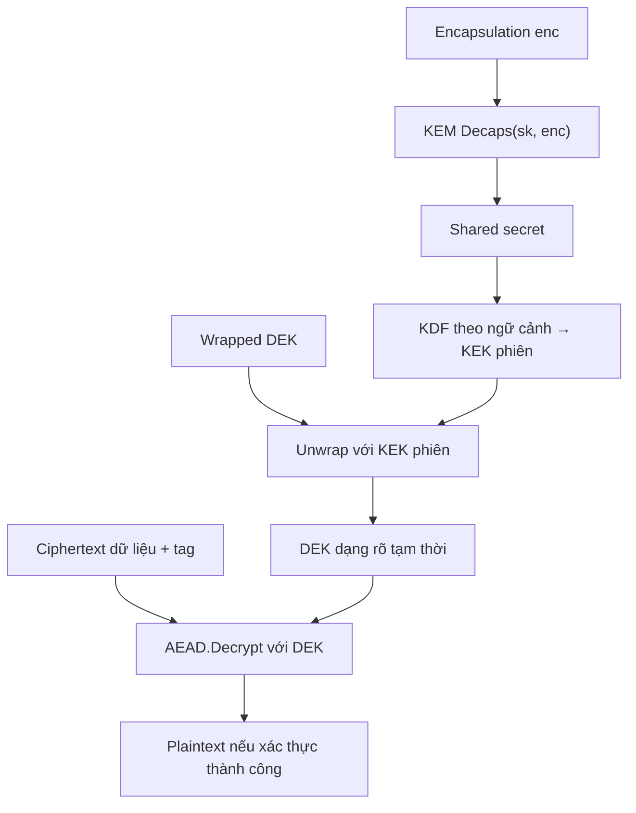
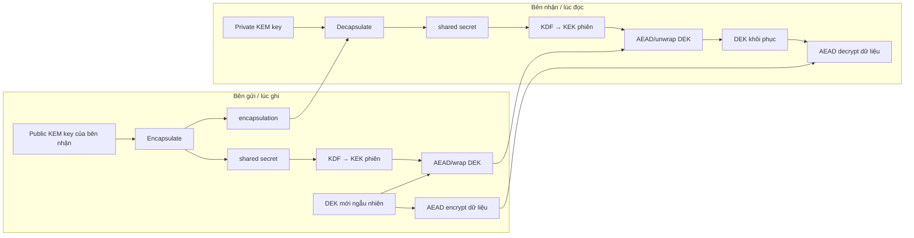
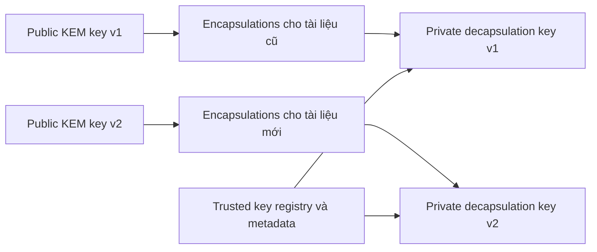

# Decapsulation

## 1. Decapsulation là gì?

**Decapsulation (tháo gói khóa)** là thao tác trong một cơ chế **Key Encapsulation Mechanism (KEM)**, cho phép bên nhận dùng **khóa riêng** và một giá trị đóng gói (*encapsulation* hay *KEM ciphertext*) để tái tạo **khóa bí mật dùng chung** (*shared secret*) đã được bên gửi thiết lập.

Mục tiêu của KEM không phải giải mã trực tiếp một tệp hay văn bản. Mục tiêu là giúp hai bên có được **cùng một bí mật mật mã** qua một kênh có thể bị quan sát, trong khi người ngoài không thể tính được bí mật đó chỉ từ khóa công khai và giá trị encapsulation, theo các giả định bảo mật của thuật toán.

Một luồng điển hình:

1. **Bên nhận** tạo cặp khóa KEM: `publicKey` và `privateKey`.
2. **Bên gửi** lấy `publicKey` đã được xác thực, gọi `Encapsulate(publicKey)` và thu được `encapsulation` cùng `sharedSecret_sender`.
3. Bên gửi chuyển `encapsulation` cho bên nhận. Đây là **dữ liệu công khai được truyền**, không phải secret gửi dạng rõ.
4. **Bên nhận** gọi `Decapsulate(privateKey, encapsulation)` và thu được `sharedSecret_receiver`.
5. Hai bên có bí mật tương ứng, dùng qua **key schedule/KDF** được giao thức quy định để thiết lập khóa mã hóa hoặc khóa bảo vệ dữ liệu.



Bài này thuộc chương **Key establishment** trong module `SECURITY_KEY_MANAGEMENT_FUNDAMENTALS`. Kiến thức về decapsulation kết nối trực tiếp với mật mã bất đối xứng, khóa phiên đối xứng, chữ ký số và xác thực danh tính, KMS/HSM, envelope encryption, phân quyền, kiểm toán và toàn bộ vòng đời khóa: tạo, cấp phát, lưu, sử dụng, xoay, thu hồi, hủy.

Sau bài học, bạn có thể:

- Phân biệt **encapsulation**, **decapsulation**, **decryption**, **key unwrapping** và **key agreement**.
- Nêu vai trò của public key, private key, encapsulation, shared secret, KDF và AEAD.
- Giải thích KEM cổ điển dựa trên Diffie–Hellman và **ML-KEM** hậu lượng tử ở mức giao thức.
- Mô tả sự khác nhau giữa **thành công của phép toán KEM** và **xác thực đúng đối tác/thông điệp**.
- Nhận diện rủi ro khi đầu vào decapsulation bị giả mạo, bị tráo khóa, bị phát lại hoặc không cùng phiên bản.
- Hiểu ví dụ Java sử dụng **KEM API** và cấu trúc envelope encryption.
- Thiết kế chính sách quản lý khóa decapsulation trong KMS/HSM với rotation, audit và ứng phó compromise.

## 2. KEM gồm những thao tác nào?

Một KEM trừu tượng có ba thao tác cơ bản:

\[
(pk, sk) \leftarrow \operatorname{KeyGen}()
\]

\[
(enc, ss_{\text{sender}}) \leftarrow \operatorname{Encaps}(pk)
\]

\[
ss_{\text{receiver}} \leftarrow \operatorname{Decaps}(sk, enc)
\]

Trong trường hợp hợp lệ, hai bí mật phải khớp:

\[
ss_{\text{sender}} = ss_{\text{receiver}}
\]

Ký hiệu `pk` là public key, `sk` là secret/private key, `enc` là giá trị encapsulation và `ss` là shared secret.

| Thành phần | Được tạo/giữ bởi ai? | Bí mật? | Chức năng |
| --- | --- | --- | --- |
| **KEM public key (`pk`)** | Bên nhận công bố | Thường không | Bên gửi dùng để encapsulate; cần xác thực nguồn gốc. |
| **KEM private key (`sk`)** | Bên nhận | **Có** | Bên nhận dùng để decapsulate; cần bảo vệ nghiêm ngặt. |
| **Encapsulation (`enc`)** | Bên gửi tạo; truyền cho bên nhận | Thường không | Vật liệu giao thức đủ để bên nhận tái tạo bí mật qua `sk`. |
| **Shared secret (`ss`)** | Bên gửi/bên nhận tạo tương ứng | **Có** | Đầu vào của KDF/key schedule, không gửi dạng rõ. |
| **Key schedule / KDF** | Hai bên thực hiện theo cùng giao thức | Phụ thuộc secret | Dẫn xuất khóa sử dụng thực tế với ngữ cảnh và mục đích rõ ràng. |
| **AEAD ciphertext/tag** | Bên mã hóa dữ liệu tạo | Ciphertext không phải secret key | Bảo vệ bí mật và tính toàn vẹn thông điệp bằng khóa từ key schedule. |

**Decapsulation không phải “mở Base64” hoặc “đọc secret có sẵn trong ciphertext”.** Bên nhận thực hiện phép toán mật mã với private key để tái tạo bí mật tương ứng với phiên encapsulation.

### 2.1. Tại sao public key cần đáng tin cậy?

Giả sử Alice muốn gửi tài liệu cho Bob. Nếu kẻ tấn công Mallory tráo `pk_Bob` bằng `pk_Mallory`, Alice có thể encapsulate cho Mallory mà không nhận ra. Mallory decapsulate bằng private key của mình, thu được shared secret và có thể đọc dữ liệu được bảo vệ bởi khóa dẫn xuất.

Vì vậy, **KEM đảm bảo bí mật theo public key được sử dụng**, nhưng không tự xác nhận rằng public key đó **thực sự thuộc Bob**. Public key phải đến từ chứng chỉ, key registry, pinning hoặc quá trình thiết lập lòng tin phù hợp. Trong nhiều giao thức, còn phải xác thực transcript hoặc bên gửi để ngăn man-in-the-middle.

### 2.2. Decapsulation trả lại khóa hay plaintext?

Trong mô hình KEM cơ bản, kết quả decapsulation là **shared secret**. Phần giải mã plaintext xảy ra ở **một bước khác**, ví dụ:

```text
Decapsulate(recipientPrivateKey, kemEncapsulation)
    -> sharedSecret

KDF(sharedSecret, protocolContext)
    -> aeadKey

AEAD.Decrypt(aeadKey, nonce, ciphertextAndTag, aad)
    -> plaintext hoặc lỗi xác thực
```

Điều này khác với một API kiểu `Decrypt(RSA-private-key, RSA-ciphertext)` dùng trực tiếp để khôi phục một thông điệp. Nhiều hệ thống hiện đại ưu tiên kiến trúc **KEM + KDF + AEAD** để tách việc thiết lập khóa và việc bảo vệ dữ liệu.

## 3. Decapsulation khác decryption, unwrapping và key agreement

| Thuật ngữ | Đầu vào điển hình | Đầu ra | Phân biệt cốt lõi |
| --- | --- | --- | --- |
| **KEM decapsulation** | Private KEM key + `enc` | Shared secret | Tái tạo bí mật thiết lập khóa, không nhất thiết là plaintext. |
| **AEAD decryption** | Symmetric key + nonce + ciphertext + tag + AAD | Plaintext hoặc lỗi | Mở dữ liệu đã mã hóa và kiểm tra tính toàn vẹn. |
| **Key unwrap** | KEK + wrapped key + metadata | Một khóa được bảo vệ trước đó hoặc lỗi | Khôi phục khóa đã được bao bọc bằng KEK theo sơ đồ tương ứng. |
| **Diffie–Hellman key agreement** | Private key một bên + public key bên kia | Giá trị chia sẻ hoặc đầu vào key schedule | Hai bên phối hợp tạo bí mật; có thể là thành phần của một DHKEM. |
| **KDF (HKDF, v.v.)** | Secret đầu vào + salt/context | Khóa dẫn xuất | Ràng buộc mục đích, chiều truyền, giao thức và độ dài khóa. |
| **Digital signature verification** | Public signing key + message + signature | Đúng/sai | Xác thực chữ ký; không tạo shared secret từ encapsulation. |

Một hệ thống có thể dùng cả **decapsulation**, **unwrap** và **decrypt** trong cùng một giao dịch:



Ở sơ đồ này, **KEM-derived key** làm một **lớp bảo vệ DEK**. Đây chỉ là một cách ghép thành phần. Trong sơ đồ hybrid encryption khác, KDF có thể trực tiếp dẫn xuất **AEAD traffic key** mà không cần DEK riêng. Việc lựa chọn phải theo chuẩn giao thức, không tự ghép tùy tiện.

### 3.1. Key establishment không luôn đồng nghĩa key transport

Có hai ý tưởng gần nhau:

- **Key agreement:** các bên phối hợp tính bí mật chung, ví dụ ECDH. Cách phát sinh khóa có thể phụ thuộc đóng góp của cả hai bên.
- **Key encapsulation:** bên encapsulate dùng public key của bên nhận để tạo `enc` và shared secret; bên nhận decapsulate bằng private key.

Một cơ chế **DHKEM** có thể sử dụng phép Diffie–Hellman bên trong, nhưng giao diện cho ứng dụng vẫn là `Encaps/Decaps`. Vì vậy, không nên đồng nhất thuật ngữ ở cấp giao diện KEM với phép toán nền bên trong.

## 4. KEM cổ điển và KEM hậu lượng tử

### 4.1. DHKEM: encapsulation từ Diffie–Hellman

Trong một **DHKEM** như những biến thể được xác định trong HPKE (RFC 9180), bên gửi có thể tạo cặp khóa **ephemeral** rồi tính shared secret thông qua Diffie–Hellman với public key của bên nhận. `enc` thường mang biểu diễn public key ephemeral; bên nhận tính toán tương ứng với private key của mình và đưa kết quả qua KDF theo giao thức.

Luồng ý tưởng:

```text
Bên nhận:
  (pkR, skR) = KeyGen()
  công bố pkR đã được xác thực

Bên gửi:
  (pkE, skE) = tạo khóa ephemeral
  dh = DH(skE, pkR)
  enc = Encode(pkE)
  ss = KEM-KeySchedule(dh, ngữ cảnh theo chuẩn)

Bên nhận:
  pkE = Decode(enc)
  dh = DH(skR, pkE)
  ss = KEM-KeySchedule(dh, ngữ cảnh theo chuẩn)
```

Pseudocode trên **lược bỏ** các bước kiểm tra điểm, serialization và thông tin ngữ cảnh KEM cụ thể; không được coi là triển khai đầy đủ RFC 9180. Bên nhận không chỉ đơn giản lấy `DH(skR,pkE)` làm khóa AES: cần key schedule đúng chuẩn, xử lý giá trị đầu vào bất hợp lệ và ràng buộc ngữ cảnh.

Các thuật toán Diffie–Hellman trên đường cong như **X25519** có thể phục vụ DHKEM. **Ed25519** là thuật toán chữ ký số, **không** phải định danh thay thế trực tiếp cho X25519 hoặc khóa decapsulation.

### 4.2. ML-KEM: key encapsulation hậu lượng tử

**ML-KEM (Module-Lattice-Based Key-Encapsulation Mechanism)** là KEM dựa trên bài toán mạng module, được chuẩn hóa trong **FIPS 203**. Các bộ tham số như **ML-KEM-512**, **ML-KEM-768** và **ML-KEM-1024** cung cấp những mức bảo mật/chi phí khác nhau.

Đặc điểm cần nhớ:

- `ML-KEM.KeyGen` tạo **encapsulation key** công khai và **decapsulation key** bí mật.
- `ML-KEM.Encaps` tạo **ciphertext KEM và shared secret**.
- `ML-KEM.Decaps` dùng decapsulation key và ciphertext KEM để tái tạo shared secret.
- Các bản triển khai cần tuân thủ chuẩn về **kiểm tra đầu vào, định dạng khóa, ciphertext, xử lý lỗi và hành vi khi ciphertext không hợp lệ**.
- Không được suy luận rằng Java `X25519` hoặc `DHKEM` mặc nhiên cung cấp bảo mật hậu lượng tử. Cần provider/thư viện và cấu hình **ML-KEM thực sự** có hỗ trợ, kiểm thử tương thích và ràng buộc thuật toán.

**Key exchange dựa trên ECDH** và **ML-KEM** có giả định an toàn khác nhau. Khi cần chống rủi ro đối thủ lưu ciphertext hôm nay để giải mã sau này (*harvest now, decrypt later*), một kiến trúc được chuẩn hóa phù hợp có thể cân nhắc KEM hậu lượng tử hoặc **hybrid key establishment**.

### 4.3. Hybrid classical + post-quantum

Một số giao thức kết hợp bí mật từ **KEM cổ điển** và **KEM hậu lượng tử** để tránh phụ thuộc hoàn toàn vào một họ giả định mật mã. Về ý tưởng:

```text
ss_classical = Decaps(classical_sk, classical_enc)
ss_pq        = Decaps(pq_sk, pq_enc)

trafficKeys = ApprovedHybridKeySchedule(
    ss_classical,
    ss_pq,
    transcript,
    algorithmIdentifiers
)
```

**Không tự nối hoặc XOR hai secret rồi dùng trực tiếp làm khóa AES** nếu chưa có đặc tả bảo mật cho bộ kết hợp (*combiner*). Độ an toàn hybrid phụ thuộc cách đóng gói, KDF, domain separation, xác thực transcript, kiểm tra hai thành phần và chống tấn công hạ cấp thuật toán.

Nếu bản tin cho phép đối phương bỏ phần PQ rồi buộc các bên quay về thuật toán yếu hơn mà không phát hiện, hybrid **không đạt mục tiêu chống downgrade**. Sự lựa chọn thuật toán, phiên bản giao thức và hai encapsulation phải được ràng buộc trong dữ liệu xác thực.

## 5. Encapsulation, decapsulation và việc xác thực đối tác

Một KEM cung cấp khả năng thiết lập bí mật, nhưng **không tự cung cấp xác thực hai chiều** cho toàn bộ kênh truyền.

### 5.1. Tráo public key của bên nhận

Nếu bên gửi không kiểm chứng `pkR`, kẻ tấn công có thể thay khóa và thực hiện decapsulation bằng private key của chính mình.

Phòng vệ:

1. Lấy `pkR` từ **certificate chain/PKI**, trusted key registry, pinning hoặc giao thức xác thực đã được phê duyệt.
2. Ràng buộc key ID, phiên bản, danh tính, tên dịch vụ, tenant, môi trường và mục đích sử dụng.
3. Xác minh chứng chỉ hoặc nguồn khóa theo chính sách thay vì chỉ kiểm tra public key có đúng định dạng.
4. Duy trì kế hoạch rotation và thu hồi trust khi private key của bên nhận bị nghi lộ.

### 5.2. Bên nhận có biết ai đã encapsulate không?

**Không nhất thiết.** Trong mô hình KEM cơ bản, bất kỳ người nào có public key của bên nhận có thể thực hiện `Encaps`. Bên nhận decapsulate một giá trị hợp lệ **không tự biết** đó là do Alice hay Mallory tạo ra.

Nếu nghiệp vụ cần xác minh danh tính **bên gửi**, phải có cơ chế bổ sung như:

- Xác thực kênh truyền hoặc protocol handshake có xác thực.
- Chữ ký số trên thông điệp/transcript theo một sơ đồ được thiết kế đúng.
- Chế độ KEM hoặc giao thức bao ngoài có xác thực người gửi, ví dụ **HPKE Auth mode** khi phù hợp.
- Danh tính workload và authorization ở tầng dịch vụ.

**Chỉ có shared secret trùng nhau không đồng nghĩa đã xác thực được cả hai bên.**

### 5.3. Bảo vệ ngữ cảnh và chống replay

Một encapsulation có thể bị sao chép/gửi lại. Một số KEM cho cùng `sk` và `enc` sẽ tái tạo **cùng shared secret** khi decapsulation được gọi lại; cơ chế này **không tự chống replay**.

Do đó, giao thức cần xác định:

- Nonce, sequence number hoặc session identifier nếu cần tính mới.
- Protocol version và algorithm identifiers.
- Role `sender/receiver`, danh tính/tenant/mục đích.
- Chống phát lại thông điệp ở tầng ứng dụng hoặc record layer.
- Quy tắc sử dụng/không tái sử dụng key/nonce trong AEAD.
- Giới hạn số bản tin và thời hạn của phiên.

Một phiên KEM không đồng nghĩa một session ứng dụng hợp lệ. Quyết định nhận một yêu cầu thanh toán, giải ngân hay reset mật khẩu phải còn dựa trên các chính sách authorization và chống replay riêng.

## 6. Decapsulation thất bại: không phải KEM nào cũng báo lỗi giống nhau

Một điểm rất quan trọng là **hành vi khi `enc` sai hoặc bị sửa** phụ thuộc thuật toán và API.

| Tình huống | Hành vi có thể xảy ra | Nguyên tắc xử lý |
| --- | --- | --- |
| `enc` có độ dài/encoding sai | API có thể từ chối ngay hoặc báo lỗi định dạng. | Kiểm tra giới hạn đầu vào, không xử lý tiếp nếu không hợp lệ. |
| `enc` không thuộc cấu trúc hợp lệ của thuật toán | API có thể từ chối hoặc thực hiện cơ chế bảo vệ riêng. | Không viết logic đoán kết quả bằng cách thử nhiều khóa tùy ý. |
| `enc` bị thay đổi nhưng vẫn được chấp nhận về định dạng | KEM có thể tạo ra **secret khác**, dẫn đến AEAD tag sai ở bước sau. | Chỉ công nhận plaintext khi xác thực AEAD thành công. |
| KEM có **implicit rejection** | Decapsulation có thể trả về một secret giả ngẫu nhiên khi ciphertext không hợp lệ, thay vì báo nhánh thất bại rõ. | Không coi “có bytes đầu ra” là bằng chứng encapsulation hợp lệ. |
| Private key hoặc thuật toán sai | Kết quả không khớp, hoặc API báo lỗi. | Xác định đúng key version/algorithm từ metadata tin cậy, không tự fallback mất kiểm soát. |
| Shared secret đúng nhưng AAD/nonce/ciphertext sai | AEAD giải mã phải thất bại ở authentication tag. | Không trả plaintext một phần hoặc bỏ qua xác thực. |

**Implicit rejection** là một kỹ thuật quan trọng trong một số KEM chống tấn công chosen-ciphertext. Với **ML-KEM**, xử lý decapsulation được thiết kế sao cho đầu vào ciphertext không dẫn đến một tín hiệu lỗi rõ ràng theo kiểu “ciphertext này khớp khóa” trong lõi mật mã; thay vào đó, thuật toán có nhánh tái tạo secret phù hợp đặc tả.

Vì vậy, **không được kết luận “`Decaps()` không throw nghĩa là ciphertext đáng tin”**. Giao thức phải dùng output theo key schedule đúng chuẩn và kiểm tra kết quả **AEAD hoặc xác thực transcript**. Không tự thay đổi hành vi xử lý lỗi của thư viện bằng cách so sánh dữ liệu trung gian bí mật rồi trả lỗi phân biệt ra mạng.

### 6.1. Decapsulation oracle và lỗi phân biệt

Nếu API tiết lộ quá chi tiết các trạng thái “khóa phù hợp”, “ciphertext mật mã sai”, “tag không đúng”, “padding sai”, kẻ tấn công có thể nhận được **oracle** để khai thác trong một số cơ chế. Mức độ nguy hiểm phụ thuộc thuật toán, thiết kế CCA và việc rò rỉ kênh phụ.

Các biện pháp:

- Dùng KEM và thư viện được đánh giá cho mô hình **IND-CCA** phù hợp, không tự triển khai phép toán giải mã/kiểm tra.
- Giới hạn kích thước dữ liệu, số lần thử, số khóa có thể được chọn và rate limit.
- Tránh thông báo lỗi quá chi tiết ra bên ngoài; tách thông tin kiểm toán nội bộ và phản hồi giao thức.
- Không log shared secret, private key, DEK, plaintext hoặc trạng thái mật mã trung gian.
- Đảm bảo bước AEAD xác thực thành công **trước khi** dùng plaintext.
- Đo và xử lý rủi ro side-channel/timing theo môi trường thực thi, đặc biệt khi KEM được gọi qua mạng.

**Không tự khẳng định một endpoint “constant-time” chỉ vì thư viện decapsulation đã được tối ưu**; parsing, IAM, key lookup, cache, retry và phân nhánh trả lỗi ở tầng ứng dụng có thể gây khác biệt đo được.

### 6.2. Sai private key không được xử lý bằng fallback nguy hiểm

Nếu hệ thống không giải mã được bằng `key-v3`, một cách làm sai là thử toàn bộ khóa cũ trong KMS không giới hạn rồi trả plaintext từ khóa đầu tiên “có vẻ đúng”. Cách làm đó:

- Mở rộng phạm vi sử dụng private key.
- Gây tải và lộ đặc tính key ring.
- Che giấu lỗi metadata và migration.
- Tạo hành vi khó kiểm toán, có thể trở thành oracle.

Thay vào đó, mỗi envelope nên mang hoặc có cơ chế xác định **algorithm suite và key version** được bảo vệ toàn vẹn. Dịch vụ định tuyến đúng private key theo registry tin cậy và từ chối không tương thích theo chính sách.

## 7. Decapsulation, HKDF và AEAD trong một giao thức

**Shared secret do KEM cung cấp thường được đưa vào key schedule**, chứ không tự động coi là khóa AES dùng trực tiếp. Mục tiêu là ràng buộc bí mật với giao thức, phiên bản, vai trò, thuật toán và phiên giao tiếp.

### 7.1. Vì sao cần KDF?

Một giao thức có thể cần nhiều khóa từ cùng một shared secret:

- `client_to_server_key`: mã hóa dữ liệu theo một chiều.
- `server_to_client_key`: mã hóa chiều ngược lại.
- `exporter_secret`: phục vụ mục đích xuất bí mật được giao thức cho phép.
- `key_confirmation` hoặc giá trị xác thực transcript.
- `wrapping_key`: bảo vệ DEK hoặc một khóa phiên khác.

KDF có thể dùng các cơ chế như **HKDF** khi giao thức quy định, với thông tin `info` hoặc context tách biệt cho từng mục đích. Không lấy một dãy bytes rồi dùng **cùng** cho nhiều chế độ mật mã hoặc nhiều chiều truyền tùy tiện.

```text
Shared secret (từ KEM)
      |
      v
Approved Key Schedule / HKDF với protocol transcript
      |
      +--> Key mã hóa chiều gửi
      +--> Key mã hóa chiều nhận
      +--> Nonce base / exporter secret theo đặc tả
```

Việc tạo nonce cho AEAD phải tuân thủ chế độ và key schedule cụ thể; không phải giao thức nào cũng tạo nonce base theo cùng một cách.

### 7.2. AAD và metadata giao thức

Nếu ciphertext được lưu hoặc gửi kèm `kemAlgorithm`, `keyId`, `keyVersion`, `encapsulation`, `formatVersion` và `tenantId`, những trường ảnh hưởng tới giải mã, định tuyến hoặc quyết định tin cậy cần được **xác thực/ràng buộc**.

Phương án có thể gồm:

- Đưa metadata được chuẩn hóa vào **KDF context** hoặc transcript theo giao thức.
- Dùng **AEAD Associated Authenticated Data (AAD)** để bảo vệ toàn vẹn những trường không cần mã hóa.
- Xác thực nguồn public key và ngữ cảnh bằng chữ ký số hoặc cơ chế xác thực kênh.

Dữ liệu AAD **không được mã hóa**. Nếu `tenantId` hoặc metadata có tính nhạy cảm, thiết kế phải cân nhắc để tránh tiết lộ. Hai đầu phải thống nhất chính xác bytes AAD, thứ tự và encoding.

### 7.3. Không tái sử dụng nonce dưới cùng một khóa AEAD

Với **AES-GCM**, việc lặp nonce dưới cùng khóa có thể làm mất cả bí mật và toàn vẹn. KEM decapsulation thành công **không đảm bảo** nonce mới. Nếu cùng `encapsulation` được phát lại và tạo cùng secret/key schedule, sơ đồ phải có cơ chế quản lý sequence number/nonce và xử lý replay đúng cách.

Không dùng `encapsulation` như một nonce AES-GCM chỉ vì nó “có vẻ ngẫu nhiên”. Các giá trị có chức năng, kích thước và tính duy nhất khác nhau; tuân theo đặc tả giao thức được dùng.

## 8. Envelope encryption sử dụng KEM decapsulation

Trong một thiết kế lưu trữ dữ liệu, KEM có thể thiết lập **khóa bọc** hoặc **khóa phiên** để bảo vệ **DEK (Data Encryption Key)**; DEK lại mã hóa dữ liệu bằng AES-GCM.



Trong sơ đồ này cần **cùng protocol context** khi dẫn xuất khóa và AAD phù hợp cho cả lớp bao bọc DEK lẫn lớp mã hóa dữ liệu. Trên thực tế, thư viện HPKE/hybrid encryption có thể **tự quản lý key schedule và AEAD**, không nhất thiết cung cấp một `KEK` cho ứng dụng nhìn thấy.

### 8.1. Envelope minh họa

```json
{
  "formatVersion": 1,
  "kemSuite": "approved-kem-suite",
  "kdfSuite": "approved-kdf-suite",
  "aeadSuite": "AES-256-GCM",
  "recipientKeyId": "storage-recipient/prod",
  "recipientKeyVersion": "v4",
  "encapsulation": "<base64url-kem-ciphertext>",
  "wrappedDek": "<base64url-wrapped-dek-and-tag>",
  "wrapNonce": "<base64url-nonce>",
  "dataNonce": "<base64url-nonce>",
  "ciphertext": "<base64url-ciphertext-and-tag>",
  "context": {
    "tenantId": "tenant-01",
    "objectId": "obj-908"
  }
}
```

Đây là **schema học thuật**, không phải định dạng chuẩn HPKE hay một KMS cụ thể. Sơ đồ ứng dụng thật cần quy định chính xác:

- **Suite và version** được phê duyệt, không lấy tên thuật toán tùy ý do người gửi khai báo.
- Quy tắc encode/decode bytes, kích thước trường và trần đầu vào.
- Thành phần nào được xác thực qua key schedule, AEAD AAD hoặc chữ ký.
- Cách chọn private key từ registry và xử lý bản ghi phiên bản cũ.
- Cách cấp quyền, kiểm toán, backup và restore được khi key version thay đổi.

**Tuyệt đối không lưu shared secret hoặc DEK dạng rõ** trong envelope. KEM encapsulation và wrapped DEK được thiết kế để có thể lưu/truyền, nhưng điều đó không có nghĩa toàn bộ metadata đều được phép công khai theo chính sách dữ liệu.

### 8.2. Decapsulation có phải luôn chạy trong KMS/HSM?

Không. Một thư viện có thể decapsulate trong tiến trình ứng dụng nếu private key được lưu/truyền tới đó; một KMS/HSM có thể cung cấp API decapsulation hoặc key agreement trong vùng bảo vệ riêng khi hỗ trợ. Tùy nền tảng, có thể có các phương án:

- **HSM/KMS thực thi KEM** và không xuất private key.
- **Provider JCA/PKCS#11** sử dụng khóa nằm trong HSM khi tính toán.
- **Ứng dụng thực thi KEM** với private key được lấy từ kho khóa đã quản trị; cần đánh giá rủi ro lộ key material trong bộ nhớ tiến trình.
- **Gateway/service chuyên dụng** thực hiện decapsulation, trả về khóa phiên hoặc thực hiện luôn AEAD/unwrap, với IAM/audit phù hợp.

**Không phải mọi KMS hoặc HSM đều hỗ trợ ML-KEM hoặc API `Decapsulate`.** Cần kiểm tra thuật toán, provider, quyền, định dạng khóa, khả năng export, giới hạn request, trạng thái version và phương án khôi phục trước khi chọn công nghệ.

## 9. Java 21+: ví dụ KEM encapsulation và decapsulation

Từ **Java 21**, Java SE có **KEM API** (`javax.crypto.KEM`) để biểu diễn giao diện encapsulation/decapsulation. Ví dụ dưới đây dùng một provider hỗ trợ **DHKEM** với khóa **X25519**.

**Giới hạn rõ ràng:** ví dụ minh họa **KEM cổ điển**, **không phải ML-KEM hậu lượng tử**. Provider/JDK và thuật toán có thể có khác biệt hỗ trợ trong từng môi trường; hãy kiểm tra khả năng tương thích thực tế. Ví dụ chạy trong một tiến trình nên không tự chứng minh public key là đáng tin cậy hay thiết lập phiên truyền tin production.

```java
import java.security.KeyPair;
import java.security.KeyPairGenerator;
import java.security.MessageDigest;
import java.util.Arrays;
import javax.crypto.KEM;
import javax.crypto.SecretKey;

public final class DecapsulationDemo {
    public static void main(String[] args) throws Exception {
        // Bên nhận tạo cặp khóa X25519 cho DHKEM.
        KeyPair recipient = KeyPairGenerator
                .getInstance("X25519")
                .generateKeyPair();

        // Trong production, người gửi PHẢI xác thực nguồn public key.
        KEM kem = KEM.getInstance("DHKEM");

        // BÊN GỬI: encapsulation tạo secret và enc.
        KEM.Encapsulator encapsulator =
                kem.newEncapsulator(recipient.getPublic());
        KEM.Encapsulated packet = encapsulator.encapsulate();

        SecretKey senderSecret = packet.key();
        byte[] enc = packet.encapsulation();

        // BÊN NHẬN: dùng PRIVATE KEY và enc để decapsulate.
        KEM.Decapsulator decapsulator =
                kem.newDecapsulator(recipient.getPrivate());
        SecretKey recipientSecret = decapsulator.decapsulate(enc);

        // Chỉ để kiểm thử nguyên lý trong môi trường này:
        // KHÔNG log hoặc truyền secret bytes trong production.
        byte[] senderBytes = senderSecret.getEncoded();
        byte[] receiverBytes = recipientSecret.getEncoded();

        if (senderBytes == null || receiverBytes == null) {
            throw new IllegalStateException(
                "Provider does not export this secret for demo"
            );
        }

        try {
            System.out.println("Encapsulation bytes: " + enc.length);
            System.out.println("Secrets match: "
                    + MessageDigest.isEqual(senderBytes, receiverBytes));
            // Expected: true trên một provider DHKEM hoạt động đúng.
        } finally {
            Arrays.fill(senderBytes, (byte) 0);
            Arrays.fill(receiverBytes, (byte) 0);
        }
    }
}
```

### 9.1. Những điều ví dụ minh họa

- **Bên gửi** chỉ cần public key đã xác thực để encapsulate.
- **Bên nhận** cần private key tương ứng để decapsulate.
- `enc` được truyền cho bên nhận, nhưng `senderSecret` và `recipientSecret` **không cần truyền dạng rõ**.
- Một provider JCA có thể đưa secret qua `SecretKey`; trong môi trường HSM, secret có thể không cho xuất bytes, nên ví dụ `getEncoded()` chỉ phục vụ minh họa.
- API hỗ trợ KEM **không thay thế** cơ chế xác thực chủ thể hoặc chính sách chấp nhận thông điệp.
- Shared secret trong ví dụ **chưa được dùng cho mã hóa dữ liệu**; production cần KDF/key schedule và AEAD của một giao thức được phê duyệt.

### 9.2. Không nhầm DHKEM với ML-KEM

Nếu yêu cầu KEM hậu lượng tử, cần thư viện/provider có **ML-KEM** được hỗ trợ và thẩm định; không đổi tên `DHKEM` thành `ML-KEM` rồi coi mọi key pair X25519 vẫn dùng được.

Phải chọn **KEM key type** tương ứng, xác định algorithm identifier, serialization, private/public key format và khả năng tích hợp với KMS/HSM. Một số JDK/provider hiện đại có thể cung cấp thêm thuật toán; khả năng thực tế phải được kiểm tra theo phiên bản đang triển khai. Không mặc định JDK 21 vốn có đầy đủ mọi KEM hậu lượng tử.

### 9.3. Khi chuyển từ KEM demo sang dữ liệu thật

Một thư viện/giao thức production phải đảm nhiệm:

1. **Xác thực public key** và ràng buộc danh tính trước khi encapsulate.
2. **Chọn ciphersuite đã phê duyệt** và xử lý version/format.
3. **Ràng buộc transcript/context** vào key schedule và AAD.
4. **Quản lý nonces và sequence number** của AEAD đúng chuẩn.
5. **Xử lý decapsulation lỗi/implicit rejection** mà không tiết lộ oracle.
6. **Xử lý retry, replay, concurrency** và giới hạn kích thước đầu vào.
7. **Giữ private key và shared secret an toàn**, audit các thao tác nhạy cảm.
8. **Hỗ trợ rotation và restore** với các bản ghi sử dụng key version cũ.

Không nên tự viết kết hợp `ECDH + SHA256 + AES-GCM` theo trực giác nếu đã có **HPKE** hoặc một giao thức được chuẩn hóa phù hợp.

## 10. Quản lý private decapsulation key trong KMS/HSM

Khóa riêng dùng decapsulation là **secret có khả năng khôi phục khóa phiên hoặc khóa bảo vệ dữ liệu** trong phạm vi các encapsulation hợp lệ. Nếu nó bị lộ cùng dữ liệu encapsulation đã lưu, có thể ảnh hưởng tới bí mật của dữ liệu lịch sử.

### 10.1. Các thành phần vòng đời

| Giai đoạn | Hành động cần có | Rủi ro nếu bỏ qua |
| --- | --- | --- |
| **Tạo (KeyGen)** | Sinh key pair từ nguồn ngẫu nhiên an toàn, đúng thuật toán và provider được duyệt. | Private key yếu/không tương thích hoặc không đạt yêu cầu bảo mật. |
| **Đăng ký public key** | Gắn owner, service, tenant, môi trường, thuật toán, version và nguồn tin cậy. | Tráo public key hoặc gửi nhầm cho bên nhận. |
| **Bảo quản private key** | KMS/HSM hoặc kho an toàn, IAM tối thiểu, giới hạn export và audit. | Rò rỉ private key dẫn đến decapsulate trái phép. |
| **Cấp quyền** | Chỉ dịch vụ nhận được phép thực hiện decapsulation cho đúng key/context. | Một danh tính có thể giải mã nhiều tenant/tài nguyên ngoài phạm vi. |
| **Sử dụng** | Kiểm tra metadata và quyền trước khi gọi, giới hạn tần suất, xác thực AEAD sau KEM. | Oracle, DoS, confused deputy hoặc lộ plaintext. |
| **Rotation** | Phát hành public key mới, chuyển encapsulation mới, hỗ trợ phiên bản cũ khi còn phụ thuộc. | Dữ liệu cũ không đọc được hoặc public key mới chưa được phân phối. |
| **Thu hồi** | Disable quyền/khóa bị nghi compromise; cập nhật registry và hệ thống gửi. | Tiếp tục dùng public key đã mất tin cậy để tạo dữ liệu mới. |
| **Hủy** | Kiểm kê mọi `enc`/envelope/backup còn phụ thuộc rồi hủy theo phê duyệt. | Mất khả năng phục hồi ciphertext lịch sử hoặc duy trì khóa bị lộ quá lâu. |

**Không nên đồng nhất trạng thái “không dùng encapsulate mới” với “không được decapsulate dữ liệu cũ”.** Hai thao tác có thể cần những cryptoperiod và chính sách khác nhau.

### 10.2. IAM và tách trách nhiệm

Một thiết kế có thể phân tách:

| Danh tính | Quyền hợp lý | Quyền không nên mặc định có |
| --- | --- | --- |
| **Sender/producer** | Đọc public KEM key đã tin cậy, encapsulate và ghi ciphertext theo scope. | Truy cập private decapsulation key. |
| **Recipient/consumer** | Decapsulate theo key ID/context được phép, sau kiểm tra quyền dữ liệu. | Quản trị toàn bộ key ring, export private key. |
| **Key administrator** | Tạo/rotate/disable/destroy theo phê duyệt. | Đọc plaintext mọi bản ghi hoặc giải mã thay dịch vụ. |
| **Security owner** | Duyệt thuật toán, vòng đời, ngoại lệ và xử lý sự cố. | Dùng private key ngoài quy trình. |
| **Auditor** | Xem lịch sử thay đổi, bản ghi sử dụng và bằng chứng phục hồi. | Thực hiện decapsulate hoặc thay key policy. |

Nếu KMS/HSM không cung cấp API decapsulation trực tiếp, quyền thực tế có thể cần áp dụng tại lớp adapter/service. **Phân tách quyền ở IAM không thay thế việc kiểm tra authorization trên bản ghi dữ liệu.** Một danh tính được quyền decapsulate một khóa không vì thế được phép đọc mọi ciphertext trong kho.

### 10.3. Kiểm toán decapsulation an toàn

Log metadata phù hợp:

```yaml
event: kem.decapsulation.request
timestamp: "2026-11-28T09:00:00Z"
actor: object-reader-prod
recipient_key_id: object-storage-kem
recipient_key_version: v4
kem_suite: approved-suite
environment: production
request_id: req-75bb
result: success
```

Đây là **mẫu log học thuật**, không phải record mặc định của một KMS. Có thể ghi `key ID/version`, operation, actor, nguồn, thời gian, policy ID, correlation ID và kết quả. Không ghi `sk`, seed, shared secret, DEK dạng rõ, plaintext hoặc nguyên liệu mật mã nhạy cảm.

Đôi khi **`Decaps()` trả secret** mà chưa thể nói phép xác thực thông điệp đã thành công, nhất là cơ chế implicit rejection. Vì vậy, trường log `result: success` ở cấp KEM chỉ mô tả thao tác API, không được dịch thành “sender đã được xác thực” hay “ciphertext hợp lệ” nếu chưa qua AEAD và policy.

## 11. Rotation và tác động đến dữ liệu lịch sử

Giả sử hệ thống `archive-prod` sử dụng `recipient-key-v1` trong năm đầu, sau đó chuyển sang `recipient-key-v2`. Dữ liệu mới được encapsulate bằng public key v2, nhưng các bản ghi cũ lưu `enc_v1` vẫn cần private key v1 để decapsulate.



Nếu ứng dụng chỉ giữ private key mới nhất, dữ liệu mã hóa cũ có thể mất khả năng khôi phục. Đó là lý do **key ID/version của envelope** và kiểm kê phụ thuộc quan trọng không kém lúc phát hành khóa.

### 11.1. Kế hoạch rotation an toàn

1. **Kiểm kê:** dữ liệu, snapshot, backup, object version, queue và đối tác còn dùng public key/private key nào.
2. **Tạo cặp khóa mới:** thuật toán được phê duyệt, nguồn entropy đáng tin cậy, owner và policy rõ ràng.
3. **Phân phối public key mới:** bảo đảm bên gửi lấy từ registry/chứng chỉ đáng tin cậy, có hỗ trợ song song trong thời gian chuyển tiếp.
4. **Chuyển encapsulate mới:** bắt đầu tạo `enc_v2` và ghi metadata version chính xác.
5. **Giữ decapsulate cũ:** cho phép v1 xử lý dữ liệu hợp lệ đã tồn tại, giới hạn theo quyền và mục đích.
6. **Migration khi cần:** giải mã/recover DEK trong vùng được phép rồi tái bao bọc/encapsulate dưới public key mới theo giao thức, không làm thất lạc dữ liệu.
7. **Kiểm thử phục hồi:** đọc lại tài liệu cũ, khôi phục backup và xác minh AEAD, policy, audit.
8. **Ngừng/hủy:** sau khi hết phụ thuộc và các yêu cầu lưu trữ, vô hiệu hóa/hủy private key cũ có phê duyệt.

**Chỉ thay key alias hoặc version mặc định không tự thay đổi những encapsulation đã được lưu trước đó.**

### 11.2. Re-encapsulate, rewrap và re-encrypt

| Thao tác | Mức thay đổi | Khi nào cần? |
| --- | --- | --- |
| **Dùng public key KEM v2 cho dữ liệu mới** | Các `enc` mới dùng v2; dữ liệu cũ giữ nguyên. | Rotation theo lịch. |
| **Re-encapsulate / rewrap DEK** | Tạo phiên KEM/khóa bọc mới và bảo vệ lại DEK cũ. | Muốn dừng phụ thuộc vào decapsulation key cũ mà DEK vẫn được tin cậy. |
| **Re-encrypt data** | Tạo DEK mới rồi mã hóa lại plaintext/ciphertext, cập nhật metadata/tag. | DEK bị lộ, thuật toán dữ liệu không đạt chính sách hoặc yêu cầu bảo mật thay đổi. |

Không phải mọi định dạng KEM-encrypted payload đều có thể “re-encapsulate” bằng cách **chỉ đổi `enc`**: nếu ciphertext AEAD gắn với khóa phiên cũ, phải thay cả phần được bảo vệ bởi khóa đó. Trường hợp **DEK được bọc riêng**, có thể unwrap/rewrap DEK mà giữ ciphertext dữ liệu khi thiết kế và AAD cho phép.

Nếu **private decapsulation key v1 đã bị lộ**, kẻ tấn công có `enc_v1` và dữ liệu lưu trữ tương ứng có thể tái tạo shared secret/khóa bọc, từ đó có nguy cơ khôi phục DEK hoặc plaintext. **Rewrap không thể làm dữ liệu mà kẻ tấn công đã sao chép và giải mã trở thành bí mật trở lại.** Cần đánh giá thời gian/khả năng lộ và biện pháp re-encrypt/thu hồi theo threat model.

## 12. Forward secrecy và rủi ro “thu thập hôm nay, giải mã sau”

Một private decapsulation key **tĩnh** nếu bị lộ về sau có thể cho phép giải mã các encapsulation đã lưu trước đó, tùy sơ đồ và việc dữ liệu phiên còn tồn tại. Vì thế:

> **Có KEM không đồng nghĩa tự có forward secrecy.**

**Forward secrecy** đòi hỏi giao thức bảo vệ khóa phiên cũ trước rò rỉ về sau của khóa dài hạn trong một mô hình đe dọa cụ thể; thường cần đóng góp **ephemeral** và quản lý/xóa bỏ trạng thái bí mật đúng thiết kế.

Ví dụ:

- Một bên gửi encapsulate nhiều lần bằng **cùng public key tĩnh của server**; private key server bị lộ về sau có thể ảnh hưởng tới các phiên đã ghi lại. Không được tự tuyên bố có forward secrecy chỉ vì bên gửi sử dụng randomness ephemeral.
- Một giao thức có **ephemeral authenticated key exchange** và xóa secret phiên có thể mang các bảo đảm khác, theo tiêu chuẩn/đặc tả.
- Đối thủ có thể lưu ciphertext hôm nay và chờ một tương lai có năng lực phá giả định mật mã cổ điển. Sơ đồ **post-quantum/hybrid** phù hợp có thể giảm một nhóm rủi ro, nhưng vẫn cần xác thực và bảo vệ private key.

Trong thiết kế lưu trữ dài hạn, phải cân nhắc cả **crypto agility**, rotation, retention, backup và kế hoạch migration, không chỉ thời gian sống của một khóa phiên.

## 13. Case study: dịch vụ nhận tệp mật từ đối tác

### 13.1. Yêu cầu

Dịch vụ `secure-ingest-prod` nhận tệp nhạy cảm từ ba đối tác. Tệp được mã hóa bằng **DEK ngẫu nhiên**, còn DEK được bảo vệ bằng khóa dẫn xuất từ KEM giữa bên gửi và public key của dịch vụ nhận.

Mỗi object lưu:

```text
object_id
tenant_id
format_version
kem_suite
recipient_key_id + recipient_key_version
encapsulation
wrapped_dek
wrap_nonce / wrap_tag
data_nonce
ciphertext / data_tag
authenticated_context
```

Yêu cầu:

- Public key của `secure-ingest-prod` phải đến từ **nguồn được đối tác tin cậy**.
- Private decapsulation key được bảo vệ bằng KMS/HSM hoặc service custody tương ứng.
- Bên nhận chỉ decapsulate sau khi xác thực/quyền truy cập vào object được kiểm tra.
- Phải có **xác thực bên gửi** ở tầng giao thức, vì KEM base không tự xác nhận đối tác.
- Metadata tenant, object, key version và ciphersuite được ràng buộc vào AEAD/context.
- Bản sao lưu phải bao gồm khả năng khôi phục private key/đường decapsulation hợp lệ cho dữ liệu đang lưu.

### 13.2. Thiết kế sai

```text
1. Nhận request gồm arbitrary keyId và encapsulation.
2. Thử mọi private key trên KMS đến khi decapsulation không báo lỗi.
3. Lấy sharedSecret làm AES key trực tiếp.
4. Giải mã ciphertext mà không xác thực tag/AAD đúng.
5. Tin tenantId do request đưa vào mà không kiểm tra IAM/ngữ cảnh.
6. Ghi secret/DEK vào log để debug khi có lỗi.
```

Rủi ro:

- Có thể trở thành **decapsulation oracle/confused deputy** và sử dụng khóa ngoài phạm vi.
- Decapsulation không throw **không chứng minh** sender được ủy quyền hoặc ciphertext đáng tin cậy.
- Thiếu KDF/AEAD chuẩn có thể làm yếu sơ đồ mã hóa dữ liệu.
- Tenant metadata bị tráo có thể dẫn tới đọc/ghi dữ liệu chéo tenant.
- Log làm lộ secret và tăng phạm vi compromise.
- Không có metadata version chuẩn khiến rotation/restore sai.

### 13.3. Thiết kế cải thiện

```text
1. Xác định authenticated partner và object scope từ cơ chế tin cậy.
2. Validate định dạng, kích thước, suite, recipient key ID/version.
3. Chỉ chọn private key được phép cho đúng môi trường/tenant/mục đích.
4. Gọi Decapsulate qua adapter đã đánh giá/KMS/HSM phù hợp.
5. Thực hiện key schedule chuẩn với transcript/context đầy đủ.
6. AEAD unwrap DEK với nonce, tag và AAD đúng phiên bản.
7. AEAD decrypt tệp bằng DEK, xác thực tag trước khi chấp nhận nội dung.
8. Kiểm tra quyền nghiệp vụ, trạng thái object, replay/idempotency.
9. Chỉ trả plaintext trong phạm vi được phép; log metadata thay vì secret.
10. Theo dõi key version cũ và kiểm thử restore định kỳ.
```

Nếu sau này công ty nghi private decapsulation key v1 bị lộ, nhóm ứng cứu cần xác định **tất cả encapsulation v1** trong dữ liệu, backup và hệ thống đối tác, phạm vi bản ghi có thể giải mã, rồi quyết định migrate/reencrypt và thông báo theo chính sách. Chỉ phát hành public key v2 cho bên gửi **không loại bỏ rủi ro đối với bản lưu cũ**.

## 14. Lỗi thường gặp khi thiết kế decapsulation

| Hiểu nhầm / sai lầm | Thực tế cần nhớ |
| --- | --- |
| “Decapsulation chính là giải mã plaintext.” | KEM decapsulation tạo shared secret; AEAD decryption là bước khác. |
| “KEM encapsulation phải được giữ bí mật.” | `enc` thường có thể truyền công khai; private key và shared secret mới là bí mật. |
| “Public key không bí mật nên nguồn nào cũng được.” | Tráo public key khiến bên gửi encapsulate cho kẻ tấn công. |
| “Bên nhận decapsulate được nghĩa là biết chắc ai gửi.” | KEM cơ bản **không tự xác thực sender**. |
| “Decapsulate không throw nghĩa là ciphertext hợp lệ.” | Một số KEM dùng **implicit rejection**; còn cần AEAD/authentication. |
| “Dùng shared secret làm thẳng khóa AES.” | Cần làm đúng key schedule/KDF và domain separation của giao thức. |
| “Mỗi lần KEM đều ngăn replay.” | Có thể tái sử dụng `enc` và nhận cùng secret; phải có xử lý replay/nonce riêng. |
| “Dùng X25519 nghĩa là đã dùng KEM hậu lượng tử.” | X25519/DHKEM là cổ điển; ML-KEM là họ hậu lượng tử khác. |
| “Đổi alias sang v2 làm mọi dữ liệu cũ được mã hóa lại.” | Encapsulation và ciphertext cũ thường vẫn phụ thuộc private key v1. |
| “Chỉ xoay private key là chữa được việc đã lộ dữ liệu.” | Không thể thu hồi những ciphertext đã được kẻ tấn công giải mã/sao chép. |
| “KMS/HSM non-exportable ngăn mọi sử dụng trái phép.” | IAM bị chiếm có thể lạm dụng API decapsulation mà không cần xuất private key. |
| “Hybrid chỉ cần nối hai bytes secret rồi SHA-256.” | Phải dùng combiner/key schedule được phân tích và bảo vệ chống downgrade. |
| “KEM tự có forward secrecy.” | Khóa decapsulation tĩnh bị lộ có thể ảnh hưởng ciphertext/phiên lịch sử. |
| “Ghi shared secret vào log để đối chiếu hai đầu.” | Log sẽ trở thành kênh rò rỉ bí mật; dùng test vectors/telemetry an toàn. |

## 15. Ma trận kiểm thử decapsulation

| Nhóm kiểm thử | Trường hợp | Kỳ vọng |
| --- | --- | --- |
| **Happy path** | Encapsulate và decapsulate với cặp key đúng | Hai shared secret trùng theo contract KEM; AEAD mở đúng dữ liệu. |
| **Wrong private key** | Decapsulate `enc` bằng key khác | Không chấp nhận dữ liệu; khóa/AEAD không khớp hoặc API từ chối an toàn. |
| **Tampered encapsulation** | Sửa một byte `enc` | Không chấp nhận plaintext; xử lý lỗi/implicit rejection đúng đặc tả. |
| **Tampered data** | Sửa ciphertext hoặc authentication tag | AEAD từ chối, không trả plaintext chưa xác thực. |
| **Wrong AAD** | Đổi tenant, object hoặc ciphersuite ràng buộc | Xác thực toàn vẹn thất bại. |
| **Untrusted public key** | Bên gửi được đưa public key do attacker tạo | Phải chặn trước encapsulation theo trust policy. |
| **Wrong issuer/sender** | Bên gửi không được ủy quyền nhưng có thể tạo `enc` | Bị từ chối ở lớp authentication/authorization. |
| **Unsupported algorithm** | Đề nghị suite không nằm trong allowlist | Từ chối, không fallback sang suite yếu theo request. |
| **Malformed ciphertext** | `enc` quá dài, rỗng, sai định dạng | Giới hạn đầu vào; từ chối an toàn, không DoS. |
| **Cross-tenant key** | Dùng key ID khác tenant/môi trường | Từ chối bằng IAM/registry/context. |
| **Replay** | Gửi lại cùng encapsulation và thông điệp | Xử lý theo replay/idempotency policy, không nhân đôi tác vụ. |
| **Rotation overlap** | v1 vẫn đọc dữ liệu cũ, v2 phục vụ dữ liệu mới | Cả hai hoạt động trong phạm vi đã phê duyệt. |
| **Destroyed key** | Thử đọc bản ghi còn phụ thuộc khóa đã hủy | Có bằng chứng không còn phụ thuộc trước hủy; nếu không sẽ thất bại được báo cáo. |
| **Provider mismatch** | Bên gửi và nhận dùng provider/encoding khác nhau | Tương thích theo test vectors, không đoán định dạng. |
| **Load test** | Nhiều request decapsulation đồng thời | Giới hạn CPU/KMS/HSM quota và thời gian xử lý phù hợp. |
| **Compromise response** | Private key/IAM quyền Decapsulate bị lộ | Cô lập, rotate, đánh giá bản ghi lịch sử và kiểm tra revoke hoạt động. |

Trong test negative, **không đòi mọi thuật toán đều phải throw ngay khi `enc` bị sửa**. Chỉ tiêu quan trọng là **ứng dụng không chấp nhận thông điệp sai hoặc tiết lộ dữ liệu** và thư viện thực hiện đúng contract đã được tiêu chuẩn hóa.

## 16. Checklist thiết kế decapsulation cho production

Trước khi triển khai, trả lời được:

1. **Mục đích:** dùng KEM cho kênh truyền, gói dữ liệu, bảo vệ DEK hay một protocol chuẩn nào? Có đang nhầm với AEAD decrypt/key unwrap không?
2. **Thuật toán:** DHKEM, ML-KEM hay hybrid? Có được phê duyệt cho hệ thống, mức bảo mật và phiên bản cụ thể không?
3. **Nguồn khóa công khai:** bên gửi xác thực `pk` qua PKI/registry/pinning hoặc cơ chế tin cậy nào?
4. **Khóa riêng:** private decapsulation key được sinh và giữ ở đâu? Có thể export? KMS/HSM/provider có hỗ trợ đúng thuật toán không?
5. **Ràng buộc ngữ cảnh:** có cố định thuật toán, version, sender/recipient, tenant, purpose và transcript trong KDF/AAD/chữ ký không?
6. **Data plane:** shared secret được chuyển qua key schedule được duyệt trước khi dùng làm AEAD key/KEK chưa?
7. **Authenticated encryption:** nonce, tag, AAD và định dạng ciphertext được xác minh theo chuẩn chưa?
8. **Failure handling:** có xử lý đúng implicit rejection, lỗi định dạng, sai private key và chống oracle không?
9. **Authorization:** ai được gọi Decapsulate, trên key version/context nào? Có kiểm tra quyền truy cập dữ liệu ở tầng nghiệp vụ không?
10. **Replay:** bản tin có sequence/nonce/session ID/idempotency đủ để chống phát lại không?
11. **Rotation:** có lưu key ID/version, hỗ trợ đọc dữ liệu cũ, kế hoạch migration và loại bỏ phiên bản không còn phụ thuộc không?
12. **Recovery:** backup có thể khôi phục **cả dữ liệu lẫn private decapsulation key/đường dùng khóa được phép** không?
13. **Compromise:** nếu private key hoặc quyền gọi API lộ, có thể phân loại ảnh hưởng đến dữ liệu lịch sử và tạo lại lòng tin không?
14. **Crypto agility:** có đường chuyển đổi từ classical KEM sang PQ/hybrid đã chuẩn hóa khi threat model thay đổi không?
15. **Audit:** có log actor, key ID, operation, kết quả và trạng thái mà không ghi secret/DEK/plaintext không?
16. **Testing:** đã thử key sai, `enc` bị sửa, AAD sai, thuật toán không hỗ trợ, cross-tenant, replay, rollback, key đã hủy và tải đồng thời chưa?

**Ghi nhớ:** **Decapsulation** dùng **private KEM key** và **encapsulation** để tái tạo **shared secret**, không phải trực tiếp giải mã nội dung người dùng. Muốn bảo vệ dữ liệu đúng cách phải kết hợp **KEM + KDF/key schedule + AEAD** theo một giao thức được đánh giá, đồng thời xác thực public key, quản lý key version, kiểm soát quyền Decapsulate và chuẩn bị rotation/thu hồi/backup. Khi private key bị lộ, rủi ro có thể ảnh hưởng cả ciphertext lịch sử; KMS/HSM và kiểm toán chỉ hữu ích nếu được triển khai cùng IAM, quản lý secret và xử lý sự cố có kiểm soát.
