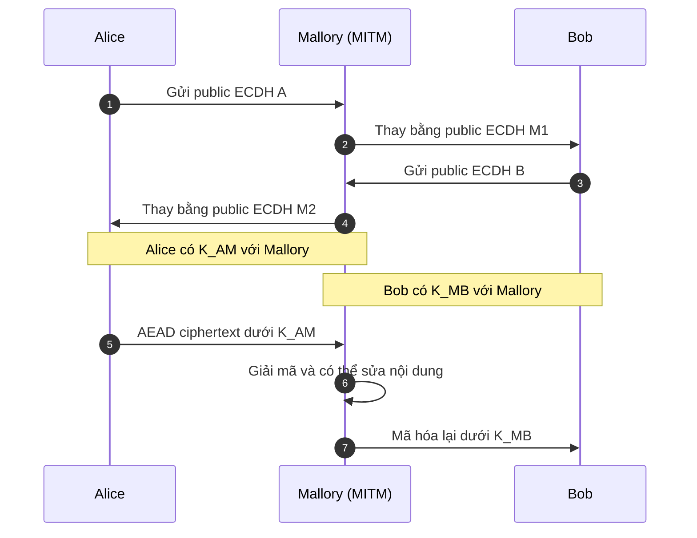
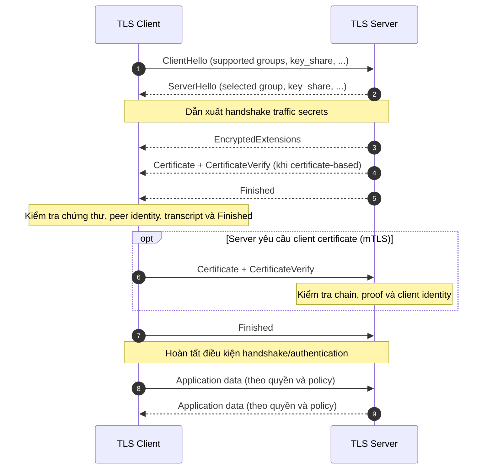
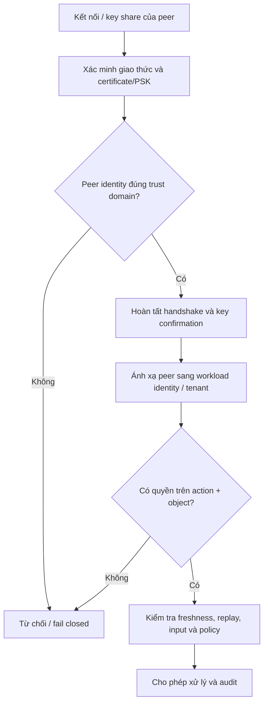
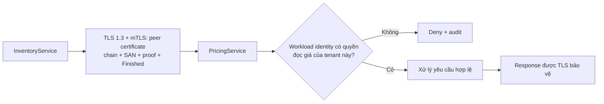

# Xác thực peer trước khi dùng shared key

> **Chương:** Key establishment  
> **Module:** SECURITY_KEY_MANAGEMENT_FUNDAMENTALS — tìm hiểu vòng đời khóa mật mã từ tạo, cấp phát, lưu trữ, sử dụng, xoay vòng đến thu hồi và hủy; kết nối mật mã đối xứng, bất đối xứng, chữ ký số, KMS/HSM, envelope encryption, kiểm soát truy cập và kiểm toán để thiết kế hệ thống bảo vệ khóa an toàn.

## 1. Mục tiêu học tập

Sau bài này, bạn có thể:

1. Phân biệt **thiết lập shared secret**, **xác thực peer**, **key confirmation** và **phân quyền sử dụng shared key**.
2. Giải thích vì sao **Diffie–Hellman/ECDH không xác thực** có thể bị man-in-the-middle (MITM) dù hai bên đều tính được một khóa đối xứng mạnh.
3. Hiểu những cách ràng buộc **danh tính peer, public key, transcript bắt tay, thuật toán, vai trò và key derivation context** để chống tráo khóa và nhầm danh tính.
4. Đánh giá các mô hình xác thực peer dựa trên **chứng thư PKI/mTLS, pinned key, PSK, PAKE** và khóa tĩnh đã được phân phối an toàn.
5. Mô tả thứ tự thiết lập/xác thực khóa trong **TLS 1.3**, phân biệt **handshake keys**, **application traffic keys** và ngoại lệ **0-RTT early data**.
6. Sử dụng **Java JSSE** minh họa TLS 1.3 và xác minh danh tính đầu bên kia; tránh các cấu hình như `trust-all` hoặc bỏ hostname verification.
7. Xây dựng key-management policy cho **KMS/HSM, khóa tĩnh/ephemeral, rotation, thu hồi, cryptoperiod, backup và audit**.
8. Thiết kế kiểm thử và phương án phản ứng với **MITM, unknown key-share, replay, downgrade, key-compromise impersonation** và xác thực sai tenant.

## 2. “Có cùng shared key” không có nghĩa “đã biết đúng peer”

Trong nhiều giao thức, hai phía sử dụng **key establishment** để tạo một bí mật chung, rồi dẫn xuất khóa đối xứng cho AEAD, HMAC hoặc các mục đích phiên. Điều này trả lời câu hỏi:

> “Hai đầu tham gia phép trao đổi hiện tại có thể tính ra cùng một bí mật không?”

Nó **chưa nhất thiết trả lời**:

> “Đầu kia chính xác là ai, khóa công khai đó có thuộc về đối tác mong muốn không, và đối tác ấy có quyền yêu cầu thao tác nghiệp vụ này không?”

Ví dụ một client muốn gửi thông tin thẻ thanh toán cho **PaymentService**. Attacker kiểm soát một mạng trung gian có thể tham gia hai phiên ECDH riêng: một phiên với client, một phiên với PaymentService. Nếu không có bước xác thực peer, cả client và server đều có thể tính được **shared secret hợp lệ**, nhưng client thực chất đang chia sẻ khóa với attacker.

**Nguyên tắc:** không chấp nhận **dữ liệu ứng dụng nhạy cảm** dựa vào một shared key cho tới khi hệ thống đã hoàn tất xác thực peer, kiểm tra khóa/thuật toán/phiên và phân quyền cần thiết.

### 2.1. Lưu ý về chữ “trước”

Trong một giao thức xác thực hiện đại, **không phải lúc nào xác thực danh tính cũng diễn ra trước phép tính shared secret**. Chẳng hạn TLS 1.3 có thể thực hiện ECDHE, dẫn xuất **handshake traffic keys**, rồi sử dụng các khóa này để bảo vệ thông điệp xác thực như `Certificate`, `CertificateVerify` và `Finished`.

Điều quan trọng là **không tin shared key cho hoạt động ứng dụng** trước khi hoàn thành các kiểm tra xác thực theo giao thức và kiểm tra quyền nghiệp vụ. Không tự sửa TLS bằng cách cố “xác thực trước khi tính ECDHE” nếu điều đó trái trình tự chuẩn.

Phân biệt rõ:

- **Tạo bí mật tạm/handshake key:** có thể cần thiết trước một số bước xác thực.
- **Hoàn tất xác thực peer và toàn vẹn transcript:** điều kiện để tin liên kết khóa với danh tính.
- **Cho phép sử dụng khóa cho application data nhạy cảm:** chỉ sau khi giao thức và chính sách đáp ứng yêu cầu.
- **Phân quyền nghiệp vụ:** thường còn phải kiểm tra sau bắt tay, dựa trên identity đã xác thực và quyền trên từng object/action.

## 3. Các thuật ngữ không nên trộn lẫn

| Thuật ngữ | Ý nghĩa | Ví dụ | Điều chưa được bảo đảm tự động |
| --- | --- | --- | --- |
| **Key establishment** | Thiết lập vật liệu khóa dùng chung | ECDHE, key transport | Danh tính/authorization |
| **Key agreement** | Các bên đóng góp để tính bí mật chung | ECDH với ephemeral key | Xác thực peer nếu public key không được kiểm chứng |
| **Shared secret** | Bí mật đầu vào KDF, thu được từ key establishment | Kết quả ECDH | Một khóa AEAD hoàn chỉnh hoặc ràng buộc đúng identity |
| **Session key** | Khóa dùng cho một mục đích/phiên cụ thể | TLS application traffic key | Quyền truy cập mọi dữ liệu |
| **Peer authentication** | Xác minh bên kia sở hữu hoặc điều khiển khóa/credential gắn với identity được tin | TLS server certificate + CertificateVerify | Quyền thao tác nghiệp vụ cụ thể |
| **Key confirmation** | Bằng chứng một bên có vật liệu khóa phiên phù hợp | MAC/Finished trên transcript | Identity chính xác nếu không ràng buộc identity |
| **Authorization** | Kiểm tra identity có quyền thực hiện action | Chỉ `billing-writer` được tạo hóa đơn | Bảo mật của phép tính khóa |
| **Forward secrecy** | Hạn chế việc lộ khóa tĩnh sau này tiết lộ khóa phiên quá khứ | ECDHE với điều kiện giao thức đáp ứng | Chống MITM khi thiếu xác thực |
| **Channel binding** | Gắn phiên/ứng dụng với kênh đã được xác thực | Protocol exporter, channel-bound token | Quyền truy cập nếu ứng dụng bỏ kiểm tra policy |

**Không sử dụng shared secret thô trực tiếp làm nhiều khóa AES/HMAC/token.** Một giao thức phù hợp sẽ dùng KDF chuẩn, domain separation và transcript binding để dẫn xuất các khóa đúng mục đích.

## 4. Tại sao Diffie–Hellman không xác thực bị MITM?

ECDH cho phép Alice và Bob tính cùng bí mật mà không gửi bí mật riêng của mình trên mạng. Với một nhóm trừu tượng và khóa công khai tương ứng, giao thức có thể mô tả ở mức đơn giản:

```text
Alice: private a, public A                Bob: private b, public B

Alice gửi A -----------------------------> Bob
Alice nhận B <---------------------------- Bob

Alice tính DH(a, B)                     Bob tính DH(b, A)
                 Hai kết quả bằng nhau khi trao đổi đúng
```

Trong mô hình **không có attacker**, phương pháp này hữu ích. Nhưng nếu attacker điều khiển đường truyền, họ có thể thay public key.

### 4.1. Tấn công man-in-the-middle



Alice nghĩ đang trao đổi trực tiếp với Bob, Bob nghĩ đang nhận từ Alice. Trên thực tế, Mallory sở hữu hai bí mật phiên khác nhau.

Đây là **lỗi thiếu xác thực các public key/handshake**, không phải “phá thuật toán ECDH” hoặc đoán khóa từ ciphertext.

### 4.2. “Bắt tay thành công” có đủ không?

**Không.** Nếu chỉ kiểm tra ECDH và gửi một bản tin mã hóa để xác nhận hai bên có thể trao đổi, Mallory có thể làm người trung gian và xác nhận từng phiên riêng.

Để chống MITM, cần cơ chế như:

- Chữ ký số xác thực **key-share và transcript** bằng khóa tĩnh đã được liên kết với identity.
- Certificate chain và tên peer được kiểm tra đúng, như TLS.
- PSK có độ mạnh thích hợp và định danh peer được ràng buộc vào phiên.
- PAKE được thiết kế chuyên dụng khi hai bên chỉ biết mật khẩu.
- Protocol có đặc tả chuẩn về key confirmation, freshness và chống nhầm vai trò.

**Không tự xây một giao thức “ECDH + AES-GCM” rồi coi rằng AEAD tag đã xác minh danh tính đầu kia.** AEAD chỉ xác thực dữ liệu đối với **khóa mà các bên của phiên hiện tại dùng**; nếu khóa đã được thiết lập với Mallory, tag cũng hợp lệ trong phiên với Mallory.

## 5. Xác thực peer bằng cách nào?

Việc chọn phương pháp phụ thuộc bối cảnh: người dùng, server, thiết bị IoT, workload trong cluster, kết nối bên thứ ba hay hệ thống khôi phục dữ liệu.

| Phương án | Bằng chứng cần có | Thích hợp khi | Rủi ro cần chú ý |
| --- | --- | --- | --- |
| **PKI / X.509** | Certificate chain tới trust anchor, identity phù hợp, proof-of-possession | TLS, mTLS, hạ tầng có CA | Tin nhầm CA, sai SAN, chứng thư hết hạn/thu hồi |
| **Pinned public key** | So khớp key/fingerprint đã provision bằng kênh tin cậy và proof-of-possession | Thiết bị/đối tác đã đăng ký khóa | Khó rotation và bootstrap ban đầu |
| **PSK (pre-shared key)** | Bằng chứng hai bên có PSK, gắn PSK identity đúng | Thiết bị hoặc đối tác đã chia sẻ secret an toàn | PSK yếu/chia sẻ rộng, lộ PSK, sai peer mapping |
| **PAKE** | Giao thức xác thực dựa trên password với thiết kế chống thử đoán offline/online theo đặc tả | Hai phía xuất phát từ password | Không thể thay bằng hash(password)+ECDH tự chế |
| **Authenticated key agreement** | Chữ ký/MAC trên public key và transcript | Protocol chuyên dụng hoặc Noise-style pattern phù hợp | Thiết kế sai binding, validation, KCI/UKS |
| **mTLS + workload identity** | Xác thực hai chiều bằng cert và kiểm tra danh tính dịch vụ | Service-to-service, zero-trust | Cert “hợp lệ” nhưng workload sai quyền/tenant |

### 5.1. Xác thực server và xác thực client khác nhau

Với HTTPS mặc định, client thường xác thực **server** bằng chứng thư; server có thể xác thực user qua cookie, OAuth, token, WebAuthn hoặc cơ chế riêng.

Với **mutual TLS (mTLS)**, cả server và client có thể được xác thực bằng chứng thư trong bắt tay. Nhưng:

- **mTLS client certificate hợp lệ** chưa đủ để biết user/worker có quyền trên từng bản ghi.
- **Chứng thư server hợp lệ** nhưng cho một hostname khác không chứng minh client đã kết nối đúng dịch vụ mong muốn.
- Một chứng thư CA nội bộ cấp đúng kỹ thuật chưa bảo đảm chính sách phân quyền giữa các microservice.

### 5.2. PSK là bằng chứng sở hữu bí mật, không luôn là danh tính cá thể

Nếu 500 thiết bị sử dụng cùng một PSK, giao thức có thể biết “bên kia nắm PSK nhóm”, nhưng **không thể phân biệt chắc thiết bị nào chỉ dựa vào PSK đó**.

Với PSK:

1. Sinh secret bằng CSPRNG hoặc cơ chế được phê duyệt; không dùng password yếu làm PSK thô.
2. Có **PSK identity** và mapping tới peer, tenant, purpose phù hợp.
3. Hạn chế chia sẻ secret qua nhóm/thiết bị khi cần phân biệt peer.
4. Có rotation, revocation, backup/DR và audit.
5. Xử lý trường hợp PSK bị lộ: attacker có thể giả mạo bất kỳ peer nào dùng secret đó theo khả năng giao thức.

### 5.3. Nếu chỉ biết mật khẩu, đừng làm “ECDH + SHA256(password)”

Một protocol tự chế dùng `SHA256(password)` làm khóa MAC cho ECDH có thể để lộ **bằng chứng giúp đoán password offline**, tùy cấu trúc transcript và phản hồi.

Hãy chọn **PAKE** được nghiên cứu/chuẩn hóa, phù hợp threat model và thư viện. Ví dụ SPAKE2/SPAKE2+, OPAQUE có mô hình và yêu cầu khác nhau; đừng tự cho rằng mọi PAKE đều là zero-knowledge hoặc có cùng bảo đảm chống tấn công server-compromise.

## 6. Xác minh chứng thư và public key đúng peer

Một lỗi thường gặp là kiểm tra “certificate được ký bởi CA tin cậy” rồi bỏ qua câu hỏi **chứng thư đó thuộc về ai**.

### 6.1. Những bước cần kiểm tra

Khi kết nối tới `payments.internal.example` bằng TLS, client cần:

1. Kiểm tra **đường dẫn chứng thư** tới trust anchor được cho phép.
2. Kiểm tra **thời gian hiệu lực**, chữ ký, thuật toán/độ mạnh khóa và các ràng buộc PKIX.
3. Kiểm tra danh tính endpoint bằng **Subject Alternative Name (SAN)** theo quy tắc hostname của TLS/HTTPS hoặc profile tương ứng.
4. Kiểm tra **KeyUsage/ExtendedKeyUsage** và certificate policy theo loại peer/giao thức, nếu áp dụng.
5. Xem xét revocation/short-lived cert/OCSP/CRL theo chính sách và khả năng của môi trường.
6. Xác minh **proof-of-possession** của private key qua cơ chế bắt tay (ví dụ `CertificateVerify`), không chỉ nhìn thấy cert trong một gói.
7. Liên kết identity đã xác thực với **authorization** trên API/tác vụ.

Trong các hạ tầng dùng **SPIFFE URI SAN** hoặc tên dịch vụ nội bộ, cách xác minh danh tính phải theo **profile của hệ thống**, không thay thế mọi SAN check bằng so khớp Common Name một cách thủ công.

### 6.2. “Trust all” và tắt hostname verification

Ví dụ về các anti-pattern nghiêm trọng:

```java
// KHÔNG DÙNG: TrustManager chấp nhận mọi certificate.
public void checkServerTrusted(X509Certificate[] chain, String authType) {
    // Không làm gì cả -> mọi cert đều có thể được chấp nhận.
}

// KHÔNG DÙNG: bỏ hostname check cho server bất kỳ.
// HostnameVerifier verifier = (host, session) -> true;
```

Nếu dùng các cấu hình trên, TLS vẫn có thể mã hóa dữ liệu, nhưng client có nguy cơ thiết lập kênh với **attacker có một certificate/key do chính họ điều khiển**.

Đường xử lý đúng là cấu hình trust store, certificate policy, hostname/peer identity verification phù hợp với môi trường, đồng thời xử lý trường hợp server certificate không hợp lệ theo **fail closed**. Không bật “trust all chỉ trong staging” nếu image hoặc flag có thể bị đưa vào production.

### 6.3. Pinning không miễn trừ quản lý khóa

Pinning có thể giúp chống một số vấn đề lựa chọn CA nhưng làm tăng trách nhiệm rotation: khi peer thay key/certificate, ứng dụng cần phân phối pin mới an toàn trước thời điểm cắt chuyển.

Không hardcode pin không có quy trình cập nhật, rồi dùng `trust-all` mỗi khi cần rotate. Cần version, phân phối đáng tin, phê duyệt thay key và khả năng rollback theo chính sách.

## 7. Chữ ký trên transcript: liên kết khóa với danh tính

Một cách xây dựng **authenticated key establishment** là ký (hoặc MAC bằng secret đã được tin cậy) trên những thành phần quan trọng của bắt tay.

Giả sử Alice và Bob trao đổi public key ECDHE. Nếu chỉ ký riêng byte khóa công khai của một phía mà không ràng buộc ngữ cảnh, một giao thức tự chế có thể có lỗ hổng nhầm phiên/nhầm vai trò. Một thiết kế chặt chẽ sẽ bảo vệ **transcript** chứa những giá trị cần thiết theo tiêu chuẩn giao thức.

```text
Transcript cần được ràng buộc (mô hình khái niệm):
  protocol_name, version
  negotiated_KEM_or_group, cipher_suite, KDF
  client_identity, server_identity (hoặc id được xác thực)
  client_hello_random, server_hello_random
  client_ephemeral_public, server_ephemeral_public
  key_id, roles, negotiation_result
  dữ liệu bắt tay quan trọng khác theo đặc tả
```

Một giao thức chuẩn có thể dùng transcript hash và các bước ký/MAC để bảo vệ chính xác byte của thông điệp bắt tay. **Không tự lấy danh sách minh họa trên rồi ghép chuỗi thành một protocol production.** Các chuẩn như TLS 1.3 đã có quy tắc framing, transcript, key schedule và xử lý lỗi cụ thể.

### 7.1. Lỗi unknown key-share (UKS)

Trong **unknown key-share**, hai bên có thể thực sự sở hữu cùng key, nhưng một bên **gán nhầm** key đó cho một identity không đúng.

Ví dụ khái niệm:

- Alice nghĩ shared key được thiết lập với Bob.
- Bob có cùng shared key nhưng nghĩ peer là Carol.
- Giao thức thiếu binding giữa key và identity nên một bên có thể cấp quyền theo tên peer sai.

Ngăn chặn bằng:

- Ràng buộc identity/role và toàn bộ transcript phù hợp vào key schedule/proof.
- Xác minh chứng thư/public key với đúng peer và context.
- Không nhận giá trị `peerId` từ request rồi gán nó thành danh tính đã xác thực.
- Phân quyền dựa trên **identity đã được chứng minh**, không dựa vào trường text do client tự khai báo.

### 7.2. Reflection và role confusion

Nếu giao thức dùng cùng khuôn dạng/khóa cho cả client→server và server→client mà không tách **vai trò**, attacker có thể thử phản chiếu các bản tin xác thực giữa hai phía.

Các giao thức an toàn thường ràng buộc `client`/`server` hoặc `initiator`/`responder`, tách chiều khóa và chuỗi ngữ cảnh. Không tự dùng một MAC proof chung dạng `HMAC(sharedKey, "ok")` cho mọi bước xác thực cả hai chiều.

### 7.3. Downgrade thuật toán

Nếu attacker có thể sửa danh sách thuật toán được đề xuất rồi ép hai phía dùng phiên bản yếu hơn, một chữ ký được kiểm tra trên **một phần** transcript có thể không phát hiện negotiation đã bị can thiệp.

Cần để giao thức bảo vệ đúng **negotiation result, version và suite**, và verifier có allowlist/cấu hình không cho lựa chọn yếu ngoài chính sách. Không fallback sang “DH không xác thực” khi bước chữ ký/chứng thư thất bại.

## 8. KDF, shared secret và ràng buộc ngữ cảnh

Kết quả thô của DH/ECDH **không nên được sử dụng trực tiếp** làm AES key, HMAC key hoặc token. Hãy dùng **KDF chuẩn** theo giao thức để dẫn xuất vật liệu khóa với domain separation và ngữ cảnh.

Mô hình khái niệm:

\[
\mathrm{PRK} = \mathrm{HKDF\text{-}Extract}(\mathrm{salt}, \mathrm{DHSecret})
\]

\[
K_{\mathrm{client\to server}} =
\mathrm{HKDF\text{-}Expand}(\mathrm{PRK}, \mathrm{label}_c \| \mathrm{context}, L)
\]

\[
K_{\mathrm{server\to client}} =
\mathrm{HKDF\text{-}Expand}(\mathrm{PRK}, \mathrm{label}_s \| \mathrm{context}, L)
\]

Trong đó `context` có thể được giao thức ràng buộc với transcript hash, phiên bản, suite và thông tin peer đã xác thực; `label_c` và `label_s` phân biệt chiều sử dụng.

**Đây không phải công thức triển khai TLS 1.3** (TLS có key schedule và nhãn dẫn xuất cụ thể theo RFC 8446). Công thức chỉ minh họa hai nguyên tắc: **dẫn xuất khóa qua KDF** và **tách miền theo mục đích/ngữ cảnh**.

### 8.1. Tách khóa theo chiều và mục đích

Một cách thiết kế nguy hiểm là sử dụng duy nhất `sharedSecret[0..31]` làm cả AES key hai chiều, key HMAC, key reset token và key bọc DEK. Nó gây trộn phạm vi, nguy cơ nonce reuse và làm tăng tác động khi một mục đích bị lộ.

Thay vào đó:

- Dẫn xuất **khóa cho từng chiều** và từng nhiệm vụ theo giao thức.
- Không reuse cùng cặp `AEAD key + nonce`.
- Dùng định danh protocol/version/purpose đúng profile.
- Không cho cùng secret gốc được tái sử dụng ở ứng dụng khác nếu không có domain separation được thẩm định.
- Dẫn xuất secret từ shared key đã **gắn với phiên và identity phù hợp**.

### 8.2. Validation public key và DH output

Không chỉ kiểm tra chữ ký mà bỏ qua validation khóa trao đổi. Tùy nhóm/thuật toán:

- Public key phải đúng **format, group/curve và phạm vi giá trị** theo chuẩn.
- Một số nhóm có rủi ro **small subgroup/invalid curve** nếu input không được kiểm tra.
- Với X25519, protocol/implementation cần xử lý các điều kiện kết quả **all-zero shared secret** theo quy tắc chuẩn thích hợp và chính sách an toàn, không mặc nhiên chấp nhận output yếu.
- Không tin `curveName` do peer tự khai báo ngoài allowlist hoặc dùng sai key type cho key agreement.
- Provider/library được thẩm định nên đảm nhiệm kiểm tra mức thấp; ứng dụng không tự bỏ qua lỗi chỉ để hoàn tất handshake.

**Việc có chữ ký hợp lệ trên một input DH sai cấu trúc không biến input đó thành hợp lệ theo thuật toán.**

## 9. Key confirmation: chứng minh sở hữu khóa chưa phải toàn bộ xác thực

**Key confirmation** giúp một bên có bằng chứng phía kia đã tạo/nắm vật liệu khóa thích hợp cho phiên. Nó có thể là:

- **Implicit key confirmation:** bằng chứng suy ra từ cấu trúc giao thức rằng chỉ một peer dự kiến có khả năng tính đúng key.
- **Explicit key confirmation:** có bản tin/MAC/chữ ký thể hiện rõ sự sở hữu khóa hoặc hoàn thành bước tính khóa.

Tùy thuật ngữ trong chuẩn key establishment, các khái niệm này phải được áp dụng theo **giao thức cụ thể**, không tự ghép một MAC và tuyên bố đã giải quyết hết MITM.

### 9.1. Ví dụ ý tưởng, không phải giao thức production

```text
K_confirm_c = KDF(shared_secret, "client-confirm", transcript_hash)
K_confirm_s = KDF(shared_secret, "server-confirm", transcript_hash)

ClientProof = HMAC(K_confirm_c, transcript_hash || "client")
ServerProof = HMAC(K_confirm_s, transcript_hash || "server")
```

Nếu cả hai bên có cùng secret và transcript, chúng có thể xác minh proof tương ứng. Nhưng **nếu transcript không được ràng buộc với identity đáng tin**, MITM vẫn có thể điều khiển hai phiên và tạo các proof hợp lệ riêng.

Vì vậy thứ tự logic là **xác thực danh tính/khóa, bảo vệ transcript, kiểm tra proof, rồi mới chấp nhận quyền sử dụng application key** theo chính sách. Các chi tiết về thứ tự trên dây phụ thuộc giao thức chuẩn.

### 9.2. Key confirmation khác authorization

Giả sử một service xác minh được peer có khóa mTLS hợp lệ, nhưng chứng thư thuộc về `analytics-reader`. Nếu request là `deleteInvoice`, server vẫn phải từ chối vì peer **không có quyền xóa hóa đơn**.

Không cấp quyền tự động chỉ vì `Finished` hoặc HMAC proof hợp lệ. Quyền trên dữ liệu phải dựa trên authenticated principal, role/scope và policy trên mỗi action/object.

## 10. TLS 1.3: ví dụ chuẩn về authenticated key establishment

**TLS 1.3** (RFC 8446) là ví dụ quan trọng để hiểu cách shared key và peer authentication phối hợp. Trong một phiên bắt tay chuẩn dựa trên chứng thư:

1. Client và server trao đổi `ClientHello`/`ServerHello`, chọn phiên bản, suite, key share.
2. Hai bên thực hiện **(EC)DHE** (khi sử dụng chế độ có DH) và dẫn xuất **handshake secrets/traffic keys** theo key schedule.
3. Server gửi các thông điệp xác thực, trong đó có `Certificate` và `CertificateVerify` khi bắt tay sử dụng chứng thư.
4. Server gửi `Finished` để chứng minh tính nhất quán của key schedule/transcript.
5. Client xác minh certificate chain, tên server và các chữ ký/proof theo chuẩn.
6. Nếu yêu cầu **mTLS**, client gửi certificate và proof tương ứng; server kiểm tra danh tính client.
7. Ứng dụng chỉ thực hiện thao tác nhạy cảm sau khi handshake/phần xác thực bắt buộc hoàn tất và **authorization nghiệp vụ** đạt.

### 10.1. Sơ đồ TLS 1.3 ở mức khái niệm



Sơ đồ lược giản, **không thay thế toàn bộ thứ tự và thông điệp của RFC 8446**, đặc biệt với session resumption, certificate request, HelloRetryRequest và early data.

### 10.2. `CertificateVerify` và `Finished` giải quyết điều gì?

- **CertificateVerify:** trong certificate-based authentication, bên ký dùng private key tương ứng với chứng thư để ký transcript theo quy tắc của TLS. Nó thể hiện **proof-of-possession** và ràng buộc handshake với khóa ký.
- **Finished:** một giá trị MAC trên transcript theo khóa đã dẫn xuất, giúp phát hiện transcript bị sửa và chứng minh hoàn tất phần key schedule phù hợp.
- **Certificate validation:** kiểm tra **chứng thư thuộc đúng identity mong muốn**, chain/trust policy và các điều kiện liên quan.
- **Application authorization:** kiểm tra peer có quyền xử lý request cụ thể.

Không một bước đơn lẻ nào thay toàn bộ các bước còn lại.

### 10.3. Tại sao ECDHE hữu ích nhưng vẫn cần chứng thư?

ECDHE giúp tạo khóa phiên mới và có thể cung cấp **forward secrecy** trong điều kiện thuật toán/protocol vận hành đúng. Nhưng public key ECDHE chưa xác thực vẫn có thể bị Mallory thay thế.

CertificateVerify và các cơ chế xác thực transcript ràng buộc ECDHE với danh tính đã được tin cậy. **Ephemeral key không phải danh tính** và không thể thay thế PKI/PSK/PAKE khi cần xác thực peer.

### 10.4. 0-RTT early data là ngoại lệ phải quản lý

Trong TLS 1.3, **0-RTT early data** cho phép client gửi dữ liệu ứng dụng sớm trong một số phiên resumption sử dụng PSK. Nó có **thuộc tính bảo mật khác** so với dữ liệu sau bắt tay đầy đủ, đặc biệt rủi ro **replay**.

Không dùng 0-RTT cho hành động nhạy cảm **không idempotent** như chuyển tiền, xóa dữ liệu, thay quyền hoặc tạo lệnh không thể lặp, trừ khi giao thức và ứng dụng có cơ chế kiểm soát đầy đủ đã được đánh giá.

Với service-to-service yêu cầu xác thực peer chặt chẽ trước khi dùng shared key cho dữ liệu nhạy cảm, thường nên **tắt/không cho phép early data** theo chính sách. Đừng suy luận rằng `TLSv1.3` luôn đồng nghĩa với “không thể replay mọi request”.

## 11. Java JSSE: xác thực server trước khi trao đổi dữ liệu

Java cung cấp **JSSE (Java Secure Socket Extension)** để sử dụng TLS. Thay vì tự viết ECDH + chữ ký + HKDF, ứng dụng nên sử dụng **TLS stack đã được kiểm thử** và cấu hình đúng peer identity/trust.

Ví dụ dưới đây minh họa TLS 1.3 client dùng **trust store được quản lý**, kiểm tra hostname chuẩn HTTPS, và không gửi dữ liệu ứng dụng trước khi handshake hoàn tất.

**Giả định:** trust store PKCS#12 chỉ chứa CA/anchor được phép; thư viện, JDK và provider hỗ trợ TLS 1.3; server certificate có SAN thích hợp cho hostname. Đối với mTLS, cung cấp thêm client certificate và private-key handle qua key manager phù hợp.

```java
import java.io.InputStream;
import java.nio.file.Files;
import java.nio.file.Path;
import java.security.KeyStore;
import java.security.Principal;
import java.security.SecureRandom;

import javax.net.ssl.SSLContext;
import javax.net.ssl.SSLParameters;
import javax.net.ssl.SSLSession;
import javax.net.ssl.SSLSocket;
import javax.net.ssl.SSLSocketFactory;
import javax.net.ssl.TrustManagerFactory;

public final class VerifiedTlsClient {
    private VerifiedTlsClient() {}

    public static void connectWithPeerVerification(
            String expectedHost,
            int port,
            Path approvedTrustStore,
            char[] trustStorePassword
    ) throws Exception {

        KeyStore trustStore = KeyStore.getInstance("PKCS12");
        try (InputStream in = Files.newInputStream(approvedTrustStore)) {
            trustStore.load(in, trustStorePassword);
        }

        TrustManagerFactory tmf = TrustManagerFactory.getInstance(
            TrustManagerFactory.getDefaultAlgorithm());
        tmf.init(trustStore);

        SSLContext context = SSLContext.getInstance("TLSv1.3");
        context.init(
            null,  // Không có client cert trong ví dụ one-way TLS.
            tmf.getTrustManagers(),
            new SecureRandom()
        );

        SSLSocketFactory factory = context.getSocketFactory();
        try (SSLSocket socket = (SSLSocket)
                factory.createSocket(expectedHost, port)) {

            SSLParameters params = socket.getSSLParameters();
            params.setProtocols(new String[] {"TLSv1.3"});

            // Bắt JSSE kiểm tra certificate identity theo hostname HTTPS.
            params.setEndpointIdentificationAlgorithm("HTTPS");
            socket.setSSLParameters(params);

            // Chưa gửi ứng dụng dữ liệu nhạy cảm trước handshake.
            socket.startHandshake();

            // Đã xác minh chain và hostname theo trust policy JSSE.
            SSLSession session = socket.getSession();
            Principal peer = session.getPeerPrincipal();

            // Kiểm tra thêm policy nghiệp vụ/role trước khi gửi dữ liệu.
            // Đừng chỉ dùng peer.toString() thay cho kiểm tra SAN/identity.
            requireApprovedServiceRole(peer);

            // Chỉ tại đây: giao thức ứng dụng có thể dùng socket.
            // Ví dụ không thực hiện trao đổi thực tế hay tự lấy TLS key.
        }
    }

    private static void requireApprovedServiceRole(Principal peer) {
        // Placeholder về policy của ứng dụng.
        // Production: dùng identity đã xác thực và mapping đáng tin,
        // thường dựa trên SAN/workload identity, không tin tên tự khai.
        if (peer == null) {
            throw new SecurityException("Peer identity is required");
        }
    }
}
```

### 11.1. Những gì đoạn mã làm được

- Sử dụng **TLS 1.3** thay vì ghép primitive mật mã thủ công.
- Nạp trust anchors được phê duyệt, không dùng `TrustManager` chấp nhận mọi cert.
- Yêu cầu xác minh hostname của server qua `setEndpointIdentificationAlgorithm("HTTPS")`.
- Gọi `startHandshake()` trước khi có logic trao đổi dữ liệu ứng dụng.
- Thể hiện vị trí của bước phân quyền sau xác thực TLS.

### 11.2. Những gì đoạn mã chưa làm

- `requireApprovedServiceRole(...)` chỉ là **placeholder**, mới kiểm tra `peer != null`. Nó **không phải giải pháp phân quyền production**. Cần trích xuất danh tính SAN/URI và mapping chính sách thật theo hệ thống.
- Ví dụ chưa cấu hình **client certificate**, nên chỉ minh họa xác thực server.
- Chưa có kiểm tra revocation/certificate transparency/pinning hoặc chính sách EКU chuyên biệt ngoài khả năng và cấu hình hiện tại của JSSE.
- Chưa có timeout, protocol framing, HTTP request validation, proxy policy, retry, xử lý lỗi vận hành hoặc logging/audit.
- Trust store password là secret quản trị, cần bảo vệ vòng đời; code chưa minh họa cách cấp phát password.
- Thực tế với HTTP client thông thường, nên dùng thư viện HTTP/TLS được duy trì thay vì tự xử lý SSLSocket ở tầng ứng dụng.

**Không sử dụng `getPeerPrincipal()` rồi so sánh chuỗi DN như một cách thay thế mọi SAN/authorization check.** Trong nhiều môi trường hiện đại, workload identity được gắn ở SAN, không thể xác thực bằng việc kiểm tra một phần Common Name.

### 11.3. mTLS với Java

Để tạo kênh mTLS, phía client cần cấu hình **KeyManagerFactory** có certificate/private key client được quản lý. Phía server cần trust anchors cho client cert và phải **yêu cầu** xác thực client.

Ý tưởng ở phía server:

```java
// PSEUDOCODE cấu hình server-side TLS socket theo JSSE.
// serverContext phải có KeyManager cho server certificate/private key,
// TrustManager được thiết lập để kiểm tra client certificate.
SSLServerSocket server = (SSLServerSocket)
    serverContext.getServerSocketFactory().createServerSocket(port);

server.setEnabledProtocols(new String[] {"TLSv1.3"});
server.setNeedClientAuth(true); // Client bắt buộc có cert hợp lệ theo trust policy.

try (SSLSocket peerSocket = (SSLSocket) server.accept()) {
    peerSocket.startHandshake();
    SSLSession session = peerSocket.getSession();

    // Lấy chain/identity đã xác thực để ánh xạ tới workload/tenant/role,
    // kiểm tra authorization cụ thể trước mỗi thao tác nghiệp vụ.
    checkAuthenticatedWorkloadAndAuthorization(session);
    // Chỉ sau đó mới phục vụ tác vụ yêu cầu quyền.
}
```

Đây chỉ là sơ đồ API, **không phải source file có thể biên dịch nguyên trạng**; các biến `serverContext`, `port` và hàm policy chưa được định nghĩa. Trong production cần certificate path validation, workload identity mapping, hết hạn/revocation, rate limit, log và khả năng khôi phục khóa.

**mTLS giúp xác thực hai đầu kênh**; không tự chứng minh mọi user hoặc job đi qua client service đều có quyền xóa dữ liệu của server.

## 12. Không tự viết protocol ECDH nếu đã có TLS/HPKE phù hợp

Một ví dụ thường thấy trong code review:

```text
K = KeyAgreement(ECDH, myPrivateKey, receivedPublicKey)
aesKey = SHA256(K)[0:32]
send AES-GCM message
```

Có quá nhiều câu hỏi bỏ ngỏ:

- `receivedPublicKey` đã được xác thực chưa?
- Thuộc group/curve nào? Định dạng có hợp lệ không?
- Hash/KDF đã ràng buộc protocol, version, identity và transcript chưa?
- Có tách khóa theo hướng/role và kiểm soát nonce AEAD không?
- Có key confirmation, chống replay, anti-downgrade và lỗi fail-closed không?
- Khóa tĩnh/ephemeral sinh từ đâu; private key được lưu và rotate thế nào?

**Hướng ưu tiên:** dùng TLS 1.3, mTLS, một giao thức Noise pattern được đặc tả/triển khai đúng, hoặc giao thức authenticated key establishment phù hợp với bài toán.

Lưu ý **HPKE Base mode** có thể mã hóa cho public key Receiver đã xác thực nhưng **không tự xác thực Sender**. Nếu yêu cầu “peer hai chiều đã được xác thực” hoặc session giao tiếp tương tác, phải xem rõ mode/protocol và policy; không tự coi HPKE Base là mTLS.

### 12.1. Khi buộc phải tích hợp protocol chuyên biệt

Nếu tương thích thiết bị/giao thức hiện hữu khiến không dùng TLS được, vẫn cần:

1. Đặc tả chuẩn đầy đủ cho handshake và threat model.
2. Cơ chế peer authentication bằng khóa/PSK/PAKE phù hợp.
3. Định danh rõ vai trò, session, context, version và thuật toán.
4. Validation key share và KDF theo tiêu chuẩn.
5. Key confirmation và ràng buộc transcript.
6. Định dạng frame, giới hạn dữ liệu, chống replay/rollback.
7. Formal/integration test, known-answer test, negative test và độc lập review.
8. Vòng đời key, provision, rotation, revocation, audit và incident response.

**Không thay các bước này bằng việc thêm một chuỗi `"AUTH_OK"` được mã hóa bằng chính shared key chưa được xác thực.**

## 13. Không nhầm peer identity với user authorization

Một máy chủ xác thực được client certificate của `orders-service` vẫn chưa được phép kết luận:

- mọi request từ `orders-service` đều được phép gọi `refund`;
- bất kỳ user nào được service đó đại diện đều có quyền đọc mọi đơn hàng;
- tenant A được phép truy cập object của tenant B;
- dữ liệu trong request là đúng nghiệp vụ hoặc chưa bị phát lại.

### 13.1. Các lớp kiểm soát



Mỗi lớp có trách nhiệm riêng:

- **Kênh TLS/mTLS:** bảo vệ kênh và xác thực đầu kênh theo credential.
- **Service authorization:** kiểm tra workload/service có quyền gọi API.
- **End-user authorization:** kiểm tra user cuối, role, consent, tenant và object.
- **Business validation:** kiểm tra nội dung/giới hạn giao dịch và trạng thái nghiệp vụ.
- **Key usage policy:** kiểm tra quyền dùng DEK/KEK/private key trong KMS/HSM.

### 13.2. Authentication không bảo đảm tính đúng của dữ liệu

Một peer đã được xác thực có thể bị chiếm quyền hoặc gửi dữ liệu không hợp lệ. AEAD tag và TLS handshake chỉ chứng minh các thuộc tính của thông điệp/kênh theo khóa và giao thức, **không chứng minh câu lệnh SQL, số tiền hay tenant ID trong request là đúng theo nghiệp vụ**.

## 14. Freshness, replay và key confirmation

Một attacker có thể ghi lại và phát lại **bản tin đã được xác thực**. Cần phân biệt:

- **Handshake replay:** gửi lại thông điệp bắt tay cũ; giao thức phải có freshness, nonces, key shares và quy tắc trạng thái chống nhầm phiên.
- **Application replay:** gửi lại request hợp lệ sau khi có kênh đã xác thực; ứng dụng cần idempotency, message ID, version/expiry hoặc trạng thái đã xử lý.
- **0-RTT replay:** early data của TLS 1.3 có mô hình replay riêng và không nên dùng cho tác vụ nhạy cảm không idempotent.

### 14.1. Nonce và timestamp không đủ khi thiếu trạng thái

Một thông điệp có `nonce = random32bytes` và `timestamp` trông mới chưa tự động chống replay. Nếu server không kiểm tra nonce/message ID từng được sử dụng, attacker có thể gửi lại **chính thông điệp đó**, vẫn mang cùng nonce/timestamp hợp lệ trong cửa sổ thời gian.

Cần xác minh:

1. Người gửi đã được xác thực.
2. Message/session ID gắn đúng peer, action và object.
3. Thời hạn hợp lệ được kiểm tra.
4. Server có **trạng thái/idempotency** để từ chối thực hiện lại.
5. Trong giao thức nhiều thông điệp, key/sequence và AAD được gắn đúng phiên.

### 14.2. Không dùng key confirmation để cấp quyền

Một bản HMAC proof trên transcript có thể xác nhận peer có secret, nhưng nếu secret đã bị chia sẻ cho cả nhóm hoặc peer identity không được xác minh, nó **không cung cấp danh tính duy nhất**.

Phân quyền phải căn cứ identity có độ tin cậy phù hợp và chính sách đã định nghĩa trước.

## 15. Lỗi key-compromise impersonation (KCI) và lộ khóa tĩnh

**Key-compromise impersonation (KCI)** mô tả một nhóm tình huống trong đó kẻ tấn công lộ **khóa bí mật của một bên** có thể giả mạo **một peer khác** trước chính bên đã bị lộ khóa, nếu giao thức có thuộc tính chống KCI không phù hợp.

Điểm cần tránh suy diễn:

- Không phải mọi giao thức dùng DH đều dễ hoặc không dễ KCI giống nhau.
- KCI khác với khả năng giả mạo **chủ sở hữu khóa đã bị lộ**; điều đó vốn là rủi ro trực tiếp của lộ khóa.
- Khả năng chống KCI phụ thuộc **cấu trúc giao thức, vai trò khóa tĩnh/ephemeral, cách xác thực transcript và kiểm tra key confirmation**.
- Không thể chứng minh chống KCI chỉ bằng cách chạy thử “cả hai bên tính ra key giống nhau”.

Trong threat model cần hỏi: nếu private key tĩnh của client A bị lộ, attacker có thể làm gì khi giả danh **server B đối với A**? Giao thức có bảo vệ đúng trường hợp đó hay không? Câu trả lời phải dựa trên **phân tích bảo mật của giao thức được chọn**, không từ tên thuật toán ECDH.

### 15.1. Phản ứng khi nghi lộ khóa

- Thu hồi/disable credential hoặc private key tĩnh bị lộ theo chính sách.
- Cấp credential mới và cập nhật trust directory/CA/pins.
- Chấm dứt các phiên có nguy cơ, đánh giá key/secret đã dẫn xuất.
- Xem xét **forward secrecy**: liệu dữ liệu lịch sử có còn được bảo vệ khi private key tĩnh bị lộ?
- Điều tra log key usage, authentication failures, certificate issuance và IAM.
- Giới hạn đường cấp phát key và policy để tránh tái lạm dụng.

**Không coi rotation certificate là đủ nếu attacker vẫn có quyền gọi KMS Sign/Decrypt hoặc vẫn giữ session token/DEK đã bị lộ.**

## 16. Vòng đời khóa xác thực peer và shared key

Trong mô hình authenticated key establishment có nhiều loại khóa và credential khác nhau.

| Tài sản | Vai trò | Cách quản lý điển hình |
| --- | --- | --- |
| **CA trust anchor** | Quyết định issuer nào được tin | Phê duyệt/phân phối an toàn, rotation và giám sát CA |
| **Server certificate/private key** | Xác thực server | KMS/HSM khi phù hợp, hạn chế quyền ký, cert rotation |
| **Client certificate/private key** | Xác thực client trong mTLS | Provision per workload, short-lived cert/rotation |
| **PSK** | Chia sẻ bí mật xác thực peer trong mode tương ứng | CSPRNG, tách scope, KMS/secret manager, rotation |
| **Ephemeral ECDH private key** | Đóng góp tạo shared secret của một phiên | Sinh từ CSPRNG/provider chuẩn, lifetime ngắn, không log |
| **DH shared secret** | Đầu vào KDF của phiên | Không lưu plaintext lâu dài, chỉ dùng qua key schedule |
| **Handshake traffic secret** | Bảo vệ/xác thực giai đoạn bắt tay | Quản lý trong TLS/provider, không dùng tùy ý ngoài giao thức |
| **Application traffic key** | Bảo vệ dữ liệu ứng dụng trong phiên | AEAD nonce/sequence và rekey theo giao thức |
| **DEK/KEK trong KMS** | Mã hóa/bọc khóa dữ liệu at rest | Key scope, wrapping, IAM, cryptoperiod, audit |
| **Workload API credential/token** | Authorization ở lớp ứng dụng | TTL, replay policy, least privilege, revocation |

### 16.1. Cấp phát identity an toàn

Khóa công khai/PSK chỉ hữu ích nếu được **gắn với đúng danh tính** khi cấp phát:

1. Xác minh chủ thể/thiết bị/workload yêu cầu cấp cert hoặc PSK.
2. Phát sinh key pair/PSK bằng nguồn được duyệt.
3. Ghi owner, environment, service, tenant, purpose và version.
4. Cấp quyền tối thiểu cho việc dùng private key hoặc secret.
5. Phân phối public cert/trust anchor và policy đến các peer qua kênh được xác thực.
6. Ghi audit và có khả năng thu hồi/thay thế khi thay đổi chủ sở hữu hoặc quyền.

### 16.2. Cryptoperiod và rotation

Khóa tĩnh có thời gian sử dụng do chính sách quy định; **ephemeral key** chỉ phục vụ một phiên/bối cảnh theo thiết kế. Cần phân biệt:

- **Rotate certificate nhưng giữ private key:** chỉ thay một phần credential; có thể không giảm mọi rủi ro do private key cũ.
- **Rotate key pair:** tạo private key mới, cấp cert/key ID mới, phân phối trust và xác nhận không làm hỏng kết nối.
- **Rekey session:** tạo traffic secrets mới theo protocol; không đồng nghĩa rotate CA hoặc private key tĩnh.
- **Rotate PSK:** cần đồng bộ phân phối/identity/version và kiểm soát trạng thái các phiên cũ.
- **Rewrap DEK:** thao tác của encryption at rest, không tự thay TLS session key.

Đối với hệ thống yêu cầu forward secrecy, phải kiểm tra **mode và phiên bản** của giao thức, không tự kết luận chỉ vì có “ECDH”.

### 16.3. Revocation và phiên đang tồn tại

Khi một certificate/PSK bị thu hồi, việc cập nhật CA/denylist **không nhất thiết tự chấm dứt** mọi kết nối đã thiết lập hoặc application token còn hiệu lực. Hệ thống cần:

- Chặn handshake mới với credential bị thu hồi.
- Xem xét kết thúc connection/session cũ theo sự cố và policy.
- Thu hồi application token, key grants và các credential liên quan.
- Ghi audit, phát hiện fallback sang credential cũ và kiểm tra DR.
- Có phương án ứng phó với certificate status không sẵn sàng phù hợp yêu cầu.

## 17. KMS/HSM không thay việc xác thực và phân quyền peer

**KMS/HSM** có thể bảo vệ private key xác thực, phát hành/sử dụng key material hoặc quản lý DEK/KEK, nhưng không tự giải quyết toàn bộ bài toán “đối tác đang ở đầu kia là ai”.

### 17.1. Non-exportable không đồng nghĩa trusted peer

Giả sử TLS server private key nằm trong HSM và không thể export. Nếu một workload bị chiếm có quyền yêu cầu ký handshake hoặc dùng key handle, attacker có thể lợi dụng API đó theo phạm vi truy cập.

Cần:

- IAM/grants theo **workload identity**, môi trường, mục đích và thuật toán.
- Hạn chế quyền dùng private key cho đúng service.
- Phân biệt **quản trị key policy** với **sử dụng key**.
- Cảnh báo hoạt động Sign/Decrypt bất thường, thay policy, certificate renewal.
- Theo dõi khả năng HSM/KMS đáp ứng API TLS, latency, quota và failover thực tế.

### 17.2. Kết nối tới envelope encryption

Khi service có kênh mTLS đã xác thực và cần lấy DEK từ KMS:

1. Service phải có **quyền đọc object** tại ứng dụng.
2. Gọi KMS unwrap theo workload identity được phê duyệt.
3. KMS bảo vệ KEK/private key theo policy; ứng dụng nhận DEK trong phạm vi cần thiết.
4. Ứng dụng giải mã AEAD với nonce/AAD/tag đúng.
5. Ghi audit không chứa plaintext DEK hoặc dữ liệu.

**mTLS chỉ xác thực kênh tới KMS/service**, không mặc nhiên cho phép một workload unwrap mọi DEK hoặc đọc object tenant khác. KMS cần policy riêng và ứng dụng phải kiểm tra authorization trên dữ liệu.

### 17.3. Loại lỗi “confused deputy”

Một dịch vụ có quyền dùng KMS thay người dùng có thể bị lợi dụng nếu chỉ dựa vào việc caller có kênh TLS hợp lệ:

```text
Tenant A --(mTLS hợp lệ)--> Gateway có quyền KMS rộng
Gateway --> KMS unwrap DEK của Tenant B
Gateway --> trả dữ liệu Tenant B cho Tenant A
```

Đây là **lỗi phân quyền nghiệp vụ/khóa**, không phải ECDH hay TLS bị phá. Cần gắn object/tenant vào policy, kiểm tra user/workload đúng phạm vi và không cấp quyền KMS quá rộng.

## 18. Multi-region, nhiều tenant, service mesh và identity

### 18.1. Peer nào được phép nói chuyện với peer nào?

Một trust store chứa một CA doanh nghiệp có thể chấp nhận chứng thư của **nhiều dịch vụ**. “Được CA ký” chưa đủ để phân biệt `payments-prod`, `analytics-dev` và `billing-staging`.

Cần có **service identity** hoặc workload identity ổn định, ánh xạ từ SAN/URI/path của credential và kiểm soát:

- Environment (`dev`/`staging`/`prod`).
- Namespace, service account, tenant hoặc trust domain.
- Endpoint/service thật sự mong đợi.
- Role/purpose của session.
- Chính sách luồng traffic được phép.

### 18.2. Service mesh không loại bỏ authorization

Một service mesh có thể quản lý mTLS tự động giữa proxy của các workload. Nhưng ứng dụng cần hiểu:

- Proxy xác thực **workload/sidecar** nào?
- Traffic có thể bypass mesh không?
- Identity có được truyền sang application ở dạng **đã được xác thực** hay chỉ là header client tự chèn?
- Khi có gateway/terminating proxy, peer mà ứng dụng thấy là **proxy** hay service gốc?
- End-user identity và tenant có được kiểm tra tại service xử lý dữ liệu không?

**Không tin header `X-User` hoặc `X-Workload-Identity`** nếu một client có thể trực tiếp đặt giá trị đó. Các header assertion phải đến từ thành phần được tin cậy và được bảo vệ khỏi giả mạo.

### 18.3. Cross-region và backup identity

Khi DR/failover sang region khác, alias/key handle có thể không tham chiếu cùng private key/certificate. Cần kiểm thử:

1. Workload trong region B có **identity hợp lệ** theo policy của peer?
2. Trust anchor và chain trong region B có đúng và còn hạn?
3. KMS/HSM Sign/Decrypt có API tương thích và quyền đúng?
4. PSK/secret rotation có đồng bộ mà không chia sẻ quá rộng?
5. Những phiên mới sau failover vẫn có peer authentication; không bypass để “khắc phục outage”.
6. Audit log đủ để xác định kết nối/truy cập trong giai đoạn chuyển vùng.

## 19. Kiểm thử các tình huống xác thực peer thất bại

| Test | Cách mô phỏng | Kết quả mong đợi |
| --- | --- | --- |
| **Sai CA** | Server dùng cert ký bởi CA không nằm trong trust store | Handshake fail closed |
| **Sai hostname/SAN** | Cert hợp lệ nhưng cấp cho hostname khác | Client từ chối trước khi gửi dữ liệu |
| **Cert hết hạn** | Dùng cert quá hạn | Từ chối theo policy |
| **Cert bị thu hồi** | Giả lập trạng thái revocation theo cấu hình | Không sử dụng credential trái policy |
| **Đúng CA, sai workload** | Client cert của service A gọi endpoint chỉ dành cho service B | Authorization từ chối |
| **mTLS thiếu client cert** | Client không cung cấp cert khi server yêu cầu | Bắt tay/thẩm quyền không đạt |
| **Thay public key ECDH** | MITM sửa key share | Handshake transcript/authentication không thành công |
| **Downgrade** | Đề nghị version/suite ngoài allowlist | Từ chối, không fallback không xác thực |
| **Key share sai định dạng** | Điểm EC sai group, invalid public key | Từ chối theo primitive/protocol |
| **Sai transcript** | Sửa bản tin được ký/MAC | Signature/Finished không hợp lệ |
| **PSK sai identity** | Đưa PSK đúng nhưng dùng tên peer ngoài mapping | Không xác thực peer mục tiêu |
| **Replay request** | Gửi lại request đã ký/được xác thực hợp lệ | Không thực hiện hành động lần hai |
| **TLS 0-RTT** | Gửi early data tới endpoint không idempotent | Từ chối/không cho early data theo policy |
| **Mất quyền KMS** | Workload đã có mTLS nhưng không có quyền unwrap | KMS từ chối và ghi audit |
| **Cross-tenant** | Tenant A dùng phiên hợp lệ nhưng truy vấn record B | Bị từ chối ở tầng dữ liệu |
| **Rotate cert/key** | Chuyển từ key v1 sang v2 | Không có fallback trust-all; peer mới được xác thực |
| **Snapshot/fork** | Khởi tạo lại process/ephemeral state | Không tạo chuỗi key/nonce nguy hiểm |
| **Lộ static key** | Diễn tập disable/revoke và end session | Hệ thống hạn chế ảnh hưởng, có runbook và audit |

### 19.1. Test sai quan trọng hơn chỉ test handshake thành công

Một kiểm thử `client.connect(server)` trả thành công **không chứng minh** danh tính peer được kiểm tra đúng.

Nên chủ động thử một chứng thư hợp lệ từ **CA đúng nhưng cấp cho service khác**, hoặc một public key được phân phối sai danh tính. Đây là cách phát hiện những lỗi mà kiểm thử happy path bỏ sót.

### 19.2. Audit những gì?

- Authenticated peer identity theo nguồn tin cậy, trust domain và endpoint/service được truy cập.
- TLS/protocol version, suite theo chính sách, trạng thái handshake, lỗi xác thực.
- Certificate key ID/fingerprint, thời gian phát hành/rotate và lỗi certificate path.
- Quyền nghiệp vụ được chấp thuận/từ chối, tenant, action và object reference phù hợp.
- KMS/HSM Sign/Decrypt/Unwrap events theo khả năng provider.
- Cảnh báo số handshake thất bại tăng, cert lỗi, downgrade attempts, request replay.
- Thay trust store, CA, policy, ACL, quyền KMS và cờ 0-RTT.

**Không log shared secret, ephemeral private key, traffic secret, raw DEK/KEK, password hoặc bearer token.** Ghi metadata đủ để điều tra thay vì lộ bí mật.

## 20. Sự cố thực tế: một kết nối ECDH không có xác thực

### 20.1. Bối cảnh

**InventoryService** cần giao tiếp với **PricingService** để lấy giá theo hợp đồng. Nhóm phát triển muốn “mã hóa hai chiều” nên tự xây:

```text
InventoryService:
  - tạo X25519 ephemeral key pair
  - gửi public key cho PricingService
  - nhận public key đối tác
  - DH + hash -> AES-GCM key
  - bắt đầu gửi yêu cầu báo giá

PricingService:
  - làm tương tự
  - không kiểm tra certificate, signature, PSK hay identity
```

Với mạng nội bộ tin cậy, prototype có thể hoạt động. Nhưng bất kỳ attacker nào có khả năng sửa traffic giữa hai service đều có thể thay key share để thiết lập hai phiên riêng. Việc AES-GCM decrypt thành công **không phát hiện được** MITM này.

### 20.2. Hướng thiết kế mới

1. Thay giao thức tự chế bằng **TLS 1.3 với mTLS** và certificate/workload identity được quản lý.
2. **InventoryService** xác thực hostname/service identity của PricingService trước khi gửi thông tin hợp đồng.
3. **PricingService** yêu cầu và kiểm tra client certificate của InventoryService.
4. Kiểm tra role `inventory-price-reader`, tenant và scope từng bảng giá.
5. Cấm 0-RTT cho những thao tác có thay đổi trạng thái nhạy cảm; dùng idempotency khi cần.
6. Khóa/credential được cấp phát qua hệ thống quản lý PKI/KMS, ngắn hạn theo policy, rotation có giám sát.
7. Có alert cho certificate mismatch, trust policy change, handshake failure và KMS Sign usage bất thường.
8. Thực hiện kiểm thử MITM, CA đúng nhưng cert sai danh tính, cross-tenant và failover.

### 20.3. Sơ đồ mới



**Điểm rút ra:** TLS/mTLS giúp ràng buộc shared key với các peer đã được xác thực ở tầng kênh; **authorization** còn quyết định những đối tượng và hành động mà peer được phép sử dụng.

### 20.4. Nếu đã gửi dữ liệu nhạy cảm bằng kênh cũ?

Không chỉ sửa code:

- Khoanh vùng thời gian, phiên, môi trường và loại dữ liệu đã truyền qua giao thức thiếu xác thực.
- Đánh giá có attacker kiểm soát mạng, proxy, gateway hoặc key directory trong giai đoạn đó không.
- Thu hồi credential/session liên quan khi có bằng chứng xâm phạm.
- Thay key phiên/credential nếu cần; phân tích ảnh hưởng tới DEK, token hoặc khóa đã vận chuyển.
- Kiểm tra log và hành vi dữ liệu theo quy trình incident response.
- Thông báo và khắc phục theo mức độ rủi ro/quy định áp dụng.

## 21. Các lỗi và hiểu lầm thường gặp

| Sai lầm | Hậu quả | Hướng xử lý |
| --- | --- | --- |
| “ECDH thành công nên peer đúng” | MITM có thể thiết lập hai shared key khác nhau | Authenticated key establishment |
| Dùng `AES-GCM` sau ECDH rồi bỏ qua xác thực | AEAD không nhận biết đối tác thật | Cert/PSK/PAKE và transcript binding |
| Tự tin chứng thư vì được bất kỳ CA nào ký | Có thể kết nối tới peer sai | Chain + hostname/SAN + policy |
| Tắt hostname verification để “fix TLS” | Mã hóa cho attacker có cert khác | Cấu hình identity đúng, fail closed |
| `TrustManager` chấp nhận mọi cert | Không xác minh peer | Trust anchors cụ thể và PKIX validation |
| Dùng cert đúng CA nhưng role sai | Peer không có quyền vẫn truy cập dữ liệu | Mapping workload identity + authorization |
| Ký mỗi ephemeral key mà không ràng buộc transcript | Có thể thiếu context/role/suite binding | Giao thức chuẩn có transcript authenticated |
| Chọn suite theo input client không qua allowlist | Downgrade hoặc confusion | Policy trước khi chấp nhận negotiation |
| Dùng raw ECDH secret làm mọi khóa | Trộn mục đích và tăng blast radius | KDF/domain separation theo protocol |
| Dùng MAC proof chung cho cả hai chiều | Role/reflection confusion | Tách vai trò và confirmation keys |
| Nghĩ key confirmation thay identity check | MITM vẫn có thể chứng minh key ở hai phiên | Identity + transcript + key confirmation |
| Tin `X-Client-Identity` do caller gửi | Giả mạo workload/user | Chỉ tin assertion từ proxy đã xác thực |
| Dùng shared PSK cho mọi thiết bị | Khó nhận dạng peer và thu hồi riêng | PSK scope/ID và rotation per device |
| Không kiểm soát replay | Request hợp lệ cũ được thực hiện lại | Message ID, TTL, trạng thái/idempotency |
| Dùng TLS 0-RTT cho giao dịch nhạy cảm | Early data có rủi ro replay | Tắt early data hoặc bảo vệ chuyên biệt |
| Tin mTLS thay quyền KMS | Peer xác thực vẫn có thể lạm dụng unwrap | IAM grants + data authorization |
| Chỉ rotate cert sau lộ private key | Phiên/token/quyền cũ có thể còn hiệu lực | Revoke, end sessions, incident review |
| Không quản lý trust store/CA | Trust drift và cert thay sai | Governance, inventory, audit |
| Tự viết handshake ECDH production | Dễ sai KDF, validation, identity, replay | TLS 1.3/mTLS hoặc protocol chuẩn |
| Không kiểm thử certificate sai danh tính | Happy path pass nhưng MITM vẫn khả thi | Negative tests và policy verification |

## 22. Bài tập tự kiểm tra

**Câu 1.** Alice và Bob dùng ECDH không có xác thực, cùng tính được một secret. Điều này có chứng minh Alice đang nói chuyện với đúng Bob không?

**Gợi ý:** Không. MITM có thể thay public key và thiết lập hai phiên riêng; cần xác thực peer/public key và transcript theo giao thức phù hợp.

**Câu 2.** Nếu TLS 1.3 dẫn xuất handshake traffic keys trước khi xử lý `CertificateVerify`, nguyên tắc “xác thực peer trước khi dùng shared key” có bị vi phạm không?

**Gợi ý:** Không. Khóa tạm được dùng đúng mục đích bắt tay; điều quan trọng là **không tin/giải phóng dữ liệu ứng dụng nhạy cảm** trước khi các bước xác thực và quyền bắt buộc hoàn tất. 0-RTT là trường hợp đặc biệt cần chính sách riêng.

**Câu 3.** Client nhận certificate hợp lệ từ CA nội bộ, nhưng SAN là `analytics.internal` còn endpoint cần gọi là `payments.internal`. Nên làm gì?

**Gợi ý:** Từ chối nếu identity không khớp policy. CA hợp lệ không chứng minh cert thuộc đúng service; phải kiểm tra SAN/hostname.

**Câu 4.** Một developer tạo `TrustManager` với `checkServerTrusted` rỗng để sửa lỗi certificate. TLS vẫn mã hóa, như vậy đã an toàn chưa?

**Gợi ý:** Chưa. Client có nguy cơ kết nối với attacker; phải dùng trust store, certificate validation và hostname verification.

**Câu 5.** Một mTLS client cert thuộc `inventory-reader` và được CA ký hợp lệ. Service đó gọi API `deleteInvoice`. Handshake thành công có đủ để cho phép không?

**Gợi ý:** Không. Cần kiểm tra role, tenant, action và object ở tầng ứng dụng.

**Câu 6.** Một giao thức xác thực ECDH bằng chữ ký trên key share nhưng bỏ tên peer, vai trò và suite khỏi transcript. Có rủi ro gì?

**Gợi ý:** Có thể xảy ra nhầm ngữ cảnh, unknown key-share, reflection hoặc downgrade tùy giao thức. Cần binding qua transcript và KDF theo đặc tả được thẩm định.

**Câu 7.** Tại sao HMAC của câu `"ready"` dưới shared key chưa xác thực không tự ngăn MITM?

**Gợi ý:** Mallory có thể thiết lập shared key riêng với mỗi bên và tạo HMAC đúng cho cả hai phiên. Phải xác thực danh tính, public key và transcript.

**Câu 8.** Hai client dùng cùng PSK nhóm có thể được server xác thực là hai identity cá thể khác nhau chỉ từ việc biết PSK không?

**Gợi ý:** Không chắc. PSK nhóm chứng minh tư cách thành viên nắm bí mật nhóm; cần credential/scope riêng để phân biệt identity.

**Câu 9.** Một request có chữ ký đúng và timestamp chưa hết hạn được gửi lần thứ hai. Có nên thực thi lại thao tác chuyển tiền không?

**Gợi ý:** Không nếu policy không cho replay. Cần message ID, idempotency và trạng thái đã thực hiện; chữ ký hợp lệ không tự chống replay.

**Câu 10.** Một KMS giới hạn private key non-exportable nhưng workload được gọi `Decrypt` với mọi wrapped DEK trong tổ chức. Xác thực TLS tới KMS có ngăn lạm dụng không?

**Gợi ý:** Không. Cần IAM theo tenant/scope, quyền trên object, giám sát và hạn chế chức năng key.

**Câu 11.** Nếu private key xác thực tĩnh bị lộ hôm nay, mọi dữ liệu đã gửi qua ECDHE TLS 1.3 năm trước có chắc bị giải mã được không?

**Gợi ý:** Không thể kết luận như vậy; cần xét giao thức, mode, ephemeral secrets, session resumption và forward secrecy. Cũng không được khẳng định không có rủi ro nếu những khóa khác, traffic secrets hoặc endpoint đã bị lộ.

**Câu 12.** Trong Java JSSE, `SSLParameters.setEndpointIdentificationAlgorithm("HTTPS")` phục vụ mục đích gì?

**Gợi ý:** Yêu cầu kiểm tra danh tính endpoint theo hostname HTTPS trong quá trình xác thực chứng thư server. Nó không thay business authorization hoặc mọi chính sách service identity.

**Câu 13.** Một proxy TLS terminates mTLS rồi gửi header `X-Identity: pricing-service` tới backend. Backend có thể tin header do bất kỳ client nào gọi trực tiếp cung cấp không?

**Gợi ý:** Không. Header assertion phải được bảo vệ và chỉ nhận từ proxy đáng tin; chặn đường bypass và xác minh quyền cho từng API.

**Câu 14.** Tại sao một nhóm đổi từ ECDH không xác thực sang giao thức TLS 1.3/mTLS vẫn cần rà soát key management?

**Gợi ý:** Trust anchors, cert issuance, key usage, private-key storage, rotation, revocation, IAM, KMS/HSM, backup/DR và audit đều ảnh hưởng khả năng xác thực peer lâu dài.

**Câu 15.** Trong một giao thức tự chế, key confirmation đúng nhưng Alice và Bob có cách hiểu khác nhau về identity đối tác. Đây là dạng rủi ro gì?

**Gợi ý:** Có thể là unknown key-share/identity misbinding. Phải ràng buộc identity/role với transcript và khóa phiên, không chỉ chứng minh cùng secret.

**Câu 16.** Một hệ thống cho phép TLS 1.3 0-RTT cho API `createPurchase` và không có idempotency. Điều gì cần đánh giá?

**Gợi ý:** Early data có thể bị replay theo mô hình 0-RTT; nên từ chối early data cho tác vụ không idempotent hoặc có cơ chế chống replay đúng chuẩn và policy.

## 23. Checklist triển khai

| Mục | Câu hỏi phải trả lời | Kết quả mong muốn |
| --- | --- | --- |
| **Protocol** | TLS 1.3/mTLS hay protocol xác thực khóa nào được sử dụng? | Đã chuẩn hóa/kiểm thử, không tự chế |
| **Peer identity** | Kỳ vọng hostname, SAN, URI, key ID hoặc PSK identity nào? | Được ràng buộc và xác thực |
| **Trust anchor** | CA/public key/PSK lấy từ nguồn nào? | Phân phối an toàn, version/rotation |
| **Key share validation** | Group/curve và public key có hợp lệ? | Provider/protocol validation đầy đủ |
| **Transcript** | Có ràng buộc role, suite, version, key share, identity không? | Không bị UKS/reflection/downgrade |
| **Proof-of-possession** | Peer chứng minh nắm private key/PSK bằng cách nào? | Chữ ký/MAC theo chuẩn |
| **Key confirmation** | Đã kiểm tra Finished/proof và trạng thái bắt tay? | Không dùng application key trước thời điểm hợp lệ |
| **KDF** | Có tách mục đích, chiều và session context không? | Key schedule đúng chuẩn |
| **App authorization** | Identity có quyền action/object/tenant nào? | Least privilege, deny by default |
| **Replay** | Có message ID, expiry, trạng thái/idempotency? | Không thực thi lại hành động cũ trái phép |
| **0-RTT** | Early data có được sử dụng không? | Tắt hoặc policy replay đặc biệt |
| **KMS/HSM** | Quyền dùng private key/DEK/KEK ra sao? | Hạn chế, audit, không lộ secret |
| **Rotation** | Cấp và thay cert/PSK/key pair như thế nào? | Không fallback `trust-all` |
| **Revocation** | Khi peer credential bị lộ, chặn handshake/phiên cũ ra sao? | Runbook có diễn tập |
| **Backup/DR** | Failover có giữ đúng identity và trust policy? | Restore/failover test |
| **Audit** | Có metadata lỗi và thay quyền nhưng không log secret? | Phát hiện và điều tra được |

## 24. Ghi nhớ

1. **Shared secret không phải bằng chứng danh tính.** ECDH/DH không xác thực có thể bị MITM dù hai phía đều tính được key và mã hóa AEAD thành công.
2. **Xác thực peer trước khi tin khóa cho ứng dụng**, nhưng trong các giao thức chuẩn có thể cần dẫn xuất **handshake keys trước** để bảo vệ/kiểm tra thông điệp xác thực.
3. **Ràng buộc danh tính, vai trò, key share, suite và transcript.** Cơ chế xác thực phải chống lẫn phiên, unknown key-share, reflection và downgrade theo mô hình giao thức.
4. **PKI/mTLS, pinning, PSK hoặc PAKE có vai trò khác nhau.** Certificate phải được xác minh đúng SAN/identity; PSK nhóm không nhận dạng chắc từng thiết bị.
5. **Key confirmation khác authorization.** TLS `Finished`, chữ ký hoặc HMAC đúng không thay thế kiểm tra quyền nghiệp vụ, tenant và object.
6. **TLS 1.3 là lựa chọn chuẩn cho nhiều hệ thống service-to-service**; tránh tự viết ECDH + HKDF + AES-GCM. 0-RTT early data có rủi ro replay riêng.
7. **KMS/HSM bảo vệ khóa nhưng không xác thực/cho phép mọi thao tác thay ứng dụng.** Non-exportable private key vẫn có thể bị lạm dụng qua API nếu quyền quá rộng.
8. **Vòng đời credential phải được quản trị:** tạo, provision, lưu, dùng, rotate, revoke, audit, backup/DR và xử lý khi khóa/secret bị lộ.

### Tài liệu tham khảo

- **RFC 8446 — The Transport Layer Security (TLS) Protocol Version 1.3:** handshake, key schedule, CertificateVerify, Finished, PSK và 0-RTT.
- **RFC 5280 — Internet X.509 PKI Certificate and CRL Profile:** kiểm tra certificate path, key usage, policy và các điều kiện chứng thư.
- **RFC 9525 — Service Identity in TLS:** hướng dẫn kiểm tra danh tính dịch vụ bằng chứng thư, cập nhật các quy tắc từ RFC 6125.
- **NIST SP 800-56A:** các cơ chế key agreement dựa trên discrete logarithm, bao gồm xác thực và key confirmation.
- **NIST SP 800-56C:** các phương pháp dẫn xuất khóa từ shared secret.
- **RFC 5869 — HKDF:** cơ sở về extract/expand và phân tách ngữ cảnh dẫn xuất khóa.
- **RFC 9180 — Hybrid Public Key Encryption (HPKE):** KEM/KDF/AEAD và giới hạn xác thực Sender theo mode.
- **OWASP Transport Layer Security Cheat Sheet:** triển khai TLS an toàn và quản lý chứng thư.
- **OWASP Authentication Cheat Sheet:** kiểm soát xác thực và nguy cơ liên quan.
- **OWASP Key Management Cheat Sheet:** vòng đời khóa, quyền sử dụng và audit.
- **NIST SP 800-57 Part 1:** quản lý cryptoperiod, key usage, rotation và thu hồi.
- **Java Platform SE — JSSE Reference Guide:** `SSLContext`, `SSLParameters`, trust/key managers và xác thực endpoint.

Khi triển khai production, phải kiểm tra đúng **phiên bản giao thức, chính sách PKI/PSK, provider, nhu cầu xác thực hai chiều và mô hình đe dọa của ứng dụng**. Bài tập trung vào nguyên tắc và cách triển khai an toàn; bước QA chuyên môn tiếp theo có thể rà soát profile chi tiết theo công nghệ đích.
