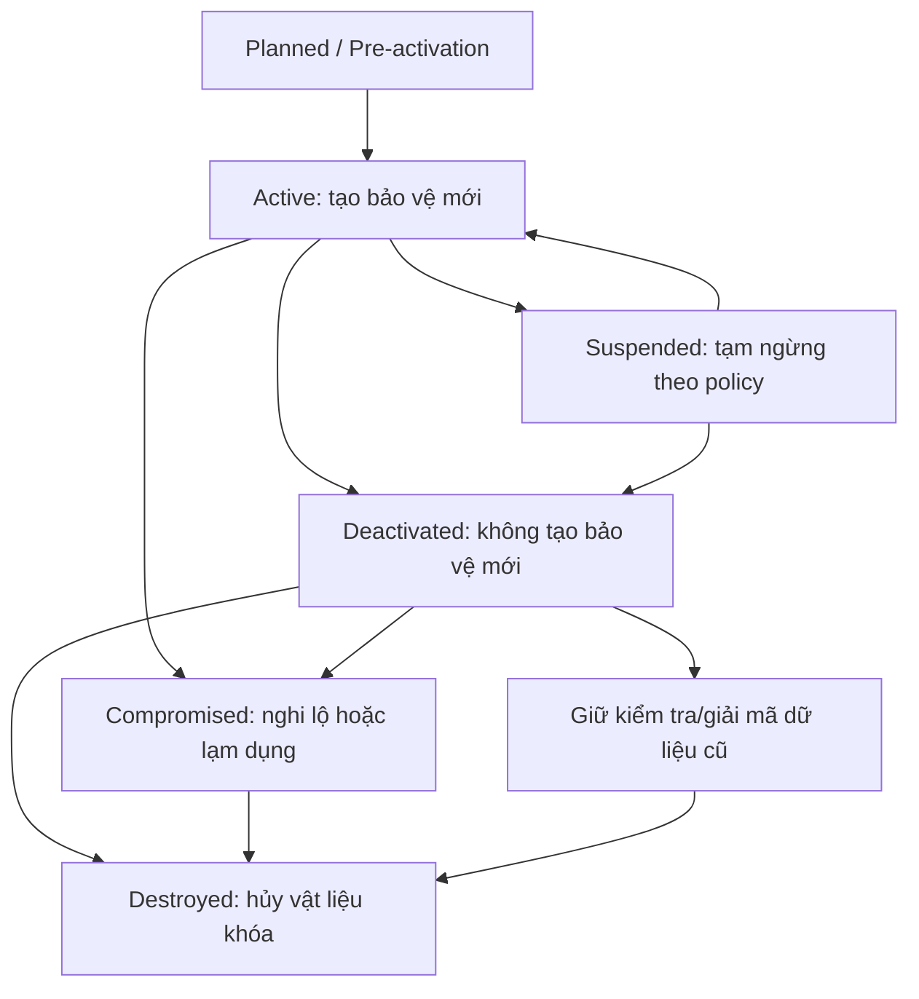
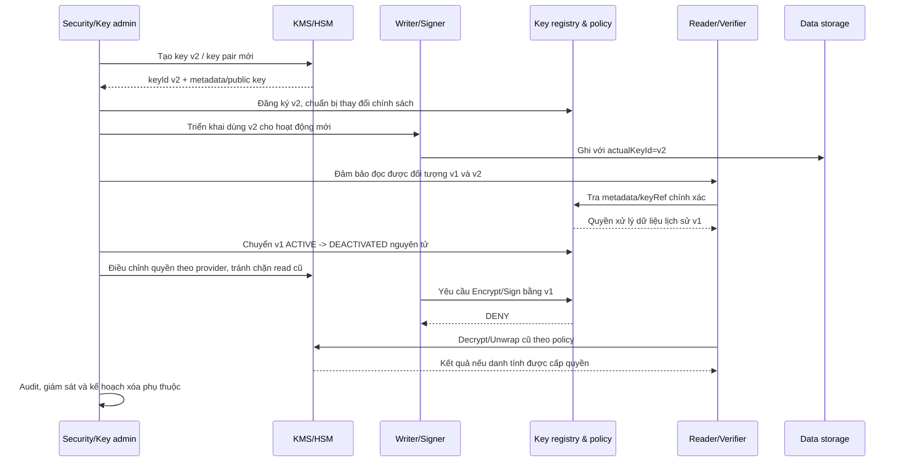
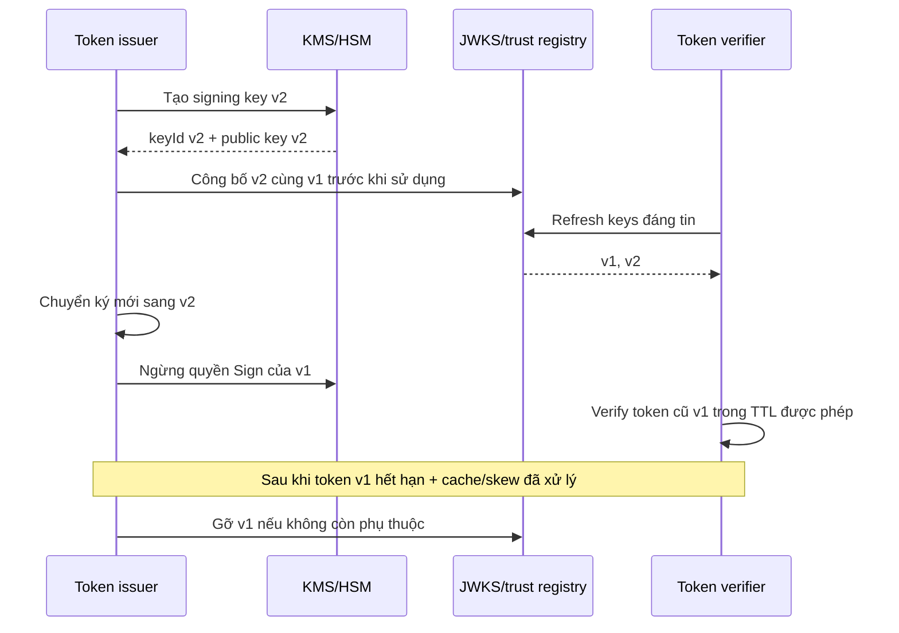

# Deactivated state — Trạng thái ngừng sử dụng khóa cho nghiệp vụ mới

Trong chương **Key lifecycle** của module **SECURITY_KEY_MANAGEMENT_FUNDAMENTALS**, **deactivated state** là trạng thái vòng đời khi một khóa mật mã **không còn được phép dùng để tạo cơ chế bảo vệ mới** theo chính sách. Khóa có thể đã hết *cryptoperiod*, được thay thế bằng khóa mới hoặc không còn phù hợp mục đích ban đầu. Tuy nhiên, vật liệu khóa và một số khả năng xử lý có thể vẫn cần được giữ để **giải mã, mở bọc khóa hoặc xác minh dữ liệu đã được bảo vệ trước đó**, tùy loại khóa, mức độ tin cậy và quy định lưu trữ.

Điểm dễ nhầm nhất là **deactivated không nhất thiết đồng nghĩa với disabled ở cấp KMS/HSM, revoked hay destroyed**. Một API `DisableKey` của nhà cung cấp có thể chặn cả mã hóa lẫn giải mã; trong khi chính sách nghiệp vụ có thể mong muốn **cấm mã hóa mới nhưng cho phép giải mã dữ liệu lịch sử**. Vì vậy, trạng thái logic trong vòng đời khóa và trạng thái kỹ thuật của nhà cung cấp phải được đối chiếu rõ ràng.

Bài này kết nối deactivation với mật mã đối xứng/bất đối xứng, chữ ký số, HMAC, KMS/HSM, envelope encryption, IAM, audit, rotation, khôi phục và hủy khóa để thiết kế hệ thống bảo vệ khóa **an toàn mà không làm mất khả năng truy cập dữ liệu hợp lệ**.

## 1. Mục tiêu học tập

Sau bài học, bạn có thể:

- Giải thích **deactivated state**, nguyên nhân chuyển trạng thái và khác biệt so với `ACTIVE`, `SUSPENDED`, `COMPROMISED`, `REVOKED` hoặc `DESTROYED`.
- Phân biệt **protection cryptoperiod** với thời gian cần xử lý hoặc xác minh dữ liệu cũ (*processing/verification lifetime*).
- Xác định thao tác nào nên bị từ chối sau deactivation: tạo chữ ký, mã hóa bằng DEK cũ, wrap DEK mới, tạo MAC mới hoặc thỏa thuận phiên mới.
- Thiết kế khả năng giải mã, unwrap và xác minh dữ liệu lịch sử mà không biến khóa cũ thành lối đi tắt để tạo dữ liệu mới.
- Hiểu vì sao **deactivate trên registry** và **disable trên KMS/HSM** có thể có hệ quả vận hành rất khác nhau.
- Đề xuất runbook rotation, cơ chế kiểm soát truy cập, logging, giám sát, incident response và quy trình hủy khóa.

## 2. Deactivated state là gì?

Một mô hình vòng đời khóa khái niệm:



Đây là **mô hình kiến trúc dùng để giải thích**, không phải danh sách API bắt buộc của mọi KMS. Trong các hệ thống và chuẩn vòng đời khóa, tên trạng thái và chuyển đổi có thể khác nhau; đặc biệt trạng thái **revoked** đôi khi nói về **chứng chỉ/trust** thay vì chính vật liệu khóa.

**Ý nghĩa chính của deactivation:**

1. **Đóng cửa tạo dữ liệu được bảo vệ mới:** không tiếp tục ký, mã hóa, wrap hay tạo MAC mới bằng khóa đã hết thời gian sử dụng được cho phép.
2. **Giữ tính tương thích lịch sử khi cần:** có thể cho phép giải mã/unwrap ciphertext cũ hoặc xác minh chữ ký/MAC cũ theo chính sách.
3. **Giữ bằng chứng:** duy trì key ID, version, thuật toán, lịch sử quyền, mốc thay đổi, nơi lưu dữ liệu phụ thuộc và audit.
4. **Chuẩn bị loại bỏ:** khi không còn phụ thuộc hợp lệ thì chuyển đến archival/destruction theo kế hoạch, không hủy ngay theo phản xạ.
5. **Giới hạn rủi ro:** việc giữ khóa cũ, nhất là private key hoặc symmetric key, tiếp tục tạo bề mặt tấn công nên phải giảm quyền và thời gian lưu.

### 2.1. Ví dụ trực quan

Ngày 01/12, một hệ thống chuyển sang dùng `billing-dek-v2` để mã hóa hóa đơn mới và ngừng dùng `billing-dek-v1` cho ghi mới. Hóa đơn tháng trước vẫn được mã hóa bằng `v1` và cần đọc trong thời gian lưu trữ. Khi đó:

```text
Trước khi xoay:
  ghi hóa đơn mới --> Encrypt bằng billing-dek-v1
  đọc hóa đơn cũ  --> Decrypt bằng billing-dek-v1

Sau khi xoay và deactivated v1:
  ghi hóa đơn mới --> Encrypt bằng billing-dek-v2
  đọc hóa đơn cũ  --> Decrypt bằng billing-dek-v1 nếu đúng quyền/policy
  ghi bằng v1     --> DENY
```

Việc “vẫn cho decrypt bằng v1” ở đây là **quyết định chính sách có kiểm soát**, không có nghĩa toàn bộ workload được tiếp tục truy cập khóa cũ vô hạn định.

### 2.2. Cryptoperiod và thời gian dữ liệu cần sống

Có hai mốc độc lập:

- **Protection/usage cryptoperiod:** khoảng thời gian khóa được dùng để **áp dụng bảo vệ mới**, như `Encrypt`, `Sign`, `GenerateMac` hay `WrapKey`.
- **Processing/verification lifetime:** khoảng thời gian còn cần **xử lý thông tin đã được bảo vệ** bằng khóa đó: giải mã bản mã cũ, unwrap DEK cũ, hoặc xác minh chữ ký lịch sử.

Một private signing key có thể hết hạn ký sau 90 ngày, trong khi **public verification key** vẫn cần để xác minh hồ sơ nhiều năm. Một KEK có thể ngừng wrap mới nhưng vẫn cần unwrap các DEK lịch sử, trừ khi đã rewrap toàn bộ.

**Không lấy ngày hết protection cryptoperiod làm điều kiện xóa khóa tự động** khi chưa biết dữ liệu phụ thuộc.

## 3. Phân biệt các trạng thái dễ bị nhầm

| Trạng thái / hành động | Ý nghĩa điển hình | Còn sử dụng cho dữ liệu cũ? | Lưu ý |
| --- | --- | --- | --- |
| **`ACTIVE`** | Khóa được phép dùng cho nghiệp vụ mới trong mục đích đã cấp. | Có, nếu chính sách cho phép. | Quyền vẫn phải giới hạn theo principal, purpose và tenant. |
| **`DEACTIVATED`** | Dừng tạo cơ chế bảo vệ mới bằng khóa cũ. | Có thể cho `Decrypt`, `Unwrap`, `Verify` trong phạm vi được kiểm soát. | Không đồng nghĩa mọi API của KMS vẫn hoạt động. |
| **`SUSPENDED`** | Tạm ngừng vì điều tra, sự cố hoặc yêu cầu vận hành. | Tùy nguyên nhân; thường nên fail closed cho đến khi có quyết định. | Có thể có đường quay lại `ACTIVE`, tùy policy. |
| **`COMPROMISED`** | Vật liệu khóa nghi bị lộ hoặc quyền sử dụng bị lạm dụng. | Chỉ theo đánh giá sự cố và bằng chứng, không mặc nhiên tin dữ liệu cũ. | Deactivation thông thường **không giải quyết** rủi ro đã lộ. |
| **Certificate `REVOKED`** | Chứng chỉ không còn được tin theo cơ chế PKI. | Xác minh chữ ký lịch sử phụ thuộc thời điểm/bằng chứng/chính sách. | Không tự xóa private key trên mọi bản sao. |
| **`DISABLED` ở nhà cung cấp** | Một cờ hoặc API chặn thao tác trên key. | Có thể chặn **cả** encrypt và decrypt/unwrap/sign tùy nền tảng. | Đọc đúng hợp đồng API trước khi dùng làm deactivation. |
| **`DESTROYED`** | Vật liệu khóa đã bị hủy trong phạm vi quản lý. | Private key/DEK đã hủy thường không thể giải mã lại; public key vẫn có thể xác minh chữ ký. | Không được hứa khả năng phục hồi khi không còn vật liệu cần thiết. |

Một khóa có thể **deactivated theo registry ứng dụng nhưng vẫn có trạng thái `Enabled` trong KMS** để xử lý dữ liệu cũ. Nếu làm vậy, lớp chính sách phải **không cho phép `Encrypt`/`Sign` mới** và quyền KMS phải tương ứng. Chỉ thay trạng thái trong database rồi để mọi principal có quyền rộng dùng KMS trực tiếp là chưa thực thi deactivation.

Ngược lại, nếu khóa bị **disabled toàn diện ở KMS**, các tác vụ hợp lệ như đọc backup hoặc xác minh MAC có thể thất bại. Không nên thực hiện thao tác này khi chưa kiểm tra API và kế hoạch truy cập dữ liệu cũ.

## 4. Ý nghĩa của deactivation thay đổi theo loại khóa

| Loại khóa | Nên dừng khi deactivated | Có thể còn cần cho dữ liệu lịch sử | Rủi ro đặc thù |
| --- | --- | --- | --- |
| **AES DEK** | Mã hóa bản ghi/thông điệp **mới** bằng DEK cũ. | Giải mã ciphertext đã được tạo hợp lệ trước mốc ngừng dùng. | Lộ DEK cho phép đọc dữ liệu cũ; phải quản lý nonce và ràng buộc bản ghi. |
| **Symmetric KEK** | Wrap DEK **mới** dưới KEK cũ. | Unwrap các DEK đã bọc từ trước cho đến khi rewrap/migration hoàn tất. | Xóa KEK trước khi rewrap có thể khiến dữ liệu không thể mở. |
| **Private signing key** | `Sign` tài liệu, token hoặc artifact mới. | Thông thường **không cần private key** để verify chữ ký cũ. | Không giữ private key vô thời hạn chỉ vì cần verify lịch sử. |
| **Public verification key** | Không phải thao tác tạo chữ ký. | `Verify` chữ ký cũ, cùng trust/cert/bằng chứng cần thiết. | Khóa công khai không chứng minh danh tính nếu chưa xác thực. |
| **HMAC key** | Tạo tag MAC mới. | Verify MAC cũ trong cửa sổ được policy cho phép. | Secret vẫn có thể tạo tag giả; replay vẫn nguy hiểm. |
| **Recipient private key của mã hóa lai/KEM** | Dùng key pair cũ cho giao thức nhận dữ liệu **mới** theo policy. | Decapsulate/unwrap bản mã đã gửi tới public key cũ. | Private key lộ có thể làm lộ bí mật của ciphertext lịch sử đã bị thu thập. |
| **Ephemeral ECDH key** | Không dùng lại cho phiên mới. | Thông thường không giữ để tạo lại phiên đã kết thúc. | Giữ private key tạm thời quá lâu làm yếu mục tiêu forward secrecy. |
| **Root/derivation key** | Dẫn xuất khóa con mới cho purpose đã đóng. | Có thể cần tái dẫn xuất key con cũ nếu thiết kế không lưu chúng. | Thời gian lưu dài và quyền rộng làm tăng blast radius. |

**Quan trọng:** “cho phép xử lý dữ liệu lịch sử” không có nghĩa chỉ cần nhìn client khai `createdAt` là kết luận dữ liệu cũ. Một attacker có thể tự đặt timestamp quá khứ. Cần metadata được bảo vệ bằng chữ ký/MAC/AEAD, inventory đáng tin hoặc bằng chứng từ nguồn server kiểm soát.

## 5. Khi nào chuyển khóa sang deactivated?

Những lý do phổ biến:

1. **Đến cuối cryptoperiod:** mốc hết thời gian sử dụng khóa để bảo vệ thông tin mới theo chính sách.
2. **Rotation theo lịch:** đã sinh và đưa khóa thay thế vào vận hành, chuyển các tác vụ tạo mới sang khóa mới.
3. **Thay mục đích hoặc phạm vi:** ứng dụng/tenant ngừng dùng key cũ sau thay đổi kiến trúc hoặc phân chia môi trường.
4. **Migration thuật toán:** chuyển từ thuật toán/cấu hình cũ sang bộ thuật toán hiện tại, vẫn có dữ liệu lịch sử cần xử lý.
5. **Giảm bề mặt tấn công:** đưa khóa ít dùng vào chế độ chỉ xử lý dữ liệu cũ với quyền hẹp.

**Nghi ngờ lộ khóa không nên xử lý như routine deactivation thuần túy.** Khi private key/DEK bị lộ, cần khoanh vùng, khóa quyền liên quan, đánh giá mất bí mật và thay key material; có thể phải re-encrypt dữ liệu. Một chuyển trạng thái `DEACTIVATED` trong metadata không tự lấy lại bí mật đã mất.

### 5.1. Điều kiện trước khi deactivation

Một checklist ngắn cho đội vận hành:

- Khóa thay thế đã **được tạo an toàn** bằng CSPRNG/KMS/HSM và đăng ký ID/version chính xác?
- Phía ghi/ký mới đã dùng **khóa thay thế** hay vẫn còn node/job cũ và bản release chưa cập nhật?
- Phía đọc/verify có thể định tuyến theo **actual key ID**, không dựa vào alias động `current`?
- Backup, snapshot, dữ liệu lưu trữ, batch job và đối tác bên ngoài nào vẫn phụ thuộc khóa cũ?
- Chính sách cho thao tác lịch sử, danh tính, tài nguyên, tenant và hạn mức đã rõ chưa?
- KMS/HSM hỗ trợ thực thi “deny encrypt/new sign, allow decrypt/verify old” như thế nào?
- Có phương án rollback **được phê duyệt** nếu migration thất bại mà không vô tình tái sử dụng key cũ cho ghi mới?

Không dựa duy nhất vào sự kiện “deploy service mới đã thành công”: hàng đợi, retry, consumer cũ, cron job, region phụ và offline client vẫn có thể phát sinh thao tác bằng key cũ.

## 6. Quy trình chuyển từ active sang deactivated

Một quy trình an toàn cần thiết kế cho **đường ghi** và **đường đọc** tách biệt:



Trong hệ thống thực, thứ tự còn phụ thuộc cơ chế **policy enforcement**. Nếu tất cả workload có thể gọi trực tiếp KMS với key ID cũ mà không qua registry, thay registry trước không ngăn được hoạt động mới. Cần cập nhật IAM/key policy hoặc loại bỏ đường gọi không được giám sát. Nếu KMS không hỗ trợ phân quyền theo thao tác hoặc theo phiên bản như yêu cầu, có thể cần cơ chế proxy/service riêng, thay đổi kiến trúc hoặc hoàn tất migration trước khi disable toàn diện.

### 6.1. Chống race condition khi chuyển trạng thái

Một yêu cầu mã hóa có thể bắt đầu trước thời điểm deactivation nhưng hoàn tất sau đó. Nếu hệ thống tuyên bố “không có đối tượng mới được mã hóa bằng key cũ kể từ mốc T”, cần đặc tả rõ **thời điểm quyết định** và xử lý request đang chạy.

Các biện pháp:

- Dùng version hoặc compare-and-set để cập nhật trạng thái nguyên tử, tránh hai admin ghi đè nhau.
- Chặn cấp quyền *new protection* từ sớm, sau đó **drain** queue/request cũ theo chính sách trước khi tuyên bố hoàn tất.
- Đặt giới hạn TTL cho cache key/policy; có cơ chế vô hiệu hóa cache trước khi kết thúc chuyển đổi.
- Giám sát `Encrypt`/`Sign`/`Wrap` với key ID cũ; số thao tác tạo mới sau cutoff phải bằng không theo nguồn audit phù hợp.
- Không lấy đồng hồ từ client làm nguồn quyết định quyền; dùng đồng hồ server tin cậy và event/version đã được bảo vệ.

Một hệ thống có nhiều region cần tính thời gian propagation. Không nên hạ trạng thái và tắt quyền đọc cũ đồng thời mà không có kế hoạch rollout, đặc biệt khi dữ liệu nằm trong nhiều kho.

## 7. Thực thi deactivation bằng policy chứ không chỉ bằng nhãn

**Key registry** ghi trạng thái logic, còn **IAM/KMS/HSM** thực thi quyền. Hai lớp phải thống nhất.

Một chính sách minh họa:

```text
ACTIVE key:
  ENCRYPT, DECRYPT, WRAP, UNWRAP, SIGN, VERIFY, MAC_CREATE, MAC_VERIFY
  -> mỗi thao tác vẫn phải qua kiểm tra purpose/algorithm/role riêng

DEACTIVATED key:
  ENCRYPT       -> DENY
  WRAP          -> DENY
  SIGN          -> DENY
  MAC_CREATE    -> DENY
  NEW_AGREEMENT -> DENY
  DECRYPT       -> CONDITIONAL: trusted historical ciphertext + allowlist
  UNWRAP        -> CONDITIONAL: trusted historical wrapped DEK + scope
  VERIFY        -> CONDITIONAL: old artifact + trust/time/policy
  MAC_VERIFY    -> CONDITIONAL: giới hạn window, chống replay

COMPROMISED or DESTROYED key:
  hoạt động ứng dụng thông thường -> DENY
  điều tra/khôi phục chuyên biệt   -> quy trình sự cố riêng
```

Đây không phải một quyền cấp trực tiếp cho bất kỳ principal nào. Các thao tác `DECRYPT` hoặc `UNWRAP` lịch sử vẫn phải kiểm tra **danh tính, tenant, purpose, nguồn đối tượng, thời gian, quyền nghiệp vụ và audit**.

### 7.1. Một bảng quyền điển hình

| Principal/role | ACTIVE key | DEACTIVATED key | Ghi chú |
| --- | --- | --- | --- |
| `data-writer` | Mã hóa bằng key hiện hành. | Không được Encrypt/Wrap bằng key cũ. | Thường chỉ dùng alias trỏ đến key mới. |
| `data-reader` | Decrypt bản ghi theo quyền. | Chỉ decrypt/unwrap dữ liệu lịch sử được phép. | Kiểm soát tenant và actual key ID; không cho quyền rộng. |
| `token-issuer` | Sign token bằng key hiện hành. | Không Sign bằng private key cũ. | Khóa cũ không được dùng làm fallback. |
| `token-verifier` | Verify theo tập public keys tin cậy. | Có thể verify token cũ trong TTL/policy. | Phải kiểm tra `iss`, `aud`, `exp`, `alg`, anti-replay khi cần. |
| `security-admin` | Tạo/xoay/quản trị key theo xét duyệt. | Chuyển trạng thái, lên lịch hủy. | Phân tách với quyền đọc dữ liệu nghiệp vụ. |
| `auditor` | Xem metadata và log. | Kiểm tra bằng chứng sử dụng/deactivation. | Không nhận secret/plaintext. |
| `recovery-service` | Theo quyền khôi phục đã phê duyệt. | Unwrap/decrypt cũ có phê duyệt và thời hạn. | Phải chống lạm dụng và ghi log chi tiết. |

Một **public verification key** không phải secret, nhưng việc verifier chấp nhận key phải được điều khiển bằng **trust policy**. Không thể giải quyết bài toán thu hồi chữ ký chỉ bằng cách chỉnh quyền truy cập private key ở KMS.

### 7.2. Vì sao cần phân tách đường ghi và đường đọc?

Một service sử dụng cùng credential với quyền `Encrypt` và `Decrypt` cho mọi key cũ/mới khiến deactivation khó kiểm soát. Tách hai role:

- **Writer:** chỉ sử dụng key hiện hành để bảo vệ dữ liệu mới.
- **Reader/recovery:** đọc chính xác key reference từ envelope đã lưu và được quyền xử lý dữ liệu hợp lệ trong thời gian lưu trữ.

Việc “chỉ cho key cũ để đọc” phải được enforce ở **điểm dùng cryptographic operation** hoặc bằng API riêng không cho phép encryption mới; không chỉ là quy ước trong tài liệu.

## 8. Java 17: mô phỏng policy gate cho khóa deactivated

Ví dụ sau không thực hiện mã hóa hay lưu key material. Nó minh họa **kiểm tra trạng thái và purpose trước khi gọi API mật mã**. Chính sách thực tế cần enforce thêm ở IAM/KMS và không được tin cậy các cờ do người dùng gửi.

```java
import java.time.Instant;

public class DeactivatedKeyPolicyDemo {
    enum KeyState {
        ACTIVE, DEACTIVATED, SUSPENDED, COMPROMISED, DESTROYED
    }

    enum Operation {
        ENCRYPT, DECRYPT, WRAP, UNWRAP,
        SIGN, VERIFY, MAC_CREATE, MAC_VERIFY, NEW_AGREEMENT
    }

    record KeyMetadata(
            String actualKeyId,
            String purpose,
            KeyState state,
            Instant deactivatedAt) {}

    // Chỉ do server dựng sau khi xác thực IAM, tenant, mục đích và
    // metadata lịch sử từ nguồn đáng tin. KHÔNG map trực tiếp từ JSON client.
    record TrustedContext(
            boolean principalAuthorizedForKey,
            boolean historicalObjectVerified,
            boolean recoveryAccessApproved) {}

    static boolean allow(
            KeyMetadata key, Operation operation, TrustedContext context) {
        if (!context.principalAuthorizedForKey()) return false;

        return switch (key.state()) {
            case ACTIVE -> true; // Vẫn cần kiểm tra algorithm/capability phía sau
            case DEACTIVATED -> switch (operation) {
                case DECRYPT, UNWRAP ->
                    context.historicalObjectVerified()
                    && context.recoveryAccessApproved();
                case VERIFY, MAC_VERIFY ->
                    context.historicalObjectVerified();
                default -> false; // Không tạo bảo vệ mới
            };
            case SUSPENDED, COMPROMISED, DESTROYED -> false;
        };
    }

    public static void main(String[] args) {
        KeyMetadata oldKey = new KeyMetadata(
                "tenant17/dek-v1",
                "customer-records",
                KeyState.DEACTIVATED,
                Instant.parse("2026-12-01T00:00:00Z"));

        TrustedContext trustedHistoricalRequest =
                new TrustedContext(true, true, true);

        System.out.println("New encrypt allowed: " +
                allow(oldKey, Operation.ENCRYPT, trustedHistoricalRequest));
        System.out.println("Historical decrypt allowed: " +
                allow(oldKey, Operation.DECRYPT, trustedHistoricalRequest));
        System.out.println("New signing allowed: " +
                allow(oldKey, Operation.SIGN, trustedHistoricalRequest));

        TrustedContext untrustedRequest =
                new TrustedContext(true, false, false);
        System.out.println("Unproven decrypt allowed: " +
                allow(oldKey, Operation.DECRYPT, untrustedRequest));
    }
}
```

Kết quả dự kiến:

```text
New encrypt allowed: false
Historical decrypt allowed: true
New signing allowed: false
Unproven decrypt allowed: false
```

**Không sử dụng nguyên hàm `allow` trên như một engine bảo mật production.** Lý do:

- Quyền `ACTIVE -> true` chỉ mô phỏng trạng thái: phải kiểm tra **capability theo key type**, scope/tenant, thuật toán, hạn mức và phân quyền thực.
- `historicalObjectVerified` và `recoveryAccessApproved` phải được tạo bởi **server dựa trên chứng cứ đáng tin**, không phải boolean client tự khai.
- Kiểm tra trạng thái ở ứng dụng không thay thế hạn chế quyền **trực tiếp ở KMS/HSM** hoặc kiểm soát tất cả các đường gọi.
- Cần chống **TOCTOU** (*time-of-check to time-of-use*): trạng thái có thể thay đổi giữa lúc kiểm tra và lúc gọi KMS. Có thể phải dùng policy enforcement gắn phiên bản, TTL ngắn hoặc cơ chế ủy quyền tại đúng điểm thực thi.
- Không dựa duy nhất vào `deactivatedAt` hay timestamp do đối tượng dữ liệu cung cấp để quyết định ciphertext có thực sự thuộc giai đoạn lịch sử.
- Trạng thái `COMPROMISED` mặc định bị từ chối ở luồng nghiệp vụ; công tác điều tra hoặc xác minh forensic cần policy riêng, không chuyển nó ngược thành `ACTIVE` tùy tiện.

Ví dụ dùng Java 17 `record`, `enum` và `switch expression`. Mục tiêu là minh họa điểm đặt policy, **không phải một SDK KMS**.

## 9. Deactivation với AES DEK, KEK và envelope encryption

Envelope encryption thường dùng **DEK** mã hóa dữ liệu bằng AEAD, còn **KEK** trong KMS/HSM bọc DEK. Deactivation phải xét cả hai lớp.

### 9.1. Khi DEK deactivated

Giả sử bản ghi đã lưu:

```json
{
  "recordId": "r-501",
  "tenantId": "t-17",
  "cipherFormat": "aes-gcm-v1",
  "dekKeyRef": "deks/r-501-v1",
  "kekKeyRef": "keks/billing-v3",
  "wrappedDek": "<encrypted-DEK>",
  "nonce": "<base64url-nonce>",
  "ciphertextAndTag": "<base64url-ciphertext-and-tag>"
}
```

Đây là **schema minh họa**, không phải định dạng crypto hoàn chỉnh. Các trường quan trọng phải được xác thực/ràng buộc theo giao thức. Sau deactivation:

1. Writer tạo **DEK mới** cho đối tượng mới hoặc lấy khóa theo policy hiện hành.
2. Reader dùng `dekKeyRef` đã lưu để giải mã **đối tượng hợp lệ** và kiểm tra AEAD tag.
3. Không mã hóa bản ghi mới bằng DEK cũ, ngay cả khi DEK vẫn còn trong cache hoặc KMS cho phép thao tác.
4. Nếu cần hủy DEK, phải đảm bảo mọi ciphertext liên quan đã được xóa hợp pháp hoặc mã hóa lại bằng DEK mới theo kế hoạch.
5. Nếu DEK bị lộ, deactivation không khôi phục bí mật của ciphertext đã thu thập; cần incident response và đánh giá re-encrypt.

### 9.2. Khi KEK deactivated

KEK bảo vệ DEK chứ không trực tiếp mã hóa mọi bản ghi. Khi xoay `KEK-v3` sang `KEK-v4`:

```text
Trước:
  DEK --> Wrapped under KEK-v3
  Data ciphertext --> AES-GCM bằng DEK

Sau rewrap theo lịch:
  DEK --> Wrapped under KEK-v4
  Data ciphertext --> vẫn AES-GCM bằng cùng DEK (có thể không đổi)
```

**Rewrap** giữ DEK không đổi; **re-encrypt** tạo DEK mới và mã hóa lại dữ liệu. Rewrap có thể đủ khi routine KEK rotation và không có dấu hiệu lộ key material liên quan. Nhưng nếu KEK cũ bị lộ và attacker đã lấy wrapped DEK, dữ liệu có thể đã bị ảnh hưởng; rewrap đơn độc không khiến attacker quên DEK cũ.

Khi KEK cũ còn cần unwrap trong giai đoạn migration, không được dùng `DisableKey` nếu provider sẽ chặn **mọi** unwrap. Có thể cần giữ KEK enabled với policy hẹp, di chuyển toàn bộ wrapped DEK trước khi disable hoặc thiết kế một dịch vụ unwrap lịch sử được giám sát.

### 9.3. Trường hợp backup và bản sao lạnh

Đối với backup lưu nhiều năm, một KEK tưởng như “không được dùng” ở môi trường chính có thể vẫn là **điều kiện giải mã duy nhất** của snapshot. Trước khi destroy:

- Kiểm kê dữ liệu online, cold storage, disaster-recovery region và backup không thường xuyên được đọc.
- Kiểm thử khôi phục **một mẫu dữ liệu thực sự** qua đường KMS/policy dự định sau deactivation.
- Lập kế hoạch rewrap/re-encrypt những bản backup có thể cập nhật; với backup immutable, xác định chiến lược giữ/retire khóa theo chính sách.
- Không giả định bản sao backup của database đồng nghĩa có thể khôi phục private key/KEK **non-exportable** nếu nhà cung cấp không hỗ trợ.

## 10. Deactivation với chữ ký số, JWT và HMAC

### 10.1. Private signing key dừng ký, public key có thể tiếp tục xác minh

Khi chuyển `sign-v1` sang `sign-v2`, nguyên tắc là **không tạo chữ ký mới bằng private v1**. Tuy nhiên, một tài liệu được ký bằng `v1` trong thời gian hợp lệ vẫn có thể cần **public key v1** để verify.



Verifier vẫn phải kiểm tra **chữ ký, `alg` cho phép, issuer `iss`, audience `aud`, `exp`, `nbf` và quy tắc chống replay/thu hồi phiên khi cần**. Việc một JWT được ký bằng khóa deactivated **không tự khiến token hợp lệ**; chính sách chấp nhận còn phụ thuộc thời gian, danh tính và trạng thái phiên.

Với **chữ ký hồ sơ lưu dài hạn**, cần giữ public key/certificate, bằng chứng trust, thông tin về thời điểm ký đáng tin và trạng thái thu hồi theo yêu cầu nghiệp vụ. Private signing key có thể bị hủy sớm hơn thời hạn lưu chữ ký khi không còn cần ký.

### 10.2. Certificate expiry/revocation không bằng deactivation

Một chứng chỉ X.509 có thể hết hạn hoặc bị thu hồi trong khi key material còn tồn tại. Deactivate private signing key **không tự phát hành CRL/OCSP hay cập nhật PKI**. Ngược lại, revoke chứng chỉ không xóa mọi bản sao private key.

Với chữ ký lịch sử, kết luận tin cậy có thể phụ thuộc thời điểm ký, bằng chứng thời gian, trạng thái chứng chỉ tại thời điểm liên quan và chính sách xác minh. Không tự coi trường `signedAt` do người ký khai là timestamp đáng tin, cũng không mặc định tất cả chữ ký cũ mất giá trị ngay khi chứng chỉ bị thu hồi.

### 10.3. HMAC key deactivated: nguy cơ replay và giả mạo

Nếu một bên gửi webhook dùng `hmac-v2` cho yêu cầu mới, bên nhận có thể cần chấp nhận `hmac-v1` trong **cửa sổ chuyển đổi đã giới hạn**. Điều này khác với giữ public verification key: **HMAC verification cần chính secret key**.

- Không tạo MAC mới bằng `hmac-v1` sau cutoff.
- Chỉ xác minh tag cũ trong chính sách thời gian/phạm vi phù hợp.
- Kèm timestamp/nonce hoặc request ID **được MAC bảo vệ** và kiểm tra idempotency để chống replay.
- Nếu `hmac-v1` bị lộ, chỉ cho phép verify thông thường có thể khiến attacker tạo tag giả; cần quy trình ứng phó sự cố, không chỉ định trạng thái deactivated.
- Hết cửa sổ hợp lệ và khi không còn phụ thuộc, thu hồi secret v1 theo chính sách.

## 11. Giám sát, kiểm toán và bằng chứng deactivation

Một lần chuyển trạng thái chỉ đáng tin khi hệ thống có thể chứng minh **không còn thao tác bảo vệ mới bằng khóa cũ** và **đường đọc lịch sử hoạt động đúng giới hạn**.

Ví dụ một event audit logic:

```json
{
  "eventType": "KEY_DEACTIVATED",
  "keyId": "billing/kek-v3",
  "previousState": "ACTIVE",
  "newState": "DEACTIVATED",
  "effectiveAt": "2026-12-01T00:00:00Z",
  "reason": "scheduled-rotation",
  "replacementKeyId": "billing/kek-v4",
  "changeId": "chg-2026-015",
  "approvedBy": "security-review",
  "policyVersion": 9
}
```

Đây là ví dụ metadata, không phải thông tin được lấy từ một hệ thống thực. Trong production phải bảo vệ tính xác thực, tính toàn vẹn và quyền sửa log/metadata.

Các sự kiện đáng giám sát:

| Tín hiệu | Ý nghĩa |
| --- | --- |
| `ENCRYPT`/`SIGN`/`WRAP` được yêu cầu với key deactivated. | Có node/client cũ hoặc dấu hiệu cố ý vượt policy. |
| `DECRYPT`/`UNWRAP` cũ tăng đột biến. | Có thể là migration hợp lệ hoặc truy cập trái phép; cần điều tra theo tenant/actor. |
| Nhiều request bị từ chối vì key disabled. | Có thể disable KMS quá sớm, hoặc request không hợp lệ. |
| Thay đổi policy, alias, key state ngoài change window. | Nguy cơ lạm dụng quyền quản trị. |
| Ciphertext cũ không còn giải mã được trong DR drill. | Bằng chứng phụ thuộc key/backups chưa được xử lý. |
| Public key cũ được chấp nhận quá lâu. | Tăng cửa sổ chấp nhận token/đối tượng không cần thiết. |

**Không log:** plaintext key, private key, DEK rõ, HMAC secret, nội dung dữ liệu nhạy cảm hoặc token còn hiệu lực. Có thể lưu key ID, version, thao tác, actor, purpose, kết quả, request ID và thông tin phạm vi đã được xử lý theo chính sách dữ liệu.

### 11.1. Yêu cầu xác minh sau khi chuyển trạng thái

Một kiểm tra kỹ thuật có thể gồm:

1. Gửi request `Encrypt` hoặc `Sign` mới với key cũ → **từ chối**.
2. Gửi cùng request với key mới và đúng IAM → **chấp nhận**.
3. Đọc ciphertext/hồ sơ có key ID cũ, với quyền lịch sử đã phê duyệt → **xử lý được**.
4. Đọc cùng đối tượng từ principal/tenant không được phép → **từ chối**.
5. Gửi ciphertext đã bị sửa/tampered metadata → **AEAD/tag hoặc policy thất bại**.
6. Kiểm tra không có đường bypass KMS/policy, credential cũ, cache key, region chưa được rollout.
7. Xác nhận audit/metrics ghi chính xác trạng thái, mốc chuyển, key ID và phiên bản policy.

Kết quả phải được đo ở **nhiều instance/region** nếu hệ thống phân tán, không chỉ trên một máy thử nghiệm.

## 12. Tình huống: hệ thống thanh toán cần vừa xoay khóa vừa giữ hồ sơ

Một hệ thống thanh toán lưu chứng từ nhiều năm, ký lệnh giao dịch và gửi webhook đến đối tác. Ba nhóm khóa cần được deactivated theo các chính sách khác nhau:

1. **KEK hóa đơn:** không bọc DEK mới dưới `billing-kek-v1`; các DEK cũ được rewrap sang `v2` theo batch. Trong thời gian migration, chỉ recovery worker được phép unwrap `v1` đúng đối tượng.
2. **Signing key giao dịch:** signer chuyển sang `payments-sign-v2`; private `v1` ngừng ký. Public `v1` vẫn được giữ cùng bằng chứng để verify chứng từ lịch sử, còn token ngắn hạn có cửa sổ JWKS riêng.
3. **HMAC webhook:** sender chuyển sang `partner-hmac-v2`; verifier hỗ trợ `v1` trong thời gian ngắn theo chính sách. Sau đó v1 bị loại bỏ để không tiếp tục tạo/chấp nhận tag.

Một quy trình rollout:

```text
T-7 ngày:  Tạo v2, kiểm tra quyền, công bố metadata/public key khi cần
T-2 ngày:  Deploy readers/verifiers hiểu v1 + v2
T0:        Chuyển writers/signers sang v2
T0 + kiểm tra:
           Deactivate v1 theo registry + IAM thích hợp
           Từ chối mọi thao tác tạo bảo vệ mới bằng v1
T+N:       Migration DEK/wrapped data, theo dõi usage v1
Khi đủ điều kiện:
           Hủy hoặc lưu trữ private/secret key cũ theo policy
```

Các mốc chỉ là **ví dụ kế hoạch**, không phải thời hạn bắt buộc. Với key nghi bị lộ, phải rút ngắn cửa sổ chấp nhận và đi theo **incident response**, không giữ lịch bảo trì như bình thường.

Trong dự án thật, câu hỏi trọng tâm là: “Hệ thống nào vẫn còn cần `Decrypt/Unwrap/Verify` bằng khóa cũ, cần đến khi nào và có thể chứng minh quyền sử dụng đó hợp lệ không?”

## 13. Sai lầm thường gặp

| Sai lầm | Hậu quả | Cách xử lý |
| --- | --- | --- |
| Đánh đồng `DEACTIVATED` với KMS `DisableKey`. | Có thể mất khả năng decrypt/unwrap data cũ. | Kiểm tra API provider và thiết kế chính sách theo thao tác. |
| Chỉ đổi trạng thái trong database, KMS vẫn cho `Encrypt`/`Sign` trực tiếp. | Khóa cũ vẫn tạo dữ liệu/chữ ký mới qua đường bypass. | Enforce IAM/KMS/key policy hoặc proxy tại điểm thực thi. |
| Xóa key ngay khi hết protection cryptoperiod. | Dữ liệu chưa rewrap/re-encrypt không còn đọc được. | Kiểm kê phụ thuộc, giữ read path được kiểm soát hoặc migration trước khi hủy. |
| Không gắn actual key ID vào ciphertext/signature. | Không biết dùng khóa nào để decrypt/verify sau rotation. | Lưu key ID/version/algorithm trong envelope/metadata đáng tin. |
| Tin timestamp `createdAt` do client gửi để cho phép historical decrypt. | Attacker có thể backdate đối tượng mới. | Tin metadata bảo vệ từ server, audit và policy. |
| Không drain queue/caches khi chuyển khóa. | Thao tác `Encrypt`/`Sign` vẫn chạy với key cũ sau cutoff. | Giới hạn TTL, drain, rollout nhiều region, kiểm tra metrics. |
| Dùng chung credential writer/reader có quyền mọi key. | Không thể thực thi read-only deactivation đúng mức. | Tách role tạo mới và xử lý lịch sử, giảm quyền KMS. |
| Coi private signing key bắt buộc phải giữ để verify chữ ký cũ. | Giữ secret lâu không cần thiết, tăng rủi ro lộ. | Giữ public key/trust/evidence, hủy private key khi đủ điều kiện. |
| Giữ HMAC key cũ để verify mà không chống replay. | Thông điệp cũ có MAC hợp lệ có thể bị gửi lại. | Timestamp/nonce/request ID có MAC, kiểm tra trạng thái nghiệp vụ. |
| Đánh dấu khóa bị lộ là deactivated định kỳ rồi coi đã an toàn. | Attacker vẫn có key material hoặc chữ ký/DEK cũ. | Incident response, đánh giá re-encrypt, revoke trust và notify khi cần. |
| Rewrap DEK khi DEK đã lộ rồi tuyên bố bí mật được phục hồi. | Attacker có thể vẫn giải mã dữ liệu với DEK đã biết. | Tạo DEK mới, re-encrypt dữ liệu liên quan. |
| Ngừng công bố public key cũ quá sớm trong JWKS. | Token chưa hết hạn bị từ chối. | Chuẩn bị overlap theo TTL, cache và skew. |
| Giữ public key cũ trong trust vô thời hạn cho JWT ngắn hạn. | Token/đường xác minh cũ sống dài hơn yêu cầu. | Xác định thời hạn chấp nhận, loại bỏ sau khi hết phụ thuộc. |
| Không kiểm tra backup trước khi destroy KEK. | Khôi phục DR thất bại, mất dữ liệu không thể sửa. | Inventory, restore drill, kế hoạch rewrap hoặc retention. |
| Không audit việc đổi state/policy. | Không truy vết được lạm dụng quyền hoặc lỗi vận hành. | Ghi change ID, actor, approval, key ID, before/after và outcome. |

## 14. Checklist trước khi xác nhận khóa đã deactivated

1. **Policy:** đã định nghĩa rõ deactivated có nghĩa dừng những thao tác nào và còn cho phép xử lý dữ liệu cũ nào?
2. **Replacement:** khóa mới được sinh an toàn, có key ID/version, metadata và quyền đúng mục đích?
3. **Actual key reference:** ciphertext, wrapped DEK, chữ ký và verifier có tham chiếu đúng khóa thực tế?
4. **Writer/Signer:** mọi đường tạo dữ liệu mới, kể cả cron/queue/region cũ, đã chuyển sang key mới?
5. **KMS/HSM:** trạng thái provider và IAM có chặn tạo bảo vệ mới nhưng vẫn hỗ trợ read lịch sử đúng policy?
6. **Reader/Verifier:** có kiểm soát tenant, purpose, trust, timestamp/metadata đã xác thực và chống replay?
7. **Policy propagation:** cache, credential, alias, worker offline đã được xử lý; tránh TOCTOU và tác vụ đang chạy?
8. **Backup/DR:** biết toàn bộ bản sao dữ liệu và wrapped keys; đã thử restore với policy sau deactivation?
9. **Compromise:** có dấu hiệu key bị lộ không? Nếu có, đã thực hiện incident response thay vì deactivation bình thường?
10. **Monitoring:** đã chứng minh `Encrypt`/`Sign`/`Wrap` mới bằng khóa cũ bị chặn, còn đọc hợp lệ vẫn hoạt động?
11. **Audit:** có thay đổi trạng thái, actor, approval, cutoff, key version, và log không lộ key material?
12. **Destruction plan:** đã xác định mốc không còn phụ thuộc, chủ sở hữu phê duyệt và cách hủy/retire an toàn?

## 15. Câu hỏi tự kiểm tra

1. Vì sao một khóa ở trạng thái `DEACTIVATED` vẫn có thể cần được giữ trong hệ thống?
2. Khác nhau giữa **ngừng mã hóa mới**, **disable key trong KMS**, **thu hồi chứng chỉ** và **hủy vật liệu khóa** là gì?
3. Vì sao protection cryptoperiod thường ngắn hơn thời gian cần xác minh chữ ký hoặc giải mã dữ liệu?
4. Một KEK cũ được dùng bọc hàng triệu DEK: có thể xóa ngay khi khóa mới hoạt động không? Cần kiểm kê những gì?
5. Vì sao private signing key cũ thường không cần thiết để xác minh chữ ký cũ? Public key cũ có tự chứng minh đáng tin không?
6. Sau rotation, ứng dụng vẫn gửi một vài request `Encrypt` bằng key cũ từ cache. Điều này cho thấy thiếu kiểm soát gì?
7. Nếu KMS hỗ trợ một nút `Disable` chặn toàn bộ cryptographic operations, làm thế nào thiết kế đường đọc dữ liệu lịch sử?
8. Khi HMAC key deactivated nhưng vẫn được dùng để verify trong cửa sổ chuyển tiếp, phải chống replay như thế nào?
9. Nếu dữ liệu có `createdAt=trước deactivation` do client tự khai, có đủ chứng minh đây là ciphertext lịch sử hợp lệ không?
10. Nếu DEK đã bị lộ, rewrap nó dưới một KEK mới có khiến dữ liệu cũ lại bí mật không? Tại sao?
11. Trong ví dụ Java, vì sao một boolean `historicalObjectVerified` do client gửi không thể dùng làm bằng chứng cấp quyền?
12. Trước khi chuyển một khóa từ `DEACTIVATED` sang `DESTROYED`, bạn cần kiểm thử khả năng khôi phục dữ liệu và xác minh lịch sử ra sao?

**Ghi nhớ:** **Deactivated state là mốc kết thúc việc dùng khóa để tạo bảo vệ mật mã mới, không tự động là mốc xóa khóa hoặc mất quyền xử lý dữ liệu cũ.** Một thiết kế tốt phải thống nhất registry và KMS/HSM, tách quyền tạo mới khỏi quyền xử lý lịch sử, giữ đúng metadata/key ID, kiểm soát rotation và incident response, giám sát thực thi, kiểm toán và chỉ hủy key material khi đã giải quyết toàn bộ phụ thuộc hợp lệ.
