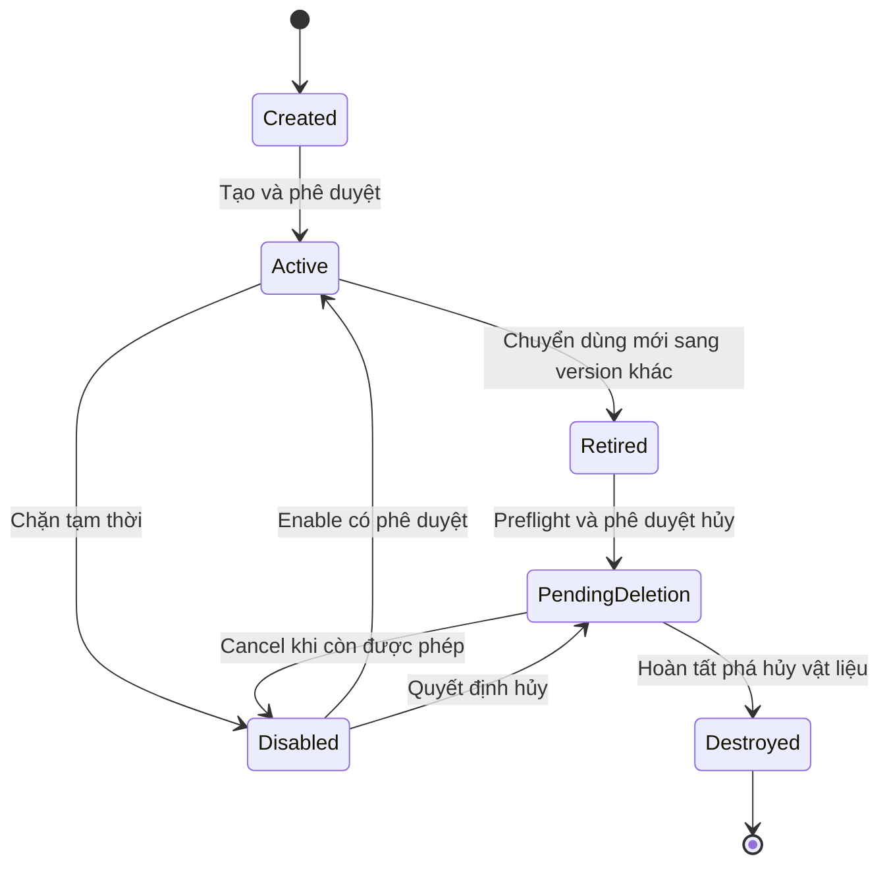
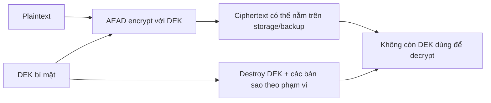
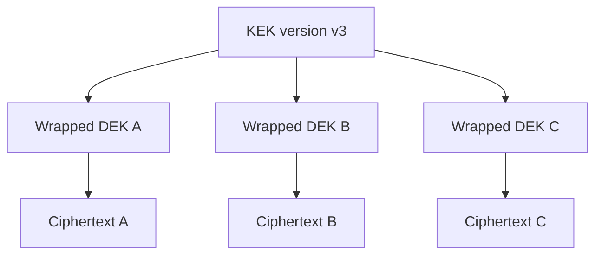
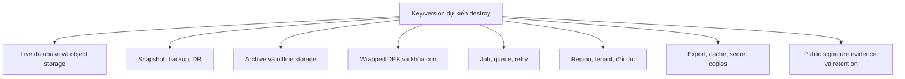
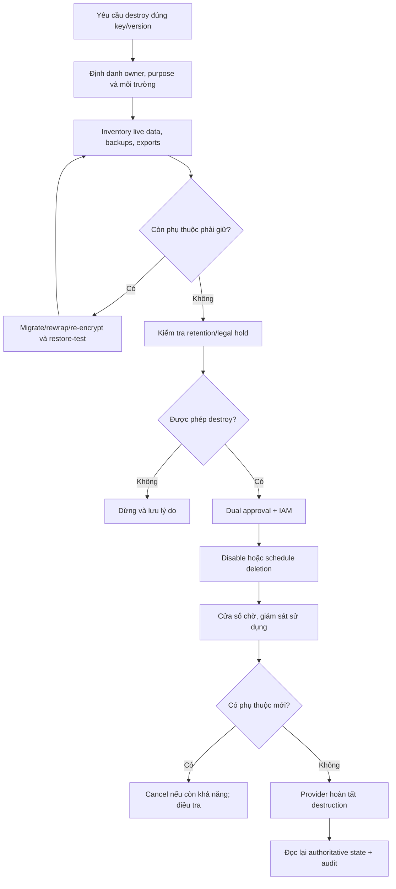

# Destroyed state

## 1. Destroyed state là gì?

**Destroyed state (trạng thái đã hủy)** là trạng thái của một khóa mật mã hoặc **key version** cho biết **vật liệu khóa thuộc phạm vi quản lý đã được hủy**, không còn khả năng sử dụng để thực hiện những phép toán mật mã tương ứng trong vùng bảo vệ đó. Trong một vòng đời khóa thông thường, đây là trạng thái kết thúc và **không thể đảo ngược bằng thao tác bật lại khóa**.

Ví dụ, hệ thống lưu hóa đơn được mã hóa bằng AES-GCM. DEK của từng hóa đơn được bọc bằng KEK `invoice-kek:v3` trong KMS. Nếu vật liệu của v3 bị hủy trước khi mọi DEK còn cần đọc được chuyển sang KEK mới, dữ liệu đang được giữ có thể **không giải mã được nữa**. Ngược lại, nếu có bản sao KEK v3 đã bị export hoặc bị đánh cắp, việc hủy bản trong KMS không khiến bản sao đó tự biến mất.

**Destroyed không đồng nghĩa mọi bản sao vật liệu khóa ở mọi nơi đều đã bị xóa.** Từ này luôn cần gắn với **phạm vi xác nhận**: một key version trong KMS, một HSM slot, một bản sao trên thiết bị, hay toàn bộ tập khóa và bản sao được quản trị.

Bài thuộc chương **Key lifecycle** của module `SECURITY_KEY_MANAGEMENT_FUNDAMENTALS`. Destroyed state là điểm kết thúc của một chu trình **tạo → cấp phát → bảo vệ/lưu trữ → sử dụng → rotation → ngừng sử dụng/thu hồi → hủy**, kết nối mật mã đối xứng, bất đối xứng, chữ ký số, KMS/HSM, envelope encryption, IAM và kiểm toán.

Sau bài học, bạn có thể:

- Phân biệt **destroy, disable, retire, revoke, schedule deletion** và xóa metadata.
- Giải thích hệ quả hủy **DEK, KEK, private signing key, HMAC secret và private decapsulation key**.
- Nêu các điều kiện cần có để **cryptographic erasure / crypto-shredding** thực sự có tác dụng.
- Kiểm kê live data, wrapped DEK, backup, snapshot, DR, archive và bản sao khóa trước thao tác không thể hoàn tác.
- Thiết kế **phê duyệt, cửa sổ chờ, quyền IAM, kiểm chứng nhà cung cấp và audit trail**.
- Áp dụng checklist và ví dụ Java 17 để ngăn yêu cầu hủy khóa sai phạm vi hoặc khi còn phụ thuộc.

## 2. So sánh Destroyed với các trạng thái khác

Nhiều từ trông gần giống nhau nhưng khác rõ về **khả năng phục hồi** và **tác động lên vật liệu khóa**.

| Trạng thái | Vật liệu khóa còn tồn tại? | Được phép dùng? | Có thể quay lại hoạt động? |
| --- | --- | --- | --- |
| **Created / Prepared** | Có | Chưa hoặc hạn chế | Có thể kích hoạt |
| **Active / Enabled** | Có | Có, theo IAM và key policy | Đang hoạt động |
| **Disabled / Suspended** | Thường có | Không theo policy hiện hành | Có thể bật lại nếu được cấp quyền |
| **Retired / Deactivated** | Thường có | Có thể chỉ decrypt/verify dữ liệu cũ | Tùy policy |
| **Revoked / Distrusted** | Có thể có hoặc không | Không còn được *tin* hoặc dùng theo phạm vi thu hồi | Không đồng nghĩa xóa key material |
| **Pending deletion** | Phụ thuộc nhà cung cấp, thường còn trong vùng quản lý | Thường bị hạn chế hoặc không dùng | Có thể hủy lịch trước khi hoàn tất nếu hệ thống hỗ trợ |
| **Destroyed** | Vật liệu trong **phạm vi hủy** không còn dùng được | **Không** | Không thể bật lại chính vật liệu đã bị hủy |
| **Deleted alias/record** | **Chưa biết** | Phụ thuộc khóa thật | Xóa tên/metadata không chứng minh đã hủy secret |

Một số dịch vụ cho phép **hủy riêng từng key version**, trong khi dịch vụ khác áp dụng xóa toàn bộ key resource. Tên state và transition **không thống nhất giữa các KMS/HSM**; luôn đọc contract/API của nền tảng đang triển khai.

### 2.1. Key ID, alias, version và key material

- **Key ID:** định danh tài nguyên logic.
- **Alias:** tên có thể trỏ tới key hoặc version và có thể đổi đích.
- **Key version:** thế hệ vật liệu mật mã, ví dụ `v3`; ciphertext lịch sử có thể còn phụ thuộc.
- **Key material:** bytes hoặc trạng thái mật mã bí mật cho phép decrypt, unwrap, sign, decapsulate hoặc tạo MAC.

Xóa `alias/customer-data-current` không làm các key versions bên dưới biến mất. Ngược lại, giữ tên, log và metadata của `v3` để audit không có nghĩa còn tồn tại vật liệu `v3` có thể sử dụng.

**Không sử dụng một phản hồi `NotFound` hoặc `PermissionDenied` làm bằng chứng duy nhất của Destroyed.** Lỗi có thể đến từ quyền IAM, mạng, trạng thái disable hoặc resource reference sai.

### 2.2. State machine minh họa



Đây là **mô hình chính sách học thuật**. Cửa sổ chờ, khả năng cancel và loại đích quay về phụ thuộc provider; một số hệ thống không có state `PendingDeletion`. Không có transition `Destroyed → Active` đối với **chính vật liệu đã bị phá hủy**.

## 3. “Destroy” có nghĩa gì ở mức vật liệu mật mã?

### 3.1. Phạm vi hủy trong KMS/HSM

KMS/HSM có thể cung cấp cơ chế xóa key version, xóa key object, vô hiệu hóa vĩnh viễn vật liệu được import hoặc **zeroization** trong ranh giới bảo vệ được công bố. Cách thực thi vật lý có thể liên quan đến lưu trữ mã hóa nội bộ, bản sao do dịch vụ quản lý hoặc thiết bị phần cứng.

Khi nhận kết quả thành công phải trả lời:

1. API đã hủy **version** hay **toàn bộ key**?
2. Vật liệu được **sinh tại dịch vụ** hay được **import** từ ngoài?
3. Có bản export/copy hay bản sao ngoài phạm vi dịch vụ không?
4. Các replica, region, cluster hoặc vùng DR của dịch vụ có được tính trong cam kết hay không?
5. Hoạt động hủy **đã hoàn tất** hay chỉ được **lên lịch**?
6. Có event log, operation ID và trạng thái authoritative để chứng minh không?

Một nhà cung cấp có thể xác nhận **material trong dịch vụ** đã được hủy; bằng chứng ấy **không đủ** để tuyên bố mọi bản copy trước đây ở ứng dụng, backup hoặc đối tác cũng đã bị hủy.

### 3.2. Xóa file không chắc đã hủy key material

Xóa file `signing-private.pem` thường chỉ làm file không còn xuất hiện trong thư mục. Vật liệu có thể tồn tại trong snapshot, backup, filesystem journal, vùng lưu trữ chưa được ghi đè, thiết bị SSD có wear leveling, file tạm hoặc bản export.

Cần áp dụng **media sanitization** và quản lý secret theo chính sách phần cứng/hệ điều hành. Không tự khẳng định việc ghi đè một lần lên file trên SSD hoặc cloud block storage bảo đảm không thể khôi phục.

Ưu tiên thiết kế **non-exportable private key**, quản trị tập trung, hạn chế cache và kiểm soát backup ngay từ đầu; việc tránh tạo bản sao bí mật dễ hơn chứng minh xóa tất cả bản sao về sau.

### 3.3. Zeroization trong bộ nhớ Java

Xóa dữ liệu từ một `byte[]` bằng `Arrays.fill(...)` có thể giảm thời gian lưu secret trong mảng do ứng dụng quản lý, nhưng Java/JVM và thư viện có thể tạo các bản sao ở `String`, JIT/GC, native memory, provider, thread stack hoặc crash dump.

**Một lần gọi `Arrays.fill(secret, (byte) 0)` không phải bằng chứng Destroyed state toàn hệ thống.** Nó chỉ là một biện pháp giảm phơi lộ. Với khóa nhạy cảm, dùng KMS/HSM, giảm lifetime trong tiến trình, hạn chế logging/debug và bảo vệ memory dumps.

## 4. Cryptographic erasure (crypto-shredding)

**Cryptographic erasure** là phương thức làm dữ liệu đã mã hóa trở nên **không thể giải mã một cách khả thi** bằng việc phá hủy vật liệu khóa cần thiết, thay vì bắt buộc phải ghi đè từng bản ciphertext trên mọi ổ đĩa.

Ví dụ: DEK ngẫu nhiên mã hóa một lô dữ liệu bằng AEAD; nếu DEK và **mọi đường khôi phục DEK** bị hủy đúng cách, ciphertext có thể vẫn tồn tại về mặt vật lý nhưng không còn phương tiện giải mã hợp lệ với secret ấy.



### 4.1. Các điều kiện để crypto-erasure có tác dụng

1. **Dữ liệu thực sự được mã hóa** bằng thuật toán và mode được phê duyệt, với integrity protection phù hợp.
2. **Key có entropy đủ mạnh**, không suy ra được từ timestamp, mã định danh hay mật khẩu yếu.
3. **Không tồn tại thêm DEK/KEK/wrapped-key path** có thể khôi phục secret từ một version khác.
4. Đã xác định **mọi bản sao khóa**: application cache, HSM replica, backup, export, offline media, secret manager và đối tác.
5. Không còn **bản rõ ở nơi khác**: log, search index, analytics, export, object copy, thumbnail hoặc tệp tạm.
6. **Quy trình hủy đã hoàn tất** trong phạm vi tin cậy, không chỉ đổi nhãn trạng thái.
7. Hành động phù hợp **retention, legal hold và nghĩa vụ lưu giữ**; hệ thống có bằng chứng về phạm vi và kết quả.

**Hủy khóa không thể thu hồi plaintext đã được một bên sao chép trước đó.** Nếu đối thủ từng có key, DEK hoặc dữ liệu dạng rõ, crypto-erasure về sau không làm họ mất các bản sao đã giữ.

### 4.2. Giới hạn của kết luận “dữ liệu đã xóa”

- Ciphertext và metadata có thể vẫn còn trên ổ đĩa; crypto-erasure **không phải physical overwrite**.
- Một bản snapshot đã được giải mã hoặc bản xuất CSV dạng rõ vẫn có thể tồn tại.
- Nếu hệ thống dùng nonce AES-GCM sai nghiêm trọng hoặc khóa entropy thấp, việc phá hủy bản chính thức không khôi phục được bảo đảm bảo mật đã mất.
- Nếu key đã được export, cần xử lý các bản sao hoặc giới hạn lời xác nhận hủy cho đúng phạm vi.

**Không mô tả xóa bằng mật mã như một phương pháp “xóa sạch mọi nơi” nếu chưa kiểm chứng toàn bộ hệ thống và chính sách áp dụng.**

## 5. Hủy DEK khác hủy KEK thế nào?

Trong **envelope encryption**:

- **DEK (Data Encryption Key)** trực tiếp mã hóa/giải mã dữ liệu.
- **KEK (Key Encryption Key)** bao bọc/mở bọc DEK, thường được KMS/HSM quản lý.



| Thao tác | Hậu quả |
| --- | --- |
| Hủy DEK A và mọi bản sao | Không đọc được dữ liệu dưới DEK A nếu không còn đường khôi phục hợp lệ. |
| Hủy KEK v3 khi A/B/C chỉ được bọc bởi v3 | Có thể mất khả năng mở **cả ba DEK**, mở rộng phạm vi thiệt hại. |
| Rotate KEK, chỉ dùng v4 cho ghi mới | Wrapped DEK cũ vẫn có thể phụ thuộc v3. |
| Rewrap DEK từ v3 sang v4 | Đổi lớp bảo vệ DEK; thường không phải mã hóa lại ciphertext dữ liệu. |
| Re-encrypt dữ liệu với DEK mới | Thay khóa mã hóa trực tiếp và ciphertext/tag; cần khi DEK bị lộ hoặc chính sách yêu cầu. |

### 5.1. Rewrap live database chưa chắc đủ để destroy

Giả sử live database đã chuyển 100% DEK sang KEK v4, nhưng snapshot tháng trước vẫn chứa wrapped DEK dưới v3. Nếu cần khôi phục snapshot ấy, destroy v3 **có thể làm bản backup không dùng được**.

Ngược lại, nếu mục tiêu là **crypto-erasure có chủ đích**, bản backup vẫn chứa DEK ở dạng có thể khôi phục có thể **làm mục tiêu xóa thất bại**. Do đó, inventory phải bao gồm backup, retention và các key ring phục hồi; không chỉ quét dữ liệu đang hoạt động.

### 5.2. Khi KEK từng bị lộ

Nếu kẻ tấn công đã có KEK và wrapped DEK cũ, họ có thể giải mã dữ liệu đã thu thập trong phạm vi sơ đồ cho phép. **Rewrap dưới KEK mới và hủy KEK cũ trong KMS không làm mất bản KEK đã bị đánh cắp.** Cần đánh giá phạm vi dữ liệu, thời gian lộ, khả năng re-encrypt bằng DEK mới, quyền truy cập và thông báo sự cố.

## 6. Destroyed state theo từng loại khóa

| Loại vật liệu | Tác động của destroy | Thứ có thể còn cần giữ |
| --- | --- | --- |
| **Symmetric DEK** | Không còn decrypt dữ liệu nếu không có bản sao/đường khác. | Ciphertext, nonce, tag chỉ là dữ liệu lưu trữ; không tự khôi phục DEK. |
| **Symmetric KEK** | Không unwrap được những DEK chỉ được bọc bởi KEK ấy. | Metadata, audit và dữ liệu đã rewrap sang key khác. |
| **HMAC/MAC secret** | Không tạo hoặc verify MAC bằng secret cũ sau khi không còn key. | Bản ghi lịch sử nhưng không tự xác minh bằng public key. |
| **Private signing key** | Không ký mới bằng vật liệu đã hủy. | **Public verification key, chứng chỉ, chữ ký lịch sử, trusted timestamps.** |
| **Private KEM decapsulation key** | Không decapsulate các encapsulation cần private key cũ. | Encapsulation công khai có thể còn nhưng không đủ khôi phục shared secret. |
| **Private decryption key bất đối xứng** | Không giải mã ciphertext gửi đến public key tương ứng. | Public key không làm thay private key đã mất. |
| **Password pepper** | Password verifier phụ thuộc pepper có thể ngừng hoạt động. | Salt/hash và metadata, nhưng có thể phải migration/reset. |
| **Root/master key** | Có thể ảnh hưởng cả hệ thống khóa con và nhiều ứng dụng. | Bằng chứng xác minh, sơ đồ phân cấp, kế hoạch phục hồi đã được kiểm soát. |

### 6.1. Chữ ký số: hủy khóa riêng không làm chữ ký cũ sai

Với Ed25519, ECDSA hoặc RSA-PSS, **private key** dùng tạo chữ ký, còn **public key** dùng xác minh. Hủy private key không làm phép toán `Verify(publicKey, message, signature)` tự trả false cho chữ ký đúng đã tồn tại.

Đối với tài liệu dài hạn, cần giữ public key và có thể giữ chứng chỉ X.509, CRL/OCSP, trusted timestamp, bằng chứng quy trình ký theo tiêu chuẩn. **Không xóa khả năng xác minh lịch sử chỉ vì private signing key đã hủy.**

Nếu private signing key bị sao chép trước khi hủy, đối thủ vẫn có thể tạo chữ ký giả; phải xử lý **revocation/trust policy** chứ không chỉ xóa khóa trong HSM.

### 6.2. JWT/JWS và thu hồi token

Hủy private key phát hành JWT có thể ngăn bên phát hành hợp lệ ký tiếp bằng key đó. Nhưng resource server vẫn có thể **tin public key cũ** từ JWKS và chấp nhận token đã ký còn hạn.

Nếu cần thu hồi token, phải xử lý **JWKS/`kid`, verifier cache, issuer, expiration, denylist/introspection hoặc session revocation** theo giao thức. Destroy private key **không tự thu hồi** những token vẫn được verifier chấp nhận.

### 6.3. HMAC khác chữ ký số

HMAC sử dụng **shared secret** cho cả tạo và kiểm tra tag. Không có public verification key độc lập, nên sau khi hủy hoàn toàn HMAC secret, việc xác minh MAC lịch sử có thể không còn thực hiện được. Cần định nghĩa rõ retention và bằng chứng thay thế trước khi destroy.

### 6.4. KEM và key establishment

Một **private decapsulation key** có thể cần cho ciphertext/encapsulation lịch sử. Hủy key sớm có thể khiến các shared secret không thể khôi phục. Với KEM dùng khóa tĩnh, sự cố private key bị lộ về sau cũng có thể ảnh hưởng dữ liệu đã ghi lại; destroy bản chính không thu hồi được bản đã bị đánh cắp.

## 7. Kiểm kê phụ thuộc trước khi destroy

Key version có thể còn được dùng ở rất nhiều nơi ngoài live database:



### 7.1. Các câu hỏi inventory cần trả lời

1. Những bản ghi/tệp nào được mã hóa hoặc bao bọc bởi **đúng key version** này?
2. Bản backup/snapshot nào vẫn yêu cầu version ấy khi restore?
3. Có job theo lịch, message retry, queue, archive hoặc dữ liệu ít truy cập còn phụ thuộc?
4. Có ứng dụng/tenant/region/cluster khác dùng cùng key object hoặc bản sao không?
5. Có DEK/cache dạng rõ hoặc bản export của key material nằm ngoài KMS/HSM?
6. Có đối tác bên ngoài đang nhận public key cũ hoặc giữ ciphertext cũ?
7. Có nghĩa vụ **retention, legal hold, điều tra** hoặc xác minh chữ ký lịch sử?
8. Metadata trong envelope có đủ key ID/version để biết chính xác dữ liệu phụ thuộc?
9. Key đã từng tham gia **root/master key hierarchy** nào, và còn khóa con được bảo vệ ra sao?
10. Những bản sao còn tồn tại có làm mục tiêu crypto-erasure không đạt được không?

### 7.2. Dependency graph minh họa

```text
KEK v3
 ├── wrapped DEK A
 │    ├── live invoice database
 │    └── backup 2026-10
 ├── wrapped DEK B
 │    └── cold archive 2025
 └── wrapped DEK C
      ├── queued export
      └── disaster-recovery replica
```

Dù live invoice database đã chuyển hết sang v4, **backup, cold archive và queue** có thể còn bắt buộc v3. Không thể chỉ dựa vào số lần gọi `Encrypt` gần đây bằng 0 rồi kết luận khóa không còn phụ thuộc.

### 7.3. Khôi phục backup phải được kiểm thử

Một bản backup chứa đầy đủ ciphertext nhưng **không còn đường lấy khóa giải mã** có thể vô dụng. Trước khi hủy key:

- Chọn snapshot/backup phải tiếp tục giữ theo chính sách.
- Khôi phục ciphertext, wrapped DEK và metadata/algorithm.
- Dùng key ring/version **sẽ còn tồn tại sau khi destroy**.
- Unwrap DEK, AEAD decrypt và xác minh tag/AAD.
- Đối chiếu số lượng bản ghi và tính toàn vẹn nghiệp vụ.
- Lưu bằng chứng restore, người phê duyệt và kết quả.

**Restore test thành công trên live data không thay thế restore test từ backup cần giữ.**

## 8. Quy trình chuyển sang Destroyed an toàn

Một quy trình có kiểm soát cần đi qua **đề xuất → đánh giá → phê duyệt → giai đoạn chờ → hoàn tất hủy → xác minh → lưu bằng chứng**.



### 8.1. Xác định chính xác tài nguyên và mục tiêu

Yêu cầu tối thiểu nên ghi:

- **Resource ID và version cụ thể**, không chỉ alias hiện tại.
- Environment, region, tenant, owner, loại khóa và mục đích.
- Lý do destroy: kết thúc retention, crypto-erasure, decommission hay xử lý sự cố.
- Tài liệu mô tả **blast radius** và phụ thuộc còn tồn tại.
- Bằng chứng dữ liệu cần giữ đã rewrap/re-encrypt hoặc không còn được phép giữ.
- Phê duyệt của data owner, security owner, backup/DR và compliance khi áp dụng.

### 8.2. Phân chia trách nhiệm

| Vai trò | Nhiệm vụ |
| --- | --- |
| **Data/service owner** | Xác nhận nghĩa vụ giữ/đọc dữ liệu và phạm vi ảnh hưởng. |
| **Key administrator** | Xác định đúng key/version, thao tác KMS theo quyền và policy. |
| **Security owner** | Đánh giá rủi ro, compromise, điều kiện separation of duties. |
| **Backup/DR owner** | Kiểm chứng restore và backup còn phụ thuộc. |
| **Compliance/legal** | Đánh giá retention hoặc legal hold khi liên quan. |
| **Auditor** | Theo dõi approval, change ticket, event và chứng cứ hậu kiểm. |

Một người duy nhất **không nên** vừa tự quyết định vừa có toàn bộ quyền xóa vật liệu production quan trọng. Áp dụng **dual control/four-eyes**, MFA, quyền tạm thời và audit theo mức rủi ro.

### 8.3. Pending deletion và khả năng cancel

Một số KMS có **cửa sổ chờ hủy** để phát hiện lỗi vận hành; trong thời gian này, key có thể bị ngừng phục vụ. Việc **cancel** chỉ khả thi nếu provider hỗ trợ và destruction **chưa hoàn tất**.

Không mặc định mọi nhà cung cấp dùng cùng số ngày chờ hoặc cùng transition. Cần đối chiếu:

- API schedule deletion áp dụng cho **key object** hay **key version**.
- Trạng thái ngay sau khi schedule.
- Ai được quyền cancel và deadline cuối cùng.
- Xử lý vùng DR, replica và imported material.
- Cách đọc **trạng thái cuối** và event xác nhận.

### 8.4. Thực thi và xác nhận

Khi hết thời gian chờ, thu thập kết quả từ **API/quy trình có thẩm quyền**; không tuyên bố thành công chỉ vì một HTTP request trả `202 Accepted` hoặc UI không còn liệt kê key.

Kết luận chính xác nên có dạng:

> KMS xác nhận key version v3 đã bị hủy trong phạm vi dịch vụ vào thời điểm T; đã kiểm kê các bản export/bản sao ngoài KMS theo hồ sơ E.

Không viết “mọi dữ liệu và mọi bản sao khóa đã biến mất” nếu không có bằng chứng tương ứng với phạm vi đó.

## 9. Khi nào phải chặn thao tác hủy?

**Không được tiến hành** khi còn bất kỳ rủi ro chưa được xử lý:

- Live ciphertext hoặc wrapped DEK còn phụ thuộc key/version.
- Backup, snapshot, DR hoặc offline archive **còn phải restore** bằng khóa đó.
- Chưa có phê duyệt retention, legal hold hoặc data owner.
- Migrations mới chạy nhưng không có kiểm chứng và restore test.
- Không rõ key là của production, staging hay tenant nào.
- Có dấu hiệu key còn được sử dụng để encrypt/unwrap/decrypt.
- Chưa biết có bản copy ngoài KMS/HSM hoặc chưa giới hạn scope hủy.
- Chưa có IAM separation và approval phù hợp.
- Cần public key/chứng chỉ để verify tài liệu lâu dài nhưng quy trình sẽ xóa luôn chứng cứ.
- Mục tiêu chỉ là **chặn sử dụng mới**, không cần xóa vật liệu vĩnh viễn.

Nếu chỉ cần ngừng ghi mới, có thể chọn **retire** hoặc **disable** theo policy, cho phép phiên bản cũ tiếp tục decrypt dữ liệu hợp lệ cho đến khi migration/retention hoàn tất.

### 9.1. Tách quyền mã hóa mới và giải mã lịch sử

```text
new-encryption-key-version: v5
versions-allowed-for-historical-decryption: [v2, v3, v4, v5]
versions-approved-for-destruction: []
```

Đây là **mẫu policy khái niệm**, không phải schema chính thức của KMS. Khóa v4 có thể không còn dùng cho bản ghi mới nhưng vẫn là khóa duy nhất đọc backup chứa wrapped DEK cũ.

## 10. Ví dụ Java 17: preflight trước khi hủy

Đoạn Java sau **không xóa khóa**, mà minh họa việc kiểm tra điều kiện trước khi gọi API KMS có tính phá hủy. Lập trình viên cần học cách **fail closed** nếu chưa đủ phê duyệt, còn phụ thuộc, hoặc chưa kiểm thử khôi phục.

```java
import java.time.Instant;
import java.util.ArrayList;
import java.util.List;
import java.util.Set;

public final class DestroyedStatePreflightDemo {

    enum State {
        ACTIVE, DISABLED, RETIRED,
        PENDING_DESTRUCTION, DESTROYED
    }

    record KeyVersion(
        String resourceId,
        String version,
        State state
    ) {}

    record Dependency(
        String location,
        boolean stillNeedsKey
    ) {}

    record Request(
        String exactResourceId,
        String exactVersion,
        String changeTicket,
        Set<String> approvedActors,
        boolean retentionCleared,
        boolean backupRestorePassed,
        Instant requestedAt
    ) {}

    record Result(boolean eligible, List<String> blockers) {}

    static Result preflight(
        KeyVersion key, Request request, List<Dependency> deps
    ) {
        if (key == null || request == null || deps == null) {
            return new Result(false, List.of("Missing input"));
        }

        List<String> problems = new ArrayList<>();

        if (!java.util.Objects.equals(
                    key.resourceId(), request.exactResourceId())
                || !java.util.Objects.equals(
                    key.version(), request.exactVersion())) {
            problems.add("Wrong resource/version");
        }

        if (key.state() != State.RETIRED
                && key.state() != State.DISABLED) {
            problems.add("Key must be retired/disabled first");
        }

        if (request.changeTicket() == null
                || request.changeTicket().isBlank()) {
            problems.add("No change ticket");
        }

        if (request.approvedActors() == null
                || request.approvedActors().size() < 2) {
            problems.add("Need independent approvals");
        }

        if (!request.retentionCleared()) {
            problems.add("Retention/legal hold unresolved");
        }

        if (!request.backupRestorePassed()) {
            problems.add("Restore test missing or failed");
        }

        long remaining = deps.stream()
                .filter(Dependency::stillNeedsKey)
                .count();
        if (remaining > 0) {
            problems.add(
                remaining + " unresolved dependencies"
            );
        }

        return new Result(
            problems.isEmpty(), List.copyOf(problems)
        );
    }

    public static void main(String[] args) {
        KeyVersion v3 = new KeyVersion(
            "invoice-kek/prod", "v3", State.RETIRED
        );

        Request request = new Request(
            "invoice-kek/prod",
            "v3",
            "CHG-2026-1148",
            Set.of("security-owner", "data-owner"),
            true,
            false, // Backup restore chưa được xác minh.
            Instant.now()
        );

        List<Dependency> dependencies = List.of(
            new Dependency("live-db migrated", false),
            new Dependency("backup-2026-10", true)
        );

        Result result = preflight(v3, request, dependencies);
        System.out.println("Eligible: " + result.eligible());
        result.blockers().forEach(System.out::println);

        // Eligible: false
        // Restore test missing or failed
        // 1 unresolved dependencies
        // Không gọi API destroy thật trong ví dụ.
    }
}
```

### 10.1. Ý nghĩa và giới hạn ví dụ

Kết quả bị từ chối vì **backup còn phụ thuộc** và **restore test chưa đạt**, dù live database đã được migrate. Điều này đúng với nguyên tắc giữ khả năng phục hồi dữ liệu trước khi phá hủy key.

Ví dụ **chưa đủ cho production** vì:

- Hai Boolean `retentionCleared` và `backupRestorePassed` phải lấy từ hồ sơ/chứng cứ đáng tin, **không tin request của người dùng**.
- `Set` các approver chỉ đếm ID, chưa chứng minh quyền, danh tính hoặc tính độc lập.
- Inventory phải được kiểm tra **đầy đủ và mới nhất**, không do client tự khai.
- Có thể xảy ra **TOCTOU race**: một DEK mới phụ thuộc v3 được tạo sau preflight nhưng trước destroy. Phải ngừng sử dụng mới và kiểm tra lại sát thao tác cuối.
- Schedule deletion và confirm destruction là API provider riêng; không thể chỉ thay enum state trong Java.
- Mọi thao tác destructive phải được IAM, dual control và audit bảo vệ ở tầng quản lý khóa.

## 11. Pseudocode thao tác với KMS

```text
requestDestroy(exactResourceId, exactVersion, changeTicket):
    authenticateOperator()
    authorizeDestructiveKeyOperation()
    verifyDualApprovalBoundToExactTargetAndTicket()

    freezeNewCryptoUse(exactResourceId, exactVersion)
    inventory = loadTrustedDependencyInventory()
    requireNoUnresolvedRequiredData(inventory)
    requireRetentionAndLegalHoldClearance()
    requireRestoreEvidenceForRetainedBackups()

    response = kms.scheduleDestruction(
        exactResourceId, exactVersion, approvedWaitingPeriod
    )
    audit(response.operationId, changeTicket, inventory.snapshotId)

    monitorScheduledOperation()
    finalState = kms.describeAuthoritativeState(
        exactResourceId, exactVersion
    )
    requireConfirmedMaterialDestruction(finalState)
    recordAttestationWithScopeAndTime()
```

**Đây là pseudocode để học cấu trúc quyết định**, không phải API chuẩn có thể copy vào bất kỳ cloud KMS nào. Một nền tảng có thể xóa cả key resource, nơi khác hủy từng version. Có nơi hỗ trợ schedule và cancel, nơi khác không. Hành vi với key import, replica và bản export phải tra theo hợp đồng dịch vụ tương ứng.

## 12. Destroyed state khi xử lý key compromise

### 12.1. Nếu chỉ quyền API bị chiếm

Private key có thể vẫn là **non-exportable** trong HSM, nhưng service account có quyền `Sign` hoặc `Decrypt` bị kẻ tấn công điều khiển. Kẻ tấn công có thể sử dụng **năng lực mật mã** của hệ thống mà không cần xuất key.

Ưu tiên thường là:

1. Cô lập danh tính/credential, thu hồi grant và chặn lạm dụng ngay.
2. Bảo toàn request logs, key usage, audit trail, approvals và dấu thời gian.
3. Xác định dấu hiệu private material có thực sự bị sao chép không.
4. Rotate, revoke trust, disable hay destroy theo chính sách sau đánh giá phạm vi.
5. Khôi phục vận hành an toàn và xem xét tính hợp lệ của chữ ký/giao dịch trong khoảng nghi ngờ.

**Không hủy vĩnh viễn khóa đang bảo vệ dữ liệu retention bắt buộc chỉ vì muốn chặn một tài khoản**, nếu còn biện pháp cô lập quyền ít phá hủy hơn và chưa có quyết định đầy đủ.

### 12.2. Nếu key material đã bị sao chép

Nếu đối thủ có bản KEK hoặc private signing key:

- Destroy bản managed trong KMS **không xóa** bản copy đã bị đánh cắp.
- Rotate/rewrap **không thu hồi** plaintext và DEK đã bị đối thủ sao chép.
- Destroy private signing key **không khiến chữ ký giả đã ký trở nên sai toán học**.
- Cần đánh giá dữ liệu đã bị ảnh hưởng, re-encrypt khi phù hợp, cập nhật trust/revocation, kiểm tra tất cả hệ thống xác minh và xử lý nghĩa vụ thông báo.

### 12.3. Không đánh mất bằng chứng điều tra

Đừng xóa log và chứng cứ chỉ để “làm sạch sau sự cố”. Hành động destroy cần phối hợp với **forensics, retention và legal hold**. Có thể cần giữ public key, certificate, key ID, operation logs, timestamp và bản ghi phê duyệt, **không nhất thiết giữ private key còn có thể sử dụng**.

## 13. Kiểm toán và xác minh việc hủy

Một cờ `destroyed=true` trong database của ứng dụng **không đủ**. Cần bằng chứng từ những lớp có thẩm quyền.

| Bằng chứng | Ý nghĩa |
| --- | --- |
| Resource ID, exact version, environment | Chứng minh đã định danh chính xác vật liệu cần hủy. |
| Owner, purpose, reason, change ticket | Giải thích mục tiêu và người chịu trách nhiệm. |
| Retention/legal-hold clearance | Xác nhận đủ điều kiện nghiệp vụ/quy định. |
| Dependency inventory và kết quả migration | Chứng minh đã rà soát khả năng mất dữ liệu. |
| Backup/DR restore tests | Chứng minh dữ liệu phải giữ có thể khôi phục sau hủy. |
| IAM/approvals/dual control | Chứng minh thao tác được ủy quyền. |
| KMS/HSM operation ID + audit | Chứng minh lệnh destructive được xử lý. |
| Authoritative final state + thời điểm | Xác nhận vật liệu trong phạm vi đã hủy. |
| External copies/replicas assessment | Giới hạn chính xác mức độ hủy đã được kiểm chứng. |

Ví dụ bản ghi audit học thuật:

```yaml
event: key.material.destroyed
resource_id: invoice-kek/prod
key_version: v3
environment: production
timestamp: "2026-11-28T03:00:00Z"
request_id: CHG-2026-1148
approval_refs:
  - security-approval
  - data-owner-approval
dependency_inventory_ref: inventory-1148
restore_test_ref: dr-restore-1148
provider_operation_ref: kms-operation-1148
result: provider-confirmed
scope: managed-key-version
```

Trường `scope` quan trọng: `managed-key-version` là lời xác nhận về **version thuộc KMS**, không khẳng định mọi export, cache hoặc bản copy bên ngoài đã bị hủy.

### 13.1. Decrypt thất bại chưa chắc chứng minh Destroyed

Một phép thử `Decrypt` bị lỗi có thể do `Disabled`, `PermissionDenied`, `NotFound`, network failure hoặc `Destroyed`. Để xác minh cần kết hợp:

1. Describe state qua **API quản lý có thẩm quyền**.
2. Operation/audit event xác nhận quá trình destructive đã **hoàn tất**, không chỉ schedule.
3. Kiểm tra những đường sử dụng được hỗ trợ theo policy.
4. Bằng chứng và giới hạn phạm vi provider, replicas, exports.

Không lấy lỗi giải mã làm bằng chứng độc nhất hoặc tạo một bản sao key bí mật không cần thiết chỉ để “thử hủy”.

## 14. Case study: hủy KEK cũ sau rotation

### 14.1. Bối cảnh

Hệ thống `invoice-archive-prod` mã hóa hóa đơn bằng AES-GCM. Mỗi hóa đơn có một DEK ngẫu nhiên được bọc bằng KEK trong KMS.

```text
invoice record:
  ciphertext
  nonce
  authentication_tag
  encrypted_dek
  kek_id = invoice-archive/prod
  kek_version = v3
```

Đội vận hành chuyển bản ghi mới sang KEK v4, rồi muốn destroy v3 nhằm giảm số khóa cũ còn duy trì.

Kết quả kiểm kê:

- **Live DB:** toàn bộ wrapped DEK đã rewrap sang v4.
- **Backup tháng trước:** vẫn chứa wrapped DEK chỉ mở được bằng v3.
- **DR offline:** chưa kiểm chứng restore với hệ thống key ring mới.
- **KMS usage:** có vài thao tác Unwrap v3 trong một bài diễn tập khôi phục.

### 14.2. Quyết định chính xác

**Chưa đủ điều kiện hủy v3.** Live migration thành công chỉ là một điều kiện; backup và DR vẫn còn phụ thuộc.

Các hướng xử lý:

1. Rewrap/migrate backup nếu định dạng và chính sách cho phép, rồi kiểm tra khả năng restore.
2. Giữ v3 ở trạng thái chỉ phục vụ decrypt/unwrap cho bản lưu cũ trong phạm vi IAM hẹp.
3. Chờ hết retention của backup v3 và xác nhận không còn nhu cầu phục hồi.
4. Đối chiếu mọi hệ thống dùng key version cũ, kể cả job hiếm chạy và bản archive.
5. Khi đủ điều kiện, phê duyệt schedule destruction, giám sát cửa sổ chờ, xác nhận final state và lưu audit.

### 14.3. Nếu v3 là khóa đã bị lộ?

Khi KEK v3 bị compromise, cần đánh giá liệu kẻ tấn công đã giữ wrapped DEK/ciphertext hoặc DEK dạng rõ chưa. **Destroy bản KMS v3 không làm dữ liệu đã bị lộ bí mật trở lại**. Phản ứng có thể cần re-encrypt với DEK mới, rotation, điều tra và thông báo, không chỉ dọn key version cũ.

## 15. Các hiểu nhầm thường gặp

| Hiểu nhầm | Sự thật cần nhớ |
| --- | --- |
| “Disabled nghĩa là Destroyed.” | Disabled thường giữ material và có thể bật lại. |
| “Xóa alias là xóa key.” | Alias là metadata/tham chiếu, không phải vật liệu khóa. |
| “Rotate sang v4 thì xóa v3 ngay được.” | Ciphertext/backup có thể còn phụ thuộc v3. |
| “Hủy KEK chỉ ảnh hưởng một bản ghi.” | Một KEK có thể bảo vệ nhiều DEK và rất nhiều bản ghi. |
| “Đã destroy key thì plaintext ở log/backup tự mất.” | Bản rõ và bản sao key ngoài phạm vi không tự biến mất. |
| “Hủy khóa sau compromise khôi phục confidentiality.” | Bản copy đã bị đánh cắp vẫn còn khả năng tương ứng. |
| “KMS Decrypt trả lỗi = vật liệu đã bị hủy.” | Có thể do IAM, disable hoặc lỗi dịch vụ. |
| “Crypto-erasure xóa ciphertext vật lý.” | Ciphertext thường còn, nhưng thiếu khóa để đọc. |
| “AES-256 nghĩa là xóa khóa luôn đủ an toàn.” | Còn cần entropy, nonce đúng, kiểm soát copies và thiết kế mật mã. |
| “Hủy signing private key khiến chữ ký cũ sai.” | Public key vẫn có thể verify chữ ký lịch sử. |
| “HMAC có public key nên không cần giữ secret cũ.” | HMAC không có public verification key độc lập. |
| “Backup chỉ chứa ciphertext nên không cần kiểm tra.” | Có thể cần KEK/DEK phiên bản cũ khi restore. |
| “Arrays.fill một mảng đã xóa sạch secret khỏi JVM.” | Runtime/provider có thể giữ bản sao khác. |
| “Destroyed có thể rollback như Disabled.” | Không bật lại vật liệu đã thực sự hủy. |
| “Một cờ trạng thái là đủ kiểm toán.” | Cần approvals, inventory, provider operation và scope. |

## 16. Ma trận kiểm thử an toàn

| Nhóm | Kiểm thử | Kết quả kỳ vọng |
| --- | --- | --- |
| Targeting | Ticket nhắm sai key/version | Chặn trước thao tác destructive. |
| Environment | Request staging trỏ production | Từ chối. |
| Active key | Key đang ghi mới, còn dependencies | Không cho schedule. |
| Authorization | Thiếu independent approval | Từ chối. |
| Inventory | Còn live ciphertext phụ thuộc | Chặn. |
| Backup | Backup còn cần v3 để restore | Chặn/migrate/retention rõ ràng. |
| Legal hold | Chưa clearance | Không destroy. |
| Migration | Rewrap đã xong live và backup cần giữ | Cho phép xem xét bước phê duyệt cuối. |
| Race | Có DEK mới dùng v3 sau inventory | Chặn use mới, revalidate. |
| Pending | Đang chờ provider hoàn tất | Giám sát state và alert. |
| Cancel | Phát hiện dependency trước deadline | Hủy lịch nếu API hỗ trợ và điều tra. |
| Post-check | Provider xác nhận Destroyed | Audit đầy đủ, không coi lỗi IAM là đủ. |
| External export | Có bản copy không quản lý | Không tuyên bố crypto-erasure toàn diện. |
| Signing key | Private key hủy, còn tài liệu ký lịch sử | Giữ public verification evidence cần thiết. |
| Compromise | Đối thủ từng lấy KEK hoặc DEK | Incident response không kết luận bí mật đã được khôi phục. |
| Cross-region | DR replica khác trạng thái | Đánh giá và xác nhận phạm vi từng vùng. |
| Recovery | Restore sau khi hủy key cũ | Dữ liệu bắt buộc giữ vẫn khôi phục được bằng key còn lại. |

## 17. Checklist trước khi đưa key vào Destroyed

1. **Mục đích:** có thực sự cần xóa vĩnh viễn, hay chỉ cần retire/disable/revoke?
2. **Đối tượng:** key resource, version, algorithm, owner, môi trường, region và tenant có chính xác?
3. **Loại khóa:** DEK/KEK/HMAC/private signing/KEM/root key có hậu quả nào khác nhau?
4. **Phụ thuộc:** đã kiểm kê live ciphertext, wrapped DEK, archive, backup, DR, queue, consumer, external copies?
5. **Retention:** nghĩa vụ lưu giữ, legal hold và bằng chứng chữ ký lịch sử đã được xử lý?
6. **Migration:** đã rewrap/re-encrypt đúng phạm vi và kiểm tra số lượng/AEAD tag/AAD?
7. **Restore:** đã khôi phục thành công backup còn cần với các khóa sẽ tiếp tục tồn tại?
8. **Copies:** có key material export/cache/replica ngoài KMS/HSM chưa được kiểm kê?
9. **IAM:** quyền destroy, cancel, schedule có least privilege, MFA, dual control?
10. **Cửa sổ chờ:** provider có schedule/cancel không, deadline nào, có giám sát trong thời gian chờ?
11. **Compromise:** có đang nhầm hủy managed key với thu hồi bản đã bị đánh cắp?
12. **Trust:** với signing key, đã giữ public key, certificate/timestamp và trạng thái revocation thích hợp?
13. **Provider contract:** API hủy key version hay toàn resource; phạm vi replicas/imported material ra sao?
14. **Audit:** có approval, dependency inventory, restore evidence, operation ID và authoritative final state?
15. **Runbook:** nếu nhầm key hoặc lộ dữ liệu, đã định nghĩa cách ứng cứu, hạn chế tác động và nghĩa vụ thông báo?
16. **Báo cáo:** kết luận phạm vi Destroyed có được viết **đúng những gì đã kiểm chứng**, không nói quá về mọi bản sao?

**Ghi nhớ:** **Destroyed state** có nghĩa là **vật liệu khóa trong phạm vi được quản lý đã bị hủy**, không phải chỉ disable, revoke hay xóa alias. Đây có thể là công cụ kết thúc vòng đời khóa hoặc thực hiện **cryptographic erasure**, nhưng chỉ an toàn sau khi đã đánh giá **phụ thuộc dữ liệu, DEK/KEK, backup, các bản sao bí mật, nghĩa vụ lưu trữ, IAM và bằng chứng kiểm toán**. Hủy một bản khóa tại KMS/HSM không tự xóa dữ liệu từng bị giải mã hoặc bản sao khóa đã lọt ra ngoài; vì vậy phạm vi destroy và quy trình ứng cứu luôn phải được xác định chính xác.
