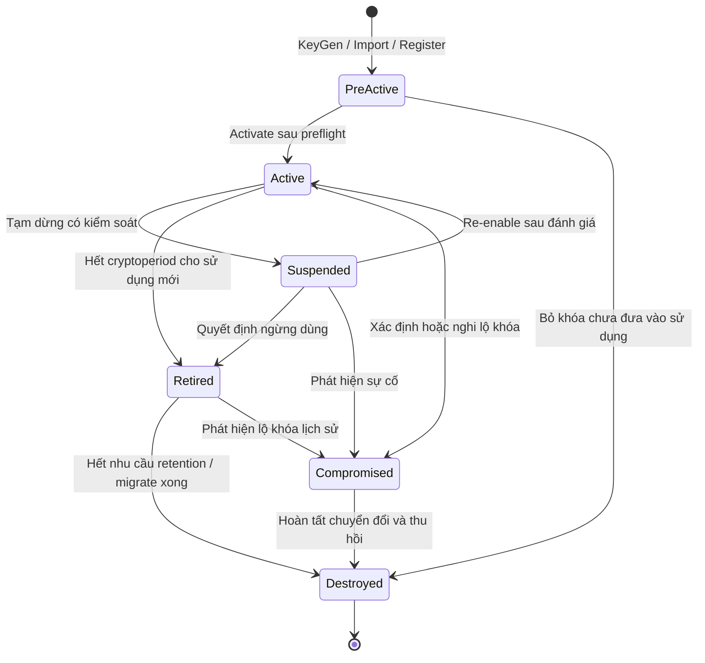
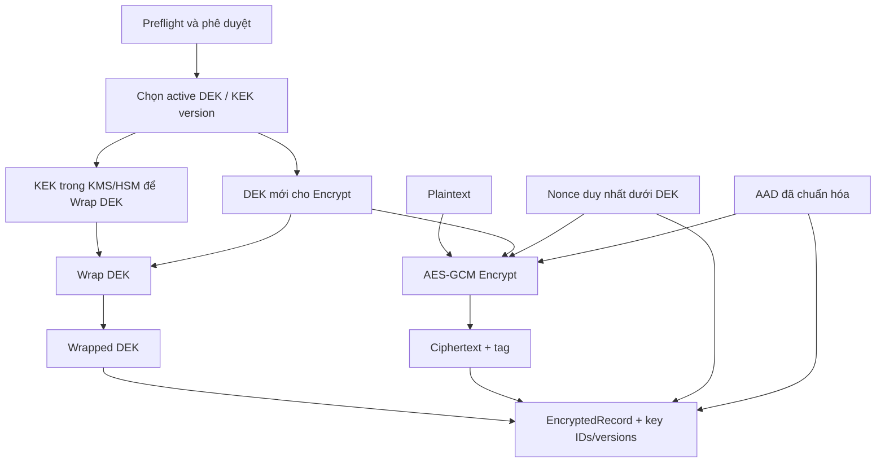
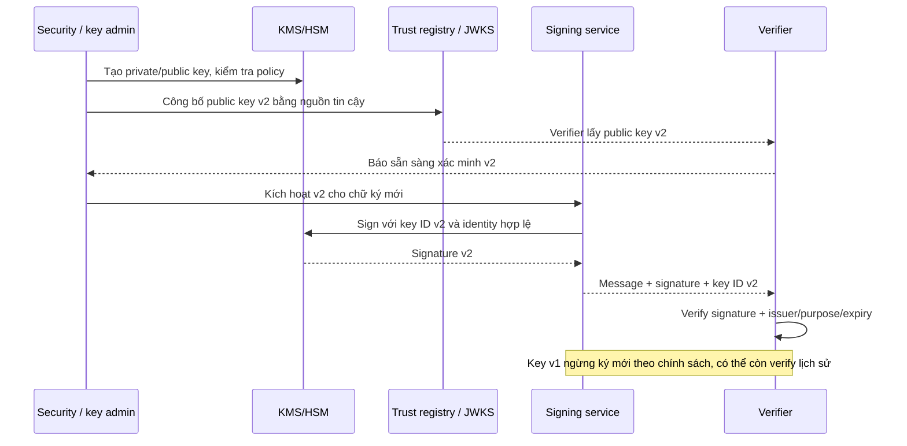
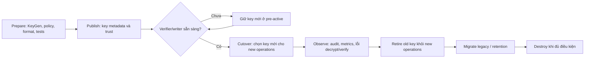
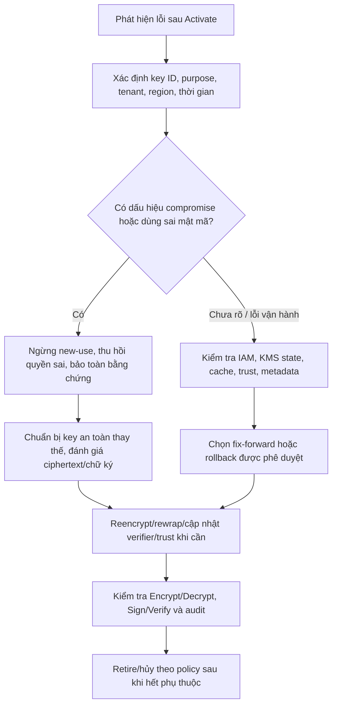

# Activate key: đưa khóa mật mã vào trạng thái được phép sử dụng

> **Chương:** Key lifecycle  
> **Module:** SECURITY_KEY_MANAGEMENT_FUNDAMENTALS

**Activate key (kích hoạt khóa)** là bước chuyển một khóa mật mã đã được tạo, nhập hoặc cấp phát từ trạng thái **chưa được phép sử dụng cho một mục đích nhất định** sang trạng thái **được phép thực hiện các phép toán mật mã đã được phê duyệt**, trong một phạm vi và khoảng thời gian xác định. Kích hoạt không chỉ là thay một cờ từ `false` thành `true`: trong hệ thống thực tế, khóa có thể đã tồn tại trong KMS/HSM nhưng vẫn chưa được phép mã hóa dữ liệu mới, ký tài liệu, tạo MAC hoặc tham gia decapsulation; ngược lại, một khóa đã ngừng **sử dụng mới** đôi khi vẫn cần cho giải mã hoặc xác minh dữ liệu lịch sử.

Ví dụ, một công ty chuẩn bị thay **data-encryption key (DEK)** dùng cho đơn hàng. Nhóm bảo mật có thể sinh DEK mới, kiểm tra chính sách, sao lưu vật liệu khóa ở dạng được bảo vệ và cho chạy thử trước. Chỉ sau khi chính sách, quyền, ứng dụng, cơ chế giám sát và đường khôi phục sẵn sàng, DEK mới được **kích hoạt để mã hóa đơn hàng mới**. Các đơn hàng cũ vẫn được giải mã bằng khóa/phiên bản tương ứng; không thể đổi nhãn khóa của bản ghi cũ rồi coi như dữ liệu đã được mã hóa lại.

Trong **SECURITY_KEY_MANAGEMENT_FUNDAMENTALS**, thao tác kích hoạt nối trực tiếp các bước của vòng đời **tạo → cấp phát → lưu trữ → kích hoạt/sử dụng → xoay vòng → ngừng sử dụng → thu hồi → hủy**. Nó tác động đến mật mã đối xứng, bất đối xứng, chữ ký số, KMS/HSM, **envelope encryption**, kiểm soát truy cập và kiểm toán. Bài này tập trung vào **ranh giới kích hoạt**: lúc nào một key thực sự được phép tham gia một hành động mật mã, ai quyết định điều đó và hệ thống cần chứng minh gì trước khi mở quyền.

Sau bài học, bạn có thể:

- Phân biệt **generate/import**, **register**, **enable**, **activate**, **publish**, **select for new operations**, **retire** và **destroy**.
- Mô tả trạng thái khóa và **cryptoperiod**: thời gian dùng để tạo dữ liệu/chữ ký mới khác với thời gian giải mã/xác minh dữ liệu cũ.
- Thiết kế điều kiện kích hoạt theo **algorithm, key purpose, owner, IAM, KMS/HSM policy, thời gian, môi trường và kiểm toán**.
- Lập runbook kích hoạt DEK/KEK, khóa ký số, HMAC key hoặc khóa KEM mà không làm gián đoạn hệ thống.
- Quản lý quá trình cutover ở cụm nhiều node/tenant/region, xử lý cache, retry, alias và rollback.
- Nhận diện các sự cố: kích hoạt quá sớm, quyền quá rộng, thiếu public-key trust, chọn sai key version hoặc hủy/disable khóa cũ quá sớm.

## 1. Kích hoạt khóa là gì?

Một khóa có thể tồn tại về mặt **vật liệu mật mã** nhưng chưa tồn tại như một lựa chọn hợp lệ đối với **ứng dụng**. Điều kiện để “active” có ý nghĩa thường bao gồm:

1. **Khóa hợp lệ:** key material/handle đúng thuật toán và kích thước, chưa bị phá hủy hoặc không khả dụng.
2. **Đúng mục đích:** ví dụ khóa chỉ ký số, chỉ giải mã, chỉ wrap, chỉ tạo MAC hoặc chỉ mã hóa dữ liệu.
3. **Đúng danh tính sử dụng:** principal/workload có quyền dùng đúng key ID và đúng phép toán.
4. **Đúng thời gian:** nằm trong khoảng sử dụng được phê duyệt, không bị tạm dừng hoặc đánh dấu compromised.
5. **Đúng ngữ cảnh nghiệp vụ:** tenant, môi trường, loại bản ghi, approval và giới hạn dữ liệu phù hợp.
6. **Đúng tuyến triển khai:** ứng dụng đang chọn phiên bản khóa đó cho **phép toán mới** và ghi đủ metadata để đọc lại về sau.

Điều kiện một khóa *được KMS bật* có thể chỉ thỏa mãn **một phần** danh sách trên. Ví dụ API quản trị `EnableKey` ở một nhà cung cấp có thể chuyển key sang trạng thái được phép dùng theo chính sách dịch vụ, nhưng không tự cập nhật mọi ứng dụng, certificate trust store hoặc quy tắc “chỉ dùng khóa này để ký hóa đơn đã duyệt”.

### 1.1. Các động từ dễ nhầm

| Thuật ngữ | Ý nghĩa chính | Điều **không** nên suy ra |
|---|---|---|
| **Generate / Create** | Sinh key material hoặc key object mới | Khóa đã được mọi ứng dụng sử dụng |
| **Import** | Đưa key material có sẵn vào hệ quản lý khóa | Nguồn key, tính hợp lệ và lifetime đã được chấp nhận |
| **Register** | Ghi key ID, owner, purpose, metadata, public key/trust | Runtime đã có quyền dùng private/symmetric key |
| **Enable** | Cho phép một số thao tác theo trạng thái của KMS/HSM/provider | Khóa được chọn cho dữ liệu mới hoặc đúng mọi mục đích nghiệp vụ |
| **Activate** | Chấp nhận key vào **phạm vi sử dụng được định nghĩa** | Mọi role có quyền hoặc mọi dữ liệu cũ đã dùng key mới |
| **Publish** | Công bố public key/certificate hoặc metadata cho bên cần dùng | Public key đã được recipient xác thực và tin cậy |
| **Select / Route** | Cho workload mới chọn một key version làm khóa phát hành/mã hóa hiện hành | Mọi node đã quan sát cùng phiên bản ngay tức thì |
| **Retire for new use** | Ngừng tạo ciphertext, chữ ký hoặc MAC mới bằng key cũ | Không thể giải mã/xác minh dữ liệu cũ nữa |
| **Disable / Revoke** | Chặn quyền hoặc khả năng sử dụng theo cơ chế cụ thể | Đã xóa mọi bản sao key, thu hồi được plaintext/chữ ký đã phát hành |
| **Destroy** | Hủy vật liệu khóa theo quy trình | Các dữ liệu cần giải mã bằng key ấy vẫn còn phục hồi được |

**“Active” phải đi kèm mục đích và phạm vi.** Một khóa có thể được dùng để `Decrypt` bản ghi cũ nhưng **không** được dùng để `Encrypt` dữ liệu mới. Một public key có thể còn nằm trong kho xác minh chữ ký lịch sử trong khi private key đã bị retire khỏi hoạt động ký mới.

## 2. Vị trí Activate trong vòng đời khóa

Mô hình trạng thái **khái niệm** (không phải API bắt buộc của mọi KMS) thường gồm:



Sơ đồ không cho đường **Compromised → Active** như một thao tác phục hồi thông thường. Khi vật liệu khóa bị lộ, không thể lấy lại tính bí mật bằng cách bật lại cờ `enabled`. Cần tạo khóa thay thế, đánh giá dữ liệu/chữ ký liên quan và thu hồi trust/quyền theo mức độ rủi ro.

### 2.1. Trạng thái Pre-active

Khóa đã được tạo hoặc nhập nhưng **chưa cho phép sản sinh dữ liệu mật mã mới trong production**. Đây là giai đoạn chuẩn bị:

- Kiểm tra thuật toán, key size/curve, exportability và policy.
- Đăng ký key ID/version, owner, tenant, environment, key purpose.
- Kiểm tra public key/certificate, backup/khôi phục khi có yêu cầu.
- Thiết lập IAM/grants, tracing/audit, định dạng metadata và quy trình rotation.
- Thử bằng dữ liệu kiểm thử được phép trước khi đưa vào luồng nghiệp vụ.

**Pre-active không có nghĩa key material thiếu hoặc không hợp lệ**. Nó có thể đã được bảo vệ tốt trong HSM nhưng chưa có quyền runtime để thực hiện mục đích cuối.

### 2.2. Trạng thái Active

Khóa đã được **phê duyệt cho một hoặc nhiều phép toán cụ thể**. Ví dụ: DEK đang mã hóa object mới, private signing key đang ký JWT hoặc HMAC key đang tạo tag cho webhook. Có thể có **nhiều key active đồng thời** trong phạm vi khác nhau: mỗi tenant, mỗi signer, mỗi region, mỗi thuật toán hoặc thời gian chồng lấn rotation.

Một khóa active không được phép bỏ qua kiểm tra **IAM, authorization, hạn mức, thuật toán và metadata**. Trạng thái active chỉ là một điều kiện trong phép quyết định có cho thực hiện thao tác hay không.

### 2.3. Retired, suspended và compromised

- **Retired:** không còn dùng để tạo kết quả mật mã mới; có thể vẫn cần mở ciphertext cũ hoặc xác minh chữ ký lịch sử theo chính sách.
- **Suspended/disabled:** tạm ngừng một số hoặc toàn bộ phép toán. Cần hiểu nhà cung cấp có cho **Decrypt** khi key disabled không; nhiều KMS chặn cả decrypt và encrypt khi key disabled.
- **Compromised:** có bằng chứng hoặc nghi vấn nghiêm trọng về việc key material/khả năng sử dụng/trust bị xâm phạm; quyết định ngừng tin và thay key phải gắn với incident response.

**Cảnh báo:** tên trạng thái và thao tác chính xác khác nhau giữa KMS, HSM, PKI, ứng dụng và chuẩn vòng đời. Không áp dụng một bảng trạng thái tự viết làm bằng chứng hệ thống cloud thực sự cưỡng chế theo đúng cách đó.

## 3. Cryptoperiod: thời điểm active không giống thời hạn đọc dữ liệu cũ

**Cryptoperiod** là khoảng thời gian khóa được chấp nhận dùng trong một mục đích/hoạt động mật mã. Với nhiều hệ thống, có ít nhất **hai khoảng thời gian khác nhau**:

1. **Originator-usage period:** lúc được phép **tạo** ciphertext, signature, MAC hoặc kết quả mật mã mới.
2. **Recipient-usage period:** lúc được phép **sử dụng để xử lý/đọc/xác minh** dữ liệu đã tạo từ trước, có thể kéo dài hơn vì retention.

Ví dụ khóa AES cũ tạo dữ liệu trong tháng 1, nhưng dữ liệu phải đọc đến hết năm:

```text
Key: orders-dek-v7
Created:        2026-01-01
Activate new use:2026-01-02
Stop new use:   2026-02-01
Legacy decrypt: có thể cần tới 2026-12-31
Destroy:        chỉ sau khi retention/migration được xác minh
```

Kết thúc **originator-usage period** không tự làm biến mất ciphertext cũ, và không nên đồng nghĩa với hủy DEK. Ngược lại, không nên để một khóa đã được retire trở lại hoạt động mã hóa mới chỉ vì thư viện vẫn cho phép gọi API.

### 3.1. Ngày hiệu lực và trạng thái provider

Một trường `activateAt` trong database chỉ có ý nghĩa bảo mật nếu **mọi đường sử dụng khóa** đều cưỡng chế kiểm tra đó. Nếu app đặt `activateAt=09:00 UTC` nhưng KMS key đã enabled, một workload có quyền có thể gọi KMS trực tiếp trước 09:00 nếu policy của hệ thống không chặn.

Tương tự, nếu server chạy nhiều vùng và có cache, một cờ trong bảng config không bảo đảm tất cả writer chuyển khóa đúng một mili giây. Cần cơ chế định tuyến có kiểm soát, xác thực phiên bản và xử lý bất đồng trạng thái.

### 3.2. Phạm vi và mục đích của active

| Khóa | “Được kích hoạt” có thể có nghĩa | Vẫn cần kiểm tra riêng |
|---|---|---|
| **AES DEK** | Dùng cho `Encrypt` record mới | Nonce, AAD, key ID, phạm vi tenant/object, ngân sách mã hóa |
| **KMS KEK** | Dùng để wrap/unwrap DEK theo policy | IAM, key material availability, quota, DEK lifecycle |
| **Private signing key** | Cho phép `Sign` nội dung đã duyệt | Phê duyệt, canonical bytes, trust public key, key usage |
| **HMAC key** | Cho phép tạo tag/MAC mới | Đúng partner, purpose, replay controls, verifier key version |
| **Private KEM key** | Cho phép decapsulation theo giao thức | Public-key authenticity, key agreement context, authorization |
| **TLS certificate/private key** | Được endpoint dùng để xác thực handshake mới | Chứng thư hợp lệ, tên server, KU/EKU, trust store, cấu hình TLS |

## 4. Năm lớp điều kiện để một khóa thực sự Active

Không nên xem một cờ `status: ACTIVE` là toàn bộ policy. Một quyết định sử dụng khóa có thể mô hình hóa:

\[
\mathrm{AllowUse} =
\mathrm{ValidMaterial}
\land \mathrm{ActiveForPurpose}
\land \mathrm{AuthorizedPrincipal}
\land \mathrm{AuthorizedContext}
\land \mathrm{WithinCryptoperiod}.
\]

Các điều kiện bổ sung như quota, phê duyệt hai bên, thuật toán được phép và kết quả attestation có thể được gắn vào chính sách cụ thể.

### 4.1. Lớp vật liệu khóa và thuật toán

- Key spec/size/curve đúng với thuật toán: AES-GCM không dùng RSA private key như AES DEK; Ed25519 là khóa ký, không phải khóa KEM.
- RNG/nguồn sinh key material phù hợp; nếu imported key, phải xác minh định dạng, provenance và hạn dùng.
- KMS/HSM key object sẵn sàng, không ở trạng thái pending deletion, unavailable hoặc chờ imported material.
- Đặc tính key **non-exportable** nếu được yêu cầu và khả năng backup/khôi phục phù hợp.

### 4.2. Lớp IAM và key policy

Chỉ principal/workload được phê duyệt mới được gọi đúng phép toán trên key ID cụ thể. Ví dụ `invoice-signer` có thể Sign, không được Decrypt hay sửa key policy. Không tự cho role runtime quyền hủy khóa chỉ vì nó phải ký dữ liệu.

**Non-exportable key** giảm nguy cơ sao chép private key, nhưng nếu attacker chiếm workload có quyền `Sign` hoặc `Decrypt`, họ vẫn có thể lạm dụng phép toán.

### 4.3. Lớp authorization nghiệp vụ

KMS thường không biết một hóa đơn đã được phê duyệt, tenant có quyền với bản ghi nào hoặc một lệnh chuyển tiền có hợp lệ. Signing/encryption/decryption service cần kiểm tra **quyền trên object và nội dung cụ thể** trước khi gọi KMS hoặc dùng key.

### 4.4. Lớp tuyến/phiên bản ứng dụng

Ứng dụng phải chọn **active key version** cho thao tác mới. Đây có thể là một bản ghi registry, alias, deployment config hoặc routing service; cần cơ chế cập nhật có kiểm soát, chống đọc cấu hình cũ và lưu **key ID/version của mỗi ciphertext/chữ ký**.

### 4.5. Lớp thời gian, hạn mức và giám sát

Phép toán phải nằm trong cryptoperiod, không vượt số lần sử dụng/khối lượng dữ liệu cho thuật toán, và phải sinh audit event. Một khóa AES-GCM đang active vẫn có thể không được tiếp tục mã hóa nếu **ngân sách nonce** hoặc số block đã đến ngưỡng quy định.

## 5. Preflight trước khi Activate: cần chứng minh điều gì?

Trước khi mở quyền cho một khóa, người vận hành nên có một **bằng chứng sẵn sàng** (*activation readiness evidence*) gồm các nội dung sau:

| Nhóm | Câu hỏi kiểm tra | Ví dụ chứng cứ |
|---|---|---|
| **Danh tính khóa** | Key ID/version, owner, tenant, environment và purpose đã rõ chưa? | Key registry record/approval |
| **Đặc tả** | Algorithm, mode, key spec, exportability có đúng không? | KMS/HSM metadata và kiểm thử API |
| **Nguồn tạo** | KeyGen/import có đúng RNG/provenance và policy không? | Provider attestation hoặc biên bản quy trình |
| **Phân quyền** | Ai được phép Sign/Encrypt/Decrypt/GenerateMac? Ai được sửa grant? | IAM review, least-privilege policy |
| **Sẵn sàng ứng dụng** | Các service đọc đúng key ID/version và tạo record format đúng chưa? | Test tích hợp với môi trường được phép |
| **Bảo vệ dữ liệu** | Nonce/AAD/tag, wrapped DEK và metadata có được lưu đủ không? | Test round-trip, negative tests |
| **Trust distribution** | Public key/certificate/JWKS đã được công bố qua nguồn đáng tin chưa? | Verify chain/fingerprint, consumer readiness |
| **Khôi phục** | Khi key bị disable/lost, dữ liệu cũ còn đọc được không? | Restore test theo quy trình |
| **Giám sát** | Audit, metrics, quota, alert và playbook đã hoạt động chưa? | Dashboard/test sự kiện |
| **Phê duyệt** | Ai đồng ý kích hoạt, có separation of duties không? | Approval ID, change ticket |

Một tổ chức không nhất thiết cần giấy tờ thủ công cho từng DEK ngắn hạn: nhiều bằng chứng có thể được **tự động hóa** trong KMS, policy-as-code và CI/CD. Nhưng giá trị của tự động hóa nằm ở việc kiểm tra thực tế, không phải ở việc tự động đánh dấu `ACTIVE` mà bỏ qua điều kiện.

### 5.1. Thử nghiệm trước khi mở đường sản xuất

Các kiểm thử hữu ích:

- **Round-trip:** mã hóa bằng key mới, giải mã bằng key mới; không được nhầm key ID.
- **Negative tests:** sai key, sai tag, sai AAD, sai quyền tenant, sai thuật toán phải bị từ chối.
- **Legacy decrypt/verify:** bản ghi/chữ ký cũ vẫn xử lý bằng đúng key/version khi cần.
- **Permission denial:** principal không đúng không gọi Sign/Decrypt thành công.
- **Rollback/cutover:** có thể rút tuyến sử dụng mới sang key đã được phê duyệt nếu quy trình cho phép, không phá dữ liệu đã tạo trong giai đoạn chuyển tiếp.
- **Failure modes:** KMS unavailable, key cache stale, IAM propagation delay hoặc region chưa có bản sao hợp lệ phải có hành vi được xác định.

## 6. Activate trong KMS/HSM: trạng thái kỹ thuật và trạng thái nghiệp vụ

Trong nhiều KMS, key object có những trạng thái provider như enabled/disabled, pending import, pending deletion, unavailable hoặc tương đương. Từng trạng thái ảnh hưởng API khác nhau, và không có một danh mục trạng thái chung bắt buộc cho mọi sản phẩm.

**Trạng thái kỹ thuật** trả lời: KMS/HSM hiện có chấp nhận yêu cầu sử dụng key material cho phép toán này không?

**Trạng thái nghiệp vụ** trả lời: hệ thống có **cho phép** dùng key đó để tạo dữ liệu/signature mới cho purpose/tenant/environment này không?

Hai trạng thái cần được **đồng bộ về ý nghĩa**, nhưng không đồng nhất. Ví dụ:

```text
KMS key object: Enabled
Application registry:
  keyId: "orders/dek/v12"
  lifecycle: PRE_ACTIVE
  allowedForNewEncryption: false
  allowedForLegacyDecryption: false

=> Key đã sẵn sàng ở KMS nhưng chưa được ứng dụng phê duyệt dùng.
```

**Cảnh báo an ninh:** nếu KMS key Enabled và principal được cấp `Encrypt`, việc chỉ đặt `allowedForNewEncryption=false` trong một ứng dụng không ngăn principal đó gọi KMS qua một đường khác. Khi cần bảo đảm cưỡng chế, phải điều chỉnh **IAM/key policy, mạng/đường truy cập API và khả năng sử dụng key** phù hợp.

### 6.1. HSM key handle, thuộc tính và kích hoạt

HSM có thể sử dụng các thuộc tính object như `sign`, `decrypt`, `derive`, `extractable` theo giao diện/thiết bị. Việc import hoặc sinh key trong slot không có nghĩa key được phép thực hiện mọi thao tác. Đặc tính non-exportable, mục đích thuật toán và quyền theo role có thể được thiết lập ngay khi tạo key.

Một thay đổi `ACTIVE` ở application database **không sửa được** những thuộc tính cố định mà HSM đã gắn với key object. Nếu purpose, algorithm hoặc export policy sai ngay khi tạo, thường cần **tạo key mới** với thuộc tính đúng hơn là cố “kích hoạt” bằng cách bỏ qua cơ chế an ninh.

### 6.2. Imported key material

Khóa được **import** có thể phụ thuộc hạn dùng của vật liệu nhập, xác thực nguồn và quy trình backup theo nhà cung cấp. Không kích hoạt khi key material chưa khả dụng, sai thuật toán hoặc sắp hết hạn mà không có kế hoạch khôi phục. Nếu imported material hết hiệu lực, đối tượng key vẫn có thể hiện diện trong registry trong khi phép toán mật mã thất bại.

### 6.3. Enable không thay được key selection

Ví dụ bật một KEK mới trong KMS **chưa khiến** các ứng dụng tự động wrap DEK bằng KEK đó. Cần **chuyển tuyến key ID/alias**, cập nhật policy của encryption service và lưu key metadata. Nếu ứng dụng tiếp tục gọi chính key cũ theo ID cụ thể, việc bật key mới không có tác dụng.

Tương tự, nếu provider hỗ trợ **automatic rotation of key material** dưới một logical key ID, hành vi có thể khác với **manual migration sang key ID mới**. Cần hiểu hợp đồng thực tế trước khi thiết kế chính sách kích hoạt/cutover.

## 7. Kích hoạt DEK và KEK trong envelope encryption

Trong **envelope encryption**:

- **DEK (data-encryption key)** mã hóa dữ liệu thực tế bằng thuật toán như AES-GCM.
- **KEK (key-encryption key)** bảo vệ DEK qua wrap/unwrap hoặc cơ chế data key của KMS.

Kích hoạt DEK mới cho **Encrypt** và kích hoạt KEK mới cho **Wrap** là **hai thao tác khác nhau**.



### 7.1. Kích hoạt DEK: điều kiện không lặp nonce

Với AES-GCM, việc kích hoạt DEK mới phải đi kèm chiến lược cấp **nonce mới đúng chuẩn cho từng lần mã hóa dưới cùng DEK**. Một DEK được tạo bằng CSPRNG nhưng mọi node cùng dùng nonce cố định vẫn không an toàn. Cần kiểm soát số lần mã hóa, tổng writer cùng DEK, retry, snapshot và thời hạn dùng key.

Nếu mỗi object có **DEK riêng**, phạm vi nonce là theo DEK đó; nếu dùng một DEK chung cả bucket, ngân sách thuộc về **tổng phép mã hóa từ mọi node**, không phải từng node riêng lẻ.

### 7.2. Kích hoạt KEK mới không tự mã hóa lại dữ liệu

Khi KEK mới active, DEK mới có thể được wrap dưới KEK mới. Nhưng DEK cũ đã được wrap bằng KEK cũ **không tự đổi**, và ciphertext dữ liệu vẫn được tạo với DEK ban đầu. **Rewrap DEK** chỉ thay lớp bảo vệ khóa; **reencrypt dữ liệu** dùng DEK mới sẽ thay ciphertext dữ liệu và nonce/tag.

| Thao tác | Thay đổi gì? | Điều vẫn giữ nguyên |
|---|---|---|
| Kích hoạt KEK v2 để wrap mới | Bản wrapped DEK mới dùng KEK v2 | Ciphertext đã mã hóa bằng DEK cũ |
| Rewrap DEK từ KEK v1 sang v2 | Wrapped DEK + metadata KEK | DEK plaintext và data ciphertext có thể giữ nguyên |
| Rotate DEK và reencrypt data | DEK, data ciphertext, nonce, tag, key metadata | Dữ liệu nghiệp vụ sau khi xác minh có thể giữ giá trị |
| Chỉ đổi alias key hiện hành | Tuyến của **yêu cầu mới** | Bản ghi cũ không tự đổi key material |

### 7.3. Encryption và decryption có thể cần chính sách khác

Một app có thể dùng **DEK v2 cho Encrypt mới**, song vẫn cần **DEK v1 cho Decrypt cũ**. Không disable v1 ở lớp KMS nếu điều đó làm thất bại mọi lời gọi decrypt/unwrap cho dữ liệu cũ mà chưa có phương án khác.

**Ngừng dùng mới** và **tước khả năng giải mã cũ** phải là hai quyết định có ảnh hưởng vận hành khác nhau. Nếu key bị compromise, có thể phải ưu tiên disable và chuyển đổi dữ liệu nhanh hơn, chấp nhận xử lý gián đoạn theo quy trình sự cố.

## 8. Kích hoạt private signing key: Sign khác với Verify

Một **private signing key** dùng để tạo chữ ký số, trong khi public key tương ứng cho phép bên nhận xác minh chữ ký. Khi kích hoạt khóa ký mới, cần làm rõ **hai phía**:

1. **Signer readiness:** private key được phép ký đúng loại thông điệp, đúng thuật toán và qua luồng phê duyệt.
2. **Verifier readiness:** các bên xác minh đã có **public key/certificate đáng tin**, đúng key ID, algorithm allowlist và quy tắc trust.

Nếu signer chuyển sang key mới trước khi verifier cập nhật, chữ ký phát hành có thể hợp lệ về mặt toán học nhưng **bị khách hàng từ chối** vì key mới chưa được tin. Ngược lại, công bố public key trước có thể phục vụ giai đoạn chuẩn bị mà chưa cấp quyền Sign cho runtime.

### 8.1. Luồng kích hoạt khóa ký



Quy trình này là **một lựa chọn tổ chức**: không phải lúc nào mọi verifier đều phản hồi readiness; đôi khi dùng thời gian chồng lấn, JWKS cache TTL, certificate deployment hoặc giao thức thương lượng. Điều cần tránh là không biết ai còn phụ thuộc vào public key cũ và ứng dụng nào chưa tin public key mới.

### 8.2. Kích hoạt khóa JWT

Đối với JWT do một issuer phát hành:

- Signer mới phải dùng **`kid` rõ ràng**, thuật toán đã được chấp nhận và private key đúng purpose.
- JWKS/registry phải công bố public key mới qua **nguồn đã cấu hình đáng tin**; không lấy URL public key tùy ý từ header token do client gửi.
- Verifier phải ràng buộc **`iss`, `aud`, `exp`, `nbf`, token type, algorithm, key ID** và authorization theo resource.
- Trong rotation bình thường, public key cũ có thể được giữ đến khi token cũ hết hiệu lực và hết khoảng trễ/caching được chấp nhận.
- Khi private key cũ bị lộ, **grace period bình thường có thể không an toàn**: cần đánh giá ngừng tin key cũ và thu hồi token/session đã phát hành.

Chữ ký hợp lệ chỉ chứng minh mối quan hệ với private key tương ứng theo giả định mật mã; nó **không tự chứng minh token được phép gọi API nào**.

### 8.3. Certificate, TLS và chữ ký tài liệu

Với TLS server certificate, kích hoạt liên quan tới **private key + certificate chain**, hostname/SAN, KU/EKU, thời hạn chứng thư và cấu hình endpoint. Chỉ bật một private key trong HSM **không đủ** nếu certificate chưa có, không hợp lệ cho server authentication hoặc các client chưa có trust anchor.

Với tài liệu có chữ ký cần xác minh lâu dài, **ngừng ký bằng private key cũ** không đồng nghĩa xóa public key/certificate cũ; việc xác minh lịch sử có thể cần timestamp đáng tin và bằng chứng trạng thái chứng thư theo thời điểm ký. Một trường `signedAt` tự khai của người ký **không tự là trusted timestamp**.

## 9. Kích hoạt HMAC key và bí mật xác thực

**HMAC** là MAC có khóa đối xứng dùng để xác thực thông điệp, không phải chữ ký số có thể verify bằng public key. Khi activate HMAC key cho webhook hoặc giao tiếp service:

1. Định danh **partner/workload**, purpose, message format, HMAC algorithm, tag length và key version.
2. Phân phối key bí mật bằng kênh bảo vệ hoặc dùng KMS/HSM API `GenerateMac`/`VerifyMac` khi sản phẩm hỗ trợ.
3. Đảm bảo phía **xác minh** đã có cách tìm đúng key version trước khi phía phát bắt đầu tạo MAC mới.
4. Kích hoạt key mới cho **tạo tag**, nhưng chấp nhận key cũ để verify trong khoảng được phê duyệt nếu cần.
5. Khi hết khoảng chuyển tiếp, ngừng tin tag dùng key cũ; nếu key bị lộ, thực hiện quy trình khẩn cấp thay vì chờ hết TTL.

```text
Webhook v1:
  sender active MAC key: mac-v7
  receiver verifies:    mac-v7

Prepare v2:
  sender still uses:     mac-v7
  receiver accepts:     mac-v7, mac-v8

Cutover:
  sender uses:           mac-v8
  receiver accepts:     mac-v7, mac-v8  // chỉ trong grace period

Retire:
  sender uses:           mac-v8
  receiver accepts:     mac-v8
```

**Không dùng chung một HMAC key cho tất cả tenant/đối tác** chỉ vì việc kích hoạt đơn giản hơn. Kẻ chiếm key của một đối tác không nên có khả năng tạo tag hợp lệ cho những đối tác khác. Key được kích hoạt phải gắn với **bên nhận, mục đích, môi trường** và giới hạn sử dụng.

**HMAC không tự chống replay.** Một message và tag hợp lệ có thể được gửi lại nguyên vẹn; phải kiểm tra timestamp, message ID, TTL, replay window hoặc trạng thái idempotency theo giao thức.

### 9.1. Pepper và mật khẩu có cần Activate key không?

**Password salt** là giá trị thường công khai gắn với verifier, **không phải khóa bí mật cần activate trong KMS**. Nếu hệ thống sử dụng **pepper** như một secret bổ sung trong password hashing, có thể cần kích hoạt phiên bản pepper mới theo chính sách **đọc/khả dụng/rotation** của secrets manager hoặc KMS/HSM.

Pepper rotation phải đi kèm kế hoạch **xác minh credential cũ và migrate**; chỉ bật secret mới trong vault mà chưa đổi luồng xác minh có thể làm đăng nhập thất bại. Với password verifier, salt/algorithm/cost đã lưu phải được giữ đúng trong suốt quá trình kiểm tra.

## 10. Kích hoạt khóa KEM và key agreement

Trong **KEM (Key Encapsulation Mechanism)**, bên gửi dùng public key của recipient để tạo một **encapsulation ciphertext và shared secret**; recipient dùng private key tương ứng để **decapsulate**. Kích hoạt KEM recipient key có ít nhất hai điều kiện riêng:

- **Public key của recipient được công bố đúng danh tính**, với algorithm, parameter set và key ID rõ ràng.
- **Private key recipient sẵn sàng Decapsulate**, được bảo vệ và chỉ cấp cho workload được phép mở dữ liệu.

Nếu bên gửi lấy nhầm public key của attacker, KEM vẫn có thể hoạt động đúng thuật toán nhưng dữ liệu được bảo vệ cho **sai người nhận**. Bởi vậy public-key authentication là điều kiện cốt lõi trước khi bật tuyến encapsulate mới.

### 10.1. Static key và ephemeral key

- **Static recipient KEM key** có thể phục vụ dữ liệu lưu trữ dài hạn: cần giữ private key hoặc khả năng migrate để mở những encapsulation cũ.
- **Ephemeral key** dùng trong một phiên handshake có thời gian sống ngắn và được hủy khi không còn cần, tùy yêu cầu forward secrecy.

Đừng kích hoạt một khóa KEM static nhiều năm rồi mặc định giao thức có forward secrecy. Nếu private recipient key bị lộ về sau và attacker đã ghi lại encapsulation cũ, dữ liệu lịch sử có thể bị ảnh hưởng.

### 10.2. Hỗ trợ thuật toán và chính sách

**X25519/DHKEM, ML-KEM** hoặc cơ chế hybrid có khả năng hỗ trợ khác nhau giữa thư viện, KMS/HSM và giao thức. Không gọi `EnableKey` cho một key object bất kỳ rồi giả định mọi API `Decapsulate` hoạt động theo ML-KEM FIPS 203. Cần xác minh parameter set, wire format, KDF/context, chosen-ciphertext protection, kiểm soát side-channel và metadata.

## 11. Kích hoạt theo lịch và trong cụm phân tán

Một dịch vụ cloud thường chạy **nhiều node, nhiều vùng, nhiều phiên bản ứng dụng**. Vì vậy kích hoạt khóa là một **sự kiện phân tán**, không phải một thao tác chỉ xuất hiện ở một database.

### 11.1. Giai đoạn Prepare → Publish → Cutover → Observe



**Prepare:** khóa mới tồn tại, policy và định dạng record đã kiểm tra; chưa có lưu lượng sản xuất mới dùng khóa.

**Publish:** những consumer cần xác minh/giải mã đã nhận metadata/key/certificate mà họ được phép có. Đối với khóa đối xứng, không “publish raw DEK” như public key; chỉ công bố key ID và cấu hình cần thiết cho những principal có quyền.

**Cutover:** hệ thống chọn khóa mới cho **phép toán mới** theo chính sách; khóa cũ ngừng được chọn cho purpose tương ứng.

**Observe:** kiểm tra tỷ lệ lỗi mã hóa/giải mã, signature verification, độ trễ KMS, metadata key ID và sự khác biệt giữa node. Chỉ retire key cũ đúng mục đích khi đủ điều kiện.

### 11.2. Alias là công cụ định tuyến, không phải bản mã

Một alias như `orders/current` có thể trỏ tới key version hiện hành cho **Encrypt mới**. Sau cutover:

```text
Trước:
  alias orders/current -> key-v12
  New writes            -> key-v12

Sau:
  alias orders/current -> key-v13
  New writes            -> key-v13

Record cũ:
  keyId                  = key-v12
  ciphertext             = dữ liệu từng mã hóa bằng key-v12

Đọc record cũ phải chọn key-v12 hoặc cơ chế decrypt do provider hỗ trợ.
Không đổi metadata cũ thành key-v13 nếu dữ liệu chưa được chuyển.
```

Việc cập nhật alias có thể có **độ trễ lan truyền**, caching và semantics khác nhau theo provider. Không dùng alias động làm bằng chứng rằng toàn bộ writer đã chuyển key đồng thời; theo dõi **key ID thực tế trong output**.

### 11.3. Đồng hồ, TTL và activationAt

Nếu đặt mốc giờ kích hoạt, phải dùng thời gian thống nhất, tránh phụ thuộc vào đồng hồ thiết bị client, và kiểm soát **clock skew**. Tuy nhiên, ngay cả khi mọi node dùng UTC, cache và IAM propagation vẫn khiến thời điểm thay đổi không tuyệt đối.

Một quy trình an toàn có thể dựa vào **epoch/version được phát hành bằng một nguồn điều phối**, yêu cầu writer chỉ tạo dữ liệu với key ID của phiên đã được phê duyệt, thay vì so sánh giờ địa phương của từng node rồi tự đổi key. Cần xử lý request đang chạy dở, retry và rollback có kiểm soát.

### 11.4. Version và compare-and-swap

Khi hai người vận hành hoặc pipeline cùng kích hoạt key, một thao tác kiểu **compare-and-swap (CAS)** hoặc optimistic locking giúp phát hiện cập nhật cạnh tranh:

```text
registry["orders/current"] = { keyId: "v12", epoch: 41 }

Activate v13:
  require epoch == 41
  require v13 preflightPassed == true
  update atomically to { keyId: "v13", epoch: 42 }

Nếu một admin khác đã đổi epoch, thao tác phải đọc lại và đánh giá,
không ghi đè âm thầm lựa chọn key mới hơn.
```

**CAS chỉ bảo đảm tính nhất quán của nơi ghi**, không tự bảo đảm mọi cache đã cập nhật. Cần đo cả quá trình rollout của client.

## 12. Quyền kích hoạt và separation of duties

Không để một workload runtime vừa tự tạo khóa, vừa chọn nó active, vừa mở toàn bộ IAM, vừa xóa khóa cũ nếu không có lý do và kiểm soát đặc biệt.

| Vai trò | Quyền phù hợp | Quyền không nên mặc định có |
|---|---|---|
| **Key custodian / key admin** | Tạo/import, cấu hình key object và quản lý lifecycle theo phê duyệt | Ký mọi chứng từ hay đọc mọi dữ liệu khách hàng |
| **Security approver** | Phê duyệt policy, algorithm, môi trường và cutover | Tự có quyền sử dụng raw key hoặc giải mã dữ liệu |
| **Activation operator / pipeline** | Chuyển routing/trạng thái theo change ticket và version đã phê duyệt | Export private key, tự thay quyền admin, tự destroy key |
| **Encryption workload** | Encrypt/GenerateDataKey/Wrap theo key ID được phép | UpdatePolicy, ScheduleDeletion, Decrypt toàn bộ dữ liệu ngoài phạm vi |
| **Decryption workload** | Decrypt/Unwrap sau object authorization | Tự chọn key mới để mã hóa cho mọi tenant |
| **Signing workload** | Sign theo purpose và approval | Export private key, tự sửa public-key trust registry |
| **Security auditor** | Đọc audit, metadata, phê duyệt và sự kiện policy | Tự ý chạy Sign/Decrypt hoặc thay key |

Nguyên tắc **least privilege** áp dụng cả cho **phép toán** và **key ID**. Một role có quyền `kms:Encrypt` trên mọi key có thể vô tình dùng key dev cho dữ liệu production, hoặc ngược lại. Gắn key với owner, tenant, region, environment và purpose giảm nguy cơ ấy.

### 12.1. Dual control và break-glass

Với khóa có tác động cao (ví dụ khóa ký chứng từ pháp lý hoặc root key của dịch vụ), có thể yêu cầu **hai người phê duyệt** trước khi activate hoặc thay trust. Khi ứng phó sự cố nghiêm trọng, quy trình **break-glass** phải được định nghĩa sẵn: ai có quyền can thiệp, cần ghi bằng chứng gì, ai rà soát sau sự kiện.

Không để cơ chế break-glass trở thành một tài khoản admin vĩnh viễn có secret tĩnh không được giám sát.

### 12.2. IAM và ứng dụng phải cùng cưỡng chế

Nếu application registry nói key **PRE_ACTIVE** nhưng KMS IAM cho phép mọi workload trực tiếp gọi `Sign`, attacker có thể bỏ qua cờ của ứng dụng. Ngược lại, nếu KMS đã disable key mà app vẫn route request tới nó, ứng dụng có thể gây lỗi hàng loạt.

Điểm cần đạt là **các lớp kỹ thuật không mâu thuẫn**: key object, IAM, routing, policy nghiệp vụ và audit đều phản ánh đúng quyết định sử dụng.

## 13. Runbook kích hoạt một key version mới

Runbook dưới đây là **mẫu quy trình chung**, cần điều chỉnh theo thuật toán, nhà cung cấp KMS/HSM, dữ liệu và yêu cầu pháp lý.

### Phase A — Chuẩn bị

1. Xác định **key purpose**, owner, environment, đối tượng/tenant và cryptoperiod.
2. Sinh/import key theo thuật toán được phê duyệt; gán **key ID bất biến/phiên bản**.
3. Thiết lập **KMS/HSM policy, IAM grants** tối thiểu và tách quyền quản trị khỏi runtime.
4. Thiết kế record format chứa **key ID/version, thuật toán, nonce/tag, wrapped DEK/AAD** hoặc metadata chữ ký tùy mục đích.
5. Kiểm tra key sẵn sàng, recovery test, backup/retention khi có yêu cầu; không ghi key material trong log.

### Phase B — Tiền kiểm

6. Chạy round-trip và negative tests với dữ liệu kiểm thử trong môi trường được phép.
7. Nếu là khóa ký hoặc KEM, công bố public key/certificate qua **kênh tin cậy** và kiểm tra verifier/recipient đã tiếp nhận.
8. Kiểm tra metrics, audit, alert, đường lỗi KMS, key cache, failover và kế hoạch rollback.
9. Hoàn thành phê duyệt; lưu approval ID, thời điểm và bản policy sẽ dùng.

### Phase C — Kích hoạt có kiểm soát

10. Mở đúng **khả năng kỹ thuật** cần thiết ở KMS/HSM theo policy đã được phê duyệt.
11. Chuyển **active key pointer/epoch** hoặc route mới bằng thao tác có kiểm soát; tránh ghi đè cạnh tranh.
12. Thực hiện canary theo tenant/traffic nếu hệ thống hỗ trợ; quan sát key ID thực tế của bản ghi/chữ ký mới.
13. Đảm bảo **mọi request mới** dùng key đúng, nhưng vẫn xử lý dữ liệu cũ qua version cũ khi cần.

### Phase D — Xác minh và kết thúc

14. Kiểm tra lỗi Encrypt/Decrypt, Sign/Verify, MAC verify hoặc Decaps và độ trễ/quota KMS.
15. Nếu ổn định, retire key cũ khỏi **new use**; không tự disable/deletion nếu cần legacy decrypt/verify.
16. Migrate legacy data hoặc xác minh retention theo kế hoạch.
17. Đánh dấu kết quả và bảo toàn audit; chỉ hủy vật liệu khóa cũ khi không còn phụ thuộc và đáp ứng yêu cầu chính sách.

**Định nghĩa hoàn thành nên đo được:** không chỉ “API Activate trả thành công”, mà còn “lưu lượng mới sử dụng đúng key version, toàn bộ consumer cần thiết xử lý được, dữ liệu cũ vẫn đọc/xác minh được khi cần và không có quyền ngoài phạm vi”.

## 14. Java 17: mô phỏng chuyển trạng thái PRE_ACTIVE → ACTIVE có kiểm soát

Ví dụ Java sau tập trung vào **điều kiện kích hoạt tại application registry**, không chứa key material và **không tự triển khai KMS**. Nó minh họa:

- Key v13 phải ở **PRE_ACTIVE** và có preflight approval trước khi được chọn.
- Kích hoạt được thực hiện theo **expected current key + epoch** để ngăn ghi đè đồng thời.
- Key v12 chuyển sang **RETIRED cho thao tác mã hóa mới**, nhưng vẫn có thể được nhận diện để xử lý dữ liệu cũ.
- Một key ở trạng thái **COMPROMISED** không thể quay lại ACTIVE chỉ bằng API kích hoạt thông thường.

```java
import java.time.Clock;
import java.time.Instant;
import java.time.ZoneOffset;
import java.util.HashMap;
import java.util.Map;
import java.util.concurrent.atomic.AtomicReference;

public final class ActivateKeyDemo {
    enum State {
        PRE_ACTIVE, ACTIVE, RETIRED, COMPROMISED, DESTROYED
    }

    record KeyVersion(
            String id,
            State state,
            Instant activateAt,
            Instant stopNewAt,
            boolean readinessApproved) {

        KeyVersion withState(State next) {
            return new KeyVersion(
                    id, next, activateAt, stopNewAt, readinessApproved
            );
        }
    }

    record Snapshot(
            Map<String, KeyVersion> keys,
            String activeForNewEncryption,
            long epoch) {}

    static final class Registry {
        private final AtomicReference<Snapshot> state;
        private final Clock clock;

        Registry(Snapshot initial, Clock clock) {
            state = new AtomicReference<>(initial);
            this.clock = clock;
        }

        // Minh họa; authorization phê duyệt phải được xác minh
        // ở tầng riêng, không chỉ kiểm tra có chuỗi approvalId.
        void activate(
                String candidateId,
                String expectedOldId,
                long expectedEpoch,
                String approvalId) {
            if (approvalId == null || approvalId.isBlank()) {
                throw new IllegalArgumentException("Approval is required");
            }

            while (true) {
                Snapshot before = state.get();
                if (before.epoch() != expectedEpoch
                        || !before.activeForNewEncryption()
                                .equals(expectedOldId)) {
                    throw new IllegalStateException("Stale activation plan");
                }

                KeyVersion candidate =
                        before.keys().get(candidateId);
                KeyVersion previous =
                        before.keys().get(expectedOldId);
                if (candidate == null || previous == null
                        || candidate.state() != State.PRE_ACTIVE
                        || previous.state() != State.ACTIVE
                        || !candidate.readinessApproved()) {
                    throw new IllegalStateException("Preflight failed");
                }

                Instant now = clock.instant();
                if (now.isBefore(candidate.activateAt())
                        || !now.isBefore(candidate.stopNewAt())) {
                    throw new IllegalStateException(
                            "Outside new-use cryptoperiod"
                    );
                }

                Map<String, KeyVersion> updated =
                        new HashMap<>(before.keys());
                updated.put(candidateId,
                        candidate.withState(State.ACTIVE));
                updated.put(expectedOldId,
                        previous.withState(State.RETIRED));

                Snapshot after = new Snapshot(
                        Map.copyOf(updated),
                        candidateId,
                        before.epoch() + 1
                );

                if (state.compareAndSet(before, after)) {
                    // Thực tế: ghi audit bất biến và phát sự kiện
                    // ra registry/stream đáng tin theo transaction.
                    return;
                }
            }
        }

        boolean canEncryptNew(String keyId) {
            Snapshot current = state.get();
            KeyVersion key = current.keys().get(keyId);
            Instant now = clock.instant();
            return key != null
                    && current.activeForNewEncryption().equals(keyId)
                    && key.state() == State.ACTIVE
                    && !now.isBefore(key.activateAt())
                    && now.isBefore(key.stopNewAt());
        }

        boolean isRetiredForNewUse(String keyId) {
            KeyVersion key = state.get().keys().get(keyId);
            return key != null && key.state() == State.RETIRED;
        }
    }

    public static void main(String[] args) {
        Clock fixedClock = Clock.fixed(
                Instant.parse("2026-11-28T09:00:00Z"),
                ZoneOffset.UTC
        );
        KeyVersion v12 = new KeyVersion(
                "orders-dek-v12",
                State.ACTIVE,
                Instant.parse("2026-10-01T00:00:00Z"),
                Instant.parse("2027-01-01T00:00:00Z"),
                true
        );
        KeyVersion v13 = new KeyVersion(
                "orders-dek-v13",
                State.PRE_ACTIVE,
                Instant.parse("2026-11-28T00:00:00Z"),
                Instant.parse("2027-02-01T00:00:00Z"),
                true
        );

        Registry registry = new Registry(
                new Snapshot(
                        Map.of(v12.id(), v12, v13.id(), v13),
                        v12.id(),
                        41
                ),
                fixedClock
        );

        registry.activate(
                v13.id(), v12.id(), 41, "approval-2026-42"
        );
        System.out.println("Encrypt new with v13: " +
                registry.canEncryptNew(v13.id())); // true
        System.out.println("Encrypt new with v12: " +
                registry.canEncryptNew(v12.id())); // false
        System.out.println("v12 retired for new use: " +
                registry.isRetiredForNewUse(v12.id())); // true
    }
}
```

### 14.1. Mẫu này bảo đảm điều gì?

Trong **một tiến trình**, `AtomicReference.compareAndSet` giúp một thao tác chuyển bản snapshot từ `epoch 41` sang `epoch 42` có điều kiện. Nếu trạng thái hiện tại đã đổi, yêu cầu với epoch cũ bị từ chối.

Trong hệ thống thật, registry phải có **lưu trữ bền vững, authorization và giao dịch phân tán phù hợp**; một `AtomicReference` trong JVM không đồng bộ giữa các pod/region và không tồn tại sau restart. Việc ký “approval-2026-42” như string trong demo không phải một cơ chế phê duyệt an toàn.

### 14.2. Mẫu này không bảo đảm điều gì?

1. Không có private/symmetric key material, KMS/HSM hay IAM. Một caller có quyền gọi KMS trực tiếp vẫn có thể bỏ qua `canEncryptNew()` nếu ứng dụng là lớp cưỡng chế duy nhất.
2. Chưa mô tả **Decrypt** cho bản ghi cũ. Để giải mã thật cần đọc **key ID/version của record** và kiểm tra quyền đối tượng, trạng thái key, retention, AAD/tag.
3. Chưa có **outbox, transaction audit, event delivery** hoặc refresh cache nhiều node.
4. Không có rollback an toàn khi v13 đã mã hóa record thật; dữ liệu ấy tiếp tục cần v13 để decrypt.
5. Không có xử lý **COMPROMISED**, khóa cần ngừng tin, hạn mức sử dụng hay các điều kiện khóa đặc thù.

**Bài học của ví dụ:** kích hoạt không chỉ là đổi field `state`. Phải ràng buộc **điều kiện, phiên bản mong đợi, thời gian và quyền sử dụng**; sau đó phối hợp với KMS và đường ứng dụng thực tế.

## 15. Mã giả điều phối kích hoạt với KMS và audit

Một hệ thống production có thể thực hiện quy trình dạng:

```text
activateKey(activationPlan):
    require caller.identity in approvedActivationOperators
    require verifyApproval(activationPlan.approvalId)
    require activationPlan.environment == "production"
    require activationPlan.candidateKeyId belongsTo configuredService
    require activationPlan.algorithm/purpose match approvedPolicy

    key = kms.describeKey(activationPlan.candidateKeyId)
    require key.materialAvailable
    require key.usage == activationPlan.requiredUsage
    require key.notCompromised
    require approvedRuntimeGrantsAreInPlace(key.id)
    require readbackTestPassed(key.id)
    require auditAndRollbackPlanPresent

    if publicKeyIsNeeded:
        require trustRegistryPublishedAndVerified(key.publicKey)

    // Chỉ cho phép đúng các thao tác KMS cần thiết.
    providerEnableIfRequired(key.id, activationPlan.approvedActions)

    // Đổi key pointer bằng compare-and-swap hoặc transaction.
    result = registry.compareAndSwap(
        expectedEpoch = activationPlan.expectedEpoch,
        newKeyId      = key.id,
        purpose       = activationPlan.purpose
    )

    require result.success
    emitAuditableEvent("KEY_ACTIVATED", key.id, result.newEpoch,
                       activationPlan.approvalId)
    verifyCanaryRequestsAndActualKeyIds()

    // Không tự vô hiệu hóa key cũ nếu legacy decrypt/verify còn cần.
```

Đây là **mã giả khái niệm**, không phải API chung của mọi provider. Các thao tác `describeKey`, `enable` hoặc `grant` có tính năng và trạng thái khác nhau theo KMS/HSM.

**Đặc biệt quan trọng:** chuyển key pointer và ghi audit là hai thao tác thường nằm ở hệ thống khác nhau. Nếu cần tính đúng đắn cao, dùng **transactional outbox, append-only audit, event retry/idempotency** hoặc cơ chế tương đương để tránh tình huống key đã được chọn active nhưng không có bằng chứng ai phê duyệt. Nếu KMS enable thành công nhưng CAS routing thất bại, phải có cách đưa hệ thống về trạng thái **an toàn và có thể kiểm toán**, không đơn giản bỏ qua lỗi.

### 15.1. Định dạng metadata tối thiểu của một key version

```yaml
# Đây là bản ghi cấu hình minh họa, KHÔNG phải provider KMS policy.
keyId: "orders/dek/v13"
algorithm: "AES-256-GCM"
purpose: "encrypt-new-orders"
environment: "prod"
owner: "orders-security"
status: "PRE_ACTIVE"
activationAt: "2026-11-28T00:00:00Z"
stopNewUseAt: "2027-02-01T00:00:00Z"
cryptoperiodPolicyVersion: "v4"
providerKeyReference: "<kms-key-handle>"
exportAllowed: false
approvalId: "approval-2026-42"
generation: 42
legacyDecryptPolicy: "retain-until-migrated"
auditRequired: true
```

Trường `providerKeyReference` chỉ là **handle/key ID**, không phải vị trí lưu plaintext DEK. Metadata cần được bảo vệ khỏi sửa trái phép, có owner và version; những giá trị cố định khi tạo key phải lấy từ nguồn đáng tin/đối chiếu với provider chứ không chỉ tin dòng YAML.

## 16. Case study: chuyển khóa mã hóa orders ở ba vùng

Giả sử `orders-service` chạy tại ba vùng, ghi 200.000 bản ghi/phút. Mỗi bản ghi được mã hóa AES-GCM bằng DEK có phiên bản, DEK được bảo vệ qua KEK trong KMS. Key hiện hành là `orders-dek-v12`, mục tiêu kích hoạt `orders-dek-v13`.

### 16.1. Trước kích hoạt

- Đội bảo mật tạo DEK v13 với nguồn ngẫu nhiên an toàn, đăng ký **key ID, purpose, tenant scope, thời gian**.
- Encryption service đã hỗ trợ đọc record chứa **key ID/nonce/tag/AAD/wrapped DEK** tương thích.
- Mọi vùng có khả năng lấy/unwrap DEK đúng theo quyền và kế hoạch khôi phục.
- Đã xác minh v13 có thể mã hóa/giải mã test record; v12 vẫn decrypt các record lịch sử.
- Metric đếm số lần Encrypt theo key ID và phát hiện writer còn dùng v12 cho dữ liệu mới.

### 16.2. Trong cutover

1. Cho một tập writer nhỏ hoặc một tenant canary chọn v13.
2. Theo dõi **key ID của ciphertext thực tế**, không chỉ flag trong config.
3. Tăng dần tỷ lệ request mới sang v13 khi không có lỗi.
4. Đặt policy ngừng chọn v12 cho **Encrypt mới** sau thời điểm cutover; không disable v12 nếu còn record phụ thuộc và provider disabled chặn Decrypt.
5. Tiếp tục đọc record bằng key ID đã lưu, bất kể alias hiện trỏ sang v13.

Ví dụ record:

```text
Record #A (trước cutover):
  keyId = orders-dek-v12
  nonce = N12
  ciphertextWithTag = C12

Record #B (sau cutover):
  keyId = orders-dek-v13
  nonce = N13
  ciphertextWithTag = C13

Decrypt #A -> chọn v12.
Decrypt #B -> chọn v13.
Không sửa keyId #A thành v13 nếu chưa reencrypt #A.
```

### 16.3. Khi một vùng chưa cập nhật

Giả sử vùng thứ ba còn cache epoch cũ và tiếp tục mã hóa bằng v12. Đội vận hành phải có chính sách rõ:

- **Chặn write mới** ở writer chưa đáp ứng epoch yêu cầu; hoặc
- Cho một **cửa sổ chồng lấn được chấp thuận** với audit và ngân sách key được theo dõi; hoặc
- Routing có kiểm soát để chỉ những writer đã nhận epoch mới thực hiện Encrypt mới.

Không tuyên bố “100% chuyển sang v13” chỉ vì một lệnh cập nhật alias đã trả thành công. Kiểm tra số bản ghi mới theo key version để xác minh thực tế.

### 16.4. Khi v13 bị lỗi sau khi đã ghi dữ liệu thật

Nếu v13 khiến tỷ lệ decrypt fail tăng cao, rollback tuyến **Encrypt mới** về v12 có thể là một biện pháp tạm thời **nếu v12 vẫn an toàn và được phép dùng theo chính sách**. Nhưng các record **đã tạo bằng v13** vẫn phải giữ metadata v13 và đường decrypt bằng v13.

Nếu nguyên nhân là **v13 bị compromise hoặc nonce reuse nghiêm trọng**, không nên đơn giản bật lại v13 để giảm lỗi; phải chuyển sang key an toàn khác, khoanh vùng ciphertext và xử lý dữ liệu theo incident response.

## 17. Rollback và cutover không tương đương thu hồi dữ liệu

**Rollback control plane:** khôi phục tuyến hoặc cấu hình để tác vụ **mới** dùng lại một lựa chọn được phép.

**Rollback cryptographic data:** muốn đổi dữ liệu đã mã hóa/ký bằng key mới về key khác, phải **mã hóa lại, rewrap, xác minh và cập nhật metadata** theo quy trình. Không thể đảo ngược một ciphertext đã được tạo bằng cách thay alias.

### 17.1. Điều kiện rollback an toàn

- Key đích của rollback vẫn **không bị compromise**, chưa vượt cryptoperiod/nonce budget.
- Người vận hành được phê duyệt và thao tác có audit.
- Writer đang xử lý request dở phải biết chính xác key đã dùng cho output của mình.
- Record tạo trong thời gian lỗi vẫn có **key ID/version đầy đủ** để decrypt/verify.
- Không dùng rollback làm cách né tránh migration hoặc che giấu dấu hiệu key compromise.

### 17.2. Một ví dụ không được rollback

Private signing key v7 đã lộ. Có khách hàng chưa cập nhật public key v8, nên đội vận hành muốn bật lại v7 cho Sign để tránh lỗi. Đây là lựa chọn nguy hiểm: attacker cũng có thể tạo chữ ký bằng v7. Cần **sửa trust distribution và kế hoạch giao tiếp**, không trở lại một khóa đã mất tính bí mật.

### 17.3. Kích hoạt và vô hiệu hóa là hai quyền khác nhau

Người được quyền **activate** không nhất thiết được quyền **disable/delete**. Trong trường hợp sự cố, quyền khẩn cấp có thể cần được phân quyền riêng. Nếu chỉ một pipeline được phép đổi cả mọi policy và xóa key, một lỗi CI/CD có thể gây mất dữ liệu diện rộng.

## 18. Khi kích hoạt khóa gây sự cố bảo mật hoặc gián đoạn

Một thao tác activate thất bại không chỉ gây lỗi API. Nó có thể làm hệ thống **mất khả năng giải mã**, ký bằng một key chưa được khách hàng tin hoặc sử dụng sai mục đích một khóa có quyền quá rộng.

### 18.1. Phân loại sự cố

| Tình huống | Dấu hiệu | Ảnh hưởng có thể xảy ra |
|---|---|---|
| **Kích hoạt nhầm key ID / tenant** | Ciphertext mới mang key ID của tenant khác | Tenant isolation và quyền truy cập dữ liệu bị vi phạm |
| **IAM chưa được đồng bộ** | Nhiều `AccessDenied` từ KMS/HSM sau cutover | Mã hóa, giải mã hoặc ký bị gián đoạn |
| **Verifier chưa tin public key mới** | JWT/chữ ký mới Verify thất bại | Người dùng không đăng nhập hoặc đối tác từ chối tài liệu |
| **Disable key cũ quá sớm** | Bản ghi cũ báo sai key/unavailable khi decrypt | Không đọc được dữ liệu đã lưu |
| **Imported key hết hạn material** | KMS key object vẫn hiện nhưng phép toán thất bại | Dịch vụ không mã hóa/giải mã được |
| **Key active ngoài cryptoperiod** | Phát sinh bản ghi mới bằng khóa đã retired/hết hạn | Vi phạm chính sách, mở rộng thời gian phơi nhiễm |
| **Key bị compromise vẫn được bật lại** | Chữ ký/tag/ciphertext mới dùng khóa đã lộ | Tăng nguy cơ giả mạo hoặc giải mã trái phép |
| **Nonce allocator lỗi sau activation** | Cặp (key, nonce) bị lặp dưới cùng DEK | Có thể phá vỡ bí mật và toàn vẹn AES-GCM |
| **KMS quota hoặc mạng quá tải** | Độ trễ và lỗi tăng đột biến khi dùng key mới | Gián đoạn hệ thống, retry gây bão tải |
| **Metadata/alias sai** | Record cũ bị trỏ sang key mới | Decrypt thất bại; dữ liệu có thể bị xử lý sai |

### 18.2. Quy trình ứng phó có thứ tự



**Bước 1 — Chặn lan rộng.** Ngừng chọn key lỗi cho phép toán mới nếu cần, cô lập đường truy cập bị xâm phạm và tạm dừng tác vụ có nguy cơ gây thêm thiệt hại. Không hủy key ngay nếu còn cần giải mã/giữ chứng cứ, trừ khi quy trình khẩn cấp có căn cứ rõ.

**Bước 2 — Xác định phạm vi.** Lấy **key ID/version, actor, operation ID, tenant, timestamp, region, thuật toán, event kích hoạt, policy và bản ghi ảnh hưởng**. Không in private key, plaintext DEK, token hợp lệ hoặc dữ liệu khách hàng vào ticket/debug log.

**Bước 3 — Phân biệt lỗi vận hành với compromise.** Lỗi “KMS permission denied” chưa chứng minh khóa bị lộ. Ngược lại, việc API vẫn chạy thành công không chứng minh khóa an toàn nếu actor lạ có quyền Sign/Decrypt hoặc key material đã bị sao chép.

**Bước 4 — Chọn biện pháp phù hợp.** Có thể fix-forward trên key mới, rollback tuyến sang **key cũ còn an toàn** hoặc thay key khi xảy ra compromise. Dữ liệu đã mã hóa/đã ký phải được đánh giá theo đúng key thực tế, không thay metadata để che dấu lỗi.

**Bước 5 — Xác minh khôi phục.** Kiểm tra quyền, trust, key budget, AAD/tag và khả năng đọc dữ liệu cũ; theo dõi lỗi/metric cho đến khi hệ thống ổn định. Ghi kết luận, nguyên nhân gốc và cải tiến runbook.

### 18.3. Nếu kích hoạt khóa không đúng nguồn tin cậy

Với khóa ký số/KEM, một sự cố có thể xuất phát từ việc **công bố public key giả hoặc chưa được xác thực**. Khi attacker sửa trust registry, các chữ ký do attacker tạo có thể được Verify thành công bằng public key bị tráo. Cần khôi phục registry có kiểm soát, kiểm tra lịch sử cập nhật key và các tài liệu/token đã được chấp nhận.

**Thay private key của issuer thật không tự sửa** những trường hợp dữ liệu đã mã hóa/ký cho khóa attacker trước đó. Phải đánh giá hoạt động tại thời điểm trust bị chiếm.

## 19. Audit, metrics và bằng chứng hoàn thành Activate

Trong quản lý khóa, một sự kiện `KEY_ACTIVATED` cần trả lời **ai**, **khóa nào**, **cho mục đích gì**, **khi nào**, **theo phê duyệt nào** và **kết quả có thực sự được áp dụng** hay không.

### 19.1. Audit event minh họa

```json
{
  "eventType": "KEY_ACTIVATED",
  "service": "orders-service",
  "keyId": "orders-dek-v13",
  "previousKeyId": "orders-dek-v12",
  "purpose": "encrypt-new-orders",
  "environment": "production",
  "actorWorkload": "key-activation-controller",
  "approvalId": "approval-2026-42",
  "previousEpoch": 41,
  "newEpoch": 42,
  "result": "SUCCESS",
  "timestamp": "2026-11-28T09:00:00Z"
}
```

Mẫu chỉ ghi **metadata**, không ghi key material. Audit có thể cần ràng buộc với nguồn identity đáng tin, chữ ký/hash chain hoặc kho append-only để phát hiện sửa/xóa trái phép. Các trường log phải được chuẩn hóa, có retention và quyền đọc theo chính sách.

### 19.2. Những metric cần theo dõi

| Metric / tín hiệu | Mục đích |
|---|---|
| **Tỷ lệ new operations theo key ID** | Biết writer có thực sự chuyển key chưa |
| **KMS/HSM success/error/latency** | Phát hiện quyền, quota và sự cố vùng |
| **Lỗi decrypt / unwrap** | Phát hiện dữ liệu cũ còn phụ thuộc key hoặc sai metadata |
| **Lỗi Verify/JWKS/certificate** | Phát hiện public key mới chưa được tin hoặc certificate sai |
| **Số request dùng key ngoài cryptoperiod** | Xác định đường bypass/stale cache |
| **Thay đổi IAM/grant/policy và alias** | Phát hiện can thiệp trái phép hoặc sai quy trình |
| **Nonce budget / số lần Encrypt theo DEK** | Phòng vượt giới hạn chế độ mã hóa |
| **Số record còn dùng key retired** | Quyết định khi nào có thể migrate/hủy key cũ |
| **Key usage theo tenant/region/workload** | Xác định phạm vi và lưu lượng bất thường |

### 19.3. Không coi kiểm tra một request là đủ

Một canary mã hóa/giải mã thành công cho thấy **một đường xử lý hoạt động**, nhưng không chứng minh toàn bộ pod, tenant, region, IAM role hoặc peer verifier đã tương thích. Nên kiểm tra theo **ma trận phạm vi** của dịch vụ và quan sát sau cutover.

Nếu một phần lưu lượng không chuyển key đúng, điều cần điều tra là **writer nào**, **đường nào**, **phiên bản nào** và **key có còn an toàn để sử dụng không**. Không tự động ép sửa ciphertext cũ.

## 20. Những anti-pattern khi kích hoạt khóa

| Anti-pattern | Hậu quả | Cách sửa |
|---|---|---|
| Chỉ đặt `enabled=true` rồi tuyên bố key đã active ở mọi nơi | App, IAM hoặc trust chưa sẵn sàng | Tách provider state và business/routing state; kiểm tra end-to-end |
| Sinh key mới trong production rồi dùng ngay, không qua preflight | Không có policy/backup/metadata đáng tin | Pre-active stage, tests, approval trước cutover |
| Cho role runtime quyền tạo, activate, xóa và export mọi key | Một danh tính bị chiếm tác động rộng | Least privilege và separation of duties |
| Ghi raw DEK hoặc private key vào config/log để triển khai nhanh | Key material bị sao chép, khó thu hồi | KMS/HSM/secret store và chỉ dùng key handles khi có thể |
| Đổi alias nhưng không kiểm tra key ID thực tế ở ciphertext | Writer stale cache tiếp tục dùng key cũ | Audit key ID per operation và theo dõi rollout |
| Đổi key ID trên bản ghi cũ mà không reencrypt | Decrypt sai key, nguy cơ mất dữ liệu | Giữ key ID nguyên vẹn hoặc migrate có xác minh |
| Disable key cũ ngay sau cutover | Không giải mã/unwrap được dữ liệu còn lưu | Tách new-use retirement và legacy-use retention |
| Giữ key cũ mãi cho Encrypt/Sign “để an toàn” | Vượt cryptoperiod, tăng blast radius | Có thời hạn overlap và chính sách retire |
| Kích hoạt khóa ký trước khi verifier cập nhật public key | Chữ ký/token hợp lệ bị từ chối | Publish trust trước, xác minh readiness rồi cutover |
| Tin `kid` hoặc URL JWKS từ client để chọn key | Attacker có thể định hướng trust | Trusted issuer/key registry và algorithm allowlist |
| Kích hoạt một DEK dùng chung vô hạn với nonce AES-GCM random | Vượt ngân sách key hoặc tăng xác suất reuse | Quản lý invocation count, split DEK, rotate |
| Rotate KEK và nghĩ DEK/ciphertext tự được mã hóa lại | Dữ liệu cũ chưa đổi khóa hoặc xử lý nguy cơ | Phân biệt rewrap và reencrypt |
| Cho client tự khai `activateAt` làm căn cứ quyền | Có thể bypass thời gian, sai lệch đồng hồ | Server-side authoritative policy, audit và controlled epoch |
| Rollback về private key đã bị lộ | Attacker vẫn có thể ký/giải mã | Tạo key thay thế, cập nhật trust và xử lý sự cố |
| Xem “non-exportable” là không thể bị lạm dụng | Actor được quyền Sign/Decrypt vẫn có thể dùng sai | Kiểm soát IAM, nghiệp vụ và audit |
| Hủy key retired khi chỉ mới hết ngày tạo ciphertext mới | Mất khả năng đọc/xác minh lịch sử | Kiểm kê retention và kiểm thử migration trước destroy |
| Không lưu algorithm/version/nonce/tag/kid | Không xử lý được key rotation hay decrypt lịch sử | Định dạng ciphertext/chữ ký có metadata đầy đủ |
| Không kiểm thử concurrency của activation | Hai pipeline ghi đè key version/epoch | CAS/transaction và kiểm soát idempotency |

## 21. Checklist trước, trong và sau Activate

**Trước Activate**

- [ ] Có **key ID/version, owner, purpose, thuật toán, environment, tenant scope** chính xác.
- [ ] Key material hợp lệ, có nguồn/provenance phù hợp; provider key khả dụng, không pending deletion/compromised.
- [ ] IAM/grants, key policy, HSM attributes và **nguyên tắc ít quyền nhất** đã được rà soát.
- [ ] Đã xác định **originator-use** và **recipient-use cryptoperiod**, thời hạn retention.
- [ ] Có record format/metadata (key ID, nonce, AAD, tag, wrapped DEK hoặc signature scheme) để đọc lại.
- [ ] Đã kiểm thử đúng/sai: Encrypt/Decrypt, Sign/Verify, MAC Verify hoặc Decaps theo purpose.
- [ ] Public key/certificate/JWKS được công bố **qua nguồn đáng tin** nếu consumer cần.
- [ ] Có backup/restore/migration, đường lỗi KMS và kế hoạch xử lý sự cố thích hợp.
- [ ] Có audit, metric, alert, approval ID và separation of duties.

**Trong Activate**

- [ ] Thao tác KMS/HSM chỉ mở **quyền/phép toán được phê duyệt**.
- [ ] Routing/alias/registry chuyển bằng **version/epoch có điều kiện**, không ghi đè mù.
- [ ] Có canary hoặc quy trình quan sát an toàn; xác minh **key ID thực tế** trên output.
- [ ] Những request đang chạy dở được xử lý nhất quán với key mà chúng đã chọn.
- [ ] Có biện pháp phát hiện writer/region còn dùng config cũ.
- [ ] Khóa cũ không bị disable/hủy khi còn dữ liệu cần decrypt/verify.

**Sau Activate**

- [ ] Lưu lượng mới dùng đúng key/version, không vượt quota, cryptoperiod hoặc key budget.
- [ ] Legacy decrypt/verify hoạt động theo đúng metadata và policy.
- [ ] Audit event chứa actor, key ID, purpose, approval, epoch, timestamp và kết quả.
- [ ] Đã xác nhận verifier/đối tác tương thích nếu thay key ký/HMAC/KEM.
- [ ] Đã đặt mốc retire/migrate/destroy của khóa cũ theo retention và rủi ro.
- [ ] Có kế hoạch khẩn cấp cho **compromise, trust failure, KMS outage hoặc sai metadata**.

## 22. Câu hỏi tự kiểm tra

**1. Key được tạo và Enable trong KMS đã chắc chắn được kích hoạt an toàn cho production chưa?**  
Chưa. Còn phải kiểm tra purpose, principal/IAM, cryptoperiod, trạng thái nghiệp vụ, định tuyến, metadata, audit và khả năng xử lý dữ liệu cũ.

**2. Khác nhau quan trọng nhất giữa Activate và Generate key là gì?**  
**Generate** tạo vật liệu khóa/đối tượng; **Activate** cho phép một key đã tồn tại được dùng vào **mục đích và phạm vi đã phê duyệt**. Hai thao tác có thể diễn ra cách nhau một khoảng thời gian.

**3. Tại sao không disable toàn bộ key cũ ngay khi key mới bắt đầu Encrypt?**  
Vì dữ liệu cũ còn có thể cần key cũ để Decrypt/Unwrap; một KMS disabled có thể từ chối cả Decrypt. Phải tách chính sách **ngừng mã hóa mới** khỏi **duy trì giải mã cũ**.

**4. Đổi alias `orders/current` sang v13 có tự làm bản ghi v12 mã hóa bằng v13 không?**  
Không. Alias thường ảnh hưởng những **yêu cầu mới**. Dữ liệu cũ phải giữ key ID v12 hoặc được migrate/reencrypt có kiểm soát.

**5. Khóa ký mới active nhưng JWT verification fail; nguyên nhân có thể ở đâu?**  
Verifier chưa nhận public key mới, `kid`/issuer mapping sai, thuật toán không được phép, JWT claims sai hoặc certificate/trust chưa hợp lệ. Cần kiểm tra cả signer lẫn verifier.

**6. Có thể để application registry ghi PRE_ACTIVE trong khi KMS key đã Enabled không?**  
Có về mặt kỹ thuật, nhưng nếu principal có quyền gọi KMS trực tiếp thì **có thể bypass** trạng thái nghiệp vụ. Cần policy kỹ thuật nhất quán để cưỡng chế quyết định.

**7. Một DEK mới active có được dùng nonce AES-GCM bằng 0 cho mọi bản ghi không?**  
Không. DEK mới vẫn phải tuân thủ quy tắc nonce và giới hạn thuật toán. Lặp cặp key/nonce có thể phá vỡ bí mật và tính xác thực.

**8. Nếu hai pipeline cùng Activate hai key mới thì kiểm soát thế nào?**  
Dùng **epoch/version + compare-and-swap hoặc transaction**, phê duyệt có liên kết với trạng thái mong đợi, audit và idempotency để tránh ghi đè cạnh tranh.

**9. Khi private signing key bị lộ, có nên rollback về khóa đó nếu verifier chưa hỗ trợ key mới không?**  
Không. Vật liệu khóa bị lộ vẫn có thể được attacker sử dụng. Phải thay key/trust và khắc phục đường tương thích; không bật lại key compromised cho chữ ký mới.

**10. Tại sao KMS/HSM non-exportable key vẫn cần giới hạn quyền Sign/Decrypt?**  
Vì attacker có quyền API có thể dùng KMS như **signing/decryption oracle**, dù không lấy được raw private key hoặc KEK.

**11. Kết thúc cryptoperiod tạo ciphertext có nghĩa key phải bị hủy ngay không?**  
Không. Recipient-use/retention period có thể kéo dài hơn; chỉ hủy khi dữ liệu/chứng cứ liên quan không còn cần key, sau khi migration và chính sách lưu trữ được đáp ứng.

**12. Đâu là bằng chứng đáng tin nhất để xác nhận Activate đã thành công trên cụm?**  
Không có một tín hiệu duy nhất. Cần kết hợp **registry epoch, provider state, IAM, key ID thực tế của output, khả năng Encrypt/Decrypt hoặc Sign/Verify, metric nhiều node và audit**.

**13. Trong envelope encryption, Activate KEK v2 có thay ciphertext dữ liệu đã mã hóa bằng DEK v1 không?**  
Không. KEK bảo vệ DEK. **Rewrap DEK** có thể chỉ thay wrapped-key metadata; **reencrypt** với DEK mới mới làm thay data ciphertext.

**14. Tại sao public key của KEM hoặc signing key phải được công bố qua nguồn tin cậy trước khi chuyển key?**  
Vì bên gửi/verifier cần biết public key thuộc **đúng recipient/issuer**. Nếu attacker tráo public key, phép toán có thể đúng về mặt mật mã nhưng phục vụ sai danh tính.

## 23. Ghi nhớ

**Activate key là điểm kiểm soát đưa một khóa đã được tạo/nhập và chuẩn bị đầy đủ vào phạm vi sử dụng mật mã được phê duyệt.** Nó khác với thao tác **Generate**, **Enable**, **Publish**, **Route**, **Rotate**, **Retire** và **Destroy**. Một key chỉ nên active cho **đúng thuật toán, đúng purpose, đúng principal, đúng dữ liệu và đúng cryptoperiod**, cùng chính sách IAM/KMS/HSM và kiểm toán có thể xác minh.

Trong vận hành, hãy đi theo trình tự **Prepare → Preflight → Publish trust/metadata → Activate/Cutover → Observe → Retire old new-use → Migrate/retain → Destroy when safe**. Tách việc **tạo dữ liệu/chữ ký mới** khỏi **giải mã/xác minh lịch sử**; luôn lưu key ID/version và metadata mật mã cần thiết. KMS/HSM có thể giữ khóa và cưỡng chế phép toán, nhưng application vẫn phải kiểm tra **quyền nghiệp vụ, thời điểm, phạm vi và định tuyến phiên bản**.

Kích hoạt đúng giúp một khóa bắt đầu tạo giá trị bảo vệ dữ liệu; kích hoạt sai có thể làm hệ thống mất dữ liệu, từ chối giao dịch hợp lệ hoặc cho phép giả mạo. Vì vậy **điều kiện kích hoạt, bằng chứng readiness, rollout có kiểm soát và ứng phó sự cố** phải là một phần được thiết kế ngay từ đầu của vòng đời quản lý khóa.
