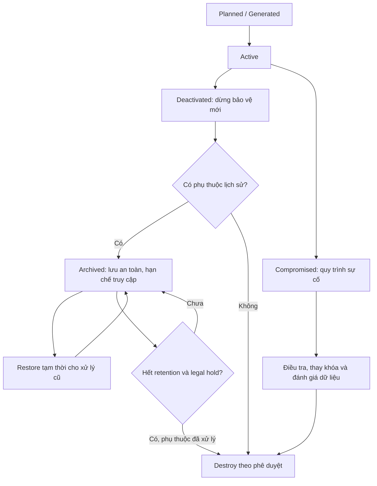
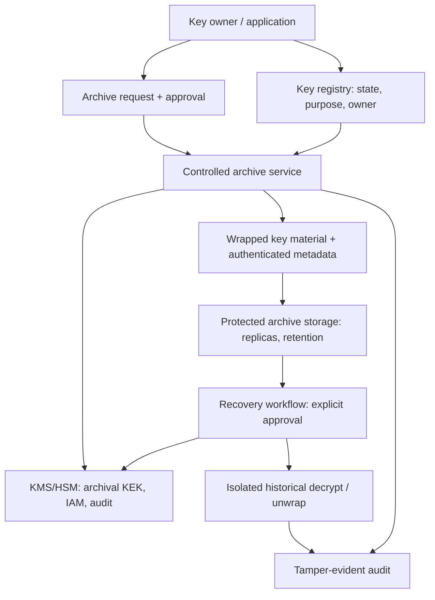
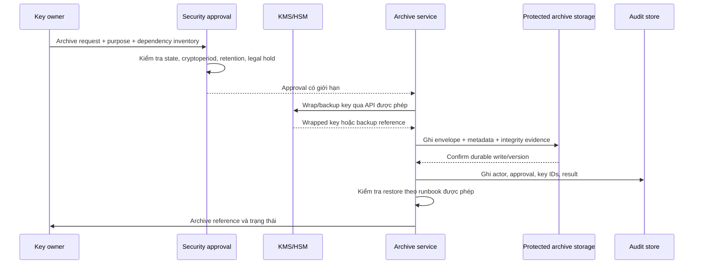
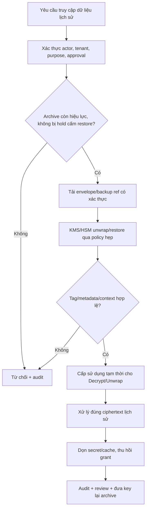

# Archive key — Lưu trữ khóa mật mã dài hạn trong vòng đời khóa

Trong chương **Key lifecycle** của module **SECURITY_KEY_MANAGEMENT_FUNDAMENTALS**, **archive key** là hoạt động **đưa vật liệu khóa mật mã cùng metadata và bằng chứng cần thiết vào chế độ lưu giữ có kiểm soát** sau khi khóa không còn được dùng cho hoạt động thông thường, nhưng vẫn có lý do hợp lệ phải giữ. Lý do phổ biến nhất là duy trì khả năng **giải mã dữ liệu cũ, mở bọc DEK, phục hồi bản sao lưu hoặc xác minh bằng chứng lịch sử**.

Lưu trữ khóa không đơn giản là sao chép một tệp chứa byte bí mật vào thư mục `backup/`. Một khóa được archive phải đi kèm **mục đích giữ, thời hạn lưu, trạng thái, người sở hữu, quyền phục hồi, cơ chế bảo vệ, thông tin khóa bọc, bằng chứng toàn vẹn và quy trình hủy**. Nếu mất khóa giải mã trước khi hết thời gian lưu dữ liệu, hệ thống có thể không phục hồi được dữ liệu. Nếu giữ khóa quá lâu và cho phép truy cập rộng, nguy cơ bị lộ hoặc lạm dụng tăng theo thời gian.

Bài này kết nối **mật mã đối xứng và bất đối xứng, chữ ký số, KMS/HSM, envelope encryption, kiểm soát truy cập và kiểm toán**, đồng thời phân biệt việc archive khóa với các trạng thái khác trong vòng đời tạo, cấp phát, lưu trữ, sử dụng, xoay vòng, thu hồi và hủy.

## 1. Mục tiêu học tập

Sau bài học, bạn có thể:

- Giải thích **archive key** khác **backup**, **deactivated**, **suspended**, **compromised**, **retired** và **destroyed** ở điểm nào.
- Xác định **khóa nào cần giữ dưới dạng vật liệu bí mật**, khóa nào chỉ cần giữ **public key/chứng chỉ/bằng chứng**, và khi nào việc giữ private key gây rủi ro lớn hơn lợi ích.
- Thiết kế một **archive envelope** gồm vật liệu khóa đã bọc, key ID/version, thuật toán, mục đích, metadata tin cậy và thời hạn lưu.
- Đề xuất cách dùng **KMS/HSM, KEK, IAM, dual control, audit log, offline/immutable storage** để lưu khóa dài hạn.
- Thiết kế quy trình phục hồi khóa được phê duyệt mà không tự động tái kích hoạt `Encrypt`, `Sign` hoặc thao tác bảo vệ dữ liệu mới.
- Phân biệt **rewrap** và **re-encrypt**, đánh giá phụ thuộc của backup, dữ liệu lâu dài và tình huống khóa bị lộ.
- Đọc ví dụ Java 17 minh họa cách bọc một DEK bằng AES-GCM với metadata được xác thực, đồng thời hiểu giới hạn khi triển khai thực tế.

## 2. Khái niệm và lý do phải archive khóa

Một hệ thống có thể tạo nhiều phiên bản khóa:

```text
2025: billing-dek-v1 -> mã hóa hóa đơn cũ
2026: billing-dek-v2 -> mã hóa hóa đơn mới

Hệ thống ngừng dùng v1 để mã hóa mới.
Nhưng hóa đơn 2025 vẫn phải đọc được theo thời hạn lưu trữ.
=> Phải giữ một cách hợp lệ để khôi phục/giải mã bằng v1,
   hoặc chuyển dữ liệu cũ sang khóa mới trước khi hủy v1.
```

**Archive** phục vụ **khả năng phục hồi hoặc kiểm tra thông tin lịch sử theo chính sách**, không phải lý do để khóa cũ tiếp tục có đầy đủ quyền như khóa đang hoạt động.

Trong kiến trúc thực, archive có thể là:

1. **Bản lưu vật liệu khóa đã được mã hóa/bọc** trong kho tách biệt, kèm metadata và chính sách phục hồi.
2. **Bản backup hoặc bản sao HSM được nhà cung cấp hỗ trợ** cho khóa non-exportable; ứng dụng không có quyền xuất private key rõ.
3. **Vùng lưu giữ trong KMS/keystore** mà chỉ một workflow phục hồi riêng có thể tiếp cận; không nhất thiết có tệp archive độc lập.
4. **Bằng chứng xác minh lịch sử** như public key, chứng chỉ, timestamp và dữ liệu kiểm toán, **không chứa private signing key**, khi chỉ cần xác minh chữ ký cũ.

Do vậy, không có yêu cầu rằng **mọi khóa archive đều phải được export ra file**. Điều cần quản lý là **khả năng cần thiết, quyền truy cập và phụ thuộc dữ liệu**, không phải một hình thức lưu trữ cố định.

### 2.1. Hai thời hạn khác nhau

- **Protection cryptoperiod**: khoảng thời gian được phép dùng khóa để **tạo bảo vệ mới** như `Encrypt`, `Sign`, `GenerateMac` hoặc `WrapKey`.
- **Thời gian xử lý/kiểm chứng lịch sử**: khoảng thời gian còn cần **giải mã, unwrap hoặc verify** đối tượng đã được bảo vệ từ trước.

Khóa ký có thể ngừng ký sau vài tháng, nhưng chữ ký trên chứng từ cần xác minh nhiều năm. KEK có thể ngừng bọc DEK mới nhưng vẫn cần mở các wrapped DEK cũ. Hai nhu cầu này không có cùng yêu cầu về **giữ secret key**: xác minh chữ ký bất đối xứng thường chỉ cần public key đáng tin và bằng chứng liên quan, còn mở dữ liệu AES hoặc HMAC lịch sử vẫn có thể cần secret.

## 3. Archive không đồng nghĩa với backup, deactivate hay destroy

| Khái niệm | Mục tiêu | Có thể tạo bảo vệ mới? | Đường xử lý dữ liệu cũ |
| --- | --- | --- | --- |
| **Active key** | Tạo và xử lý dữ liệu trong cryptoperiod được phép. | Có, theo quyền và thuật toán. | Có, theo policy. |
| **Deactivated key** | Dừng **bảo vệ mới** bằng khóa đó. | Không. | Có thể vẫn được phép `Decrypt`/`Unwrap`/`Verify` ở chế độ hạn chế. |
| **Archived key** | Giữ khóa/bằng chứng cho nhu cầu phục hồi hoặc lịch sử; thường đưa khỏi luồng sử dụng thường ngày. | **Không** theo chính sách archive. | Qua workflow được phê duyệt; có thể cần restore hoặc môi trường cách ly. |
| **Backup key material** | Tạo bản dự phòng để phục hồi khi mất/hỏng hệ thống. | Phụ thuộc trạng thái của **khóa gốc**, không tự cấp quyền mới. | Có thể cần phục hồi toàn bộ key store; phải bảo vệ giống khóa gốc. |
| **Suspended/disabled** | Tạm chặn thao tác vì sự cố hoặc chính sách. | Thường không. | Tùy API/nhà cung cấp, có thể bị chặn hoàn toàn. |
| **Compromised** | Ghi nhận khóa nghi hoặc đã bị lộ/lạm dụng. | Không được tiếp tục dùng thông thường. | Phải theo phương án incident response; archive không lấy lại bí mật đã lộ. |
| **Destroyed** | Loại bỏ vật liệu khóa theo phạm vi đã xác định. | Không. | Không thể dựa vào private/secret key đã bị hủy; bằng chứng công khai có thể còn. |

**Archive và backup có thể giao nhau nhưng không đồng nhất:** backup nhắm đến tính sẵn sàng trước mất dữ liệu/hạ tầng; archive nhắm đến nhu cầu lưu giữ và phục hồi **theo thời gian, mục đích và chính sách**. Một bản backup hàng ngày chứa khóa đang active không tự biến khóa thành archived key.

**Archive cũng không phải API `DisableKey` phổ quát**: nhiều KMS chặn cả `Decrypt` hoặc `Unwrap` khi disabled. Phải xác định khả năng sản phẩm và thiết kế đường khôi phục trước khi thay trạng thái nhà cung cấp.

### 3.1. Mô hình vòng đời mang tính khái niệm



Sơ đồ **không quy định** một khóa đã bị lộ phải archive hoặc có thể quay lại active. Nếu khóa bí mật đã bị lộ, ngay cả bản archive mã hóa rất tốt cũng không xóa được bản sao kẻ tấn công đang có.

## 4. Nên archive loại khóa nào?

Không phải loại khóa nào cũng cần giữ **vật liệu bí mật** sau khi ngừng sử dụng.

| Loại khóa | Cần giữ gì cho lịch sử? | Có nên archive bí mật không? | Nguy cơ hoặc điều kiện |
| --- | --- | --- | --- |
| **AES DEK** | DEK, wrapped DEK và metadata nếu ciphertext cũ còn phải giải mã. | **Có thể cần** nếu chưa re-encrypt/xóa dữ liệu phụ thuộc. | Lộ DEK cho phép giải mã bản mã liên quan. |
| **Symmetric KEK** | Khả năng unwrap DEK cũ hoặc bản bọc mới sau migration. | **Có thể cần** cho tới khi rewrap hoàn tất. | Hủy KEK quá sớm khiến wrapped DEK trong backup không thể mở. |
| **Recipient private key RSA/KEM** | Private key để mở bản mã đã gửi tới public key cũ, nếu dữ liệu còn tồn tại. | **Có thể cần** với kiểm soát đặc biệt. | Lộ private key có thể ảnh hưởng ciphertext lịch sử đã bị thu thập. |
| **ECDH ephemeral private key** | Thông thường không cần giữ sau khi phiên kết thúc. | **Không mặc định archive.** | Giữ quá lâu làm tăng tác động nếu khóa tạm thời bị lộ. |
| **Private signing key RSA-PSS/ECDSA/Ed25519** | Thường **không cần private key** để xác minh chữ ký cũ. | Thường **không archive bí mật chỉ vì cần verify**; xét ngoại lệ theo policy riêng. | Giữ private key có thể cho phép ký giả thêm về sau. |
| **Public verification key/X.509 certificate** | Public key, chứng chỉ, chuỗi tin cậy và bằng chứng thời điểm/trạng thái thu hồi khi cần. | Không phải bí mật, nhưng phải giữ **tính xác thực và toàn vẹn**. | Public key chưa được xác thực không chứng minh signer. |
| **HMAC key** | Secret để kiểm tra tag cũ nếu thực sự còn nhu cầu. | Chỉ giữ trong cửa sổ xác minh có hạn hoặc quy trình lưu trữ được bảo vệ. | Ai có secret đều có thể tạo MAC giả; giữ lâu tăng nguy cơ giả mạo. |
| **Root/KDF master key** | Khả năng tái dẫn xuất khóa con từ root secret và thông số KDF. | Phải phân tích phạm vi ảnh hưởng và mô hình khôi phục rất chặt chẽ. | Một root key có thể ảnh hưởng nhiều tenant/phiên bản, tạo blast radius lớn. |
| **Password pepper** | Secret nếu verifier lịch sử vẫn cần xác minh theo thiết kế. | Có thể cần, nhưng rotation/rehash/password reset phải được định trước. | Mất pepper có thể chặn đăng nhập; lộ pepper làm yếu rào cản bảo vệ database. |

### 4.1. Khóa ký số: lưu bằng chứng, không lưu private key vô tội vạ

Một tài liệu đã ký có thể được xác minh bằng **public key** tương ứng. Tùy mô hình tin cậy, để xác minh dài hạn còn cần:

- byte gốc của dữ liệu ký hoặc định dạng đã canonicalize;
- chữ ký, thuật toán, **actual key ID**, phiên bản, mục đích;
- public verification key hoặc certificate chain và trust anchor phù hợp;
- bằng chứng thời điểm ký đáng tin cậy, trạng thái chứng chỉ lúc liên quan, metadata kiểm toán/provenance;
- cách xử lý chứng chỉ hết hạn, thu hồi hoặc thuật toán không còn phù hợp.

**Lưu private signing key không phải điều kiện để verify lịch sử**. Archive private signing key chỉ khi có lý do pháp lý/nghiệp vụ và đánh giá rủi ro cụ thể; mặc định nên **ngừng quyền `Sign`**, rồi hủy private key khi hết mọi nhu cầu hợp lệ, thay vì giữ để “phòng khi cần ký lại”.

### 4.2. Khóa giải mã: phụ thuộc còn sống là yếu tố quyết định

Với AES DEK/KEK hoặc private key của cơ chế mã hóa bất đối xứng, nếu còn ciphertext cần truy cập, khả năng mở dữ liệu cũ có thể phụ thuộc trực tiếp vào secret. Vì vậy phải lưu **dependency graph**:

```text
Invoice ciphertext (AES-GCM)
   |
   +--> DEK id = dek-invoices-v2
               |
               +--> wrapped under KEK id = kek-prod-v3
                            |
                            +--> KMS key version + recovery policy

Backup năm cũ vẫn giữ wrapped DEK dưới kek-prod-v2?
   -> Nếu có, phải có kế hoạch unwrap/rewrap hoặc giữ khả năng phục hồi v2.
```

Một DEK cũ không nhất thiết cần archive **dạng plaintext**. Thường chỉ cần giữ **wrapped DEK** gắn với metadata đúng và một đường khôi phục KEK có kiểm soát.

## 5. Những câu hỏi phải chốt trước khi archive

1. **Vì sao phải giữ?** Lưu dữ liệu theo luật/chính sách, phục hồi backup, đọc bản mã cũ, kiểm chứng chứng từ hay phục vụ legal hold?
2. **Ai là owner?** Dịch vụ, tổ chức, tenant, nhóm security và người phê duyệt?
3. **Khóa gốc có thật sự deactivated?** Không còn tác vụ `Encrypt`, `Sign`, `Wrap` hoặc phát hành MAC mới bằng phiên bản này?
4. **Tài sản phụ thuộc nằm ở đâu?** Database, object store, cold storage, DR region, bản backup bất biến, client ngoại tuyến?
5. **Mô hình khôi phục?** KMS/HSM còn phục vụ khóa hay phải dùng một archive không hoạt động thường ngày?
6. **Độ dài retention?** Mốc bắt đầu, mốc hết hạn, legal hold, cách gia hạn và người phê duyệt hủy?
7. **Ràng buộc an toàn?** KEK bọc khóa archive có được bảo vệ, backup, xoay, phục hồi và audit độc lập không?
8. **Tình huống lộ khóa?** Nếu vật liệu gốc bị compromised, archive chỉ để điều tra hay còn được phép decrypt dữ liệu lịch sử?
9. **Đường thoát?** Khi dữ liệu hết hạn hoặc đã re-encrypt, làm sao chứng minh không còn phụ thuộc trước khi destroy?

Không lập một archive “giữ mãi mãi” mà không có chính sách: càng nhiều secret tồn tại lâu, phạm vi tác động của một vụ rò rỉ càng lớn.

## 6. Kiến trúc lưu khóa an toàn

Một kiến trúc điển hình với **symmetric wrapping key/KEK**:



Phân tách các lớp:

- **Key registry**: nguồn tin cậy cho key ID, thuật toán, owner, purpose, key state, cryptoperiod, archive status và reference dữ liệu. Registry **không lưu plaintext private/secret key**.
- **Archive service**: xác minh điều kiện, đóng gói và/hoặc yêu cầu KMS/HSM wrap key, ghi metadata, kiểm tra kết quả, không giữ bản rõ lâu hơn cần thiết.
- **Archival KEK**: khóa dùng để bảo vệ vật liệu được phép export. Cần tách mục đích, không dùng chung tùy tiện với DEK dữ liệu hoặc signing key.
- **Archive storage**: kiểm soát truy cập, integrity, versioning, lưu giữ theo chính sách; có thể dùng kho bất biến/append-only cho manifest và audit.
- **Recovery service**: quyền `Unwrap`/`Decrypt` rất hẹp, có phê duyệt, thời hạn và giám sát; không tự động cho phép quay lại ghi/đăng ký dữ liệu mới bằng khóa archive.

**Cảnh báo:** không phải private key/KEK nào cũng xuất được. Nếu key là **non-exportable trong HSM/KMS**, không tự tạo tệp archive bằng `getEncoded()`. Khi đó phải dựa vào tính năng backup/replication/restore được **nhà cung cấp hỗ trợ và chính sách cho phép**, hoặc chuyển dữ liệu sang khóa mới trước khi xóa dịch vụ/thiết bị cũ.

### 6.1. Mẫu lưu trữ phổ biến

| Mẫu | Ưu điểm | Phụ thuộc và hạn chế |
| --- | --- | --- |
| **Wrapped key trong object storage** | Tách vật liệu lưu khỏi dịch vụ chạy; dễ version và kiểm soát retention. | KEK phải sống, được sao lưu và restore được; phải chống tráo metadata. |
| **KMS key giữ ở trạng thái hạn chế** | Không cần export secret ra ứng dụng. | Chi phí duy trì KMS, phụ thuộc tài khoản/region/provider; chính sách cần chặn bảo vệ mới. |
| **HSM backup/replica chuyên dụng** | Giữ tính chất bảo vệ trong ranh giới phần cứng theo tính năng được hỗ trợ. | Quy trình backup/restore có thể yêu cầu dual control, thiết bị tương thích và quản lý khóa bảo vệ backup. |
| **Offline archive, restore theo yêu cầu** | Giảm bề mặt tấn công thường trực. | RTO cao, vận hành phức tạp, rủi ro vật lý và phải kiểm thử định kỳ. |
| **Rewrap/re-encrypt rồi hủy key cũ** | Giảm số secret cần giữ dài hạn. | Có chi phí migration, cần chứng minh toàn bộ dữ liệu/backup đã chuyển và xác minh đúng. |

**Không có một mẫu luôn tốt nhất.** Thiết kế phải dựa trên threat model, tính sẵn sàng, thời gian phục hồi, khối lượng dữ liệu, tuân thủ và khả năng thực tế của KMS/HSM.

## 7. Archive envelope và metadata tối thiểu

Một archive envelope không nên chỉ gồm `base64(keyBytes)`. Nó cần cho người vận hành biết **đó là khóa gì, được bảo vệ bằng gì và làm sao khôi phục an toàn**.

Ví dụ **metadata minh họa** cho một DEK được bọc:

```json
{
  "schemaVersion": 2,
  "archiveRecordId": "arc-2026-00172",
  "originalKeyId": "billing/dek-v1",
  "keyPurpose": "decrypt-legacy-invoices",
  "algorithm": "AES-256",
  "origin": "approved-key-generator",
  "originalState": "DEACTIVATED",
  "archiveState": "ARCHIVED",
  "tenantId": "tenant-17",
  "createdAt": "2025-04-10T10:00:00Z",
  "archivedAt": "2026-11-28T02:00:00Z",
  "retentionReviewAt": "2030-11-28T00:00:00Z",
  "wrappingKekRef": "archive/kek-v4",
  "wrappingSuite": "AES-256-GCM",
  "wrapNonce": "<base64url>",
  "wrappedKeyAndTag": "<base64url>",
  "dependenciesRef": "invoices/archive-manifest-v2",
  "policyVersion": 12
}
```

Đây **không phải format chuẩn đã hoàn chỉnh**. Production cần quy định serialization, encoding, xử lý null/field lạ, mối quan hệ metadata với ciphertext, versioning và key usage bằng một giao thức đã được đánh giá.

Các trường quan trọng:

| Nhóm metadata | Tác dụng | Lưu ý |
| --- | --- | --- |
| `originalKeyId`, version, key type | Xác định đúng vật liệu khóa khi phục hồi. | Không dùng alias `current` làm tham chiếu duy nhất. |
| `algorithm`, parameters, encoding | Biết cách nhập lại/dùng khóa; phân biệt AES, RSA, Ed25519, EC. | Không “đoán” loại khóa từ độ dài chuỗi. |
| Owner, tenant, purpose | Giới hạn miền truy cập và hành vi phục hồi. | Không để client tự chỉnh metadata quyết định quyền. |
| Cryptoperiod và archive times | Phân biệt thời gian hoạt động, lưu trữ và đánh giá retention. | Dùng thời gian từ nguồn đáng tin; không tin mỗi timestamp tự khai. |
| `wrappingKekRef`, suite, nonce | Xác định khóa và thuật toán bọc để unwrap chính xác. | KEK phải tồn tại, được phép dùng và có kế hoạch rotation riêng. |
| Dependency manifest | Liên kết ciphertext/backup với secret cần giữ. | Phải kiểm kê cả cold storage và disaster recovery. |
| Approval, policy version, legal hold | Bằng chứng quyết định lưu, phục hồi, hủy. | Thay đổi phải được audit và bảo vệ chống giả mạo. |
| Integrity/authentication data | Phát hiện sửa, tráo record hoặc metadata. | Dùng AEAD AAD/MAC/chữ ký theo giao thức; checksum thuần không đủ trước attacker chủ động. |

**Không lưu secret key dưới dạng chuỗi base64 không mã hóa** rồi nghĩ rằng nó đã được bảo vệ. Base64 chỉ là encoding.

### 7.1. Ràng buộc metadata bằng AEAD/AAD

Nếu attacker có thể đổi `tenantId`, `originalKeyId`, `wrappingKekRef` hoặc `keyPurpose` trong record mà không làm bước restore thất bại, hệ thống có nguy cơ **key substitution, cross-tenant access hoặc key confusion**.

Với **AES-GCM để wrap**, có thể đưa một bộ trường đã chuẩn hóa vào **AAD** để tag xác thực cả vật liệu khóa và metadata liên quan. Khi restore phải dựng **cùng chuỗi byte AAD** từ metadata đã kiểm soát và từ chối nếu tag không hợp lệ.

Một AAD khớp **không tự chứng minh quyền truy cập**: vẫn cần IAM, ownership, phê duyệt và kiểm tra thời hạn. Không đưa duy nhất dữ liệu client chưa tin vào AAD rồi coi là policy đã được thực thi.

## 8. Bảo vệ secret key archive: wrapping, IAM và audit

### 8.1. KEK lưu trữ phải có vòng đời riêng

Vật liệu khóa archive có thể được mã hóa bởi **archival KEK**. KEK đó cũng cần:

- tạo từ CSPRNG hoặc bên trong HSM/KMS;
- quản lý key ID, version, purpose, owner và chính sách `Wrap/Unwrap`;
- kiểm soát quyền tối thiểu, lý tưởng không xuất được nếu dịch vụ hỗ trợ;
- bản sao/replica hoặc phương án disaster recovery được kiểm thử;
- rotation và rewrap những archive envelope còn sống;
- kế hoạch hủy **sau** khi không còn archive nào phụ thuộc.

Đây là **chuỗi phụ thuộc**: một backup hoàn hảo của wrapped DEK vẫn vô dụng nếu KEK duy nhất để mở bản bọc đã bị hủy hoặc KMS account/region không thể phục hồi.

### 8.2. Phân tách vai trò

| Vai trò | Quyền phù hợp | Không cấp mặc định |
| --- | --- | --- |
| **Key owner** | Đề xuất archive với lý do, thời hạn và dependency manifest. | Tự bỏ qua phê duyệt hoặc xuất tất cả secret. |
| **Archive operator** | Thực hiện workflow được phê duyệt, ghi archive record. | Ký/mã hóa dữ liệu nghiệp vụ mới bằng khóa cũ. |
| **Security approver** | Phê duyệt archive/restore/destruction theo policy. | Đọc plaintext dữ liệu nghiệp vụ nếu không được ủy quyền riêng. |
| **KMS/HSM admin** | Quản lý key policy, KEK, backup/restore theo dual control khi cần. | Tự ý giải mã mọi khách hàng mà không qua nghiệp vụ. |
| **Recovery workload** | Unwrap/decrypt **đúng key ref, tenant, object và thời gian được cấp**. | Quyền `Unwrap` không giới hạn trên toàn bộ archive. |
| **Auditor** | Xem metadata, approvals, attempts, kết quả và bằng chứng. | Đọc private key, plaintext DEK, pepper hoặc shared secret. |

**Dual control / quorum approval** là lớp kiểm soát khi giá trị khóa hoặc phạm vi ảnh hưởng rất lớn. Nó không nên chỉ tồn tại trên giấy: workflow cần chống việc một tài khoản tự đề xuất, tự phê duyệt và tự thực thi phục hồi mà không để lại bằng chứng.

### 8.3. Những gì audit nên và không nên lưu

Một sự kiện archive/restore có thể gồm:

```json
{
  "eventType": "KEY_ARCHIVE_RESTORE",
  "archiveRecordId": "arc-2026-00172",
  "originalKeyId": "billing/dek-v1",
  "wrappingKekRef": "archive/kek-v4",
  "actor": "approved-recovery-service",
  "approvalRef": "approval-00831",
  "purpose": "legacy-invoice-read",
  "tenantId": "tenant-17",
  "result": "SUCCESS",
  "policyVersion": 12,
  "requestId": "req-9382"
}
```

Không log **plaintext key, private key, shared secret, unwrapped DEK, password/pepper, nội dung nhạy cảm hoặc token còn hiệu lực**. Một log có key ID/tenant vẫn có thể tiết lộ metadata nghiệp vụ, nên cần chính sách quyền và lưu trữ phù hợp.

## 9. Quy trình archive khóa: từ yêu cầu đến kiểm chứng



Một quy trình thực tế nên có các bước:

1. **Inventory:** xác định phiên bản khóa thực, thuật toán, nơi key material đang nằm, trạng thái, toàn bộ đối tượng/backup phụ thuộc.
2. **Eligibility check:** khóa đã ngừng được dùng để tạo bảo vệ mới chưa? Nếu chưa, phải quyết định thời điểm chuyển an toàn; archive không có nghĩa được bỏ qua rotation.
3. **Retention decision:** tính thời gian giữ theo dữ liệu phụ thuộc, nghĩa vụ lưu trữ và legal hold, có chủ sở hữu chịu trách nhiệm.
4. **Authorization:** phê duyệt từ vai trò có thẩm quyền, giới hạn mục đích, vùng, tenant, key ref và thời gian.
5. **Protect:** dùng wrapping/encryption hoặc chức năng backup HSM/KMS chính thức; giữ plaintext secret ngoài log và hạn chế thời gian tồn tại trong RAM.
6. **Commit:** ghi archive envelope/backup reference và metadata có xác thực; xác nhận khả năng lưu bền, version và replication.
7. **Verify:** kiểm tra checksum/integrity và **diễn tập restore có kiểm soát** phù hợp. Việc tồn tại một file archive không chứng minh khóa sẽ mở được sau 5 năm.
8. **Reduce access:** sau archive, rút đường sử dụng thường ngày và quyền cấp cho workload cũ; cần chứng minh không thể `Encrypt`/`Sign` mới với key archived.
9. **Audit and review:** ghi sự kiện, người phê duyệt, phiên bản policy; lập lịch đánh giá retention, migration, backup health và khả năng khôi phục.

**Thứ tự quan trọng:** không hủy hoặc làm mất khả năng đọc khóa gốc **trước** khi bản archive/đường restore được xác minh và chính sách cho phép.

## 10. Quy trình restore: khôi phục không đồng nghĩa tái kích hoạt

Khi người dùng cần đọc dữ liệu cũ, workflow có thể trông như sau:



**Restore chỉ nên cấp capability tối thiểu**: khi cần đọc hóa đơn cũ, quyền `Decrypt`/unwrap chính xác dữ liệu cũ là đủ. Không mặc định bật lại `Encrypt`, `Sign`, `GenerateMac` hoặc `GenerateDataKey` bằng phiên bản đã archive.

Điều kiện cần thiết:

- **Nguồn yêu cầu đáng tin:** actor, business approval, tenant, object reference và mục đích không đến từ cờ `isHistorical=true` do client tự khai.
- **Archive authentication:** xác minh wrapped material, metadata, key version, AAD/tag và nguồn archive; từ chối sai lệch.
- **Giới hạn phạm vi:** grant có thời hạn và object/tenant allowlist; tránh restore một KEK cho mọi workload chỉ vì một bản ghi cần đọc.
- **Không tạo secret tồn tại lâu không cần thiết:** ưu tiên API trong HSM/KMS, môi trường cách ly hoặc xử lý in-place; giảm cache plaintext key.
- **Audit đầy đủ:** record lần phục hồi, cả thành công và thất bại; cảnh báo truy cập bất thường.
- **Re-archive:** thu hồi grant, dọn secret runtime trong khả năng của nền tảng, không thay state khóa thành `ACTIVE` vĩnh viễn.

Đừng coi `Arrays.fill` trong Java bảo đảm **mọi bản sao khóa đã biến mất**. JVM, crypto provider, native memory và log có những giới hạn khác nhau; cần thiết kế để giảm việc xuất và nhân bản secret ngay từ đầu.

### 10.1. Khôi phục trong KMS/HSM non-exportable

Nếu khóa không thể xuất, có thể **không tồn tại thao tác “tải lại raw key về Java”**. Quy trình phù hợp có thể là khôi phục HSM backup theo cơ chế quản trị, tái kết nối với KMS key còn sống, chạy decrypt/unwrap qua API có quyền, hoặc chuyển khóa/vật liệu trong các miền tin cậy được provider hỗ trợ.

Phải kiểm chứng điều này **trước khi chọn retention dài hạn**. Một kế hoạch ghi “archive private key” nhưng thực tế nhà cung cấp không cho export và không có backup được hỗ trợ là kế hoạch chưa hoàn chỉnh.

## 11. Java 17: minh họa bọc một DEK để lưu archive

Đoạn mã sau minh họa **vật liệu khóa AES được bọc dưới một archival KEK bằng AES-GCM**, đồng thời ràng buộc `tenantId`, `originalKeyId` và `wrappingKekRef` vào **AAD**. Khi đọc lại, nếu metadata bị tráo, giải mã phải thất bại do authentication tag không hợp lệ.

**Phạm vi demo:** cả KEK và DEK đều được sinh trong cùng tiến trình để thấy cơ chế hoạt động. Trong hệ thống thật, archival KEK phải được quản lý độc lập trong KMS/HSM hoặc keystore được bảo vệ, và workflow restore phải có IAM, approval, retention và audit. Code này không phải thiết kế production hoàn chỉnh.

```java
import java.io.ByteArrayOutputStream;
import java.io.DataOutputStream;
import java.nio.charset.StandardCharsets;
import java.security.SecureRandom;
import java.util.Arrays;
import javax.crypto.Cipher;
import javax.crypto.KeyGenerator;
import javax.crypto.SecretKey;
import javax.crypto.spec.GCMParameterSpec;
import javax.crypto.spec.SecretKeySpec;

public final class ArchivedDekDemo {
    record ArchiveEnvelope(
            String tenantId,
            String originalKeyId,
            String wrappingKekRef,
            byte[] nonce,
            byte[] wrappedDekAndTag) {}

    // Dùng length-prefix, không nối chuỗi với dấu phân cách mơ hồ.
    static byte[] archiveAad(
            String tenantId, String originalKeyId, String wrappingKekRef)
            throws Exception {
        ByteArrayOutputStream buffer = new ByteArrayOutputStream();
        try (DataOutputStream out = new DataOutputStream(buffer)) {
            for (String value : new String[] {
                    "archived-dek:v1", tenantId, originalKeyId, wrappingKekRef
            }) {
                byte[] bytes = value.getBytes(StandardCharsets.UTF_8);
                out.writeInt(bytes.length);
                out.write(bytes);
            }
        }
        return buffer.toByteArray();
    }

    static ArchiveEnvelope archive(
            SecretKey dek, SecretKey archivalKek, SecureRandom rng,
            String tenantId, String originalKeyId, String wrappingKekRef)
            throws Exception {
        byte[] rawDek = dek.getEncoded(); // Demo: DEK có thể export
        if (rawDek == null || rawDek.length != 32) {
            throw new IllegalArgumentException("Expected exportable AES-256 DEK");
        }
        try {
            byte[] nonce = new byte[12];
            rng.nextBytes(nonce);

            Cipher cipher = Cipher.getInstance("AES/GCM/NoPadding");
            cipher.init(Cipher.ENCRYPT_MODE, archivalKek,
                    new GCMParameterSpec(128, nonce));
            cipher.updateAAD(archiveAad(tenantId, originalKeyId, wrappingKekRef));
            byte[] wrapped = cipher.doFinal(rawDek);
            return new ArchiveEnvelope(
                    tenantId, originalKeyId, wrappingKekRef, nonce, wrapped);
        } finally {
            Arrays.fill(rawDek, (byte) 0);
        }
    }

    static SecretKey restore(
            ArchiveEnvelope envelope, SecretKey archivalKek)
            throws Exception {
        if (envelope.nonce().length != 12) {
            throw new SecurityException("Invalid archive envelope");
        }

        Cipher cipher = Cipher.getInstance("AES/GCM/NoPadding");
        cipher.init(Cipher.DECRYPT_MODE, archivalKek,
                new GCMParameterSpec(128, envelope.nonce()));
        cipher.updateAAD(archiveAad(
                envelope.tenantId(),
                envelope.originalKeyId(),
                envelope.wrappingKekRef()));

        byte[] rawDek = cipher.doFinal(envelope.wrappedDekAndTag());
        if (rawDek.length != 32) {
            Arrays.fill(rawDek, (byte) 0);
            throw new SecurityException("Invalid archived key");
        }
        try {
            // Chỉ cấp cho workflow Decrypt/Unwrap lịch sử đã được phê duyệt.
            return new SecretKeySpec(rawDek, "AES");
        } finally {
            Arrays.fill(rawDek, (byte) 0);
        }
    }

    public static void main(String[] args) throws Exception {
        SecureRandom rng = new SecureRandom();
        KeyGenerator gen = KeyGenerator.getInstance("AES");
        gen.init(256, rng);

        SecretKey archivalKek = gen.generateKey();
        SecretKey historicalDek = gen.generateKey();

        ArchiveEnvelope saved = archive(
                historicalDek, archivalKek, rng,
                "tenant-17", "billing/dek-v1", "archive/kek-v4");
        SecretKey restored = restore(saved, archivalKek);

        // Kiểm tra trong demo, không log raw key material.
        System.out.println("Restored key type: " + restored.getAlgorithm());

        ArchiveEnvelope tampered = new ArchiveEnvelope(
                "tenant-99", saved.originalKeyId(), saved.wrappingKekRef(),
                saved.nonce(), saved.wrappedDekAndTag());
        try {
            restore(tampered, archivalKek);
            throw new AssertionError("Tampered metadata accepted");
        } catch (javax.crypto.AEADBadTagException expected) {
            System.out.println("Tampered metadata rejected");
        }
    }
}
```

**Giải thích đúng ý nghĩa bảo mật:**

1. `KeyGenerator` với nguồn ngẫu nhiên mật mã tạo DEK và KEK độc lập. **Không** dùng `Random`, timestamp hay password có thể đoán để tạo khóa.
2. `archiveAad` dùng **length-prefix encoding** và nhãn miền `archived-dek:v1` để tránh dữ liệu metadata ghép mơ hồ.
3. GCM mã hóa DEK dưới KEK, tạo ciphertext và tag; khi metadata thay đổi, tag không còn khớp.
4. Nonce 12 byte được sinh mới **cho một lần wrapping**. Trong production khi dùng cùng archival KEK để bọc hàng triệu khóa, phải thiết kế quy tắc **không tái sử dụng nonce với cùng KEK**, cân nhắc giới hạn khối lượng hoặc cơ chế cấp phát theo provider.
5. Code **chưa kiểm tra IAM, approval, retention, tenant ownership, source of truth hay chống rollback**. AAD giúp phát hiện sửa metadata, không thay thế những kiểm soát đó.
6. `record ArchiveEnvelope` chứa mảng byte có thể thay đổi và không có defensive copy; bản production nên dùng định dạng immutable/serialization được kiểm soát.
7. `SecretKeySpec` có thể giữ một bản sao secret trong bộ nhớ. `Arrays.fill` xóa mảng trung gian nhưng **không** bảo đảm hủy mọi bản sao trong runtime.
8. KEK của demo không được lưu lâu dài nên không thể phục hồi archive sau khi tiến trình kết thúc. Sản phẩm thật phải có **KEK persistence, replica/backup và restore drill** phù hợp; ưu tiên KMS/HSM khi yêu cầu.
9. Đoạn mã chỉ minh họa **symmetric key wrapping theo kiểu AEAD**, không phải chứng minh đã có một định dạng archive tương thích mọi nhà cung cấp.

### 11.1. Ví dụ policy trước restore

Trước khi gọi `restore`, dịch vụ thực tế cần một **quyết định cấp quyền** do hệ thống tin cậy tạo ra. Ví dụ pseudocode:

```text
requestRestore(archiveRecordId, objectRef, actor):
  require authenticate(actor)
  metadata = trustedRegistry.lookup(archiveRecordId)
  require metadata.state == ARCHIVED
  require businessAuthorization(actor, metadata.tenantId, objectRef)
  require approvedPurpose == "legacy-decrypt"
  require objectRef thuộc dependency manifest hợp lệ của key
  require not blockedByIncidentPolicy(metadata)
  grant = issueShortLivedRestoreGrant(metadata, objectRef)
  audit("RESTORE_REQUESTED", actor, metadata.keyId, objectRef)

  decryptByApprovedPath(grant, archivedKeyRef, objectRef)
  revoke(grant)
  audit("RESTORE_COMPLETED", ...)
```

Không dùng trực tiếp dữ liệu `objectRef` hoặc cờ `isOld` do client tự khai làm bằng chứng rằng việc restore được phép. Policy cần ràng buộc key ID, tenant, mục đích, trạng thái và đường truy cập dữ liệu đã kiểm chứng.

## 12. Archive trong envelope encryption: DEK và KEK là hai tầng

Xét dữ liệu được mã hóa bằng AES-GCM với **DEK**, và DEK được bọc dưới một **KEK** của KMS:

```text
Document ciphertext + tag + nonce
         ^
         | AES-GCM under DEK-v3
         |
Wrapped DEK-v3  --unwrap-->  DEK-v3
        ^
        | wrapped under KEK-v2
        |
KMS/HSM KEK-v2
```

Khi cần lưu trữ dài hạn, không nhất thiết phải export DEK rõ:

- Lưu **wrapped DEK** cùng ciphertext và metadata tin cậy.
- Giữ khả năng unwrap của **KEK** tương ứng hoặc chuyển bản bọc sang KEK mới.
- Bảo vệ quyền `Decrypt/Unwrap` theo purpose/tenant/object và policy lịch sử.
- Lưu dependency graph để biết còn bản mã hoặc backup nào phụ thuộc.

### 12.1. Rotation KEK: rewrap khác re-encrypt

**Rewrap** một DEK dưới KEK mới:

```text
Trước:
    WrappedDEK_v3 = Wrap(KEK_v2, DEK_v3)
    Ciphertext    = AEAD_Encrypt(DEK_v3, data)

Sau rewrap:
    WrappedDEK_v3 = Wrap(KEK_v3, DEK_v3)
    Ciphertext    = giữ nguyên nếu thiết kế cho phép
```

**Re-encrypt** dữ liệu bằng DEK mới:

```text
Trước:
    Ciphertext_old = AEAD_Encrypt(DEK_v3, data)

Sau:
    Ciphertext_new = AEAD_Encrypt(DEK_v4, data, nonce mới)
    WrappedDEK_v4  = Wrap(KEK hiện hành, DEK_v4)
```

Nếu chỉ rotation KEK định kỳ và không có dấu hiệu lộ bí mật, **rewrap** có thể đủ để chuyển phụ thuộc và rút KEK cũ khỏi sử dụng. Nếu **DEK đã bị lộ**, rewrap cùng DEK không làm dữ liệu trở lại bí mật; cần đánh giá **re-encrypt** và phạm vi dữ liệu đã bị truy cập.

Nếu **KEK bị lộ**, attacker có thể đã mở các wrapped DEK cũ mà họ lưu được; chỉ thay KEK cũng **không bảo đảm hồi phục bí mật lịch sử**. Cần incident response và đánh giá khóa/dữ liệu đã bị ảnh hưởng.

### 12.2. Archive key non-exportable và vendor dependency

Một KEK hoặc private key được đánh dấu **non-exportable** không thể archive bằng cách lấy raw bytes nếu API không cho phép. Nếu KMS/HSM sắp bị thay thế hoặc tài khoản bị đóng, phải lên kế hoạch:

1. Kiểm kê dữ liệu, wrapped DEK, archive và backup phụ thuộc.
2. Kiểm tra nhà cung cấp có **backup/replication hoặc migration trong miền tin cậy** hay không.
3. Nếu không thể chuyển raw key, dùng khóa cũ qua API hợp lệ để **unwrap/rewrap dữ liệu sang key mới** trước khi vô hiệu hóa dịch vụ.
4. Kiểm thử khôi phục một mẫu dữ liệu từ backup qua **đường mới**.
5. Chỉ xóa key cũ, account hoặc HSM sau khi chứng minh không còn phụ thuộc hợp lệ.

Lưu một file mang tên `kek-v2-backup.json` không có nghĩa đã sao lưu được **vật liệu khóa thực** hay khả năng decrypt.

## 13. Retention, legal hold, hủy khóa và khả năng phục hồi

**Retention** của khóa archive phải được xác định từ nhu cầu thực tế và chính sách, không nhất thiết bằng thời hạn lưu file.

Ví dụ:

| Tình huống | Quyết định lưu khóa | Điều kiện trước khi hủy |
| --- | --- | --- |
| Hóa đơn được mã hóa cần lưu nhiều năm | Giữ DEK/đường unwrap hoặc hoàn tất re-encrypt. | Không còn ciphertext/backups phụ thuộc hoặc đã chuyển đổi đúng. |
| Token JWT sống 15 phút | Giữ public verification key cho khoảng xác minh hợp lệ; thường không archive private signing key để verify. | Token cũ hết hiệu lực, cache và chính sách lưu bằng chứng đã xử lý. |
| Chứng từ ký số cần xác minh lâu dài | Giữ chữ ký, public key/cert, trust/timestamp evidence theo policy. | Không phụ thuộc giữ private signing key; đánh giá retention của bằng chứng riêng. |
| HMAC webhook chuyển khóa | Có thể cần giữ secret cũ trong cửa sổ xác minh ngắn. | Hết cửa sổ, không còn yêu cầu hợp lệ và đã xử lý replay. |
| Backup bất biến còn wrapped DEK dưới KEK cũ | Có thể cần giữ KEK cũ/đường unwrap dài hơn dữ liệu online. | Backup hết hạn hợp pháp hoặc có thể restore bằng khóa mới đã kiểm thử. |
| Legal hold đang hoạt động | Có thể cần tạm hoãn tiêu hủy dù đến retention review. | Quyết định giải tỏa hold từ chủ thể có thẩm quyền, kèm audit. |

**Legal hold** là yêu cầu giữ dữ liệu/bằng chứng theo vụ việc hoặc chính sách. Hãy tránh suy luận tự động rằng legal hold cho phép mọi nhân viên truy cập khóa; yêu cầu **giữ** không đồng nghĩa quyền **sử dụng**.

### 13.1. Hủy khóa archive đúng điều kiện

Quy trình hủy nên gồm:

1. Xác minh không còn dữ liệu online, cold storage, backup, DR hoặc hồ sơ thuộc phạm vi yêu cầu còn **phụ thuộc** khóa.
2. Xác nhận không có legal hold hoặc nghĩa vụ lưu trữ còn hiệu lực.
3. Phê duyệt từ owner/security theo nguyên tắc phân tách nhiệm vụ.
4. Xóa/vô hiệu hóa vật liệu bí mật theo cơ chế được hệ thống lưu trữ/HSM/KMS hỗ trợ, tính cả bản sao, backup và key cache.
5. Ghi bằng chứng hủy, key ID, mốc thời gian, actor, kết quả và ngoại lệ đã biết.
6. Giữ **metadata và audit proof phù hợp** khi chính sách đòi hỏi, nhưng không giữ lại plaintext key.

**Crypto-shredding** (làm dữ liệu không thể giải mã bằng cách hủy key material) có thể hữu ích nhưng chỉ an toàn khi không còn bản sao DEK/KEK, backup, cache hoặc đường thay thế. Đừng tuyên bố dữ liệu không thể giải mã nếu khóa vẫn còn trên một HSM replica hoặc file backup.

### 13.2. Bài kiểm thử phục hồi đáng tin

Không chỉ kiểm tra archive object tồn tại. Một **restore drill** nên xác minh:

- người được phép phục hồi có thể lấy archive metadata và xử lý approval;
- archival KEK hoặc HSM backup còn dùng được trong vùng phục hồi;
- khôi phục được một DEK/khóa thử và **giải mã đúng ciphertext mẫu có tag hợp lệ**;
- restore bằng sai key ID, sai tenant, sai AAD/metadata và sai quyền đều **thất bại**;
- grant hết hạn, không còn quyền tạo bảo vệ mới bằng khóa archive;
- audit, cảnh báo, khôi phục sau lỗi giữa chừng và khả năng xóa secret tạm thời hoạt động như thiết kế.

Mục tiêu là chứng minh **khả năng phục hồi có kiểm soát**, không tự biến archive thành secret store online có quyền rộng.

## 14. Tình huống: hệ thống lưu trữ hồ sơ khách hàng

Một hệ thống Java dùng **AES-256-GCM** cho hồ sơ, **KMS KEK** để bọc DEK và **Ed25519** để ký manifest phát hành. Tổ chức cần giữ hồ sơ nhiều năm và đôi lúc phục hồi từ backup.

**Giai đoạn hoạt động:**

- Writer tạo DEK ngẫu nhiên, mã hóa hồ sơ mới, lưu `ciphertext`, nonce/tag, `wrappedDEK`, actual `kekKeyRef`.
- KMS quản lý KEK và log `GenerateDataKey`/`Decrypt` theo IAM.
- Signing service dùng private Ed25519 key hiện hành; verifier có public key đáng tin.

**Giai đoạn rotation:**

- Chuyển writer sang KEK mới và signing key mới.
- Các wrapped DEK cũ được rewrap dần sang KEK mới; backup bất biến được ghi nhận có thể vẫn phụ thuộc KEK cũ.
- Private signing key cũ ngừng ký; public verification key và chứng cứ liên quan được giữ để verify chữ ký cũ.

**Giai đoạn archive:**

- KEK cũ không được dùng wrap mới. Nếu HSM/KMS không xuất KEK, tổ chức giữ một **đường restore/replica do nhà cung cấp hỗ trợ** hoặc chuyển hết wrapped DEK phụ thuộc trước khi hủy.
- Registry ghi key ID, thuật toán, owner, dependency manifest, lý do lưu, retention review và approval.
- Recovery team chỉ được mở dữ liệu lịch sử có quyền, trong thời gian ngắn, có audit và giới hạn tenant.
- Không archive private signing key chỉ vì còn chữ ký Ed25519 cần xác minh.

**Giai đoạn destroy:**

- Khi dữ liệu/backup không còn phụ thuộc và không có legal hold, tổ chức quyết định hủy KEK cũ theo policy.
- Giữ bằng chứng hoàn tất migration/restore drill và thao tác hủy; không giữ bí mật thô trong log.

Nếu HSM bị thay mới trước mốc retention, không được đơn giản hủy HSM cũ rồi giả định archive vẫn đọc được. **Migrate hoặc chứng minh đường khôi phục** là phần bắt buộc của kế hoạch.

## 15. Các lỗi thiết kế thường gặp

| Sai lầm | Hậu quả | Cách xử lý |
| --- | --- | --- |
| Lưu raw DEK/private key ở dạng base64 trong object storage. | Bất kỳ ai đọc object có thể lấy secret. | Wrap/encrypt đúng chuẩn, IAM và kiểm soát lưu trữ. |
| Coi backup hàng ngày là archive an toàn hoàn chỉnh. | Không rõ retention, quyền restore, dependency và trạng thái key. | Archive record riêng với policy/approval/restore drill. |
| Hủy KEK sau khi rotate mà không kiểm kê backup. | Backup cũ không mở được wrapped DEK. | Dependency inventory và rewrap/migration trước khi xóa. |
| Archive mọi private signing key vì “chữ ký cũ vẫn cần verify”. | Giữ secret ký lâu, tăng rủi ro giả mạo. | Lưu public key/cert/evidence, hủy private key khi đủ điều kiện. |
| Chỉ ghi alias `current` vào archive. | Alias đổi đích, không biết đúng phiên bản KEK để unwrap. | Lưu **actual key ID/version** và suite. |
| Tin metadata archive không được xác thực. | Có thể tráo key ID, tenant, purpose, wrapping reference. | AEAD AAD/chữ ký trên metadata quan trọng, source of truth đáng tin. |
| Khôi phục archive rồi tự động đánh dấu khóa `ACTIVE`. | Khóa hết cryptoperiod tạo dữ liệu/chữ ký mới. | Restore chỉ cấp quyền lịch sử cần thiết, thời hạn ngắn. |
| Cho phép một tài khoản đề xuất, phê duyệt, restore và xóa audit. | Dễ lạm dụng secret lưu lâu. | Separation of duties, dual control, log chống sửa. |
| Chỉ kiểm tra archive file tồn tại, không thử decrypt dữ liệu. | Đến lúc sự cố mới biết KEK/provider không thể khôi phục. | Thực hiện restore drill và negative tests định kỳ. |
| Xoay archival KEK nhưng bỏ lại các wrapped key chưa rewrap. | Archive cũ mất khả năng mở sau khi KEK bị hủy. | Rewrap tất cả phụ thuộc hoặc duy trì key version cũ đúng hạn. |
| Đánh dấu khóa compromised là archived rồi coi an toàn. | Secret có thể vẫn nằm trong tay attacker. | Incident response, đánh giá exposure, thay DEK và re-encrypt khi cần. |
| Dùng chung archival KEK với nhiều mục đích không kiểm soát. | Một quyền/khóa lộ ảnh hưởng miền rộng. | Tách purpose, tenant, IAM và key hierarchy. |
| Lưu key trong HSM non-exportable nhưng lập kế hoạch “tải raw key về file”. | Không thực hiện được backup/restore như đã hứa. | Dùng cơ chế provider hoặc migrate ciphertext/wrapped data khi còn thời gian. |
| Quên legal hold hoặc retention của bản backup bất biến. | Hủy quá sớm hoặc giữ secret trái chính sách. | Kết hợp registry, data retention, legal review và điều kiện hủy. |
| Lưu secret trong log khi debug restore. | Rò key qua hệ thống giám sát hoặc ticket. | Log metadata, status và request ID, không log raw key. |

## 16. Checklist trước khi xác nhận đã archive thành công

1. **Đúng mục đích:** đã xác định vì sao cần giữ khóa và loại dữ liệu lịch sử nào phụ thuộc?
2. **Trạng thái:** khóa đã ngừng tạo bảo vệ mới, không còn writer/signer dùng nhầm phiên bản cũ?
3. **Phân loại:** có thật sự cần giữ private/secret key, hay chỉ cần public key/chứng cứ xác minh?
4. **Key ID/algorithm:** lưu actual ID, version, type, parameters, tenant, owner và suite có tương thích?
5. **Cơ chế bảo vệ:** key material được wrapped/backup theo cơ chế KMS/HSM cho phép, không để raw key trong object/log?
6. **KEK lifecycle:** wrapping key có owner, backup/replica, IAM, rotation và phương án khôi phục riêng?
7. **Integrity:** metadata quan trọng đã được AEAD/MAC/chữ ký bảo vệ, có chống tráo và rollback theo chính sách?
8. **Access:** archive/restore cần approval, least privilege, thời hạn và phân tách nhiệm vụ?
9. **Dependency inventory:** biết mọi ciphertext, wrapped DEK, backup/DR và hệ thống còn cần khóa?
10. **Retention:** có review date, legal hold, quy trình gia hạn và điều kiện hủy được phê duyệt?
11. **Restore drill:** đã thử khôi phục và giải mã dữ liệu mẫu thành công qua đường được phép, đồng thời thử sai quyền/tenant/tag?
12. **After restore:** không tái kích hoạt `Encrypt`/`Sign` mới; có thu hồi grant và giảm thời gian secret hiện diện?
13. **Monitoring:** lưu metadata và audit thao tác tạo archive, truy cập, restore, rewrap, destroy; cảnh báo hành vi lạ?
14. **Incident response:** khi khóa bị lộ, có đánh giá dữ liệu đã bị thu thập và kế hoạch re-encrypt, không chỉ rewrap?
15. **Crypto agility:** nếu thuật toán hoặc KMS provider hết vòng đời trước thời hạn dữ liệu, có phương án migrate được kiểm chứng?

## 17. Câu hỏi tự kiểm tra

1. Archive key khác backup và deactivated state như thế nào? Có cần export key ra file mới gọi là archive không?
2. Vì sao một private signing key thường **không cần giữ lại** để xác minh chữ ký Ed25519/ECDSA lịch sử?
3. Một KEK cũ vẫn bảo vệ wrapped DEK trong backup lạnh. Điều gì xảy ra nếu xóa KEK chỉ vì đã chuyển writer sang KEK mới?
4. Nếu dữ liệu cần giữ mười năm nhưng nhà cung cấp KMS sắp ngừng hỗ trợ trong hai năm, bạn phải lên kế hoạch gì trước khi đóng tài khoản?
5. Một archive envelope có `wrappedDek` nhưng không lưu actual `wrappingKekRef`. Vì sao việc restore có thể thất bại?
6. Vì sao `tenantId`, `purpose`, `keyId` và `wrappingKekRef` cần được bảo vệ tính toàn vẹn trong metadata/AAD?
7. Khi restore khóa cũ, vì sao không nên tự động cấp lại quyền `Encrypt` hoặc `Sign`?
8. Nếu DEK bị lộ, việc bọc lại DEK bằng KEK mới có khôi phục được bí mật của dữ liệu cũ không? Cần cân nhắc gì thêm?
9. Một hệ thống chỉ lưu chuỗi base64 của private key ở object storage có encryption-at-rest mặc định. Những kiểm soát nào còn thiếu để trở thành archive an toàn?
10. Vì sao cần **restore drill**, không chỉ checksum của file archive? Những kiểm tra âm tính nào nên có?
11. Với HMAC key đã retired, tại sao giữ secret để verify tag lịch sử có thể kéo dài nguy cơ giả mạo, và chống replay liên quan thế nào?
12. Trước khi hủy archived key, bạn cần kiểm kê loại phụ thuộc nào và làm gì khi đang có legal hold?
13. Khi dùng HSM non-exportable, bạn sẽ xây dựng khả năng archive/khôi phục ra sao nếu không được phép lấy byte private key thô?
14. Vì sao một thao tác archive thành công về mặt kỹ thuật chưa chứng minh toàn bộ vòng đời khóa đã tuân thủ IAM, audit và retention?

**Ghi nhớ:** **Archive key không phải là cất một tệp secret cho “chắc ăn”, mà là duy trì có kiểm soát khả năng xử lý dữ liệu và bằng chứng lịch sử**. Một archive an toàn cần lựa chọn đúng loại khóa để giữ, bảo vệ vật liệu bí mật bằng KMS/HSM và wrapping phù hợp, xác thực metadata, giới hạn quyền phục hồi, kiểm thử restore, theo dõi phụ thuộc và chỉ hủy khóa khi không còn nghĩa vụ hoặc dữ liệu hợp lệ phụ thuộc.
