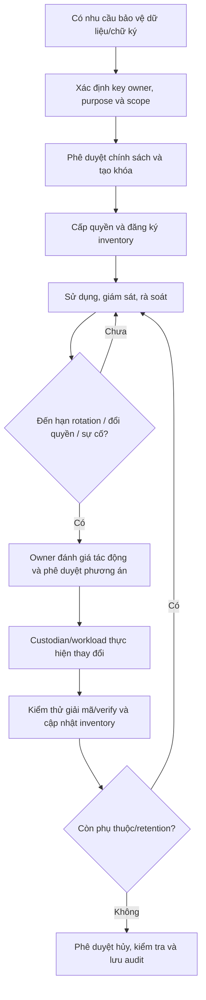
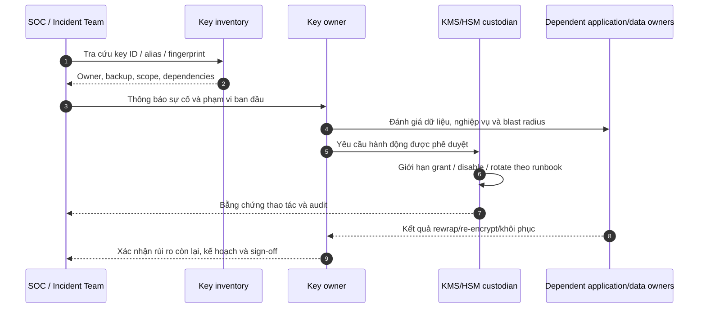
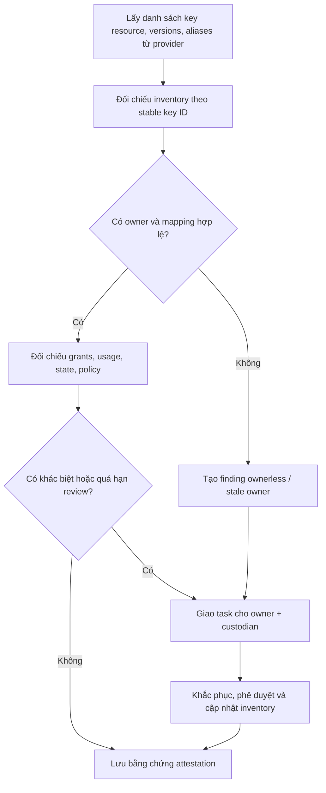
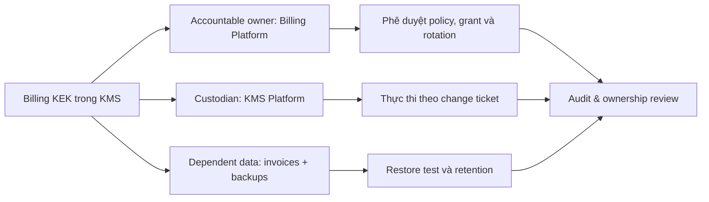

# Key owner — Chủ sở hữu và trách nhiệm đối với khóa mật mã

> **Chương:** Key inventory  
> **Module:** SECURITY_KEY_MANAGEMENT_FUNDAMENTALS — hiểu vòng đời khóa mật mã từ tạo, cấp phát, lưu trữ, sử dụng, xoay vòng đến thu hồi và hủy; kết nối mật mã đối xứng, bất đối xứng, chữ ký số, KMS/HSM, envelope encryption, kiểm soát truy cập và kiểm toán để thiết kế hệ thống bảo vệ khóa an toàn.

## 1. Mục tiêu học tập

Sau bài học này, bạn có thể:

1. Định nghĩa **key owner** trong quản lý khóa và phân biệt chủ sở hữu chịu trách nhiệm với **key custodian**, người giữ khóa kỹ thuật, key administrator, service owner và data owner.
2. Giải thích vì sao **key inventory phải có người/nhóm chịu trách nhiệm rõ ràng** cho từng khóa hoặc nhóm khóa có kiểm soát, dù khóa nằm trong KMS/HSM và không thể xuất ra.
3. Thiết kế bản ghi inventory có **owner, backup owner, key purpose, scope, custodian, trạng thái, cryptoperiod, phụ thuộc dữ liệu, version, policy và audit**.
4. Áp dụng **RACI**, nguyên tắc quyền tối thiểu, phân tách nhiệm vụ, phê duyệt thay đổi và kiểm tra định kỳ trong quy trình key management.
5. Phân công trách nhiệm xuyên suốt vòng đời **tạo, cấp phát, sử dụng, rotation, revocation, backup/DR, cryptographic erasure và hủy**.
6. Phân biệt quyền sở hữu ở cấp **DEK, KEK, master/root key, khóa ký, TLS private key, PSK và pepper**.
7. Xử lý **ownerless key**, thay đổi đội ngũ, chuyển chủ sở hữu, hệ thống ngừng hoạt động và sự cố khóa bị lộ.
8. Đọc ví dụ **JSON, Java và truy vấn SQL** để phát hiện inventory thiếu owner, kiểm tra policy và tổ chức công việc vận hành.

## 2. Key owner là ai?

**Key owner** là **chủ thể được tổ chức giao trách nhiệm giải trình (accountability)** đối với một khóa mật mã hoặc phạm vi khóa được xác định. Key owner chịu trách nhiệm bảo đảm khóa có mục đích sử dụng hợp lệ, người dùng và hệ thống được cấp quyền phù hợp, vòng đời được quản lý, và rủi ro được xử lý theo chính sách.

Trong doanh nghiệp, key owner thường là **một vai trò hoặc một nhóm nghiệp vụ/kỹ thuật ổn định**, được gắn với **một cá nhân chịu trách nhiệm chính và người thay thế** theo quy trình nội bộ. Key owner không nhất thiết là người thực hiện mọi thao tác trên KMS/HSM.

Ví dụ:

- **Payments Security Owner** chịu trách nhiệm về khóa ký lệnh thanh toán.
- **Billing Platform Owner** chịu trách nhiệm về các KEK bảo vệ dữ liệu hóa đơn.
- **Identity Security Owner** chịu trách nhiệm về khóa ký token truy cập và chính sách rotation của khóa đó.
- **PKI/Infrastructure Owner** chịu trách nhiệm về CA key hoặc một lớp trust anchor, với phê duyệt đặc biệt nếu có ảnh hưởng rộng.

Tên nhóm ở đây chỉ là **ví dụ minh họa**, không đại diện cấu trúc tổ chức mặc định. Điều quan trọng là **ai có thẩm quyền ra quyết định và ai phải xử lý khi có sự cố**, không phải tên phòng ban.

### 2.1. Key owner không đồng nghĩa người biết byte của khóa

Đây là điểm dễ nhầm nhất:

- **Ownership** là trách nhiệm về mục đích, phạm vi, quyền, rủi ro, kế hoạch thay/thu hồi và hủy khóa.
- **Custody** là việc bảo quản, vận hành hoặc kiểm soát kỹ thuật đối với vật liệu khóa.
- **Possession** là việc một principal thực sự có quyền sở hữu/nhìn thấy/giữ byte khóa hoặc dùng key handle.
- **Usage permission** là quyền thực hiện các hoạt động cụ thể như `Encrypt`, `Decrypt`, `Sign`, `Verify`, `Wrap`, `Unwrap`.

Một key owner có thể **không có quyền `Decrypt` hoặc export key material**. Đây thường là lựa chọn hợp lý để giảm rủi ro. Ngược lại, workload có quyền `Decrypt` có thể **không có quyền** đặt cryptoperiod hay phê duyệt hủy khóa.

> **Câu hỏi quản trị cốt lõi:** Nếu khóa bị lộ, sắp hết hạn hoặc không ai biết còn được dùng ở đâu, **ai phải đưa ra quyết định và chịu trách nhiệm hoàn tất xử lý?**

Nếu inventory không trả lời được, khóa chưa được quản trị đầy đủ.

## 3. Vì sao key owner là trường quan trọng trong key inventory?

Một tổ chức có thể quản lý hàng nghìn khóa trong AWS KMS, Google Cloud KMS, Azure Key Vault, HSM, keystore ứng dụng, service mesh, CI/CD hoặc hệ thống PKI. **Danh sách khóa kỹ thuật không tự trả lời mục đích nghiệp vụ và trách nhiệm của từng khóa.**

Không có owner rõ ràng dẫn đến:

1. **Rotation bị bỏ quên:** không ai xác định khi nào cần đổi khóa hoặc kiểm thử khả năng đọc dữ liệu cũ.
2. **Quyền quá rộng:** grant tích lũy qua nhiều năm mà không ai phê duyệt hoặc rà soát.
3. **Khóa không còn sử dụng:** tài nguyên tốn chi phí hoặc tạo bề mặt tấn công mà không có người quyết định hủy.
4. **Mất khả năng khôi phục:** KEK/private key bị hủy trong khi backup vẫn phụ thuộc.
5. **Ứng phó sự cố chậm:** SOC tìm thấy truy cập giải mã bất thường nhưng không xác định được owner để đánh giá ảnh hưởng.
6. **Đổi chủ sở hữu không đồng bộ:** một đội ngừng vận hành, khóa vẫn gắn với email cá nhân đã nghỉ việc.
7. **Không thể chứng minh kiểm soát:** khi kiểm toán hỏi “ai phê duyệt và rà soát key usage?”, doanh nghiệp chỉ có log API.
8. **Rủi ro tập trung:** một master key bảo vệ nhiều hệ thống nhưng không có nhóm chịu trách nhiệm phối hợp các bên phụ thuộc.

Key inventory vì vậy cần kết hợp **metadata kỹ thuật** (key ID, algorithm, location, state) và **metadata quản trị** (owner, purpose, approvals, review dates, dependencies, policy).

### 3.1. Ví dụ “có key ID nhưng không có owner”

```text
key-id: prod-payments-kek-2026
algorithm: AES-256
provider: managed KMS
state: ENABLED
last-used: recent
owner: null
```

Bản ghi này chưa đủ để trả lời:

- Đội nào có quyền đổi policy hoặc phê duyệt grant?
- Key đang bảo vệ những DEK và dữ liệu nào?
- Nếu cần rotate, ai lên kế hoạch rewrap và kiểm thử restore?
- Nếu bị nghi lộ, ai quyết định có cần re-encrypt dữ liệu hay không?
- Nếu khóa không còn sử dụng, ai có quyền chấp thuận hủy?

**Key ID hữu ích cho API; owner hữu ích cho trách nhiệm và ra quyết định. Hai trường bổ sung nhau.**

## 4. Phân biệt key owner với các vai trò liên quan

| Vai trò | Trách nhiệm chính | Có nhất thiết truy cập key material? |
| --- | --- | --- |
| **Key owner** | Chịu trách nhiệm cuối cùng về purpose, policy, lifecycle, risk và approval | **Không** |
| **Backup/delegate owner** | Thay thế khi owner vắng mặt theo phạm vi ủy quyền | **Không** |
| **Key custodian** | Bảo quản, giám sát hoặc thực hiện thao tác vận hành khóa theo quy trình | Tùy kiến trúc; ưu tiên giới hạn quyền |
| **KMS/HSM administrator** | Vận hành nền tảng, cấu hình tài nguyên, hỗ trợ backup/HA, quyền kỹ thuật được giao | Không mặc nhiên được export/decrypt |
| **Data owner** | Quyết định phân loại dữ liệu, retention và quyền xử lý dữ liệu | **Không** |
| **Application/service owner** | Chịu trách nhiệm hệ thống gọi các API mật mã, tích hợp và sự cố dịch vụ | Chỉ trong phạm vi cần dùng |
| **Security architect/policy owner** | Xây tiêu chuẩn thuật toán, cryptoperiod, mô hình phân quyền và kiểm soát | **Không** |
| **IAM administrator** | Cấp/sửa/revoke các quyền theo chính sách/phê duyệt | Không mặc nhiên có quyền dùng khóa |
| **Auditor/SOC** | Giám sát sự kiện, rà soát kiểm soát và điều tra dấu hiệu bất thường | **Không** |
| **Incident commander** | Điều phối xử lý sự cố, phối hợp owner và bên liên quan | Theo quyền khẩn cấp được kiểm soát |

Một người có thể đảm nhiệm nhiều vai trò trong tổ chức nhỏ, nhưng cần **biết rõ xung đột lợi ích và giới hạn quyền**. Với khóa có tác động lớn, nên có separation of duties giữa người **đề xuất**, **phê duyệt** và **thực hiện** những thay đổi nhạy cảm.

### 4.1. Key owner khác tài khoản IAM mang tên “Owner”

Một sản phẩm cloud có thể đặt tên quyền hoặc role là `Owner`, `Key Administrator`, `CryptoKey Encrypter/Decrypter`... Chúng là **quyền trên tài nguyên** theo định nghĩa của nhà cung cấp.

**Key owner trong inventory là một khái niệm quản trị tổ chức**. Việc gán role cloud `Owner` cho một service account không tự khiến service account đó trở thành người chịu trách nhiệm giải trình hoặc có quyền phê duyệt việc hủy khóa.

Tương tự, trường `createdBy` chỉ cho biết ai đã tạo tài nguyên trong một thời điểm; **creator không nhất thiết là current owner**.

### 4.2. Nên có một primary accountable owner

Một khóa có thể phục vụ nhiều hệ thống. Cần có **một đầu mối accountability chính thức** cho quyết định vòng đời, đồng thời ghi các **stakeholder/dependent owners** có quyền được tham vấn.

Nếu có “ba owner cùng chịu trách nhiệm” mà không ai chịu trách nhiệm cuối cùng, khi đến thời điểm hủy hoặc xử lý sự cố có thể không ai ra quyết định. Mô hình phù hợp là:

- **Primary accountable owner**: một nhóm/vai trò được định danh ổn định.
- **Named accountable person/on-call**: đầu mối hiện tại và người thay thế.
- **Technical custodian**: đội vận hành KMS/HSM hoặc secret manager.
- **Dependent data/application owners**: các bên phải được tham vấn khi tác động đến dữ liệu.
- **Security approver**: vai trò phê duyệt ngoại lệ/rủi ro khi chính sách yêu cầu.

## 5. Key owner phải quyết định những gì?

Để ownership trở thành kiểm soát thực tế thay vì trường text, tổ chức cần quy định **quyền quyết định và nghĩa vụ** của owner.

### 5.1. Trước khi tạo khóa

Owner phải trả lời:

- Khóa phục vụ **mục đích nào**: mã hóa dữ liệu, bọc khóa, ký số, MAC, TLS hay một nhiệm vụ khác?
- Phạm vi dữ liệu/ứng dụng/tenant nào được bảo vệ?
- Khóa có cần **KMS/HSM, non-exportable, BYOK/HYOK**, hay phần mềm được phê duyệt?
- Thuật toán, độ mạnh, key usage, thời hạn dùng và cách cấp phát nào được phép?
- Ai được yêu cầu `Encrypt`/`Decrypt`/`Sign`/`Unwrap` hoặc thay policy?
- Khi khóa bị lộ/mất/thu hồi, dữ liệu và hệ thống nào bị ảnh hưởng?
- Backup/DR và khả năng di chuyển nhà cung cấp có cần thiết?
- Owner và backup owner có đủ thẩm quyền với rủi ro của khóa không?

### 5.2. Trong thời gian sử dụng

Owner chịu trách nhiệm bảo đảm:

1. Inventory phản ánh **mục đích và owner hiện tại**.
2. Các quyền truy cập được **phê duyệt, tối thiểu và rà soát định kỳ**.
3. Key state, expiration, cryptoperiod và rotation plan không bị bỏ quên.
4. Mọi thay đổi lớn như export, import, disable, grant rộng, multi-region replication hoặc schedule deletion đều có kiểm soát phù hợp.
5. Đội vận hành có runbook xử lý lỗi KMS/HSM và sự cố khóa.
6. Các ứng dụng phụ thuộc biết định dạng ciphertext, wrapped DEK, key reference và phiên bản khóa.
7. Có log và bằng chứng thực thi các quyết định, không chỉ lời hứa từ tài liệu.

### 5.3. Khi ngừng dùng hoặc xảy ra sự cố

Owner cần tham gia quyết định:

- Khóa có còn cần để **decrypt/verify dữ liệu lịch sử** hay không?
- Thao tác nào cần thực hiện: **rotate, rewrap, re-encrypt, revoke grant, disable, destroy**?
- Có phải thông báo tới data owner, SOC, bên tuân thủ hoặc khách hàng không?
- Có cần chuyển tiếp ownership khi dịch vụ được bàn giao?
- Khóa được hủy ở thời điểm nào là hợp lệ theo retention và khả năng restore?

**Không tự đánh đồng “key đã disable” với “không còn nguy cơ”, hoặc “khóa không xuất được” với “không thể bị lạm dụng”.**

## 6. Thiết kế metadata owner trong key inventory

Một bản ghi inventory nên đủ thông tin để **tìm owner, biết trách nhiệm, đánh giá blast radius và ra quyết định vòng đời**.

### 6.1. Các nhóm trường thiết yếu

| Nhóm | Trường ví dụ | Ý nghĩa |
| --- | --- | --- |
| **Định danh** | `inventoryId`, `providerKeyId`, `version`, `keyAlias` | Trỏ đúng khóa, tránh nhầm alias với key material |
| **Tổ chức** | `ownerTeamId`, `primaryContactId`, `backupOwnerId` | Xác định trách nhiệm và người thay thế |
| **Vận hành** | `custodianTeamId`, `platformOwnerId`, `supportQueue` | Biết ai thực thi thay đổi kỹ thuật |
| **Phụ thuộc** | `applicationIds`, `dataAssetIds`, `tenantScope` | Đánh giá hệ thống/dữ liệu bị tác động |
| **Mục đích** | `keyPurpose`, `usageAllowlist`, `dataClassification` | Phân loại hoạt động mật mã được phép |
| **Mật mã** | `algorithm`, `keySizeOrCurve`, `provider`, `protectionBoundary` | Kiểm soát độ mạnh và nơi lưu |
| **Trạng thái** | `state`, `enabledAt`, `retiredAt` | Theo dõi lifecycle, không nhầm active/disabled/destroyed |
| **Chu kỳ** | `createdAt`, `rotationDueAt`, `lastReviewAt` | Lập kế hoạch rà soát/rotation |
| **Chính sách** | `policyRef`, `approvalTicket`, `exceptionRef` | Truy nguyên cơ sở phê duyệt |
| **Khôi phục** | `backupPlanRef`, `restoreTestAt`, `retentionRef` | Ngăn xóa khóa khi vẫn cần backup |
| **Kiểm toán** | `lastAccessReviewAt`, `changeLogRef`, `incidentRef` | Chứng minh quyết định và sự kiện |
| **Phạm vi** | `environment`, `region`, `trustDomain` | Chống lẫn dev/prod hoặc cross-tenant |

**Tuyệt đối không lưu raw key material, private key, seed, PSK, pepper, DEK plaintext hoặc thông tin phục hồi bí mật trong inventory.** Inventory lưu **tham chiếu và metadata**, không phải bản sao kho bí mật.

### 6.2. Chọn owner identifier bền vững

Không nên chỉ ghi:

```text
owner: "anh Minh"
ownerEmail: "minh@example.invalid"
```

Vì email và nhân sự có thể thay đổi. Thay vào đó:

```text
ownerTeamId: "team-billing-platform"
primaryContactId: "employee-opaque-482"
backupOwnerTeamId: "team-security-operations"
supportQueue: "queue-billing-crypto"
```

Các giá trị minh họa phải được đối chiếu với **directory/CMDB thực tế**. ID nhóm bền vững giúp gắn ownership với **vai trò tổ chức**, trong khi người chịu trách nhiệm theo ca/on-call có thể thay đổi qua directory.

Một đội dự phòng **không tự động có quyền quản trị tất cả khóa**: quyền thực hiện phải tuân RACI và quy trình ủy quyền đã định.

### 6.3. Alias không phải key version

Một alias như `billing-kek-prod` có thể được trỏ sang khóa khác khi rotate. Trong inventory phải phân biệt:

- **Logical key / key family**: tài sản ở cấp nghiệp vụ và policy.
- **Concrete key resource / key material version**: phiên bản cụ thể có thể giải mã/verify dữ liệu lịch sử.
- **Alias**: tên tham chiếu có thể thay đổi đích theo nhà cung cấp.
- **Ownership**: có thể ở mức key family và được kế thừa có kiểm soát xuống version.

Đừng ghi “owner của alias” rồi bỏ qua những key version lịch sử hoặc tài nguyên không còn xuất hiện trong alias nhưng vẫn cần cho backup.

## 7. Ví dụ bản ghi inventory có owner

```json
{
  "inventoryId": "cryptokey-100287",
  "provider": "managed-kms",
  "providerKeyRef": "kms://prod-region/keys/billing-kek-v4",
  "logicalKeyName": "billing-invoice-kek",
  "keyVersion": "4",
  "environment": "production",
  "tenantScope": "billing-tenants",
  "purpose": "wrap-dek",
  "keyType": "symmetric",
  "algorithm": "AES-256",
  "usageAllowlist": ["wrap", "unwrap"],
  "dataClassification": "confidential",
  "state": "enabled",
  "owner": {
    "ownerTeamId": "team-billing-platform",
    "primaryContactId": "employee-opaque-482",
    "backupOwnerTeamId": "team-security-operations",
    "approvalPolicyRef": "policy/crypto-ownership/v2"
  },
  "custodianTeamId": "team-kms-platform",
  "dependentApplications": ["billing-api", "invoice-archive"],
  "dependentDataAssets": ["invoices-v2"],
  "createdAt": "2026-07-01T09:00:00Z",
  "rotationDueAt": "2027-07-01T09:00:00Z",
  "lastOwnerReviewAt": "2026-10-01T09:00:00Z",
  "retentionPolicyRef": "retention/invoice-archive",
  "restoreRunbookRef": "runbook/restore-invoice-keys",
  "lastRestoreTestAt": "2026-09-15T10:00:00Z",
  "lastAccessReviewRef": "review/access/billing-kek-2026q3"
}
```

**Đây là cấu trúc minh họa**, không phải schema bắt buộc của một sản phẩm KMS. Thời hạn rotation và những ngày tháng trong ví dụ **không phải mức áp dụng chung**. Các URI và ID là giá trị giả định phục vụ học tập.

Những nguyên tắc cần giữ:

1. **Owner và custodian tách biệt**; không suy từ người tạo khóa.
2. Mọi trường có thể thay đổi cần **audit history** để biết ai thay và lý do.
3. **Không chứa vật liệu khóa dạng rõ**.
4. Tham chiếu key/version phải đủ chính xác để kiểm kê dependency.
5. Trạng thái `enabled` chỉ cho biết một phần lifecycle; cần biết **approved for new encryption** hay **decrypt-only** khi policy yêu cầu.
6. Review và rotation phải tạo **công việc có owner**, không chỉ ngày tháng.
7. Nếu key bao phủ nhiều tài sản, phụ thuộc nên lưu dạng quan hệ/CMDB để tra cứu và cập nhật, không chỉ một chuỗi mô tả.

## 8. Mô hình RACI cho key owner

**RACI** là cách phân công:

- **R — Responsible:** người/nhóm trực tiếp thực hiện.
- **A — Accountable:** người/nhóm chịu trách nhiệm cuối cùng và có thẩm quyền phê duyệt theo policy.
- **C — Consulted:** bên phải được tham vấn.
- **I — Informed:** bên cần được thông báo.

Bảng minh họa một cách phân trách nhiệm cho khóa bảo vệ dữ liệu:

| Hoạt động | Key owner | Key custodian/KMS team | Data owner | Security | SOC/Audit |
| --- | --- | --- | --- | --- | --- |
| Xác định mục đích và phạm vi khóa | **A** | C | **R** | C | I |
| Tạo key resource theo yêu cầu đã duyệt | **A** | **R** | C | C | I |
| Định nghĩa chính sách thuật toán/độ mạnh | C | C | C | **A/R** | I |
| Cấp quyền sử dụng khóa theo nghiệp vụ | **A** | **R** | C | C | I |
| Rà soát grant/usage định kỳ | **A** | R | C | C | I |
| Lập kế hoạch rotation | **A** | R | C | C | I |
| Thực hiện rotation/rewrap | **A** | **R** | C | C | I |
| Điều phối đánh giá ảnh hưởng khi khóa nghi lộ | **A** | R | C | C | **R** |
| Quyết định hủy khóa sau đối soát phụ thuộc | **A** | R | C | C | I |
| Kiểm toán độc lập | I | C | I | C | **A/R** |

**Đây là ví dụ để thảo luận**, không phải mẫu phân quyền bắt buộc. Trong tổ chức thật, một số hoạt động có thể do security, data owner hoặc ban quản trị rủi ro giữ quyền **A** theo luật, tiêu chuẩn hoặc mức độ nhạy cảm.

Một RACI tốt cần **rõ một đầu mối A cho mỗi quyết định**, tránh tình trạng “mọi người đều tham gia nhưng không ai chịu trách nhiệm cuối cùng”.

### 8.1. Khi nào cần dual control hoặc quorum?

Với CA root key, master key có phạm vi rộng, khóa ký tài chính hoặc hành động hủy không thể đảo ngược, có thể yêu cầu:

- Hai người độc lập phê duyệt/tác nghiệp theo nguyên tắc **dual control**.
- M-of-N approvals hoặc quorum tại HSM/KMS khi có khả năng.
- Người phê duyệt không đồng thời là người thực hiện thay đổi.
- Hạn chế break-glass, thời hạn quyền ngắn và hậu kiểm.

Không phải mọi DEK ngắn hạn đều cần hội đồng phê duyệt. Mức kiểm soát phải **tương xứng tác động**, số lượng khóa, độ tự động hóa và yêu cầu tuân thủ.

## 9. Vòng đời khóa nhìn từ trách nhiệm của owner



### 9.1. Khi tạo khóa

- **Owner** xác nhận mục đích, thuật toán/key usage, dữ liệu và rủi ro.
- **Custodian** tạo key trong KMS/HSM/provider được duyệt.
- **Inventory** lưu key reference, owner, version, scope, policy và người chịu trách nhiệm hỗ trợ.
- **Security** hoặc nhóm phê duyệt kiểm tra các trường hợp vượt chính sách.

**Không tạo key rồi “gán owner sau cho đủ hồ sơ”** như quy trình mặc định. Đặc biệt với production key, owner nên được biết trước khi cấp quyền sử dụng.

### 9.2. Khi cấp phát và sử dụng

Owner phải biết **ai có quyền dùng key và vì sao**, nhất là:

- `Encrypt` và `Decrypt`: khác nhau về khả năng làm lộ plaintext.
- `Wrap` và `Unwrap`: khác nhau về khả năng phục hồi DEK.
- `Sign`: tạo bằng chứng chữ ký, nguy cơ lạm dụng có thể cao.
- `Verify`: thường sử dụng public key, không cần private key.
- `Export`: có thể làm tăng bề mặt tấn công hoặc trái policy.
- `Disable`/`Delete`: ảnh hưởng availability và retention.
- `UpdatePolicy`/`Grant`: có thể mở rộng quyền cho principal khác.

**Owner phê duyệt phạm vi quyền, nhưng không nên mặc nhiên nắm tất cả những quyền đó.**

### 9.3. Khi rà soát định kỳ

Các câu hỏi cần trả lời:

1. Owner và backup owner còn hoạt động trong tổ chức không?
2. Ứng dụng và dữ liệu phụ thuộc còn tồn tại không?
3. Có quyền nào không còn phù hợp, chủ thể không dùng nữa hoặc grant vượt scope không?
4. Key có đang được dùng để **encrypt mới**, chỉ **decrypt cũ**, hay hoàn toàn không sử dụng?
5. Cryptoperiod/rotation/recovery test có đến hạn?
6. Có quyết định ngoại lệ cần gia hạn hay chấm dứt?
7. Có thay đổi phân loại dữ liệu, tenant hoặc yêu cầu pháp lý?

Rà soát nên để lại **bằng chứng có phiên bản**: người phê duyệt, ngày, phạm vi, phát hiện, hành động khắc phục và thời hạn hoàn tất.

## 10. Key owner theo từng loại tài sản mật mã

Vai trò owner thay đổi theo **mục đích và blast radius** của khóa, không chỉ theo nơi lưu.

| Loại khóa/bí mật | Owner thường phù hợp | Phụ thuộc/rủi ro cần quản trị |
| --- | --- | --- |
| **DEK** | Data/application owner theo key family và data scope | Dữ liệu cụ thể; nonce, encryption format, retention |
| **KEK** | Owner của hệ thống bảo vệ dữ liệu, phối hợp security | Có thể bọc rất nhiều DEK; blast radius lớn |
| **Master/root key** | Nhóm quản trị crypto cấp cao/PKI/security được ủy quyền | Nhiều hệ thống phụ thuộc, yêu cầu dual control |
| **Private signing key** | Chủ thể chịu trách nhiệm về hành động ký hoặc phát hành | Giả mạo chữ ký, thời hạn xác minh lịch sử, revocation |
| **TLS private key** | Service/workload owner; PKI custodian quản lý cấp phát | Danh tính peer, downtime khi cert/key hết hạn |
| **CA key / trust anchor** | PKI/security governance | Niềm tin của nhiều dịch vụ, phát hành sai danh tính |
| **HMAC key** | Owner của giao thức/service sử dụng MAC | Xác thực thông điệp, key scope, rotation |
| **PSK** | Owner của hệ thống/key-establishment protocol | Ai biết PSK, phân phối, revoke khi thiết bị lộ |
| **Pepper** | Identity/authentication service owner | Xác minh mật khẩu và khó khăn khi rotation |
| **Ephemeral session keys** | Owner của service/giao thức quản lý phiên ở mức chính sách | Không nhất thiết tạo record inventory từng phiên |
| **Public verification key** | Owner của danh tính/chữ ký liên quan | Phân phối tin cậy, phiên bản và khả năng verify lịch sử |

### 10.1. Có cần inventory từng DEK cho mỗi file?

Không phải mọi hệ thống đều nên tạo một record quản trị thủ công cho **hàng triệu DEK tạm thời**. Một mô hình có thể phân tầng:

- **Key family/policy record:** owner của các DEK thuộc ứng dụng, tenant hoặc data class.
- **Concrete object metadata:** mỗi file lưu wrapped DEK, key reference, algorithm và version cần giải mã.
- **KEK/root key record:** quản trị riêng vì blast radius lớn.
- **Automated discovery/audit:** đếm DEK, kiểm tra policy và đối chiếu dependency.

Điều kiện là hệ thống vẫn **truy ra được owner và quy trình xử lý** cho bất kỳ data key nào khi cần. Không tạo hàng triệu bản ghi owner thủ công chỉ để tăng số lượng inventory mà không có giá trị vận hành.

### 10.2. Owner của khóa ký không nhất thiết là người ký

Với khóa ký release phần mềm:

- **Release Security Owner** có thể chịu trách nhiệm policy của khóa.
- **CI/CD workload** được cấp quyền `Sign` trong phạm vi release đã phê duyệt.
- **HSM custodian** vận hành key handle và phần cứng.
- **Code reviewer/release approver** phê duyệt nội dung bản phát hành.

Không nên gán owner cho tài khoản CI/CD chỉ vì đó là principal gọi `Sign`. Cần phân biệt **người chịu trách nhiệm với khóa**, **người phê duyệt bản phát hành** và **workload thực thi chữ ký**.

### 10.3. Owner của public key cần thiết khi không có secret?

Có. Public key không bí mật nhưng **nguồn gốc và ánh xạ identity** rất quan trọng. Nếu key directory bị thay công khai cho một dịch vụ, Sender có thể mã hóa DEK cho attacker. Owner chịu trách nhiệm về key registration, rotation, trust distribution và revocation theo scope.

## 11. Owner và policy phân quyền trên KMS/HSM

KMS/HSM hỗ trợ thực thi một phần các quyết định quản trị, nhưng không tự suy ra business owner từ metadata key.

### 11.1. Thiết kế quyền tối thiểu

Ví dụ một KEK bảo vệ hóa đơn:

| Principal | Quyền | Lý do |
| --- | --- | --- |
| `billing-write-service` | `GenerateDataKey` hoặc `Encrypt/Wrap` theo thiết kế | Mã hóa dữ liệu mới |
| `billing-read-service` | `Decrypt/Unwrap` trên scope cần thiết | Đọc hóa đơn khi đã qua authorization |
| `kms-platform-operator` | Quản lý vận hành được phê duyệt, không phải mặc nhiên plaintext decrypt | Vận hành nền tảng |
| `security-auditor` | Read-only policy/audit metadata | Kiểm toán |
| `billing-key-owner` | Phê duyệt yêu cầu quyền/rotation trong workflow | Accountability, không bắt buộc runtime decrypt |

Cần giới hạn theo **môi trường, tenant, key ID, purpose, encryption context/AAD** khi API hỗ trợ, và tránh để quyền rộng hơn chức năng thực tế. Các tên API khác nhau theo nhà cung cấp; bảng minh họa **ý định bảo mật**, không phải cú pháp IAM chung.

### 11.2. Encryption context không thay kiểm tra quyền

Một KMS có thể hỗ trợ **encryption context** để ràng buộc ciphertext với metadata khi mã hóa/giải mã. Nhưng nếu workload có quyền `Decrypt` rộng và tự điền context theo request của attacker, không thể chỉ dựa vào context để bảo đảm tenant isolation.

Owner cần xác nhận:

- Context đến từ **identity và object được xác minh**, không từ input tùy ý.
- IAM/grants giới hạn key và workload ở mức thích hợp.
- Ứng dụng kiểm tra ownership/quyền trên object trước khi unwrap.
- Kết quả từ KMS không bị trả tự do cho client không được phép.
- Logging của context không làm lộ dữ liệu nhạy cảm.

### 11.3. Non-exportable key vẫn có thể bị lạm dụng

Một private key trong HSM có thể không export được. Tuy nhiên workload có quyền `Sign` có thể tạo chữ ký trái phép; workload có quyền `Decrypt/Unwrap` có thể phục hồi DEK.

Vì vậy **owner phải kiểm soát quyền dùng khóa**, không chỉ quyền “xem byte khóa”. Cần có rate limit, cảnh báo bất thường, phê duyệt thao tác nhạy cảm và cơ chế thu hồi credential khi workload bị xâm nhập.

## 12. Owner quyết định rotation và cryptoperiod như thế nào?

**Rotation** không phải một thao tác đồng nhất cho mọi khóa. Key owner phối hợp với custodian và dependent owners để chọn **mục tiêu và ảnh hưởng**.

### 12.1. Ba thao tác cần phân biệt

| Hoạt động | Thay đổi gì? | Owner phải kiểm tra |
| --- | --- | --- |
| **Rotate KEK/recipient key** | Key dùng để wrap/unwrap phiên bản mới | Dữ liệu cũ còn phụ thuộc phiên bản cũ không? |
| **Rewrap DEK** | Cùng DEK được bọc bằng key mới | Có được phép tiếp tục dùng chính DEK đó không? |
| **Re-encrypt với DEK mới** | Đổi DEK và mã hóa lại dữ liệu | Dữ liệu, backup, thông lượng, độ sẵn sàng và tính nguyên tử |
| **Rotate private signing key** | Khóa ký cho tác vụ mới được thay | Public key/chứng thư lịch sử vẫn cần verify không? |
| **Rotate TLS key/certificate** | Credential xác thực peer thay đổi | Trust, SAN, hostname, thời hạn và downtime |
| **Rotate PSK/pepper** | Bí mật xác thực/thêm lớp bảo vệ thay đổi | Phân phối, migration verifier và khả năng login |

**Rewrap DEK không sửa được vấn đề DEK đã bị lộ.** Nếu attacker biết byte DEK cũ, họ vẫn có thể giải mã ciphertext đã dùng DEK đó, dù cùng DEK đã được bọc lại dưới KEK mới.

### 12.2. Cryptoperiod khác thời hạn lưu dữ liệu

Một KEK có thể đã hết thời hạn dùng cho **encrypt/wrap mới** nhưng vẫn cần hoạt động **decrypt/unwrap lịch sử** tới khi toàn bộ dữ liệu được di chuyển hoặc hết retention.

Owner phải phân biệt:

- **Origination-usage period:** khoảng được phép tạo ciphertext/chữ ký mới theo policy.
- **Recipient-usage period:** khoảng còn cần giải mã/verify dữ liệu lịch sử theo policy.
- **Disable/revoke:** chặn sử dụng trong một số phạm vi.
- **Destroy:** loại bỏ khả năng dùng khóa sau khi kiểm tra dependency.

Không hủy khóa chỉ vì “hôm nay tới hạn rotate”. Đối với những loại khóa có rủi ro cao, cần lịch cụ thể, diễn tập và phê duyệt trước khi thực hiện.

### 12.3. Chịu trách nhiệm kiểm thử restore

Sau rotation, owner phải bảo đảm:

1. Dữ liệu mới được mã hóa/ký bằng key đúng version.
2. Dữ liệu cũ vẫn có thể giải mã/verify đúng chính sách.
3. Snapshot/backup/DR có đủ metadata và khả năng dùng khóa lịch sử.
4. Ứng dụng không fallback sang alias/key cũ ngoài kế hoạch.
5. Quyền cũ được giảm dần và được hủy khi hợp lệ.
6. Có bằng chứng hoàn thành và rollback/incident plan.

## 13. Key owner trong quy trình incident response

Khi SOC phát hiện dấu hiệu lộ khóa hoặc sử dụng bất thường, cần có **đường liên hệ owner rõ ràng**, không phụ thuộc “hỏi xem ai nhớ đã tạo khóa này”.

### 13.1. Phân chia trách nhiệm khi có sự cố



**Trong sự cố khẩn cấp**, runbook có thể cho phép incident commander hoặc người được ủy quyền thực hiện chặn truy cập trước khi owner phê duyệt thông thường. Phải ghi rõ điều kiện break-glass, phạm vi, bằng chứng, thời gian và hậu kiểm, tránh để owner approval trở thành điểm nghẽn gây thiệt hại.

### 13.2. Tùy loại khóa bị lộ mà hành động khác nhau

| Trường hợp | Rủi ro | Owner cần phối hợp quyết định |
| --- | --- | --- |
| **DEK plaintext bị lộ** | Dữ liệu được mã hóa bằng DEK có thể bị đọc | Thay DEK/re-encrypt theo phạm vi, xử lý bản sao/backup |
| **KEK bị lộ** | Nhiều wrapped DEK có thể bị mở | Khoanh vùng dependency, thay KEK, đánh giá DEK và dữ liệu bị ảnh hưởng |
| **Private signing key bị lộ** | Chữ ký mới có thể bị giả mạo | Revoke/rotate, cập nhật trust, rà chữ ký và timestamp lịch sử |
| **TLS private key bị lộ** | Giả mạo peer, nguy cơ kênh và phiên tùy giao thức | Rotate cert/key, revoke, kiểm tra session và forward secrecy |
| **PSK bị lộ** | Peer biết PSK có thể bị giả mạo | Phân phối PSK mới, cập nhật mapping, thu hồi PSK cũ |
| **Pepper bị lộ** | Mất lớp bảo vệ nếu chỉ DB bị lộ, tăng rủi ro password cracking | Rotation/version, đánh giá reset và ảnh hưởng verifier |
| **Key bị xóa/mất không có backup** | Có thể mất khả năng giải mã/verify hợp lệ | Đánh giá DR/restore, impact và nghĩa vụ retention |
| **Grant `Decrypt` quá rộng** | Workload bị chiếm có thể dùng key mà không export | Thu hồi grant, điều tra mọi use event và dữ liệu đã truy cập |

**Chỉ rewrap khi KEK bị nghi lộ không tự chứng minh mọi DEK cũ đã an toàn**, vì attacker có thể đã giải bọc chúng. Quyết định phải dựa trên khả năng truy cập thực tế, log, thời điểm lộ và phạm vi ciphertext/DEK.

### 13.3. Owner phải nhận được cảnh báo đúng lúc

Inventory cần liên kết tới:

- Support queue hoặc nhóm on-call hiện hành.
- Backup owner.
- Escalation path khi owner không phản hồi.
- Severity và thời hạn đánh giá theo phân loại khóa.
- System/data owners có thể chịu ảnh hưởng.
- Runbook incident và các quyền khẩn cấp.

Một địa chỉ email cá nhân có thể là **thông tin liên hệ bổ sung**, không nên là **điểm phụ thuộc duy nhất** của quy trình khẩn cấp.

## 14. Chuyển giao ownership khi thay đổi tổ chức

Một rủi ro vận hành phổ biến là người hoặc nhóm tạo khóa chuyển bộ phận, nghỉ việc, hoặc hệ thống đổi chủ. Nếu chỉ để owner là email cũ, key inventory nhanh chóng trở thành dữ liệu lỗi thời.

### 14.1. Quy trình ownership transfer

1. **Người/nhóm đề xuất** chuyển ownership nêu key ID/family, lý do và phạm vi tài sản.
2. **Owner mới** xác nhận tiếp nhận trách nhiệm, key purpose, policy, dependencies và các công việc còn tồn.
3. **Security/data owners** phê duyệt nếu phạm vi thay đổi ảnh hưởng dữ liệu/tuân thủ.
4. **Custodian** cập nhật inventory và các workflow/policy liên quan theo nhiệm vụ được phân quyền.
5. **IAM** được rà soát: owner mới không mặc nhiên có quyền decrypt/export; owner cũ mất quyền không còn cần.
6. **On-call/escalation** và runbook được cập nhật.
7. **Hai bên đối soát** rotation due, key versions cũ, restore test, incident và approval chưa đóng.
8. Ghi **audit event** với thời gian hiệu lực, old owner, new owner, người phê duyệt và ticket.

### 14.2. Ownership transfer khác key rotation

Nếu chỉ thay chủ sở hữu hành chính, **không phải lúc nào cũng cần đổi key material**. Nhưng nếu owner cũ hoặc đội cũ vẫn có quyền sử dụng private key/KEK, cần đánh giá revoke/rotate theo threat model.

Ví dụ:

- Nhân sự chuyển đội nhưng không có quyền đọc secret: cập nhật owner và quyền workflow có thể đủ.
- Một nhân sự rời tổ chức từng có bản sao plaintext private key hoặc PSK: phải đánh giá **nguy cơ bí mật bị giữ lại**, có thể cần rotation/revocation.
- Một service account bị bàn giao giữa tenant khác nhau: phải đánh giá trust boundary, key scope và khả năng tách khóa.

**Đổi tên người chịu trách nhiệm không tự vô hiệu các bản sao key material hay credential cũ.**

## 15. Ownerless key: khóa không có người chịu trách nhiệm

**Ownerless key** là khóa không thể xác định được owner đáng tin cậy hoặc owner đã không còn khả dụng, dù key resource vẫn tồn tại. Nó có thể ở trạng thái enabled, disabled, pending deletion hoặc đã tạo nhiều wrapped DEK.

### 15.1. Dấu hiệu khóa mồ côi

- `ownerTeamId` rỗng, không tồn tại hoặc tham chiếu một nhóm đã giải thể.
- Chỉ có `createdBy` là tài khoản cá nhân đã nghỉ việc.
- Key có grant đang hoạt động nhưng không có application/data owner xác nhận.
- Alias đổi nhiều lần, không ai biết key version cũ phục vụ object nào.
- Có bản backup chứa wrapped DEK nhưng key không xuất hiện trong inventory chính.
- KMS/HSM key tồn tại mà không có ticket, policy, runbook hoặc lịch review.
- Owner được gán cho một tài khoản máy không có người chịu trách nhiệm trong tổ chức.

### 15.2. Không xóa ownerless key ngay lập tức

Khi thấy key không owner, thao tác **delete ngay** có thể phá vỡ hệ thống hoặc khiến backup mất khả năng giải mã. Quy trình an toàn:

1. Đánh dấu trạng thái quản trị **`owner_unassigned` hoặc `ownership_review_required`** trong inventory/workflow.
2. Liệt kê key references, tags, grants, audit use events, phụ thuộc ciphertext/wrapped DEK, backup và workload.
3. Xác minh lịch sử tạo, change ticket và đội từng quản lý; không dựa duy nhất vào tag do requester tự nhập.
4. Chỉ định **temporary accountable owner** theo chính sách trong thời gian điều tra.
5. Kiểm tra có nên **chặn việc tạo ciphertext mới** bằng key này trong khi vẫn cho phép decrypt lịch sử hay không.
6. Chỉ khi xác định purpose, dependency và owner mới mới tiến hành transfer/rotation hoặc hủy.
7. Ghi bằng chứng và thời hạn đóng vấn đề.

### 15.3. Kỹ thuật tìm owner khi metadata thiếu

Các nguồn có thể hữu ích:

- KMS resource tags/labels và policy hiện hành.
- IAM principals/grants/service accounts sử dụng key.
- Audit logs: caller, workload, role, khung thời gian, hành động `Encrypt`/`Decrypt`/`Sign`.
- IaC repository/CMDB/deployment manifest ở hệ thống quản trị được phép.
- Mapping alias, key version, object encryption metadata và wrapped DEK.
- Tài liệu thay đổi, runbook, backup/DR và ticket.

**Audit caller chỉ là bằng chứng hỗ trợ.** Principal gọi `Decrypt` nhiều nhất **không tự động** là accountable owner; có thể chỉ là một batch job có quyền rộng.

## 16. Định kỳ đối soát inventory với KMS/HSM và hệ thống thực

Key inventory thường có nguy cơ “đẹp trên giấy nhưng lỗi thời”. Owner cần có cơ chế **reconciliation**:



### 16.1. Nguồn chân lý ở đâu?

Trong tổ chức, có thể có:

- **Cloud KMS/HSM** là nguồn trạng thái tài nguyên kỹ thuật hiện tại.
- **Key inventory/CMDB** là nguồn authoritative cho owner, purpose, dependencies và governance.
- **IAM** là nguồn quyền đang thực thi.
- **Ticketing/change management** là nguồn approvals và exception.
- **Data catalog** là nguồn phụ thuộc dữ liệu.

Không nhất thiết dồn tất cả vào một database, nhưng phải **xác định rõ hệ thống nào authoritative cho trường nào**, và cơ chế đồng bộ/đối soát khi có mâu thuẫn.

### 16.2. Dùng tag/label có đủ không?

Tags/labels giúp khám phá và lọc, nhưng:

- Có thể bị thiếu hoặc người tạo đặt sai.
- Không luôn bảo vệ bằng policy cứng nếu quyền sửa tag rộng.
- Có thể lưu email/name cũ.
- Không tự có lịch sử phê duyệt và các phụ thuộc dữ liệu.
- Không cho biết ai chịu trách nhiệm ký xác nhận review.

Có thể dùng tag `ownerTeamId` làm **tham chiếu đến registry**, rồi kiểm tra ID tồn tại, group còn hoạt động và mapping đúng với key purpose.

### 16.3. Không dùng “last used” làm bằng chứng duy nhất để hủy

Một key lâu không có `Decrypt` event **không có nghĩa** nó không còn cần. Backup hoặc archive có thể chỉ được restore sau nhiều tháng/năm. Audit log có thể chưa được bật trong quá khứ hoặc nhà cung cấp không ghi đủ loại hoạt động.

Quyết định hủy phải xem **retention, backup, snapshot, archived signatures, consumer contracts và dependencies**, không chỉ một biểu đồ usage thấp.

## 17. Ví dụ SQL: phát hiện thiếu owner và review quá hạn

Giả sử tổ chức có bảng metadata **không chứa key material**:

```sql
-- Schema minh họa. Không lưu DEK/KEK hoặc private key trong bảng này.
CREATE TABLE key_inventory (
    inventory_id         VARCHAR(128) PRIMARY KEY,
    provider_key_id      VARCHAR(512) NOT NULL UNIQUE,
    logical_key_name     VARCHAR(255) NOT NULL,
    owner_team_id        VARCHAR(128),
    backup_owner_team_id VARCHAR(128),
    custodian_team_id    VARCHAR(128),
    lifecycle_state      VARCHAR(32) NOT NULL,
    purpose              VARCHAR(128) NOT NULL,
    environment          VARCHAR(32) NOT NULL,
    last_owner_review_at TIMESTAMP,
    rotation_due_at      TIMESTAMP,
    updated_at           TIMESTAMP NOT NULL
);

-- Directory tổ chức đồng bộ từ nguồn có thẩm quyền.
CREATE TABLE organization_team (
    team_id    VARCHAR(128) PRIMARY KEY,
    is_active  BOOLEAN NOT NULL
);
```

### 17.1. Khóa thiếu hoặc có owner không còn hợp lệ

```sql
SELECT
    k.inventory_id,
    k.provider_key_id,
    k.owner_team_id,
    k.lifecycle_state,
    k.environment
FROM key_inventory AS k
LEFT JOIN organization_team AS t
       ON t.team_id = k.owner_team_id
WHERE
    k.owner_team_id IS NULL
    OR TRIM(k.owner_team_id) = ''
    OR t.team_id IS NULL
    OR t.is_active = FALSE;
```

Đây là **truy vấn tìm bất thường**, không phải thao tác disable/delete. Khi phát hiện phải mở finding, điều tra dependency và giao cho temporary owner đúng quy trình.

### 17.2. Khóa quá hạn review hoặc rotation

```sql
-- Mốc 90 ngày chỉ là ví dụ cho chính sách đánh giá owner.
SELECT
    inventory_id,
    provider_key_id,
    owner_team_id,
    last_owner_review_at,
    rotation_due_at
FROM key_inventory
WHERE lifecycle_state IN ('enabled', 'decrypt_only')
  AND (
       last_owner_review_at IS NULL
       OR last_owner_review_at < CURRENT_TIMESTAMP - INTERVAL '90 days'
       OR rotation_due_at < CURRENT_TIMESTAMP
  );
```

**Cú pháp `INTERVAL '90 days'` minh họa cho PostgreSQL và các hệ tương thích**; có thể cần chỉnh ở SQL Server, MySQL hoặc engine khác.

Điều kiện `rotation_due_at < CURRENT_TIMESTAMP` không tự chứng minh vi phạm bảo mật: có thể có ngoại lệ được phê duyệt hoặc quy trình rollover đã bắt đầu. Owner phải kiểm tra **approval/exception và công việc khắc phục** trước khi đưa kết luận.

### 17.3. Phát hiện dependency mồ côi

Nếu một bảng `encrypted_object_key_reference` lưu `provider_key_id` của các object mã hóa, truy vấn phát hiện tham chiếu không có inventory record:

```sql
SELECT
    d.provider_key_id,
    COUNT(*) AS dependent_object_count
FROM encrypted_object_key_reference AS d
LEFT JOIN key_inventory AS k
       ON k.provider_key_id = d.provider_key_id
WHERE k.provider_key_id IS NULL
GROUP BY d.provider_key_id;
```

Đây là mẫu thiết kế quan hệ, **giả định bảng dependency tồn tại trong hệ thống thật**. Không tạo bảng phụ thuộc bằng cách trích xuất plaintext DEK. Chỉ cần **key reference và định danh object phù hợp bảo mật dữ liệu**.

## 18. Java: validate owner metadata trước khi cấp quyền dùng key

Một ứng dụng quản trị inventory có thể bắt buộc record có owner hợp lệ trước khi cho phép tạo grant cho khóa production.

Ví dụ Java 17 dưới đây chỉ kiểm tra **metadata và tổ chức**, không quản lý crypto API, không truy cập private key và không thay IAM/KMS policy của nhà cung cấp.

```java
import java.time.LocalDate;
import java.util.Objects;
import java.util.Set;

public final class KeyOwnershipPolicy {
    private KeyOwnershipPolicy() {}

    public enum State {
        PENDING_APPROVAL, ENABLED, DECRYPT_ONLY, DISABLED, DESTROYED
    }

    public record KeyRecord(
            String inventoryId,
            String providerKeyId,
            String environment,
            String purpose,
            String ownerTeamId,
            String backupOwnerTeamId,
            String custodianTeamId,
            State state,
            LocalDate lastOwnerReviewDate
    ) {
        public KeyRecord {
            inventoryId = required(inventoryId, "inventoryId");
            providerKeyId = required(providerKeyId, "providerKeyId");
            environment = required(environment, "environment");
            purpose = required(purpose, "purpose");
            ownerTeamId = required(ownerTeamId, "ownerTeamId");
            backupOwnerTeamId = required(
                backupOwnerTeamId, "backupOwnerTeamId");
            custodianTeamId = required(
                custodianTeamId, "custodianTeamId");
            Objects.requireNonNull(state, "state");
        }
    }

    public interface TeamDirectory {
        boolean isActiveTeam(String teamId);
    }

    private static final Set<String> ALLOWED_PURPOSES =
        Set.of("wrap-dek", "sign-tokens", "tls-identity",
               "encrypt-data", "verify-signatures");

    public static void requireReadyForProductionUse(
            KeyRecord record,
            TeamDirectory directory,
            LocalDate today,
            int maxReviewAgeDays) {

        Objects.requireNonNull(record);
        Objects.requireNonNull(directory);
        Objects.requireNonNull(today);

        if (!"production".equals(record.environment())) {
            throw new SecurityException("Not a production key record");
        }
        if (!ALLOWED_PURPOSES.contains(record.purpose())) {
            throw new SecurityException("Unapproved key purpose");
        }
        if (record.state() != State.ENABLED) {
            throw new SecurityException("Key not enabled for new use");
        }
        if (maxReviewAgeDays <= 0) {
            throw new IllegalArgumentException("Invalid review window");
        }

        requireActive(directory, record.ownerTeamId(), "owner");
        requireActive(directory, record.backupOwnerTeamId(), "backup owner");
        requireActive(directory, record.custodianTeamId(), "custodian");

        LocalDate reviewed = record.lastOwnerReviewDate();
        if (reviewed == null
                || reviewed.isAfter(today)
                || reviewed.isBefore(today.minusDays(maxReviewAgeDays))) {
            throw new SecurityException("Ownership review missing or stale");
        }

        // Phần bên ngoài vẫn phải kiểm tra approvals, key grants,
        // algorithm, key usage, tenant/object scope và KMS key state.
    }

    private static void requireActive(
            TeamDirectory directory, String teamId, String field) {
        if (!directory.isActiveTeam(teamId)) {
            throw new SecurityException("Inactive " + field);
        }
    }

    private static String required(String value, String field) {
        if (value == null || value.isBlank()) {
            throw new IllegalArgumentException("Missing " + field);
        }
        return value;
    }
}
```

### 18.1. Cách đọc logic

- Record không được tạo thiếu owner/backup/custodian ID.
- Trước khi dùng khóa production mới, policy kiểm tra owner và các team đang hoạt động.
- Kiểm tra **review date** còn hiệu lực theo chính sách.
- Trạng thái `DECRYPT_ONLY` không được dùng trong đường **tạo ciphertext mới**.
- Purpose phải nằm trong allowlist minh họa.
- Lỗi dẫn tới **fail closed** ở tầng quản trị, không tạo grant/cấu hình mới.

### 18.2. Giới hạn của đoạn mã

1. `TeamDirectory` chỉ là interface để minh họa. Triển khai thật cần xác minh người gọi, đọc directory đáng tin, cache và xử lý outage; không tin team ID do client tự khai báo.
2. Mức `maxReviewAgeDays` không phải con số chuẩn chung; phải nhận từ **policy có version**.
3. Metadata có thể bị sửa trái phép. Bản ghi và quyết định owner cần có **authorization, audit và chống chỉnh sửa**.
4. Không chỉ dựa vào kiểm tra record để cho phép `Decrypt`. Cần KMS IAM, kiểm tra ứng dụng/tenant/object và policy xử lý dữ liệu.
5. Một khóa vẫn cần giải mã lịch sử có thể ở `DECRYPT_ONLY`; không nên dùng cùng hàm “new use” để chặn mọi hoạt động hợp lệ.
6. Với khóa tự động tạo theo policy, kiểm tra owner có thể diễn ra tại **parent key family/approved template**, còn record cụ thể kế thừa trách nhiệm theo quy tắc đã được quản trị.

**Key ownership validation là kiểm soát quản trị, không phải primitive mật mã.**

## 19. Key owner trong môi trường multi-cloud, multi-tenant và BYOK

### 19.1. Multi-cloud

Một tổ chức có thể lưu khóa trong nhiều cloud/provider. Tên role, alias, key state và cách rotation có thể khác nhau.

Nên chuẩn hóa những khái niệm governance:

- `inventoryId` do tổ chức kiểm soát.
- `provider` và `providerKeyId` đủ để tìm tài nguyên chính xác.
- `ownerTeamId` và `custodianTeamId` từ directory nội bộ.
- `environment`, `region`, `tenantScope` và `keyPurpose`.
- `dependentDataAssets` và `policyRef`.
- Mapping trạng thái kỹ thuật thành trạng thái governance nội bộ.

**Không giả định alias trùng tên ở hai region/cloud mang cùng key material.** Owner phải xác định khả năng khôi phục ciphertext/wrapped DEK trong từng môi trường.

### 19.2. Multi-tenant

Có những mô hình:

1. **Một KEK dùng chung cho nhiều tenant**, với application-level isolation và policy/authorization nghiêm ngặt.
2. **Một KEK cho mỗi tenant**, giúp tách scope và hỗ trợ một số thao tác thu hồi riêng.
3. **Khách hàng quản lý khóa (BYOK/CMEK)**, nhà cung cấp dịch vụ sử dụng khóa theo cấp quyền.
4. **HYOK/External Key Manager**, tùy giải pháp sản phẩm hỗ trợ.

Trong mọi mô hình phải phân biệt:

- **Customer/data owner**: chủ thể quyết định dữ liệu của họ.
- **Cryptographic key owner theo hợp đồng**: người chịu trách nhiệm lifecycle/key availability.
- **Technical custodian**: bên thực thi hoặc giữ key material.
- **Service provider**: bên vận hành ứng dụng phụ thuộc khóa.
- **Emergency decision authority**: ai có thể disable/revoke trong sự cố.

Không dùng nhãn “customer-owned key” như bằng chứng mặc định rằng khách hàng tự quản lý tất cả quyền hoặc rằng nhà cung cấp không thể nhìn thấy plaintext data trong runtime. **Mô hình trách nhiệm chia sẻ** phải được thể hiện trong hợp đồng, kiến trúc và inventory.

### 19.3. Khách hàng xóa khóa thì hệ thống nào chịu ảnh hưởng?

Nếu khách hàng có quyền disable/delete một key BYOK, ứng dụng có thể lập tức không giải mã được dữ liệu liên quan. Provider cần biết:

- Khóa nào đang bảo vệ DEK/object của tenant?
- Trạng thái key sẽ ảnh hưởng online read/write, backup và restore thế nào?
- Có retention/legal hold ngăn hủy không?
- Ai được thông báo và thời hạn phản hồi?
- Trách nhiệm xử lý khi khách hàng thu hồi key là của ai?
- Có đường khôi phục hợp pháp và phù hợp hợp đồng không?

Key owner ở hai phía có thể **khác nhau theo trách nhiệm**. Inventory nội bộ vẫn cần một **internal accountable owner** cho tác động của hệ thống dù khách hàng kiểm soát vật liệu khóa.

## 20. Chỉ số và kiểm toán chất lượng ownership

Để đo hiệu quả của key inventory, đừng chỉ đếm “đã có bao nhiêu khóa”. Hãy đo **khả năng giải trình và thực thi**.

### 20.1. Chỉ số có ích

| Chỉ số | Ý nghĩa |
| --- | --- |
| **Owner coverage** | Tỷ lệ key family/resource trong scope có owner hợp lệ |
| **Active owner coverage** | Tỷ lệ owner team còn hoạt động trong directory |
| **Backup coverage** | Tỷ lệ khóa có backup owner/escalation được xác nhận |
| **Review freshness** | Tỷ lệ ownership/access review trong thời hạn policy |
| **Rotation on-time** | Tỷ lệ rotation/phương án được hoàn thành đúng hạn hoặc có exception hợp lệ |
| **Orphan backlog** | Số ownerless key và tuổi của finding chưa xử lý |
| **Dependency mapping coverage** | Tỷ lệ khóa quan trọng có mapping data/application/backup |
| **Restore validation coverage** | Tỷ lệ khóa có diễn tập đọc dữ liệu lịch sử theo yêu cầu |
| **Incident owner response** | Thời gian liên hệ owner và xác nhận đánh giá ảnh hưởng |
| **Privileged grant review** | Tỷ lệ các grant `Decrypt/Sign/Unwrap/Export` được rà soát |
| **Destruction evidence** | Tỷ lệ yêu cầu hủy có phê duyệt, kiểm tra phụ thuộc và bằng chứng thực thi |

Một metric 100% owner coverage có thể **vẫn không có ý nghĩa** nếu mọi khóa bị gán cho nhóm `unknown` hoặc một tài khoản chung không ai theo dõi.

### 20.2. Công thức coverage minh họa

\[
\text{Owner Coverage} =
\frac{\text{Số khóa trong phạm vi có owner hợp lệ và còn hoạt động}}
{\text{Tổng số khóa trong phạm vi đã kiểm kê}}
\times 100\%
\]

Cần công bố rõ **phạm vi mẫu số**: key family, concrete key resource, key version, production hay toàn tổ chức; có tính ephemeral session keys hay không.

Khi báo cáo **rotation compliance**, nên tính ngoại lệ có phê duyệt riêng thay vì âm thầm loại bỏ khỏi mẫu số để làm đẹp tỷ lệ.

### 20.3. Bằng chứng kiểm toán

Một bộ bằng chứng có thể gồm:

- Bản ghi inventory và lịch sử owner transfer.
- Policy và approval ticket của key creation/rotation/retirement.
- KMS/HSM key state và grants.
- Access review attestation được owner ký/xác nhận.
- Ticket xử lý orphan key.
- Báo cáo restore test và dependency reconciliation.
- Log thay policy, break-glass, disable/delete và kết quả sự cố.

**Không dùng việc thu thập bằng chứng làm lý do sao chép private key hoặc DEK plaintext** sang hệ thống kiểm toán.

## 21. Case study: KEK hóa đơn bị “mất chủ”

### 21.1. Bối cảnh

Một công ty SaaS dùng envelope encryption:

- Mỗi hóa đơn được mã hóa bằng **DEK ngẫu nhiên**.
- DEK được bọc dưới **KEK** trong KMS.
- Database lưu ciphertext hóa đơn và wrapped DEK.
- Một nhóm cũ đã tạo KEK; người tạo resource đã rời công ty.
- Inventory còn `createdBy`, nhưng `ownerTeamId` rỗng.
- KMS ghi nhận nhiều lần gọi `Unwrap` từ production workload và backup/restore jobs.

Một yêu cầu audit hỏi ai đang chịu trách nhiệm với KEK, khi nào rotate và ai sẽ xử lý nếu KMS key bị disable. Không ai trả lời chắc chắn.

### 21.2. Cách xử lý sai

Nhóm vận hành nhìn `last used` gần đây, gán `ownerTeamId = "platform-admin"` cho đủ trường, rồi xem vấn đề đã xong. Một nhân viên khác đề nghị xóa key cũ và tạo key mới vì “key không còn owner”.

Cả hai cách đều thiếu bước quan trọng:

- **Platform-admin** có thể chỉ là custodian, không phải owner của dữ liệu/ứng dụng.
- Xóa key cũ có thể làm **hàng triệu wrapped DEK không giải bọc được**.
- Chỉ đổi trường owner không xác nhận ai sẽ phê duyệt grant, rotation hay DR.
- Không có bằng chứng chính thức owner mới chấp nhận trách nhiệm.

### 21.3. Phương án phù hợp

1. Tạo finding `OWNER_UNASSIGNED`; không hủy khóa.
2. Từ KMS key ID, inventory và audit, tìm ứng dụng/dữ liệu phụ thuộc.
3. Xác nhận **Billing Platform** chịu trách nhiệm nghiệp vụ về lifecycle KEK.
4. Chỉ định **primary accountable owner**, backup và custodian; owner chấp thuận.
5. Rà soát grant `Encrypt/Decrypt/Wrap/Unwrap` và các batch jobs hiện tại.
6. Kiểm tra cryptoperiod, key versions, wrapped DEK trong database/backup.
7. Lập kế hoạch rotation nếu cần; kiểm thử **rewrap** và khả năng đọc dữ liệu lịch sử.
8. Bổ sung support queue/escalation, runbook và lịch review.
9. Lưu audit/ticket thể hiện ownership transfer và các quyết định quyền.
10. Tự động cảnh báo nếu owner team không còn hoạt động trong directory.

### 21.4. Sơ đồ trách nhiệm sau khắc phục



**Điểm chính:** mục tiêu không chỉ là thêm giá trị vào cột `owner` mà là **tạo đường ra quyết định, thực thi và kiểm toán** cho toàn bộ vòng đời.

## 22. Checklist khi giao một khóa cho key owner

| Câu hỏi | Dấu hiệu đạt |
| --- | --- |
| Owner là một nhóm/vai trò ổn định và có người phụ trách hiện hành? | Team ID hợp lệ, có primary contact |
| Có backup owner và escalation path? | Người thay thế, support queue, SLA theo policy |
| Owner đã xác nhận purpose/scope? | Bản ghi purpose/tenant/data classification được duyệt |
| Custodian và platform được xác định? | Có đội vận hành, key resource chính xác |
| Key ID, alias và version được phân biệt? | Không nhầm alias với bản sao key material |
| Algorithm, key usage, protection boundary đúng chính sách? | Provider/config/profile và key policy rõ |
| Ai được phép Encrypt/Decrypt/Sign/Wrap/Unwrap? | Grants được owner phê duyệt và kiểm toán |
| Có mapping dữ liệu/ứng dụng/backup phụ thuộc? | Tra được blast radius khi khóa mất/lộ |
| Cryptoperiod, rotation và last review có hợp lệ? | Due dates hoặc ngoại lệ được duyệt |
| Có kế hoạch xử lý khi lộ DEK/KEK/private key? | Runbook và escalation đã diễn tập |
| Có kiểm thử khả năng restore ciphertext và key version cũ? | Bằng chứng DR/restore gần đây theo policy |
| Quy trình transfer khi owner nghỉ/đổi team? | Ticket, reviewer, ownership history |
| Hủy khóa có cần xác nhận retention và dữ liệu lịch sử? | Gate trước `Destroy`/`ScheduleDeletion` |
| Inventory không chứa key material bí mật? | Security review và kiểm tra quyền DB |
| Có reconciliation từ KMS/HSM/CMDB/IAM? | Automation findings và owner attestation |
| Có tách quyền phê duyệt và thực thi với khóa nhạy cảm? | RACI/dual control được áp dụng khi cần |

## 23. Bài tập tự kiểm tra

**Câu 1.** Một người tạo KEK trong KMS và sau đó nghỉ việc. Có thể mặc định người đó là current key owner không?

**Gợi ý:** Không. `createdBy` ghi người tạo ở một thời điểm; ownership phải thuộc vai trò/nhóm chịu trách nhiệm hiện hành, có contact và quy trình chuyển giao.

**Câu 2.** Tại sao key owner không nên mặc nhiên có quyền `Decrypt` mọi dữ liệu dùng khóa của mình?

**Gợi ý:** Accountability không đồng nghĩa quyền sử dụng key material. Least privilege và separation of duties giúp hạn chế blast radius và lạm dụng đặc quyền.

**Câu 3.** Một khóa trong KMS có alias, algorithm, trạng thái enabled và ngày tạo. Inventory chưa có owner. Nó đã đủ để gọi là quản trị vòng đời đầy đủ chưa?

**Gợi ý:** Chưa. Còn thiếu người chịu trách nhiệm, purpose/scope, phụ thuộc dữ liệu, quyền, kế hoạch rotation, backup/DR và audit/approval.

**Câu 4.** Một KEK bảo vệ DEK của ba dịch vụ. Ba đội đều được gọi là owner, không ai có quyền quyết định cuối cùng. Rủi ro là gì?

**Gợi ý:** Mất accountability. Cần một primary accountable owner với các dependent owners được tham vấn và quy trình phê duyệt rõ.

**Câu 5.** Một key version không được gọi `Decrypt` trong 18 tháng nhưng backup còn giữ dữ liệu được mã hóa bằng key đó. Có thể hủy ngay không?

**Gợi ý:** Không. Usage thấp không chứng minh hết dependency. Cần đối soát retention, backup, test restore và phê duyệt hủy.

**Câu 6.** Một ứng dụng dùng mỗi file một DEK. Có cần tạo một ticket chủ sở hữu riêng cho hàng triệu DEK không?

**Gợi ý:** Không nhất thiết. Có thể quản trị owner theo key family/tenant/data class, kế thừa xuống DEK cụ thể và giữ metadata đủ để truy nguyên.

**Câu 7.** Một đội phát hiện KEK bị lộ, chỉ rewrap các DEK dưới KEK mới. Điều đó luôn đủ không?

**Gợi ý:** Không. Attacker có thể đã unwrap DEK cũ; cần đánh giá khả năng lộ DEK và dữ liệu, có thể phải re-encrypt bằng DEK mới.

**Câu 8.** Một service account có role cloud `Owner` trên khóa. Nó có phải accountable key owner theo inventory không?

**Gợi ý:** Không. Role cloud là quyền kỹ thuật; cần owner là vai trò/nhóm chịu trách nhiệm với người phê duyệt và escalation rõ.

**Câu 9.** Khi đổi owner từ Team A sang Team B, liệu luôn phải sinh DEK/KEK mới?

**Gợi ý:** Không. Transfer trách nhiệm khác rotation. Cần đánh giá đội cũ còn nắm secret/quyền gì và thay key khi threat model yêu cầu.

**Câu 10.** Một key owner thuộc Billing nhưng KMS do Platform vận hành. Ai chịu trách nhiệm xác nhận rewrap hóa đơn cũ và restore backup?

**Gợi ý:** Owner chịu trách nhiệm bảo đảm kết quả và quyết định, Platform thực thi kỹ thuật theo RACI, data/application owners phối hợp test.

**Câu 11.** Một public key được đăng trên key directory không chứa bí mật. Nó có cần owner không?

**Gợi ý:** Có. Danh tính, nguồn tin cậy, rotation và khả năng bị thay thế public key vẫn ảnh hưởng bảo mật của người nhận.

**Câu 12.** Một hệ thống dùng BYOK do khách hàng quản lý. Nhà cung cấp dịch vụ có thể bỏ hoàn toàn internal key owner không?

**Gợi ý:** Không. Cần owner nội bộ cho dependency, availability, hỗ trợ khách hàng, xử lý key revocation, backup và trách nhiệm theo hợp đồng.

**Câu 13.** Nếu SOC phát hiện `Decrypt` tăng đột biến nhưng owner không phản hồi, quy trình nào cần tồn tại?

**Gợi ý:** Backup owner/on-call, escalation SLA và break-glass có giới hạn/phê duyệt/hậu kiểm theo độ nghiêm trọng; không để incident bị kẹt vì một cá nhân vắng mặt.

**Câu 14.** Có thể coi tag `ownerTeamId` là bằng chứng owner đã phê duyệt access grant không?

**Gợi ý:** Không. Tag là metadata; approval cần workflow, identity đã xác thực, lịch sử thay đổi và attestation.

**Câu 15.** Ownerless key có `lastUsedAt` là ngày hôm qua. Có thể tự suy owner là service gọi nhiều nhất không?

**Gợi ý:** Không. Caller có thể là một job dùng key mà không chịu trách nhiệm lifecycle. Cần điều tra dependency, change history và owner confirmation.

**Câu 16.** Tại sao “key trong HSM và non-exportable” không loại bỏ nghĩa vụ kiểm soát owner?

**Gợi ý:** Có thể lạm dụng API `Sign/Decrypt`, thay grants, hủy key, bỏ qua rotation hoặc không khôi phục được dữ liệu. Ownership quản trị những rủi ro đó.

## 24. Ghi nhớ

1. **Key owner là vai trò chịu trách nhiệm giải trình đối với khóa**, không đồng nghĩa người tạo resource, nắm byte khóa hay có role cloud `Owner`.
2. **Inventory phải liên kết key ID/version với owner ổn định, backup owner, custodian, purpose, scope, dependencies và policy**, đủ để liên hệ đúng người khi thay khóa hoặc xảy ra sự cố.
3. **Ownership phải có quyết định thực thi được**: phê duyệt quyền, rà soát, rotation, rewrap/re-encrypt, revocation, DR, hủy và audit.
4. **RACI và separation of duties** giúp tách người chịu trách nhiệm, người vận hành KMS/HSM và người được phép dùng khóa. Khóa có tác động lớn có thể cần dual control.
5. **Key owner phải hiểu đặc điểm từng loại khóa**: DEK, KEK, master/root key, khóa ký, TLS key, PSK, pepper và public key có rủi ro, cryptoperiod và dependency khác nhau.
6. **Ownerless key là finding cần điều tra, không phải lý do để xóa ngay.** Trước khi hủy cần xác định ciphertext/wrapped DEK, dữ liệu lịch sử, backup và retention.
7. **Ownership transfer khác key rotation.** Chuyển trách nhiệm không tự thu hồi quyền hoặc key material cũ; phải đánh giá tác động và ghi lịch sử.
8. **KMS/HSM và inventory bổ sung nhau**: KMS bảo vệ/thực thi thao tác, còn owner bảo đảm mục đích, accountability, quyền, rủi ro và lifecycle được quản trị.
9. **Reconciliation và attestation định kỳ** giúp inventory không bị lỗi thời khi nhóm, cloud resource hoặc ứng dụng thay đổi.
10. **Chỉ đo coverage là chưa đủ**: phải xác nhận owner còn hoạt động, có phản hồi, phê duyệt, xử lý finding, thử restore và chứng minh kiểm soát trong audit.

### Tài liệu tham khảo

- **NIST SP 800-57 Part 1 — Recommendation for Key Management: General:** vai trò và trách nhiệm trong key management, phân loại khóa, cryptoperiod và vòng đời.
- **NIST SP 800-57 Part 2 — Best Practices for Key Management Organizations:** tổ chức quản trị khóa, trách nhiệm, chính sách và vận hành.
- **NIST SP 800-130 — A Framework for Designing Cryptographic Key Management Systems:** cấu trúc trách nhiệm, thành phần và quyết định thiết kế hệ thống quản lý khóa.
- **NIST SP 800-152 — A Profile for U.S. Federal Cryptographic Key Management Systems:** tham khảo mô hình hệ thống và kiểm soát theo phạm vi phù hợp.
- **OWASP Key Management Cheat Sheet:** sinh, phân phối, lưu giữ, sử dụng, rotation, thu hồi và hủy khóa.
- **OWASP Cryptographic Storage Cheat Sheet:** scope DEK/KEK, key separation và bảo vệ dữ liệu mã hóa.
- **NIST SP 800-53 — Security and Privacy Controls:** các nhóm kiểm soát access control, audit, configuration và trách nhiệm vận hành liên quan.
- **ISO/IEC 27001 và ISO/IEC 27002:** tham khảo hệ thống quản lý an ninh thông tin, quyền hạn, asset management và kiểm soát theo phạm vi áp dụng.

Trong hệ thống thực tế, **owner model phải phù hợp mô hình tổ chức, ràng buộc pháp lý, sản phẩm KMS/HSM và data classification**. Bài này cung cấp cơ sở và ví dụ thiết kế inventory; bước QA chuyên môn tiếp theo có thể rà soát schema, chính sách và luồng phê duyệt theo nền tảng đích.
