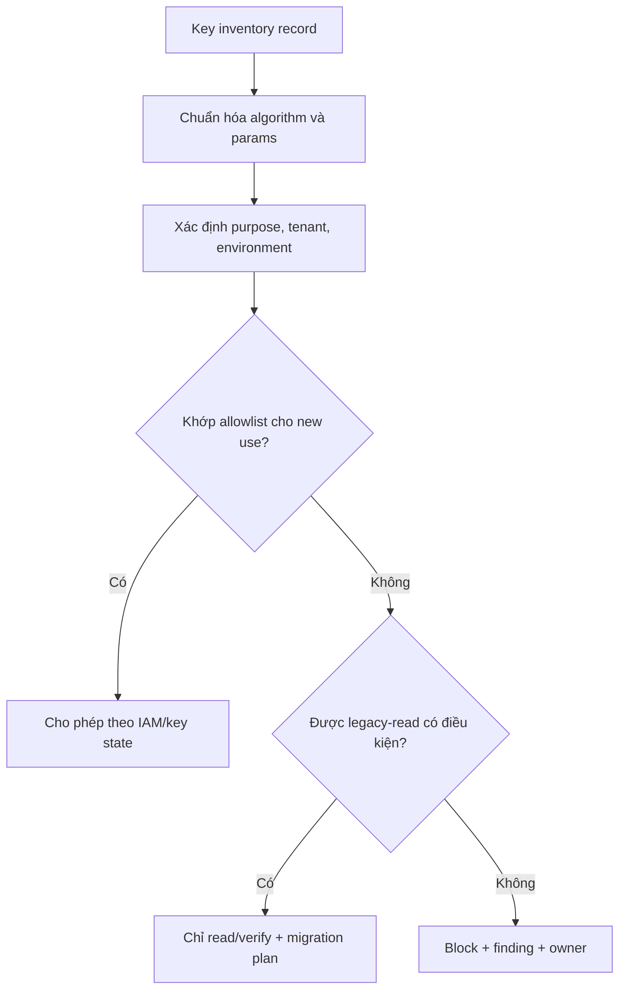
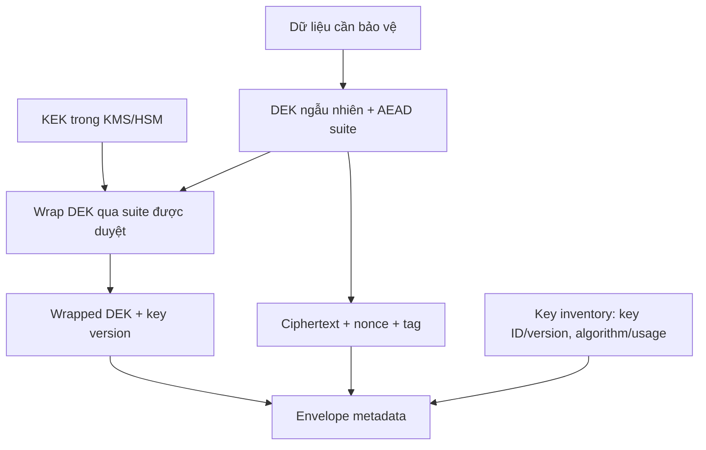

# Algorithm

## 1. Algorithm trong Key inventory là gì?

Trong **Key inventory (danh mục kiểm kê khóa mật mã)**, **Algorithm** là thông tin cho biết **khóa được tạo ra hoặc được phép dùng theo thuật toán mật mã nào**, cùng các tham số và giới hạn liên quan. Đây là thuộc tính cốt lõi để xác định một key có đang đáp ứng chính sách bảo mật, tương thích với hệ thống sử dụng và có thể được thay thế an toàn hay không.

Ví dụ, hai bản ghi chỉ ghi `algorithm: AES` đều chưa đủ thông tin để đánh giá:

- Khóa thứ nhất có thể là **AES-256** dùng **GCM** với nonce 96 bit và authentication tag 128 bit.
- Khóa thứ hai có thể là **AES-128** đang bị dùng trong **ECB** hoặc **CBC** không có cơ chế xác thực toàn vẹn.

Cả hai đều liên quan đến AES, nhưng **mức rủi ro, định dạng dữ liệu và phương án di trú khác hẳn nhau**. Một inventory đáng tin cậy vì thế phải thể hiện được **algorithm family, primitive/operation, parameters, allowed usage và key version**, không chỉ một tên chung.

Tương tự, chỉ ghi `RSA` không nói rõ khóa dùng **RSA-PSS để ký**, **RSA-OAEP để mã hóa/bao bọc**, hay đang bị sử dụng một sơ đồ không còn phù hợp. Với elliptic curve, `Ed25519` dùng **chữ ký**, còn `X25519` dùng **thỏa thuận khóa**; không thể thay thế cho nhau chỉ vì tên gần giống.

Bài thuộc chương **Key inventory** của module `SECURITY_KEY_MANAGEMENT_FUNDAMENTALS`. Mục tiêu tổng thể là hiểu vòng đời khóa từ **tạo, cấp phát, lưu trữ, sử dụng, xoay vòng đến thu hồi và hủy**, kết nối mật mã đối xứng, bất đối xứng, chữ ký số, KMS/HSM, envelope encryption, phân quyền và kiểm toán. Trong vòng đời đó, thông tin Algorithm là “nhãn kỹ thuật có thể kiểm chứng” giúp tìm đúng khóa, thực thi đúng chính sách, tránh nhầm loại thao tác và lập kế hoạch **crypto agility** khi thuật toán cần được nâng cấp.

Sau bài học, bạn có thể:

1. Phân biệt **key algorithm**, **operation algorithm**, **cipher suite** và **protocol algorithm identifier**.
2. Thiết kế metadata algorithm đủ cho AES-GCM, HMAC, RSA, Ed25519, ECDSA, X25519, KEM và KDF.
3. Giải thích vì sao phải lưu **key size, curve, mode, padding, hash, tag, nonce policy, provider và mục đích** khi cần.
4. Kiểm tra tính nhất quán giữa key inventory, API KMS/HSM, ứng dụng Java và ciphertext/signature đã phát hành.
5. Xây dựng **algorithm allowlist**, đánh giá thuật toán cũ/yếu và thay đổi thuật toán có kiểm soát.
6. Phân biệt **key rotation** với **algorithm migration** và xác định hậu quả đối với dữ liệu lịch sử.
7. Đọc ví dụ Java 17+ về việc chọn ciphersuite từ **metadata được tin cậy**, tránh nhận thuật toán tùy ý từ request.

## 2. Một tên thuật toán không phải toàn bộ mô tả mật mã

Khi kiểm kê, cần phân biệt ít nhất bốn tầng:

| Tầng | Câu hỏi | Ví dụ |
| --- | --- | --- |
| **Key type / key algorithm** | Đây là vật liệu khóa loại nào? | AES symmetric key, HMAC secret, RSA keypair, Ed25519 keypair, X25519 keypair, ML-KEM keypair. |
| **Cryptographic primitive / operation** | Khóa được dùng để làm gì? | Encrypt/decrypt, sign/verify, wrap/unwrap, encapsulate/decapsulate, MAC, derive. |
| **Algorithm suite + parameters** | Cơ chế chính xác và tham số nào được dùng? | AES-256-GCM, RSA-PSS với hash/MGF/salt policy, ECDSA với curve/hash, HPKE KEM/KDF/AEAD suite. |
| **Protocol/profile identifier** | Trên wire hoặc trong SDK, ciphersuite được gọi tên thế nào? | `AES/GCM/NoPadding` trong JCA; một algorithm enum của KMS; `alg` của JOSE; HPKE suite ID. |

Một trường `algorithm: RSA` chỉ mô tả **họ khóa**. Để xác minh một chữ ký RSA-PSS, verifier còn cần cơ chế padding, hash, MGF và cấu hình salt phù hợp. Để giải mã RSA-OAEP, decryptor lại cần tham số OAEP tương ứng.

**Không thể suy ra an toàn chỉ từ tên thư viện.** `Cipher.getInstance("AES")` có thể phụ thuộc provider hoặc biến thể mặc định, không mô tả rõ mode/padding. Trong production, ứng dụng phải **chỉ định tường minh** phép toán đã được phê duyệt.

### 2.1. Phân biệt algorithm của key và algorithm của dữ liệu

Giả sử `customer-data-kek:v4` là khóa AES 256 bit trong KMS. Key này có thể được cấp phép cho một số thao tác wrap/unwrap hay encrypt/decrypt theo API của provider. Ciphertext cụ thể còn cần ghi:

```text
key reference: customer-data-kek / v4
key type: symmetric
algorithm family: AES
key size: 256 bits

per-envelope usage:
  wrapping algorithm: approved provider-specific wrap or AEAD
  wrapped DEK format/version: ...
  nonce/IV: ...
  auth tag: ...
  AAD/context: ...
```

Nếu chỉ biết key là AES-256, **chưa biết** một bản ciphertext được tạo bằng AES-GCM, AES-KW, AES-KWP hay một sơ đồ khác. Do đó inventory có thể mô tả **allowed algorithms ở cấp khóa**, nhưng mỗi ciphertext/signature/envelope vẫn phải mang hoặc tra cứu được **algorithm suite và tham số cụ thể của lần sử dụng**.

### 2.2. Algorithm identifier, key ID và key version khác nhau

- **Algorithm ID** xác định quy tắc mật mã, ví dụ `AES-256-GCM` hay `Ed25519`.
- **Key ID** xác định đối tượng khóa cụ thể, ví dụ `billing/prod/data-key`.
- **Key version** xác định thế hệ vật liệu của khóa, ví dụ `v4`.
- **Provider key reference** là định danh tài nguyên thực trong một KMS/HSM; cú pháp phụ thuộc nhà cung cấp.
- **Ciphertext format version** là version của cách đóng gói dữ liệu, có thể thay đổi dù thuật toán và key vẫn giữ nguyên.

Ví dụ hai khóa `billing/prod/enc:v4` và `billing/prod/enc:v5` có thể cùng thuật toán AES-256-GCM nhưng **vật liệu khóa khác nhau**. Ngược lại, chuyển từ AES-GCM sang một suite khác có thể cần **key mới, định dạng mới và hỗ trợ giải mã lịch sử**, không chỉ tăng số version.

## 3. Bảng thuật toán cần nhận diện trong Key inventory

Một inventory lớn có thể chứa nhiều họ mật mã. Mục tiêu là phân loại **đúng vai trò của khóa**, chứ không đưa mọi thuật toán vào một danh sách không có ngữ cảnh.

| Họ / thuật toán | Loại khóa | Mục đích điển hình | Metadata cần làm rõ |
| --- | --- | --- | --- |
| **AES-GCM** | Secret symmetric key | AEAD encrypt/decrypt | Key bits, nonce strategy, tag length, AAD policy, usage. |
| **AES-KW / AES-KWP** | Secret symmetric KEK | Wrap/unwrap key material | Key bits, wrapping format, provider, purpose. |
| **HMAC-SHA256 / HMAC-SHA384** | Shared secret | MAC generate/verify | MAC hash, key strength, tag-length policy, version. |
| **RSA-PSS** | RSA private/public pair | Digital sign/verify | Modulus bits, hash, MGF, salt length, key usage. |
| **RSA-OAEP** | RSA private/public pair | Asymmetric encryption / key transport trong phạm vi cho phép | Modulus bits, OAEP hash, MGF, label policy. |
| **ECDSA** | EC private/public pair | Digital sign/verify | Named curve, hash, signature encoding, canonical policy. |
| **Ed25519 / Ed448** | EdDSA private/public pair | Digital sign/verify | Exact variant/profile, key ID, public key format. |
| **X25519 / X448** | Key-agreement pair | ECDH / DHKEM trong giao thức phù hợp | Curve, ephemeral/static use, protocol/KDF. |
| **ML-KEM** | Encapsulation/decapsulation keypair | Thiết lập shared secret hậu lượng tử | Parameter set, KEM version, provider, ciphertext format. |
| **HKDF** | Dẫn xuất từ một secret đầu vào | Derive subkeys | Hash, salt/info/domain separation, source key reference. |
| **Argon2id / scrypt** | Password hoặc secret có entropy thấp làm input | Password hashing hoặc password-based KDF | Version, memory/time/parallelism, salt, output usage. |
| **SHA-256 / SHA-3** | **Không có key** khi dùng như hash thuần | Hash dữ liệu, digest, thành phần KDF/signature | Digest algorithm, purpose; không tự biến thành key. |

**Không phải mọi dòng đều là “key algorithm” theo nghĩa chặt.** SHA-256 thuần không cần khóa; HKDF là thuật toán dẫn xuất; Argon2id phục vụ đầu vào password. Các thuật toán này có thể là **metadata của một quy trình tạo/định dạng key**, chứ không nhất thiết là loại vật liệu khóa độc lập trong key inventory.

### 3.1. Đối xứng: AES không nói đủ mode

Khi dùng AES, inventory nên cho thấy:

- **Key length** (ví dụ 128 hoặc 256 bit theo chính sách).
- **Purpose**: data encryption, key wrapping, hoặc một công dụng được duyệt.
- **Permitted operation**: Encrypt, Decrypt, Wrap, Unwrap; phân quyền theo service/tenant.
- **Mode / authenticated encryption**: ví dụ GCM, các mode khác theo chuẩn/đặc tả.
- **Nonce/IV policy**: cơ chế bảo đảm **không lặp nonce với cùng key** khi dùng AES-GCM.
- **Tag length và AAD**: theo profile đã thống nhất.
- **Key lifecycle**: active for encrypt, decrypt-only, disabled, pending destruction, destroyed.

Ví dụ `AES-256-GCM` có thể dùng nonce **96 bit** và tag **128 bit** trong một profile thông dụng, nhưng inventory phải ghi **policy đang áp dụng** và ciphertext phải cung cấp nonce cần thiết để giải mã. **Không dùng lại nonce trong cùng AES-GCM key**; vi phạm có thể phá hủy cả tính bí mật và tính toàn vẹn.

**Không đánh đồng “AES-256” với việc toàn bộ hệ thống an toàn.** Key bị lộ, nonce bị lặp, AAD không được ràng buộc hoặc IAM quá rộng vẫn là rủi ro.

### 3.2. Bất đối xứng: RSA và EC cần tham số bổ sung

Với RSA, metadata thường gồm:

- Modulus size, key usage, public/private nature.
- **RSA-PSS** hay **RSA-OAEP**; không dùng tên `RSA` làm toàn bộ cipher/signature algorithm.
- Hash/MGF/salt policy hoặc OAEP parameters.
- Provider, key encoding/reference, certificate chain nếu phù hợp.
- Cryptoperiod và chính sách thuật toán mới so với dữ liệu cũ.

Với ECDSA, cần **curve** (ví dụ một named curve được duyệt), hash và **signature encoding**. Dạng ASN.1 DER và raw `r||s` không mặc nhiên tương thích. Hệ thống JWT/JOSE có thể có quy tắc encoding khác API chữ ký Java truyền thống.

Với EdDSA, phân biệt `Ed25519`, `Ed448` và các biến thể prehash/context nếu giao thức sử dụng. Không tự gọi `Ed25519` trên dữ liệu đã hash rồi coi như Ed25519ph. Với X25519, mục đích là key agreement, **không phải chữ ký Ed25519**.

### 3.3. KEM và hậu lượng tử

Key inventory của hệ thống dùng **KEM** nên ghi:

- `keyType: kem-keypair` và các quyền `Encapsulate`, `Decapsulate` phù hợp.
- Thuật toán/parameter set, ví dụ **ML-KEM-768** khi đã được phê duyệt, hoặc **DHKEM** với curve cụ thể.
- Định dạng public key, private key và encapsulation ciphertext.
- **KDF/key schedule/AEAD ciphersuite** ở tầng protocol, không chỉ tên KEM.
- Có phải **hybrid classical + post-quantum** và cách kết hợp theo chuẩn đã chọn.
- Mục đích, trạng thái, version và dữ liệu lịch sử còn phụ thuộc private decapsulation key.

Một key `ML-KEM` không tự biểu diễn đầy đủ `HPKE`. Trong một giao thức hybrid, còn cần metadata cho thuật toán cổ điển, thuật toán hậu lượng tử, combiner và chính sách chống downgrade.

## 4. Algorithm inventory nên chứa những field nào?

Không có một schema duy nhất cho mọi KMS, nhưng một bản ghi quản trị thường cần ít nhất các nhóm sau:

| Nhóm | Field gợi ý | Vì sao cần? |
| --- | --- | --- |
| **Định danh** | `keyId`, `version`, `provider`, `providerResourceId` | Phân biệt khóa logic và vật liệu thực trong KMS/HSM. |
| **Thuật toán** | `algorithmFamily`, `keyAlgorithm`, `algorithmSuite`, `parameters` | Biết chính xác loại khóa, ciphersuite và ràng buộc. |
| **Loại vật liệu** | `keyClass`, `keySizeBits`, `curve`, `origin`, `exportability` | Đánh giá phạm vi bảo vệ và tương thích. |
| **Mục đích** | `purpose`, `allowedOperations`, `allowedSuites` | Ngăn dùng một key sai mục đích. |
| **Chủ thể** | `owner`, `service`, `environment`, `tenantScope` | Phân quyền, điều tra và quản lý blast radius. |
| **Vòng đời** | `createdAt`, `activatedAt`, `rotateBy`, `state`, `destroyAfter` | Đánh giá cryptoperiod và kế hoạch hủy. |
| **Chính sách** | `policyId`, `policyVersion`, `complianceProfile`, `approvalRef` | Biết khóa đáp ứng chuẩn nào và do ai phê duyệt. |
| **Phụ thuộc** | `dataReferences`, `envelopeVersions`, `consumerCount`, `backupDependencies` | Tránh hủy hoặc migration gây mất dữ liệu. |
| **Quan sát** | `lastUsedAt`, `lastOperation`, `findings`, `auditRefs` | Tìm khóa không dùng, bất thường và sai policy. |

**Key inventory không phải nơi lưu private key, raw DEK/KEK, seed, password, pepper hoặc session token.** Chỉ lưu **tham chiếu, metadata và bằng chứng** cần cho quản trị. Nếu có public key/chứng chỉ, cân nhắc lưu fingerprint/định danh và vị trí nguồn tin cậy theo chính sách.

### 4.1. Tách “declared” và “observed” để tránh tự tin sai

Một bản ghi có thể khai báo `allowedSuites: [AES-256-GCM]` nhưng log thực tế cho thấy còn sử dụng AES-CBC ở một service cũ. Inventory nên có hai loại bằng chứng:

- **Declared/configured**: KMS metadata, key policy, tài liệu thiết kế, mô tả artifact.
- **Observed/validated**: kết quả dò cấu hình, telemetry, usage log, test vector hoặc kiểm chứng ứng dụng.

Nếu hai nguồn mâu thuẫn, không tự chọn giá trị đẹp hơn; ghi **mismatch finding**, owner và hành động xử lý. Cơ chế inventory hữu ích khi có khả năng phát hiện thực tế **không trùng với dự định**.

### 4.2. Không lấy tên thuật toán từ input chưa xác thực làm policy

Nếu request gửi:

```json
{
  "keyId": "tenant-a/payment-v4",
  "algorithm": "AES/CBC/PKCS5Padding",
  "payload": "..."
}
```

thì backend không được vì tên `algorithm` trong request mà tự chạy chế độ mới, đặc biệt nếu policy chỉ cho AES-GCM. Metadata từ đối tác/ciphertext **có thể hỗ trợ định tuyến**, nhưng phải được đối chiếu với **algorithm allowlist, key registry, tenant/issuer và format version được xác thực**.

**Thuật toán phải được chọn từ cấu hình tin cậy**, không phải thương lượng theo sở thích của bên gửi hay cho phép downgrade mà không kiểm tra.

## 5. Mẫu inventory cho khóa AES-GCM trong KMS

Ví dụ YAML sau là **schema minh họa** cho một bản ghi key version; nó **không phải API thực tế** của cloud KMS nào.

```yaml
keyId: billing/prod/invoice-data-kek
version: v4
owner: billing-platform
environment: production
tenantScope: tenant-billing
provider: approved-kms
providerResourceId: provider-specific-reference
keyClass: symmetric
keyAlgorithm: AES
keySizeBits: 256
algorithmFamily: symmetric-aead
allowedSuites:
  - AES-256-GCM
allowedOperations:
  - Encrypt
  - Decrypt
noncePolicy:
  perKeyUniquenessRequired: true
  preferredNonceBits: 96
tagPolicy:
  defaultTagBits: 128
usagePurpose: envelope-key-protection
keyOrigin: provider-generated
exportability: non-exportable
state: ACTIVE_FOR_ENCRYPT
createdAt: "2026-11-01T08:00:00Z"
rotateReviewAt: "2027-01-31T08:00:00Z"
policyId: key-policy-billing-v2
dependencyInventoryRef: inv-billing-kek-v4
```

Giải thích:

1. **`keyAlgorithm: AES`** xác định vật liệu khóa.
2. **`allowedSuites`** cụ thể hóa cách dùng được phép; một key có thể cần policy riêng cho thao tác wrap thay vì AEAD trực tiếp.
3. **`noncePolicy`** ràng buộc việc sử dụng AES-GCM; không có nghĩa KMS nào cũng tự bảo đảm nonce uniqueness cho ứng dụng.
4. **`usagePurpose`** nêu khóa bảo vệ DEK trong envelope encryption; không đồng nghĩa trực tiếp mã hóa toàn bộ hóa đơn.
5. **`providerResourceId`** là tham chiếu tới khóa; không chứa material.
6. **`state`** ở đây là trạng thái nghiệp vụ do tổ chức định nghĩa, cần mapping sang state thật của KMS.
7. **`dependencyInventoryRef`** dẫn đến danh sách những ciphertext/wrapped DEK còn phụ thuộc version, đặc biệt quan trọng trước khi destroy.

Nếu KMS dùng cơ chế wrap chuyên dụng, bản ghi tương ứng phải có **allowed wrapping suite đúng thực tế**; không đưa AES-GCM vào metadata chỉ vì key có độ dài 256 bit.

### 5.1. Mẫu inventory cho khóa Ed25519

```yaml
keyId: auth/prod/jwt-signing
version: v7
owner: identity-team
environment: production
keyClass: asymmetric
keyAlgorithm: Ed25519
algorithmFamily: digital-signature
algorithmSuite: Ed25519
allowedOperations:
  - Sign
  - Verify
privateKeyExportable: false
publicKeyRegistry: trusted-issuer-jwks
publicKeyId: auth-ed25519-v7
usagePurpose: jwt-access-token-signing
state: ACTIVE_FOR_SIGN
previousVersion: v6
previousVersionPolicy: verify-only-while-required
policyId: signature-policy-v4
```

`Verify` có thể được thực hiện ngoài KMS bằng public key đã công bố. `Sign` phải giới hạn cho identity service với quyền tối thiểu; không cho verifier quyền ký chỉ vì nó được phép đọc public key. Bản ghi **không chứa private key**.

Tại tầng JWT, header `alg` và `kid` phải khớp chính sách của issuer/JWKS đáng tin cậy; không được chọn thuật toán từ header chưa xác thực rồi tự mở rộng allowlist.

### 5.2. Khi nhiều thuật toán đi qua một envelope

Một bản ghi dữ liệu có thể cần metadata rộng hơn bản ghi key inventory:

```json
{
  "formatVersion": 2,
  "contentEncryptionSuite": "AES-256-GCM",
  "dataNonce": "<base64url-nonce>",
  "keyWrappingSuite": "provider-approved-wrap-suite",
  "kekId": "billing/prod/invoice-data-kek",
  "kekVersion": "v4",
  "wrappedDek": "<base64url-wrapped-key>",
  "ciphertextAndTag": "<base64url-ciphertext>",
  "aadSchemaVersion": 1
}
```

Các phần trong `<...>` chỉ là placeholder, không phải dữ liệu mã hóa hợp lệ. Một **envelope** mô tả **cách mã hóa dữ liệu cụ thể**; key inventory mô tả **khả năng, chính sách và vòng đời khóa**. Hai nguồn phải liên kết được nhưng không phải cùng một đối tượng.

## 6. Algorithm policy và lựa chọn thuật toán được phép

Tổ chức cần có **algorithm policy** xác định thuật toán/suite được phép cho từng mục đích, môi trường và mức nhạy cảm. Inventory phải trả lời được **những khóa nào không phù hợp với policy hiện tại**.

Một bảng đánh giá khái niệm:

| Mục đích | Ví dụ loại suite có thể chấp nhận theo policy | Điều cần tránh hoặc đánh giá riêng |
| --- | --- | --- |
| Mã hóa dữ liệu có xác thực | AES-GCM theo profile và nonce policy phù hợp | ECB; CBC không có cơ chế xác thực; nonce GCM tái sử dụng. |
| Key wrapping | AES-KW/KWP hoặc KMS wrapping suite được phê duyệt | Tự ghép mode/padding không có contract. |
| Chữ ký số | Ed25519, RSA-PSS hoặc ECDSA với tham số đã duyệt | `RSA`/`EC` không rõ padding/hash/curve; thuật toán yếu ngoài policy. |
| MAC | HMAC-SHA256 hoặc MAC chuẩn phù hợp | `SHA256(secret || message)` tự chế. |
| Password hashing | Argon2id hoặc password KDF được phê duyệt | SHA-256(password) trực tiếp, HKDF(password) trực tiếp. |
| Key agreement / KEM | Curve/KEM và key schedule theo protocol phê duyệt | Dùng Ed25519 như X25519; tự nối secret hybrid tùy ý. |
| KDF cho secret entropy cao | HKDF theo context/domain separation | Dùng cùng derived key cho nhiều mục đích không tách miền. |

Danh sách là **ví dụ về các họ kỹ thuật**, không phải một chứng nhận rằng mọi cấu hình của thuật toán trên đều đạt yêu cầu mọi tổ chức. Hệ thống có thể bị ràng buộc bởi chính sách ngành, chứng nhận FIPS, yêu cầu lưu trữ lâu dài, SDK, HSM hoặc giao thức.

### 6.1. Chấp nhận có điều kiện và dùng cũ để giải mã

Một policy thực tế có thể phân biệt:

- **Allowed for new operations**: được phép tạo ciphertext/chữ ký mới.
- **Allowed for legacy read/verify**: chỉ giải mã/xác minh dữ liệu lịch sử trong thời gian chuyển tiếp.
- **Deprecated**: cần kế hoạch di trú có hạn.
- **Prohibited**: không được dùng theo policy hiện hành.
- **Unknown/unverified**: chưa đủ metadata, phải điều tra chứ không tự coi an toàn.



**Deprecated không đồng nghĩa đã bị phá mã**, và **legacy read** không phải giấy phép tiếp tục encrypt/sign mới mãi mãi. Cần đánh giá rủi ro thực tế, nghĩa vụ dữ liệu lịch sử và thời hạn hoàn tất migration.

### 6.2. FIPS, tiêu chuẩn và provider không thể thay nhau

Nếu chính sách yêu cầu cryptography được triển khai trong **cryptographic module được xác nhận theo tiêu chuẩn áp dụng**, thì ghi tên `AES-256` vào inventory **không chứng minh** module, cấu hình và chế độ hoạt động đã đạt yêu cầu.

Cần kiểm tra **provider/module**, chứng nhận và phạm vi, algorithm implementation, operational mode, cấu hình và những quyền sử dụng thực tế. Một thư viện Java hoặc HSM hỗ trợ thuật toán không mặc nhiên có nghĩa mọi hoạt động của hệ thống đã tuân thủ FIPS.

Inventory có thể gắn `complianceProfile`, `validationEvidenceRef` và ngày kiểm tra, nhưng không nên lưu tuyên bố chung chung kiểu `fipsCompliant: true` thiếu chứng cứ/ngữ cảnh.

## 7. Thu thập và chuẩn hóa Algorithm từ nhiều hệ thống

Trong doanh nghiệp, inventory có thể lấy metadata từ:

- **Cloud KMS**: loại khóa, key spec, permitted operations, origin, version/rotation, trạng thái, audit.
- **HSM**: key object attributes, mechanism IDs, exportability, partitions, token/slot identity.
- **Secret manager**: secret metadata/version; **không tự suy ra** nội dung secret là một khóa AES hay MAC nếu không có bằng chứng.
- **PKI/CA/certificate stores**: public key algorithm, curve/modulus, signature algorithm, certificate validity/key usage.
- **Application config/Java**: thuật toán khai báo, transformation, provider, runtime usage.
- **Ciphertext/envelope metadata**: algorithm suite, key ID/version, format và nonce/tag parameters.
- **Source control/dependency inventory**: thư viện crypto đang dùng, cấu hình tạo khóa và deprecated APIs.
- **Audit/telemetry**: các thuật toán được quan sát thực tế trong Encrypt/Decrypt/Sign/Verify/Wrap/Decapsulate.

**Không đọc raw private key hoặc xuất secret để “làm inventory”.** Thu thập metadata qua API quản trị có quyền chỉ-đọc và quyền hạn tối thiểu; ghi sự không chắc chắn nếu provider không trả đầy đủ.

### 7.1. Tạo canonical algorithm ID

Cùng một thuật toán có thể có nhiều tên theo API:

| Hệ thống / lớp | Biểu diễn ví dụ | Ý nghĩa cần chuẩn hóa |
| --- | --- | --- |
| Java JCA | `AES/GCM/NoPadding` | Cipher transformation; chưa mô tả key bits, nonce/tag policy. |
| Java JCA | `HmacSHA256` | MAC implementation name. |
| Java JCA | `RSASSA-PSS` | Signature algorithm; còn phải cấu hình các PSS parameters. |
| Java JCA | `Ed25519` | Chữ ký Ed25519 cụ thể. |
| JOSE/JWS | `alg: EdDSA` trong các profile hỗ trợ | Header algorithm; còn cần key type/curve và issuer policy. |
| KMS/HSM | Provider-specific algorithm enum/ID | Phải mapping sang canonical suite có lưu provider ID gốc. |
| Crypto policy | `AES-256-GCM` | Định danh suite chuẩn hóa theo chính sách nội bộ. |

Một inventory tốt giữ **cả tên gốc của provider lẫn tên chuẩn hóa**, cùng bảng mapping có **phiên bản**. Không dùng cách so sánh string không phân biệt hoa/thường hoặc cắt prefix tùy ý để suy ra hai thuật toán tương đương.

Ví dụ, một application có thể báo `AES` vì `SecretKey.getAlgorithm()` chỉ trả họ khóa. Đó là **dữ liệu thiếu**, không phải bằng chứng mode là GCM.

### 7.2. Không tự điền default tham số chưa quan sát

Nếu không biết padding của một khóa RSA hoặc tag length của bản ghi AES-GCM, inventory nên ghi **UNKNOWN** và tạo finding. Tự điền `SHA-256` hoặc `tag=128` cho đẹp có thể làm đội kiểm toán tin nhầm.

Nên lưu `source`, `observedAt`, `confidence` hoặc `evidenceRef` cho mỗi kết luận quan trọng. Khi cấu hình từ KMS khác với code thực tế, đánh dấu **mismatch** để owner xác minh.

### 7.3. Theo dõi drift và thay đổi

Thu thập theo lịch hoặc sự kiện để phát hiện:

- Key mới tạo với thuật toán ngoài allowlist.
- Provider đổi default, ứng dụng chuyển transformation hoặc SDK update.
- Quyền `Encrypt`/`Sign` bị mở rộng sang key đang legacy-only.
- Khóa đã retired nhưng vẫn phát sinh thao tác mới.
- Phiên bản ciphertext xuất hiện mà decoder cũ không hỗ trợ.
- Owner/team thay đổi, key không còn người phụ trách.
- Lần dùng cuối không còn phù hợp với retirement/destruction plan.

Không đồng nhất **không thấy event gần đây** với **key chắc chắn không được dùng**: log có thể thiếu, job chạy hiếm, dữ liệu lưu trữ lạnh hoặc consumer ngoại tuyến.

## 8. Ví dụ Java 17: ràng buộc thuật toán với key inventory

Java Cryptography Architecture (JCA) có nhiều thuật toán và provider, nên một ứng dụng cần **quy tắc lựa chọn ciphersuite** thay vì dùng trực tiếp string do request cung cấp.

Ví dụ sau chỉ minh họa AES-256-GCM. Nó:

1. Định nghĩa bản ghi **trusted inventory** với key ID, version, purpose, algorithm và suite.
2. Chỉ cho phép cấu hình `AES/GCM/NoPadding` đúng policy.
3. Sinh key bằng CSPRNG/provider qua `KeyGenerator` cho demo.
4. Tạo nonce mới cho thao tác encrypt.
5. Dùng **AAD** để bảo vệ sự ràng buộc giữa dữ liệu và metadata.
6. Giải mã với **đúng suite, key/version và AAD**, từ chối khi ciphertext/tag bị sửa.

**Production:** thay key sinh trong tiến trình bằng key reference và API/provider KMS/HSM phù hợp. Không xuất key chỉ để lấy tên thuật toán.

```java
import java.nio.charset.StandardCharsets;
import java.security.SecureRandom;
import javax.crypto.Cipher;
import javax.crypto.KeyGenerator;
import javax.crypto.SecretKey;
import javax.crypto.spec.GCMParameterSpec;

public final class AlgorithmInventoryDemo {
    private static final SecureRandom RNG = new SecureRandom();
    private static final String ALLOWED_SUITE = "AES-256-GCM";
    private static final String TRANSFORMATION = "AES/GCM/NoPadding";

    record KeyMetadata(
        String keyId,
        String version,
        String keyAlgorithm,
        int keyBits,
        String suite,
        String purpose,
        boolean enabledForEncrypt
    ) {}

    record EncryptedRecord(
        String keyId,
        String version,
        String suite,
        byte[] nonce,
        byte[] ciphertextAndTag
    ) {}

    static void checkPolicy(KeyMetadata metadata, SecretKey key) {
        if (!"invoice/prod/data-key".equals(metadata.keyId())
                || !"v4".equals(metadata.version())
                || !"AES".equals(metadata.keyAlgorithm())
                || metadata.keyBits() != 256
                || !ALLOWED_SUITE.equals(metadata.suite())
                || !"invoice-content".equals(metadata.purpose())
                || !metadata.enabledForEncrypt()
                || !"AES".equals(key.getAlgorithm())) {
            throw new SecurityException("Key policy mismatch");
        }
        // getAlgorithm() chỉ cho biết họ khóa, KHÔNG chứng minh
        // key size, mode, storage, owner hoặc chính sách KMS.
        // Metadata phải lấy từ trusted registry/provider.
    }

    static byte[] aad(KeyMetadata m) {
        return ("v1|" + m.keyId() + "|" + m.version()
                + "|" + m.suite() + "|" + m.purpose())
                .getBytes(StandardCharsets.UTF_8);
    }

    static EncryptedRecord encrypt(
        KeyMetadata metadata, SecretKey key, byte[] plaintext
    ) throws Exception {
        checkPolicy(metadata, key);

        byte[] nonce = new byte[12];
        RNG.nextBytes(nonce); // Demo: nonce 96-bit ngẫu nhiên.

        Cipher cipher = Cipher.getInstance(TRANSFORMATION);
        cipher.init(Cipher.ENCRYPT_MODE, key,
                new GCMParameterSpec(128, nonce));
        cipher.updateAAD(aad(metadata));
        byte[] encrypted = cipher.doFinal(plaintext);

        return new EncryptedRecord(
            metadata.keyId(), metadata.version(),
            metadata.suite(), nonce, encrypted
        );
    }

    static byte[] decrypt(
        KeyMetadata metadata, SecretKey key, EncryptedRecord data
    ) throws Exception {
        // Demo dùng cùng metadata. Production cần policy decrypt
        // riêng cho các version đã RETIRED, không check enabledForEncrypt.
        checkPolicy(metadata, key);

        if (!metadata.keyId().equals(data.keyId())
                || !metadata.version().equals(data.version())
                || !metadata.suite().equals(data.suite())
                || data.nonce() == null || data.nonce().length != 12
                || data.ciphertextAndTag() == null) {
            throw new SecurityException("Envelope metadata mismatch");
        }

        Cipher cipher = Cipher.getInstance(TRANSFORMATION);
        cipher.init(Cipher.DECRYPT_MODE, key,
                new GCMParameterSpec(128, data.nonce()));
        cipher.updateAAD(aad(metadata));
        return cipher.doFinal(data.ciphertextAndTag());
        // AEAD tag sai → authentication failure, không nhận plaintext.
    }

    public static void main(String[] args) throws Exception {
        KeyGenerator generator = KeyGenerator.getInstance("AES");
        generator.init(256);
        SecretKey demoKey = generator.generateKey();

        KeyMetadata trusted = new KeyMetadata(
            "invoice/prod/data-key", "v4", "AES",
            256, "AES-256-GCM", "invoice-content", true
        );

        byte[] input = "invoice-id=INV-008"
                .getBytes(StandardCharsets.UTF_8);
        EncryptedRecord data = encrypt(trusted, demoKey, input);
        byte[] recovered = decrypt(trusted, demoKey, data);
        System.out.println(
            new String(recovered, StandardCharsets.UTF_8)
        );
    }
}
```

### 8.1. Hạn chế quan trọng của ví dụ

Ví dụ phù hợp cho **minh họa cách ràng buộc algorithm** chứ chưa phải module encryption production:

- **Nonce AES-GCM:** dùng ngẫu nhiên 96 bit có giới hạn xác suất va chạm; hệ thống khối lượng lớn phải có **nonce strategy và usage bounds** phù hợp, tránh reuse dưới cùng key.
- **Key size:** `key.getAlgorithm()` không chứng minh key là 256 bit. `getEncoded()` có thể trả `null` cho key non-exportable, nên **không** export key chỉ để đo kích thước. Hãy tin vào nguồn metadata/provisioning đã xác minh.
- **Encrypt/decrypt policy:** ví dụ tái sử dụng `enabledForEncrypt`, trong production phải tách **EncryptAllowed** và **DecryptLegacyAllowed** vì khóa retired có thể chỉ phục vụ dữ liệu cũ.
- **Trusted metadata:** bản ghi `KeyMetadata` trong code được tạo nội bộ; production phải được nạp từ **registry/KMS đáng tin cậy**, không parse từ request rồi coi là sự thật.
- **AAD serialization:** chuỗi `v1|...` chỉ phục vụ demo. Nếu metadata có ký tự `|` hoặc giá trị tự do, cần encoding không mơ hồ (length-prefix/canonical format) và format version rõ ràng.
- **Nonce storage/validation:** nonce phải đi cùng ciphertext; AEAD tag phải được kiểm tra trước khi dùng plaintext.
- **Resource safety:** cần giới hạn kích thước payload, xử lý lỗi, tránh log plaintext/secret, kiểm tra concurrency và provider.
- **KMS/HSM:** thuật toán trong key policy và phép toán thực tế có thể thuộc API khác JCA; cần adapter được kiểm thử.
- **Rotation:** ví dụ chỉ có v4; phiên bản thật cần giải mã dữ liệu v3 theo policy và kế hoạch rewrap/reencrypt.

### 8.2. Vì sao không dùng algorithm từ payload?

Mẫu sai:

```java
// KHÔNG LÀM: request tự quyết định transformation.
Cipher cipher = Cipher.getInstance(request.algorithm());
cipher.init(Cipher.DECRYPT_MODE, key);
```

Đầu vào không đáng tin cậy có thể yêu cầu chế độ không nằm trong policy, làm luồng giải mã không khớp, mở đường downgrade hoặc xử lý thiếu AEAD authentication. Thiết kế tốt chọn suite từ **allowlist đã cấu hình và mapping key/version tin cậy**, rồi so khớp envelope metadata đã ràng buộc.

## 9. KMS/HSM, IAM và kiểm toán algorithm

KMS/HSM không chỉ giữ secret mà còn có thể giới hạn **loại key và loại thao tác**. Tuy nhiên, không phải provider nào cũng cung cấp cùng tập thuật toán hoặc tham số, và một quyền API không tự đảm bảo mọi metadata ở tầng ứng dụng là đúng.

### 9.1. Phân quyền theo key purpose và operation

| Vai trò | Quyền phù hợp | Không nên có mặc định |
| --- | --- | --- |
| **Key creator / provisioning service** | Tạo khóa với thuật toán trong policy và môi trường cho phép | Tạo mọi thuật toán, cấp quyền cho mình không cần phê duyệt. |
| **Encrypt service** | `Encrypt`/`Wrap` đúng key/tenant/suite | `Decrypt` mọi tài nguyên, `Sign`, export private key. |
| **Decrypt service** | `Decrypt`/`Unwrap` đúng tài nguyên được phép | Tự đổi algorithm allowlist hoặc key policy. |
| **Signing service** | `Sign` trên private signing key của mục đích cụ thể | Tùy ý thay JWKS hoặc revoke tin cậy. |
| **Verifier** | Đọc public key/JWKS đáng tin cậy, thực thi verify | Private key hoặc quyền ký. |
| **Security/key admin** | Duyệt thuật toán, tạo/rotate/disable theo quy trình | Tự ý đọc dữ liệu nghiệp vụ và cấp grant ngoài policy. |
| **Auditor** | Đọc metadata, findings, usage và change history | Xuất key material hoặc thay policy. |

**Mục đích khóa phải ràng buộc với IAM và operation**, không chỉ một field mô tả. Ví dụ private signing key trong HSM không thể xuất vẫn có thể bị lạm dụng nếu danh tính có quyền `Sign` quá rộng hoặc nội dung cần ký không được kiểm soát.

### 9.2. Các trường audit quan trọng

Một event sử dụng hoặc thay đổi thuật toán nên ghi:

```yaml
event: crypto.operation
time: "2026-11-28T09:00:00Z"
actor: billing-worker-prod
key_id: billing/prod/invoice-data-kek
key_version: v4
operation: Encrypt
algorithm_suite: AES-256-GCM
policy_version: crypto-policy-v5
result: success
request_id: req-0412
```

Đây là **mẫu schema**, không phải log mặc định của nhà cung cấp.

Không đưa vào audit: plaintext, raw DEK/KEK, signing private key, shared secret, token đầy đủ, dữ liệu nhạy cảm hoặc các bản sao key material. Chỉ ghi metadata đủ điều tra, kèm giới hạn retention và quyền đọc log.

### 9.3. Các cảnh báo hữu ích

- Tạo key với **algorithm outside allowlist**.
- Khóa production không có **owner, purpose, key bits/curve** hoặc thiếu nguồn metadata tin cậy.
- Key `RETIRE_FOR_NEW_USE` nhưng vẫn có `Encrypt`/`Sign` mới.
- Dùng KMS key/certificate có thuật toán không khớp ứng dụng.
- Verifier nhận JWT `alg` hoặc `kid` ngoài issuer/keyset được duyệt.
- Envelope chứa format/suite không khớp key version.
- Nonce reuse indicator hoặc tăng AEAD authentication failure.
- Key sắp hết cryptoperiod hoặc provider có thông báo ngừng hỗ trợ algorithm.
- Bản ghi tồn tại nhưng không xác định được **ciphertext dependencies**.

## 10. Algorithm và key lifecycle

Ở từng giai đoạn, metadata thuật toán phải phục vụ một quyết định cụ thể.

| Giai đoạn | Cần làm với algorithm inventory |
| --- | --- |
| **Generate** | Chọn thuật toán, key type/size/curve, provider và entropy theo policy. |
| **Register / provision** | Gắn key ID, version, purpose, allowed suites và owner. |
| **Store / protect** | Xác định exportability, HSM/KMS boundary, wrap/encrypt policy. |
| **Use** | Kiểm soát operation đúng thuật toán, key state và context; ghi audit. |
| **Rotate** | Thay vật liệu khóa theo cryptoperiod, duy trì metadata version. |
| **Migrate algorithm** | Tạo suite/key/format mới, chuyển bên gửi và dữ liệu cũ có kiểm chứng. |
| **Disable / revoke** | Chặn thao tác hoặc thay trust; giữ khả năng lịch sử theo policy. |
| **Destroy** | Kiểm kê ciphertext/backup/DEK/chữ ký còn phụ thuộc, xác nhận phạm vi hủy. |

### 10.1. Rotation cùng thuật toán

Ví dụ `AES-256-GCM v3 → AES-256-GCM v4`:

- **Thuật toán giữ nguyên**, vật liệu key thay đổi.
- Bản ghi mới dùng v4.
- Bản ghi cũ có thể còn cần v3 để decrypt/unwrap.
- Có thể rewrap DEK sang v4 hoặc re-encrypt tùy kiến trúc, không tự động xảy ra khi đổi alias.
- KMS/HSM policy và audit phải phản ánh version mới và quyền của version cũ.

### 10.2. Algorithm migration

Ví dụ một hệ thống cũ đang dùng **AES-CBC không xác thực** và cần chuyển dữ liệu mới sang **AES-GCM**:

1. Khảo sát bản ghi cũ: key ID/version, IV, padding, nội dung, khả năng phát hiện sửa đổi.
2. Đánh giá rủi ro khi **giải mã dữ liệu cũ không có xác thực toàn vẹn**, không tự cho rằng dữ liệu cũ đã không bị can thiệp.
3. Tạo key mới và định dạng **AES-GCM** đã được phê duyệt, kèm nonce policy, tag length và AAD.
4. Chuyển luồng encrypt mới sang suite mới; **không cho client tự lựa chọn CBC** khi gửi dữ liệu mới.
5. Migration dữ liệu cũ qua đường có quyền, xác minh nghiệp vụ, mã hóa lại bằng suite mới.
6. Đối chiếu data counts, checksum/ngữ cảnh, restore test và yêu cầu backup.
7. Hạn chế/deprecate CBC decrypt legacy sau khi hết phụ thuộc.
8. Chỉ destroy key cũ khi retention, rollback/DR và kiểm toán đã được xử lý.

**Algorithm migration không đơn giản là đổi string `algorithm` trong metadata**: ciphertext có mode, padding, tag/nonce và tính chất bảo mật riêng.

### 10.3. Chuyển chữ ký số hoặc KEM

Với **RSA-PSS → Ed25519** hoặc **một KEM cổ điển → ML-KEM/hybrid**, migration còn cần:

- Kiểm tra khả năng của tất cả **signer/verifier** hoặc **encapsulator/decapsulator**.
- Xác thực trust anchor, public key distribution, JWKS/certificate formats và cache.
- Giao thức ràng buộc thuật toán, key type và version để tránh downgrade.
- Cửa sổ hỗ trợ xác minh **chữ ký lịch sử** hoặc giải mã **ciphertext lịch sử**.
- Kế hoạch xử lý khi một phần client/đối tác chưa hỗ trợ suite mới.
- Đánh giá tiêu chuẩn, chứng nhận và hiệu năng của provider/HSM.

Nếu chỉ chuyển private signing key sang Ed25519 nhưng verifier cũ không hỗ trợ EdDSA, chữ ký mới sẽ bị từ chối. Nếu hủy private KEM key cũ quá sớm, bản ghi cũ có thể không còn decapsulate được.

## 11. Ví dụ thuật toán và encryption envelope

Một kiến trúc envelope encryption thường có:



**Điểm đáng ghi vào inventory:**

- **DEK:** mã hóa nội dung, thường là symmetric AES key; chứa key ID/format và mode theo thiết kế.
- **KEK:** bảo vệ DEK, thuật toán wrap/unwrap có thể khác thuật toán mã hóa nội dung.
- **Ciphertext:** lưu nonce/AAD/tag/suite và reference tới key version.
- **KMS key:** được cấp quyền Encrypt/Decrypt/Wrap/Unwrap theo provider.
- **Backup/DR:** phải khôi phục được cả ciphertext, wrapped DEK và key version còn hoạt động.

**Đừng ghi `algorithm: AES-256` cho cả DEK và KEK rồi bỏ qua việc chúng dùng các operation khác nhau.** Một inventory cần thể hiện đủ để phát hiện key-misuse, lập kế hoạch rewrap hoặc re-encrypt và tính blast radius nếu key bị compromise.

## 12. Case study: rà soát Key inventory trước crypto-agility

### 12.1. Bối cảnh

Công ty có ba dịch vụ:

- `billing-api` mã hóa hóa đơn bằng AES-GCM, DEK được KMS bao bọc.
- `auth-service` ký JWT bằng RSA-PSS và công bố public key qua JWKS.
- `device-gateway` có ứng dụng cũ dùng RSA-OAEP để bảo vệ khóa phiên của thiết bị.

Báo cáo inventory ban đầu:

| Key ID | Algorithm khai báo | Purpose khai báo | Vấn đề |
| --- | --- | --- | --- |
| `billing/prod/kek` | AES | encrypt | Không rõ wrap mode, key bits và các version cũ. |
| `auth/prod/jwt-sign` | RSA | sign | Không rõ RSA-PSS hash, MGF, modulus, JWKS/`kid`. |
| `gateway/prod/legacy-key` | RSA | decrypt | Không rõ OAEP params, thiết bị còn phụ thuộc và backup. |

**Chỉ nhìn ba dòng này chưa thể chứng minh hệ thống đáp ứng policy** hoặc lên kế hoạch hủy key cũ.

### 12.2. Inventory cải thiện

Sau khi thu thập KMS metadata, application config, ciphertext format và verifier policy:

| Key/version | Key algorithm + params | Allowed operation/suite | Dependency |
| --- | --- | --- | --- |
| `billing/prod/kek:v4` | AES-256 | Wrap/Unwrap bằng suite provider phê duyệt | Wrapped DEK live + backup theo version. |
| `auth/prod/jwt-sign:v6` | RSA keypair, modulus và PSS params theo hồ sơ | Sign JWT bằng suite RSA-PSS đã phê duyệt; verify qua JWKS | Access tokens chưa hết hạn, ứng dụng verifier. |
| `gateway/prod/legacy-key:v2` | RSA keypair, OAEP params theo thiết bị | Decrypt legacy-only | Thiết bị offline và archive cũ. |

Từ inventory này, đội kỹ thuật có thể:

1. Xác định khóa nào cần **algorithm/parameter review**.
2. Giao owner và thời hạn xử lý cho thuật toán thiếu thông số.
3. Đóng quyền **encrypt mới** với phiên bản legacy khi có kế hoạch.
4. Lập thử nghiệm hỗ trợ algorithm mới trên consumer/verifier.
5. Giữ decryption/verification cũ trong thời gian hợp lệ, tránh mất dữ liệu.
6. Đối chiếu backup và trạng thái KMS trước khi lên lịch destroy.
7. Ghi findings và kết quả remediation để audit.

### 12.3. Sai lầm có thể xảy ra

Giả sử đội kỹ thuật chỉ đổi `algorithm=RSA` thành `algorithm=Ed25519` cho key cũ trong database inventory. **Không có gì về key material thật thay đổi**: RSA public/private key không biến thành Ed25519. Verifier sẽ dùng sai thuật toán; key registry và chữ ký lịch sử mất tương thích.

Tương tự, đổi tên `AES-CBC` thành `AES-GCM` trên ciphertext không tạo ra authentication tag hay nonce policy đúng. Crypto agility đòi hỏi **phát hành vật liệu/định dạng mới và migration có kiểm chứng**, không phải chỉnh metadata cho đẹp.

## 13. Các lỗi thường gặp khi quản lý Algorithm

| Sai lầm | Hệ quả | Cách xử lý |
| --- | --- | --- |
| Chỉ lưu `algorithm: AES` | Không biết mode/padding/tag/nonce. | Lưu key type và suite/params riêng. |
| Chỉ lưu `RSA` | Dùng sai padding/hash hoặc operation. | Xác định RSA-PSS, RSA-OAEP, modulus và params. |
| Đổi tên thuật toán trong inventory để “nâng cấp” | Không đổi key material/ciphertext thật. | Migration có key, format, runtime tests. |
| Nhầm `Ed25519` với `X25519` | Sai vai trò chữ ký/thỏa thuận khóa. | Phân loại theo key purpose và algorithm. |
| Lấy `Cipher.getInstance("AES")` mặc định | Có thể chọn mode không được phê duyệt. | Dùng transformation tường minh và allowlist. |
| Tin `alg` từ JWT hoặc request | Algorithm confusion và downgrade. | Bind issuer/key type/alg với trusted config. |
| Chỉ quản lý thuật toán mới, bỏ dữ liệu cũ | Destroy key làm mất decrypt/verify lịch sử. | Mapping version → ciphertext/backup/consumer. |
| Coi key size lớn luôn đồng nghĩa an toàn | Mode, nonce, key custody và IAM vẫn có thể sai. | Đánh giá cả suite và operational controls. |
| Tự điền default cho field UNKNOWN | Inventory báo sai tuân thủ. | Lưu unknown/finding và nguồn bằng chứng. |
| Không theo dõi provider/SDK support | Migration thất bại trên hệ thống cũ. | Compatibility matrix và integration tests. |
| Coi KMS hỗ trợ AES là hỗ trợ mọi AES mode | API/provider có giới hạn khác nhau. | Kiểm tra key spec, permissions và algorithm enum. |
| Ghi raw private key vào inventory | Tăng bề mặt rò rỉ secret. | Chỉ lưu reference/metadata và hạn chế truy cập. |
| Dùng DEK như HMAC secret hoặc signing key | Trộn mục đích, mở rộng ảnh hưởng compromise. | Phân tách key purpose, derivation đúng domain. |
| Cho verifier quyền `Sign` | Vi phạm nguyên tắc đặc quyền tối thiểu. | Chỉ public key/verify theo trust policy. |
| Lưu `fipsCompliant=true` thiếu bằng chứng | Tuyên bố tuân thủ không kiểm chứng được. | Lưu module/provider/profile và evidence. |

## 14. Ma trận kiểm thử và kiểm tra inventory

| Nhóm | Tình huống | Kỳ vọng |
| --- | --- | --- |
| **Required fields** | Key thiếu algorithm/purpose/owner | Gắn finding, không mặc định compliant. |
| **Normalization** | JCA/KMS dùng tên khác cho cùng suite | Mapping chuẩn hóa có evidence và version. |
| **Wrong operation** | Dùng signing key để decrypt | Chặn theo key type/purpose/IAM. |
| **Wrong mode** | AES key dùng ECB hoặc CBC ngoài allowlist | Chặn new use. |
| **AEAD parameters** | GCM nonce bị tái sử dụng/length sai | Theo dõi và từ chối theo policy; không cho reuse. |
| **RSA parameters** | RSA-PSS hash/MGF/salt không khớp | Verify fail hoặc bị từ chối trước khi dùng. |
| **Curve/type mismatch** | Ed25519 key bị dùng như X25519 | Từ chối. |
| **Header confusion** | JWT yêu cầu `alg=none` hoặc khác allowlist | Từ chối, không dùng request điều khiển policy. |
| **Key version** | Ciphertext v3 được thử bằng key v4 | Chọn đúng version, không thử hàng loạt thiếu kiểm soát. |
| **Legacy decrypt** | Key retired vẫn cần đọc archive | Chỉ decrypt/verify theo policy, không new encrypt/sign. |
| **Algorithm migration** | Chuyển CBC → GCM | Có nonce/tag/AAD, format version, migration và restore tests. |
| **Provider mismatch** | KMS/HSM không hỗ trợ suite dự kiến | Phát hiện trước cutover, không fallback âm thầm. |
| **Unknown metadata** | Thiếu padding hoặc curve | Không bịa default; tạo finding và owner. |
| **Inventory freshness** | Key policy đổi ngoài quy trình | Detect drift, audit, cảnh báo. |
| **Crypto-erasure** | Destroy KEK còn wrapped DEK trong backup | Chặn destruction, kiểm kê và restore-test. |
| **Signing compromise** | Private key bị lộ nhưng verifier vẫn tin public key | Xử lý revocation/trust, không chỉ rotate. |
| **Exportability** | Key non-exportable được yêu cầu dump để kiểm kê | Từ chối; dùng metadata provider. |

## 15. Checklist xây dựng field Algorithm trong production

1. **Định nghĩa:** `Algorithm` đang mô tả key algorithm, operation suite hay profile giao thức? Có tách các khái niệm không?
2. **Loại khóa:** key symmetric, asymmetric, MAC, KEM hay đầu ra KDF? Hash thuần có bị ghi nhầm thành key không?
3. **Tham số:** có ghi key size/curve/mode/padding/hash/MGF/tag/nonce/KDF context tùy trường hợp?
4. **Purpose:** key chỉ được Encrypt/Decrypt/Wrap/Sign/Verify/Encaps/Decaps theo mục đích nào?
5. **Định danh:** key ID, version, provider reference và format version có thể liên kết tới bản ghi ciphertext/signature không?
6. **Nguồn metadata:** field được xác minh từ KMS/HSM, code, certificate hay runtime logs? Độ tin cậy/độ mới ra sao?
7. **Allowlist:** có chính sách cho new use và legacy read/verify, phân biệt deprecated/prohibited/unknown?
8. **IAM:** quyền thực tế có tương thích algorithm, operation và tenant không?
9. **Provider:** JDK/JCA/KMS/HSM/SDK và thiết bị cũ có hỗ trợ đúng suite, encoding và parameters?
10. **Rotation:** có tách thay vật liệu cùng thuật toán khỏi di trú thuật toán khác?
11. **Migration:** ciphertext/signatures/wrapped DEK/backup/DR có chiến lược tương thích và restore test?
12. **Crypto agility:** có kế hoạch chuyển thuật toán khi tiêu chuẩn, rủi ro hoặc yêu cầu hậu lượng tử thay đổi?
13. **Bảo vệ key:** inventory có vô tình chứa raw secret, DEK, pepper hoặc private key không?
14. **Kiểm toán:** có thể truy vấn key ngoài policy, last use, owner, findings và thay đổi cấu hình?
15. **Destruction:** trước khi hủy có thể chứng minh mọi dependency của thuật toán/key version đã được xử lý?
16. **Kiểm thử:** đã chạy negative tests cho algorithm confusion, wrong key type/params, downgrade và unknown suite?

**Ghi nhớ:** Trong **Key inventory**, trường **Algorithm** không nên chỉ là một chuỗi như `AES`, `RSA` hay `EC`. Nó phải đi cùng **key type, purpose, operation suite, tham số, key ID/version, provider và bằng chứng sử dụng thực tế**. Inventory càng chính xác, hệ thống càng có khả năng **chặn dùng sai khóa, kiểm soát IAM, lên kế hoạch rotation và crypto agility, giữ khả năng decrypt/verify lịch sử, xử lý compromise và hủy key an toàn**. Thuật toán mạnh chỉ thực sự có giá trị khi được triển khai và quản lý đúng trong toàn bộ vòng đời khóa.
