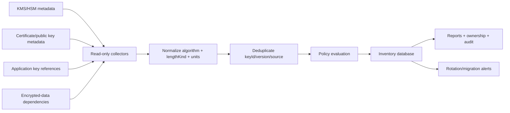
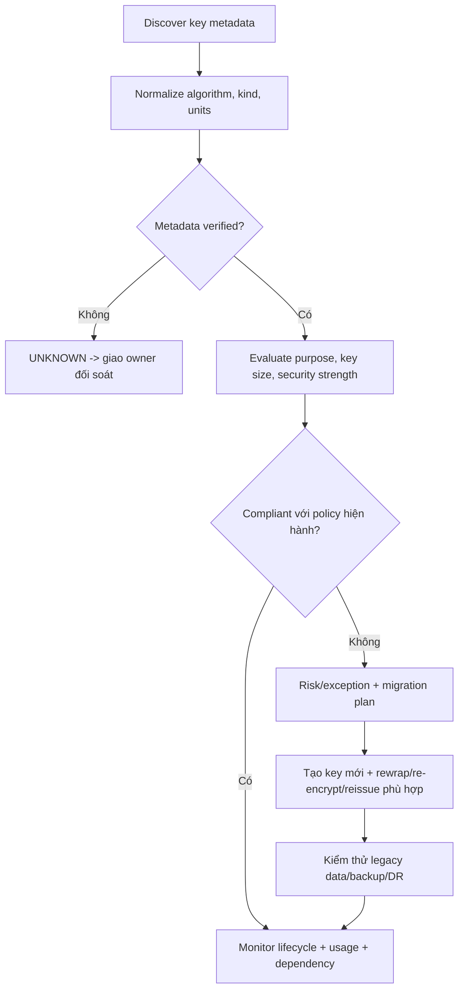

# Key length: Ghi nhận và đánh giá độ dài khóa trong key inventory

> **Chương:** Key inventory  
> **Bài học:** Key length  
> **Module:** `SECURITY_KEY_MANAGEMENT_FUNDAMENTALS` — quản lý vòng đời khóa mật mã từ tạo, cấp phát, lưu trữ, sử dụng, xoay vòng, thu hồi đến hủy; kết nối mật mã đối xứng/bất đối xứng, chữ ký số, KMS/HSM, envelope encryption, IAM và kiểm toán.

## 1. Vì sao key inventory phải lưu độ dài khóa?

Một doanh nghiệp vận hành nhiều dịch vụ Java:

- `Order Service` mã hóa đơn hàng bằng AES-GCM.
- `Payment Gateway` ký thông điệp với RSA-PSS.
- `Webhook Verifier` xác thực bằng HMAC-SHA-256.
- `Archive Service` nhận DEK bằng một cơ chế key establishment.
- KMS/HSM bảo vệ KEK, private keys và quản lý thao tác mật mã.

Khi kiểm kê khóa, một báo cáo liệt kê:

```text
key-001: 256 bit
key-002: 3072 bit
key-003: 256 bit
key-004: 256 bit
```

Các con số này **chưa trả lời được** khóa nào mạnh, khóa nào yếu, thuật toán nào đang dùng và khóa nào cần thay. `3072 bit` có thể là kích thước modulus RSA, trong khi `256 bit` có thể là AES key, kích thước nhóm elliptic curve, độ dài HMAC key hoặc đầu ra của một KDF. Chúng **không mang cùng ý nghĩa**.

**Key length** là thông tin mô tả độ dài của một loại vật liệu khóa hoặc một tham số có liên quan, thường đo bằng **bit**. Trong hệ thống kiểm kê khóa (**key inventory**), cần luôn lưu **key length cùng thuật toán, mục đích, loại khóa, tham số, phiên bản và chính sách**.

> **Nguyên tắc cốt lõi:** Key length là thuộc tính cần thiết của một khóa, nhưng **không đủ để kết luận độ mạnh mật mã**. Cần đánh giá *algorithm + parameter set + security strength + entropy + lifecycle + implementation*.

### Sau bài học, bạn có thể

1. Phân biệt **key length**, **key size**, **security strength**, **entropy**, **digest/tag length** và **encoding length**.
2. Đọc đúng kích thước AES, RSA, ECC/Ed25519/X25519, HMAC và các hệ mật mã khác.
3. Hiểu tại sao một khóa RSA 3072 bit không tương đương khóa AES 3072 bit.
4. Thiết kế các trường inventory cho độ dài khóa, tham số và chứng cứ nguồn.
5. Sử dụng Java 17 để kiểm tra một số metadata khóa mà **không log vật liệu bí mật**.
6. Phát hiện khóa yếu, khóa không rõ kích thước, khóa sai mục đích hoặc gần hết vòng đời.
7. Lập kế hoạch rotation/migration an toàn với KMS/HSM, DEK/KEK, ciphertext và chữ ký số.
8. Áp dụng IAM, audit và quy tắc kiểm tra tự động phù hợp.

---

## 2. Các khái niệm dễ nhầm lẫn

### 2.1. Key length và key size

Trong nhiều tài liệu, hai cụm **key length** và **key size** được dùng gần nhau: độ dài hoặc kích thước tham số khóa. Tuy nhiên, đơn vị và đối tượng đo phải được làm rõ.

| Thuộc tính | Ví dụ | Cách hiểu đúng |
|---|---|---|
| `symmetricKeyBits` | 256 | Độ dài khóa AES thực tế là 256 bit (32 byte). |
| `rsaModulusBits` | 3072 | Độ dài modulus RSA xấp xỉ 3072 bit, không phải 3072 bit độ mạnh bảo mật. |
| `ecGroup` | `secp256r1` | Nhóm elliptic curve được sử dụng; không đơn giản là một chuỗi khóa 256-bit bất kỳ. |
| `ecOrderBits` | 256 | Độ dài bit của bậc nhóm EC; không phải kích thước serialized key. |
| `hmacKeyBits` | 256 | Độ dài vật liệu bí mật cho HMAC; khác độ dài tag. |
| `digestBits` | 256 | Độ dài đầu ra SHA-256; **không phải key length**. |
| `tagBits` | 128 | Độ dài authentication tag, ví dụ AES-GCM; **không phải key length**. |
| `encodedBytes` | 450 | Kích thước biểu diễn PEM/DER nào đó; không suy ra security strength từ số byte này. |

Vì thế không nên có một cột chung `length=256` rồi coi nó mô tả đầy đủ mọi khóa. Nếu bắt buộc dùng tên `keyLengthBits`, phải có thêm `keyType`, `algorithm`, `parameterSet` và định nghĩa rõ **độ dài đó đo cái gì**.

### 2.2. Bit và byte

Một byte bằng 8 bit:

\[
\operatorname{bits}=8\times\operatorname{bytes}
\]

Ví dụ:

| Độ dài bit | Số byte tương ứng | Ngữ cảnh |
|---:|---:|---|
| 128 bit | 16 byte | Khóa AES-128 hoặc tag 128 bit, tùy trường |
| 192 bit | 24 byte | Khóa AES-192 |
| 256 bit | 32 byte | Khóa AES-256 |
| 384 bit | 48 byte | Một đầu ra có độ dài 384 bit |
| 512 bit | 64 byte | Độ dài digest SHA-512, không mặc nhiên là độ dài khóa |

**Đừng lưu `32` với tên `keyLength` mà không có đơn vị.** `32` có thể là 32 byte = 256 bit, hoặc 32 bit, khác biệt bảo mật rất lớn.

### 2.3. Encoding length không phải security strength

Một public key có thể được lưu dưới dạng:

```text
-----BEGIN PUBLIC KEY-----
...
-----END PUBLIC KEY-----
```

PEM thường mã hóa dữ liệu DER bằng Base64 và bổ sung phần header/footer. Dung lượng file còn chứa định danh thuật toán, cấu trúc ASN.1 và metadata. Vì thế:

```text
length(PEM file) != số bit của private/public key
length(Base64 string) != security strength
length(DER data) != RSA modulus size
```

Muốn biết kích thước RSA, lấy **modulus bit length** từ đối tượng public key/API. Muốn biết nhóm EC, đọc **tên curve và thông số nhóm**. Với KMS/HSM, dùng metadata từ API được tin cậy.

### 2.4. Security strength là gì?

**Security strength** thường được diễn đạt bằng số bit bảo mật tương đương: lượng công việc tính toán xấp xỉ cần để phá một cơ chế theo mô hình tấn công và các giả định mật mã nhất định.

Ví dụ minh họa theo bảng độ mạnh của các cơ chế cổ điển thường dùng:

| Cơ chế | Key size/parameter | Security strength xấp xỉ |
|---|---|---|
| AES-128 | Khóa 128 bit | 128 bit |
| AES-192 | Khóa 192 bit | 192 bit |
| AES-256 | Khóa 256 bit | 256 bit |
| RSA | Modulus 2048 bit | Khoảng 112 bit |
| RSA | Modulus 3072 bit | Khoảng 128 bit |
| RSA | Modulus 7680 bit | Khoảng 192 bit |
| RSA | Modulus 15360 bit | Khoảng 256 bit |
| ECC trên nhóm phù hợp | Bậc nhóm khoảng 256 bit | Khoảng 128 bit |
| ECC trên nhóm phù hợp | Bậc nhóm khoảng 384 bit | Khoảng 192 bit |
| ECC trên nhóm phù hợp | Bậc nhóm khoảng 521 bit | Khoảng 256 bit |
| Ed25519/X25519 | Parameter set riêng | Khoảng 128 bit ở mức cổ điển |

Đây là **quy chiếu xấp xỉ trong mô hình cổ điển và khi thuật toán/đường cong/triển khai đáp ứng giả định**; không phải cam kết an toàn tuyệt đối hoặc bảng tương thích pháp lý cho mọi tổ chức. Các yêu cầu mới, đặc biệt về hậu lượng tử, phải đánh giá theo chuẩn hiện hành và chính sách riêng.

**Sai:** chọn RSA-2048 vì thấy `2048 > 256`, rồi kết luận mạnh hơn AES-256.  
**Đúng:** so sánh *security strength và mục đích* trong hệ quy chiếu được công nhận, đồng thời xét điều kiện sử dụng.

### 2.5. Entropy không được tăng lên chỉ bằng độ dài đầu ra

Giả sử:

```text
passphrase = "password123"
KEK = PBKDF2(passphrase, salt, cost, 32 byte)
```

`KEK` có thể dài 256 bit, nhưng mức khó đoán thực tế còn phụ thuộc vào passphrase, password KDF và khả năng attacker tấn công offline.

**Không thể nói KEK chắc chắn chứa 256 bit entropy chỉ vì mảng đầu ra dài 32 byte.** Tương tự, băm một timestamp thành SHA-256 không tạo ra khóa AES-256 mạnh.

---

## 3. Key length theo họ thuật toán

### 3.1. Khóa đối xứng AES

AES theo FIPS 197 sử dụng khóa:

- **AES-128:** 128 bit (16 byte).
- **AES-192:** 192 bit (24 byte).
- **AES-256:** 256 bit (32 byte).

Cả ba đều là biến thể AES được định nghĩa, nhưng mỗi biến thể có mức bảo mật và chi phí xử lý khác nhau.

```text
algorithm = AES
keyLengthBits = 256
mode = GCM
nonceLengthBits = 96
tagLengthBits = 128
```

Trong ví dụ này:

- `keyLengthBits=256` là độ dài **khóa AES**.
- `nonceLengthBits=96` là kích thước nonce/IV.
- `tagLengthBits=128` là độ dài authentication tag.

Không được coi `tagLengthBits` hay `nonceLengthBits` là một kiểu key length khác.

**AES-GCM không tự đảm bảo không replay.** Nó bảo vệ tính bí mật/toàn vẹn của bản mã theo DEK, nonce và AAD. Nonce phải tránh tái sử dụng dưới cùng key; bản ciphertext cũ hợp lệ vẫn có thể bị phát lại nếu thiếu trạng thái nghiệp vụ.

### 3.2. DES, 3DES và các khóa legacy

Một hệ thống cũ có thể báo:

```text
DES key length: 64 bit
```

DES có **56 bit khóa hữu hiệu**, còn một số bit được dùng cho parity. Vì vậy nhìn vào 64 bit byte biểu diễn mà kết luận độ mạnh 64 bit là sai.

Tương tự, 3DES/TDEA có kích thước vật liệu khóa và độ mạnh hữu hiệu phụ thuộc lựa chọn keying option và ràng buộc an toàn. Đây là nhóm thuật toán legacy bị hạn chế/không nên chọn cho thiết kế mới theo chính sách hiện đại.

Trong inventory nên ghi:

```text
algorithm = DES hoặc TDEA
keyType = symmetric
status = LEGACY_REMEDIATION
policyDecision = REPLACE
```

Cụ thể cho mỗi hệ thống, việc di chuyển phải xét khả năng giải mã ciphertext lịch sử, khả năng backup và yêu cầu tuân thủ. Không tự xóa khóa legacy đang cần cho dữ liệu chưa di chuyển.

### 3.3. Khóa RSA

Đối với RSA, trường phổ biến là **modulus bit length**, ví dụ:

```text
RSA modulusBits = 2048
RSA modulusBits = 3072
RSA modulusBits = 4096
```

Độ dài RSA modulus không phải số bit entropy của private key và không ánh xạ 1:1 sang độ mạnh của AES. Theo các mốc so sánh thường dùng, RSA-2048 xấp xỉ 112-bit security; RSA-3072 khoảng 128-bit security. RSA-4096 nằm giữa các mốc chuẩn và **không mặc nhiên được gọi là 192-bit security**.

Trong key inventory, nên lưu:

```yaml
algorithm: RSA
keyClass: ASYMMETRIC_PRIVATE
modulusBits: 3072
publicExponent: 65537
purpose: SIGN
signatureScheme: RSASSA-PSS
hash: SHA-256
```

Đây chỉ là ví dụ metadata. Với RSA, **kích thước modulus thôi chưa đủ**: cần đánh giá padding, hash, exponent hợp lệ, nguồn tạo khóa, khả năng export private key và cơ chế key usage.

Cần phân biệt:

- **RSA-PSS** phục vụ chữ ký.
- **RSA-OAEP** phục vụ mã hóa/transport vật liệu khóa nhỏ.
- **RSA raw/NoPadding** không phù hợp cho các thiết kế bảo mật thông thường.
- **PKCS#1 v1.5** tồn tại vì tương thích legacy và cần đánh giá rủi ro/chuẩn áp dụng.

Một khóa RSA 3072 bit **không tự bảo đảm** hệ thống an toàn nếu ứng dụng dùng padding sai, public key không xác thực hoặc private key được commit trong source.

### 3.4. ECC, ECDSA và ECDH

Một khóa đường cong elliptic có thể được mô tả bằng tên **nhóm/curve** thay vì một số bit đơn lẻ:

| Tên nhóm | Thông số gần đúng | Security strength cổ điển |
|---|---|---|
| `secp256r1` / P-256 | Nhóm EC khoảng 256 bit | Khoảng 128 bit |
| `secp384r1` / P-384 | Nhóm EC khoảng 384 bit | Khoảng 192 bit |
| `secp521r1` / P-521 | Nhóm EC khoảng 521 bit | Khoảng 256 bit |
| Ed25519 | EdDSA parameter set | Khoảng 128 bit |
| X25519 | X25519 key agreement parameter set | Khoảng 128 bit |

**ECC key size không phải file size.** EC public key có thể lưu nén/không nén, bọc SPKI hoặc chứng thư; dung lượng serialized rất khác.

Đừng viết chính sách kiểu:

```text
if keyLengthBits >= 256:
    allowEveryAlgorithm()
```

Vì `RSA-256` không có ý nghĩa tương đương `AES-256`; `P-256` và `RSA-256` cũng khác hẳn. Phải đánh giá theo **algorithm family + named parameter set**.

### 3.5. Ed25519 và X25519

Tên `Ed25519` hoặc `X25519` chứa con số **không được hiểu đơn giản là khóa 25519 bit**. Chúng là tên cơ chế với thông số đã định nghĩa.

- **Ed25519:** thuật toán chữ ký số dựa trên EdDSA.
- **X25519:** cơ chế thỏa thuận khóa kiểu Montgomery ECDH.

Hai tên này không thể hoán đổi chỉ vì đều liên quan Curve25519. Một key pair dùng cho ký không nên mặc nhiên dùng cho thỏa thuận khóa.

Inventory nên ghi:

```text
algorithm = Ed25519
keyPurpose = DIGITAL_SIGNATURE
parameterSet = Ed25519
```

hoặc:

```text
algorithm = X25519
keyPurpose = KEY_AGREEMENT
parameterSet = X25519
```

**Không tự lấy kích thước của PEM/DER của Ed25519 rồi báo là key length thực sự.**

### 3.6. HMAC: key length khác digest/tag length

Một HMAC-SHA-256 có ba thông số dễ nhầm:

```text
algorithm = HmacSHA256
keyLengthBits = 256         # ví dụ dùng HMAC key ngẫu nhiên 32 byte
hashOutputBits = 256       # SHA-256 digest 32 byte
transmittedTagBits = 256   # toàn bộ tag 32 byte, nếu giao thức dùng full tag
```

HMAC cho phép khóa có độ dài khác nhau theo cơ chế chuẩn hóa khóa. Trong nhiều ứng dụng, **HMAC key ngẫu nhiên 256 bit** là một lựa chọn rõ ràng; không nên dùng một password ngắn rồi đệm thành 32 byte và gọi nó là khóa 256-bit mạnh.

Một giao thức có thể rút ngắn HMAC tag theo chuẩn và chính sách, nhưng key length và tag length vẫn là **hai thuộc tính riêng**. Một tag quá ngắn có thể làm tăng khả năng giả mạo, dù secret key dài.

### 3.7. DH/finite-field và key establishment

Với finite-field Diffie–Hellman, cần ghi nhóm được dùng và kích thước modulus, đồng thời chú ý bậc nhóm và các tham số. Một trường `dhKeyBits` đơn lẻ không đủ để đánh giá độ mạnh.

Với ECDH/X25519, ghi **named group** và xác thực đúng key share, không tự kết luận bằng độ dài public key được serialize. Sự an toàn của key establishment còn phụ thuộc xác thực peer, transcript binding, freshness, replay policy và KDF.

### 3.8. Mật mã hậu lượng tử: tên parameter set không phải key length

Các thuật toán hậu lượng tử có kích thước **public key**, **private key**, **ciphertext/signature** rất khác với RSA/ECC. Ví dụ các họ chuẩn hóa như **ML-KEM** (FIPS 203) và **ML-DSA** (FIPS 204) dùng những parameter set và mức security category riêng.

**Đừng đọc một con số trong tên parameter set rồi coi nó là số bit private key hoặc security strength.** Với PQC, inventory cần lưu:

- Algorithm chuẩn, parameter set và phiên bản.
- Loại key: public/private/seed hoặc key handle.
- Kích thước serialized (nếu cần theo dõi), **tách khỏi security category**.
- Purpose và điều kiện sử dụng; hình thức hybrid nếu có.
- Provider/firmware hỗ trợ và cryptoperiod/policy migration.

Đánh giá security strength hậu lượng tử **không đơn giản thay bằng bảng AES/RSA/ECC cổ điển**. Theo chính sách chuyển đổi, cần tham chiếu tiêu chuẩn và hướng dẫn đang có hiệu lực tại thời điểm đánh giá.

---

## 4. Độ dài khóa và độ mạnh bảo mật: cách đưa vào policy

### 4.1. Bảng phân loại thực hành

Một tổ chức có thể chọn các mức yêu cầu ví dụ:

| Tier | Mục tiêu minh họa | Thuật toán phù hợp trong một số bối cảnh |
|---|---|---|
| **Baseline hiện đại** | Xấp xỉ 128-bit classical security | AES-128; RSA-3072; P-256; Ed25519/X25519 khi phù hợp |
| **Dữ liệu giá trị cao/giữ dài** | Có thể yêu cầu mức cao hơn theo chính sách | AES-256, EC group mạnh hơn hoặc phương án PQC/hybrid theo threat model |
| **Legacy cần di chuyển** | Thấp hơn mức chấp nhận hoặc bị loại theo chính sách | RSA-1024, DES, nhiều cấu hình 3DES, thuật toán không còn phù hợp |
| **Unknown/unverified** | Chưa biết kích thước, thuật toán hoặc nguồn | Cần thu thập/đối soát trước khi chứng nhận compliance |

Đây là **bảng minh họa**, không phải bảng cho phép tự động cho mọi ngành, mọi luật và mọi thời điểm. Tổ chức phải chọn policy theo tiêu chuẩn, thời hạn bảo vệ, môi trường vận hành, threat model, chứng nhận và thuật toán được phép.

### 4.2. Vì sao RSA-2048 không luôn bị cấm tức thì?

Một số chính sách có giai đoạn chuyển tiếp hoặc cho phép legacy verification/decryption với điều kiện riêng. Phân biệt:

- Tạo khóa mới.
- Ký/mã hóa dữ liệu mới.
- Xác minh chữ ký lịch sử.
- Giải mã ciphertext cũ.
- Lưu trữ hoặc hủy khóa theo retention.

**Không nên lấy một ngưỡng đơn giản rồi tự động xóa tất cả RSA-2048**. Cần phân tích hệ thống phụ thuộc, thời gian giữ chứng cứ, loại thao tác được phép và kế hoạch nâng cấp.

### 4.3. Không thay key length mà bỏ mode và context

AES-256-CBC không có đặc tính authenticated encryption giống AES-256-GCM chỉ vì cả hai có khóa 256 bit. Tương tự:

- RSA-3072 ký bằng một giao thức lỗi vẫn có rủi ro.
- HMAC-SHA-256 với key 256 bit vẫn bị replay nếu không có nonce/operation state.
- P-256 ECDH không xác thực có thể bị MITM.
- AES-GCM 256 bit vẫn hỏng nếu dùng lại nonce dưới cùng key.

**Key size là một trường kiểm kê, không phải bản đánh giá an toàn toàn diện.**

---

## 5. Những trường metadata cần có trong key inventory

### 5.1. Tập trường tối thiểu

Một bản ghi inventory có thể có:

| Trường | Ví dụ | Ý nghĩa |
|---|---|---|
| `keyId` | `orders-dek-v7` | ID duy nhất trong phạm vi hệ thống. |
| `keyVersion` | `7` | Phiên bản vật liệu, phân biệt với alias. |
| `algorithm` | `AES`, `RSA`, `Ed25519` | Primitive chính. |
| `parameterSet` | `AES-256`, `secp256r1`, `ML-KEM-768` | Nhóm/tham số cụ thể, khi áp dụng. |
| `keyType` | `SYMMETRIC`, `PUBLIC`, `PRIVATE` | Loại vật liệu/handle. |
| `lengthKind` | `SYMMETRIC_KEY_BITS`, `RSA_MODULUS_BITS` | **Đang đo kích thước gì**. |
| `keyLengthBits` | `256`, `3072` | Giá trị số có đơn vị bit, nếu có ý nghĩa. |
| `securityStrengthBits` | `128` | Ước lượng **theo policy và thuật toán**; không copy từ key length. |
| `keyPurpose` | `ENCRYPT`, `SIGN`, `HMAC`, `WRAP` | Mục đích sử dụng. |
| `keyOrigin` | `KMS_GENERATED`, `HSM_GENERATED`, `IMPORTED` | Nguồn tạo/nhập khóa. |
| `exportPolicy` | `NON_EXPORTABLE` | Có thể xuất raw material hay không. |
| `owner` | `orders-team` | Đơn vị chịu trách nhiệm. |
| `tenant/environment` | `tenant-42`, `prod` | Ranh giới sử dụng. |
| `lifecycleState` | `ACTIVE`, `DISABLED`, `DESTROY_PENDING` | Trạng thái vòng đời. |
| `createdAt`, `rotateBy` | UTC ISO 8601 | Thời điểm sinh và lịch rotation. |
| `sourceRef` | KMS key ARN/URI hoặc handle | Tham chiếu metadata; **không chứa raw key**. |
| `policyVersion` | `crypto-policy-2026-v3` | Quy tắc đã đánh giá. |
| `lastVerifiedAt` | UTC ISO 8601 | Lần kiểm tra gần nhất. |

Không phải trường nào cũng áp dụng mọi khóa. Ví dụ một Ed25519 key có tên parameter set nhưng không nhất thiết có một integer modulus bit length như RSA. Đối với HSM key, đôi khi nhà cung cấp báo `keySizeBits` theo định nghĩa riêng; cần chuẩn hóa bằng metadata gốc và kiểu độ dài.

### 5.2. Ví dụ record JSON

```json
{
  "keyId": "archive-signing-prod-v3",
  "keyVersion": "3",
  "algorithm": "RSA",
  "parameterSet": "RSA-3072",
  "keyType": "ASYMMETRIC_PRIVATE",
  "lengthKind": "RSA_MODULUS_BITS",
  "keyLengthBits": 3072,
  "securityStrengthBits": 128,
  "keyPurpose": "DIGITAL_SIGNATURE",
  "signatureScheme": "RSASSA-PSS",
  "owner": "archive-service",
  "environment": "prod",
  "keyOrigin": "HSM_GENERATED",
  "exportPolicy": "NON_EXPORTABLE",
  "lifecycleState": "ACTIVE",
  "createdAt": "2026-06-01T00:00:00Z",
  "rotateBy": "2027-06-01T00:00:00Z",
  "policyVersion": "crypto-policy-example-v1",
  "sourceRef": "kms://example/archive-signing-prod-v3",
  "lastVerifiedAt": "2026-11-28T00:00:00Z"
}
```

Đây là **record minh họa**, không phải key thực hoặc định dạng API của một nhà cung cấp KMS. Giá trị `securityStrengthBits=128` là mức quy đổi **ước lượng** cho RSA-3072 trong ngữ cảnh cổ điển; có thể cần thêm policy, thuật toán ký và các điều kiện khác để đưa ra compliance decision.

### 5.3. Không lưu raw key trong inventory

**Inventory là sổ quản lý metadata, không phải một bản sao kho bí mật.**

Không lưu những trường sau vào bảng tra cứu thông thường:

```text
privateKeyPem
secretKeyBase64
rawDek
passwordDerivedKek
hmacSecret
recoverySeed
```

Thậm chí raw public key đôi khi có thể được lưu theo yêu cầu, nhưng cần kiểm soát nguồn, integrity, trust mapping và rủi ro lộ metadata. Để theo dõi khóa, thường dùng **key ID, fingerprint công khai, resource ARN/URI hoặc HSM object handle**.

### 5.4. Key ID và alias không phải key material

Một alias kiểu:

```text
alias/orders-data-prod
```

có thể trỏ từ key version `v3` sang `v4` sau rotation. Inventory cần lưu **key version bất biến** để biết ciphertext hoặc chữ ký lịch sử thực sự phụ thuộc vào vật liệu nào.

Một số KMS hỗ trợ automatic rotation nhưng không thay mọi bản DEK đã wrap bên ngoài; không được suy ra mọi dữ liệu đã chuyển khóa chỉ từ alias mới.

---

## 6. Nguồn sự thật về key length

### 6.1. KMS/HSM metadata

Nếu khóa được quản lý trong KMS/HSM:

1. Truy vấn metadata qua API **read-only** với quyền tối thiểu.
2. Lưu `algorithm`, `keySpec`, `keyUsage`, `keyState`, `origin`, `keyId/version` và các trường kích thước mà API hỗ trợ.
3. Chuẩn hóa thành `lengthKind` và `keyLengthBits` khi có định nghĩa rõ.
4. Lưu nguồn, thời điểm truy vấn và `policyVersion`.
5. Không gọi `Decrypt`, `ExportKey` hoặc ghi raw key vào inventory chỉ để biết độ dài.

**Không phải mọi KMS cung cấp API/field giống nhau.** Một symmetric key có thể được biểu diễn bằng `SYMMETRIC_DEFAULT` hoặc tên spec khác thay vì literal `256`. Khi đó mapping phải dựa trên **tài liệu provider**, không đoán từ tên tùy tiện.

Một non-exportable private key vẫn có thể kiểm tra thông số/metadata mà không đưa private key ra khỏi HSM.

### 6.2. Public key metadata

Với RSA public key, modulus bit length có thể được kiểm tra bằng JCA:

```java
RSAPublicKey pub = ...; // Public key đã lấy và xác thực
int modulusBits = pub.getModulus().bitLength();
```

Đây là thông tin công khai của thuật toán, không yêu cầu private key. Tuy nhiên, **chỉ đọc bitLength không xác minh trust chain hoặc quyền sử dụng**.

Với EC, có thể kiểm tra nhóm/thông số được provider hỗ trợ:

```java
ECPublicKey pub = ...;
int orderBits = pub.getParams().getOrder().bitLength();
```

Điều này chỉ phản ánh một thông số của nhóm. Đối với chính sách, cần lưu **tên nhóm/curve đáng tin**, đánh giá có thuộc danh sách cho phép hay không, và xác thực nguồn public key.

### 6.3. Có cần gọi `SecretKey.getEncoded()`?

Trong Java, `SecretKey.getEncoded()` có thể trả raw bytes của khóa nếu provider cho phép. Một số key ở HSM/KMS hoặc provider an toàn có thể trả `null`, vì khóa **không được xuất**.

**Không dùng việc đọc/xuất raw secret như đường kiểm kê mặc định.** Nó tạo thêm bản sao nhạy cảm trong heap, crash dump hoặc log, và có thể vi phạm export policy.

Với symmetric keys:

- Lúc tạo khóa, ghi **kích thước đã yêu cầu** và metadata đã được provider xác nhận.
- Với KMS/HSM, lấy size từ **key spec metadata**.
- Đối với key nhập từ ngoài, cần kiểm tra metadata/formats ngay trong quy trình import được phép.
- Nếu không xác minh được, đặt `sizeVerificationState=UNKNOWN`, không bịa một giá trị chỉ từ thuật toán.

### 6.4. Chứng thư X.509 có đủ để đo độ mạnh không?

Chứng thư chứa public key và metadata hữu ích. Nhưng:

- Public key phải được xác thực qua chain/trust policy.
- Key usage và mục đích certificate phải phù hợp.
- Độ dài RSA hoặc EC group chỉ là một phần.
- Chữ ký của CA và chính sách thu hồi/thời hạn cũng ảnh hưởng độ tin cậy.
- Một chứng thư có khóa đủ dài **không tự chứng minh** private key đang được bảo vệ tốt trong HSM.

---

## 7. Java 17: Minh họa thu thập key-length metadata an toàn

Code sau dùng JCA Java 17 để **sinh khóa cho demo** và thu thập thông số:

- AES-256 bằng `KeyGenerator`, ghi kích thước **đã yêu cầu**.
- RSA-3072 bằng `KeyPairGenerator`, đọc **modulus bit length** của public key.
- ECDSA P-256 bằng `KeyPairGenerator` với `ECGenParameterSpec`, đọc **group order bit length**.
- Ed25519 bằng JCA, ghi **tên parameter set** thay vì cố suy ra độ mạnh từ số byte PEM.
- Không in/serialize/ghi raw secret key hay private key.

```java
import java.security.GeneralSecurityException;
import java.security.KeyPair;
import java.security.KeyPairGenerator;
import java.security.SecureRandom;
import java.security.interfaces.ECPublicKey;
import java.security.interfaces.EdECPublicKey;
import java.security.interfaces.RSAPublicKey;
import java.security.spec.ECGenParameterSpec;

import javax.crypto.KeyGenerator;
import javax.crypto.SecretKey;

public final class KeyLengthInventoryDemo {
    private static final SecureRandom RNG = new SecureRandom();

    private KeyLengthInventoryDemo() {}

    public static void main(String[] args)
            throws GeneralSecurityException {

        // 1. Symmetric key: thông tin từ cấu hình tạo khóa.
        KeyGenerator aesGenerator = KeyGenerator.getInstance("AES");
        int requestedAesBits = 256;
        aesGenerator.init(requestedAesBits, RNG);
        SecretKey aesDek = aesGenerator.generateKey();

        System.out.println(
                "AES algorithm=" + aesDek.getAlgorithm()
                + ", requestedKeyBits=" + requestedAesBits);
        // Không gọi aesDek.getEncoded() chỉ để in key material.

        // 2. RSA: modulus bit length lấy qua PUBLIC key.
        KeyPairGenerator rsaGen = KeyPairGenerator.getInstance("RSA");
        rsaGen.initialize(3072, RNG);
        KeyPair rsaPair = rsaGen.generateKeyPair();

        RSAPublicKey rsaPublic =
                (RSAPublicKey) rsaPair.getPublic();
        System.out.println("RSA modulusBits="
                + rsaPublic.getModulus().bitLength());

        // 3. EC: group name + group order bit length.
        KeyPairGenerator ecGen = KeyPairGenerator.getInstance("EC");
        ecGen.initialize(new ECGenParameterSpec("secp256r1"), RNG);
        KeyPair ecPair = ecGen.generateKeyPair();

        ECPublicKey ecPublic = (ECPublicKey) ecPair.getPublic();
        System.out.println("EC group=secp256r1, orderBits="
                + ecPublic.getParams().getOrder().bitLength());

        // 4. Ed25519: ghi đúng named parameter set.
        KeyPairGenerator edGen =
                KeyPairGenerator.getInstance("Ed25519");
        KeyPair edPair = edGen.generateKeyPair();

        EdECPublicKey edPublic =
                (EdECPublicKey) edPair.getPublic();
        System.out.println("EdDSA parameterSet="
                + edPublic.getParams().getName());
    }
}
```

### 7.1. Kết quả kỳ vọng

```text
AES algorithm=AES, requestedKeyBits=256
RSA modulusBits=3072
EC group=secp256r1, orderBits=256
EdDSA parameterSet=Ed25519
```

Các dòng trên là **kết quả kỳ vọng trên Java 17 với provider hỗ trợ đầy đủ**; không tuyên bố chương trình đã được thực thi hay kiểm thử production.

### 7.2. Những gì code chứng minh

- `AES` cần có thông số số bit khi khởi tạo; inventory không bắt buộc phải xuất raw key để lấy giá trị đó.
- `RSA` public modulus cho biết kích thước modulus.
- Với `EC`, phải giữ tên nhóm và không đồng nhất order bits với `securityStrengthBits`.
- `Ed25519` là tên thuật toán/parameter set; không tính key bits từ PEM length.

### 7.3. Giới hạn của ví dụ

- Các khóa được sinh **trong JVM**, chưa ở KMS/HSM; demo không mô tả non-exportable key.
- Giá trị `requestedAesBits` phản ánh cấu hình yêu cầu; trong production cần **xác nhận trạng thái thành công và metadata nguồn** chứ không tin một string trong database.
- Code không đánh giá chứng thư, key usage, cryptoperiod, IAM, security strength, PQC hoặc thuật toán bị cấm.
- Code không lưu inventory database, không có schema validation, pagination, deduplication và reconciliation.
- Không có rotation, key wrapping, audit KMS hoặc lifecycle event.
- Không có yêu cầu thử `getEncoded()` cho private/secret key. **Đừng bổ sung bước xuất khóa để kiểm kê**.
- Java provider phải hỗ trợ RSA, EC P-256 và Ed25519 trên runtime đang dùng.
- Với HSM-backed JCA, các đối tượng key có thể là opaque handles; API lấy metadata sẽ phụ thuộc provider.

**Mẫu tốt:** kiểm kê **metadata của khóa** và nguồn chính sách, không kiểm kê **byte bí mật của khóa**.

---

## 8. Policy engine: đánh giá key length theo ngữ cảnh

### 8.1. Tại sao quy tắc `if length < 256` là sai?

Giả sử một policy engine có:

```text
reject if keyLengthBits < 256
```

Lỗi:

- Không nhận ra RSA-2048 (độ dài > 256 nhưng security strength chỉ ~112).
- Không phân biệt HMAC key bits và HMAC tag bits.
- Không hiểu Ed25519/X25519 qua named parameter set.
- Không đánh giá thuật toán legacy.
- Không tính được security category của PQC.
- Không xác định khóa được dùng để **sign mới**, **verify lịch sử**, **encrypt**, hay **decrypt cũ**.

### 8.2. Quy tắc đúng phải theo thuật toán, mục đích và thời gian

Minh họa cấu hình logic:

```yaml
policyId: crypto-inventory-example-v1
purpose:
  ENCRYPT_NEW:
    AES:
      allowedKeyBits: [128, 192, 256]
  SIGN_NEW:
    RSA:
      minModulusBits: 3072
      allowedScheme: RSASSA-PSS
    ECDSA:
      allowedCurves: [secp256r1, secp384r1]
    EdDSA:
      allowedParameterSets: [Ed25519]
  VERIFY_LEGACY:
    requireExplicitException: true
```

Đây chỉ là **policy minh họa cho bài học**, không phải cấu hình tiêu chuẩn/khuyến nghị đầy đủ. Việc cho phép AES-128 hay RSA-PSS tùy rủi ro, tiêu chuẩn hiện hành và thời hạn bảo vệ thực tế. Các chính sách production cần bổ sung chế độ mã hóa, hash/MGF, key usage, expiry, cryptoperiod, proof-of-origin và state.

### 8.3. Phân loại kết quả inventory

Một pipeline nên phân biệt các trạng thái:

| Trạng thái | Khi nào áp dụng | Hành động |
|---|---|---|
| `COMPLIANT` | Metadata đã xác minh và đáp ứng policy hiện hành | Theo dõi vòng đời, xem lại định kỳ |
| `NON_COMPLIANT` | Biết rõ thuật toán/size/use không hợp lệ | Tạo kế hoạch khắc phục |
| `LEGACY_EXCEPTION` | Khóa cũ còn cần cho verify/decrypt lịch sử | Giới hạn mục đích và thời hạn ngoại lệ |
| `UNKNOWN` | Thiếu metadata hoặc nguồn không xác minh được | Reconcile trước khi phê duyệt |
| `PENDING_MIGRATION` | Đã có kế hoạch nâng cấp và owner | Theo dõi deadline, dependencies |
| `DISABLED` | Khóa không còn dùng được cho thao tác mới | Xem xét retention và xóa an toàn |

**Unknown không phải compliant.** Cũng không nên coi mọi khóa legacy là xấu và xóa ngay nếu còn ciphertext/chữ ký cần bảo toàn.

---

## 9. Tự động phát hiện và đối soát inventory

### 9.1. Những nơi cần tìm key metadata

Tùy kiến trúc tổ chức:

- KMS (keys, versions, aliases, usage policy).
- HSM partitions hoặc object handles.
- Secrets manager: trường khóa được lưu (không đọc secret nếu không được phép).
- Certificate inventory, PKI và trust store.
- Java keystore metadata (JKS/PKCS12) **khi được cấp quyền**; không in private material.
- Application configurations chỉ chứa **key reference**.
- Cơ sở dữ liệu metadata của DEK/wrapped DEK.
- CI/CD key provisioning và rotation logs.
- Backup/DR catalog để biết các bản mã lịch sử còn phụ thuộc khóa nào.
- Workload identity và endpoint TLS metadata.

Không phải mọi password, OAuth token hay connection string đều là **cryptographic key** theo cùng schema. Có thể có inventory bổ sung cho secrets/credentials với thuộc tính khác.

### 9.2. Pipeline khái niệm



**Read-only collectors** nên dùng danh tính riêng với quyền tối thiểu. Chúng không cần quyền `Decrypt`, `ExportKey` hay thay `KeyPolicy` chỉ để liệt kê size.

### 9.3. Reconciliation: phát hiện metadata mâu thuẫn

Ví dụ:

```text
Ứng dụng khai: key=orders-prod, algorithm=AES, bits=128
KMS metadata:  key=orders-prod-v3, keySpec=SYMMETRIC_256
```

Không tùy ý lấy giá trị lớn hơn hoặc “tự sửa” mà không biết nguồn nào đúng. Cần:

1. Xác định **key version** thay vì alias động.
2. Xác định app dùng **đúng key ARN/handle** nào.
3. Kiểm tra xem kích thước app khai là kích thước **DEK** hay **KEK**.
4. Đối chiếu KMS metadata và ciphertext format đã tạo.
5. Đánh dấu sai lệch, ghi audit và giao owner kiểm tra.
6. Chỉ cập nhật inventory sau khi có bằng chứng nguồn.

Một DEK AES-128 có thể được **wrap dưới KEK AES-256**; hai kích thước khác nhau không nhất thiết là lỗi. Inventory cần phân biệt **đối tượng khóa** và **mối quan hệ bảo vệ khóa**.

### 9.4. SQL truy vấn ví dụ

Giả sử bảng đã chuẩn hóa:

```sql
CREATE TABLE key_inventory (
    key_id VARCHAR(200) NOT NULL,
    key_version VARCHAR(40) NOT NULL,
    environment VARCHAR(40) NOT NULL,
    algorithm VARCHAR(80) NOT NULL,
    length_kind VARCHAR(80) NOT NULL,
    key_length_bits INTEGER,
    security_strength_bits INTEGER,
    key_purpose VARCHAR(80) NOT NULL,
    lifecycle_state VARCHAR(40) NOT NULL,
    verification_state VARCHAR(40) NOT NULL,
    rotate_by TIMESTAMP,
    PRIMARY KEY (key_id, key_version, environment)
);
```

Truy vấn tìm key không có thông tin size:

```sql
SELECT key_id, key_version, algorithm, length_kind
FROM key_inventory
WHERE key_length_bits IS NULL
  AND verification_state <> 'VERIFIED';
```

Truy vấn ứng viên RSA modulus dưới 3072 bit dùng cho ký mới:

```sql
SELECT key_id, key_version, key_length_bits
FROM key_inventory
WHERE algorithm = 'RSA'
  AND key_purpose = 'SIGN_NEW'
  AND key_length_bits < 3072;
```

**Đây là truy vấn lọc ứng viên theo policy ví dụ, không phải bộ kiểm định compliance hoàn chỉnh.** Một số khóa có `key_purpose='DIGITAL_SIGNATURE'` thay cho `SIGN_NEW`; hệ thống phải có danh mục chuẩn hóa trường và quy tắc giai đoạn sử dụng.

### 9.5. Key ID, version và alias trong kiểm kê

```text
alias/orders-data-prod -> key version v4
ciphertext cũ          -> wrappedDEK under key version v2
ciphertext mới         -> wrappedDEK under key version v4
```

Nếu chỉ có một record cho alias, sẽ bỏ sót phụ thuộc vào `v2`. Cần các quan hệ:

```text
keyVersion -> ciphertext/wrapped DEK dependencies
keyVersion -> signing/verifying dependencies
keyVersion -> status, owner, rotation plan
```

Đây là điều kiện thiết yếu để rotate/hủy mà không đánh mất khả năng decrypt hoặc verify tài liệu lịch sử.

---

## 10. Key length trong vòng đời khóa

### 10.1. Tạo khóa

**Câu hỏi:**

- Chọn algorithm/parameter set nào?
- Key length nào đáp ứng chính sách?
- Nguồn sinh có đủ entropy không?
- Key được tạo trong ứng dụng, KMS hay HSM?
- Có cần non-exportable không?
- Ai có quyền sử dụng khóa đó?

Ví dụ ứng dụng yêu cầu AES-256 DEK:

```text
KMS.GenerateDataKey(keySpec = AES_256)
```

Ý nghĩa là **yêu cầu dịch vụ cấp DEK AES-256** theo API cụ thể. Phải kiểm tra tên field thực tế của nhà cung cấp. Không giả định mọi KMS có cùng tên `AES_256`.

### 10.2. Cấp phát

Không nên cấp raw key qua chat/email/plain config. Key length đúng nhưng quy trình cấp phát sai vẫn làm bí mật bị lộ.

- Public key: phân phối qua kênh xác thực/trust registry/chứng thư.
- Symmetric key: cấp phát theo cơ chế bảo vệ và policy.
- DEK: wrap bằng KEK, có metadata về thuật toán và key version.
- Private signing key: nên hạn chế xuất, dùng API ký của KMS/HSM nếu phù hợp.

Inventory phải theo dõi **đường phân phối** mà không sao chép vật liệu khóa.

### 10.3. Lưu trữ và sử dụng

Một DEK AES-256 có thể được wrap dưới một KMS KEK. Inventory nên ghi:

```text
DEK:
    algorithm: AES
    keyLengthBits: 256
    purpose: CONTENT_ENCRYPTION
    wrappedBy: kms-key-v4

KEK:
    keyId: kms-key-v4
    algorithm: AES
    keyLengthBits: 256
    purpose: KEY_WRAP
```

Không coi **key length của KEK** là key length của DEK. Một báo cáo chỉ dựa trên KMS key có thể hoàn toàn bỏ sót những DEK do ứng dụng tạo rồi wrap, do đó cần **dependency inventory**.

### 10.4. Rotation

Khi policy thay đổi, cần xác định chính xác:

- Thay **DEK** hay chỉ **KEK/wrapping key**?
- Chỉ **rewrap DEK** hay phải **re-encrypt dữ liệu**?
- Đổi signing key mới có cần giữ public key cũ để verify chữ ký lịch sử?
- Có kiểm tra backward compatibility, backup/DR và key identifiers?
- Những ciphertext nào còn dùng size/algorithm cũ?

Ví dụ nâng từ AES-128 DEK lên AES-256 DEK:

```text
C_old = AES-GCM-Encrypt(DEK_128, plaintext, ...)
DEK_256 <- CSPRNG()
C_new = AES-GCM-Encrypt(DEK_256, plaintext, nonceNew, ...)
```

**Chỉ bọc lại cùng `DEK_128` dưới KEK mới không biến nó thành `DEK_256`.** Muốn thay trực tiếp khóa nội dung phải tạo DEK mới và mã hóa lại dữ liệu tương ứng.

### 10.5. Thu hồi và hủy

Khi khóa không còn phù hợp:

- Chặn thao tác tạo/Sign/Encrypt mới theo mục đích.
- Giữ khả năng decrypt/verify lịch sử khi policy cho phép và dữ liệu còn phụ thuộc.
- Xác minh tất cả bản sao, key versions, backup và DR.
- Hủy private/secret key theo quy trình sau khi dependency được xử lý.
- Ghi lại ngày hủy, người phê duyệt và chứng cứ vận hành.

**Hủy key version có thể khiến dữ liệu mã hóa không thể khôi phục.** Inventory giúp biết trước tác động để không xóa nhầm.

---

## 11. Độ dài khóa và cryptoperiod

**Cryptoperiod** là thời gian một khóa được phép dùng cho những chức năng nhất định theo chính sách. Key length ảnh hưởng đánh giá rủi ro, nhưng không thể dùng một công thức "khóa dài gấp đôi thì sống lâu gấp đôi".

Các yếu tố cần xem xét:

- Mục đích: AES data encryption, RSA signing, HMAC, transport, KEK.
- Khối lượng dữ liệu và số phép toán dưới cùng khóa.
- Giới hạn nonce/IV và chế độ AEAD.
- Độ nhạy dữ liệu và thời hạn giữ bí mật.
- Rủi ro lộ khóa trong runtime hoặc khi cấp phát.
- Thuật toán, môi trường tấn công và yêu cầu pháp lý.
- Khả năng triển khai rotation mà không mất dữ liệu lịch sử.

**Ví dụ:** AES-256 không có nghĩa được phép dùng vô hạn nonce hoặc không cần rotation. RSA-4096 không có nghĩa private key được lưu plaintext mãi mãi. Một HMAC key mạnh vẫn cần dừng chấp nhận tag cũ nếu đối tác bị xâm nhập.

### 11.1. Mức bảo vệ dữ liệu lâu dài

Dữ liệu cần giữ bí mật trong nhiều thập kỷ có thể cần đánh giá thêm rủi ro mật mã hậu lượng tử, thuật toán đã lỗi thời và năng lực đối thủ tương lai.

Không thể chỉ đổi một trường trong database từ `128` thành `256` rồi coi như đã cải thiện mức bảo vệ dữ liệu. Cần quyết định thuật toán/kiến trúc, migration, key generation và ciphertext mới.

### 11.2. Quản lý ngoại lệ legacy

Một khóa đã hết thời hạn tạo chữ ký mới có thể vẫn cần dùng public key để **verify chữ ký cũ**. Inventory nên phân biệt:

```text
allowedOperations = [VERIFY_HISTORICAL]
blockedOperations = [SIGN_NEW]
```

Đây là một ví dụ policy; không tự mở quyền `Decrypt` hoặc `Sign` chỉ vì khóa tồn tại để phục vụ kiểm toán.

---

## 12. IAM, KMS/HSM và audit

### 12.1. Read-only inventory collector

| Vai trò | Nên được phép | Không cần mặc định |
|---|---|---|
| **Inventory Collector** | Đọc key metadata, version, algorithm, key spec, state | `Decrypt`, `Sign`, `ExportKey`, sửa policy |
| **Key Administrator** | Tạo/rotate/disable theo phê duyệt | Đọc plaintext nghiệp vụ hoặc export raw secret tùy ý |
| **Crypto Policy Owner** | Định nghĩa allowed algorithms, strength và exception | Thao tác hàng loạt dữ liệu doanh nghiệp |
| **Service Workload** | Dùng đúng key cho mục đích và tenant | Quyền quản trị mọi khóa/KMS |
| **Auditor** | Xem inventory, thay đổi, log và evidence | Chỉnh sửa audit và lấy raw private key |
| **Recovery Operator** | Khôi phục có kiểm toán theo runbook | Quyền vĩnh viễn vượt phân tách nhiệm vụ |

HSM non-exportable giúp hạn chế sao chép private key nhưng không ngăn workload có quyền `Sign` lạm dụng key. Key inventory phải liên kết **key length** với **permission và usage** để đánh giá đúng rủi ro.

### 12.2. Những sự kiện nên audit

- Khóa được tạo/nhập/đổi thuật toán hoặc key spec.
- Key version mới xuất hiện và alias thay đổi.
- Key bị disable, revoke, pending deletion hoặc destroyed.
- Mức `securityStrengthBits` hoặc policy verdict bị điều chỉnh.
- Khóa bị phát hiện legacy/unknown và quyết định ngoại lệ.
- Thay đổi quyền `Sign`, `Encrypt`, `Decrypt`, `GenerateDataKey`.
- Rotation hoàn tất nhưng bản ghi phụ thuộc ciphertext cũ chưa xử lý.
- Mất liên hệ với nguồn metadata KMS/HSM hoặc lỗi collector.

Không log raw secret, DEK, private key, recovery seed hay passphrase. Ngay cả một key ID/tenant ID cũng có thể là metadata nhạy cảm, nên áp dụng kiểm soát truy cập và retention cho audit.

### 12.3. Tại sao audit key length lại quan trọng?

Một cuộc điều tra sự cố có thể hỏi:

> Trong tháng trước, những khóa RSA modulus dưới ngưỡng policy nào vẫn được dùng để ký payload mới?

Nếu inventory lưu `algorithm`, `keyLengthBits`, `keyVersion`, `usage`, `createdAt`, `lastUsedAt` và audit theo nguồn đáng tin, nhóm bảo mật có thể khoanh vùng. Nếu chỉ có `length=2048` và alias hiện tại, rất khó biết ứng dụng hay dữ liệu nào chịu ảnh hưởng.

---

## 13. Case study: Chuẩn hóa key inventory tại doanh nghiệp

### 13.1. Bối cảnh

Một đội Security đang kiểm kê hệ thống có:

- 40 dịch vụ Java.
- Hàng trăm KMS keys và các HSM key handles.
- Chứng thư mTLS cho giao tiếp nội bộ.
- DEK lưu dưới dạng wrapped keys cạnh hàng triệu bản ghi dữ liệu.
- Một số khóa RSA cũ và các HMAC secrets do đối tác cung cấp.
- Backup/DR có dữ liệu mã hóa nhiều phiên bản.

Nhóm nhận được bảng:

| ID | Raw key size |
|---|---:|
| `orders-kek` | 256 |
| `payment-sign` | 2048 |
| `billing-mtls` | 256 |
| `webhook-secret` | 32 |
| `archive-legacy` | 192 |

Bảng này **chưa đủ để đánh giá** vì không biết các giá trị là bit hay byte, thuật toán và chức năng cụ thể.

### 13.2. Phân tích từng bản ghi

**`orders-kek = 256`:** cần xác nhận đây là AES-256 KEK hay 256 byte của một đối tượng key. Nếu là KEK KMS, phải tìm **DEK nào đang được wrap** dưới từng key version, không kết luận data key cũng 256 bit.

**`payment-sign = 2048`:** nếu là RSA modulus 2048 bit, mức security strength cổ điển khoảng 112 bit. Policy cho ký mới có thể yêu cầu khác; cần xét thuật toán ký, cryptoperiod và thời điểm migration. Đừng xóa private key khi chứng cứ lịch sử chưa có kế hoạch xác minh.

**`billing-mtls = 256`:** nếu là EC P-256 thì security strength khoảng 128 bit; cũng cần certificate chain, key usage, expiry và identity trust. Không thể đánh giá chỉ từ số 256.

**`webhook-secret = 32`:** có thể là 32 **byte** ngẫu nhiên = 256-bit HMAC key, hoặc 32 **ký tự** password dễ đoán. Nên xác minh nguồn sinh và độ dài bằng metadata hợp lệ, không yêu cầu đối tác gửi raw secret vào bảng kiểm kê.

**`archive-legacy = 192`:** có thể là AES-192; cũng có thể là khóa 3DES biểu diễn 24 byte. Cần xem thuật toán và key usage trước khi kết luận.

### 13.3. Chuẩn hóa kết quả

| Key | Algorithm/parameter | Length kind | Length | Đánh giá ban đầu |
|---|---|---|---:|---|
| `orders-kek` | AES | SYMMETRIC_KEY_BITS | 256 bit | Cần xem policy/usage và data dependencies |
| `payment-sign` | RSA | RSA_MODULUS_BITS | 2048 bit | Ứng viên migration cho ký mới theo policy ví dụ |
| `billing-mtls` | ECDSA P-256 | EC_GROUP_ORDER_BITS | Khoảng 256 bit | Mức cổ điển xấp xỉ 128; cần kiểm tra chứng thư |
| `webhook-secret` | HMAC-SHA-256 | HMAC_KEY_BITS | **Unknown** đến khi xác minh đơn vị/nguồn | Không tự chuyển `32` thành `256` |
| `archive-legacy` | Unknown | UNKNOWN | **Unknown** | Phải xác định thuật toán trước khi đánh giá |

Điểm quan trọng: **Không tự lấp giá trị không biết bằng giá trị có vẻ hợp lý**. `UNKNOWN` là trạng thái có giá trị quản trị, giúp ưu tiên thu thập bằng chứng.

### 13.4. Lộ trình khắc phục



Khắc phục không nên chỉ nâng `minKeyBits` trong config. Phải xác định **thuật toán và dữ liệu** dùng khóa, giữ khả năng decrypt/verify cần thiết và audit quá trình chuyển đổi.

### 13.5. Kiểm thử

- Thêm một RSA-2048 signing key → pipeline cảnh báo theo policy cụ thể.
- Thêm AES-256 DEK → inventory ghi `256` bit và biết KEK bảo vệ.
- Thêm EC P-256 cert → không báo nhầm “khóa 256-bit security”.
- Thêm Ed25519 → lưu named parameter set thay vì đo chiều dài PEM.
- Thêm HMAC key không có size metadata → ghi `UNKNOWN`, không xuất secret.
- Rotate alias KMS → giữ record key version cũ và dependencies.
- Restore từ backup → inventory vẫn truy được key versions của dữ liệu cũ.
- Collector mất quyền metadata → cảnh báo nguồn không xác minh được, không kết luận toàn bộ key đã compliant.
- Có cipher legacy → khóa bị hạn chế theo policy, nhưng dữ liệu cũ không bị mất vì xóa key vội.

---

## 14. Những sai lầm cần tránh

| Sai lầm | Tại sao sai? | Cách sửa |
|---|---|---|
| Lưu `keyLength=32` không có đơn vị | Có thể là 32 bit hoặc 32 byte | Lưu `keyLengthBits` và `lengthKind` |
| So sánh RSA-3072 với AES-256 theo số lớn hơn | Các họ thuật toán có độ mạnh tương đương khác nhau | So sánh security strength theo chuẩn |
| Dùng file PEM size làm key length | Encoding có overhead và metadata | Lấy modulus/group/spec qua API |
| Coi SHA-256 digest length là HMAC key length | Digest và secret key khác nhau | Lưu hai trường riêng |
| Coi GCM tag 128 bit là AES-128 key | Tag length không phải key length | Lưu key/tag/nonce riêng |
| Coi password-derived KEK 256 bit có entropy 256 bit | KDF không tạo entropy từ password yếu | Kiểm soát passphrase và KDF policy |
| Dùng AES-256 nhưng nonce GCM lặp | Key length không sửa lỗi nonce reuse | Thiết kế nonce uniqueness |
| Ghi `RSA` mà không có padding/usage | Modulus length không đủ đánh giá | Thêm key purpose, OAEP/PSS params |
| Ghi `EC-256` mà thiếu curve name | Các đường cong/parameter set khác nhau | Lưu named group và policy |
| Đo Ed25519 bằng byte PEM | Serialization không đại diện security strength | Lưu parameter set |
| Dùng một ngưỡng size cho mọi thuật toán | Sai với RSA, ECC, HMAC và PQC | Policy theo thuật toán/mục đích |
| Copy alias hiện tại thành toàn bộ lịch sử | Mất key version/ciphertext dependency | Lưu immutable version và references |
| Đọc raw key qua getEncoded để làm audit | Lộ secret, vi phạm non-exportable policy | Metadata API và nguồn đã xác minh |
| Suy đoán `UNKNOWN` là AES-256 | Có thể che lấp dữ liệu yếu | Đánh dấu unknown và giao owner |
| Chỉ rotate KEK rồi coi DEK được nâng cấp | DEK cũ vẫn giữ size ban đầu | Tạo DEK mới, re-encrypt nếu cần |
| Xóa key legacy ngay khi policy thay đổi | Dữ liệu cũ có thể không decrypt/verify | Migration, backup test, retention |
| Coi key đủ dài thì không cần IAM | Workload có quyền vẫn lạm dụng key | Least privilege, audit, approval |
| Không cập nhật inventory sau nhập BYOK | Sai lệch key spec và origin | Verify import metadata và version |

---

## 15. Checklist production cho trường Key length

### Thu thập metadata

- [ ] Mỗi record có algorithm, key type và purpose.
- [ ] Có `lengthKind` và đơn vị **bit** rõ ràng.
- [ ] Phân biệt RSA modulus, EC group/parameter, symmetric key và HMAC key.
- [ ] Ghi named parameter set cho Ed25519/X25519/PQC thay vì suy ra từ PEM size.
- [ ] Có `sourceRef`, `lastVerifiedAt` và verification state.
- [ ] Collector dùng API read-only, không export private/secret key.
- [ ] Metadata UNKNOWN không bị suy đoán thành COMPLIANT.

### Chính sách bảo mật

- [ ] Mức security strength được đánh giá theo thuật toán/tham số, không copy từ key length.
- [ ] Policy có phiên bản và phân biệt new encrypt/sign với legacy verify/decrypt.
- [ ] Đánh giá mode, padding, hash, nonce, KDF và implementation cùng key size.
- [ ] Chọn cryptoperiod theo dữ liệu và số lượng sử dụng.
- [ ] Có exception owner, deadline và lý do rõ ràng cho khóa legacy.
- [ ] Có phương án chuyển đổi PQC/hybrid khi threat model yêu cầu.

### Vòng đời và vận hành

- [ ] Lưu key ID, version bất biến, alias và owner.
- [ ] Liên kết DEK với KEK, ciphertext và backup dependencies.
- [ ] Phân biệt **rewrap** với **re-encrypt** khi nâng key size.
- [ ] Thử nghiệm rollback/DR trước khi disable/delete key cũ.
- [ ] IAM tách quyền collector, quản trị, sign/decrypt và audit.
- [ ] Có alert khi key không đủ strength, thiếu metadata hoặc quá hạn rotate.
- [ ] Có audit về key creation/import/rotation/deletion và policy verdict.
- [ ] Không lưu raw material trong inventory, báo cáo hoặc log.

---

## 16. Câu hỏi tự kiểm tra

**Câu 1.** Vì sao RSA-3072 không tương đương khóa đối xứng 3072 bit?

**Gợi ý:** `3072` là modulus size của RSA, trong khi AES key bits mô tả số bit khóa đối xứng; mức security strength cổ điển của RSA-3072 xấp xỉ 128 bit.

**Câu 2.** Một HMAC-SHA-256 có tag 32 byte. Có chắc HMAC key cũng dài 32 byte không?

**Gợi ý:** không. Tag output length và secret key length là hai thuộc tính độc lập.

**Câu 3.** Tại sao không nên dùng số byte của PEM để biết kích thước RSA key?

**Gợi ý:** PEM/DER có encoding overhead và thông tin thuật toán. Cần đọc modulus của public key.

**Câu 4.** AES-256-GCM có nonce 12 byte và tag 16 byte. Độ dài khóa AES là bao nhiêu?

**Gợi ý:** 256 bit (32 byte). Nonce là 96 bit và tag là 128 bit; không phải key length.

**Câu 5.** EC P-256 có bảo mật cổ điển xấp xỉ bao nhiêu?

**Gợi ý:** khoảng 128 bit với nhóm/triển khai phù hợp, không phải 256 bit security strength.

**Câu 6.** PBKDF2 sinh 32 byte từ passphrase "123456". Có đảm bảo 256 bit entropy không?

**Gợi ý:** không. Entropy phụ thuộc vào độ khó đoán passphrase, salt/KDF chỉ ảnh hưởng chi phí tấn công.

**Câu 7.** HSM non-exportable key không hỗ trợ `getEncoded()`. Có thể kiểm kê length không?

**Gợi ý:** có thể dựa vào metadata/key specification được provider/KMS/HSM xác thực; không cần xuất raw key.

**Câu 8.** Key inventory chỉ lưu alias hiện tại. Rủi ro khi rotation là gì?

**Gợi ý:** mất mối liên kết với phiên bản vật liệu cũ đang bảo vệ ciphertext hoặc chữ ký lịch sử.

**Câu 9.** Đổi KEK AES-128 thành KEK AES-256 có nâng DEK AES-128 lên AES-256 không?

**Gợi ý:** không. Rewrap chỉ đổi lớp bảo vệ khóa; muốn đổi DEK phải sinh khóa mới và mã hóa lại dữ liệu.

**Câu 10.** Tại sao `keyLengthBits >= 256` không phù hợp làm policy chung?

**Gợi ý:** không phân biệt RSA modulus, EC group, HMAC key và PQC parameter sets; cũng bỏ qua mục đích, mode và strength.

**Câu 11.** Một chứng thư mTLS RSA-2048 cũ vẫn dùng verify lịch sử nhưng không còn được phép tạo phiên mới. Inventory nên làm gì?

**Gợi ý:** phân biệt mục đích `VERIFY_HISTORICAL` và `AUTH_NEW`, lưu policy exception và thời hạn; không xóa mọi chứng cứ công khai.

**Câu 12.** Vì sao key length đủ mạnh nhưng secret key vẫn có thể bị lộ?

**Gợi ý:** do IAM sai, export/log raw key, seed yếu, memory compromise hoặc lưu trữ/cấp phát không an toàn.

---

## 17. Ghi nhớ

**Key length** là thông số quan trọng trong **key inventory**, nhưng một mình nó không quyết định độ mạnh bảo mật. Cần biết **đang đo loại khóa nào**: AES secret bits, RSA modulus bits, EC named group/order, HMAC key bits, hoặc parameter set của một thuật toán hiện đại.

Độ dài phải được lưu **cùng thuật toán, mục đích, key version, security strength theo policy, nguồn sinh, trạng thái vòng đời, quyền sử dụng và dữ liệu phụ thuộc**. Một khóa đủ dài vẫn có thể không an toàn nếu nonce lặp, private key bị export, signing API lạm dụng hoặc thuật toán/format sai.

Trong quản lý khóa chuyên nghiệp, mục tiêu không phải tạo danh sách những số bit lớn, mà là khả năng trả lời chính xác: **Khóa này bảo vệ dữ liệu gì? Dùng cơ chế nào? Đạt mức bảo mật nào? Ai có quyền sử dụng? Có thể rotate hoặc hủy mà không mất dữ liệu hay chứng cứ lịch sử không?**

### Tài liệu nền

- **NIST SP 800-57 Part 1** — *Recommendation for Key Management*: security strength, key management, cryptoperiod và vòng đời.
- **NIST SP 800-131A** — *Transitioning the Use of Cryptographic Algorithms and Key Lengths*: giai đoạn chuyển đổi và giới hạn thuật toán.
- **FIPS 197** — *Advanced Encryption Standard (AES)*: các khóa AES-128, AES-192, AES-256.
- **FIPS 186-5** — *Digital Signature Standard*: các cơ chế ký và yêu cầu mật mã tương ứng.
- **RFC 8017** — *PKCS #1: RSA Cryptography Specifications*: RSA modulus và tham số OAEP/PSS.
- **RFC 7748** — *Elliptic Curves for Security*: X25519/X448.
- **RFC 8032** — *Edwards-Curve Digital Signature Algorithm*: Ed25519/Ed448.
- **RFC 2104** — *HMAC: Keyed-Hashing for Message Authentication*: cấu trúc MAC và khóa.
- **FIPS 203** và **FIPS 204** — các tiêu chuẩn ML-KEM và ML-DSA; parameter set và security categories.
- **OWASP Key Management Cheat Sheet** và **OWASP Cryptographic Storage Cheat Sheet** — quản trị khóa và thực hành lưu trữ an toàn.
