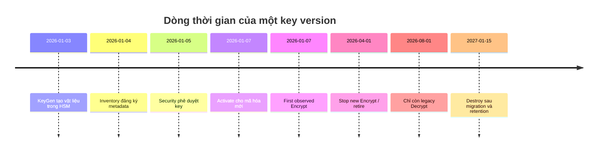
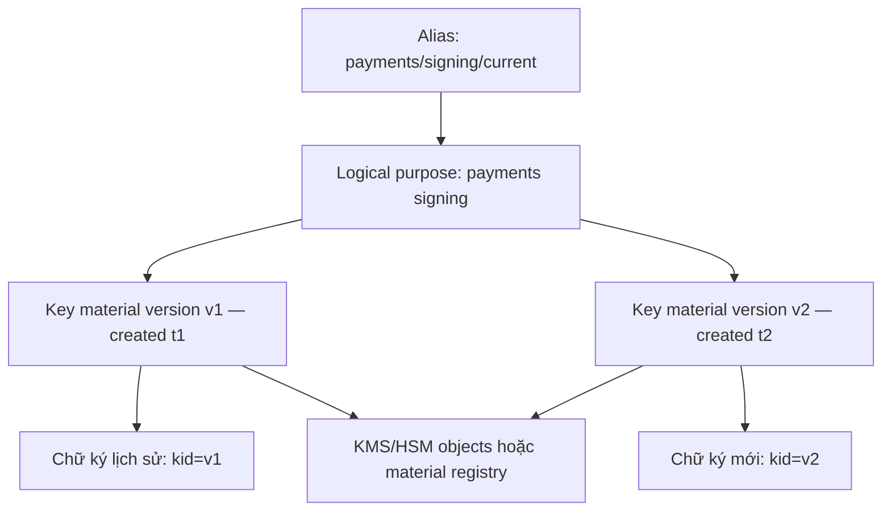
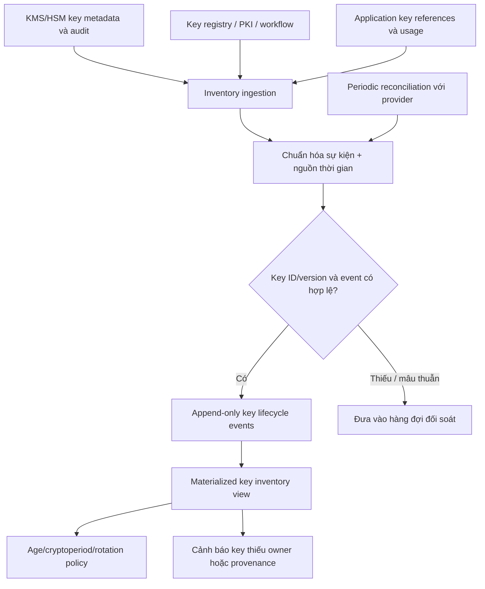
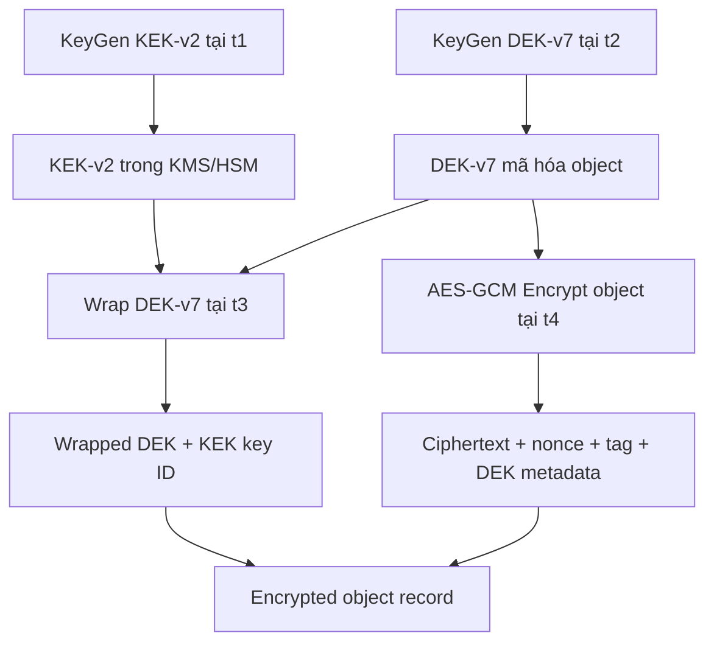
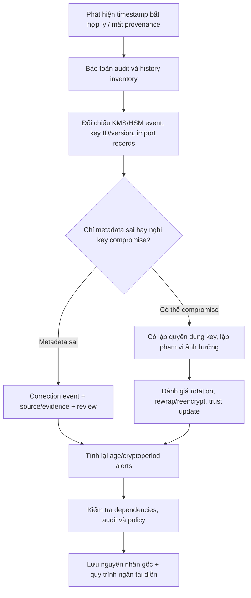

# Creation time trong key inventory: xác định thời điểm hình thành khóa mật mã

> **Chương:** Key inventory  
> **Module:** SECURITY_KEY_MANAGEMENT_FUNDAMENTALS

Trong hệ thống bảo mật, một khóa có thể được tạo hôm nay, đăng ký vào kho quản lý vào ngày mai, kích hoạt trong tuần sau và tiếp tục được dùng để giải mã dữ liệu nhiều năm sau đó. Nếu key inventory chỉ ghi một cột `createdAt` nhưng không nói rõ **“cái gì được tạo, khi nào và ai xác nhận?”**, báo cáo tuổi khóa, đánh giá cryptoperiod và quyết định rotation rất dễ sai.

**Creation time (thời điểm tạo)** là metadata thời gian ghi nhận một **sự kiện hình thành đối tượng khóa hoặc vật liệu khóa theo một định nghĩa cụ thể**. Trong key inventory, creation time không phải bí mật mật mã và không trực tiếp tạo ra mức độ an toàn của khóa; giá trị của nó là giúp truy vết **provenance**, liên kết key ID với lịch sử vòng đời, kiểm tra chính sách, lên kế hoạch thay khóa và điều tra tác động khi có sự cố.

Ví dụ một **key object** được tạo trong KMS lúc 10:00 nhưng **key material** chỉ được import vào lúc 11:30. Nếu vật liệu nhập thực chất được sinh từ hệ thống khác ba năm trước, `keyObjectCreatedAt = 10:00` không chứng minh **tuổi thật của key material bằng 0**. Cần lưu riêng thời điểm và nguồn dữ liệu để không kết luận nhầm rằng khóa cũ vừa được tạo.

Trong phạm vi **SECURITY_KEY_MANAGEMENT_FUNDAMENTALS**, bài học này nối kiểm kê khóa với toàn bộ vòng đời **tạo → cấp phát → lưu trữ → sử dụng → xoay vòng → thu hồi → hủy**, gồm khóa đối xứng/bất đối xứng, chữ ký số, **KMS/HSM**, envelope encryption (**DEK/KEK**), IAM và audit.

Sau bài học, bạn có thể:

- Định nghĩa creation time đúng theo **key object**, **key material** và **phiên bản khóa**.
- Phân biệt `createdAt`, `generatedAt`, `importedAt`, `registeredAt`, `activatedAt`, `firstUsedAt` và những mốc rotation/retirement.
- Chọn **nguồn thời gian có thẩm quyền**, định dạng UTC và phương pháp ghi provenance của timestamp.
- Thiết kế bản ghi inventory hỗ trợ **key ID/version, algorithm, owner, purpose, cryptoperiod, nguồn vật liệu, KMS/HSM handle và lịch sử sự kiện**.
- Tính tuổi khóa và cảnh báo theo **đúng sự kiện**, không dùng thời điểm import hay alias change để thay thế tuổi vật liệu.
- Xử lý khác biệt giữa creation time của **DEK/KEK, RSA/EC signing key, HMAC key, KEM key, imported key** và những cấu trúc vật liệu được rotation tự động.
- Minh họa quản lý timestamp và kiểm tra chuyển trạng thái bằng Java 17, đồng thời nhận biết giới hạn của một ví dụ chạy trong một tiến trình.

## 1. Creation time trả lời câu hỏi nào?

Hãy bắt đầu bằng một khóa AES-256 dùng để mã hóa các đơn hàng:

```text
Key ID (logic): orders/data-encryption/v3
Thuật toán: AES-256-GCM
Owner: orders-service
Nguồn: KMS/HSM hoặc CSPRNG được phê duyệt

Câu hỏi 1: Khi nào key object xuất hiện trong KMS?
Câu hỏi 2: Khi nào 256 bit vật liệu khóa thực sự được sinh?
Câu hỏi 3: Khóa được nhập từ nơi khác hay được tạo tại chỗ?
Câu hỏi 4: Khi nào khóa được cho phép mã hóa đơn hàng mới?
Câu hỏi 5: Khi nào có bản mã đầu tiên dùng khóa này?
```

Các câu trả lời có thể trùng nhau hoặc cách nhau hàng giờ, hàng tháng. **Creation time phải được định nghĩa trên một thực thể cụ thể**:

| Thực thể | Ý nghĩa thời điểm tạo | Chú ý |
|---|---|---|
| **Key object** | Thời điểm provider/registry tạo đối tượng quản lý key | Không nhất thiết là lúc sinh hoặc nhập vật liệu |
| **Key material** | Thời điểm byte bí mật/cặp key được sinh bởi nguồn đã biết | Có thể không biết nếu nhập key từ hệ thống cũ |
| **Key material version** | Thời điểm một phiên bản vật liệu mới hình thành | Một logical key ID có thể trỏ tới nhiều phiên bản |
| **Key record trong inventory** | Thời điểm hệ thống kiểm kê lần đầu thấy hoặc đăng ký khóa | Chỉ là thời điểm ghi nhận, **không thay thế thời điểm sinh** |
| **Public key/certificate** | Thời điểm public key/certificate hoặc chứng thư được tạo/cấp | Chứng thư được cấp lại không làm private key trở thành mới |
| **Alias/key pointer** | Thời điểm một alias hoặc tuyến chọn key được tạo | Alias không phải key material |

Ví dụ: với một **KMS key object được tạo trực tiếp cùng key material**, timestamp do provider trả về có thể gần với thời điểm sinh material. Nhưng **không được mặc nhiên áp dụng** khi key hỗ trợ import, rotate vật liệu bên dưới một ID logic, dùng HSM clone hoặc khôi phục backup.

### 1.1. Tại sao cần biết chính xác?

Creation time có thể dùng để:

1. Tính **tuổi của key material** và chuẩn bị rotation theo chính sách.
2. Xác định một khóa **có tồn tại trước một sự cố** hay không.
3. Liên kết thao tác KeyGen/import với **người hoặc workload** đã thực hiện.
4. Kiểm tra liệu một phiên bản khóa xuất hiện **trước khi thay đổi thuật toán, provider hoặc môi trường**.
5. Xác định những record mã hóa/chữ ký có thể phụ thuộc vào một phiên bản cụ thể.
6. Phát hiện key “mồ côi”, không có provenance hoặc timestamp bất hợp lý.

**Creation time không tự chứng minh** khóa được tạo bằng nguồn entropy đủ mạnh, không bị lộ, đang còn hợp lệ hay được phép dùng. Những điều đó cần kiểm chứng riêng qua metadata, policy, logs và bằng chứng triển khai.

## 2. Bản đồ các mốc thời gian trong vòng đời khóa

Một key inventory có thể có nhiều timestamp, mỗi trường phục vụ một câu hỏi độc lập:

| Trường metadata | Định nghĩa khuyến nghị | Nguồn thường dùng |
|---|---|---|
| `creationRequestedAt` | Thời điểm yêu cầu tạo/import được tiếp nhận | Workflow/change service |
| `keyObjectCreatedAt` | Thời điểm đối tượng khóa được provider tạo | KMS/HSM hoặc registry có thẩm quyền |
| `materialGeneratedAt` | Thời điểm **key material** được sinh | Key generator/HSM, nếu có bằng chứng |
| `materialImportedAt` | Thời điểm key material được nhập vào hệ quản lý hiện tại | KMS/HSM import event |
| `inventoryRegisteredAt` | Thời điểm bản ghi xuất hiện trong inventory | Inventory service |
| `approvedAt` | Thời điểm phê duyệt việc sử dụng key | Approval service |
| `activatedAt` | Thời điểm key được kích hoạt theo policy đã định nghĩa | Key lifecycle controller |
| `firstUsedAt` | Lần sử dụng đầu tiên **quan sát được** cho một phép toán | Audit/KMS events; có thể thiếu lịch sử |
| `lastUsedAt` | Lần sử dụng cuối **quan sát được** | Audit/metrics; phụ thuộc độ phủ |
| `stopNewUseAt` | Thời điểm ngừng tạo ciphertext, chữ ký/MAC mới | Lifecycle policy/controller |
| `retiredAt` | Thời điểm key nghỉ khỏi purpose đã định nghĩa | Key registry / controller |
| `disabledAt` | Thời điểm nhà cung cấp hoặc ứng dụng chặn sử dụng key | KMS/HSM state transition |
| `destroyedAt` | Thời điểm vật liệu khóa được ghi nhận đã hủy | HSM/KMS deletion evidence |

**Không yêu cầu mọi KMS phải cung cấp tất cả trường này.** Một số là sự kiện ứng dụng; một số chỉ là **best-effort observed timestamp**, không thể suy ra trực tiếp từ metadata hiện có. Tốt hơn nên ghi `unknown` cùng lý do và nguồn chứng cứ thay vì tự điền thời điểm đoán.

### 2.1. Timeline minh họa



Trong ví dụ, `materialGeneratedAt` là **ngày 03/01**, còn `activatedAt` là **ngày 07/01**. Nếu chính sách đánh giá tuổi key material kể từ **KeyGen**, không được bắt đầu đếm từ ngày Activate. Ngược lại, nếu giới hạn **thời gian được phép dùng cho Encrypt mới** tính từ ngày kích hoạt, phải ghi rõ đó là *active-usage period*, không phải tuổi vật liệu.

### 2.2. Event time khác observed time

Một inventory nhận audit event trễ có thể có hai mốc:

```text
eventTime:     2026-03-01T09:00:00Z  // Nguồn báo KeyGen xảy ra
observedAt:    2026-03-01T09:02:17Z  // Inventory đọc được event
recordedAt:    2026-03-01T09:02:19Z  // Inventory commit bản ghi
```

**Event time** là lúc sự kiện được cho là xảy ra tại nguồn; **observed/recorded time** là lúc hệ thống kiểm kê thấy và lưu sự kiện. Ba thời điểm khác nhau không nhất thiết là lỗi. Cần biết độ trễ và độ tin cậy của từng nguồn.

### 2.3. “Creation time” không thay được activation hoặc expiry

Nếu một key được tạo tháng 1 và kích hoạt tháng 4, có thể:

- Key đã **3 tháng tuổi về mặt vật liệu** lúc bắt đầu sử dụng.
- Khóa chưa tạo ra ciphertext/signature nào trong thời gian chuẩn bị.
- Chính sách rotation dựa trên tuổi vật liệu cần xem xét cả ba tháng pre-active.
- Chính sách sử dụng mới còn phụ thuộc vào cryptoperiod, quota và trạng thái key.

Không thay logic bằng một phép tính duy nhất `today - createdAt` cho mọi mục đích.

## 3. Creation time khác cryptoperiod và key age

**Key age** thường là khoảng thời gian đã trôi qua kể từ một mốc đã định nghĩa, ví dụ `materialGeneratedAt` hoặc `keyObjectCreatedAt`. **Cryptoperiod** là khoảng thời gian mà khóa được cho phép sử dụng cho một hoặc nhiều phép toán theo chính sách.

Nếu có timestamp \(t_c\) đáng tin và thời điểm đánh giá \(t_{\mathrm{now}}\), tuổi tính được là:

\[
\mathrm{age}=t_{\mathrm{now}}-t_c.
\]

Nhưng công thức chỉ có ý nghĩa khi **\(t_c\) đúng loại**, không thiếu provenance và không ở tương lai bất hợp lý. Nếu thời gian tạo vật liệu không biết, một phép tính dựa trên registration time chỉ cho biết **tuổi của bản ghi inventory**, không phải tuổi của khóa.

### 3.1. Tách thời gian tạo mới và thời gian sử dụng cũ

| Mục tiêu | Mốc phù hợp | Câu hỏi |
|---|---|---|
| **Tuổi vật liệu khóa** | `materialGeneratedAt` (nếu có) | Khóa đã tồn tại bao lâu? |
| **Tuổi key object trong KMS** | `keyObjectCreatedAt` | Object được provider quản lý bao lâu? |
| **Tuổi trong inventory** | `inventoryRegisteredAt` | Chúng ta biết khóa này từ khi nào? |
| **Thời gian phát hành dữ liệu mới** | `activatedAt` → `stopNewUseAt` | Khóa đã/được phép tạo output trong khoảng nào? |
| **Thời gian đọc dữ liệu cũ** | Theo retention/recipient-use period | Khi nào còn phải Decrypt/Verify? |
| **Thời gian xử lý sự cố** | Event compromise, last known good, first suspicious use | Sự cố nằm trong giai đoạn nào? |

Một khóa có thể **không còn được phép Encrypt** nhưng vẫn có thể cần **Decrypt**, hoặc không còn được phép Sign nhưng public key vẫn cần để **Verify** chữ ký lịch sử. Creation time giúp xây timeline chứ **không tự quyết định ngày hủy khóa**.

### 3.2. Thời gian không thay giới hạn thuật toán

Ví dụ AES-GCM dùng nonce ngẫu nhiên dưới một DEK. Ngay cả khi DEK mới tạo **10 phút trước**, nếu hệ thống thực hiện quá nhiều phép mã hóa hoặc đã tái sử dụng nonce, khóa vẫn có thể cần ngừng sử dụng. Ngân sách nonce, số block, thuật toán, dữ liệu và threat model phải được kiểm tra **độc lập** với key age.

Ngược lại, một khóa mới tạo có thể không an toàn nếu nguồn sinh ngẫu nhiên yếu hoặc quyền sử dụng quá rộng. **“Fresh key” không đồng nghĩa “secure key”.**

## 4. Creation time phải gắn với đúng identity của khóa

Một inventory hiệu quả cần phân biệt:

1. **Logical key:** tên ổn định do ứng dụng dùng như `payments/signing/current`.
2. **Key object:** đối tượng do KMS/HSM cấp ID hoặc handle.
3. **Key material version:** bộ byte/cặp khóa cụ thể được sử dụng ở từng giai đoạn.
4. **Alias:** con trỏ có thể đổi đích sang key object/version khác.
5. **Key usage record:** log/metadata kết nối output cụ thể với key version thực tế.



Nếu alias từ v1 sang v2, **creation time của alias** không làm v2 có cùng tuổi v1. Và nếu nhà cung cấp rotate **key material bên trong cùng một logical KMS key**, `keyObjectCreatedAt` có thể giữ nguyên trong khi vật liệu/phiên bản bên trong thay đổi. Cần ghi theo những phiên bản/metadata mà provider cho phép quan sát.

### 4.1. Key version là thực thể quan trọng của inventory

Một bản ghi nên phân biệt ít nhất:

```text
logicalName:       "orders/encryption/current"
providerKeyId:     "kms-key-abc123"
materialVersionId: "version-2026-04"
keyObjectCreatedAt:   "2024-10-10T08:00:00Z"
materialGeneratedAt:  "2026-04-01T06:30:00Z"
inventoryRegisteredAt:"2026-04-01T06:30:04Z"
```

Nếu provider không expose material version riêng, **không bịa ID**. Có thể lưu thông tin mà provider cung cấp, đánh dấu khoảng trống về khả năng quan sát và thiết kế inventory để không gán nhầm `keyObjectCreatedAt` là `materialGeneratedAt`.

### 4.2. Không dùng creation time làm khóa chính

Hai key có thể được tạo cùng mili giây hoặc timestamp bị làm tròn theo provider. Dùng `createdAt` làm định danh duy nhất dễ gây nhập nhằng và không ổn định khi nhập dữ liệu quá khứ. **Key ID/handle bất biến và version** mới là liên kết chính; creation time là thuộc tính dùng để lọc, audit và đánh giá chính sách.

## 5. KeyGen, import, restore và clone: cùng tên key nhưng khác lịch sử

### 5.1. KeyGen tạo vật liệu mới

Nếu HSM/KMS trực tiếp sinh một RSA private key hoặc AES key từ nguồn ngẫu nhiên được phê duyệt, sự kiện KeyGen là mốc gần nhất với **thời điểm sinh vật liệu**. Metadata nên cho biết:

- Provider/module thực hiện sinh key.
- Thuật toán, key size/parameter set, purpose và phạm vi.
- Key ID/version do provider trả về.
- Event timestamp và request/operation ID.
- Kết quả tạo, actor/workload và bằng chứng cần thiết theo chính sách.

Không ghi **private key, raw DEK, RNG seed hoặc toàn bộ HSM key blob** vào inventory chỉ để chứng minh thời điểm tạo.

### 5.2. Imported key: import time không phải generation time

Một khóa AES được sinh trên thiết bị trước đó rồi import vào KMS vào tháng 11. Trong hệ đích:

```text
materialGeneratedAt:  "2023-06-12T12:00:00Z"  // Nếu có chứng cứ
materialImportedAt:   "2026-11-28T08:20:00Z"
keyObjectCreatedAt:  "2026-11-28T08:15:00Z"
sourceSystem:         "legacy-hsm-cluster"
provenanceConfidence: "verified-by-import-records"
```

Nếu không có bằng chứng về ngày sinh ban đầu:

```text
materialGeneratedAt:  null
materialTimeStatus:   "UNKNOWN"
materialImportedAt:  "2026-11-28T08:20:00Z"
```

**Không suy ra materialGeneratedAt = importedAt.** Khi đánh giá cryptoperiod, trường hợp “không biết tuổi vật liệu” phải được xử lý như **rủi ro dữ liệu kiểm kê chưa đầy đủ**, không phải như khóa mới hoàn toàn.

### 5.3. Restore/replica từ backup

Một private key được phục hồi từ bản sao hôm nay vẫn là **cùng vật liệu khóa cũ**. `restoredAt` hay `replicatedAt` là thời gian triển khai, **không phải** thời gian KeyGen mới. Nếu tạo key object mới chứa cùng bytes, cần ghi quan hệ **same material / source key** theo khả năng chứng minh; tránh đếm chúng như hai secret độc lập.

### 5.4. HSM cluster và key clone

Một key có thể được nhân bản có kiểm soát sang module khác để hỗ trợ availability. Thời điểm tạo đối tượng tại HSM thứ hai là thời điểm **provision bản sao**, không nhất thiết là thời điểm vật liệu ban đầu được sinh. Inventory cần giữ provenance/lineage của key để biết phạm vi ảnh hưởng nếu một bản sao bị compromise.

### 5.5. Automatic rotation và lịch sử phiên bản

Một số KMS cho phép **automatic rotation**, tạo vật liệu mới dưới một key ID logic mà ứng dụng không trực tiếp nhận version nội bộ. Nếu chỉ lấy creation time của logical object, báo cáo có thể nhầm rằng không có rotation hoặc toàn bộ ciphertext luôn dùng cùng vật liệu.

Vì vậy inventory cần tận dụng **rotation events, provider metadata và các thông tin được phép công bố**, ghi rõ giới hạn observability nếu provider không expose thời điểm từng material version. Không tự tạo một timeline vật liệu giả chỉ từ alias.

## 6. Creation time của các loại khóa và đối tượng mật mã

| Đối tượng | Creation time đáng quan tâm | Cần tránh hiểu nhầm |
|---|---|---|
| **AES DEK** | Khi bytes DEK được sinh | Thời gian wrap DEK không phải thời gian sinh DEK |
| **KMS KEK** | Khi key material/phiên bản KEK sinh; cả object creation khi cần | Rewrap DEK dưới KEK mới không thay tuổi DEK |
| **RSA/EC private signing key** | Khi cặp public/private được sinh | Chứng thư mới không đồng nghĩa private key mới |
| **Certificate X.509** | Thời điểm phát hành ký chứng thư theo CA nếu có bằng chứng | `notBefore` là bắt đầu validity, không phải private-key creation |
| **HMAC key** | Khi secret được tạo, hoặc import provenance | Public tag không cho biết tuổi của HMAC key |
| **KEM recipient private key** | Khi cặp KEM được KeyGen | Encapsulation mới không làm recipient static private key thành mới |
| **Session key / ephemeral DH key** | Khi secret tạm thời được tạo theo handshake | Thường không cần inventory từng key như key dài hạn; vẫn cần policy/metrics |
| **Password salt** | Khi salt được sinh cho một verifier | Salt không phải secret key có vòng đời KMS như KEK |
| **Password pepper** | Khi secret pepper version được tạo/import | Pepper version mới khác với việc rehash mọi verifier |
| **Alias / JWKS key entry** | Khi bản ghi alias/public key được công bố | Công bố public key không phải sinh lại private key |

### 6.1. Vì sao không phải mọi session key đều cần một inventory record?

Trong một hệ thống TLS quy mô lớn, hàng triệu **traffic key** có thể được dẫn xuất tự động và tồn tại rất ngắn. Inventory chi tiết từng phiên có thể tăng nguy cơ lưu metadata nhạy cảm, tạo tải khổng lồ và làm mất trọng tâm của quản trị khóa dài hạn.

Thay vì ghi toàn bộ secret phiên, thường nên quản lý **chính sách sinh/dẫn xuất, thuật toán, lifetime, owner, key hierarchy và sự kiện tổng hợp**, còn per-session logs chỉ giữ metadata thật sự cần thiết theo threat model/retention. Với DEK lâu dài, KEK, signing key hay HMAC key, inventory theo key ID/version quan trọng hơn.

### 6.2. KEM và bí mật dẫn xuất

Một KEM có thể tạo nhiều **shared secret** từ một public key nhận dài hạn. Thời điểm mỗi lần `Encaps` **không đổi** creation time của private KEM key. Nếu hệ thống giữ KEM ciphertext để mở dữ liệu trong tương lai, cần ràng buộc record với recipient key ID/version và policy; không dùng thời gian encapsulation như bằng chứng tuổi private key.

### 6.3. Certificate validity và chữ ký số

Một chứng thư có `notBefore`/`notAfter`. Đây là **khoảng hiệu lực được CA xác nhận theo chính sách**, không phải bằng chứng private key được sinh tại đúng `notBefore`. Tương tự, trường `signedAt` do ứng dụng tự điền không nhất thiết là **trusted timestamp** độc lập.

Trong kiểm kê khóa ký số, nên tách **key material creation**, **certificate issuance**, **certificate validity**, **trust publication**, **first signature** và **key retirement** để đánh giá các chữ ký lịch sử khi rotate hoặc xảy ra sự cố.

## 7. Timestamp đáng tin: đồng hồ, nguồn chứng cứ và độ chính xác

Một timestamp trong inventory có thể mang tính **tuyên bố** hoặc là **quan sát có chứng cứ**. Nếu người vận hành nhập `materialGeneratedAt` thủ công, thông tin đó chưa có độ tin cậy tương đương timestamp từ một **HSM audit event được bảo vệ** và được đối chiếu với request ID.

### 7.1. Nguồn timestamp và mức độ tin cậy

| Nguồn | Có thể dùng để xác nhận điều gì? | Giới hạn |
|---|---|---|
| **KMS API metadata** | Thời điểm provider cho biết key object được tạo, trạng thái hiện tại | Không mặc định là thời điểm material generation/import gốc |
| **HSM audit record** | KeyGen/import/usage được thiết bị ghi nhận theo khả năng hỗ trợ | Phụ thuộc độ phủ audit, trạng thái đồng hồ và tính toàn vẹn log |
| **Inventory ingest event** | Hệ thống kiểm kê **nhìn thấy** key vào thời điểm nào | Không chứng minh key vừa sinh vào lúc ấy |
| **Workflow approval/change ticket** | Yêu cầu và phê duyệt tạo/activate key | Không chứng minh phép KeyGen đã hoàn thành |
| **CI/CD deployment log** | Thời điểm triển khai cấu hình hoặc key reference | Không chứng minh thời điểm tạo vật liệu |
| **Certificate metadata** | Validity của chứng thư; có thể suy thông tin cấp phát theo quy trình CA | `notBefore` không phải KeyGen timestamp |
| **Nhật ký do client gửi lên** | Tuyên bố của bên gửi về một sự kiện | Có thể sai clock, bị sửa hoặc giả nếu không xác thực |

**Thời điểm do provider trả về có giá trị**, nhưng cần hiểu rõ provider định nghĩa nó là *key creation*, *resource creation*, *material version created* hay một sự kiện khác. Không nên tự đặt tất cả vào một trường `createdAt` rồi làm mất semantics.

### 7.2. Dùng UTC và định dạng có múi giờ rõ ràng

Một cách biểu diễn phổ biến là **ISO 8601 / RFC 3339** với UTC:

```text
2026-11-28T09:15:30Z
2026-11-28T16:15:30+07:00  // Cùng một thời điểm
```

Không lưu chuỗi `"28/11/2026 09:15"` mà không biết múi giờ hoặc cách diễn giải ngày/tháng. Nếu cần hiển thị theo vùng địa phương, thực hiện **chuyển đổi lúc trình bày**, không làm mất thông tin instant gốc.

Trong Java, `Instant` đại diện cho một thời điểm trên timeline UTC; `LocalDateTime` **không mang offset/timezone**, nên không phù hợp làm trường audit global nếu không lưu bổ sung vùng và quy tắc quy đổi.

### 7.3. Timestamp precision không đồng nghĩa accuracy

Một hệ thống có thể lưu nanosecond trong schema nhưng nguồn chỉ ghi đến giây. Ví dụ:

```text
raw provider time: "2026-11-28T09:15:30Z"
inventory field:   "2026-11-28T09:15:30.000000000Z"

=> Số chữ số không chứng minh nguồn chính xác đến nanosecond.
```

Độ chính xác phụ thuộc đồng hồ, đồng bộ hóa và cách provider ghi event. Nên lưu **time source** và nếu cần **precision/uncertainty**, tránh kết luận thứ tự KeyGen của hai node chỉ vì timestamp lệch nhau vài microsecond không được bảo đảm.

### 7.4. Clock skew, ingestion delay và event ordering

Một event ở region A được ghi lúc 10:00:02, còn event ở region B được ghi lúc 10:00:01; việc so sánh wall-clock **chưa đủ** để kết luận B xảy ra trước A nếu đồng hồ lệch. Cần:

- Sử dụng cơ chế đồng bộ thời gian phù hợp trong hạ tầng.
- Lưu **event ID, sequence, key/version ID và causal relation** khi có.
- Phân biệt event occurred time, event observed time và thời điểm database commit.
- Tránh suy ra một phép toán “không thể đã xảy ra” chỉ vì log có timestamp hơi lệch.
- Dùng **version/epoch/CAS** để điều phối thay đổi trạng thái, không dựa duy nhất vào so sánh timestamp giữa nhiều node.

### 7.5. Wall-clock time và monotonic time

**Wall clock** thích hợp cho mốc lịch sử như KeyGen/approved/activated. **Monotonic clock** thích hợp để đo thời lượng một thao tác trong cùng tiến trình, giảm ảnh hưởng đồng hồ hệ thống được chỉnh lại. Không lưu kết quả đồng hồ monotonic như timestamp có thể đem so giữa nhiều máy.

Việc tính tuổi khóa từ timestamps đã lưu là phép tính **calendar/instant**; nhưng việc đo độ trễ request dùng nguồn monotonic ở runtime thì hợp lý hơn.

## 8. Thiết kế bản ghi key inventory có thể kiểm toán

Một bản ghi inventory tốt lưu **đúng giá trị + ý nghĩa + bằng chứng**. Ví dụ JSON sau là **schema minh họa**, không phải định dạng bắt buộc của sản phẩm KMS cụ thể:

```json
{
  "schemaVersion": 1,
  "inventoryId": "inv-orders-kms-007",
  "logicalKeyName": "orders/encryption",
  "provider": "example-kms",
  "providerKeyId": "kms-key-7c8d",
  "materialVersionId": "material-v3",
  "keyType": "SYMMETRIC",
  "algorithm": "AES-256-GCM",
  "purpose": ["ENCRYPT", "DECRYPT"],
  "environment": "production",
  "ownerService": "orders-service",
  "origin": "GENERATED_IN_PROVIDER",
  "lifecycleStatus": "ACTIVE_FOR_ENCRYPT_NEW",
  "timestamps": {
    "keyObjectCreatedAt": "2026-01-02T10:00:00Z",
    "materialGeneratedAt": "2026-04-05T11:40:00Z",
    "materialImportedAt": null,
    "inventoryRegisteredAt": "2026-04-05T11:40:09Z",
    "activatedAt": "2026-04-06T00:00:00Z",
    "firstObservedEncryptAt": "2026-04-06T00:00:18Z",
    "stopNewUseAt": "2026-07-01T00:00:00Z",
    "destroyedAt": null
  },
  "timestampEvidence": {
    "materialGeneratedAt": {
      "source": "provider-rotation-event",
      "eventId": "event-gen-8831",
      "confidence": "PROVIDER_REPORTED",
      "recordedAt": "2026-04-05T11:40:09Z"
    }
  },
  "retentionPolicy": "orders-records-v4",
  "keyPolicyVersion": "policy-v7",
  "lastReconciledAt": "2026-11-28T09:00:00Z"
}
```

Lưu ý trong ví dụ: `keyObjectCreatedAt` trước `materialGeneratedAt` vì logical key object được tạo trước, rồi có **material version mới**. Nếu một provider không hỗ trợ mô hình này, không tạo ra material version giả; schema chỉ minh họa **khả năng mô tả các trường hợp khác nhau**.

### 8.1. Các trường tối thiểu thực sự hữu ích

| Nhóm | Giá trị cần cân nhắc |
|---|---|
| **Định danh** | Inventory ID, provider key ID/ARN/handle, material version nếu có, logical alias |
| **Công dụng** | Symmetric/asymmetric, algorithm, size/curve, purpose, environment, owner, tenant |
| **Nguồn gốc** | Generated/imported/restored/unknown, provider/module, source key reference |
| **Thời gian** | Thời điểm tạo object, sinh material nếu biết, import/register/activate/retire/destroy, time source |
| **Chính sách** | Cryptoperiod, rotation policy, exportability, IAM/key policy reference |
| **Phụ thuộc** | Dữ liệu/chữ ký/DEK được bảo vệ, downstream services, retention requirement |
| **Chứng cứ** | Event ID, request ID, approval ID, audit correlation, reconciliation result |

Không phải tất cả trường đều cần có trong một bảng vật lý. Có thể tách **key master record**, **material-version records**, **append-only lifecycle events** và **usage/dependency index** để đáp ứng quy mô.

### 8.2. Những trường không nên đặt trong inventory

Inventory **không phải kho secret**. Không lưu:

- Private key PEM, raw AES DEK, raw HMAC key, KEK plaintext hoặc seed RNG.
- Full KMS/HSM authentication credential, bearer token, tài khoản service có quyền gọi API.
- Plaintext dữ liệu nhạy cảm để “test khôi phục”.
- Bản dump toàn bộ secret chỉ để tính fingerprint hoặc timestamp.

Một **public key fingerprint** có thể phù hợp để xác minh key mapping; một **hash của raw symmetric key** được công bố rộng lại có nguy cơ tạo cơ chế kiểm tra ứng viên key yếu hoặc tiết lộ metadata không cần thiết. Ưu tiên **key ID/handle do provider quản lý** và chứng cứ KeyGen thay vì sao chép vật liệu.

### 8.3. Immutability và append-only events

Creation time có nghĩa lịch sử: thông thường không được **ghi đè âm thầm** khi alias đổi, key rotate hoặc bản ghi được đồng bộ lại. Thay vì:

```text
UPDATE key_inventory
SET materialGeneratedAt = NOW()
WHERE logicalKeyName = 'orders/encryption';
```

nên tạo **key version record/event mới** với `materialGeneratedAt` của phiên bản mới và giữ mốc của phiên bản cũ.

Nếu cần sửa timestamp vì trước đây dữ liệu sai, tạo **correction event** ghi old value, new value, reason, actor, nguồn chứng cứ và thời gian sửa. Báo cáo phải phân biệt **giá trị lịch sử đã được xác thực** và **giá trị từng bị ghi sai**, thay vì mất dấu.

## 9. Thu thập Creation time: event-driven và reconciliation

Một hệ thống inventory thường nhận dữ liệu từ nhiều nguồn: KMS/HSM, CI/CD, ứng dụng, certificate service, IAM và key registry. Không nên chỉ dựa vào người dùng nhập thủ công.



### 9.1. Bước 1 — Lấy nguồn có thẩm quyền

Với KMS key, ưu tiên **provider describe/list APIs và audit events** để xác định object creation. Với HSM, đọc event KeyGen/import và metadata key handle theo khả năng hỗ trợ. Với key app tự tạo, cần một **sự kiện KeyGenerated do ứng dụng đáng tin ghi nhận** qua cơ chế audit được bảo vệ.

### 9.2. Bước 2 — Chuẩn hóa nhưng không làm mất nghĩa

Chuyển timestamp về `Instant`/UTC cho so sánh, nhưng vẫn giữ trường **event type** và **source**. Không map `importedAt` thành `generatedAt` chỉ vì bảng báo cáo chỉ có một cột creation time.

### 9.3. Bước 3 — Idempotency và chống trùng sự kiện

Một event KeyGen có thể được gửi lại do retry hoặc xử lý lại từ message queue. Dùng **event ID/operation ID + source** để loại trùng; không đếm hai sự kiện như hai lần sinh vật liệu mới chỉ vì hệ thống nhận chúng hai lần.

Đồng thời, hai KeyGen events thật có thể cùng timestamp nhưng khác event ID/key version. Không loại trùng chỉ bằng timestamp.

### 9.4. Bước 4 — Reconciliation định kỳ

Event stream có thể mất sự kiện, audit có độ trễ hoặc API có giới hạn. Cần **đối soát định kỳ** giữa inventory và provider:

- Key xuất hiện ở KMS nhưng chưa có inventory record → tạo trạng thái cần điều tra.
- Inventory nói ACTIVE nhưng provider báo disabled/unavailable → phát cảnh báo.
- Material version thay đổi theo event nhưng inventory chưa cập nhật → đối soát version.
- Key bị delete trong provider nhưng inventory chưa ghi nhận → giữ tombstone/evidence và kiểm tra dữ liệu phụ thuộc.

**Reconciliation time không phải creation time.** Khi lần đầu phát hiện key cũ, nên ghi `firstDiscoveredAt` và giữ `materialGeneratedAt = UNKNOWN` nếu không có chứng cứ khác.

### 9.5. Event đến sai thứ tự

Ví dụ event `KeyActivated` đến trước `KeyCreated` vì hệ thống queue trễ. Inventory có thể tạm giữ một bản ghi **incomplete** rồi ghép sự kiện khi nhận đủ; không tự sửa timestamp KeyCreated thành giờ hiện tại chỉ để thỏa mãn thứ tự.

Những điều kiện bất khả thi thật sự (ví dụ materialGeneratedAt sau destroyedAt theo cùng nguồn uy tín, không có correction event) phải được **đánh dấu anomaly**, không âm thầm thay đổi lịch sử.

## 10. Java 17: biểu diễn Creation time và tính tuổi khóa có ý nghĩa

Ví dụ dùng `Instant`, `Clock` và một record bất biến để minh họa **phân biệt key object creation với material generation/import**. Nó **không tạo hoặc lưu khóa bí mật** và **không truy cập KMS**.

```java
import java.time.Clock;
import java.time.Duration;
import java.time.Instant;
import java.time.ZoneOffset;
import java.util.Optional;

public final class KeyCreationTimeDemo {
    enum Origin { GENERATED_IN_PROVIDER, IMPORTED, UNKNOWN }

    record KeyInventoryRecord(
            String providerKeyId,
            String materialVersionId,
            Origin origin,
            Instant keyObjectCreatedAt,
            Optional<Instant> materialGeneratedAt,
            Optional<Instant> materialImportedAt,
            Instant inventoryRegisteredAt,
            Optional<Instant> activatedAt,
            String timeEvidenceSource) {

        KeyInventoryRecord {
            if (providerKeyId == null || providerKeyId.isBlank()) {
                throw new IllegalArgumentException("Missing key ID");
            }
            if (keyObjectCreatedAt == null
                    || inventoryRegisteredAt == null
                    || origin == null
                    || materialGeneratedAt == null
                    || materialImportedAt == null
                    || activatedAt == null) {
                throw new IllegalArgumentException("Null metadata");
            }
        }

        Optional<Duration> materialAgeAt(Instant at) {
            return materialGeneratedAt
                    .filter(created -> !created.isAfter(at))
                    .map(created -> Duration.between(created, at));
        }

        Duration keyObjectAgeAt(Instant at) {
            if (at.isBefore(keyObjectCreatedAt)) {
                throw new IllegalArgumentException("Clock/time anomaly");
            }
            return Duration.between(keyObjectCreatedAt, at);
        }
    }

    public static void main(String[] args) {
        Clock fixedClock = Clock.fixed(
                Instant.parse("2026-11-28T09:00:00Z"),
                ZoneOffset.UTC
        );
        Instant now = fixedClock.instant();

        // Một key object mới được tạo để IMPORT vật liệu cũ.
        KeyInventoryRecord imported = new KeyInventoryRecord(
                "kms-recipient-v2",
                "material-v1",
                Origin.IMPORTED,
                Instant.parse("2026-11-27T10:00:00Z"),
                Optional.empty(), // Không có chứng cứ KeyGen gốc.
                Optional.of(Instant.parse(
                        "2026-11-27T10:05:00Z")),
                Instant.parse("2026-11-27T10:05:08Z"),
                Optional.of(Instant.parse(
                        "2026-11-28T00:00:00Z")),
                "provider-import-event"
        );

        System.out.println("Key object age hours: "
                + imported.keyObjectAgeAt(now).toHours());
        System.out.println("Material age known: "
                + imported.materialAgeAt(now).isPresent());

        KeyInventoryRecord generated = new KeyInventoryRecord(
                "kms-new-signing-key",
                "material-v1",
                Origin.GENERATED_IN_PROVIDER,
                Instant.parse("2026-11-20T08:00:00Z"),
                Optional.of(Instant.parse(
                        "2026-11-20T08:00:01Z")),
                Optional.empty(),
                Instant.parse("2026-11-20T08:00:04Z"),
                Optional.empty(), // Chưa được kích hoạt.
                "provider-keygen-event"
        );

        System.out.println("Generated material age known: "
                + generated.materialAgeAt(now).isPresent());
        System.out.println("Key activated: "
                + generated.activatedAt().isPresent());
    }
}
```

Kết quả quan trọng:

- Key import có `keyObjectCreatedAt` rõ ràng và `materialImportedAt`, nhưng **không có materialGeneratedAt đáng tin** → không thể trả về tuổi vật liệu.
- Key được provider tạo có KeyGen timestamp → có thể tính tuổi vật liệu từ nguồn đó.
- Key được tạo nhưng chưa Activate vẫn có **tuổi vật liệu**; trạng thái kích hoạt là câu hỏi riêng.

### 10.1. Những giới hạn của ví dụ

1. `Clock.fixed` dùng để **kiểm thử có kết quả ổn định**. Production dùng clock phù hợp và không coi local system time là chứng cứ thay cho provider event.
2. `Optional.empty()` diễn đạt “chưa có timestamp”; hệ thống thật nên bổ sung **reason, source, confidence và event ID**.
3. Bản ghi này chưa quản lý nhiều material versions, IAM, lifecycle state machine, audit chain hay concurrency.
4. Nếu `materialGeneratedAt` đến từ input không đáng tin, `Duration.between` vẫn chỉ tạo một con số từ dữ liệu sai. **Đúng công thức không bù được nguồn dữ liệu không đáng tin**.
5. Việc cho `materialAgeAt` trả empty khi thời điểm tạo nằm trong tương lai chỉ là cách biểu diễn an toàn cho demo; production cần **alert bất thường về clock/provenance**, không bỏ qua.

## 11. Quy tắc thời gian và chính sách tính tuổi khóa

Không phải mọi loại khóa có cùng quy tắc rotation. Một policy engine cần biết **loại khóa, purpose, mức rủi ro và sự kiện gốc dùng tính tuổi**.

Ví dụ mô tả chính sách:

```yaml
# Minh họa; KHÔNG phải policy bắt buộc của một cloud KMS cụ thể.
ruleId: "orders-dek-age-policy"
appliesTo:
  keyType: "SYMMETRIC"
  purpose: "ENCRYPT_NEW"
  environment: "production"
ageBasis: "materialGeneratedAt"
onMissingAgeBasis: "REQUIRE_REVIEW"
onFutureTimestamp: "QUARANTINE_AND_REVIEW"
warningBeforeEnd: "P14D"
originatorUseLimit: "P90D"
afterStopNewUse:
  allowLegacyDecryptByPolicy: true
  requireDependencyInventoryBeforeDestroy: true
auditFields:
  - "keyId"
  - "materialVersionId"
  - "ageBasis"
  - "evidenceEventId"
  - "decision"
```

Các giá trị 14 ngày và 90 ngày **chỉ để minh họa** cho cấu trúc rule, không phải tuổi chuẩn bắt buộc cho mọi DEK. Chính sách thực tế phải dựa trên thuật toán, giới hạn lượng dữ liệu/nonce, quy định tổ chức, hệ thống lưu trữ, KMS/HSM, khả năng khôi phục và threat model.

### 11.1. Xử lý creation time thiếu hoặc không đáng tin

Khi thiếu `materialGeneratedAt`:

- **Không** tự coi tuổi bằng 0.
- Đánh dấu record `UNKNOWN_ORIGIN_TIME` hoặc trạng thái tương đương.
- Tìm bằng chứng từ HSM audit, import manifest, hệ thống nguồn, migration log hoặc quy trình quản lý trước đây.
- Nếu không khôi phục được, áp dụng **policy xử lý ngoại lệ**, có thể yêu cầu đánh giá rủi ro, rotate hoặc reset key theo mức độ quan trọng.
- Lưu quyết định và người phê duyệt, không sửa timestamp cho khớp mong muốn.

### 11.2. Creation time sớm hơn ngày đưa vào production

Một key được tạo trong môi trường bảo vệ rồi mới được đưa vào production có thể có tuổi vật liệu đáng kể ngay ngày đầu sử dụng. Nếu chính sách tính từ ngày KeyGen, phải tính cả giai đoạn chờ; nếu tính từ ngày activation cho mục đích cụ thể, cần ghi **cơ sở chính sách**.

Không thay đổi ý nghĩa mốc tính trong báo cáo mà không ghi policy version; nếu năm nay dùng createdAt và năm sau dùng activatedAt, đường biểu diễn tuổi có thể thay đổi đột ngột mà không phản ánh thay đổi thật của khóa.

### 11.3. “Hết hạn” có thể mang nhiều nghĩa

Một certificate có ngày `notAfter`; một KMS key có thể có trạng thái pending deletion; một DEK có chính sách stop-new-encrypt; một HMAC key có thời hạn chấp nhận tag cũ. Không dùng một trường `expiresAt` cho tất cả nếu semantics không rõ.

Đặc biệt, **stop-new-use** khác **destroy**: dữ liệu mã hóa dưới key cũ có thể còn cần đọc, chữ ký lịch sử có thể còn cần public key để xác minh. Tự động hủy key chỉ vì `now - createdAt` vượt ngưỡng có thể gây mất dữ liệu.

## 12. Creation time trong envelope encryption: DEK và KEK không cùng tuổi

Trong envelope encryption, **DEK** mã hóa dữ liệu; **KEK** trong KMS/HSM bảo vệ DEK bằng wrap/unwrap hoặc cơ chế tương đương. Mỗi khóa cần identity và lịch sử riêng.



Các mốc:

- **\(t_1\)**: tạo vật liệu KEK-v2.
- **\(t_2\)**: tạo vật liệu DEK-v7.
- **\(t_3\)**: wrap DEK-v7 bằng KEK-v2.
- **\(t_4\)**: encrypt dữ liệu bằng DEK-v7 và nonce hợp lệ.

Không lấy `wrappedAt=t3` làm creation time của DEK. **Rewrap** DEK-v7 dưới KEK-v3 ở \(t_5\) vẫn không tạo DEK-v8. Nếu chủ đích thay DEK, cần sinh vật liệu mới và thường mã hóa lại dữ liệu hoặc áp dụng quy trình migration tương ứng.

### 12.1. DEK tạo theo từng object

Nếu KMS cấp **data key mới cho mỗi object** qua API thích hợp, inventory có thể không cần một record quản trị thủ công cho hàng tỷ DEK. Có thể dùng:

- Metadata **encrypted object** lưu wrapped DEK, KEK key ID, thuật toán, nonce/tag.
- Audit/metrics số lần sinh data key, lỗi và phạm vi sử dụng.
- Quan hệ owner/purpose/retention theo tập object.
- Inventory cấp cao cho KEK và chính sách DEK generation.

Tuy nhiên, nếu một DEK được **tái sử dụng lâu dài** cho nhiều record, cần theo dõi age/cryptoperiod, volume, nonce budget, key ID/version và phạm vi dữ liệu rõ hơn.

### 12.2. KEK rotate nhưng record cũ chưa được rewrap

Một KEK v2 được tạo hôm qua không chứng minh tất cả DEK hiện đã được bảo vệ bằng nó. Nếu hàng triệu wrapped DEK vẫn tham chiếu KEK v1, **dependency inventory** phải thể hiện rõ. Creation time của KEK v2 không thể dùng làm bằng chứng migration hoàn thành.

### 12.3. Xóa KEK và ảnh hưởng dữ liệu

Không hủy KEK chỉ vì nó cũ nếu còn DEK cần unwrap dưới KEK đó. Nếu quy trình destruction diễn ra trước khi rewrap hoặc hết retention, hệ thống có thể không đọc được dữ liệu dù mọi DEK/ciphertext khác vẫn còn. Đây là lý do key inventory cần cả **timestamp lẫn dependency graph**.

## 13. Creation time và kiểm soát truy cập

Ai có thể **tạo khóa**, **sửa creation time** hoặc **đánh dấu nguồn chứng cứ** là câu hỏi an ninh. Nếu một actor có thể sửa `materialGeneratedAt` từ ba năm trước thành hôm nay, họ có thể làm báo cáo rotation sai lệch mà không đụng tới key material.

### 13.1. Phân quyền nên tách theo chức năng

| Chủ thể | Quyền nên có | Quyền nên hạn chế |
|---|---|---|
| **Key generator / KMS** | Tạo key và phát ra event KeyGen từ nguồn có thẩm quyền | Tự sửa inventory history sau khi đã phát hành |
| **Inventory ingestion service** | Đọc metadata/audit, append event chuẩn hóa | Đọc raw private key/DEK hoặc điều khiển mọi key policy |
| **Key custodian / owner** | Xem trạng thái, duyệt giải thích provenance, yêu cầu correction | Viết đè creation time không có audit |
| **Rotation operator** | Chuẩn bị key mới, kích hoạt theo policy, cập nhật dependency | Tự xóa lịch sử để che việc dùng key cũ |
| **Security auditor** | Đọc bản ghi key/material version, evidence và correction history | Xuất secret hoặc tự động chuyển key lifecycle |
| **Application workload** | Dùng khóa theo mục đích, ghi usage metadata cần thiết | Tự khai `materialGeneratedAt` cho key không do mình tạo |

### 13.2. Audit không chỉ là timestamp

Một event đáng tin nên chứa **event type, key ID, material version khi có, actor, nguồn hệ thống, operation ID, result, timestamp, observedAt, policy/config version và correlation ID**. Những trường này giúp xác định ai thực sự thực hiện KeyGen/import và liệu creation time có bị tạo lại hoặc giả mạo hay không.

Audit log nên có quyền truy cập hạn chế, retention hợp lý và cơ chế chống sửa/xóa ngoài ý muốn. Nếu có hai nguồn mâu thuẫn, inventory phải **giữ lại nguồn gốc và trạng thái cần điều tra**, không chọn bừa timestamp mới nhất.

## 14. Truy vấn tuổi khóa và phát hiện bất thường

Giả sử inventory lưu một dòng cho mỗi **key material version**. Một truy vấn kiểm kê có thể cần lọc những phiên bản có timestamp tạo vật liệu đã được xác minh, đồng thời liệt kê riêng các phiên bản có thời gian **UNKNOWN**.

Ví dụ SQL ở mức minh họa:

```sql
-- Schema giả định: material_generated_at TIMESTAMPTZ,
-- time_confidence, material_version_id, provider_key_id,
-- lifecycle_status và policy_id có trong bảng inventory.

SELECT
    provider_key_id,
    material_version_id,
    material_generated_at,
    CURRENT_TIMESTAMP - material_generated_at AS material_age,
    lifecycle_status
FROM key_material_inventory
WHERE material_generated_at IS NOT NULL
  AND time_confidence IN ('PROVIDER_REPORTED', 'VERIFIED')
  AND material_generated_at <= CURRENT_TIMESTAMP
ORDER BY material_generated_at ASC;

-- Những trường hợp cần review, không tính tuổi bằng 0:
SELECT
    provider_key_id,
    material_version_id,
    origin,
    material_generated_at,
    time_confidence
FROM key_material_inventory
WHERE material_generated_at IS NULL
   OR time_confidence = 'UNVERIFIED'
   OR material_generated_at > CURRENT_TIMESTAMP;
```

Đây **không phải query áp dụng trực tiếp vào mọi database**; tên cột, kiểu dữ liệu và policy khác nhau. Trường hợp `material_generated_at > CURRENT_TIMESTAMP` có thể là clock skew, dữ liệu nhập sai hoặc một mốc dự kiến bị gán nhầm là thời điểm đã xảy ra — cần điều tra trước khi sửa.

### 14.1. Không lọc mất những key đáng chú ý

Một dashboard chỉ hiển thị key có tuổi > 90 ngày có thể **bỏ sót key không có creation time**. Nếu nhiều legacy key thiếu provenance, đây có thể là nhóm rủi ro nhất nhưng lại biến mất khỏi đồ thị.

Nên có các nhóm rõ ràng:

- **Age known / within policy**.
- **Approaching cryptoperiod limit**.
- **Overdue for review/rotation**.
- **Age unknown / source unverified**.
- **Timestamp anomaly / conflict**.
- **Retired but still has dependencies**.
- **Destroyed/tombstoned** theo chính sách lưu bằng chứng.

Một record ở nhóm **UNKNOWN** không nên được hiển thị màu xanh với `age=0`.

### 14.2. Tuổi key object không đồng nghĩa số lần sử dụng

Một key được tạo từ lâu nhưng chưa bao giờ dùng có thể vẫn cần review theo chính sách; một key mới vài giờ nhưng đã ký hàng triệu thông điệp hoặc mã hóa khối lượng lớn có thể đã gần **giới hạn sử dụng**. Vì vậy cần kết hợp `materialGeneratedAt`, `firstObservedUseAt`, `lastObservedUseAt`, **số lần dùng** và trạng thái key.

Những timestamp `firstObservedUseAt`/`lastObservedUseAt` cần được gắn nhãn **observed**, vì mất audit event hoặc dùng khóa ngoài KMS có thể khiến lần sử dụng thật không được ghi nhận.

### 14.3. Tính tuổi theo logical key hay version?

Nếu một logical key object tồn tại 4 năm nhưng rotation đã tạo vật liệu v5 tuần trước, một báo cáo cần **hai con số khác nhau**:

- **Logical object age**: 4 năm — hữu ích cho vòng đời resource, policy và cấu hình.
- **Current material version age**: 1 tuần — hữu ích cho quy tắc material rotation của phiên bản hiện hành.

Không chọn một trong hai rồi đặt nhãn chung “key age” nếu người xem cần quyết định rotation hoặc đánh giá sự cố. Nếu provider không cho thấy material version, phải ghi rõ con số chỉ đo **object age**.

## 15. Bất biến dữ liệu và điều kiện cảnh báo

Một số quan hệ có thể kiểm tra như **điều kiện hợp lý**, nhưng phải tôn trọng các tình huống imported/replicated keys và clock skew.

| Kiểm tra | Cách hiểu |
|---|---|
| `materialGeneratedAt <= materialImportedAt` (khi cùng một material và có cả hai mốc) | Thông thường hợp lý; nếu vi phạm có thể lỗi nguồn/clock |
| `keyObjectCreatedAt <= inventoryRegisteredAt` | Thường đúng khi inventory đăng ký sau object; event/clock nguồn có thể lệch |
| `activatedAt >= materialGeneratedAt` đối với material tạo tại chỗ | Thông thường; nếu sai cần xét mốc thời gian/phiên bản |
| `destroyedAt >= materialGeneratedAt` đối với cùng material | Nếu sai rõ rệt, cần điều tra dữ liệu |
| Key version mới có **identity** riêng với version cũ | Rotation phải tạo sự kiện/version mới, không ghi đè lịch sử |
| Key imported có `materialGeneratedAt` trống nếu không biết | Trạng thái hợp lệ, không nên tự fill bằng import time |

**Đừng biến những quan hệ này thành ràng buộc database quá cứng** khi có nhiều nguồn sự kiện, độ trễ hoặc dữ liệu lịch sử. Một mô hình thực tế có thể đưa event mâu thuẫn vào **quarantine/review queue** rồi điều tra bằng chứng.

### 15.1. Thời gian ở tương lai

Nếu event nguồn báo KeyGen sẽ xảy ra vào ngày mai, trong khi key đã được dùng hôm nay, có thể:

1. Người nhập dùng nhầm **scheduledCreateAt** thay vì **actualCreatedAt**.
2. Đồng hồ nguồn ở tương lai.
3. Sai offset/timezone.
4. Event bị gắn vào **key version khác**.
5. Có sửa lịch sử trái phép.

Cần tách **plannedAt** và **occurredAt**, đối chiếu event ID và nguồn. Không tự đổi timestamp tương lai thành `NOW()` vì sẽ che dấu lỗi.

### 15.2. Creation time quá cũ

Một vật liệu khóa được tạo từ nhiều năm trước có thể vẫn còn cần để **Decrypt** dữ liệu lịch sử. Báo cáo không nên mặc định “cũ = phải xóa”. Thay vào đó, kiểm tra:

- Có còn được **Encrypt/Sign/MAC mới** không?
- Có còn key material trên host không được quản lý không?
- Dữ liệu/chữ ký lịch sử phụ thuộc key này là gì?
- Kế hoạch migration/retention, cryptoperiod và nguy cơ compromise ra sao?

## 16. Case study: nhập khóa cũ vào KMS mới rồi hiểu nhầm Creation time

Một nền tảng thanh toán chuyển từ HSM nội bộ sang KMS cloud. Hệ thống cũ có một **RSA private key** dùng để mở DEK cho các dữ liệu lưu trữ. Trong quá trình migration:

| Sự kiện | Thời gian minh họa |
|---|---|
| RSA key pair được sinh trong HSM cũ | 2022-06-10T08:00:00Z |
| Bản ghi lịch sử HSM cũ xác nhận KeyGen | 2022-06-10T08:00:03Z |
| KMS cloud tạo key container mới | 2026-10-20T03:00:00Z |
| Vật liệu khóa được import hợp lệ | 2026-10-20T03:10:00Z |
| Inventory mới quét và phát hiện key | 2026-10-21T01:15:00Z |
| Luồng giải mã legacy chuyển sang KMS mới | 2026-10-25T00:00:00Z |

### 16.1. Sai sót đầu tiên

Dashboard chỉ lấy `keyObjectCreatedAt = 2026-10-20` và tính “key mới 1 tháng tuổi”. Đội vận hành kết luận không cần rotate thêm vài năm. Trong thực tế, **vật liệu RSA đã hơn 4 năm tuổi**, được import nguyên vẹn sang môi trường mới.

Vấn đề không phải KMS cloud trả sai thời gian. Vấn đề là **bảng báo cáo gán sai semantics** giữa “resource mới” và “secret mới”.

### 16.2. Phương án inventory đúng

```text
keyObjectCreatedAt     = 2026-10-20T03:00:00Z
materialGeneratedAt    = 2022-06-10T08:00:00Z
materialImportedAt     = 2026-10-20T03:10:00Z
inventoryRegisteredAt  = 2026-10-21T01:15:00Z
activatedForLegacyUseAt= 2026-10-25T00:00:00Z
origin                 = IMPORTED
sourceSystem           = legacy-hsm
evidenceRef            = verified-HSM-KeyGen-event
purpose                = LEGACY_DECAPSULATE_OR_DECRYPT
```

Điều này cho phép đánh giá đúng **tuổi vật liệu**, chỉ định khóa là **legacy-use**, không vô tình activate nó để mã hóa dữ liệu mới và lập kế hoạch chuyển DEK sang vật liệu nhận mới.

### 16.3. Nếu không có log HSM cũ

Giả sử không tìm thấy bằng chứng KeyGen 2022. Cách làm đúng là:

```text
materialGeneratedAt = UNKNOWN
materialImportedAt  = 2026-10-20T03:10:00Z
ageRiskStatus       = REVIEW_REQUIRED
```

Có thể vẫn tạm duy trì khả năng **giải mã legacy** theo quyết định rủi ro để không mất dữ liệu, nhưng không được tuyên bố vật liệu mới sinh vào 2026. Chủ sở hữu cần quyết định mức độ ưu tiên migrate và kiểm soát truy cập.

### 16.4. Vì sao creation time không đủ đánh giá an ninh?

Ngay cả với KeyGen timestamp 2022 đã xác nhận, cần xét:

- Key material có từng bị export/clone hay không?
- RNG nguồn có bảo đảm theo chính sách khi sinh không?
- Bao nhiêu hệ thống và backup đang giữ bản sao?
- Có KEM/RSA-OAEP scheme hoặc padding được phép dùng đúng không?
- Có những DEK/ciphertext nào đã được mở bằng khóa này?
- Mức độ ảnh hưởng nếu attacker chiếm quyền **Decrypt** trong KMS hiện tại?

Creation time là **dấu mốc điều tra**, không phải chứng chỉ xác nhận mọi phép toán trước đây an toàn.

## 17. Khi Creation time bị làm giả hoặc mất: ứng phó sự cố

Hai nhóm sự cố thường gặp:

**Sự cố metadata:** inventory bị sửa thời điểm, mất event, mất nguồn provenance hoặc tính tuổi sai. Khóa vật lý có thể vẫn an toàn nhưng quyết định policy sai.

**Sự cố key material:** key bị lộ, source RNG sai, IAM quyền quá rộng hoặc vật liệu bị thay thế. Creation time có thể giúp khoanh vùng nhưng không phải biện pháp khắc phục.

### 17.1. Quy trình điều tra



**Bước 1 — Bảo toàn dữ liệu.** Ghi nhận giá trị cũ, actor, event ID, request ID, provider logs và thời gian điều tra. Không ghi đè creation time ngay lập tức khiến không thể xác định việc bị sửa.

**Bước 2 — Xác định đúng đối tượng.** Timestamp thuộc **logical key**, **material version**, **provider object**, **certificate** hay **inventory record**? Kiểm tra key ID, phiên bản và aliases.

**Bước 3 — Đối chiếu nguồn.** Dùng nguồn KeyGen/import có thẩm quyền. Nếu không có, đánh dấu **unknown** thay vì suy ngược từ first-use hoặc activation.

**Bước 4 — Kiểm tra phạm vi policy.** Có khóa nào đã vượt cryptoperiod nhưng báo cáo không phát hiện? Có key retired nào tiếp tục Encrypt/Sign do thông tin tuổi bị làm mới? Có key mới nào bị chặn nhầm?

**Bước 5 — Khôi phục và ngăn tái diễn.** Tạo correction event, tính lại alerts, bảo vệ quyền ghi inventory, bổ sung event idempotency, reconcile lịch và kiểm thử trường hợp nhập khóa/rotation/restore.

Nếu phát hiện **private key đã bị lộ**, không thể “sửa” bằng cách đặt creation time thành hôm nay. Cần **thay vật liệu, cập nhật trust/định tuyến và đánh giá dữ liệu hoặc chữ ký đã ảnh hưởng**. Nếu khóa bị lộ đã được sao chép, sửa IAM không thu hồi được những byte đó.

### 17.2. Các dấu hiệu cảnh báo đáng ưu tiên

- `materialGeneratedAt` đổi khi chỉ có **alias cutover**.
- Một imported key được gắn `origin=GENERATED_IN_PROVIDER` không có KeyGen event.
- Key đang xử lý Encrypt/Sign mới dù tuổi/cryptoperiod vượt chính sách.
- Có **hai material versions** cùng một `versionId` nhưng khác nguồn/thuật toán.
- Một key bị đánh dấu destroyed nhưng provider vẫn thấy object active, hoặc ngược lại.
- Creation time của certificate bị ghi đè từ `notBefore` để suy ra tuổi private key.
- Inventory update actor không thuộc nhóm quản trị được phép.

### 17.3. Không hủy key chỉ vì phát hiện timestamp sai

Việc phát hiện key “quá cũ” hoặc “không biết tuổi” có thể yêu cầu **review và hạn chế sử dụng mới**, nhưng hủy ngay key có thể làm mất khả năng giải mã dữ liệu còn retention. Phải kiểm tra **dependency graph**: wrapped DEK, ciphertext, chữ ký lịch sử, public key cần verify, backup và quy trình khôi phục.

## 18. Runbook kiểm kê Creation time khi đưa một key vào hệ thống

Một quy trình thực tế có thể tổ chức theo các bước sau:

1. **Xác định loại key:** symmetric DEK/KEK, RSA/EC private key, HMAC key, KEM key hoặc key material tạm thời.
2. **Định danh bất biến:** ghi provider key handle, logical name, material version ID nếu được hỗ trợ, owner và purpose.
3. **Xác định nguồn gốc:** generated, imported, restored, replicated hoặc unknown; phân biệt đối tượng với vật liệu.
4. **Lấy timestamp có thẩm quyền:** KeyGen event/material creation nếu có, object creation từ provider, import event và inventory registration.
5. **Gắn chứng cứ:** event ID, request ID, source system, operation actor và độ tin cậy của mốc thời gian.
6. **Chuẩn hóa giờ:** dùng timestamp có offset/UTC, giữ precision nguồn, kiểm tra clock skew và event ordering.
7. **Không điền suy đoán:** nếu không xác nhận được `materialGeneratedAt`, để trạng thái unknown và đưa vào review.
8. **Gắn policy:** áp dụng cryptoperiod và rotation rules theo đúng **age basis**, thuật toán và purpose.
9. **Đối chiếu dependencies:** key nào wrap DEK, key nào ký token/chứng từ, dữ liệu nào còn cần decrypt/verify?
10. **Kiểm tra quyền và audit:** inventory không chứa raw key, chỉ người được phép sửa metadata, mọi correction đều có lịch sử.
11. **Lập lịch reconciliation:** đối chiếu provider/registry định kỳ, cập nhật material versions và trạng thái vòng đời mà không sửa creation time cũ.
12. **Đánh giá báo cáo:** nhóm age known/unknown/anomaly và hiển thị cơ sở tính, không báo cáo một con số tuổi duy nhất không giải thích.

### 18.1. Tiêu chí hoàn thành

Một key entry có thể được xem là sẵn sàng cho quản trị khi:

- Biết key thuộc **đối tượng và material version nào**.
- Có thể giải thích `createdAt` lấy từ **sự kiện gì, nguồn gì**.
- Có mốc **material creation hoặc trạng thái unknown minh bạch**, không giả định.
- Gắn policy kiểm tra tuổi/cryptoperiod hợp lệ, có owner và kế hoạch rotation.
- Có thể truy vết các bản ghi/secret phụ thuộc trước khi retire/destroy.
- Có audit và đường sửa sai **không làm mất lịch sử**.

Không nhất thiết mọi key đều có đủ chứng cứ để phục hồi ngày sinh gốc; yêu cầu quan trọng là **không nói sai mức độ chắc chắn của dữ liệu**.

## 19. Những anti-pattern thường gặp

| Anti-pattern | Hậu quả | Cách làm phù hợp |
|---|---|---|
| Dùng một cột `createdAt` cho KeyGen, import, alias và registration | Báo cáo tuổi vật liệu sai | Phân biệt các timestamp theo **event/entity** và ghi nguồn |
| Gắn thời điểm import làm thời điểm tạo vật liệu | Khóa cũ được xem như khóa mới | Lưu `materialImportedAt` riêng; unknown nếu không có chứng cứ KeyGen |
| Tạo key object mới chứa bytes cũ rồi reset tuổi khóa về 0 | Che giấu tuổi và các bản sao material | Theo dõi **provenance/lineage** của material |
| Ghi đè `materialGeneratedAt` mỗi khi rotate logical alias | Mất lịch sử vật liệu và đánh giá sai rotation | Một record/sự kiện cho **mỗi material version** |
| Lấy `certificate.notBefore` làm thời điểm sinh private key | Tuổi khóa ký bị hiểu sai | Tách KeyGen, certificate issuance và validity |
| Lấy `firstUsedAt` làm KeyGen timestamp | Bỏ qua thời gian tồn tại trước sử dụng | Dùng audit KeyGen; first-use chỉ là mốc sử dụng quan sát được |
| Mặc định creation time luôn là UTC khi chuỗi thiếu timezone | Sai lệch giờ hoặc ngày | Chuẩn hóa offset và xử lý timestamp không rõ múi giờ |
| Giữ nanosecond trong database rồi khẳng định precision nanosecond | Báo cáo chính xác giả | Lưu/giải thích độ chính xác nguồn |
| Sắp thứ tự tuyệt đối event ở nhiều region bằng timestamp đơn thuần | Nhầm thứ tự do clock skew | Event ID, sequence/epoch, causality và reconciliation |
| Không ghi `observedAt` hoặc source event ID | Không phân biệt event trễ với sự kiện mới | Lưu occurredAt, observedAt, recordedAt và correlation |
| Điền `NOW()` cho key phát hiện lần đầu | Key cũ được coi là vừa tạo | Ghi discovery time riêng và material time unknown |
| Không hiển thị key thiếu creation time | Dashboard bỏ sót nhóm rủi ro | Nhóm `UNKNOWN/UNVERIFIED` và đưa vào review |
| Tính tuổi key chỉ từ logical KMS object sau automatic rotation | Bỏ qua phiên bản vật liệu mới | Dùng material-version metadata/event khi có |
| Đổi KEK rồi coi DEK cũ đã được tạo lại | Sai mục tiêu bảo vệ và migration | Theo dõi riêng DEK/KEK, rewrap time và data reencrypt |
| Hủy key theo `age > N` bất kể phụ thuộc | Mất khả năng Decrypt/Verify lịch sử | Cryptoperiod + dependency inventory + retention |
| Cho admin sửa creation time không audit | Có thể che giấu vi phạm rotation/sự cố | Correction event, phê duyệt và append-only history |
| Lưu raw key material trong inventory để chứng minh nguồn | Tăng bề mặt lộ secret | Chỉ key ID/handle, public metadata và chứng cứ có kiểm soát |
| Xem timestamp mới là bằng chứng key an toàn | Bỏ sót RNG yếu, IAM sai, key đã lộ | Đánh giá key provenance, quyền, thuật toán và usage |

## 20. Checklist khi triển khai Creation time trong key inventory

**Xác định ngữ nghĩa và nguồn dữ liệu**

- [ ] Có định nghĩa rõ **key object creation** và **key material generation** hay chưa?
- [ ] Với key import/restore/clone, có tách thời điểm **nhập/phục hồi** khỏi thời điểm sinh vật liệu không?
- [ ] Có gắn material version, provider key ID, owner, purpose và environment đúng bản ghi không?
- [ ] Timestamp được lấy từ provider/HSM audit hay chỉ là dữ liệu do ứng dụng nhập? Có evidence/source ID không?
- [ ] Nếu không biết ngày sinh vật liệu, có ghi **UNKNOWN** thay vì lấy registration time không?
- [ ] Có tách certificate validity, first-use, activation, rotation và destruction khỏi creation time không?

**Chuẩn hóa thời gian**

- [ ] Có lưu instant UTC hoặc timestamp có offset rõ ràng không?
- [ ] Có ghi hoặc hiểu được độ chính xác của nguồn timestamp không?
- [ ] Có phương án xử lý clock skew, event trễ và thứ tự sự kiện giữa nhiều region không?
- [ ] Có phân biệt `eventTime`, `observedAt` và `recordedAt` không?
- [ ] Có kiểm tra timestamp trong tương lai, mâu thuẫn version hoặc sự kiện bất khả thi không?

**Sử dụng trong quản trị khóa**

- [ ] Policy tính tuổi dùng đúng **age basis** và được gắn phiên bản chưa?
- [ ] Có biết key nào được dùng cho **Encrypt/Sign mới** và key nào chỉ còn **Decrypt/Verify lịch sử** không?
- [ ] Có kết hợp key age với quota, nonce budget, số lần sử dụng và trạng thái compromise không?
- [ ] Với envelope encryption, có tách **DEK creation, KEK creation, wrap time, rewrap time** không?
- [ ] Có dependency inventory và retention check trước khi disable/destroy không?
- [ ] Có thể phân tích tuổi của **material version** thay vì chỉ logical key object khi provider hỗ trợ không?

**Bảo vệ và kiểm toán**

- [ ] Inventory có tránh lưu raw private key/DEK/KEK/HMAC key hoặc credential không?
- [ ] Quyền sửa creation time và correction events có được giới hạn và audit không?
- [ ] Có reconciliation định kỳ với KMS/HSM, key registry và lifecycle events không?
- [ ] Dashboard có nhóm **unknown/unverified/anomaly** thay vì giấu key thiếu timestamp không?
- [ ] Khi xảy ra sự cố, có thể truy vết event KeyGen/import, actor, key version và dữ liệu phụ thuộc không?

## 21. Câu hỏi tự kiểm tra

**1. KMS trả `CreationDate` là hôm nay; có chắc key material được sinh hôm nay không?**  
Không. Phải đọc đúng định nghĩa provider và nguồn gốc key. Nếu material được **import** hoặc **rotate bên trong logical object**, thời điểm tạo key object có thể không trùng thời điểm sinh material.

**2. Creation time khác activation time như thế nào?**  
Creation time ghi nhận sự hình thành key object/vật liệu theo định nghĩa đã chọn. Activation time đánh dấu **quyền hoặc tuyến sử dụng** được mở cho mục đích cụ thể. Khóa có thể được tạo lâu trước khi được phép dùng.

**3. Một private key được sinh năm 2022, import sang KMS mới năm 2026. Tuổi vật liệu tính từ mốc nào?**  
Nếu có chứng cứ đáng tin, tính từ **năm 2022** theo policy dựa vào material generation. Import time năm 2026 chỉ là thời điểm vật liệu vào KMS mới.

**4. Nếu không biết materialGeneratedAt, có nên điền keyObjectCreatedAt để tránh null không?**  
Không. Hai trường có ngữ nghĩa khác nhau. Nên ghi `UNKNOWN`, giữ key object creation và đưa hồ sơ vào quy trình review/risk acceptance phù hợp.

**5. Chứng thư X.509 có `notBefore = 2026-11-28`; private key chắc được tạo ngày đó?**  
Không. `notBefore` là thời điểm bắt đầu hiệu lực của chứng thư, không chứng minh KeyGen xảy ra lúc ấy; private key có thể được tái sử dụng khi cấp lại chứng thư.

**6. Vì sao inventory cần phân biệt logical key, material version và alias?**  
Vì alias có thể trỏ sang key khác và logical object có thể đổi material theo rotation. Nếu chỉ có một timestamp cho logical key, hệ thống dễ mất lịch sử từng vật liệu và tính sai tuổi/cryptoperiod.

**7. Một khóa AES-GCM mới tạo 5 phút trước có đương nhiên an toàn để mã hóa vô hạn không?**  
Không. Mức an toàn còn phụ thuộc entropy, IAM, nonce uniqueness, tổng lần mã hóa, kích thước dữ liệu, key policy và nguy cơ compromise. Creation time không thay giới hạn thuật toán.

**8. Rewrap DEK dưới KEK mới có làm DEK mới sinh lại không?**  
Không. Rewrap đổi lớp bảo vệ DEK, còn raw DEK và ciphertext dữ liệu có thể giữ nguyên. **DEK creation time không thay** chỉ vì wrap time mới.

**9. Khi audit event đến trễ hai phút, creation time nên được lấy từ thời điểm nào?**  
Nếu event có nguồn và semantics đáng tin, **thời điểm sự kiện thực tế theo nguồn** là ứng viên của creation time; thời điểm inventory nhận/lưu event phải giữ riêng để biết độ trễ.

**10. Vì sao một timestamp có 9 chữ số sau dấu thập phân chưa chắc chính xác tới nanosecond?**  
Vì độ chính xác thực phụ thuộc **nguồn đồng hồ và cách ghi**, không phụ thuộc số chữ số mà database cho phép hiển thị.

**11. Khi provider báo key object tồn tại nhưng inventory chưa có record, có được coi thời điểm discovery là creation không?**  
Không. Đó là `firstDiscoveredAt`. Cần lấy creation time từ nguồn có thẩm quyền hoặc ghi trạng thái không biết.

**12. Nếu materialGeneratedAt bị sửa trái phép, hậu quả có thể là gì dù key material không bị lộ?**  
Báo cáo tuổi khóa và policy rotation có thể sai, key hết cryptoperiod tiếp tục được dùng hoặc một key bị hủy nhầm. Phải bảo vệ **tính toàn vẹn metadata và audit trail**.

**13. Hai key tạo cùng một mili giây có phải cùng một key không?**  
Không. Timestamp không là ID. Cần key handle/material version và nguồn sự kiện để phân biệt.

**14. Có nên lưu tất cả TLS session secrets trong key inventory để có creation time chính xác?**  
Không mặc định. Điều đó có thể tạo khối lượng khổng lồ và tăng nguy cơ lộ secret. Thường nên quản lý chính sách **key hierarchy/lifetime**, audit/metrics thích hợp và key dài hạn; chỉ lưu metadata phiên theo nhu cầu thật sự.

**15. Một key cũ vẫn cần giải mã dữ liệu lịch sử; báo cáo tuổi cao có buộc hủy ngay không?**  
Không. Cần phân biệt thời gian **Encrypt mới** và **Decrypt/Verify cũ**, retention, migration, mức rủi ro và chính sách. Hủy key quá sớm có thể làm dữ liệu không thể phục hồi.

## 22. Ghi nhớ

**Creation time trong key inventory là một mốc lịch sử có ngữ nghĩa cụ thể, không phải chỉ một ô ngày giờ.** Phải xác định đang nói đến **key object**, **key material**, **material version** hay **bản ghi inventory**; khi nhập hoặc restore key, thời gian import/restore **không biến vật liệu cũ thành vật liệu mới**.

Một inventory đáng tin cần **key ID/version, thuật toán, purpose, owner, nguồn tạo, timestamp có offset/UTC, event ID, bằng chứng provenance và trạng thái unknown minh bạch**. Dùng **materialGeneratedAt** khi có chứng cứ để tính tuổi vật liệu; dùng **keyObjectCreatedAt** để đo tuổi resource; dùng **activatedAt/firstObservedUseAt** để đánh giá lịch sử sử dụng, nhưng không trộn các khái niệm.

Trong vòng đời **tạo → cấp phát → lưu trữ → sử dụng → xoay vòng → thu hồi → hủy**, creation time hỗ trợ chính sách cryptoperiod, rotation, kiểm toán và incident response. Tuy nhiên, **tuổi khóa không tự chứng minh an toàn**, và không được hủy vật liệu chỉ dựa trên tuổi khi ciphertext, wrapped DEK hoặc chữ ký lịch sử còn phụ thuộc. Kết hợp timestamp đúng nguồn với **KMS/HSM, IAM, dependency inventory, key-version tracking và audit bất biến** mới giúp doanh nghiệp quản lý khóa mật mã an toàn, có thể giải thích và có khả năng khôi phục.
