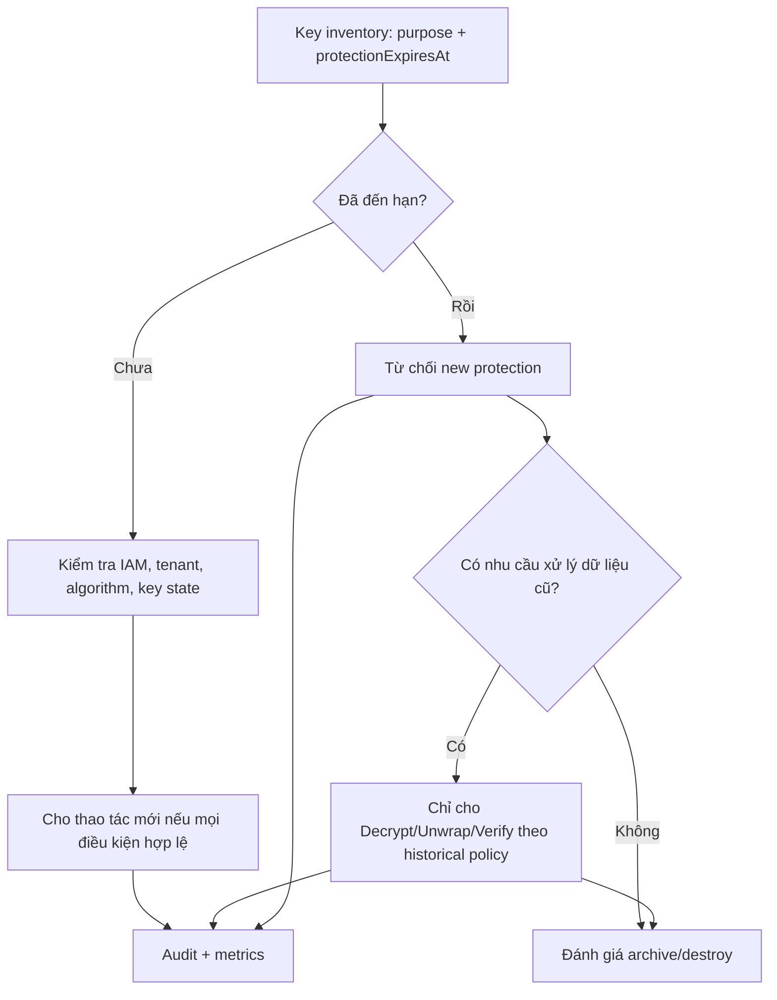
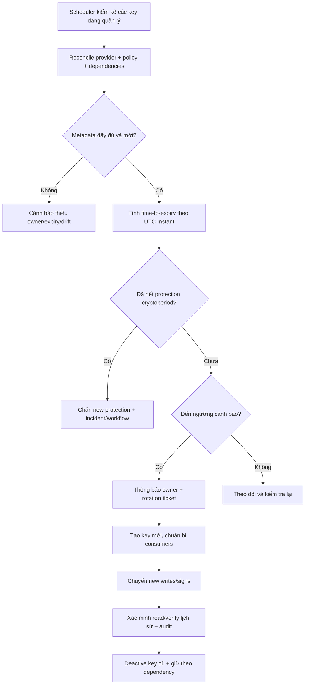
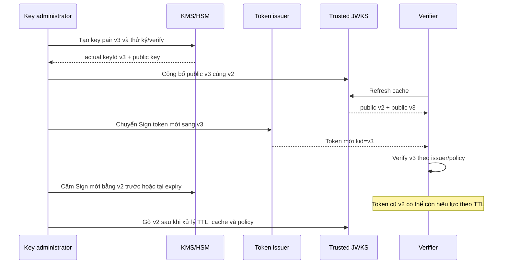

# Expiration time — Thời điểm hết hạn khóa trong key inventory

Trong chương **Key inventory** của module **SECURITY_KEY_MANAGEMENT_FUNDAMENTALS**, **expiration time** là mốc thời gian được ghi nhận để xác định **khi nào một khóa mật mã không còn được phép sử dụng theo một mục đích hoặc chính sách đã định**. Nó là một trong những trường quan trọng nhất của danh mục khóa (*key inventory*): nếu tổ chức không biết khóa nào sắp hết hạn, ai chịu trách nhiệm, khóa đang bảo vệ dữ liệu nào và có khóa thay thế chưa, việc xoay vòng và thu hồi sẽ trở nên bị động.

Tuy nhiên, “khóa hết hạn” **không đồng nghĩa với “mọi thao tác dùng khóa đều phải dừng”**, càng không đồng nghĩa với “hủy khóa ngay lập tức”. Một **private signing key** có thể hết hạn để ký mới nhưng public key tương ứng vẫn cần xác minh chữ ký cũ; một **KEK** có thể ngừng bọc DEK mới nhưng vẫn cần mở bọc DEK từ backup; một **AES DEK** có thể ngừng mã hóa dữ liệu mới nhưng còn cần giải mã dữ liệu đã lưu. Ngoài ra, **thời hạn của certificate, JWT, API secret và key material** là những khái niệm riêng, dù chúng có quan hệ với nhau.

Bài học kết nối việc theo dõi hạn sử dụng khóa với **vòng đời khóa từ tạo, cấp phát, lưu trữ, sử dụng, xoay vòng, thu hồi đến hủy**, cùng mật mã đối xứng/bất đối xứng, chữ ký số, KMS/HSM, envelope encryption, IAM và kiểm toán.

## 1. Mục tiêu học tập

Sau bài học, bạn có thể:

- Giải thích `expiration time` trong **key inventory** và phân biệt mốc này với `activationTime`, `rotationDueAt`, `deactivatedAt`, `retentionUntil`, `destroyAfter`.
- Phân biệt **protection cryptoperiod**, thời gian xử lý/kiểm chứng dữ liệu cũ, thời hạn chứng chỉ và thời hạn token.
- Định nghĩa chính xác thao tác nào bị chặn khi khóa hết hạn: `Encrypt`, `Sign`, `Wrap`, `GenerateMac` hay thiết lập phiên mới.
- Thiết kế schema inventory có **key ID/version, purpose, owner, algorithm, state, expiration**, quan hệ tới ciphertext và nguồn dữ liệu thời gian đáng tin cậy.
- Lập quy trình **cảnh báo trước hạn, xoay khóa và xác minh hậu chuyển đổi** cho DEK/KEK, signing key, HMAC key và recipient key.
- Dùng Java 17 `Instant`, `Clock` và policy để kiểm tra hạn một cách nhất quán, tránh sai lệch timezone và lỗi so sánh biên.
- Xử lý sự cố khóa hết hạn khi dữ liệu lịch sử vẫn cần đọc, đồng thời không cho phép sử dụng lại khóa không còn hợp lệ để tạo dữ liệu mới.

## 2. Expiration time thực sự mô tả điều gì?

Ở mức inventory, một trường `expiresAt` thường trả lời: **kể từ mốc nào, một khóa không được phép tiếp tục một nhóm thao tác nhất định?**. Nhưng nhóm thao tác đó phải được xác định rõ trong **key policy**, nếu không `expiresAt` trở thành nhãn mơ hồ, khiến hệ thống này từ chối `Sign` còn hệ thống khác lại từ chối cả `Verify`.

Ví dụ một signing key được tạo ngày 01/01/2026, kích hoạt ngày 02/01/2026 và có hạn ký đến 01/07/2026:

```text
2026-01-01           2026-01-02                2026-07-01
    |                     |                         |
    v                     v                         v
 Generated             Activated               Signing expires
    |---------------------|=========================|
                           Được ký đối tượng mới

Sau 2026-07-01:
  - Cấm tạo chữ ký mới bằng private signing key này.
  - Chữ ký đã tạo trước đó có thể vẫn cần public key để xác minh.
  - Thời hạn lưu evidence/certificate không nhất thiết trùng 01/07.
```

Mốc ngày trong ví dụ chỉ minh họa cách diễn đạt; khi ghi vào hệ thống cần **timestamp đầy đủ, múi giờ rõ và quy tắc biên chính xác**.

### 2.1. Ba loại thời gian thường bị trộn lẫn

| Khái niệm | Câu hỏi nó trả lời | Ví dụ |
| --- | --- | --- |
| **Protection cryptoperiod** | Khóa còn được tạo **bảo vệ mật mã mới** đến khi nào? | Cho phép `Sign` hoặc `Encrypt` đến `protectionExpiresAt`. |
| **Processing / verification lifetime** | Dữ liệu cũ được phép hoặc cần **giải mã/kiểm chứng** đến khi nào? | KEK còn được `Unwrap` cho wrapped DEK lịch sử; public key tiếp tục `Verify`. |
| **Retention / destruction schedule** | Phải **giữ khóa/bằng chứng**, rồi được phép hủy lúc nào? | Giữ KEK đến khi các backup phụ thuộc được xử lý, hết legal hold. |

Đây không phải ba ngày có thể suy ra tự động từ nhau. **Không tính `destroyAt = protectionExpiresAt`** khi chưa kiểm kê dữ liệu phụ thuộc.

### 2.2. Phân biệt các mốc metadata

| Trường inventory gợi ý | Ý nghĩa | Có phải “hết hạn” không? |
| --- | --- | --- |
| `createdAt` | Lúc tạo vật liệu khóa hoặc đăng ký khóa. | Không. |
| `activatedAt` | Mốc bắt đầu được sử dụng theo policy. | Không; là đầu khoảng sử dụng. |
| `notBefore` | Mốc sớm nhất có hiệu lực theo một policy/giao thức. | Không; là hạn dưới. |
| `rotationDueAt` | Mốc mục tiêu vận hành để **chuẩn bị hoặc chuyển khóa**. | Không nhất thiết; có thể sớm hơn thời hạn thực. |
| `protectionExpiresAt` | Mốc **kết thúc quyền tạo bảo vệ mới**. | **Có**, nếu đó là định nghĩa nghiệp vụ. |
| `processingUntil` | Mốc cuối được hỗ trợ xử lý dữ liệu cũ theo chính sách. | Một thời hạn khác, cần điều kiện riêng. |
| `deactivatedAt` | Thời điểm đã chuyển trạng thái thực tế sang deactivated. | Là sự kiện thực tế, có thể xảy ra trước/sau hạn. |
| `certificateNotAfter` | Hạn chứng chỉ X.509 theo PKI. | Có, nhưng là **hạn certificate**, không mặc nhiên là hạn raw key. |
| `tokenExpiresAt` | Hạn JWT/session token cụ thể. | Có, nhưng là **hạn token**, không phải hạn signing key. |
| `retentionReviewAt` | Mốc cần đánh giá tiếp tục lưu trữ hay tiêu hủy. | Không tự cấp quyền xóa. |
| `scheduledDeletionAt` | Mốc đã lên lịch xóa trong hệ thống quản lý khóa. | Là lịch tác vụ hủy, có thể có thời gian chờ. |
| `destroyedAt` | Thời điểm đã hủy vật liệu trong phạm vi kiểm soát. | Ghi nhận sự kiện, không phải hạn dự kiến. |

Các tên trường là **schema gợi ý**, không phải danh sách thuộc tính chuẩn giống nhau ở mọi nhà cung cấp KMS/HSM.

## 3. Expiration time không tự động là trạng thái khóa

Một **timestamp trong database** không làm khóa ngừng hoạt động. Nếu workload vẫn có quyền `Encrypt` hoặc `Sign` trực tiếp tại KMS, nó có thể tiếp tục gọi API dù registry ghi `expiresAt` đã qua. Vì vậy cần phân biệt:

- **Thời gian theo policy**: ví dụ `protectionExpiresAt = 2026-12-01T00:00:00Z`.
- **Trạng thái logic của key inventory**: `ACTIVE`, `DEACTIVATED`, `SUSPENDED`, `COMPROMISED`, `ARCHIVED`, `DESTROYED` theo kiến trúc của tổ chức.
- **Trạng thái trong KMS/HSM**: cờ enabled/disabled, policy IAM, scheduled deletion, trạng thái pending import và giới hạn thao tác do provider thực thi.
- **Quyền nghiệp vụ**: actor có được dùng khóa này để ký đúng đối tượng hoặc giải mã đúng tenant hay không.



**Đừng coi expiration là disable toàn diện.** Một thao tác `DisableKey` tại một số KMS có thể chặn **cả decrypt lẫn encrypt**; nếu dùng nó để thực thi hạn tạo dữ liệu mới mà không thiết kế đường đọc lịch sử, hệ thống có thể không giải mã được dữ liệu cũ.

### 3.1. Hết hạn, deactivated, suspended, revoked, destroyed

| Sự kiện/trạng thái | Nguyên nhân phổ biến | Hệ quả điển hình |
| --- | --- | --- |
| **Expired theo policy** | Đến `protectionExpiresAt`. | Cấm tạo bảo vệ mới; chưa nhất thiết đã thực hiện chuyển trạng thái kỹ thuật. |
| **Deactivated** | Key được chuyển ra khỏi giai đoạn bảo vệ mới. | Cấm `Encrypt`/`Sign` mới; có thể duy trì read/verify lịch sử. |
| **Suspended** | Tạm ngừng vì điều tra hoặc vận hành. | Có thể chặn tất cả thao tác tùy rủi ro, không chỉ do hết hạn. |
| **Compromised** | Private/secret key bị nghi lộ hoặc lạm dụng. | Cần incident response; expiry không khôi phục bí mật đã mất. |
| **Certificate revoked** | PKI thu hồi độ tin cậy của chứng chỉ. | Verifier cần xét chính sách và bằng chứng thời điểm liên quan. |
| **Destroyed** | Vật liệu key đã được hủy. | Thường không thể decrypt/unwrap bằng secret bị hủy; public key vẫn có thể verify. |

**Hạn sử dụng và sự cố rò rỉ là hai vấn đề riêng**. Khi một khóa bị lộ trước `expiresAt`, không được chờ tới hạn kế hoạch mới xử lý.

## 4. Expiration time thay đổi theo loại khóa

Không thể chọn một trường expiry rồi áp dụng cùng một hành động cho mọi loại khóa.

| Loại khóa | Điều nên dừng khi hết protection cryptoperiod | Điều có thể còn cần |
| --- | --- | --- |
| **AES DEK** | Mã hóa đối tượng/thông điệp mới bằng DEK cũ. | Decrypt ciphertext cũ cho đến khi được xóa hoặc re-encrypt. |
| **Symmetric KEK** | Wrap DEK mới dưới KEK cũ. | Unwrap DEK lịch sử hoặc rewrap sang KEK mới. |
| **HMAC key** | Tạo MAC mới dưới secret cũ. | Verify tag cũ trong cửa sổ có giới hạn, kèm chống replay. |
| **Private signing key** | Ký JWT, tài liệu, manifest mới. | Thường không cần private key để verify chữ ký cũ. |
| **Public verification key** | Không trực tiếp áp dụng hạn tạo chữ ký. | Verify chữ ký cũ và bằng chứng trust trong thời gian cần thiết. |
| **Recipient private key RSA/KEM** | Được dùng làm đích cho key establishment/mã hóa lai **mới** theo policy. | Decrypt/decapsulate bản mã đã gửi tới public key cũ. |
| **Ephemeral ECDH private key** | Dùng cho phiên mới sau kết thúc phiên. | Thông thường không lưu lại sau thiết lập phiên. |
| **Root/KDF key** | Dẫn xuất khóa con mới cho purpose đã hết hạn. | Có thể còn cần tái dẫn xuất key cũ nếu kiến trúc yêu cầu. |

Ví dụ nếu `JWT-sign-v3` hết hạn để ký, issuer chuyển sang `v4` nhưng JWKS có thể tiếp tục công bố **public key v3** trong khoảng thời gian cần xác minh token cũ. Trái lại, nếu **HMAC webhook key** hết hạn, phía kiểm tra tag vẫn cần **chính secret** trong thời gian overlap, làm tăng rủi ro nếu secret lộ.

### 4.1. Hạn certificate khác hạn private key

Chứng chỉ X.509 có `NotBefore` và `NotAfter`. Hai mốc này giới hạn thời gian hiệu lực của **chứng chỉ theo PKI**, không phải một lệnh tự hủy private key. Cặp khóa có thể vẫn tồn tại, đã ngừng sử dụng hoặc được cấp chứng chỉ khác tùy hệ thống.

Một chữ ký tài liệu phát hành trước khi chứng chỉ hết hạn có thể cần **bằng chứng thời điểm ký và trạng thái chứng chỉ tại thời điểm liên quan** để xác minh lâu dài. Không dùng duy nhất `certificateNotAfter` để quyết định hủy private key hay đánh dấu tất cả chữ ký lịch sử không hợp lệ. Trường `signedAt` do người ký tự khai cũng **không tự trở thành trusted timestamp**.

### 4.2. Hạn JWT khác hạn signing key

Trong JWT/JWS:

- Claim `exp` quy định **hạn của token**, phải được verifier kiểm tra.
- `kid` giúp chọn public key phù hợp **trong tập khóa của issuer đáng tin**, không có nghĩa token được tin chỉ vì tồn tại key ID.
- `signingKey.protectionExpiresAt` quy định **đến khi nào issuer được ký token mới** bằng private key ấy.
- JWKS/public key có thể cần duy trì **sau mốc hết hạn ký**, tính cả token TTL tối đa, độ lệch đồng hồ, cache JWKS và chính sách thu hồi.

**Không dùng `kid` từ token làm URL tự do để tải khóa không tin cậy**. Hệ thống xác minh phải cố định issuer, thuật toán chấp nhận, `aud`, `iss`, `exp`, `nbf` cùng chính sách tin cậy.

## 5. Thiết kế schema key inventory có thời hạn rõ nghĩa

Một bản ghi inventory không nên chỉ gồm `keyName` và `expirationDate`. Cần đủ thông tin để hệ thống trả lời: **khóa nào, ở đâu, của ai, phục vụ mục đích nào, khi nào hết hạn, cần thay bằng gì, ai đang dùng và phụ thuộc nào chưa xử lý?**

Ví dụ **schema logic minh họa**, không phải JSON chuẩn của nhà cung cấp:

```json
{
  "keyId": "billing/kek-v3",
  "providerKeyRef": "kms://region-a/account-x/key/uuid-v3",
  "version": "3",
  "owner": "billing-security",
  "environment": "production",
  "tenantScope": "billing",
  "purpose": "wrap-dek",
  "algorithm": "AES-256",
  "origin": "provider-generated",
  "state": "ACTIVE",
  "createdAt": "2026-01-10T09:00:00Z",
  "activatedAt": "2026-01-15T00:00:00Z",
  "rotationDueAt": "2026-11-15T00:00:00Z",
  "protectionExpiresAt": "2026-12-01T00:00:00Z",
  "processingUntil": null,
  "retentionReviewAt": "2027-03-01T00:00:00Z",
  "replacementKeyId": "billing/kek-v4",
  "dependencyManifestRef": "inventory/billing/kek-v3/dependencies",
  "policyVersion": 8,
  "lastReconciledAt": "2026-11-28T00:00:00Z",
  "metadataSource": "kms-plus-approved-registry"
}
```

**Lưu ý:** `processingUntil: null` phải được diễn giải theo policy rõ ràng, chẳng hạn “chưa xác định vì còn phụ thuộc”, **không được tự suy là quyền decrypt vô thời hạn**. Chuỗi `providerKeyRef` là tham chiếu mẫu, không phải địa chỉ KMS thực. Không lưu plaintext key/DEK vào inventory.

### 5.1. Nhóm trường bắt buộc và nguồn sự thật

| Nhóm metadata | Ví dụ | Nguồn đáng tin nên xét |
| --- | --- | --- |
| **Định danh** | Actual key ID, version, provider ref, aliases | KMS/HSM cùng registry nội bộ; tránh chỉ dùng alias động. |
| **Phân loại** | Algorithm, key type, size/curve, purpose, exportability | Provider metadata và chính sách đã phê duyệt. |
| **Quyền sở hữu** | Owner, service, environment, tenant | CMDB/asset registry và IAM có kiểm soát. |
| **Vòng đời** | State, created/activated/deactivatedAt | Sự kiện quản trị, audit và key registry. |
| **Hạn theo policy** | `rotationDueAt`, `protectionExpiresAt`, `processingUntil` | Policy version và phê duyệt; không suy từ tên khóa. |
| **Phụ thuộc** | DEK/wrapped objects, backup manifest, JWKS/cert consumers | Data inventory, object metadata, service dependencies. |
| **Vận hành** | Last used, last reconciled, alert owner, incident reference | Audit/telemetry có thời hạn lưu phù hợp. |
| **Tuân thủ** | Retention, legal hold, deletion approval | Records policy và workflow được phê duyệt. |

**Không gộp `alias` và `actualKeyId`**. Alias như `current-signing` có thể chuyển đích từ v3 sang v4. Một chữ ký/ciphertext lịch sử cần biết **khóa thực tế** đã tạo bảo vệ, không chỉ alias hiện hành.

### 5.2. Thời gian nào là authoritative?

Một inventory thường thu thập dữ liệu từ nhiều nơi: KMS/HSM, trust registry, PKI, ứng dụng và các hệ thống backup. Các nguồn có thể không cùng định nghĩa expiration.

- **Provider expiration**: một số nền tảng có ngày hết hạn vật liệu khóa được nhập, chứng chỉ hoặc thời hạn sử dụng do dịch vụ quản lý. Không được mặc định mọi KMS có `expiresAt` hoặc tự chặn đúng mọi thao tác sau ngày đó.
- **Policy expiration**: tổ chức đặt `protectionExpiresAt` theo cryptoperiod/purpose, có thể độc lập với provider.
- **Observed effective state**: thực tế IAM, alias và key state hiện cho phép những thao tác nào?
- **Certificate/JWT expiration**: hạn của credential hoặc đối tượng riêng, không tự động cập nhật hạn key registry.

Inventory nên giữ **source**, `policyVersion`, `lastReconciledAt`, kết quả reconciliation và cảnh báo **drift**. Nếu policy ghi expired nhưng KMS vẫn cho `Sign`, đó là **lỗi kiểm soát cần xử lý**, không phải “key vẫn còn hợp lệ vì API thành công”.

## 6. Định nghĩa phép so sánh thời gian không mơ hồ

Khi dùng `expiresAt`, hãy quy định khoảng có hiệu lực **nửa mở**:

\[
[\text{activatedAt}, \text{protectionExpiresAt})
\]

Tức là được dùng cho thao tác tạo bảo vệ mới khi:

\[
\text{activatedAt} \leq \text{now} < \text{protectionExpiresAt}
\]

Tại **đúng thời điểm `protectionExpiresAt`**, quyền tạo mới đã **hết hiệu lực**. Cách diễn đạt này tránh lỗi một request đúng mốc nửa đêm vẫn được phép vì mã dùng phép `<=` cho thời điểm hết hạn.

### 6.1. UTC, múi giờ và DST

- Lưu timestamp theo chuẩn **UTC** (ví dụ `2026-12-01T00:00:00Z`) hoặc kiểu dữ liệu có timezone/offset rõ ràng.
- Dùng **`Instant`** cho quyết định bảo mật máy-máy; chỉ chuyển sang timezone địa phương để hiển thị.
- Tránh lưu `2026-12-01` mà không quy định “đầu ngày hay cuối ngày, ở múi giờ nào?”.
- Nếu policy quy định hết hạn cuối ngày của một khu vực kinh doanh, hãy **chuyển mốc đó sang Instant từ trước**, kiểm tra quy tắc DST/lịch địa phương, không để từng node tự hiểu.
- Đồng bộ đồng hồ máy chủ và giám sát drift. Với quyết định cấp quyền, không lấy `now` từ client.
- Quy định độ lệch đồng hồ (*clock skew*) **theo từng giao thức**; không âm thầm cộng grace period vào hạn khóa cho mọi thao tác mới.

### 6.2. Cảnh báo trước hạn khác cho phép dùng quá hạn

Có thể cảnh báo trước hạn ở mốc **90/30/7 ngày** hoặc mốc phù hợp tần suất rotation. Đây là **ví dụ vận hành**, không phải chuẩn bắt buộc; khóa phiên vài phút hoặc chứng chỉ vài ngày phải có lịch cảnh báo khác.

**Grace period** dùng để hỗ trợ dữ liệu cũ (ví dụ verify token đã phát hành) không nên hiểu là cho phép **ký mới** sau `protectionExpiresAt`. Cần tách quyền:

```text
now < protectionExpiresAt:
  Sign/Encrypt new -> xét IAM/purpose/state

now >= protectionExpiresAt:
  Sign/Encrypt new -> DENY

Historical Verify/Decrypt:
  Quyết định độc lập theo processing policy,
  object metadata đáng tin và quyền nghiệp vụ.
```

## 7. Lập lịch cảnh báo và rotation từ inventory

Một inventory chỉ có giá trị khi được dùng để chủ động thay khóa, không chỉ phục vụ báo cáo.



### 7.1. Trách nhiệm của một job cảnh báo

1. **Đọc inventory được ủy quyền** có `actualKeyId`, owner, state, expiration, source và thời điểm reconcile.
2. **Loại trừ hoặc phân nhánh** khóa đã destroyed theo đúng policy; khóa compromised cần incident workflow, không phải chỉ cảnh báo định kỳ.
3. **Tính remaining duration** bằng đồng hồ server tin cậy, xử lý cả hạn đã qua.
4. **Tạo thông báo có người chịu trách nhiệm**: key ref, purpose, deadline, mức ảnh hưởng, dependencies, replacement status.
5. **Chống trùng cảnh báo** bằng key ID/version và từng ngưỡng; không gửi hàng nghìn email giống nhau sau mỗi lần scheduler chạy.
6. **Escalation** khi gần hết hạn mà chưa có key thay thế/owner phê duyệt.
7. **Reconcile trạng thái thực tế** ở provider và đường gọi ứng dụng để chứng minh `Sign`/`Encrypt` mới bị chặn đúng hạn.
8. **Audit** những thay đổi `expiresAt`, thay policy, ngoại lệ gia hạn và tác vụ rotation.

Không để một job cảnh báo tự **xóa key** chỉ vì `expiresAt <= now`. Xóa khóa là quyết định riêng, cần chứng minh dữ liệu/backup không còn phụ thuộc và có approval theo chính sách.

### 7.2. Ví dụ bảng inventory giám sát

| Key ID | Purpose | Protection expires | Owner | Trạng thái vận hành |
| --- | --- | --- | --- | --- |
| `payments/sign-v4` | Ký lệnh thanh toán mới | `2027-01-15T00:00:00Z` | Identity/security team | Lên lịch sinh v5 và công bố public key sớm. |
| `billing/kek-v3` | Wrap DEK hóa đơn mới | `2026-12-01T00:00:00Z` | Billing security | Chuẩn bị chuyển sang v4; inventory còn wrapped DEK cũ. |
| `partners/acme-hmac-v2` | Tạo webhook MAC | `2026-12-10T00:00:00Z` | Partner integration | Phối hợp key ID/overlap với đối tác. |
| `archive/dek-v1` | Decrypt hồ sơ đã lưu | Đã hết hạn **bảo vệ mới** | Records/security team | Archive; chỉ decrypt lịch sử theo approval. |

Các ngày và tên khóa ở bảng là **giả định để minh họa**, không phải dữ liệu thực của doanh nghiệp.

## 8. Java 17: kiểm tra expiration và cảnh báo trước hạn

Java 17 cung cấp `Instant`, `Duration`, `Clock` và `record` để xây chính sách thời gian có thể kiểm thử. Ví dụ dưới đây:

- Chỉ cho phép **bảo vệ mới** khi key đang `ACTIVE` và thời điểm hiện tại nằm trong khoảng `[activeFrom, protectionExpiresAt)`.
- Tính trạng thái cảnh báo theo `rotationDueAt` và thời gian trước hạn.
- Cho biết việc **xử lý lịch sử là quyết định riêng**, không mặc nhiên được phép sau expiry.
- Không gọi KMS/crypto API; mục tiêu là minh họa một **policy gate**.

```java
import java.time.Clock;
import java.time.Duration;
import java.time.Instant;
import java.util.Objects;

public final class KeyExpirationDemo {
    enum State { PENDING, ACTIVE, DEACTIVATED, SUSPENDED, COMPROMISED, DESTROYED }
    enum Alert { NONE, ROTATION_DUE, EXPIRING_SOON, EXPIRED }

    record KeyMetadata(
            String actualKeyId,
            String purpose,
            State state,
            Instant activeFrom,
            Instant rotationDueAt,
            Instant protectionExpiresAt) {
        KeyMetadata {
            Objects.requireNonNull(actualKeyId);
            Objects.requireNonNull(purpose);
            Objects.requireNonNull(state);
            Objects.requireNonNull(activeFrom);
            Objects.requireNonNull(rotationDueAt);
            Objects.requireNonNull(protectionExpiresAt);
            if (!activeFrom.isBefore(protectionExpiresAt)) {
                throw new IllegalArgumentException("Invalid cryptoperiod");
            }
        }
    }

    static boolean mayCreateNewProtection(KeyMetadata key, Clock clock) {
        Instant now = clock.instant(); // Quyết định dùng thời gian từ server
        return key.state() == State.ACTIVE
                && !now.isBefore(key.activeFrom()) // now >= activeFrom
                && now.isBefore(key.protectionExpiresAt()); // now < expiry
    }

    static Alert alert(KeyMetadata key, Clock clock, Duration leadTime) {
        Instant now = clock.instant();
        if (!now.isBefore(key.protectionExpiresAt())) {
            return Alert.EXPIRED;
        }
        if (!now.plus(leadTime).isBefore(key.protectionExpiresAt())) {
            return Alert.EXPIRING_SOON;
        }
        if (!now.isBefore(key.rotationDueAt())) {
            return Alert.ROTATION_DUE;
        }
        return Alert.NONE;
    }

    public static void main(String[] args) {
        KeyMetadata key = new KeyMetadata(
                "billing/kek-v3", "wrap-dek", State.ACTIVE,
                Instant.parse("2026-01-15T00:00:00Z"),
                Instant.parse("2026-11-15T00:00:00Z"),
                Instant.parse("2026-12-01T00:00:00Z"));

        Clock before = Clock.fixed(
                Instant.parse("2026-11-28T12:00:00Z"), java.time.ZoneOffset.UTC);
        Clock atExpiry = Clock.fixed(
                Instant.parse("2026-12-01T00:00:00Z"), java.time.ZoneOffset.UTC);

        System.out.println("Before expiry: " +
                mayCreateNewProtection(key, before));   // true
        System.out.println("At expiry: " +
                mayCreateNewProtection(key, atExpiry)); // false
        System.out.println("Alert before: " +
                alert(key, before, Duration.ofDays(7))); // EXPIRING_SOON
        System.out.println("Alert at expiry: " +
                alert(key, atExpiry, Duration.ofDays(7))); // EXPIRED

        // Điều kiện Decrypt/Unwrap lịch sử KHÔNG được suy ra từ kết quả trên.
        // Cần policy và IAM riêng ở đúng điểm thực thi crypto/KMS.
    }
}
```

**Đầu ra dự kiến:**

```text
Before expiry: true
At expiry: false
Alert before: EXPIRING_SOON
Alert at expiry: EXPIRED
```

### 8.1. Giới hạn của ví dụ

- `State.ACTIVE` và khoảng thời gian **không đủ** để cấp quyền mã hóa/ký trong production. Phải kiểm tra actor, tenant, key purpose, algorithm, capability, approval và quyền thực tế tại KMS/HSM.
- `Clock.fixed` làm cho test có tính xác định; production dùng một **nguồn thời gian server được quản lý**, chẳng hạn `Clock.systemUTC()`, cùng cơ chế giám sát đồng hồ.
- Demo không xử lý **clock skew giữa vùng, policy cache, TOCTOU** hay request đã chạy trước mốc hết hạn. Phải xác định rõ thời điểm kiểm tra và điểm thực thi thao tác.
- `now.plus(leadTime)` ở đây là minh họa với `leadTime` được cấu hình từ chính sách; production cần kiểm tra lead time không âm và giới hạn hợp lệ, cũng như phòng overflow với input không đáng tin.
- Lệnh `alert` không tự chuyển key sang `DEACTIVATED`, không gọi `DisableKey` và không xóa key. Các hành động đó thuộc **workflow có phê duyệt**.
- Tính toán cảnh báo chỉ phản ánh metadata vừa đọc. Nếu bản ghi stale hoặc owner trống, job phải **cảnh báo chất lượng inventory**, không coi không có alert là an toàn.
- Java không tự làm hạn key của nhà cung cấp có hiệu lực. Policy gate phải được kết hợp với IAM, key policy hoặc API kiểm soát tại đúng nơi sử dụng.

## 9. Rotation trước hạn với DEK/KEK và envelope encryption

Một hệ thống lưu trữ có:

```text
Plaintext ---- AES-GCM(DEK-v3) ----> data ciphertext + tag + nonce
                      |
                      +---- Wrap bằng KEK-v2 ----> wrapped DEK

Inventory:
  DEK-v3: protectionExpiresAt (không dùng mã hóa mới sau mốc)
  KEK-v2: protectionExpiresAt (không wrap DEK mới sau mốc)
```

**Hai khóa có thể hết hạn vào thời điểm khác nhau** và dẫn tới hành động khác nhau:

- **DEK hết protection cryptoperiod**: dừng mã hóa bản ghi mới bằng DEK cũ. Nếu dữ liệu cũ vẫn phải đọc, giữ khả năng decrypt hoặc lên kế hoạch re-encrypt.
- **KEK hết protection cryptoperiod**: dừng wrap DEK mới bằng KEK cũ. Các wrapped DEK lịch sử có thể vẫn cần unwrap hoặc phải được rewrap trước khi hủy KEK.
- **KEK rotation**: có thể rewrap cùng DEK dưới KEK mới mà không phải thay ciphertext payload.
- **DEK rotation**: nếu muốn thay chính DEK bảo vệ dữ liệu cũ, thường cần re-encrypt với DEK mới và nonce/tag phù hợp.

**Expiry của KEK không tự hủy DEK**, và hết hạn DEK không có nghĩa mọi ciphertext lập tức bị mất quyền giải mã.

### 9.1. Runbook trước khi KEK hết hạn

1. **T-90/T-30 theo policy:** inventory liệt kê KEK sắp hết hạn và tất cả wrapped DEK, bản sao backup, region và owner phụ thuộc.
2. Sinh **KEK mới** trong KMS/HSM bằng cơ chế thích hợp; đăng ký key ID/version, purpose và quyền.
3. Chuyển mọi writer/service có chức năng wrap mới sang KEK mới, tính cả queue, batch và region phụ.
4. Bảo đảm mỗi bản ghi lưu **actual KEK reference** đã dùng wrap, không chỉ alias `current`.
5. Chặn `Wrap` mới bằng KEK cũ tại điểm enforcement; nếu giữ `Unwrap` lịch sử, thu hẹp quyền theo workload/tenant/object.
6. Rewrap các DEK lịch sử nếu policy và hạ tầng cho phép; kiểm tra từng batch, có rollback và checkpoint đáng tin.
7. Kiểm thử khôi phục ciphertext từ backup/cold storage trước khi lập lịch hủy KEK cũ.
8. Ghi audit: actor, `oldKeyId`, `newKeyId`, số bản ghi đã chuyển, phần còn phụ thuộc, kết quả và approval.

**Không dùng `DisableKey` một cách mù quáng** nếu thao tác đó chặn luôn `Decrypt`/`Unwrap`. Khi nghi **lộ KEK**, routine rotation và rewrap có thể không đủ vì attacker có thể đã mở wrapped DEK cũ; cần đánh giá re-encrypt bằng DEK mới và hậu quả với dữ liệu quá khứ.

## 10. Rotation trước hạn với signing key và chứng chỉ

### 10.1. JWT signing key

Một issuer dùng signing key `auth-sign-v2` với mốc `protectionExpiresAt`. Quy trình:



Những điểm cần kiểm tra:

- Public key mới **được công bố và cache** trước khi issuer bắt đầu ký bằng private key mới.
- Sau expiry của v2, không được tạo **token mới** với v2; grace period cho token cũ không đồng nghĩa cho ký mới.
- Verifier kiểm tra signature và các claim `iss`, `aud`, `exp`, `nbf`, issuer trust, thuật toán allowlist; không tin `kid` một mình.
- Nếu private key v2 **bị lộ**, có thể phải vô hiệu hóa token và thay trust khẩn cấp thay vì chờ TTL bình thường.

### 10.2. Chứng chỉ TLS và PKI

Với TLS hoặc hệ thống dùng X.509, inventory nên liên kết:

```text
certificateId
    -> NotBefore / NotAfter
    -> public key fingerprint
    -> private key reference (nếu quản lý được)
    -> service hostname/SAN, owner, deployment targets
    -> CA/issuer chain, renewal status, revocation status
```

Cảnh báo trước `NotAfter` cần đảm bảo chứng chỉ **thực sự được cài đặt và phục vụ** trên tất cả endpoint, không chỉ “đã xin cấp mới”. Một certificate mới có thể dùng **key pair mới** hoặc quy trình khác theo chính sách, nhưng đây là quyết định PKI riêng. Expiry certificate không đồng nghĩa key material được xóa hoặc khóa ký hồ sơ dài hạn tự mất khả năng xác minh.

## 11. HMAC secret, token và khóa ngắn hạn

### 11.1. HMAC webhook

Một secret HMAC chia sẻ với đối tác thường cần lịch đổi:

```text
Trước cutoff:
  sender tạo HMAC bằng secret v1
  receiver verify bằng secret v1

Chuyển đổi có kiểm soát:
  sender chuyển tạo tag mới bằng secret v2
  receiver có thể verify v1/v2 trong cửa sổ hữu hạn
  mỗi request có keyId + timestamp + requestId
  tất cả trường cần thiết được đưa vào MAC input

Sau cutoff:
  không tạo tag mới bằng v1
  ngừng verify v1 khi cửa sổ hợp lệ kết thúc
  thu hồi/hủy v1 sau khi xử lý phụ thuộc
```

Khi HMAC key hết hạn, **chỉ kiểm tra thời gian của secret không đủ chống replay**. Một tag đúng từ hôm trước có thể bị gửi lại; cần kiểm tra timestamp, nonce/request ID, idempotency và quyền nghiệp vụ. Không tin `keyId` từ request nếu chưa ràng buộc partner/tenant.

### 11.2. Access token, refresh token và session secret

Các loại token có thể dùng **TTL rất khác** so với signing key:

- **JWT access token** có `exp` của chính token; có thể sống ngắn hơn signing key nhiều lần.
- **Refresh token** thường có chính sách rotation/thu hồi và storage riêng.
- **Session secret hoặc bearer token ngẫu nhiên** cần hạn, phạm vi quyền, bảo vệ khi lưu/truyền và cơ chế thu hồi.
- **KMS data key/ephemeral session key** có thể tồn tại rất ngắn, nhưng mốc runtime và phiên bản key có thể không phù hợp đưa vào cùng job cảnh báo như KEK dài hạn.

Không nên áp dụng một ngưỡng “cảnh báo trước 30 ngày” cho mọi loại key hoặc token. Inventory nên phân loại **key duration class** và độ ưu tiên dựa trên tác động.

## 12. Trường hợp dữ liệu cũ sau expiration

### 12.1. Chứng minh dữ liệu lịch sử hợp lệ

Giả sử một DEK hết hạn mã hóa mới tại `T`. Nếu client gửi ciphertext kèm `createdAt < T`, không được tự cho rằng đây là dữ liệu cũ. Attacker có thể tự khai timestamp trong quá khứ rồi tạo dữ liệu trái policy.

Cần dựa vào:

- object metadata từ nguồn tin cậy do server ghi nhận;
- key ID/algorithm/purpose và version được **xác thực** cùng envelope;
- AEAD tag và AAD ràng buộc tenant, object ID, schema/version khi phù hợp;
- inventory hoặc event log chống sửa về thời điểm được tạo/nhập;
- quyền nghiệp vụ và chính sách xử lý lịch sử.

**Decrypt thành công không tự chứng minh đối tượng được tạo trước expiration**. Việc bảo đảm tính lịch sử có thể cần manifest, log đã ký và các mốc thời gian tin cậy độc lập.

### 12.2. Archive và destruction

Khi khóa đã hết hạn protection cryptoperiod:

1. Đưa key vào trạng thái **deactivated** theo policy, cấm tạo bảo vệ mới.
2. Nếu còn ciphertext hoặc tài liệu cần xử lý, giữ **đường đọc/verify có kiểm soát** hoặc hoàn thành migration.
3. Nếu chỉ cần xác minh chữ ký bất đối xứng, thường giữ **public key/chứng cứ** thay vì private key.
4. Xác định **retention review** và legal hold; kiểm kê backup và cross-region replicas.
5. Chỉ **destroy** khi phụ thuộc và nghĩa vụ được giải quyết, có phê duyệt và bằng chứng tiêu hủy.

Một key ở trạng thái **expired** nhưng vẫn cần giải mã backup **không phải “lỗi inventory”** nếu đã có trạng thái deactivated/archived và policy đọc lịch sử hợp lệ. Lỗi là khi hệ thống **không biết vì sao còn giữ**, hoặc vẫn cho mã hóa/ký mới vượt hạn.

## 13. Chất lượng dữ liệu inventory và kiểm soát sai lệch

Việc chọn timestamp chính xác là chưa đủ nếu inventory **không đáng tin hoặc không đầy đủ**.

### 13.1. Các sai lệch cần phát hiện

| Drift / dữ liệu bất thường | Rủi ro | Cách xử lý |
| --- | --- | --- |
| Key `ACTIVE` nhưng `protectionExpiresAt < now`. | Có thể đang tạo dữ liệu mới bằng khóa hết hạn. | Chặn thao tác mới, cảnh báo owner và xác minh KMS/IAM. |
| Không có owner hoặc policy version. | Không ai chịu trách nhiệm rotation hoặc ngoại lệ. | Đưa vào hàng đợi remediation, yêu cầu gắn owner. |
| `createdAt` sau `activatedAt` hoặc expiry trước activation. | Metadata lỗi, phép so sánh có thể sai. | Validate và quarantine bản ghi, không tự sửa bằng suy đoán. |
| Alias `current` trỏ sang key khác registry ghi. | Dịch vụ có thể dùng key sai hoặc audit sai. | Reconcile actual key ID và các deployment target. |
| Provider key bị disabled nhưng registry ghi `ACTIVE`. | Outage encrypt/decrypt hoặc trạng thái không được kiểm soát. | Điều tra drift và reconcile thực tế. |
| Certificate đã renew nhưng endpoint vẫn phục vụ cert cũ. | Sắp gián đoạn TLS dù ticket renewal hoàn thành. | Kiểm tra deployment và cert đang được trình bày thực tế. |
| `lastReconciledAt` quá cũ. | Cảnh báo trước hạn bỏ sót key mới hoặc thay đổi state. | SLA đồng bộ và cảnh báo stale data. |
| Khóa hết hạn nhưng không có `replacementKeyId`. | Rotation có thể chưa chuẩn bị. | Escalate, ưu tiên theo blast radius. |
| KEK đã hết hạn mà vẫn có `Wrap` mới. | Vi phạm policy, tạo phụ thuộc mới lên key cũ. | Chặn tại KMS/proxy, kiểm tra đường bypass. |
| Key sắp destroy nhưng dependency manifest còn objects. | Mất khả năng giải mã dữ liệu. | Hoãn hủy, rewrap/re-encrypt và restore drill. |

### 13.2. Cảnh báo phải phục vụ hành động

Một cảnh báo hữu ích nên nêu **key ID/version, purpose, owner, expiration, time remaining, service sử dụng, mức ảnh hưởng, trạng thái khóa thay thế và việc cần làm**. Không đưa secret hay DEK/plaintext vào email, ticket hoặc telemetry.

Chẳng hạn:

```text
Alert: KEY_EXPIRATION_WITHOUT_REPLACEMENT
Key: billing/kek-v3
Purpose: wrap-dek
Protection expires: 2026-12-01T00:00:00Z
Owner: billing-security
Dependency: 43,000 wrapped DEKs (inventory example)
Action: Create/activate replacement KEK, move new wraps,
        validate historical unwrap, plan rewrap.
```

Số lượng trong ví dụ là **giả lập**, không phản ánh hệ thống thực.

## 14. Quyền, kiểm toán và an ninh vận hành

### 14.1. Ai có quyền thay expiration time?

Thay đổi thời hạn sử dụng khóa là **thao tác bảo mật có tác động lớn**. Nếu workload có thể tự đẩy `protectionExpiresAt` từ ngày mai sang năm sau, chính sách cryptoperiod coi như bị vô hiệu hóa.

Một phân tách vai trò:

| Vai trò | Quyền phù hợp | Không cấp mặc định |
| --- | --- | --- |
| **Key owner** | Đề xuất cryptoperiod/rotation theo use case. | Tự gia hạn không qua phê duyệt. |
| **Security policy approver** | Duyệt thay đổi hạn, ngoại lệ và risk acceptance. | Đọc plaintext secret nếu không cần. |
| **Key administrator** | Thực thi state/key policy theo change đã duyệt. | Ký giao dịch nghiệp vụ tùy ý. |
| **Writer/Signer workload** | Dùng key hiện hành đúng purpose/tenant. | Sửa metadata expiry, policy hay hủy key. |
| **Reader/Verifier workload** | Xử lý dữ liệu lịch sử trong phạm vi cho phép. | Vượt quyền để tạo bảo vệ mới bằng key expired. |
| **Auditor** | Xem biến động key inventory, log, rotation status. | Xuất private key hoặc cấp lại quyền. |

Cần audit những sự kiện:

- `KEY_EXPIRATION_SET` / `KEY_EXPIRATION_CHANGED`, mốc trước/sau, người yêu cầu và người duyệt;
- `KEY_ROTATION_STARTED`, `KEY_ACTIVATED`, `KEY_DEACTIVATED`, `KEY_DESTROY_SCHEDULED`;
- các request `Sign/Encrypt/Wrap` đến key đã hết hạn (cả bị chặn và trường hợp bypass được phát hiện);
- `Decrypt/Unwrap/Verify` lịch sử bất thường sau expiry;
- thay đổi IAM, alias, key policy, certificate/JWKS distribution và nguồn đồng bộ inventory.

Không log **private key, HMAC secret, DEK rõ, seed, plaintext nhạy cảm hoặc bearer token**. Một key ID hoặc metadata có thể không bí mật nhưng vẫn cần được bảo vệ về tính toàn vẹn và phân quyền.

### 14.2. Gia hạn ngoại lệ (*expiry extension*)

Đôi khi hệ thống chưa kịp rotation và muốn kéo dài `protectionExpiresAt`. Đây **không phải thao tác miễn phí**: cần đánh giá lý do, rủi ro thuật toán, số lượng dữ liệu bị ảnh hưởng, hệ thống chưa cập nhật, thời hạn ngắn nhất có thể và người phê duyệt có thẩm quyền.

Một quy trình phù hợp:

1. Tạo change request ghi lý do và tác động.
2. Kiểm tra khóa có dấu hiệu compromised không; nếu nghi lộ, **không dùng extension thay incident response**.
3. Duyệt ngoại lệ có thời hạn cố định, lưu policy version và audit.
4. Bảo đảm tất cả enforcement points nhận policy mới một cách nhất quán.
5. Theo dõi hạn mới, escalation và kế hoạch rotation thật.
6. Không lặp vô hạn ngoại lệ để thay thế chương trình quản lý khóa.

**Không chỉnh trực tiếp timestamp trong database** chỉ để tắt cảnh báo mà không thay đổi thiết kế/kiểm soát vận hành.

## 15. Tình huống tích hợp: hệ thống lưu hóa đơn, phát token và webhook

Một hệ thống Java có ba luồng bảo vệ:

**Luồng A — hóa đơn mã hóa:** tạo DEK AES-GCM, bọc bằng KEK của KMS. Inventory theo dõi hạn KEK cho `Wrap` mới và hạn DEK cho `Encrypt` mới, cùng dependencies ciphertext và backup. Khi KEK gần hết hạn, tạo KEK mới và chuyển writer; dữ liệu lịch sử được rewrap khi phù hợp, rồi mới xét hủy KEK cũ.

**Luồng B — JWT:** tạo cặp khóa ký trong KMS/HSM. Inventory theo dõi `signing.protectionExpiresAt`, còn `exp` là của từng JWT. Signer chuyển sang key mới sau khi public key đã được phát hành qua JWKS đáng tin. Verifier kiểm tra chữ ký cũ theo TTL, cache và policy, không giữ private signing key lâu chỉ vì còn token lịch sử.

**Luồng C — webhook:** dùng HMAC-SHA256 secret theo partner. Khi key gần hết hạn, phối hợp rollout; sender chỉ MAC mới bằng secret mới, receiver có thể giữ key cũ trong cửa sổ overlap ngắn và thực thi chống replay.

```text
Key inventory mỗi ngày:
  - Reconcile key actual IDs, states, policy timestamps.
  - Tính cảnh báo theo purpose, SLA và owner.
  - Xác định những key đã hết hạn nhưng còn tạo protection mới.
  - Theo dõi migration/rewrap và dependencies.
  - Chứng minh recovery path trước khi hủy key cũ.

Không làm:
  - Tắt KMS key hàng loạt khi thấy expiresAt trong database.
  - Xóa public verification key ngay khi hết hạn ký.
  - Tin một token có exp dài hơn để kéo dài signing key cryptoperiod.
  - Gửi raw key để đội vận hành "gia hạn" thủ công.
```

Nếu KMS đang lỗi vào đúng thời điểm rotation, hệ thống cần biết chính sách **fail closed**, cơ chế dự phòng và đường xử lý dữ liệu cũ. Không tự tạo một KEK không quản lý được, đổi thuật toán yếu hơn hoặc kéo dài hạn một cách ngầm định để vượt qua sự cố.

## 16. Các lỗi thường gặp

| Sai lầm | Hậu quả | Cách phòng tránh |
| --- | --- | --- |
| Một trường `expiresAt` chung cho certificate, token và key material. | Thay nhầm quyền sử dụng, gây outage hoặc mở rộng trust. | Tách các mốc theo đối tượng/purpose. |
| Coi `expiresAt` = `destroyAt`. | Mất khả năng đọc ciphertext/backup hoặc mất evidence lịch sử. | Kiểm kê phụ thuộc, retention và phê duyệt hủy riêng. |
| Coi expiry trong registry tự chặn KMS. | Service có quyền vẫn ký/mã hóa mới bằng key cũ. | Enforce tại KMS/IAM/proxy và kiểm tra telemetry. |
| Dùng `DisableKey` để chặn encryption mới mà quên decrypt cũ. | Outage đọc dữ liệu lịch sử. | Xác định provider behavior, tách read/write policy. |
| Lưu ngày không timezone, ví dụ `2026-12-01` rồi mỗi node tự hiểu. | Hết hạn sớm/muộn không nhất quán. | UTC `Instant`, quy tắc biên và chuyển đổi timezone rõ ràng. |
| Cho phép `now == expiresAt` vẫn ký mới. | Vi phạm cryptoperiod tại đúng cutoff. | Dùng `now < expiresAt` với khoảng nửa mở. |
| Gia hạn để tắt cảnh báo mà không approval/audit. | Mất kiểm soát vòng đời khóa. | Change approval, policy version, expiry mới và deadline rotation. |
| Lấy `createdAt` do client khai để cho decrypt lịch sử. | Backdating, bypass policy. | Metadata được xác thực và nguồn thời gian đáng tin. |
| Chỉ theo dõi alias `current`, không lưu actual key ID. | Không tìm được khóa phù hợp cho ciphertext/chữ ký cũ. | Lưu version, key ID thực và reference trong envelope. |
| Xóa public key/JWKS ngay khi private key hết hạn ký. | Token còn hợp lệ không xác minh được. | Publish-before-use, verification overlap có giới hạn. |
| HMAC cũ còn verify nhưng không chống replay. | Kẻ tấn công phát lại tag hợp lệ. | Timestamp, nonce/request ID được MAC bảo vệ và idempotency. |
| Đổi KEK bằng rewrap rồi cho rằng DEK đã lộ trở lại an toàn. | Attacker vẫn có thể đọc dữ liệu với DEK đã biết. | Incident response và re-encrypt bằng DEK mới khi cần. |
| Không theo dõi backup/cold storage khi xác định thời điểm hủy. | Mất khả năng khôi phục trong DR. | Dependency manifest và restore drill. |
| Cảnh báo gần hạn không có owner, escalation hoặc replacement. | Ticket tồn đọng đến lúc hệ thống lỗi. | Owner, SLA, runbook và escalation rõ. |
| Inventory stale nhưng job báo “không có key sắp hết hạn”. | Bỏ sót key mới hoặc policy thay đổi. | Reconciliation SLA, cảnh báo stale metadata. |
| Coi HSM/KMS tự giải quyết mọi lỗi vòng đời. | Workload có quyền vẫn có thể lạm dụng khóa. | IAM tối thiểu, policy nghiệp vụ, audit và giám sát. |

## 17. Checklist khi thiết kế expiration time trong key inventory

1. **Định nghĩa:** `expiresAt` áp dụng cho protection cryptoperiod nào, có tách `processingUntil` và `destroyAt` không?
2. **Loại khóa:** chính sách expiry đã phù hợp AES DEK, KEK, HMAC, signing, recipient/KEM và session keys?
3. **Thời gian:** UTC `Instant`, khoảng `[activeFrom, expiresAt)`, nguồn đồng hồ và drift đã được quy định?
4. **Inventory:** có key ID/version thực, owner, purpose, provider ref, algorithm, tenant, state và metadata source?
5. **Nguồn sự thật:** policy expiry và provider state có được reconcile, phát hiện drift và stale data?
6. **Cảnh báo:** có lead time theo key class, người chịu trách nhiệm, escalation, chống duplicate và tình trạng replacement?
7. **Rotation:** khóa thay thế được tạo, public key/certificate được công bố trước khi dùng, writers đã chuyển?
8. **Enforcement:** tất cả đường tạo protection mới đều kiểm tra expiry tại đúng điểm thực thi, không còn bypass/cache stale?
9. **Lịch sử:** có thể decrypt/unwrap/verify dữ liệu cũ trong phạm vi đúng quyền và chống replay/backdating?
10. **DEK/KEK:** có phân biệt rewrap với re-encrypt và kiểm kê ciphertext/backup trước khi hủy?
11. **IAM:** ai được sửa expiry, approve extension, rotate/disable/destroy key? Có separation of duties?
12. **Audit:** ghi actor, old/new expiry, policy version, decision, result và request ID mà không lộ secret?
13. **Sự cố:** khi key compromised, có runbook riêng thay vì chỉ chờ expiry?
14. **Khôi phục:** đã thử restore từ backup và verify chữ ký/token trong giai đoạn overlap?
15. **Tiêu hủy:** chỉ hủy sau retention/legal hold và dependency review có phê duyệt?

## 18. Câu hỏi tự kiểm tra

1. `protectionExpiresAt` trong key inventory là gì? Vì sao nó không đồng nghĩa với `destroyedAt`?
2. Phân biệt `rotationDueAt`, `deactivatedAt`, `processingUntil` và `certificateNotAfter`.
3. Nếu `expiresAt = 2026-12-01T00:00:00Z`, một request `Sign` đúng mốc đó có còn được phép không, khi dùng khoảng nửa mở?
4. Vì sao một private signing key đã hết hạn ký có thể bị hủy trong khi public verification key cần giữ lại?
5. Một JWT có `exp` năm sau nhưng signing key hết hạn hôm nay. Hai thời hạn đó tương tác thế nào, và ai chịu trách nhiệm chặn việc ký token mới?
6. Khi KEK hết hạn bọc khóa mới, vì sao không nên tự động `DisableKey` nếu backup vẫn chứa wrapped DEK dưới KEK đó?
7. Nếu inventory báo `ACTIVE` và `protectionExpiresAt` đã qua, nhưng KMS còn trả kết quả `Sign` thành công, đây là vấn đề gì?
8. Khi client tự khai `createdAt` trước expiry, có đủ để cấp phép decrypt dữ liệu lịch sử không? Cần bằng chứng nào?
9. Vì sao không nên áp dụng một cảnh báo “30 ngày trước hạn” cho ephemeral session key và KEK dài hạn giống nhau?
10. Trong Java 17, vì sao `Instant.now().isBefore(expiresAt)` khác với phép so sánh ngày dạng chuỗi và timezone cục bộ?
11. Cách xử lý khi rotation gần hạn nhưng `replacementKeyId` chưa tồn tại là gì? Ai phải nhận cảnh báo/escalation?
12. Khi HMAC secret cũ chỉ còn dùng để verify, những cơ chế nào cần thêm để tránh request cũ bị replay?
13. Sau khi KEK bị lộ, chỉ rewrap các DEK sang KEK mới đã đủ khôi phục bảo mật dữ liệu không?
14. Những thông tin nào inventory cần lưu để chứng minh một key đã hết hạn tạo bảo vệ mới nhưng vẫn có quyền xử lý dữ liệu lịch sử?
15. Vì sao nên audit cả việc **gia hạn expiry** chứ không chỉ audit thao tác `Sign`/`Encrypt`?

**Ghi nhớ:** **expiration time trong key inventory là một mốc điều khiển quyền sử dụng khóa, không phải lệnh tự động xóa khóa**. Hệ thống an toàn phải định nghĩa rõ hạn cho **tạo bảo vệ mới**, tách biệt với hạn xử lý dữ liệu cũ và thời điểm tiêu hủy; lưu key ID, purpose, owner, nguồn thời gian và metadata đáng tin, cảnh báo trước hạn, thực thi IAM/KMS đúng chỗ, kiểm toán mọi ngoại lệ và đảm bảo dữ liệu/chữ ký lịch sử vẫn được xử lý hợp lệ theo vòng đời khóa.
