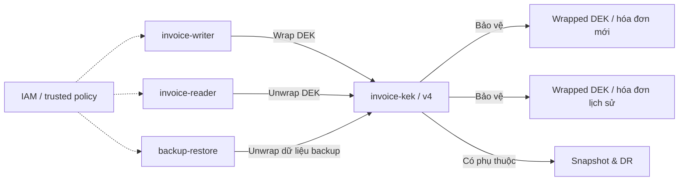
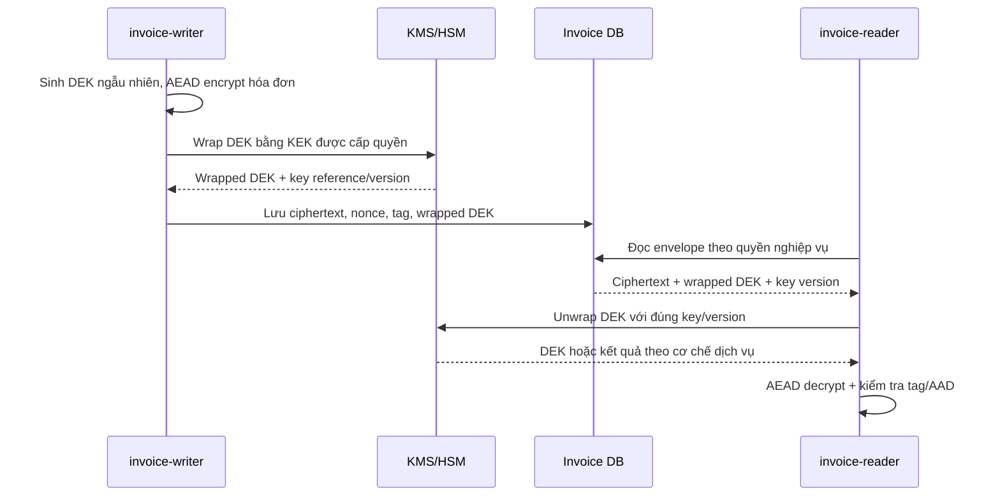
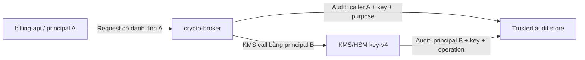
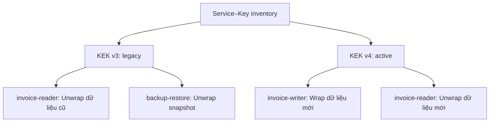
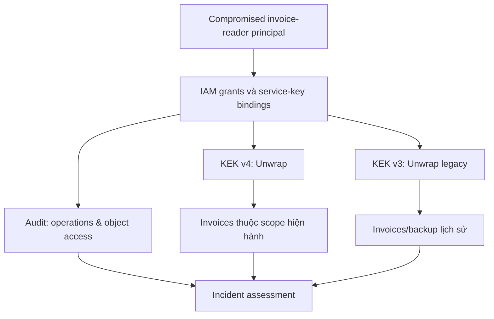

# Service sử dụng key

## 1. “Service sử dụng key” nghĩa là gì?

Trong **Key inventory (danh mục kiểm kê khóa mật mã)**, **Service sử dụng key** là thông tin cho biết **dịch vụ, workload hoặc thành phần hệ thống nào phụ thuộc vào một khóa hoặc một phiên bản khóa**, để thực hiện thao tác mật mã gì, với danh tính và quyền nào, trong môi trường nào và nhằm bảo vệ tài nguyên nào.

Ví dụ, khóa `invoice-kek/prod:v4` có thể được sử dụng bởi:

- `invoice-writer` để yêu cầu KMS **bọc DEK** cho hóa đơn mới.
- `invoice-reader` để yêu cầu KMS **mở bọc DEK** khi đọc hóa đơn.
- `billing-backup-restore` để giải mã những bản backup có quyền khôi phục.
- Một batch job cũ để đọc những hóa đơn thuộc key version trước.

Nếu inventory chỉ ghi `owner: billing-team` thì **không thể kết luận** chỉ có một service đang sử dụng khóa, và cũng không biết việc vô hiệu hóa phiên bản cũ ảnh hưởng đến thành phần nào.

Trường “Service sử dụng key” vì vậy nên được hiểu là **quan hệ nhiều–nhiều có thể kiểm chứng**, thay vì một chuỗi mô tả duy nhất:

\[
\text{Service} \longleftrightarrow \text{Key Version}
\]

Quan hệ này còn cần ngữ cảnh: **thao tác (`Encrypt`, `Decrypt`, `Sign`, `Verify`, `Wrap`, `Unwrap`, `GenerateMac`, `Decapsulate`...), mục đích, IAM principal, tenant, môi trường, dữ liệu phụ thuộc và vòng đời**.

Bài thuộc chương **Key inventory** của module `SECURITY_KEY_MANAGEMENT_FUNDAMENTALS`. Để quản lý khóa an toàn từ **tạo → cấp phát → lưu trữ → sử dụng → xoay vòng → thu hồi → hủy**, tổ chức cần liên kết hoạt động sử dụng khóa của service với mật mã đối xứng, bất đối xứng, chữ ký số, KMS/HSM, envelope encryption, kiểm soát truy cập và kiểm toán.

**Kết quả mong đợi:** từ một khóa bất kỳ, bạn trả lời được “những service nào sẽ bị ảnh hưởng nếu khóa này bị thu hồi/hủy?”; từ một service bất kỳ, bạn trả lời được “service có thể sử dụng những khóa nào và với quyền gì?”. Cả hai câu hỏi đều rất quan trọng khi xử lý sự cố.

Sau bài học, bạn có thể:

1. Phân biệt **service owner**, **key owner**, **key consumer**, **IAM principal** và **cryptographic operator**.
2. Mô hình hóa quan hệ **service ↔ key version ↔ operations ↔ data dependencies**.
3. Ghi nhận nguồn bằng chứng **declared, configured, observed** thay vì đoán từ tên service.
4. Thiết kế inventory phục vụ **least privilege**, phân tách quyền và phát hiện truy cập chéo tenant/môi trường.
5. Phân biệt service sử dụng **DEK/KEK, HMAC key, signing key, public verification key, private decapsulation key**.
6. Phân tích **blast radius**, rotation, revoke, compromised workload và retirement trước khi Destroyed state.
7. Xây dựng bảng inventory, truy vấn kiểm tra và ví dụ Java 17 về **policy guard** trước thao tác KMS.
8. Lập checklist kiểm toán và bộ kiểm thử để quản trị khóa trong môi trường có nhiều microservice.

## 2. Phải phân biệt ai sở hữu khóa và ai sử dụng khóa

Một hệ thống có thể có nhiều loại đối tượng liên quan đến một key:

| Khái niệm | Vai trò | Ví dụ |
| --- | --- | --- |
| **Key owner** | Đơn vị chịu trách nhiệm chính sách, cryptoperiod và quyết định lifecycle | `security-platform` |
| **Service owner** | Đơn vị vận hành, chịu trách nhiệm sửa code/cấu hình của service | `billing-team` |
| **Consuming service** | Thành phần thực sự phụ thuộc khóa để làm một việc | `invoice-reader` |
| **Workload identity / principal** | Danh tính xác thực được dùng để gọi KMS/HSM hoặc nhận quyền secret | `principal:billing-prod-invoice-reader` |
| **Cryptographic operator** | Thành phần thực hiện thao tác, có thể là KMS, HSM, sidecar hoặc thư viện trong tiến trình | `kms-adapter` |
| **Data owner** | Đơn vị quyết định quyền đọc/xóa và retention của dữ liệu được khóa bảo vệ | `finance-data-owner` |
| **Verifier** | Thành phần xác minh chữ ký/MAC hoặc tình trạng dữ liệu | `api-gateway`, `jwt-verifier` |

**Một tên service không nhất thiết là một principal duy nhất**: một service có thể chạy ở production và staging, nhiều vùng, nhiều account hoặc tenant với các danh tính IAM khác nhau. Ngược lại, một principal dùng chung nhiều service làm giảm khả năng gán trách nhiệm và mở rộng phạm vi tác động khi bị chiếm.

Ví dụ:

```text
Key owner          : platform-security
Key resource       : billing/invoice-kek
Key version        : v4
Key purpose        : wrap/unwrap invoice DEK
Service owner      : billing-team
Consuming service  : invoice-reader
Workload principal : principal://prod/billing/invoice-reader
Allowed operation  : UnwrapKey (chỉ đúng dữ liệu được cấp quyền)
Environment        : production
Tenant scope       : billing-tenant-01
```

Nếu chỉ lưu `service: billing-api`, sẽ thiếu quyền chi tiết, principal thật, version và đường phụ thuộc. Trong kiểm toán, đây là dấu hiệu inventory **chưa đủ dùng**.

### 2.1. “Sử dụng khóa” có thể là sử dụng trực tiếp hoặc gián tiếp

Một service có thể dùng khóa theo các hình thức:

- **Gọi KMS/HSM trực tiếp:** `payments-api` gọi thao tác `Encrypt` hoặc `Sign` bằng identity được IAM cấp quyền.
- **Gọi qua crypto gateway/broker:** `billing-api` gọi `crypto-service`, còn `crypto-service` mới gọi KMS.
- **Dùng khóa trong process:** ứng dụng giữ secret được cấp từ secret manager, file, memory hoặc key store.
- **Xác minh bằng public key:** `resource-server` dùng public verification key từ JWKS; có thể **không gọi KMS và không biết private key**.
- **Sử dụng gián tiếp thông qua SDK/sidecar:** service ứng dụng gửi dữ liệu vào thư viện/sidecar đã tích hợp.
- **Phụ thuộc dữ liệu lịch sử:** service ít chạy nhưng còn cần key version cũ để khôi phục backup hoặc xử lý queue.

Vì vậy, cần ghi cả **service nghiệp vụ** và **thành phần mật mã thực thi**. Nếu chỉ đọc KMS audit thấy `crypto-service`, bạn chưa chắc đã biết request xuất phát từ `billing-api` hay `risk-worker`.

### 2.2. Hai kiểu quan hệ phải tách biệt

1. **Can-use (authorized/configured):** một service hoặc principal *có quyền* sử dụng khóa.
2. **Did-use (observed):** có bằng chứng service/principal *đã sử dụng* khóa tại một thời điểm.

Một grant IAM có thể tồn tại nhiều năm dù service không còn gọi khóa. Một operation trong log chứng minh đã có sử dụng, nhưng **không chứng minh mọi quyền khác đã bị từ chối** hoặc service đã hết phụ thuộc dữ liệu.

Để bảo mật, cần đối chiếu **quyền đang được cấp**, **hành vi quan sát** và **phụ thuộc dữ liệu**. Không lấy mỗi `lastUsedAt` hoặc mỗi file cấu hình làm chân lý duy nhất.

## 3. Mô hình quan hệ Service – Key – Operation – Data

Một quan hệ inventory hữu ích gồm bốn chiều:

- **Service identity:** ai gọi, thuộc team/môi trường/tenant nào.
- **Key identity:** tài nguyên khóa, **version**, thuật toán, purpose và trạng thái.
- **Operation:** service được phép thao tác gì, qua kênh nào, trong thời gian nào.
- **Protected resource:** dữ liệu, ciphertext, token, hợp đồng hoặc phiên có liên hệ đến key.



**Nhiều service có thể dùng cùng một key nhưng không nhất thiết cần cùng quyền.** Service ghi hóa đơn mới có thể cần `Wrap` mà không cần `Unwrap` toàn bộ dữ liệu, trong khi service đọc dữ liệu có thể cần `Unwrap` nhưng không được phép thay key policy.

### 3.1. Service → Key và Key → Service là hai truy vấn khác nhau

**Từ một service:**

- Nó đang sở hữu quyền sử dụng những khóa nào?
- Có quyền `Decrypt`/`Sign` quá rộng không?
- Đang dùng khóa cũ hoặc thuật toán ngoài policy không?
- Có sử dụng secret ở dạng rõ trong tiến trình không?

**Từ một key/version:**

- Ai đang có quyền? Ai đã thực sự gọi API gần đây?
- Service nào còn decrypt/verify dữ liệu lịch sử?
- Key bị lộ sẽ ảnh hưởng các tenant hoặc dữ liệu nào?
- Những thành phần nào cần cập nhật trước khi rotate, revoke hoặc destroy?

Để trả lời đầy đủ, inventory nên hỗ trợ **tra cứu hai chiều**, không chỉ danh sách một cột chứa tên service.

### 3.2. Không đồng nhất quan hệ truy cập với quyền nghiệp vụ

Nếu một identity được KMS cho phép `Decrypt` với KEK, điều đó **không đồng nghĩa** service được phép xem mọi hóa đơn được KEK bảo vệ. Hệ thống vẫn phải kiểm tra **quyền truy cập dữ liệu theo tenant, account, object và mục đích** trước khi thực hiện hoặc trả kết quả giải mã.

Một crypto gateway có quyền KMS rộng đặc biệt dễ trở thành **confused deputy**: nhận yêu cầu từ service A rồi sử dụng quyền của gateway để giải mã dữ liệu thuộc service/tenant B. Phải ràng buộc danh tính caller, resource owner, key version, encryption context/AAD và authorization tại điểm thực hiện.

## 4. Những field nên có trong quan hệ Service sử dụng key

Thông tin này nên được mô hình hóa thành một **binding/access edge** giữa service và key/version, thay vì nhét tất cả vào một trường dạng văn bản.

| Nhóm | Field minh họa | Tác dụng |
| --- | --- | --- |
| **Service** | `serviceId`, `serviceOwner`, `environment`, `region`, `tenantScope` | Xác định workload và phạm vi nghiệp vụ. |
| **Danh tính** | `principalId`, `roleRef`, `authMethod` | Biết identity thực tế gọi KMS/HSM hoặc secret manager. |
| **Key** | `keyId`, `keyVersion`, `keyType`, `algorithm`, `keyPurpose` | Tránh dùng nhầm tài nguyên/phiên bản/loại vật liệu. |
| **Hoạt động** | `allowedOperations`, `requiredOperations`, `accessPath` | Phân quyền theo Encrypt/Decrypt/Sign/Verify/Wrap/Unwrap/MAC/Decapsulate. |
| **Ràng buộc** | `resourceScope`, `tenantBinding`, `encryptionContextPolicy` | Hạn chế truy cập chéo tenant và dữ liệu ngoài mục đích. |
| **Vòng đời** | `bindingStatus`, `approvedAt`, `reviewBy`, `expiresAt` | Thu hồi quyền thừa và bảo đảm owner duyệt định kỳ. |
| **Quan sát** | `lastObservedAt`, `firstObservedAt`, `observationSource` | Phân biệt quyền khai báo và hành vi sử dụng. |
| **Phụ thuộc** | `dataInventoryRef`, `backupRef`, `consumerRef` | Xác định ảnh hưởng rotation/destroy. |
| **Chứng cứ** | `approvalRef`, `policyVersion`, `evidenceRef` | Kiểm toán và phát hiện drift. |

**Key inventory tuyệt đối không cần lưu raw private key, DEK/KEK, MAC secret, password, session token hoặc plaintext.** Chỉ nên lưu **metadata và tham chiếu**, với quyền xem inventory theo mức nhạy cảm. Ngay cả việc tiết lộ cấu trúc quan hệ key–service cũng có thể giúp kẻ tấn công chọn mục tiêu, nên kiểm soát truy cập danh mục.

### 4.1. Mẫu key record và service binding

Ví dụ YAML **mang tính thiết kế**, không phải schema của một cloud KMS cụ thể:

```yaml
key:
  keyId: billing/prod/invoice-kek
  version: v4
  keyType: symmetric
  algorithm: AES-256
  purpose: invoice-dek-wrapping
  providerRef: kms://prod/billing/invoice-kek/v4
  environment: production
  owner: security-platform
  state: ACTIVE_FOR_NEW_USE

serviceBindings:
  - serviceId: invoice-writer
    serviceOwner: billing-team
    principalId: principal://prod/billing/invoice-writer
    environment: production
    tenantScope: billing-tenant-01
    accessPath: direct-kms
    allowedOperations: [Wrap]
    bindingStatus: APPROVED
    approvalRef: IAM-2026-041
    lastObservedAt: "2026-11-27T09:15:00Z"
    observationSource: kms-audit
  - serviceId: invoice-reader
    serviceOwner: billing-team
    principalId: principal://prod/billing/invoice-reader
    environment: production
    tenantScope: billing-tenant-01
    accessPath: direct-kms
    allowedOperations: [Unwrap]
    bindingStatus: APPROVED
    approvalRef: IAM-2026-042
    lastObservedAt: "2026-11-27T09:16:00Z"
    observationSource: kms-audit
  - serviceId: billing-backup-restore
    serviceOwner: sre-backup
    principalId: principal://prod/backup/restore-job
    environment: production
    tenantScope: billing-tenant-01
    accessPath: restore-kms
    allowedOperations: [Unwrap]
    bindingStatus: CONDITIONAL
    approvalRef: DR-2026-019
    dataInventoryRef: backup-index-2026-11
    observationSource: approved-restore-test
```

**Một binding chỉ nên được xem là APPROVED khi phê duyệt thực sự đã được kiểm chứng** từ hệ thống có thẩm quyền. Việc viết một chuỗi `approvalRef` trong file YAML không tự chứng minh có quyết định cấp quyền.

### 4.2. Metadata có thể nhạy cảm, nhưng khác key material

Khi kiểm kê, có thể ghi **key reference, principal, operation và timestamp**. Không export private key hoặc gọi `GetSecretValue` chỉ để xác nhận rằng một service dùng khóa. Nếu không có dữ liệu đủ rõ để khẳng định, giữ trạng thái `UNKNOWN` hoặc `NEEDS_REVIEW`.

Một trường hợp đặc biệt: với service dùng **public verification key**, cần ghi nguồn public key đáng tin cậy và phạm vi issuer; không nên ghi rằng service có quyền `Sign` chỉ vì nó xác minh chữ ký bằng public key.

## 5. Các cách service sử dụng key trong thực tế

### 5.1. Mã hóa đối xứng và envelope encryption

Xét hệ thống hóa đơn có **DEK ngẫu nhiên** dùng AES-GCM để mã hóa nội dung, còn **KEK** tại KMS để bọc DEK:



Inventory cần ghi **ít nhất hai mối quan hệ service** (writer/reader) và những **data dependencies** tương ứng. Nếu một crypto service thay writer/reader gọi KMS, cần thêm thông tin **caller → crypto service → KMS principal**, tránh mất nguồn gốc thao tác.

**Lưu ý:** không phải tất cả KMS đều có API `Wrap` và `Unwrap` mang đúng tên đó; một số sử dụng `Encrypt`/`Decrypt` hoặc API tạo/giải mã data key. Metadata inventory phải phản ánh **operation thật của provider** và mapping sang ý nghĩa nghiệp vụ.

### 5.2. Chữ ký số và public verification key

Giả sử `auth-issuer` tạo JWT với private key Ed25519, còn `api-gateway` và `resource-service` chỉ xác minh bằng public key từ JWKS tin cậy.

| Service | Key material hoặc tham chiếu | Operation | Điểm bảo vệ |
| --- | --- | --- | --- |
| `auth-issuer` | Private signing key hoặc quyền KMS/HSM Sign | `Sign` | IAM chặt; non-exportable; phê duyệt nội dung/token được phát hành. |
| `api-gateway` | Public verification key từ issuer/JWKS | `Verify` | Ràng buộc issuer/algorithm/key ID, cache và trust policy. |
| `resource-service` | Public verification key | `Verify` | Kiểm tra `iss`, `aud`, `exp`, scope/tenant, không chỉ chữ ký. |
| `key-admin` | Key lifecycle metadata/policy | `Rotate/Disable` khi được phép | Tách khỏi quyền phát hành token. |

Verifier **không cần quyền dùng private signing key**. Đưa tất cả các service này vào một mục “uses signing key” mà không ghi **Sign hay Verify** sẽ khiến đánh giá blast radius và least privilege sai nghiêm trọng.

Nếu private signing key bị lộ, việc xoay khóa không đủ nếu verifier còn tin public key cũ. Inventory phải giúp liệt kê **mọi verifier/JWKS cache** để cập nhật chính sách thu hồi.

### 5.3. HMAC/MAC key

Với **HMAC**, producer và verifier thường có cùng shared secret hoặc quyền tạo/xác minh MAC tương ứng. Nếu verifier giữ raw HMAC key, về mặt mật mã nó **cũng có khả năng tạo tag**.

Một số KMS/HSM có thể tách thao tác `GenerateMac` và `VerifyMac` qua IAM, nhưng **không phải mọi nền tảng đều hỗ trợ**, và việc phân quyền API không tự tạo tính không thể chối bỏ như chữ ký số. Inventory phải ghi liệu service **giữ secret bytes**, hay **chỉ gọi một API cụ thể**.

Nếu một key MAC dùng chung quá nhiều service, kẻ tấn công chiếm một service có secret có thể mở rộng ảnh hưởng đến những luồng khác. Nên tách key theo mục đích, issuer, môi trường và phạm vi rủi ro.

### 5.4. KEM, ECDH và decapsulation

Trong một giao thức KEM:

- Bên gửi `Encapsulate` với **public key** của bên nhận.
- Bên nhận `Decapsulate` bằng **private key** để tạo shared secret.
- Phía ứng dụng dùng **key schedule/KDF và AEAD** theo chuẩn để bảo vệ dữ liệu.

Inventory phải phân biệt các service **chỉ cần public encapsulation key** với service **có quyền decapsulation**. Không coi “bên gửi có public key” là có quyền truy cập private key. Với private KEM key tĩnh, việc destroy quá sớm có thể gây mất khả năng mở dữ liệu lịch sử.

### 5.5. Password KDF và random token

Một service xác thực có thể sử dụng **Argon2id** để tạo/verify password hash, đồng thời sử dụng `SecureRandom` để sinh reset token. Đây **không mặc nhiên là service sử dụng một KMS key cụ thể**.

Tuy nhiên, nếu password hashing bổ sung **pepper trong secret manager/KMS**, inventory phải ghi service có thể đọc hoặc sử dụng secret đó. Nếu reset token được lưu bằng `HMAC(serverSecret, token)`, phải ghi quan hệ với HMAC key.

**Không tự đưa mỗi thuật toán hoặc mỗi session token vào key inventory như một key resource riêng**. Chỉ tạo quan hệ service–key khi có vật liệu khóa hoặc secret được quản lý cần kiểm soát vòng đời. Những thuật toán không khóa và token ngắn hạn có thể được ghi trong **asset/secret inventory** riêng theo thiết kế.

## 6. Danh tính workload và IAM: service thực sự có quyền gì?

Một service có thể được triển khai bằng nhiều cơ chế identity: IAM role/service account, workload identity, mTLS client certificate, Kubernetes service account được liên kết tới quyền cloud, hoặc một principal được HSM công nhận. **Tên deployment không tự là danh tính được KMS xác minh**.

Các ràng buộc quan trọng:

1. **Principal cụ thể:** không chỉ tên team hay hostname.
2. **Resource/version:** những key ID nào principal được phép dùng.
3. **Operation:** Encrypt, Decrypt, Wrap, Unwrap, Sign, VerifyMac, GenerateMac, Decapsulate...
4. **Environment và tenant:** tránh staging/production hoặc tenant A/B dùng chung quyền ngoài thiết kế.
5. **Purpose/context:** thông điệp hoặc object nào được phép xử lý.
6. **Điều kiện thời gian:** quyền tạm thời, rotation, review và emergency access.
7. **Đường truy cập:** direct KMS, proxy/broker, local key store hay secret manager.

### 6.1. Mẫu quyền tối thiểu

| Principal | Được phép | Không được mặc định |
| --- | --- | --- |
| `principal://prod/billing/writer` | `Wrap` DEK bằng KEK hóa đơn thuộc tenant cho phép | `Unwrap` mọi DEK, `Sign` token, quản trị KMS. |
| `principal://prod/billing/reader` | `Unwrap` với key và object context đúng | `Wrap` mới không được ủy quyền, đọc tenant khác. |
| `principal://prod/identity/issuer` | `Sign` bằng private signing key đã duyệt | Export private key, dùng key thanh toán. |
| `principal://prod/gateway/verifier` | Đọc public verification key/JWKS tin cậy | `Sign` bằng private key. |
| `principal://prod/backup/restore` | `Unwrap` trong phiên khôi phục được phê duyệt | Truy cập không giới hạn quanh năm. |
| `principal://prod/security/auditor` | `List/Describe` metadata và audit | `Decrypt`, `Sign`, xuất secret. |

Một số KMS không tách quyền theo chính xác mô hình trên hoặc không có version-level IAM. Khi đó phải dùng **policy ở tầng adapter, service và dữ liệu**, kết hợp giám sát; không ghi vào inventory các quyền tinh vi mà provider thực tế không thực thi được.

### 6.2. Tránh shared identity và quyền thừa

Nếu `billing-api`, `payments-worker` và `audit-job` cùng chạy bằng **một service account** có quyền `Decrypt` mọi key trong production, KMS audit khó xác định service nào thực sự thực hiện thao tác, và một service bị chiếm có thể lạm dụng quyền chung.

Hướng xử lý:

- Cấp workload identity riêng và permission theo từng mục đích.
- Tách production/staging và tenant nếu chính sách yêu cầu.
- Áp dụng short-lived credentials khi nền tảng hỗ trợ.
- Không để access token/API credential cố định trong source/config không được bảo vệ.
- Đưa mọi ngoại lệ shared identity vào finding có owner, thời hạn và kế hoạch cải thiện.

### 6.3. Key policy không thay quyền truy cập dữ liệu

Ngay cả khi KMS xác thực caller và cho phép Decrypt, backend vẫn phải:

- Kiểm tra **requester** được quyền đọc object hay không.
- Giới hạn **tenant** và dữ liệu phù hợp.
- Ràng buộc **encryption context/AAD** trong phạm vi thuật toán và provider hỗ trợ.
- Không cho client tùy ý chọn key ID hoặc ciphertext của tenant khác.
- Ghi metadata audit đủ phân biệt việc KMS cho phép và việc nghiệp vụ chấp nhận.

Một khóa hoặc một principal có quyền Decrypt rộng có thể cần thiết cho backup/DR, nhưng đó là quyền nhạy cảm phải có **quy trình phê duyệt, break-glass và hậu kiểm**.

## 7. Nguồn dữ liệu để phát hiện service nào thực sự dùng khóa

Không nên chỉ hỏi developer “service nào dùng key?” rồi lưu một danh sách thủ công. Thực tế có thể tồn tại jobs hiếm chạy, code cũ, bản sao secret hoặc dependency gián tiếp.

| Nguồn bằng chứng | Có thể biết được | Giới hạn |
| --- | --- | --- |
| **KMS/HSM audit logs** | Principal gọi operation nào, key reference, thời điểm và kết quả | Nếu dùng proxy, log có thể chỉ thấy principal của proxy; log có thể thiếu/stale. |
| **IAM/key policies** | Ai được *cấp quyền* dùng khóa | Có quyền không đồng nghĩa đang sử dụng. |
| **Application tracing** | Request từ service nghiệp vụ đi qua crypto adapter | Cần bảo vệ correlation ID, hạn chế ghi secret. |
| **Config/deployment metadata** | Key ID/alias, service account, môi trường | Có thể là cấu hình dự phòng/chưa dùng. |
| **Source/dependency scan** | SDK, key references, API calls | Không chứng minh runtime hiện tại đang gọi hay đã decommission. |
| **KMS describe/list API** | Key type, state, version, owner/tag, provider ID | Thường không liệt kê đầy đủ mọi consumer bên ngoài. |
| **Envelope/ciphertext metadata** | Key version nào bảo vệ dữ liệu đang lưu | Không chứng minh service nào có quyền giải mã. |
| **Backup/DR catalog** | Bản lưu nào còn cần key version | Có thể không phản ánh các external copies. |
| **Service registry/CMDB** | Owner, service identity, lifecycle | Có thể chậm cập nhật khi service thay đổi. |
| **Approval/ticket** | Vì sao một binding được cấp | Phê duyệt tồn tại không chứng minh policy đã triển khai đúng. |

### 7.1. Ba trạng thái bằng chứng nên lưu

- **DECLARED:** service owner khai báo cần dùng khóa.
- **CONFIGURED:** policy hoặc config đã gắn service/principal với khóa.
- **OBSERVED:** có sự kiện sử dụng từ nguồn log/tracing tin cậy.

Những trạng thái này có thể cùng tồn tại. Một binding `CONFIGURED + NOT_OBSERVED` không tự chứng minh đã hết sử dụng; một service khác có thể gọi nó gián tiếp hoặc chỉ hoạt động khi sự cố.

Nên lưu `evidenceSource`, `observedAt`, `confidence`, `reviewStatus` và liên kết đến log/approval (không copy secret vào inventory).

### 7.2. Trường hợp crypto broker: cần correlation đầu-cuối



Nếu inventory chỉ dựa trên audit KMS, kết quả có thể là **chỉ broker dùng key**. Nhưng để truy vết tác động nghiệp vụ, cần giữ cả **upstream service A** và đường phụ thuộc qua broker B.

Gateway/broker phải **xác thực caller**, kiểm tra policy trước khi gọi KMS và ghi audit correlation ID. **Không được tin header `X-Service-Name` tự khai báo** nếu chưa được xác thực từ danh tính kết nối hoặc credential đáng tin cậy.

### 7.3. Thời gian không có hoạt động không đồng nghĩa không phụ thuộc

Các tác vụ như `backup-restore`, `annual-report-export` hoặc key access của thiết bị ngoại tuyến có thể chỉ chạy vài tháng một lần. `lastObservedAt` cũ là **dấu hiệu cần xem xét**, không đủ để xóa binding hoặc destroy key.

Phải phối hợp owner, bản lưu dữ liệu, lịch chạy và restore drill trước quyết định thu hồi quyền hoặc phá hủy vật liệu.

## 8. Inventory dạng bảng: quan hệ nhiều–nhiều

Một mô hình quan hệ có thể gồm:

```text
services
  service_id (PK)
  owner, environment, tenant_scope, lifecycle_state

workload_principals
  principal_id (PK)
  service_id (FK)
  identity_provider, environment, active

keys
  key_id (PK)
  owner, key_type, purpose, provider_ref

key_versions
  (key_id, version) (PK)
  algorithm, key_state, created_at, retire_at

service_key_bindings
  binding_id (PK)
  service_id (FK)
  principal_id (FK)
  key_id, key_version (FK)
  operation, access_path, tenant_scope
  binding_status, policy_ref, approval_ref
  created_at, expires_at, last_observed_at, evidence_ref

key_data_dependencies
  dependency_id (PK)
  key_id, key_version (FK)
  resource_type, resource_ref, owner
  needs_decrypt_or_verify, retention_until, restore_evidence_ref
```

Trong thiết kế production, tránh lưu danh sách operation thành một chuỗi tùy ý nếu cần tìm kiếm/kiểm soát chính xác: có thể tạo **một dòng cho mỗi binding + operation** hoặc bảng con có foreign key và enum hợp lệ.

**Key version là một phần của identity**, vì khi rotation, service có thể dùng `v5` để ghi mới nhưng vẫn cần `v3/v4` để đọc dữ liệu cũ.

### 8.1. Truy vấn “Service nào bị ảnh hưởng nếu hủy key v3?”

Ví dụ SQL **khái niệm**:

```sql
SELECT
    s.service_id,
    s.owner,
    b.principal_id,
    b.operation,
    b.binding_status,
    b.last_observed_at
FROM service_key_bindings b
JOIN services s ON s.service_id = b.service_id
WHERE b.key_id = :target_key_id
  AND b.key_version = :target_version
  AND b.binding_status IN ('APPROVED', 'CONDITIONAL')
ORDER BY s.service_id, b.operation;
```

Truy vấn này liệt kê **bindings đã khai báo/cấp phép**, nhưng không thay thế truy vấn `key_data_dependencies`, vì một bản backup hoặc ciphertext có thể cần khóa ngay cả khi không còn service active thường xuyên gọi đến.

### 8.2. Truy vấn “Principal nào có Decrypt rộng?”

```sql
SELECT
    principal_id,
    COUNT(DISTINCT key_id) AS distinct_keys,
    COUNT(DISTINCT tenant_scope) AS tenant_scopes
FROM service_key_bindings
WHERE operation IN ('Decrypt', 'Unwrap')
  AND binding_status = 'APPROVED'
GROUP BY principal_id
HAVING COUNT(DISTINCT key_id) > :approved_key_threshold
    OR COUNT(DISTINCT tenant_scope) > :approved_tenant_threshold;
```

Đây là **truy vấn phát hiện ứng viên rủi ro**, không tự khẳng định principal vi phạm. Các ngưỡng phải dựa trên phạm vi đúng của service và chính sách; backup/DR có thể cần exception được kiểm soát.

### 8.3. Truy vấn “Service có quyền nhưng không còn quan sát”

```sql
SELECT service_id, principal_id, key_id, key_version, operation,
       last_observed_at, approval_ref
FROM service_key_bindings
WHERE binding_status = 'APPROVED'
  AND (last_observed_at IS NULL
       OR last_observed_at < :review_cutoff);
```

Các binding được trả về cần **review với owner**, không xóa tự động khi log thiếu. Cần thêm lịch batch, tần suất truy cập, dependency graph và yêu cầu khôi phục để quyết định có thu hồi grant.

## 9. Java 17: policy guard cho service sử dụng key

Ví dụ Java dưới đây không thực hiện thao tác KMS thật. Nó minh họa **kiểm tra ràng buộc service–principal–key/version–operation–environment–tenant** bằng một registry đáng tin cậy, **fail closed** khi thiếu binding.

Trong production, việc đọc trusted registry phải có kiểm soát toàn vẹn/cập nhật; bộ kiểm tra này **không thay thế IAM/key policy tại KMS**, và còn phải có authorization đối với từng resource dữ liệu.

```java
import java.time.Instant;
import java.util.List;
import java.util.Objects;
import java.util.Set;

public final class ServiceKeyInventoryDemo {

    enum Operation {
        WRAP, UNWRAP, SIGN, VERIFY, GENERATE_MAC, VERIFY_MAC
    }

    enum KeyPurpose {
        INVOICE_DEK_WRAPPING, JWT_SIGNING, WEBHOOK_MAC
    }

    enum KeyState {
        ACTIVE, LEGACY_READ_ONLY, DISABLED, DESTROYED
    }

    record Workload(
        String serviceId,
        String principalId,
        String environment,
        String tenantId
    ) {}

    record KeyVersion(
        String keyId,
        String version,
        String environment,
        String tenantId,
        KeyPurpose purpose,
        KeyState state
    ) {}

    record Binding(
        String serviceId,
        String principalId,
        String keyId,
        String keyVersion,
        String environment,
        String tenantId,
        KeyPurpose expectedPurpose,
        Set<Operation> allowedOperations,
        boolean approved,
        Instant expiresAt
    ) {}

    record Decision(boolean allowed, String reason) {
        static Decision deny(String reason) {
            return new Decision(false, reason);
        }
        static Decision allow() {
            return new Decision(true, "Approved by trusted binding");
        }
    }

    static boolean compatible(KeyPurpose purpose, Operation op) {
        return switch (purpose) {
            case INVOICE_DEK_WRAPPING ->
                op == Operation.WRAP || op == Operation.UNWRAP;
            case JWT_SIGNING ->
                op == Operation.SIGN || op == Operation.VERIFY;
            case WEBHOOK_MAC ->
                op == Operation.GENERATE_MAC
                    || op == Operation.VERIFY_MAC;
        };
    }

    static Decision check(
        Workload caller,
        KeyVersion key,
        Operation operation,
        List<Binding> trustedBindings,
        Instant now
    ) {
        if (caller == null || key == null || operation == null
                || trustedBindings == null || now == null) {
            return Decision.deny("Missing trusted input");
        }

        if (!Objects.equals(caller.environment(), key.environment())
                || !Objects.equals(caller.tenantId(), key.tenantId())) {
            return Decision.deny("Environment/tenant boundary mismatch");
        }

        if (!compatible(key.purpose(), operation)) {
            return Decision.deny("Operation incompatible with key purpose");
        }

        if (key.state() == KeyState.DISABLED
                || key.state() == KeyState.DESTROYED) {
            return Decision.deny("Key is unavailable");
        }

        // Không tạo chữ ký/DEK mới bằng key chỉ dành cho legacy read.
        if (key.state() == KeyState.LEGACY_READ_ONLY
                && operation != Operation.UNWRAP
                && operation != Operation.VERIFY
                && operation != Operation.VERIFY_MAC) {
            return Decision.deny("Key is legacy-read-only");
        }

        boolean approved = trustedBindings.stream().anyMatch(b ->
            b.approved()
            && b.expiresAt() != null
            && now.isBefore(b.expiresAt())
            && Objects.equals(b.serviceId(), caller.serviceId())
            && Objects.equals(b.principalId(), caller.principalId())
            && Objects.equals(b.environment(), caller.environment())
            && Objects.equals(b.tenantId(), caller.tenantId())
            && Objects.equals(b.keyId(), key.keyId())
            && Objects.equals(b.keyVersion(), key.version())
            && b.expectedPurpose() == key.purpose()
            && b.allowedOperations() != null
            && b.allowedOperations().contains(operation)
        );

        return approved
            ? Decision.allow()
            : Decision.deny("No approved binding for exact operation");
    }

    public static void main(String[] args) {
        Instant now = Instant.parse("2026-11-28T09:00:00Z");

        KeyVersion kek = new KeyVersion(
            "billing/prod/invoice-kek", "v4",
            "production", "tenant-01",
            KeyPurpose.INVOICE_DEK_WRAPPING, KeyState.ACTIVE
        );

        Workload writer = new Workload(
            "invoice-writer",
            "principal://prod/billing/invoice-writer",
            "production", "tenant-01"
        );

        Binding writeGrant = new Binding(
            writer.serviceId(), writer.principalId(),
            kek.keyId(), kek.version(),
            "production", "tenant-01",
            KeyPurpose.INVOICE_DEK_WRAPPING,
            Set.of(Operation.WRAP),
            true, now.plusSeconds(3600)
        );

        List<Binding> trustedBindings = List.of(writeGrant);
        System.out.println(
            check(writer, kek, Operation.WRAP, trustedBindings, now)
        );
        // allowed=true

        System.out.println(
            check(writer, kek, Operation.UNWRAP, trustedBindings, now)
        );
        // allowed=false: writer chỉ có quyền WRAP.

        Workload otherTenant = new Workload(
            writer.serviceId(), writer.principalId(),
            "production", "tenant-02"
        );
        System.out.println(
            check(otherTenant, kek, Operation.WRAP, trustedBindings, now)
        );
        // allowed=false: tenant mismatch.
    }
}
```

### 9.1. Ý nghĩa các bước guard

- **Match exact key ID và version**: ngăn dùng alias mặc định ngoài dự kiến khi mã hóa/giải mã.
- **Match service + principal**: một tên service tự khai báo không có giá trị nếu principal không đúng.
- **Match environment/tenant**: chống nhận nhầm key staging hoặc chéo tenant.
- **Purpose và operation**: không dùng private signing key để unwrap DEK.
- **Binding approved, chưa hết hạn**: cấp quyền có vòng đời, không mặc nhiên tồn tại vô thời hạn.
- **Key state**: khóa disabled/destroyed không được dùng; legacy-only chỉ cho thao tác lịch sử được policy cho phép.
- **Fail closed**: thiếu thông tin hoặc không thấy grant thì từ chối.

### 9.2. Giới hạn của ví dụ

Ví dụ vẫn cần nhiều kiểm soát trước production:

1. `trustedBindings` phải lấy từ **nguồn policy tin cậy và đã được xác thực**, không phải JSON/header do caller gửi.
2. `Workload` phải dựa vào danh tính xác thực ở ingress/transport, không đọc từ trường `serviceId` tự khai báo.
3. Việc dùng cùng `tenantId` với nhiều service/key có thể không đủ: phải xác minh **đúng object và quyền nghiệp vụ**.
4. API KMS/HSM vẫn phải có **IAM/authorization riêng**, không tin mỗi guard trong code.
5. KMS có thể quản lý version bằng alias hoặc envelope reference; cần xử lý mapping và API thực tế.
6. Trạng thái `LEGACY_READ_ONLY` chỉ là quy ước học thuật; policy cho HMAC/verify phải được thiết kế theo rủi ro cụ thể.
7. Quan hệ đọc dữ liệu có thể đi qua **crypto-broker**, cần audit caller–broker–KMS đầy đủ.
8. Phải kiểm soát **TOCTOU** nếu key state, binding hoặc authorization thay đổi ngay sau guard.
9. Hạn chế lộ thông tin khi trả lỗi ra ngoài; log lý do chi tiết trong kênh kiểm toán được bảo vệ.
10. Không chạy `Sign`/`Decrypt` trên dữ liệu do caller tùy ý cung cấp chỉ vì check này trả `allowed=true`.

Ví dụ cho thấy tại sao **inventory theo service** cần gắn **identity, operation, purpose và version**, không chỉ danh sách tên phần mềm.

## 10. Rotation: làm sao biết service nào cần cập nhật?

Khi thay `invoice-kek:v3` bằng `v4`, có thể cần nhiều nhóm service chuyển trạng thái khác nhau.



### 10.1. Runbook rotation dựa trên inventory

1. **Tra key → services:** liệt kê mọi service, principal, operation, tenant, vùng và dữ liệu phụ thuộc `v3`.
2. **Xác nhận owner:** service owner và data owner kiểm tra mapping, kể cả job chạy hiếm, DR và đối tác.
3. **Provision `v4`:** sinh key mới với thuật toán và IAM policy được phê duyệt.
4. **Chuẩn bị consumer:** cập nhật service cần đọc dữ liệu v4 và registry/alias theo đúng API; thử trên môi trường kiểm soát.
5. **Cutover producer:** writer bắt đầu tạo wrapped DEK hoặc ciphertext mới bằng v4.
6. **Giữ đọc lịch sử có kiểm soát:** cho reader/restore có quyền Unwrap v3 trong phạm vi cần thiết.
7. **Theo dõi thực tế:** so sánh log KMS và service tracing để xem còn Write/Wrap mới bằng v3 không.
8. **Migrate dữ liệu nếu cần:** rewrap DEK hoặc re-encrypt theo design; đối chiếu số bản ghi và restore test backup.
9. **Thu hồi quyền thừa:** bỏ grant Write/Wrap v3, rồi cân nhắc giữ/thu hồi grant Read/Unwrap theo retention.
10. **Chỉ Destroy khi đủ bằng chứng:** inventory không còn phụ thuộc bắt buộc, có phê duyệt, trạng thái và audit provider.

**“Đã chuyển alias current sang v4” không phải bằng chứng mọi service hoặc mọi dữ liệu cũ đều hết phụ thuộc vào v3.**

### 10.2. Chữ ký số và JWT khác DEK/KEK

Trong hệ thống JWT:

- **Issuer** chuyển ký mới từ `sign-v3` sang `sign-v4`.
- **Verifier** phải nhận public key v4 từ JWKS/registry **đáng tin cậy**.
- Trong overlap bình thường, verifier có thể cần public key v3 để xác minh token còn hợp lệ.
- Nếu v3 bị compromise, có thể cần **distrust/revoke ngay**, bất kể token cũ chưa hết hạn.
- Không được hủy/xóa bằng chứng **public verification key** cần cho chữ ký lịch sử theo policy chỉ vì private key đã retire.

Inventory phải phân loại service **signer vs verifier**; nếu không, kế hoạch chuyển key có thể làm gián đoạn token hoặc không chặn token giả.

### 10.3. MAC/KEM và dữ liệu lịch sử

- Với **HMAC**, consumer `VerifyMac` còn cần secret hoặc quyền API tương ứng cho thông điệp hợp lệ cũ; giữ secret đồng nghĩa vẫn có một đường dùng key cần quản trị.
- Với **KEM**, phía nhận còn cần private decapsulation key cũ nếu encapsulation/envelope lịch sử chưa được migrate.
- Với **AEAD ciphertext**, decoder phải biết đúng key version, nonce và AAD để giải mã; không thể thử khóa mới thay thế theo suy đoán.

Do đó, **cùng một key version có thể retired for new use nhưng vẫn active for historical read/verify**. Inventory phải phản ánh sự khác biệt này.

## 11. Thu hồi một service: chặn quyền trước hay xoay key trước?

Khi một service bị xâm nhập, quyết định còn phụ thuộc **service có thể làm gì với khóa**.

| Tình huống | Nguy cơ | Hành động trọng tâm |
| --- | --- | --- |
| Principal bị chiếm, private key nằm non-exportable trong HSM | Có thể lạm dụng `Sign`/`Decrypt` qua API | Thu hồi principal/credential, điều tra operations, rà soát nội dung và policy; xoay/distrust nếu cần. |
| Service giữ raw symmetric key trong memory/config | Kẻ tấn công có thể **sao chép key bytes** | Coi key có khả năng compromise, rotate và đánh giá dữ liệu đã bị ảnh hưởng. |
| Gateway có quyền rộng và caller bị chiếm | Có thể phát sinh **confused deputy** qua proxy | Chặn caller, kiểm tra broker authorization, log correlation và các tài nguyên đã truy cập. |
| JWT issuer bị chiếm | Có thể phát hành token giả bằng signing capability | Thu hồi quyền Sign, xem xét signing key trust và toàn bộ verifier/JWKS. |
| Backup/DR principal bị chiếm | Có thể giải mã dữ liệu lịch sử số lượng lớn | Cô lập quyền, đánh giá snapshot/restore access và phạm vi dữ liệu. |
| Chỉ có quyền `Verify` với public key | Không tự cho phép ký giả qua private key | Kiểm tra trust registry và các lỗi khác, không mặc định private key đã lộ. |

Một bảng service–key binding chính xác giúp trả lời:

- Kẻ tấn công có thể **gọi những phép toán** nào?
- Khóa có **exportable** không, hay chỉ dùng qua KMS?
- **Bao nhiêu dữ liệu, tenant và service khác** dùng chung key?
- Có những **log/trace** nào chứng minh tác vụ đã thực hiện?
- Có phải cập nhật **signer, verifier, consumer hoặc key registry** để thu hồi lòng tin không?

### 11.1. Từ service bị chiếm đến blast radius



**Blast radius không thể xác định chỉ từ khóa.** Cần kết hợp IAM scopes, dữ liệu bị khóa bảo vệ, nội dung request, thời gian compromise, log và khả năng service/đối thủ đã lấy plaintext hoặc raw DEK ra ngoài.

**Rotation không khôi phục bí mật của dữ liệu đã lộ**; và **hủy key trong KMS không thu hồi bản sao key** đã bị kẻ tấn công export. Runbook ứng cứu phải phân biệt bảo vệ vật liệu khóa và bảo vệ **khả năng sử dụng khóa**.

## 12. Decommission service và ngừng sử dụng key

Khi retire một service, không nên đơn giản xóa tên khỏi inventory rồi coi như đã xử lý khóa.

Một quy trình tốt:

1. Đặt service vào trạng thái **decommission planned**, khóa thời điểm ngừng hoạt động.
2. Liệt kê tất cả **service→key bindings**, gồm direct/indirect và các phiên bản cũ.
3. Xem các **job, queue, workflow, DR/backup** còn yêu cầu service hoặc key.
4. Chuyển dữ liệu và trách nhiệm owner cho service mới nếu cần.
5. Thu hồi quyền IAM/credential/secret distribution sau khi đã xác minh chuyển đổi.
6. Đối chiếu audit KMS xem còn operations từ principal cũ hay không.
7. Chấm dứt hoặc điều chỉnh **key grants**, nhưng **không tự destroy key** nếu service khác hoặc dữ liệu lịch sử còn phụ thuộc.
8. Lưu hồ sơ decommission, người phê duyệt và timestamp.
9. Kiểm thử fail-closed: principal cũ không được `Decrypt`/`Sign`; service thay thế hoạt động đúng.
10. Xem xét hủy key version chỉ theo quy trình lifecycle, retention và backup riêng.

### 12.1. Ghost services và orphaned grants

**Ghost service** là một service đã ngừng vận hành nhưng danh tính hoặc cấu hình cũ vẫn còn. **Orphaned grant** là quyền key chưa có owner hợp lệ hoặc chưa có consumer được xác nhận.

Rủi ro bao gồm:

- Credential hoặc principal cũ vẫn có `Decrypt`/`Sign`.
- Không ai chịu trách nhiệm rotation khi key sắp hết cryptoperiod.
- Log hiếm xuất hiện bị bỏ qua vì “service đã xóa”.
- Không biết backup nào còn phụ thuộc key.
- Một người mới có thể vô tình sử dụng lại principal/tên service cũ với quyền rộng.

Inventory nên có trạng thái `ORPHANED`, `NEEDS_REVIEW` hoặc finding với owner/đề xuất xử lý; không xóa mối quan hệ và bằng chứng chỉ để bảng nhìn gọn.

## 13. Rủi ro tenant, region, môi trường và external consumer

### 13.1. Chéo tenant

Nếu cùng một KMS key được dùng cho nhiều tenant, cần ghi **tenantScope** của mỗi service binding và data scope cụ thể. Một request có header `tenantId` chưa xác thực không đủ để thay đổi quyền sử dụng key.

Trong hệ thống nhiều tenant, một crypto broker có quyền KMS chung cần ràng buộc **authenticated tenant**, resource ID và policy trước thao tác. Có thể dùng encryption context/AAD khi provider và sơ đồ hỗ trợ, nhưng nó **không thay thế authorization**.

### 13.2. Staging và production

Service staging không nên có quyền decrypt key production chỉ vì key ID hoặc alias có tên giống nhau. Inventory phải thể hiện **account/project, environment, identity và key resource** rõ ràng; không dựa vào tên đường dẫn lỏng lẻo hoặc biến môi trường do request điều khiển.

Các integration tests nên bảo đảm principal `staging` gọi `production key` bị từ chối, kể cả khi shared library hỗ trợ cả hai môi trường.

### 13.3. Cross-region và DR

Một service có thể chạy tại nhiều vùng, KMS key có thể có regional/global semantics tùy provider. Không được tự suy ra replica ở region khác là bản copy có thể dùng hoàn toàn tương đương.

Inventory cần ghi **region, provider resource reference, backup dependencies, IAM grants và trạng thái replica**. Kịch bản DR cần kiểm chứng rằng dữ liệu/khóa vẫn khôi phục được **theo quyền đúng**, đồng thời không tạo thêm bản export secret không kiểm soát.

### 13.4. Đối tác và consumer bên ngoài

Đối tác có thể dùng **public KEM key** để encapsulate, **public verification key** để verify, hoặc có một shared HMAC secret. Họ không nhất thiết xuất hiện trong IAM audit nội bộ.

Cần ghi external consumer, owner hợp đồng/tích hợp, kênh phân phối key, thuật toán, phiên bản, thời hạn hỗ trợ, phương thức rotation/revocation và bằng chứng xác nhận chuyển đổi.

**Không phát private key hoặc raw DEK cho đối tác chỉ để đơn giản hóa inventory.** Phải có kiến trúc phân phối đúng loại khóa và phạm vi tin cậy.

## 14. Kiểm toán và chất lượng inventory

### 14.1. Các event nên ghi

| Event | Metadata quan trọng | Giám sát |
| --- | --- | --- |
| **Key created/rotated** | Key ID/version, algorithm, owner, environment, policy | Key không có owner hoặc được tạo ngoài quy trình. |
| **Grant created/changed** | Principal, service, operation, scope, approver, timestamp | Quyền `Decrypt`/`Sign` được mở rộng bất thường. |
| **Crypto operation** | Key/version, operation, principal, success/failure, correlation ID | Tần suất hoặc vùng/identity bất thường. |
| **Broker request** | Authenticated caller, target key, purpose, decision | Confused deputy, caller không được ủy quyền. |
| **Binding review** | Reviewer, evidence, quyết định keep/revoke, due date | Quyền tồn tại khi service đã decommission. |
| **Key retirement/destroy** | Dependency inventory, restore evidence, approvals, provider state | Hủy khóa vẫn còn service/data phụ thuộc. |
| **Incident change** | Compromised principal, affected bindings, revoked grants | Verifier/consumer chưa được cập nhật. |

Không log **raw key, secret, private key, DEK dạng rõ, token đầy đủ hoặc plaintext**. Key ID, service ID và correlation ID cũng cần phân quyền và retention vì có thể tiết lộ cấu trúc hệ thống.

### 14.2. Các chỉ số hữu ích

- **Coverage:** tỷ lệ key versions có owner, purpose, service bindings và dependency inventory.
- **Unowned bindings:** số grant không tìm được service owner hợp lệ.
- **Excess privilege:** số principal có quyền `Decrypt`/`Sign` vượt scope đã duyệt.
- **Mismatch:** quyền khai báo không khớp IAM thực tế hoặc observed usage.
- **Stale grants:** binding quá hạn review hoặc gắn với service ngừng hoạt động.
- **Legacy operations:** số lượt Encrypt/Sign mới trên key đã retire cho new use.
- **Rotation readiness:** số service chưa xác nhận hỗ trợ key version mới.
- **Destroy blockers:** số key versions còn backup/queue/consumer phụ thuộc.
- **Incident response latency:** thời gian từ khi xác định compromised principal đến khi các grants và consumer cần thiết được xử lý.

**Coverage cao không tự chứng minh inventory đúng.** Cần lấy mẫu kiểm chứng nguồn, đối chiếu logs và owner, đánh giá các trường hợp `UNKNOWN`/`CONFLICTING_EVIDENCE`.

### 14.3. Phát hiện lệch giữa policy và hành vi

Ví dụ:

```text
Declared:
  invoice-writer → KEK v4 → Wrap only

Configured:
  invoice-writer principal → KMS Encrypt + Decrypt

Observed:
  invoice-writer → KMS Decrypt on v3 (yesterday)

Finding:
  unexpected decrypt capability and legacy use

Action:
  verify caller identity, object scope, usage cause;
  reduce IAM, correct service binding and inspect data impact.
```

Không nên tự sửa inventory từ `Wrap only` thành `Wrap + Unwrap` chỉ vì log cho thấy đã có `Decrypt`. Trước hết phải xác định đó là **việc sử dụng được phê duyệt hay dấu hiệu vi phạm**.

## 15. Case study: xoay KEK của nền tảng hóa đơn

### 15.1. Bối cảnh

Một nền tảng có bốn thành phần:

- `invoice-writer` tạo hóa đơn và wrapped DEK.
- `invoice-reader` đọc hóa đơn và mở bọc DEK.
- `monthly-exporter` chạy cuối tháng để xuất dữ liệu đã được cấp quyền.
- `backup-restore` phục hồi snapshot khi có sự cố.

KEK `invoice-kek:v3` sắp hết cryptoperiod. Nhóm security muốn chuyển sang `v4`.

Inventory cũ ghi:

```yaml
keyId: invoice-kek
usedBy: billing-team
```

Thông tin này **không cho biết** `monthly-exporter` chạy hiếm, `backup-restore` phụ thuộc backup v3, và service nào có quyền Wrap hay Unwrap.

### 15.2. Kiểm kê cải thiện

| Service | Principal | v3 | v4 sau cutover | Phụ thuộc |
| --- | --- | --- | --- | --- |
| `invoice-writer` | `billing-writer-prod` | Không tạo Wrap mới | Wrap | Dữ liệu mới. |
| `invoice-reader` | `billing-reader-prod` | Unwrap legacy | Unwrap | Hóa đơn cũ và mới. |
| `monthly-exporter` | `billing-exporter-prod` | Unwrap legacy theo lịch | Unwrap khi cần | Báo cáo cuối tháng. |
| `backup-restore` | `backup-restore-prod` | Unwrap khi có DR được phê duyệt | Unwrap tương ứng | Snapshot còn lưu theo chính sách. |

Hệ thống kiểm thử:

1. Writer mã hóa dữ liệu mới với v4 và không còn gọi Wrap v3.
2. Reader giải mã thành công bản ghi v3 và v4.
3. Exporter chạy bài kiểm thử batch cho dữ liệu lịch sử.
4. Backup restore được thử bằng snapshot thực tế cần giữ.
5. IAM cho writer không có Unwrap rộng.
6. Audit KMS có principal/operation đúng mapping; luồng qua broker có correlation ID.
7. Key v3 **chưa được destroy** cho đến khi backup/retention và migration hoàn tất.

### 15.3. Nếu chỉ nhìn lastUsedAt sẽ sai ở đâu?

Giả sử log cho thấy `backup-restore` đã **90 ngày không gọi Unwrap v3**. Đó có thể là vì không có sự cố, **không phải** vì backup đã hết cần v3.

Nếu destroy v3 dựa trên lastUsedAt, nhóm DR có thể mất khả năng phục hồi dữ liệu. Ngược lại, nếu một principal không còn owner và đang có quyền `Decrypt` nhiều key, cần review ngay dù gần đây không sử dụng.

### 15.4. Nếu một service bị chiếm

Nếu `monthly-exporter` bị xâm nhập, inventory cần trả lời key nào mà principal của nó có quyền, những tenant nào có thể bị ảnh hưởng và trong khoảng thời gian nào đã có hoạt động Unwrap. Từ đó đội bảo mật có thể:

- Thu hồi credentials/grants của exporter.
- Kiểm tra key usage, object access và các phiên xuất dữ liệu.
- Tạo principal mới với quyền tối thiểu.
- Đánh giá key material có bị export hay không.
- Quyết định rotation/re-encrypt hoặc các biện pháp xử lý sự cố theo bằng chứng.

**Không nên tự coi key đã bị lộ chỉ vì service bị lộ**, nhưng cũng không được coi dữ liệu an toàn chỉ vì KEK non-exportable nếu service có thể yêu cầu KMS Unwrap để lấy DEK/plaintext.

## 16. Những hiểu nhầm và lỗi thiết kế thường gặp

| Hiểu nhầm | Tác động | Cách xử lý |
| --- | --- | --- |
| `owner` chính là service sử dụng key | Bỏ sót consumer và blast radius. | Tách key owner, service owner, consumer, principal. |
| Một service chỉ dùng một khóa | Không thấy nhiều key versions, MAC/Sign/Wrap khác nhau. | Quan hệ nhiều–nhiều và exact version. |
| KMS audit ghi `crypto-broker` là đã biết đầy đủ consumer | Mất upstream caller. | Correlation caller→broker→KMS có xác thực. |
| Quyền IAM tồn tại tức là đang dùng key | Lẫn authorized và observed. | Lưu declared/configured/observed riêng. |
| Không thấy usage gần đây nghĩa là có thể destroy | Mất backup/DR và job hiếm chạy. | Dependency inventory, retention, restore test. |
| Có quyền `Decrypt` nghĩa là có quyền đọc mọi ciphertext | Cross-tenant và confused deputy. | Authorization object/tenant và encryption context. |
| Dùng chung principal cho nhiều service | Mở rộng blast radius, khó audit. | Workload identity riêng, least privilege. |
| Verifier chữ ký cần quyền `Sign` | Tăng nguy cơ giả mạo JWT/chữ ký. | Chỉ public key verify với trust policy. |
| HMAC verifier biết secret nhưng được coi chỉ có thể verify | Có thể tự tạo tag nếu giữ shared secret bytes. | Ghi đúng access mode; cân nhắc API tách quyền. |
| Public key có thể lấy từ bất cứ nơi nào | Tráo public key, verify sai issuer hoặc encapsulate cho attacker. | Trusted registry/PKI và key pinning theo policy. |
| Rotation alias tự làm dữ liệu cũ dùng key mới | Mất khả năng decrypt/unwrap lịch sử. | Key version và rewrap/migration rõ ràng. |
| Xóa service record đồng nghĩa đã revoke IAM | Orphaned grant vẫn còn. | Thu hồi grants/credentials, xác minh trên provider. |
| Chỉ kiểm tra production, bỏ staging/DR | Có thể rò quyền và mất khả năng khôi phục. | Mô hình theo environment/region đầy đủ. |
| Cho client chọn key ID/tenant qua header | Có thể lạm dụng crypto service với scope sai. | Ràng buộc caller đã xác thực và object-level policy. |
| Dùng raw key để “kiểm kê chính xác hơn” | Tạo bản sao secret và nguy cơ rò rỉ. | Chỉ dùng metadata/list/describe/audit đáng tin cậy. |
| Destroy key là xóa mọi bản copy từng bị đánh cắp | Kẻ tấn công có thể vẫn có secret/DEK. | Incident scope và đánh giá external copies. |
| Nhìn `success` từ KMS là đủ chấp nhận nghiệp vụ | Không kiểm tra đúng người dùng/dữ liệu. | Tách cryptographic operation khỏi authorization. |

## 17. Ma trận kiểm thử service–key inventory

| Nhóm kiểm thử | Tình huống | Kết quả mong đợi |
| --- | --- | --- |
| **Đúng principal** | Writer gọi Wrap v4 bằng identity đã được duyệt | Được phép theo IAM và application policy. |
| **Sai principal** | Cùng service name nhưng credential của caller khác | Từ chối. |
| **Sai operation** | Writer có Wrap nhưng thử Unwrap | Từ chối. |
| **Sai mục đích** | JWT signing key bị dùng như KEK | Từ chối. |
| **Sai tenant** | Tenant A thử Unwrap dữ liệu tenant B | Từ chối tại quyền dữ liệu và key policy. |
| **Sai môi trường** | Staging principal dùng production key | Từ chối. |
| **Sai key version** | Ciphertext v3 yêu cầu Unwrap bằng v4 không có migration | Không tự fallback hàng loạt; xử lý đúng version. |
| **Unapproved binding** | Có IAM grant nhưng chưa có approval hợp lệ | Tạo finding và chặn hoặc xử lý theo chính sách, không tự coi compliant. |
| **Expired binding** | Grant đã hết review/expiry | Thu hồi hoặc từ chối theo policy, audit. |
| **Broker attribution** | Caller A gọi qua broker B tới KMS | Log xác định được cả A, B và key/version. |
| **Public verify** | Gateway verify JWT | Không cần quyền private Sign; kiểm tra issuer/audience/expiry. |
| **Rotation overlap** | v3 đọc cũ, v4 ghi mới | Đúng theo chính sách, không tạo dữ liệu mới bằng v3. |
| **Backup restore** | Backup còn wrapped DEK v3 | Không destroy v3 trước khi khôi phục/migrate đầy đủ. |
| **Orphaned grant** | Service đã decommission, IAM quyền vẫn còn | Phát hiện, giao owner và thu hồi theo quy trình. |
| **Unknown usage** | KMS log thiếu, chỉ có config hoặc lời khai | Ghi `UNKNOWN`/`REVIEW`, không kết luận đã hết phụ thuộc. |
| **Compromise** | Principal reader bị chiếm | Tìm được mọi key, operation, tenant, ciphertext scope liên quan. |
| **Audit hygiene** | Tracing bật khi gọi decrypt/sign | Không chứa raw key/DEK/plaintext/token trong log. |
| **Destroy preflight** | Key không còn grants nhưng còn backup dependency | Chặn phá hủy và yêu cầu evidence restore/retention. |

## 18. Checklist triển khai Service sử dụng key trong production

Trước khi phê duyệt một key binding hoặc một thay đổi lifecycle, hãy xác minh:

1. **Service identity:** đã có service ID ổn định, owner, environment, region và tenant scope?
2. **Authenticated principal:** đã gắn workload identity thực với service, không chỉ dựa vào tên tự khai báo?
3. **Key identity:** binding chỉ đúng key ID và **version**, không phụ thuộc alias mơ hồ?
4. **Key purpose:** khóa dùng Encrypt/Decrypt, Wrap/Unwrap, Sign/Verify, HMAC hay KEM theo mục đích đã duyệt?
5. **Least privilege:** operation, resource scope và thời gian cấp quyền có tối thiểu?
6. **Direct/indirect use:** đã ghi cả service nghiệp vụ, crypto broker/sidecar và principal gọi KMS chưa?
7. **Data authorization:** đã kiểm tra quyền object/tenant và ràng buộc encryption context/AAD khi áp dụng?
8. **Evidence:** có phân biệt DECLARED, CONFIGURED và OBSERVED, với nguồn và thời điểm đáng tin?
9. **Public key:** verifier/encapsulator có nguồn public key tin cậy, không bị cấp quyền private key thừa?
10. **HMAC secret:** đã nhận diện service có raw secret so với service chỉ gọi API kiểm tra MAC?
11. **Envelope encryption:** đã liên kết KEK với wrapped DEK, DEK với ciphertext, và từng service sử dụng các version?
12. **Rotation:** biết đầy đủ producer/consumer, batch/DR/backup và những bên cần cập nhật khi đổi key?
13. **Legacy read:** service chỉ giải mã/xác minh lịch sử được nhận diện riêng với service tạo ciphertext/chữ ký mới?
14. **Compromise:** có thể truy vấn nhanh principal bị chiếm → các khóa → operations → dữ liệu/tenant có thể bị ảnh hưởng?
15. **Decommission:** khi service nghỉ hoạt động, có thu hồi grant và kiểm tra dependency trước khi xóa binding?
16. **Destruction:** có chặn destroy khi còn data dependency, external consumer, retention hoặc restore chưa đạt?
17. **Audit:** log có identity, operation, key/version, decision, correlation ID mà không lộ secret?
18. **Quality:** inventory có owner cho trường UNKNOWN/mismatch, kế hoạch review và phát hiện drift định kỳ?

**Ghi nhớ:** **“Service sử dụng key” không chỉ là tên ứng dụng nằm trong một cột của Key inventory**. Đó là **quan hệ được kiểm soát giữa danh tính workload, key ID/version, loại thao tác mật mã, mục đích, phạm vi dữ liệu và bằng chứng sử dụng thực tế**. Khi mô hình này được duy trì đúng, tổ chức mới có thể cấp quyền KMS/HSM tối thiểu, phát hiện truy cập bất thường, đánh giá blast radius khi service hoặc khóa bị xâm phạm, triển khai rotation không gián đoạn và hủy vật liệu khóa mà không vô tình đánh mất dữ liệu cần giữ.
