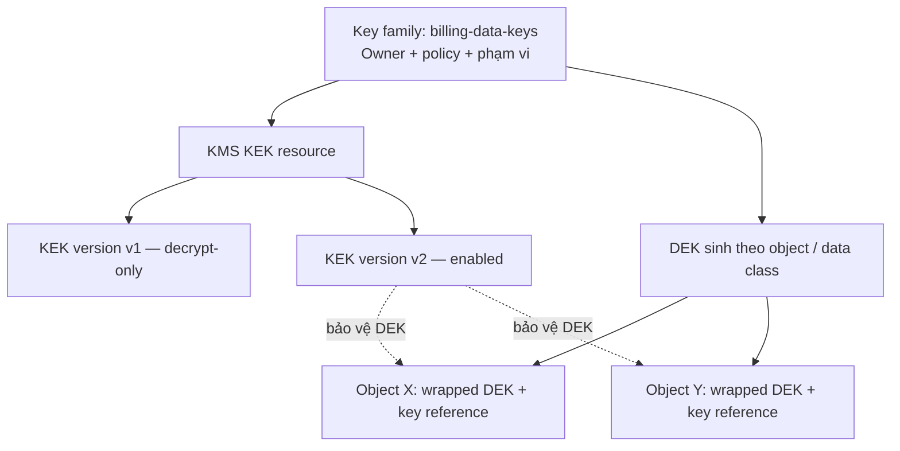
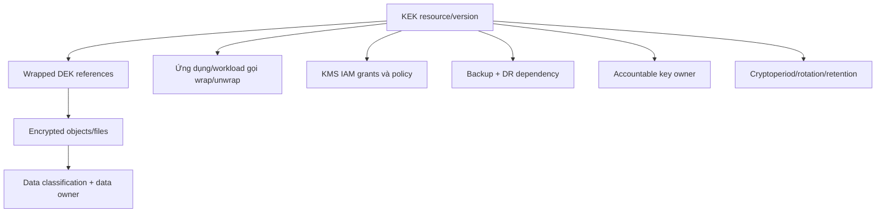
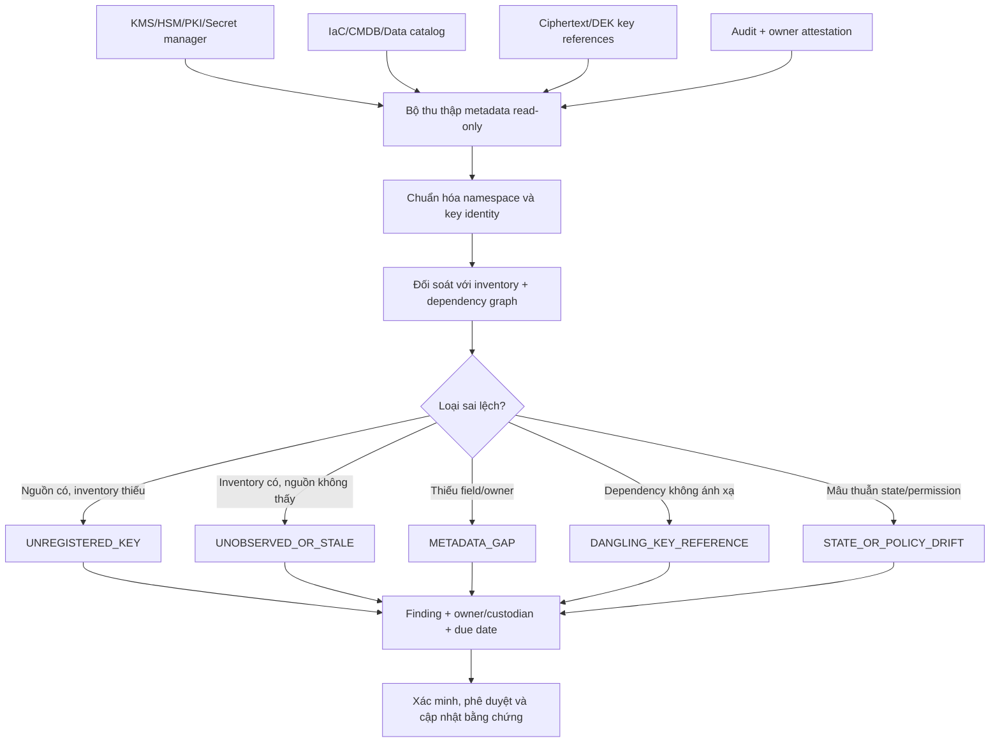
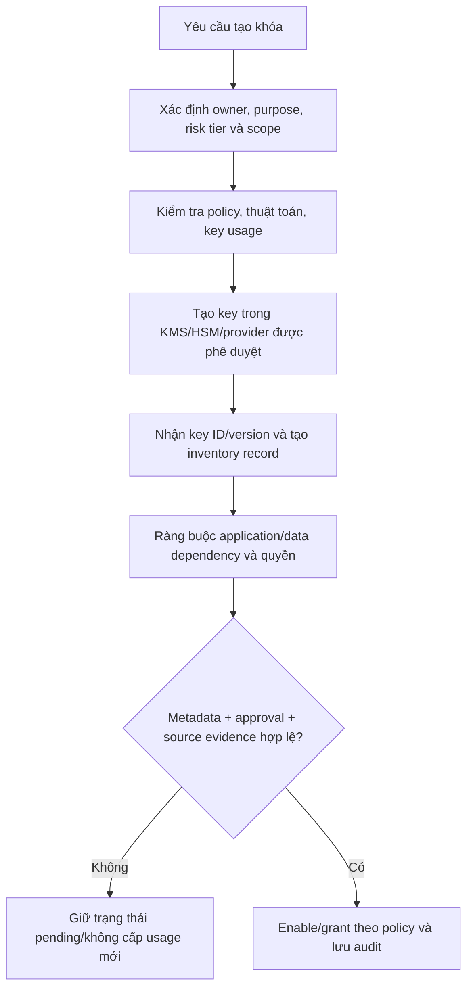
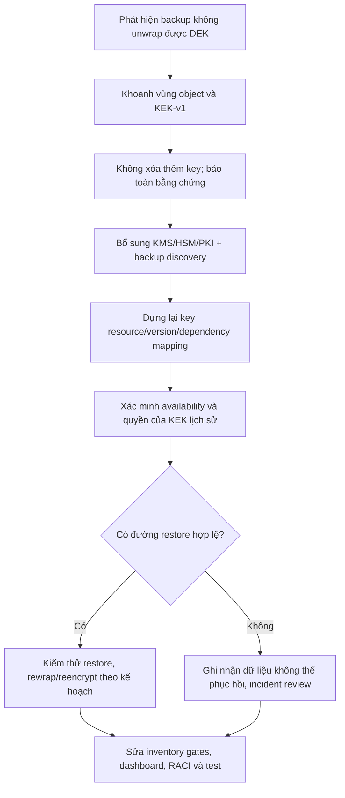

# Inventory completeness — Đánh giá mức độ đầy đủ của danh mục khóa mật mã

> **Chương:** Key inventory  
> **Module:** SECURITY_KEY_MANAGEMENT_FUNDAMENTALS — hiểu vòng đời khóa mật mã từ tạo, cấp phát, lưu trữ, sử dụng, xoay vòng đến thu hồi và hủy; kết nối mật mã đối xứng, bất đối xứng, chữ ký số, KMS/HSM, envelope encryption, kiểm soát truy cập và kiểm toán để thiết kế hệ thống bảo vệ khóa an toàn.

## 1. Mục tiêu học tập

Sau bài học, bạn có thể:

1. Giải thích **inventory completeness** là gì, phân biệt với tính chính xác (*accuracy*), tính cập nhật (*freshness*) và mức độ tuân thủ (*compliance*) của danh mục khóa.
2. Xác định **phạm vi kiểm kê** và các **nguồn phát hiện độc lập** cho khóa trong KMS/HSM, PKI, keystore, ứng dụng, thiết bị, CI/CD và các hệ thống quản lý bí mật.
3. Thiết kế **schema inventory** đủ phục vụ truy vết vòng đời: khóa nào, thuộc ai, dùng để làm gì, ở đâu, trạng thái nào và đang bảo vệ dữ liệu/khóa nào.
4. Phân biệt **logical key, concrete key resource, key material version, alias, certificate, key pair, DEK, KEK và ephemeral/session key** để tránh thiếu hoặc đếm trùng.
5. Xây dựng **reconciliation** phát hiện orphan key, ownerless key, dangling reference, shadow key, lệch trạng thái, phụ thuộc không được khai báo và dữ liệu chưa có bằng chứng.
6. Tính và diễn giải các chỉ số **population coverage, metadata completeness, dependency coverage, freshness, attestation và exception backlog**, tránh mẫu số tự tham chiếu.
7. Áp dụng ví dụ **SQL, JSON, Java** và sơ đồ luồng để xây dựng kiểm soát tự động mà không làm lộ key material.
8. Lên kế hoạch cải thiện inventory completeness trước **rotation, rewrap, revocation, cryptographic erasure, backup/DR và incident response**.

## 2. Inventory completeness là gì?

**Key inventory** là danh mục có kiểm soát về những tài sản khóa mật mã thuộc phạm vi quản trị của tổ chức. **Inventory completeness** là mức độ mà danh mục này **bao phủ đầy đủ quần thể khóa cần quản lý và các thông tin bắt buộc** để đưa ra quyết định an toàn trong suốt vòng đời khóa.

Một inventory “có 3.000 dòng” chưa chắc đầy đủ. Nếu còn 200 khóa trong HSM không được phát hiện, các key version lịch sử bị bỏ sót, hoặc không biết những DEK nào được bảo vệ bằng KEK sắp bị xóa, số lượng dòng không giải quyết được rủi ro.

Tối thiểu có hai câu hỏi khác nhau:

- **Population completeness — Có đủ đối tượng chưa?** Mọi khóa trong **phạm vi đã định nghĩa** có được phát hiện, đăng ký hoặc liên kết với record quản trị hợp lệ không?
- **Record completeness — Đủ thông tin để quản lý chưa?** Với mỗi đối tượng, các trường **bắt buộc theo loại khóa và mức rủi ro** có được điền, xác minh và duy trì không?

Ví dụ:

```text
Danh mục do ứng dụng tự khai:
    1. KEK-A
    2. SigningKey-B
    3. TLSKey-C

Kết quả đối soát độc lập:
    KMS có KEK-A, KEK-D
    HSM có SigningKey-B, SigningKey-E
    PKI có TLSKey-C và TLSKey-F
    Storage còn wrapped DEK tham chiếu tới KEK-Old

Danh sách 3 khóa ban đầu KHÔNG đại diện đầy đủ cho thực tế.
```

Nếu chỉ tính phần trăm trường được điền trên ba record đầu tiên, có thể báo **100% metadata đầy đủ** nhưng vẫn **bỏ sót bốn tài sản/phụ thuộc quan trọng**.

### 2.1. Những tính chất liên quan nhưng không đồng nhất

| Tính chất | Câu hỏi | Ví dụ sai |
| --- | --- | --- |
| **Completeness** | Mọi khóa cần quản lý và trường bắt buộc đã có chưa? | Thiếu khóa trong HSM hoặc thiếu owner |
| **Accuracy** | Dữ liệu ghi trong record có đúng với thực tế? | Owner đã rời đội nhưng tên cũ vẫn còn |
| **Freshness** | Thông tin được cập nhật/đối soát đủ gần thời điểm hiện tại? | Trạng thái `enabled` được chụp từ năm trước |
| **Consistency** | Các nguồn có thống nhất về ID, version, owner, state? | KMS báo disabled nhưng inventory báo active |
| **Traceability** | Có truy được nguồn, người duyệt, thay đổi và phụ thuộc? | Không biết bản ghi đến từ API nào |
| **Compliance** | Đáp ứng chính sách và tiêu chuẩn áp dụng? | Có đủ dữ liệu nhưng dùng thuật toán ngoài allowlist |

Một bản ghi có thể **đầy đủ các trường nhưng chứa thông tin sai**. Ngược lại, record chính xác về key ID/algorithm nhưng thiếu owner và kế hoạch thu hồi cũng chưa đạt **record completeness**.

### 2.2. Không thể chứng minh tuyệt đối chỉ bằng một nguồn

Nếu hệ thống chỉ nhập dữ liệu từ một API KMS rồi lấy **chính số khóa đã nhập** làm mẫu số, tỷ lệ coverage luôn có thể bằng 100%, kể cả khi một đội còn dùng file PKCS#12 hoặc secret hardcode ngoài KMS.

**Nguyên tắc:** phạm vi phải rõ và cần dùng **nhiều nguồn quan sát có tính độc lập tương đối** để phát hiện thiếu sót. Inventory completeness là **một tuyên bố có bằng chứng và giới hạn**, không phải cam kết toán học rằng “không còn khóa ẩn nào ở bất cứ đâu”.

## 3. Định nghĩa quần thể khóa cần kiểm kê

Trước khi đo coverage, tổ chức phải định nghĩa **đối tượng** và **ranh giới**.

### 3.1. Các câu hỏi về phạm vi

- Những **business unit, sản phẩm, tenant, cloud account/subscription/project, vùng và môi trường** nào thuộc scope?
- KMS/HSM/secret manager/PKI/keystore/thiết bị nào nằm trong phạm vi quản trị?
- Những khóa nào do **đối tác hoặc khách hàng quản lý** nhưng ứng dụng đang phụ thuộc?
- Có tính **key version đã disabled/retired**, khóa dùng đọc backup, public verification key và trust anchor?
- Có tính **DEK được sinh tự động theo object**, session key ngắn hạn và ephemeral key trong TLS?
- Có kiểm kê **pepper, PSK, API signing secret** và các tài sản bí mật gắn với giao thức hay chỉ key material được định nghĩa chính thức?
- Có cần record cấp **logical key family**, cấp **key resource**, cấp **version** hay tổ hợp nhiều cấp?
- Ai xác nhận các ngoại lệ và cơ chế kế thừa ownership?

**Không được loại bỏ một khóa khỏi scope chỉ vì khó phát hiện hoặc vì provider không hỗ trợ export.** Nếu không thể phát hiện từng key object tự động, cần xác định mức quản trị phù hợp và ghi rõ **coverage limitation**.

### 3.2. Mô hình phân tầng để không đếm trùng

Một hệ thống có thể bao gồm:



Có thể tồn tại đồng thời:

1. **Logical key family:** bản ghi quản trị, mô tả mục đích, owner và chính sách.
2. **Provider key resource:** tài nguyên có key ID ổn định trong KMS/HSM.
3. **Key material version:** phiên bản cụ thể dùng để wrap/unwrap, encrypt/decrypt hoặc sign/verify.
4. **Alias:** tên tiện dùng, **có thể chuyển đích**, không nhất thiết là key vật lý.
5. **Data dependency/reference:** ciphertext hoặc wrapped DEK tham chiếu tới một khóa hoặc version.
6. **Derived/ephemeral key population:** có thể được quản lý bằng policy và telemetry tổng hợp, không phải từng record thủ công.

**Đừng cộng số key families, key resources, versions và aliases thành một tổng “số khóa”** mà không nêu rõ đơn vị đo.

### 3.3. Key inventory không phải kho lưu byte khóa

Inventory nên chứa:

- **Key ID/key handle/fingerprint** đủ để tìm đúng tài sản.
- Owner, custodian, purpose, algorithm, lifecycle state, policy, dependencies.
- Nguồn phát hiện và evidence.

Inventory **không nên chứa** raw DEK/KEK, private key, HSM master secret, seed, pepper, PSK, password hoặc backup của key material.

Có thể cần lưu public key hoặc certificate ở một hệ thống trust directory, nhưng inventory chỉ cần **tham chiếu và fingerprint tin cậy**; không buộc sao chép mọi public/private material vào chính database inventory.

## 4. Phân loại tài sản để tránh “vùng mù”

| Nhóm | Ví dụ | Điểm dễ bỏ sót | Cách quản lý phù hợp |
| --- | --- | --- | --- |
| **DEK** | AES key cho file, bảng hoặc tenant | Hàng triệu DEK nằm trong object metadata | Key family/policy + dependency records + wrapped DEK references |
| **KEK/master key** | KMS key bọc DEK | Key version cũ, alias chuyển đích | Provider key ID, version, usage và quyền |
| **Signing key** | JWT/JWS, release signing, hóa đơn điện tử | Khóa cũ vẫn cần verify | Private key lifecycle + public key/retention |
| **TLS/mTLS private key** | Service, gateway, mesh, IoT | Tồn tại ngoài KMS, ở keystore hoặc sidecar | PKI discovery, cert/key reference và workload mapping |
| **CA/trust anchor** | Root/intermediate CA | Không thường xuyên được “used” như key nghiệp vụ | PKI inventory và trust distribution |
| **HMAC/PSK** | Webhook MAC, service PSK | Trong secret manager/env/config | Secret references và purpose, không lấy secret plaintext |
| **Pepper** | Bí mật bổ sung cho password verifier | Chỉ có ở Auth service, không phải KMS key chuẩn | Đăng ký secret ownership, version, DR và rotation |
| **BYOK/CMEK/HYOK** | Khóa do khách hàng kiểm soát | Nhà cung cấp không sở hữu key material | External key dependency, owner/contacts và availability policy |
| **HSM-resident key** | Non-exportable private key/KEK | Không thấy từ cloud KMS API chung | HSM partition/slot, object labels và key handles |
| **Legacy/offline key** | Backup media, PFX/P12, smart card | Không có API realtime | Asset attestation và kiểm kê theo thiết bị/quy trình |
| **Session/ephemeral key** | TLS 1.3 ECDHE, HPKE ephemeral | Tạo/hủy liên tục trong runtime | Kiểm kê **cơ chế/policy/owner**, không lưu từng secret |
| **Test/CI/CD key** | Release test signing, staging TLS | Trôi sang prod hoặc bị dùng sai scope | Cả non-prod có scope và policy rõ, phân tách môi trường |

### 4.1. Public key có cần kiểm kê không?

Có khi **tính xác thực, phiên bản hoặc sự tin cậy** của public key ảnh hưởng hệ thống:

- Public key dùng **verify JWT/chữ ký số** và cần giữ để xác minh dữ liệu lịch sử.
- Public key dùng **key transport** cho DEK, nếu bị thay bằng khóa của attacker có thể làm lộ DEK.
- Trust anchor/CA key dùng xác minh chứng thư.
- Partner signing keys có vòng đời ngoài tổ chức.

Việc public key không bí mật **không khiến nó nằm ngoài nghĩa vụ quản trị**. Nhưng record có thể nhẹ hơn private key vì không có rủi ro export secret.

### 4.2. Có bắt buộc inventory từng ephemeral key?

Thông thường **không**. Ephemeral/session keys có vòng đời rất ngắn, số lượng lớn, và lưu từng key có thể làm tăng rủi ro lộ secret.

Thay vào đó nên kiểm kê:

- **Giao thức/provider** tạo khóa (TLS, HPKE, KEM, DRBG).
- **Service owner**, chính sách thuật toán/key size, key rotation/rekey.
- Khả năng telemetry không nhạy cảm: số phiên, lỗi handshake, algorithm policy.
- Thiết kế của key schedule, hardening và incident response.

**Completeness được đánh giá theo đúng mức trừu tượng.** Không đặt yêu cầu sai rằng phải lưu từng TLS traffic secret để inventory “100%”.

## 5. Các chiều đánh giá completeness

Một chương trình kiểm kê đáng tin thường tách ít nhất sáu chiều:

1. **Population coverage:** đã phát hiện và đăng ký các key resources/version thuộc phạm vi?
2. **Metadata completeness:** đủ trường bắt buộc theo risk class/loại khóa?
3. **Relationship completeness:** biết khóa bảo vệ/được dùng bởi những tài sản nào?
4. **Ownership completeness:** có accountable owner, backup/escalation và custodian hợp lệ?
5. **Lifecycle completeness:** trạng thái, cryptoperiod, rotation/retention/DR đã được khai báo?
6. **Evidence and freshness:** nguồn thông tin, thời điểm kiểm chứng và quyết định owner có còn hiệu lực?

### 5.1. Metadata bắt buộc phải có điều kiện

Không áp dụng một form cố định cho mọi loại khóa. Ví dụ:

- **RSA signing key:** cần key usage, fingerprint/public verification key, thuật toán/profile, identity, thẩm quyền ký, cert/key retention.
- **Symmetric KEK:** cần wrapping scope, key version, KMS grants, dependent DEKs, policy rewrap/re-encrypt.
- **DEK per object:** cần wrapped DEK metadata, encryption algorithm, nonce/tag/AAD schema, reference tới KEK; owner có thể kế thừa từ data asset.
- **Public trust anchor:** cần trust domain, distribution, validity, chain/owner; không có mục “private key export policy” nếu chỉ quản lý bản public.
- **Ephemeral session keys:** cần kiểm soát ở **protocol/implementation record** thay vì một bản ghi riêng mỗi phiên.

Có thể xây **required-fields matrix** theo `keyKind × riskTier × lifecycleState`.

### 5.2. Tình huống lỗi được che bởi số liệu đẹp

| Bối cảnh | Số liệu được báo | Điều đang thiếu |
| --- | --- | --- |
| Chỉ lấy KMS account A | 100% record có owner | Bỏ qua HSM B và secret manager C |
| Tất cả resource có alias | “100% khóa được đặt tên” | Alias không chỉ ra key version lịch sử |
| Điền `owner=platform` cho mọi khóa | 100% owner coverage | Thiếu accountable owner thật và phê duyệt |
| Mọi record có `lastUsedAt` | 100% lifecycle metadata | Không biết backup/dependency còn cần key |
| Lấy số record inventory làm mẫu số | 100% inventory completeness | Không phát hiện khóa chưa được nhập |
| Không ghi DEK per file | “Thiếu hàng triệu khóa” | Có thể đã quản lý đúng ở cấp policy và metadata object |

**Không tối ưu metric bằng cách giảm scope hoặc điền giá trị giả.** Cần công bố phạm vi, phương pháp thu thập và giới hạn.

## 6. Nguồn dữ liệu để khám phá khóa

Một inventory đáng tin nên lấy tín hiệu từ nhiều hệ thống, mỗi hệ thống phản ánh **một phần sự thật**.

| Nguồn | Tìm được gì? | Giới hạn |
| --- | --- | --- |
| **KMS APIs** | Key IDs, aliases, versions, state, policy, tags | Không thấy secret trong app hoặc bên ngoài provider |
| **HSM inventory** | Key handles, partition/slot, attributes, usage policy | Một số key không export, cách xem phụ thuộc thiết bị |
| **PKI/CA & cert stores** | Certificates, serials, subject/SAN, public-key fingerprints | Không phải mọi private key đều nằm trong CA |
| **Secret manager** | Secret references, versions, access policy, tags | Tên secret không tự chứng minh đó là crypto key |
| **Cloud IAM & audit** | Actors, grants, key usage events, policy changes | “Last used” không đại diện mọi dependency |
| **IaC & deployment manifests** | Key resources được khai báo, expected owners, service bindings | Không thấy thay đổi thủ công hoặc shadow key |
| **CMDB/data catalog** | Application/data owner và sensitivity | Có thể thiếu resource mới được tạo |
| **Storage/database metadata** | Wrapped DEK references, encryption key ID, file/blob lineage | Chỉ thấy dữ liệu đang được index/scan |
| **CI/CD signing infrastructure** | Key IDs cho release signing, provenance/cert references | Có thể có key nằm trong runner hoặc offline signer |
| **Device/endpoint inventory** | TPM/smart card, keystores, IoT certificates | Thiết bị offline, cần attestation hoặc kiểm kê định kỳ |
| **Owner attestation** | Mục đích sử dụng, phụ thuộc, trách nhiệm | Dữ liệu tự khai có thể nhầm/thiếu |
| **Incident/exception records** | Khóa có rủi ro, bypass và sự cố chưa đóng | Không cung cấp toàn bộ quần thể |

### 6.1. Phát hiện không cần xuất key material

Các connector nên dùng quyền **metadata read-only**, ví dụ list/describe key, list versions, xem policy/tags và audit metadata khi được cho phép.

Không yêu cầu:

- Export private key để “xác minh nó tồn tại”.
- Decrypt mọi wrapped DEK để lấy fingerprint.
- Dump secret manager values vào CSV inventory.
- Scan bộ nhớ ứng dụng để trích traffic secrets.
- Ghi plaintext DEK vào event bus dùng đồng bộ.

**Inventory là lớp kiểm soát và tham chiếu, không phải bản sao thứ hai của kho khóa.**

### 6.2. Discovery từ code không phải bằng chứng duy nhất

Static analysis có thể phát hiện các biểu thức như `KeyGenerator.getInstance("AES")`, `SecretKeySpec`, file keystore, `PrivateKey`, biến môi trường tên `SIGNING_KEY`. Nhưng code search có thể:

- Bỏ sót runtime-generated secrets, external modules hoặc vendor libraries.
- Đưa nhiều false positives (test/example code).
- Không biết key đã được deploy production hay chưa.
- Không biết một key reference có còn được dùng cho dữ liệu lịch sử.

Dùng scan code/IaC làm **tín hiệu bổ sung** để mở finding và điều tra, không xem kết quả scan là inventory hoàn chỉnh.

## 7. Khóa định danh và chuẩn hóa để tránh đếm trùng

### 7.1. Một định danh chuẩn nhiều thành phần

Khóa `key-id=123` chưa chắc duy nhất trên toàn tổ chức. Cần tính tới namespace:

```text
inventoryIdentity =
    organization
  + environment
  + provider
  + account/project/subscription
  + region/partition/tenant
  + providerResourceId
  + keyMaterialVersion (nếu có)
```

Đây là **mô hình logical identity**, không phải chuỗi ghép thô bắt buộc. Mỗi provider có quy tắc ID/alias/version riêng; cần chuẩn hóa mà không làm mất thông tin.

### 7.2. Alias, key ID và version là ba lớp khác nhau

Ví dụ:

```text
Alias: payments-signing-prod
  -> signing-key-resource-42
       -> version 1 (verify-only)
       -> version 2 (active sign)
       -> version 3 (pending activation)
```

Nếu chỉ crawl alias, bản ghi có thể mất:

- Version 1 vẫn dùng verify chứng từ đã phát hành.
- Version 3 đang được provision nhưng chưa active.
- Khóa khác không có alias nhưng còn bảo vệ ciphertext cũ.

Khi phát hiện trùng, **không tự xóa record** vì “cùng tên alias”. Cần xác minh provider ID, key material version và trạng thái/nguồn.

### 7.3. Hash/fingerprint của public key không thay key ID ở mọi nơi

Public-key fingerprint có thể giúp nhận diện key material, nhưng:

- Hai chứng thư khác nhau có thể chứa cùng một public key.
- Cùng key material có thể được đăng ký ở nhiều trust domain với policy khác nhau.
- Symmetric keys không được export chỉ để tính fingerprint.
- Fingerprint không thay thế owner/purpose/tenant và vòng đời.

Cần quản lý **material identity** và **resource/policy identity** thành các khái niệm riêng khi cần.

## 8. Schema inventory phục vụ completeness

Một record quản trị có thể gồm các trường:

| Nhóm | Trường gợi ý | Vì sao cần? |
| --- | --- | --- |
| **Identity** | `inventoryId`, `providerKeyId`, `keyVersion` | Gắn đúng resource/version |
| **Classification** | `keyKind`, `algorithm`, `strength`, `purpose` | Áp dụng required-field policy |
| **Ownership** | `ownerTeamId`, `backupOwnerId`, `custodianId` | Accountability và escalation |
| **Scope** | `environment`, `tenantScope`, `region`, `dataClassification` | Tránh nhầm môi trường/tenant |
| **Location** | `provider`, `accountRef`, `keyHandleRef` | Biết nơi giữ/sử dụng khóa |
| **State** | `lifecycleState`, `allowedOperations`, `cryptoperiod` | Rotation, decrypt-only và thu hồi |
| **Dependencies** | `dataAssetRefs`, `wrappedKeyRefs`, `serviceRefs` | Đánh giá blast radius và DR |
| **Assurance** | `protectionBoundary`, `exportability`, `policyRef` | Biết kiểm soát, không dựa vào nhãn |
| **Evidence** | `sourceId`, `observedAt`, `verifiedAt`, `attestationRef` | Đánh giá freshness/confidence |
| **Operations** | `rotationDueAt`, `restoreRunbookRef`, `lastRestoreTestAt` | Có khả năng duy trì vòng đời |
| **Exceptions** | `exceptionRef`, `exceptionExpiresAt`, `findingRefs` | Hiển thị những khoảng trống có kiểm soát |

Các trường bắt buộc phải **phụ thuộc loại khóa**. Ví dụ public verification key không có ý nghĩa `privateKeyExportability` trong record chỉ quản lý public half; một ephemeral key family có thể không có `keyVersion` cho từng phiên.

### 8.1. Ví dụ JSON record có nguồn và bằng chứng

```json
{
  "inventoryId": "k-inv-2026-0142",
  "keyKind": "SYMMETRIC_KEK",
  "provider": "managed-kms",
  "accountRef": "org-prod-security",
  "region": "region-a",
  "providerKeyId": "kms://region-a/keys/invoice-kek-3",
  "keyVersion": "v3",
  "environment": "production",
  "purpose": "wrap-dek",
  "ownerTeamId": "billing-platform",
  "backupOwnerTeamId": "security-operations",
  "custodianTeamId": "kms-platform",
  "tenantScope": "billing-tenants",
  "dataClassification": "confidential",
  "algorithm": "AES-256",
  "lifecycleState": "ENABLED",
  "newUsageAllowed": true,
  "dependentDataAssetRefs": ["invoice-archive"],
  "sourceEvidence": [
    {"source": "kms-api", "observedAt": "2026-11-27T09:00:00Z"},
    {"source": "iac-registry", "observedAt": "2026-11-27T09:10:00Z"}
  ],
  "lastOwnerAttestedAt": "2026-10-10T08:00:00Z",
  "rotationPolicyRef": "policy/key-rotation-billing",
  "restoreRunbookRef": "runbook/invoices-restore",
  "inventorySchemaVersion": 2
}
```

**Đây là dữ liệu giả định để học**, không phải schema/API có sẵn của KMS. Ngày tháng và tên ID không quy định chuẩn chung.

Đừng coi việc JSON có `dependentDataAssetRefs` là bằng chứng chắc rằng mọi ciphertext đã được liệt kê. Cần **đối soát độc lập** với database/object metadata và các bản backup.

### 8.2. Các trường nhạy cảm không đưa vào inventory

```text
KHÔNG lưu:
  rawKeyBytes
  plaintextDEK
  privateKeyPem
  hsmMasterSecret
  passwordOrPepper
  seedOrDRBGState
  unencryptedPSK
  recoverySecretShares
  fullSecretManagerValue
```

Việc inventory dùng database có mã hóa at rest **không làm hợp thức hóa** sao chép toàn bộ khóa bí mật sang đó. Tập trung lưu **tham chiếu, thuộc tính và bằng chứng**.

## 9. Relationship completeness: không chỉ có khóa mà còn cần phụ thuộc

Một bản ghi khóa có thể ghi đúng owner và state nhưng thiếu dữ liệu nó đang bảo vệ. Đây là lỗ hổng lớn khi thực hiện rotation, hủy khóa hoặc disaster recovery.

### 9.1. Các quan hệ nên truy được



Những truy vấn quan trọng:

- Nếu `KEK-v1` bị disable, **những DEK nào** không còn giải bọc được?
- Những object nào vẫn tham chiếu tới `KEK-v1` sau khi alias đã chuyển sang `v2`?
- Nếu **private signing key** bị thu hồi, tài liệu/chữ ký nào cần kiểm tra trust status hoặc evidence lịch sử?
- Những tenant/data assets nào có thể chịu ảnh hưởng khi một master key bị lộ?
- Backup ở region B có key version tương thích để restore không?
- Workload nào có quyền sử dụng khóa nhưng **không còn phụ thuộc hợp lệ**?

### 9.2. Quan hệ âm thầm bị thiếu

Một hệ thống lưu:

```text
objectId = invoice-1204
ciphertext = ...
wrappedDEK = ...
keyId = kms/invoice-kek-v1
```

Nhưng inventory chỉ lưu alias `kms/invoice-kek` đang trỏ `v2`. Nếu không lưu dependency ở cấp version hoặc hiểu chính sách giải mã phiên bản của provider, người vận hành có thể **hủy v1 quá sớm**, làm mất khả năng đọc object cũ.

### 9.3. Quan hệ cũng có phiên bản

Một object có thể được **rewrap** để DEK cũ được bọc bằng KEK mới nhưng **DEK và ciphertext không đổi**. Bản đồ phụ thuộc cần phản ánh:

- Version mới của wrapped DEK đang active.
- Bản cũ trong backup/snapshot còn tồn tại hay đã hết retention.
- Tình trạng rewrap theo object và khả năng rollback.
- Phạm vi decryption exposure nếu KEK hoặc DEK bị lộ.

**Rewrap không giống re-encrypt.** Khi DEK plaintext đã bị lộ, chỉ đổi dependency sang KEK mới không tự khắc phục rủi ro dữ liệu đã mã hóa bằng DEK đó.

## 10. Discovery và reconciliation hoạt động như thế nào?

**Reconciliation** là quá trình đối chiếu tập tài sản/tham chiếu phát hiện được từ các nguồn với inventory hiện tại, sau đó phân loại và xử lý sai lệch.



### 10.1. Tách discovery khỏi hành động nguy hiểm

Một quy trình phát hiện thấy key không có owner **không được tự động**:

- Xóa key.
- Disable mọi grant.
- Rotate không kiểm tra ứng dụng phụ thuộc.
- Export key material để xác minh.
- Xóa bản ghi inventory vì nguồn không trả về.
- Tự sửa `owner` bằng caller truy cập nhiều nhất.

Tự động hóa nên **mở finding và điều phối công việc**. Các thao tác có tác động như revoke/disable/delete cần policy, quyền phê duyệt và cơ chế rollback/DR phù hợp.

### 10.2. Nhóm kết quả đối soát

| Kết quả | Ý nghĩa | Xử lý |
| --- | --- | --- |
| **MATCHED_VERIFIED** | Key/resource được phát hiện và metadata quan trọng khớp | Lưu evidence, cập nhật `observedAt` |
| **UNREGISTERED_KEY** | Nguồn phát hiện khóa thuộc scope nhưng không có inventory record | Điều tra owner, purpose, quyền và import có kiểm soát |
| **STALE_INVENTORY** | Inventory có record nhưng không quan sát lại được trong cửa sổ kỳ vọng | Kiểm tra nguồn lỗi, tài nguyên đã xóa hoặc offline |
| **MISSING_OWNER** | Owner rỗng hoặc nhóm không còn hoạt động | Giao temporary owner và tìm owner thật |
| **MISSING_DEPENDENCY** | Không biết dữ liệu/workload nào phụ thuộc | Truy vết object metadata, CMDB, audit, restore |
| **DANGLING_REFERENCE** | Object/wrapped DEK tham chiếu key không tìm thấy | Ưu tiên điều tra rủi ro mất dữ liệu |
| **CONFLICTING_STATE** | Provider và inventory khác nhau về enabled/deleted/version | Xác minh nguồn authoritative, sửa sau phê duyệt |
| **DUPLICATE_IDENTITY** | Hai record dường như đại diện cùng resource/version | Chuẩn hóa và kiểm chứng trước merge |
| **POLICY_DRIFT** | Grants/usage không còn đúng phạm vi phê duyệt | Owner/security review và remediation |
| **EXCEPTION_PENDING** | Khóa được quản lý bằng ngoại lệ chưa hết hạn | Theo dõi deadline, reason và bù đắp kiểm soát |

### 10.3. Data provenance

Mỗi phát hiện nên giữ:

- `sourceId` và kiểu nguồn.
- `sourceResourceId` nguyên gốc.
- Thời gian **observedAt** và **collectedAt** (không luôn trùng).
- Connector version, vùng/account và scope được quét.
- Kết quả từng trường hoặc bằng chứng tóm tắt đã kiểm soát.
- Confidence/validation status khi dữ liệu còn bất định.
- Link tới change ticket/approval và người xác nhận.
- Mã lỗi khi nguồn API **không trả đủ dữ liệu**.

Không đánh dấu “không có key” nếu connector thực tế **bị AccessDenied, timeout hoặc thiếu account/region**. Trường hợp đó là **coverage unknown**, không phải âm tính chắc chắn.

## 11. Rủi ro mẫu số và cách đo population coverage

Gọi:

- \(D\): tập key identities trong phạm vi được **phát hiện từ nguồn độc lập** trong cửa sổ quan sát.
- \(I\): tập key identities có inventory record hợp lệ ở mức kiểm kê đã chọn.
- \(D \cap I\): tập key identities vừa phát hiện vừa được đăng ký.

Một chỉ số:

\[
\text{Discovery-to-Inventory Coverage}
  = \frac{|D \cap I|}{|D|} \times 100\%
\]

Nếu \(D\) có 1.000 key identities và inventory ánh xạ chính xác 940 identities:

\[
\text{Coverage} = \frac{940}{1000}\times100\% = 94\%.
\]

**Giới hạn quan trọng:** \(D\) không nhất thiết chứa mọi khóa trong thực tế. Chỉ số này chứng minh **bao phủ trên những gì các nguồn hiện quan sát được**, không chứng minh toàn bộ hệ thống không có shadow keys.

### 11.1. Không lấy inventory làm cả tử và mẫu

Công thức sai:

```text
coverage = số record có owner / số record inventory
=> 100% nếu điền owner cho mọi record đang biết
```

Đây là **owner metadata coverage**, không phải population coverage. Nó không nhận diện key chưa từng được nhập.

### 11.2. Khi nhiều nguồn phát hiện khác nhau

Có thể dùng hợp của những tập đã chuẩn hóa:

\[
D = D_{\mathrm{KMS}}\cup D_{\mathrm{HSM}}\cup
D_{\mathrm{PKI}}\cup D_{\mathrm{Storage}}\cup D_{\mathrm{IaC}}
\]

Trước khi tính phải **deduplicate theo identity ở cùng cấp**. Không đếm một key hai lần vì nó xuất hiện trong KMS API và IaC registry.

Nếu một nguồn không thể quét đầy đủ (thiếu quyền hoặc API outage), cần ghi **scope gap** và không báo 100% toàn tổ chức dựa vào các nguồn còn hoạt động.

### 11.3. Một số phép đo bổ sung

**Unregistered key count:**

\[
U = |D \setminus I|
\]

**Unobserved inventory count:**

\[
S = |I \setminus D|
\]

Tập \(I\setminus D\) **không đồng nghĩa khóa đã xóa**. Nó có thể là key offline, vùng chưa crawl, key đã retired nhưng được giữ để verify/restore, hoặc lỗi connector.

**Không tự động xóa** những record trong tập này; phải kiểm tra lifecycle/retention và bằng chứng.

## 12. Đo metadata completeness và freshness

### 12.1. Required fields phụ thuộc loại khóa

Gọi \(R(k)\) là tập trường bắt buộc cho khóa \(k\), do **key kind, risk tier và lifecycle state** quyết định.

Một phép đo ở cấp record:

\[
C(k) =
\frac{\#\{\text{trường bắt buộc đã có và hợp lệ}\}}
{\#R(k)} \times 100\%
\]

Nhưng cần tránh hiểu nhầm:

- Trường có giá trị `owner=unknown` **không phải owner hợp lệ**.
- `lastReviewedAt` có giá trị quá cũ có thể **không đạt** freshness requirement.
- `dataAssets=[]` không chắc đúng nếu key đang có `Decrypt` events hoặc wrapped DEK references.
- `algorithm=RSA` không đủ nếu policy cần **scheme, size và usage** rõ.
- `keyId` có chuỗi nhưng không thể đối chiếu provider cũng chưa được xem là verified.

Có thể quy định **hard gates** cho những trường quan trọng thay vì lấy trung bình để “bù điểm”. Ví dụ production KEK thiếu owner hoặc key reference có thể **không đạt** dù 95% trường khác có dữ liệu.

### 12.2. Freshness là số liệu riêng

Một record có đủ trường cách đây sáu tháng có thể không còn đáng tin sau rotation hoặc IAM change.

Ví dụ:

```text
observedAt: thời điểm provider API trả kết quả
verifiedAt: thời điểm record được đối soát/kiểm chứng
ownerAttestedAt: owner xác nhận mục đích, scope và phụ thuộc
lastAccessReviewedAt: thời điểm grant/usage được rà soát
```

**Không đồng nhất `updatedAt` với `verifiedAt`.** Một thao tác format JSON hoặc thay nhãn có thể cập nhật timestamp mà không hề xác minh key state.

### 12.3. Cửa sổ kiểm tra theo rủi ro

Một key ký phát hành phần mềm production, CA root hoặc KEK bảo vệ dữ liệu nhạy cảm có thể cần lịch attestation/monitoring khác một public verification key ít rủi ro.

Tổ chức nên xác định theo policy:

- Thời gian tối đa từ lần discovery/reconciliation cuối.
- Thời gian tối đa từ owner/access review.
- Deadline remediation của finding theo severity.
- Chu kỳ kiểm thử restore/retirement cho khóa lịch sử.
- Tần suất kiểm tra drift và sự kiện realtime khi provider hỗ trợ.

Không lấy một mốc `30 ngày` hay `90 ngày` làm **chuẩn bảo mật phổ quát**. Những mốc đó chỉ có ý nghĩa khi được risk assessment và policy cụ thể phê duyệt.

## 13. Ví dụ dashboard: không để một KPI che khuất rủi ro

Giả sử hệ thống đã phát hiện 1.200 key identities từ các nguồn đang được giám sát; 1.140 có inventory records khớp; 1.100 có owner hợp lệ; 960 có dependency mapping đạt policy; 1.010 record có evidence đủ mới. Đây là **số liệu giả định**.

| Chỉ số | Cách tính | Giá trị minh họa |
| --- | --- | --- |
| Discovery-to-inventory coverage | 1.140 / 1.200 | **95,0%** |
| Owner coverage trên quần thể phát hiện | 1.100 / 1.200 | **91,7%** |
| Dependency coverage trên quần thể phát hiện | 960 / 1.200 | **80,0%** |
| Freshness coverage trên quần thể phát hiện | 1.010 / 1.200 | **84,2%** |
| Unregistered key identities | 1.200 − 1.140 | **60** |

**Không** cộng hoặc lấy trung bình các tỷ lệ để ra một “điểm 88% bảo mật”. Các tiêu chí có **tầm quan trọng khác nhau**, có thể chồng lấp và có hard gates.

### 13.1. Phân khúc giúp ưu tiên

- Production / non-production.
- Symmetric KEK / DEK / private signing / public verification / TLS / PSK.
- Root/master/CA và khóa có blast radius lớn.
- Tenant hoặc business domain.
- Region/account/provider và độ tin cậy của connector.
- State: active, decrypt-only, verify-only, disabled, pending deletion.
- Mức độ dữ liệu: public, internal, confidential, restricted.
- Những nhóm có owner/dependency/restore evidence thiếu.

Một 95% coverage toàn tổ chức có thể **che khuất** 10 CA/private signing keys bị bỏ sót. Cần có **risk-based reporting** thay vì một chỉ số tổng duy nhất.

### 13.2. Cần báo cáo cả “unknown”

Nếu connector không thể quét HSM partition vì lỗi quyền, không nên coi quần thể HSM có **0 key**. Báo cáo:

```text
scope: HSM partition P3
discoveryStatus: UNKNOWN_INSUFFICIENT_ACCESS
lastSuccessfulScan: <timestamp>
impact: cannot assert coverage for P3
findingOwner: platform-security
remediationDue: <policy-defined deadline>
```

**Tính trung thực của coverage** quan trọng hơn việc hiển thị dashboard toàn màu xanh.


## 14. SQL: phát hiện khóa chưa đăng ký và metadata thiếu

Một cơ sở dữ liệu inventory có thể tách:

- **`key_inventory`:** record quản trị đã được duyệt.
- **`discovered_key`:** observation từ nguồn độc lập.
- **`data_key_dependency`:** tham chiếu tới key resource/version từ ciphertext hoặc ứng dụng.
- **`source_scan`:** tình trạng và phạm vi quét của từng connector.

Tách các bảng này giúp phân biệt **khóa chưa có record** với **nguồn chưa thể kiểm tra**.

### 14.1. Schema minh họa

```sql
-- SQL theo phong cách PostgreSQL, không phải schema production hoàn chỉnh.
-- Chỉ lưu metadata và tham chiếu; TUYỆT ĐỐI KHÔNG lưu raw key material.

CREATE TABLE key_inventory (
    inventory_id       VARCHAR(128) PRIMARY KEY,
    provider           VARCHAR(64) NOT NULL,
    account_scope      VARCHAR(255) NOT NULL,
    region             VARCHAR(128) NOT NULL,
    provider_key_id    VARCHAR(512) NOT NULL,
    material_version   VARCHAR(128) NOT NULL,
    key_kind           VARCHAR(64) NOT NULL,
    purpose            VARCHAR(128),
    lifecycle_state    VARCHAR(64),
    owner_team_id      VARCHAR(128),
    custodian_team_id  VARCHAR(128),
    policy_ref         VARCHAR(512),
    last_verified_at   TIMESTAMPTZ,
    UNIQUE (provider, account_scope, region,
            provider_key_id, material_version)
);

CREATE TABLE discovered_key (
    source_id          VARCHAR(128) NOT NULL,
    provider           VARCHAR(64) NOT NULL,
    account_scope      VARCHAR(255) NOT NULL,
    region             VARCHAR(128) NOT NULL,
    provider_key_id    VARCHAR(512) NOT NULL,
    material_version   VARCHAR(128) NOT NULL,
    observed_at        TIMESTAMPTZ NOT NULL,
    PRIMARY KEY (source_id, provider, account_scope,
                 region, provider_key_id, material_version)
);

CREATE TABLE source_scan (
    source_id          VARCHAR(128) PRIMARY KEY,
    scope_description  VARCHAR(512) NOT NULL,
    scan_status        VARCHAR(64) NOT NULL,
    last_success_at    TIMESTAMPTZ,
    last_attempt_at    TIMESTAMPTZ,
    error_code         VARCHAR(128)
);

CREATE TABLE data_key_dependency (
    object_ref         VARCHAR(512) NOT NULL,
    provider           VARCHAR(64) NOT NULL,
    account_scope      VARCHAR(255) NOT NULL,
    region             VARCHAR(128) NOT NULL,
    provider_key_id    VARCHAR(512) NOT NULL,
    material_version   VARCHAR(128) NOT NULL,
    PRIMARY KEY (object_ref, provider, account_scope,
                 region, provider_key_id, material_version)
);
```

**Giới hạn của schema minh họa:**

1. `material_version` đặt `NOT NULL` để đơn giản hóa khóa ghép; một provider có thể không lộ version hoặc dùng key resource không phiên bản hóa theo cùng cách. Trong thực tế cần **quy tắc chuẩn hóa đặc thù**, ví dụ một định danh sentinel hợp lệ cho resource không có version, nhưng không được dùng sentinel để che một version **không biết**.
2. `source_scan` mới biểu diễn một source/scope, chưa xử lý hàng trăm vùng, permission gaps, lịch sử scan và trạng thái từng lần chạy.
3. `data_key_dependency` là quan hệ logic; trong triển khai thật cần lưu provenance, trạng thái active/backup, retention và version của object.
4. Có thể cần bảng riêng cho key family, key alias, key usage, grants, exceptions, owner directory, attestation và audit history.
5. Không dùng một chuỗi URL `provider_key_id` có thể nhập tùy ý để trực tiếp gọi KMS nếu chưa xác thực scope và policy.

### 14.2. Phát hiện key đã thấy nhưng chưa có inventory record

```sql
WITH observed AS (
    SELECT DISTINCT
        provider,
        account_scope,
        region,
        provider_key_id,
        material_version
    FROM discovered_key
)
SELECT o.*
FROM observed AS o
LEFT JOIN key_inventory AS i
  ON i.provider = o.provider
 AND i.account_scope = o.account_scope
 AND i.region = o.region
 AND i.provider_key_id = o.provider_key_id
 AND i.material_version = o.material_version
WHERE i.inventory_id IS NULL;
```

Đây là tập **`D \setminus I`** tương ứng với các nguồn đã quét. Kết quả cần tạo **finding `UNREGISTERED_KEY`**, không tự ý xóa key hoặc gán owner từ caller gần nhất.

### 14.3. Phát hiện owner và policy bắt buộc bị thiếu

```sql
SELECT
    inventory_id,
    provider_key_id,
    material_version,
    key_kind,
    lifecycle_state,
    owner_team_id,
    policy_ref
FROM key_inventory
WHERE
    owner_team_id IS NULL
    OR TRIM(owner_team_id) = ''
    OR policy_ref IS NULL
    OR TRIM(policy_ref) = '';
```

Query chỉ kiểm tra **sự hiện diện**, chưa xác minh owner team còn tồn tại, policy có hợp lệ, hay khóa có thuộc ngoại lệ. Muốn đánh giá completeness thật, cần **join với directory/policy registry** và rule engine theo key kind/risk tier.

### 14.4. Phát hiện wrapped DEK tham chiếu khóa không thấy trong inventory

```sql
SELECT
    d.provider,
    d.account_scope,
    d.region,
    d.provider_key_id,
    d.material_version,
    COUNT(*) AS dependent_object_count
FROM data_key_dependency AS d
LEFT JOIN key_inventory AS i
  ON i.provider = d.provider
 AND i.account_scope = d.account_scope
 AND i.region = d.region
 AND i.provider_key_id = d.provider_key_id
 AND i.material_version = d.material_version
WHERE i.inventory_id IS NULL
GROUP BY d.provider, d.account_scope, d.region,
         d.provider_key_id, d.material_version;
```

Đây thường là finding **nguy hiểm hơn một tag bị thiếu**, vì có nguy cơ không thể giải bọc DEK trong tương lai. Phải rà account/region/backup trước khi kết luận key bị mất.

### 14.5. Cảnh báo nguồn discovery không hoàn thành

```sql
SELECT
    source_id,
    scope_description,
    scan_status,
    last_success_at,
    last_attempt_at,
    error_code
FROM source_scan
WHERE scan_status <> 'SUCCESS'
   OR last_success_at IS NULL;
```

Nếu một nguồn có trạng thái `ACCESS_DENIED` hoặc `PARTIAL`, dashboard nên đặt coverage của scope liên quan thành **không xác định hoặc có điều kiện**, không mặc định 100%.

## 15. Java: đánh giá completeness theo loại khóa và policy

Ví dụ Java 17 dưới đây minh họa **rule kiểm tra metadata**, không tạo hoặc giải mã khóa. Mục tiêu là áp dụng chính sách bắt buộc theo key kind và đánh dấu lỗi rõ ràng thay vì điền giá trị giả.

```java
import java.time.Duration;
import java.time.Instant;
import java.util.ArrayList;
import java.util.List;
import java.util.Objects;
import java.util.Set;

public final class KeyInventoryCompleteness {

    public enum KeyKind {
        SYMMETRIC_KEK, PRIVATE_SIGNING, PUBLIC_VERIFY, EPHEMERAL_FAMILY
    }

    public record KeyRecord(
            String inventoryId,
            String providerKeyId,
            String materialVersion,
            KeyKind kind,
            String ownerTeamId,
            String purpose,
            String lifecycleState,
            String policyRef,
            String dataDependencyRef,
            String trustDomain,
            Instant observedAt,
            Instant ownerAttestedAt
    ) {}

    public interface TeamDirectory {
        boolean isActive(String teamId);
    }

    public record CheckResult(
            boolean complete,
            List<String> findings
    ) {
        public CheckResult {
            findings = List.copyOf(findings);
        }
    }

    private static final Set<String> VALID_STATES =
        Set.of("ENABLED", "DECRYPT_ONLY", "VERIFY_ONLY",
               "DISABLED", "PENDING_DELETION", "DESTROYED");

    private KeyInventoryCompleteness() {}

    public static CheckResult check(
            KeyRecord record,
            TeamDirectory teams,
            Instant now,
            Duration maxEvidenceAge,
            Duration maxOwnerAttestationAge) {

        Objects.requireNonNull(record);
        Objects.requireNonNull(teams);
        Objects.requireNonNull(now);

        if (maxEvidenceAge.isNegative() || maxEvidenceAge.isZero()
                || maxOwnerAttestationAge.isNegative()
                || maxOwnerAttestationAge.isZero()) {
            throw new IllegalArgumentException("Invalid review windows");
        }

        List<String> findings = new ArrayList<>();

        requireNonBlank(record.inventoryId(), "INVENTORY_ID", findings);
        requireNonBlank(record.providerKeyId(), "PROVIDER_KEY_ID", findings);
        requireNonBlank(record.purpose(), "KEY_PURPOSE", findings);
        requireNonBlank(record.policyRef(), "POLICY_REF", findings);

        if (record.kind() == null) {
            findings.add("KEY_KIND_MISSING");
        }

        if (record.lifecycleState() == null
                || !VALID_STATES.contains(record.lifecycleState())) {
            findings.add("STATE_UNKNOWN_OR_INVALID");
        }

        if (record.ownerTeamId() == null
                || record.ownerTeamId().isBlank()
                || !teams.isActive(record.ownerTeamId())) {
            findings.add("OWNER_MISSING_OR_INACTIVE");
        }

        if (record.observedAt() == null
                || record.observedAt().isAfter(now)
                || record.observedAt().isBefore(
                       now.minus(maxEvidenceAge))) {
            findings.add("SOURCE_EVIDENCE_STALE_OR_MISSING");
        }

        if (record.ownerAttestedAt() == null
                || record.ownerAttestedAt().isAfter(now)
                || record.ownerAttestedAt().isBefore(
                       now.minus(maxOwnerAttestationAge))) {
            findings.add("OWNER_ATTESTATION_STALE_OR_MISSING");
        }

        // Đây chỉ là vài rule minh họa, không phải toàn bộ schema.
        if (record.kind() == KeyKind.SYMMETRIC_KEK) {
            requireNonBlank(
                record.materialVersion(),
                "KEK_VERSION", findings);
            requireNonBlank(
                record.dataDependencyRef(),
                "KEK_DEPENDENCY", findings);
        }

        if (record.kind() == KeyKind.PUBLIC_VERIFY) {
            requireNonBlank(
                record.trustDomain(),
                "TRUST_DOMAIN", findings);
        }

        // Ephemeral key family không bắt buộc mỗi phiên có materialVersion.
        // Thay vào đó sẽ có policy/provider/protocol checks ở lớp khác.

        return new CheckResult(findings.isEmpty(), findings);
    }

    private static void requireNonBlank(
            String value, String code, List<String> findings) {
        if (value == null || value.isBlank()) {
            findings.add(code + "_MISSING");
        }
    }
}
```

### 15.1. Điều ví dụ minh họa đúng

- Trường bắt buộc **thay đổi theo loại khóa**.
- Có thể từ chối `ownerTeamId` thuộc nhóm không còn hoạt động.
- Timestamp phải hợp lệ; **có trường** chưa đồng nghĩa **có bằng chứng mới**.
- Không bắt ephemeral key family lưu từng session-key version.
- Kết quả tạo danh sách **finding codes** dùng trong review workflow.

### 15.2. Giới hạn quan trọng

- Đây là **metadata validation**, không chứng minh khóa thực sự tồn tại trong KMS/HSM.
- `dataDependencyRef` có chuỗi không bảo đảm dependency graph đủ. Cần **reconcile với nguồn object metadata**.
- `materialVersion` phụ thuộc semantics provider; rule phải thích ứng loại tài sản.
- Không có role/authentication/authorization của người chạy hoặc người sửa inventory.
- `TeamDirectory` cần được bảo vệ khỏi giả mạo, có kiểm soát outage và cache.
- Không thay thế **cryptographic policy**, key validity, certificate validation hoặc KMS IAM.
- Các ngưỡng `Duration` phải lấy từ **policy có phiên bản**; không hardcode 30/90 ngày làm chuẩn chung.
- Với record có trạng thái `DESTROYED`, một số field có thể chuyển từ “required live key metadata” sang **retention evidence**; chính sách cần xác định rõ.

Khi tích hợp production, **kiểm tra cấu trúc chỉ là một bước** của quá trình completeness; còn cần population discovery, scope validation, evidence và owner approval.

## 16. Tích hợp vào quy trình tạo, xoay vòng và hủy khóa

Inventory completeness nên là **kiểm soát liên tục**, không phải chiến dịch dọn bảng mỗi cuối năm.

### 16.1. Khi tạo key resource



**Tránh phụ thuộc vòng tròn không thể khôi phục:** nếu tạo key thành công nhưng việc ghi inventory lỗi, automation phải có trạng thái `PENDING_REGISTRATION` và cơ chế retry/reconcile. Không âm thầm dùng key chưa đăng ký cho dữ liệu mới.

### 16.2. Khi rotate hoặc rewrap

Trước khi rotate KEK/private key:

1. Inventory có **key resource và tất cả version liên quan** chưa?
2. Có map **wrapped DEK/data assets/backup** còn phụ thuộc?
3. Khóa cũ có thể vẫn dùng **decrypt-only/verify-only** trong thời gian lưu trữ không?
4. Đội nào là accountable owner và ai có quyền phê duyệt?
5. Có kiểm thử reader mới và reader cũ, rollback và bản sao DR?
6. Có đủ reference để cập nhật metadata **nguyên tử** sau rewrap?
7. Có bằng chứng rằng toàn bộ phụ thuộc được chuyển trước khi quyết định hủy?

**Rewrap** chỉ thay cách bảo vệ DEK; **re-encrypt** tạo DEK mới và mã hóa lại dữ liệu. Completeness của dependency graph quyết định liệu tổ chức có thể biết **đã chuyển hết các đối tượng hay chưa**.

### 16.3. Khi thu hồi hoặc hủy

Để tránh xóa nhầm khóa còn được sử dụng:

```text
Deletion readiness checklist:
  [ ] Key resource và versions được nhận diện chính xác.
  [ ] Owner được xác thực và có quyết định phê duyệt.
  [ ] Không còn thao tác encrypt/sign mới trái kế hoạch.
  [ ] Mọi ciphertext/wrapped DEK và backup được đối soát.
  [ ] Các bên phụ thuộc chấp thuận mốc chuyển đổi.
  [ ] Tồn tại bằng chứng rewrap/re-encrypt/restore nếu cần.
  [ ] Quy định retention/legal hold được kiểm tra.
  [ ] Phương án rollback, grace period hoặc recovery được hiểu rõ.
  [ ] Hành động destroy/schedule deletion có audit evidence.
```

**Không dùng `lastUsedAt` thấp làm điều kiện đủ để hủy.** Một key có thể chỉ được dùng để giải mã backup sau nhiều năm hoặc để xác minh chữ ký lịch sử.

## 17. Completeness trong backup, retention và disaster recovery

### 17.1. Vì sao backup là nguồn kiểm kê khó?

Một bản backup đã được tạo từ trước có thể chứa:

- Ciphertext dùng **DEK/KEK version cũ**.
- Wrapped DEK trỏ tới một khóa không còn alias hiện hành.
- Chứng thư/verification key cần để kiểm tra tài liệu lịch sử.
- Secret được cấp phát từ provider/region hiện đã thay.
- File cấu hình mang tham chiếu tới HSM slot hoặc key handle cụ thể.

Inventory realtime của production **không phản ánh đầy đủ** phụ thuộc của backup nếu không khảo sát metadata và lịch retention.

### 17.2. Những thuộc tính cần biết cho khả năng restore

| Thuộc tính | Lý do |
| --- | --- |
| **Key/resource/version của backup** | Biết khóa nào cần để giải bọc DEK lịch sử |
| **Algorithm/format version** | Có đúng implementation giải mã/verify không |
| **KMS/HSM availability ở DR region** | Alias trùng không bảo đảm key material giống |
| **Owner/custodian/escrow/quorum** | Biết ai cấp quyền khôi phục và thực hiện |
| **Retention/legal hold** | Không hủy key trước khi dữ liệu có thể được xóa |
| **Restore evidence** | Chứng minh tổ hợp backup + key + policy thực sự hoạt động |
| **Cross-region permissions** | DR workload có quyền sử dụng key đúng scope |
| **Decommissioning path** | Khi hệ thống ngừng hoạt động, ai chịu trách nhiệm key còn tồn |

### 17.3. Completeness và cryptographic erasure

Hủy một KEK có thể khiến wrapped DEK không thể giải bọc **chỉ nếu** không còn key copies, DEK plaintext, recipient wraps khác hoặc dữ liệu plaintext ở nơi khác.

Inventory phải hỗ trợ câu hỏi:

> “Có bất kỳ **đường hợp lệ còn tồn tại** để truy cập dữ liệu thông qua key, backup, wrapper hoặc bản sao khác không?”

Không thể khẳng định cryptographic erasure chỉ vì đã xóa một **alias** hoặc một key resource trong region chính. Cần xác minh version, replica, backup, wrapped DEK nhiều recipient và retention.

## 18. Key inventory completeness trong KMS/HSM và đa nền tảng

### 18.1. Managed KMS

Những nguồn cần đối soát:

- Key resources theo account/project/region.
- Key material versions hoặc rotation history theo API.
- Aliases và mapping tới keys.
- Grants/IAM/key policies.
- Key state: enabled, disabled, pending deletion, destroyed theo semantics provider.
- External key stores/HYOK/BYOK dependencies nếu có.
- Audit/usage events và các API không nằm trong quyền collector.

Một số managed KMS **tự xoay phiên bản key material** mà không xuất từng version như một resource độc lập. Inventory cần mô hình **đúng semantics provider**, không bịa key version dựa trên timestamp.

### 18.2. HSM on-premises

Có thể phải kết hợp:

- Partition/slot inventory, key handles và attributes.
- Key ownership/quorum, backup domain, firmware/module state.
- Offline records của những HSM không được kết nối liên tục.
- Điều kiện exportability, wrap-only, sign-only, decrypt-only.
- Attestation/vận hành được cấp phép, không lấy secret plaintext.

HSM có key không xuất được vẫn phải có **accountable owner, usage scope và kế hoạch khôi phục**. Đừng coi `non-exportable` là lý do loại khỏi inventory.

### 18.3. PKI và trust stores

Cần nhìn cả hai phía:

- **Private signing/TLS keys:** nằm ở HSM, keystore, secret store, device TPM, sidecar hoặc CA.
- **Public certificates/trust anchors:** được phân phối tới client/server/trust store và có thể tồn tại nhiều bản sao.

Một certificate đã hết hạn có thể vẫn cần cho **xác minh chữ ký lịch sử** tùy mô hình bằng chứng. Nhưng trust anchor không còn được phép dùng cho **kết nối mới** có thể phải được rút khỏi trust stores. Inventory nên phân biệt **verify historical** và **new trust**.

### 18.4. Cross-cloud và multi-tenant

Không được ghép key IDs từ nhiều cloud thành một identity duy nhất vì trùng alias. Cần:

- Tenant/project/account và trust domain.
- Provider-specific key handles và source provenance.
- Customer-managed vs provider-managed vs external key.
- Owner nội bộ cho **dependency của sản phẩm**, kể cả key material thuộc khách hàng.
- Mẫu số và nguồn discovery theo từng region/account để biết scope nào quét thành công.

Với BYOK/HYOK, inventory có thể không nhìn thấy toàn bộ key material hoặc thao tác quản trị của khách hàng. Phải ghi rõ **external dependency**, trách nhiệm trong hợp đồng và điều kiện availability; không suy diễn rằng provider kiểm soát được key của khách hàng.

## 19. Phân quyền, governance và xử lý finding

### 19.1. Ai làm gì?

| Vai trò | Trách nhiệm trong completeness | Không nên mặc định có |
| --- | --- | --- |
| **Key owner** | Xác nhận purpose, dependencies, policy, timeline khắc phục | Quyền export/decrypt mọi khóa |
| **KMS/HSM custodian** | Cung cấp metadata/API, thực thi thay đổi được duyệt | Quyền phê duyệt nghiệp vụ thay owner |
| **Data/application owner** | Liên kết ciphertext, workflow và retention với key | Quyền thay KMS policy tùy ý |
| **Security architecture** | Định nghĩa scope, required fields, risk tier và hard gates | Tự bỏ qua owner approvals |
| **IAM/platform team** | Kiểm soát quyền scanner và grants, kiểm soát drift | Đọc plaintext secret để “đếm key” |
| **SOC/incident team** | Ưu tiên finding ảnh hưởng sự cố và abuse | Bỏ qua audit trail khi break-glass |
| **Auditor** | Kiểm chứng nguồn, coverage, evidence và các ngoại lệ | Quyền dùng khóa mật mã nhạy cảm |

### 19.2. Finding phải có owner và hạn hoàn tất

Mỗi khoảng trống cần ít nhất:

```text
findingId
findingType
scope / affectedKeyIdentities
severity + businessImpact
discoveryEvidenceRef
accountableOwnerTeam
assignedRemediationTeam
detectedAt / dueAt
status
exceptionRef (nếu có)
resolutionEvidenceRef
```

Không đóng finding bằng cách “đã gửi email cho team”. Cần có **bằng chứng sửa metadata, mapping, grant hoặc kết quả đối soát** tùy loại lỗi.

### 19.3. Hard gates và ngoại lệ

Một số lỗi có thể cần chặn việc tạo usage mới:

- Production root/master/KEK không có owner.
- Key dùng cho dữ liệu restricted không rõ purpose/algorithm/tenant scope.
- Khóa mới không có policy và bằng chứng provisioning.
- Key dùng để encrypt mới nhưng ở trạng thái chỉ cho decrypt hoặc đã pending deletion.
- Key resource chưa được đăng ký nhưng workflow đang yêu cầu grant rộng.

Tuy nhiên **không tự disable khóa đang dùng để decrypt dữ liệu quan trọng** khi phát hiện thiếu metadata; làm vậy có thể gây mất dịch vụ. Cần policy theo loại hoạt động, emergency escalation và kế hoạch remediation.

Ngoại lệ có thể tồn tại khi có **người phê duyệt, lý do, biện pháp bù đắp, phạm vi, ngày hết hạn và review**. Không biến `exception=permanent` thành cách che ẩn những lỗ hổng kiểm kê.

## 20. Inventory completeness khi xảy ra sự cố

### 20.1. Tại sao cần tìm đúng khóa trong vài phút?

Khi SOC nhận cảnh báo `Decrypt` bất thường đối với một KMS key, inventory cần giúp trả lời:

1. Key này thuộc ai, owner/backup owner có thể liên lạc ở đâu?
2. Thuật toán, purpose, key usage và key state là gì?
3. Những tenant, data assets, wrapped DEKs và backup nào phụ thuộc?
4. Có bao nhiêu key version và alias liên quan?
5. Workload nào đã được grant `Decrypt/Unwrap`?
6. Cần thay KEK, rewrap, sinh DEK mới hay re-encrypt?
7. Có khóa ký, CA/trust anchor hoặc credentials nào dùng chung scope?
8. Những bản sao/region nào có thể tiếp tục dùng key sau khi disable?
9. Có bằng chứng owner phê duyệt và tiến độ remediation không?

Một inventory thiếu phụ thuộc **có thể trì hoãn xử lý hoặc tạo quyết định sai** ngay cả khi key ID và owner đều có.

### 20.2. Ưu tiên theo blast radius

| Finding | Mức ưu tiên thường cần xem xét | Vì sao |
| --- | --- | --- |
| Mất record của CA root/private signing key production | Cao | Khả năng giả mạo danh tính/chữ ký quy mô lớn |
| Wrapped DEK trong backup không ánh xạ được key | Cao | Rủi ro mất dữ liệu khi restore |
| Master KEK không có owner/incident route | Cao | Khó điều phối khi khóa bị lộ/hỏng |
| Một cert test hết hạn nhưng không còn phụ thuộc | Thấp hơn, cần xác minh | Có thể là record cần dọn dẹp hợp lệ |
| Alias trùng tên trong hai môi trường | Theo khả năng confusion | Dễ dùng sai môi trường nếu automation không phân biệt |
| Source scan không có quyền trên một HSM partition | Cao nếu partition nhạy cảm | Không thể khẳng định coverage |

Phân loại ưu tiên phải dựa trên **rủi ro thực tế**, không chỉ mã finding. Một thiếu sót trong môi trường dev có thể rất nghiêm trọng nếu dev key đang được dùng ký release production.

### 20.3. Khi khóa bị lộ, completeness giúp phân biệt hành động

- **DEK lộ:** thay DEK và đánh giá re-encrypt; rewrap KEK không đủ.
- **KEK lộ:** đánh giá toàn bộ wrapped DEK/ciphertext và khả năng DEK đã bị giải bọc.
- **Private signing key lộ:** thay/thu hồi khóa và rà trust/public verification keys, chữ ký lịch sử.
- **PSK/pepper lộ:** rà phạm vi verifier/peer, version và kế hoạch migration/reset.
- **Key mất/không khả dụng:** tìm bản sao/DR và backup dependency; không xóa thêm key để “dọn sạch”.

Nếu inventory không bao phủ key versions và dependencies, **phạm vi sự cố có thể bị đánh giá thiếu**. Trường hợp thiếu bằng chứng phải được trình bày là **uncertainty**, không tự khẳng định “không ảnh hưởng”.

## 21. Case study: 100% inventory trên dashboard nhưng backup mất khóa

### 21.1. Bối cảnh

Một nền tảng thương mại điện tử có:

- **OrderService** mã hóa thông tin đơn hàng bằng AES-GCM với DEK cho mỗi object.
- DEK được bọc bằng **KEK** trong KMS.
- **AuthService** ký JWT bằng private signing key trong HSM.
- **Gateway** dùng TLS certificate từ hệ thống PKI nội bộ.
- Backup object storage giữ ciphertext và wrapped DEKs trong nhiều năm.

Dashboard inventory ban đầu chỉ tích hợp KMS. Nó hiển thị **“100% keys have an owner”** và **“100% KMS keys inventoried”**. Khi thử restore một snapshot cũ, đội vận hành nhận lỗi không thể unwrap một DEK vì object tham chiếu **KEK-v1** không còn trong danh mục.

### 21.2. Phân tích các khoảng trống

**Gap A — Phạm vi:** dashboard chưa quét HSM, PKI và keystores khác.

**Gap B — Version:** chỉ ghi alias `orders-kek-prod` hiện trỏ `v3`; không lưu lineage của `v1` trong dữ liệu cũ.

**Gap C — Dependencies:** không có quan hệ từ backup object đến wrapped DEK/KEK version.

**Gap D — Freshness:** một số `lastVerifiedAt` chỉ phản ánh lần cập nhật bảng, không phải kiểm tra provider.

**Gap E — Governance:** owner đã phê duyệt rotation nhưng không có gate xác nhận restore với backup cũ.

Kết quả: báo cáo dashboard **không sai trong câu “những record KMS đang biết đều có owner”**, nhưng **sai khi bị diễn giải thành “toàn bộ crypto inventory đã đầy đủ”**.

### 21.3. Kế hoạch khắc phục



### 21.4. Thay đổi cách đo

Trước đây:

```text
KMS owner coverage = số record KMS có owner / số record KMS.
```

Sau khắc phục, báo cáo ít nhất:

- **Discovery scope:** account/region/provider nào đã quét thành công, nguồn nào partial/unknown.
- **Population coverage:** số keys phát hiện từ nhiều nguồn và tỷ lệ match inventory.
- **Metadata completeness:** tỷ lệ có owner/purpose/policy hợp lệ.
- **Version coverage:** tỷ lệ key resources có lịch sử version đáp ứng retention.
- **Dependency coverage:** tỷ lệ encrypted assets/backup ánh xạ được key reference.
- **Freshness:** lần đối soát thành công và owner attestation.
- **Critical exceptions:** những root/master/KEK/signing keys thiếu yêu cầu cứng.

### 21.5. Tiêu chí xác nhận cải thiện

1. Restore thử nghiệm từ backup ở nhiều thời điểm thành công đối với các tập dữ liệu được chọn.
2. Mọi wrapped DEK reference được **ánh xạ hoặc có finding có owner**; không im lặng bỏ qua.
3. Không có key mới trong scope production bị dùng trước khi đăng ký theo workflow quy định.
4. Ownerless/key-version findings có người xử lý và deadline.
5. Quét HSM/PKI và other key stores có bằng chứng coverage.
6. Không có đường auto-delete dựa duy nhất vào alias, lastUsedAt hoặc thiếu record inventory.
7. Dashboard công bố phạm vi, unknown scopes và mức độ chắc chắn của số liệu.

**Bài học:** “Inventory completeness” là **khả năng nhìn được toàn bộ tài sản và phụ thuộc đúng phạm vi để đưa ra quyết định**, không phải chỉ một tỷ lệ đẹp trên bảng điều khiển.

## 22. Checklist triển khai và kiểm toán

| Hạng mục | Câu hỏi kiểm tra | Bằng chứng mong đợi |
| --- | --- | --- |
| **Scope** | Đã liệt kê account, region, tenant, environment, provider? | Scope registry được phê duyệt |
| **Key taxonomy** | Có phân biệt family, resource, version, alias, DEK, ephemeral? | Schema + normalization rules |
| **Independent discovery** | Có nguồn KMS/HSM/PKI/secret/storage/IaC phù hợp? | Scan results và connector coverage |
| **Discovery errors** | Lỗi scan có được tính là unknown thay vì zero? | Source-scan status và alert |
| **Population coverage** | Mẫu số lấy từ nguồn độc lập và deduplicate? | Báo cáo `D`, `I`, `D∩I` |
| **Required fields** | Có ma trận theo key kind/risk/lifecycle? | Policy version + validation |
| **Owner** | Owner/backup/custodian có còn hoạt động? | Directory + owner attestation |
| **Purpose/usage** | Khóa có được dùng đúng purpose, grant và environment? | IAM/key policy review |
| **Identity** | Key ID/version/alias có phân biệt và chuẩn hóa? | Resource mapping, fingerprints nếu áp dụng |
| **Dependencies** | Có tìm được ciphertext, wrapped DEK, services và backup? | Dependency graph, object metadata |
| **State** | Inventory có khớp KMS/HSM/PKI hiện tại? | Reconciliation evidence |
| **Cryptoperiod** | Rotation/decrypt-only/verify-only/retention có rõ? | Owner-approved policy và runbook |
| **Freshness** | `observedAt`/`verifiedAt`/`attestedAt` có còn hiệu lực? | Timestamps và source provenance |
| **Reconciliation** | Có phát hiện orphan/dangling/duplicates/drift? | Findings và resolution evidence |
| **Critical gates** | Thiếu owner/scope có chặn use mới khi phù hợp? | Integration tests + approval workflow |
| **Safe remediation** | Có tránh tự động xóa/disable key chưa điều tra? | Change approval và break-glass rules |
| **Restore** | Đã thử giải mã/verify dữ liệu lịch sử đúng key version? | DR/backup test records |
| **Multi-cloud/BYOK** | Có external keys và trách nhiệm chia sẻ? | Key dependency/contracts |
| **No key material in inventory** | Collector có chỉ metadata read-only? | Access reviews, data schema scan |
| **Audit** | Có tìm được ai phát hiện, duyệt, sửa record và khi nào? | Immutable/tamper-evident audit theo policy |
| **Incidents** | Có thể tra blast radius nhanh bằng key reference? | Incident drill và key dependency query |
| **Metrics** | Có công bố unknown, mẫu số và critical findings? | Dashboard methodology |

## 23. Bài tập tự kiểm tra

**Câu 1.** Inventory có 500 record và tất cả đều có owner. Có thể tuyên bố 100% cryptographic key inventory completeness không?

**Gợi ý:** Không. Đó mới là owner coverage của những record đã biết. Cần xác định scope và tìm quần thể khóa từ nguồn độc lập.

**Câu 2.** Bộ quét KMS báo thành công ở account A nhưng AccessDenied ở account B. Tỷ lệ coverage cho toàn doanh nghiệp nên tính thế nào?

**Gợi ý:** Phải công bố account B là **unknown/partial scope**; không coi B có 0 khóa và không tuyên bố coverage toàn doanh nghiệp.

**Câu 3.** Một key alias trỏ từ v1 sang v2. Vì sao kiểm kê chỉ alias có thể làm mất dữ liệu?

**Gợi ý:** Ciphertext hoặc backup lịch sử vẫn có thể phụ thuộc v1. Cần version lineage và dependency mapping trước khi retire/destroy.

**Câu 4.** Mỗi file trong storage có một DEK riêng, hàng triệu file. Có cần một ticket owner cho từng DEK không?

**Gợi ý:** Không nhất thiết. Có thể dùng key family/policy owner và metadata wrapped DEK theo object, miễn truy ngược được dependency và mục đích.

**Câu 5.** Một root CA key không có owner nhưng 1.000 public verification keys có metadata đầy đủ. Có nên dùng trung bình coverage để xem rủi ro đã thấp?

**Gợi ý:** Không. Khóa có blast radius lớn có thể là **hard gate**, cần ưu tiên riêng, không để tỷ lệ trung bình che khuất.

**Câu 6.** Một service gọi `Decrypt` nhiều nhất cho một key. Có thể tự gán service đó là owner không?

**Gợi ý:** Không. Caller là dấu hiệu sử dụng; accountable owner phải được xác nhận dựa trên nghiệp vụ, tổ chức và phê duyệt.

**Câu 7.** Inventory record có đầy đủ trường `lastVerifiedAt` nhưng timestamp được cập nhật khi sửa giao diện dashboard. Có đạt freshness không?

**Gợi ý:** Không. Verification cần bằng chứng thực sự từ provider/owner; thao tác UI không tự xác minh key state.

**Câu 8.** Key được đánh dấu non-exportable trong HSM và không có record trong cloud KMS. Nó có thể nằm ngoài phạm vi inventory không?

**Gợi ý:** Không tự động. Phải tìm từ HSM inventory/attestation; non-exportable không có nghĩa không cần owner, policy hoặc DR.

**Câu 9.** Một wrapped DEK reference không tìm được KEK tương ứng. Hướng xử lý an toàn là gì?

**Gợi ý:** Tạo finding ưu tiên, kiểm tra provider/account/region/backup/alias history và khả năng restore; không xóa reference hoặc tự thay key ID.

**Câu 10.** Rewrap 10.000 DEK từ KEK-v1 sang KEK-v2. Làm sao biết có thể xóa v1?

**Gợi ý:** Reconcile toàn bộ active object, backup/snapshot và retention dependencies; kiểm thử restore/unwrap trước khi phê duyệt xóa.

**Câu 11.** 1.200 key identities được phát hiện, 1.140 khớp inventory. Coverage phát hiện tới inventory là bao nhiêu?

**Gợi ý:** `1140 / 1200 × 100% = 95%`. Cần nêu rõ 1.200 mới là tập quan sát, không chứng minh mọi key trong thực tế đã được phát hiện.

**Câu 12.** Một record `public verification key` không có `privateKeyExportability`. Có nhất thiết bị xem là metadata incomplete không?

**Gợi ý:** Không nếu schema chỉ quản lý public key và field không áp dụng. Rule phải phụ thuộc loại khóa, không áp form cho tất cả.

**Câu 13.** Provider báo key `DISABLED`, inventory báo `ENABLED`. Có nên tự sửa inventory rồi coi đã hoàn thành?

**Gợi ý:** Cần xác định authoritative source, ghi event/finding và xác minh ảnh hưởng tới application. Sửa record có audit, owner và tác động rõ.

**Câu 14.** Một hệ thống BYOK có khóa do khách hàng quản lý. Nhà cung cấp không thể liệt kê key material. Có thể bỏ qua trong inventory không?

**Gợi ý:** Không. Phải lưu external key reference, owner/contact, trách nhiệm chia sẻ, dependency và coverage limitation.

**Câu 15.** Vì sao việc lưu private key vào inventory để tính fingerprint là sai hướng?

**Gợi ý:** Tạo một bản sao secret mới và blast radius lớn. Dùng metadata API/key handle và các fingerprint công khai khi phù hợp; không export secret chỉ để kiểm kê.

**Câu 16.** KMS key không có `lastUsedAt` gần đây nhưng backup cần decrypt sau hai năm. Có được hủy để tăng “completeness” không?

**Gợi ý:** Không. Completeness nhằm hỗ trợ lifecycle an toàn, phải đánh giá retention và restore; usage thấp không chứng minh key không cần.

**Câu 17.** Một client scanner timeout và trả tập rỗng. Vì sao không nên merge kết quả rỗng vào inventory như “keys removed”?

**Gợi ý:** Không quan sát được khác với xác nhận tài nguyên đã bị xóa. Giữ trạng thái lỗi/quyền, không tự xóa/disable key.

**Câu 18.** Một ứng dụng ký JWT bằng key trong secret manager mà scanner KMS không thấy. Bước nào giúp phát hiện?

**Gợi ý:** Đối chiếu secret manager metadata, deployment/IaC, signing key references và owner attestation, không lấy KMS làm nguồn duy nhất.

**Câu 19.** Nếu owner coverage đạt 100% nhưng dependency coverage chỉ 80%, rủi ro lớn khi rotate KEK là gì?

**Gợi ý:** Không biết tất cả ciphertext/backup phụ thuộc; có thể ngừng khóa cũ quá sớm hoặc bỏ sót rewrap, gây mất khả năng decrypt.

**Câu 20.** Có cần lưu từng TLS session secret để đạt 100% inventory completeness?

**Gợi ý:** Thường không. Quản lý ở cấp service/protocol/provider/policy và telemetry tổng hợp; lưu từng secret có thể tạo rủi ro mới.

## 24. Ghi nhớ

1. **Inventory completeness có hai nền tảng:** bao phủ **đủ tài sản trong scope** và có **đủ metadata/bằng chứng** để quản trị vòng đời.
2. **Không lấy số record inventory làm mẫu số cho population completeness.** Dùng discovery đa nguồn, deduplicate đúng identity và công bố những vùng chưa quan sát được.
3. **Key family, resource, version, alias và key dependency là những đối tượng khác nhau.** Đếm trùng hoặc bỏ qua key version lịch sử có thể dẫn tới sai quyết định rotation/hủy.
4. **Required metadata phải phụ thuộc key kind, risk tier và lifecycle state.** Owner/purpose/key reference thường là hard gates; ephemeral key được quản lý ở cấp policy khi hợp lý.
5. **Dependency completeness quyết định khả năng quản lý rotation, restore và cryptographic erasure.** Không có wrapped DEK/ciphertext lineage thì không chứng minh đã chuyển hết dữ liệu.
6. **Discovery không đồng nghĩa dữ liệu đã đúng; cần reconciliation, provenance, freshness và owner attestation.** AccessDenied hoặc timeout là trạng thái unknown, không phải chứng minh key không tồn tại.
7. **Inventory không phải kho secret.** Collector dùng quyền metadata read-only; không export DEK, KEK, private key, seed hay pepper chỉ để đếm.
8. **Không tự động xóa/disable khóa dựa trên finding hoặc lastUsedAt.** Kết hợp owner approval, backup/DR, retention và đánh giá blast radius.
9. **Dashboard phải hiển thị giới hạn của số liệu và các thiếu sót trọng yếu.** Coverage 95% toàn tổ chức có thể che thiếu một root CA hay master KEK.
10. **Completeness là kiểm soát liên tục:** tích hợp vào provisioning, owner transfer, IAM changes, key rotation, incident response, reconciliation và audit.

### Tài liệu tham khảo

- **NIST SP 800-57 Part 1 — Recommendation for Key Management: General:** phân loại khóa, key usage, cryptoperiod, vòng đời và các yêu cầu quản trị.
- **NIST SP 800-57 Part 2 — Best Practices for Key Management Organizations:** vai trò, trách nhiệm, chính sách và quy trình quản lý khóa trong tổ chức.
- **NIST SP 800-130 — A Framework for Designing Cryptographic Key Management Systems:** khung thiết kế CKMS, metadata và quản lý tài sản khóa.
- **NIST SP 800-152 — A Profile for U.S. Federal Cryptographic Key Management Systems:** tham khảo hồ sơ quản lý khóa trong phạm vi áp dụng.
- **NIST SP 800-53 — Security and Privacy Controls:** các nhóm kiểm soát asset, access, audit, configuration và liên tục vận hành liên quan.
- **OWASP Key Management Cheat Sheet:** kiểm soát sinh, lưu trữ, sử dụng, rotation, thu hồi, backup và hủy khóa.
- **OWASP Cryptographic Storage Cheat Sheet:** quản lý DEK/KEK, key separation, mã hóa dữ liệu và cấu hình.
- **NIST SP 800-38D — GCM:** nonce, IV, AEAD tag và giới hạn sử dụng trong mã hóa dữ liệu.
- **RFC 5280 — Internet X.509 Public Key Infrastructure Certificate and CRL Profile:** chứng thư, identity, key usage và kiểm tra trust.
- **Tài liệu quản trị KMS/HSM/PKI của từng nhà cung cấp:** semantics key version, aliases, grants, key states, rotation, multi-region và backup/restore cần được kiểm tra theo sản phẩm thực tế.

Trong hệ thống thực tế, cần điều chỉnh phạm vi, schema, ngưỡng policy và cadence theo **phân loại dữ liệu, kiến trúc KMS/HSM, quy mô workload và nghĩa vụ tuân thủ**. Nội dung này thiết lập nền tảng để đánh giá inventory completeness; vòng QA chuyên môn sau đó có thể kiểm tra sâu hơn những quy tắc đặc thù theo nền tảng triển khai.
