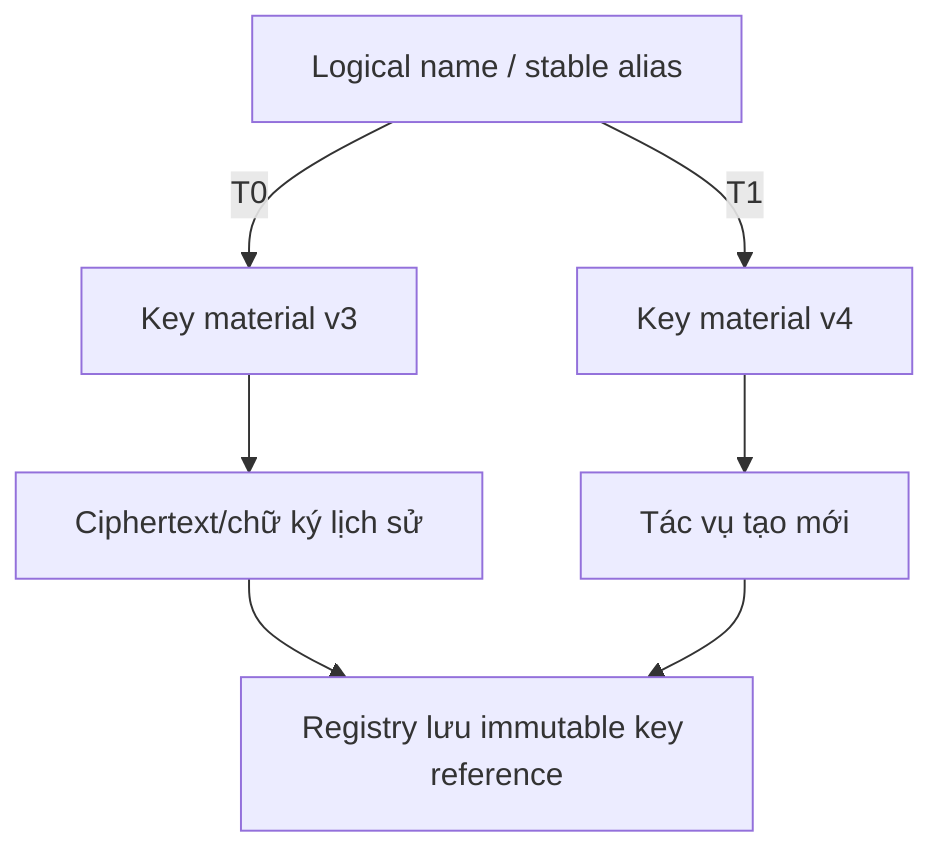
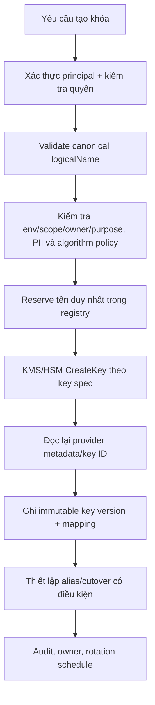
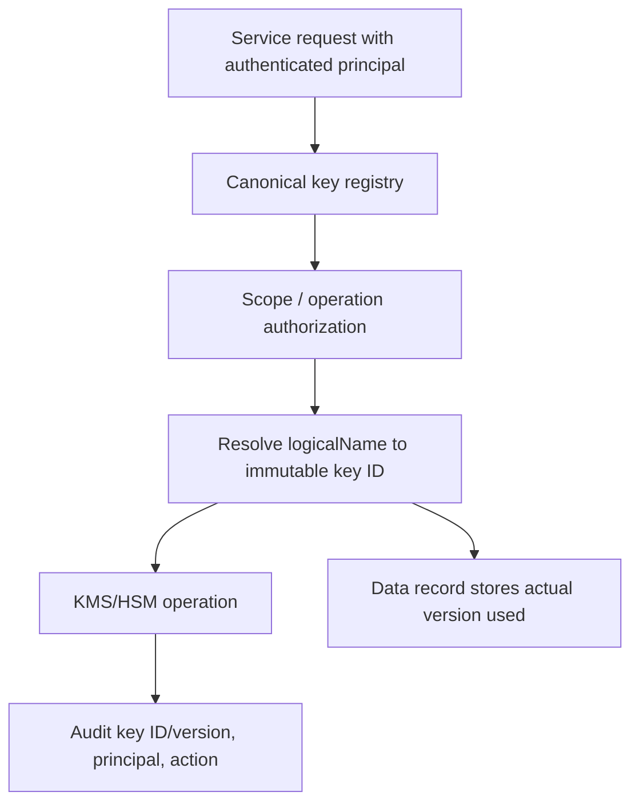

# Key naming policy: Quy ước đặt tên khóa mật mã có thể quản trị và kiểm toán

> **Chương:** Key policy  
> **Bài học:** Key naming policy  
> **Module:** `SECURITY_KEY_MANAGEMENT_FUNDAMENTALS` — hiểu và quản lý vòng đời khóa mật mã từ tạo, cấp phát, lưu trữ, sử dụng, xoay vòng, thu hồi đến hủy; kết nối AES/HMAC, mật mã bất đối xứng, chữ ký số, KMS/HSM, envelope encryption, IAM và audit.

## 1. Bài toán: Tên khóa không chỉ để dễ đọc

Giả sử một nền tảng có 40 microservice, ba môi trường `dev`, `stg`, `prod`, nhiều tenant, một KMS và một HSM. Danh sách tài nguyên chứa những tên:

```text
key1
key-final
prod-key
aes-secret
payments-new2
customer-john@example.com
backup-key-active
```

Khi cần xoay vòng khóa của `Payment Service`, đội vận hành khó biết:

- Khóa nào thuộc production và khóa nào là thử nghiệm?
- Khóa nào phục vụ **mã hóa dữ liệu**, khóa nào phục vụ **HMAC** hoặc **chữ ký số**?
- Tên `payments-new2` là **khóa mới**, **alias**, hay chỉ là nhãn tùy ý?
- Khi `prod-key` được trỏ sang khóa khác, ciphertext cũ dùng phiên bản nào?
- Ai có quyền `Sign`, `Decrypt`, `GenerateMac`, rotate hoặc disable?
- Các tên có tiết lộ email khách hàng, dữ liệu nhạy cảm hoặc cấu trúc nội bộ không?

**Key naming policy** là tập quy tắc đặt, chuẩn hóa, đăng ký, sử dụng và duy trì **định danh có ý nghĩa quản trị** cho khóa mật mã. Mục tiêu không chỉ để “tên đẹp” mà còn để:

1. Xác định **môi trường, ranh giới sử dụng, chủ sở hữu và mục đích**.
2. Tránh nhầm lẫn giữa các khóa hoặc các phiên bản khóa.
3. Hỗ trợ **key inventory**, rotation, incident response, audit và IaC.
4. Giảm nguy cơ dùng nhầm khóa của tenant, hệ thống hoặc nghiệp vụ khác.
5. Giữ tính truy vết khi alias thay đổi hoặc khóa bị vô hiệu hóa.
6. Tránh rò rỉ thông tin nhạy cảm qua tên, log, URL và metadata.

> **Nguyên tắc quan trọng:** Tên khóa hỗ trợ điều hướng và quản trị; **không tự tạo ra cơ chế xác thực, phân quyền hoặc bảo đảm mật mã**. Một alias đúng cú pháp không chứng minh bên gọi được quyền dùng khóa ấy.

### Mục tiêu học tập

Sau bài học, bạn có thể:

- Phân biệt **logical name**, **alias**, **immutable key ID**, **key version**, **key handle**, **JWK `kid`**, **fingerprint** và **resource reference**.
- Thiết kế grammar đặt tên có **scope, environment, owner và purpose** rõ ràng.
- Phân biệt tên ổn định với metadata có thể thay đổi và phiên bản khóa.
- Viết Java 17 để kiểm tra tên, phân tích cú pháp và phát hiện trùng.
- Thiết kế registry và luồng provisioning/rotation có tính nguyên tử.
- Tránh rủi ro **cross-tenant confusion**, alias hijacking, name reuse, wildcard IAM và rò rỉ thông tin.
- Gắn naming policy với vòng đời DEK/KEK, chữ ký số, HMAC, KMS/HSM và kiểm toán.

---

## 2. Trước hết phải phân biệt sáu loại định danh

Trong thực tế, từ “tên khóa” có thể chỉ nhiều thứ khác nhau.

| Khái niệm | Ý nghĩa | Có thể thay đổi? | Có phải raw key? |
|---|---|---|---|
| **Logical name** | Tên do tổ chức đặt để diễn đạt mục đích và phạm vi, ví dụ `k1/prod/shared/orders/enc/records`. | Thường giữ ổn định theo một ý định sử dụng; thay khi semantics thay. | Không. |
| **Alias** | Tham chiếu gián tiếp đến một khóa hoặc key version, ví dụ alias phục vụ ký mới. | **Có thể đổi đích** nếu nền tảng và policy cho phép. | Không. |
| **Immutable key ID** | ID cố định chỉ một khóa/vật liệu hoặc key object nhất định. | Không nên tái sử dụng cho key khác. | Không. |
| **Key version ID** | ID của một phiên bản vật liệu trong key hierarchy. | Không nên thay đổi ý nghĩa; lịch sử phải giữ được. | Không. |
| **Key handle / resource URI** | Tham chiếu do HSM/KMS/provider cấp cho một object. | Quy tắc phụ thuộc provider; thường là reference, không phải secret. | Không. |
| **Fingerprint / public key thumbprint** | Giá trị dẫn xuất từ dữ liệu khóa công khai để nhận dạng/đối chiếu. | Phụ thuộc đúng public key và cách canonicalize. | Không phải bằng chứng danh tính tự thân. |

**Không dùng các khái niệm này thay thế cho nhau.**

Ví dụ:

```text
logicalName : k1/prod/shared/orders/enc/order-records
alias       : alias/orders-data-active
keyId       : kms-key-7b3f...       (minh họa)
keyVersion  : version-004
algorithm   : AES-256
purpose     : WRAP_DATA_KEYS
```

Ở đây logical name biểu đạt mục đích sử dụng. Alias có thể được đổi sang phiên bản khóa mới. Nhưng **ciphertext cũ phải vẫn truy vết được immutable key ID/version đã thực sự bảo vệ DEK**, không chỉ alias hiện tại.

### 2.1. Logical name không nhất thiết là tên vật lý của KMS

Một nền tảng KMS có thể có giới hạn ký tự, độ dài, cấu trúc tài nguyên và khả năng đổi tên khác nhau. Vì vậy tổ chức nên phân biệt:

```text
Tên chuẩn cấp tổ chức:    k1/prod/shared/orders/wrap/order-deks
Provider-specific alias: alias/prod/orders/order-deks
Provider key resource:   URI/ID bất biến do nhà cung cấp cấp
```

Tên chuẩn là một **biểu diễn logic nội bộ**. Đừng giả định có thể gửi nguyên chuỗi chứa dấu `/` cho mọi HSM/KMS. Cần adapter/registry ánh xạ tên chuẩn đến locator thực tế được hỗ trợ.

### 2.2. Alias động và ID bất biến

Giả sử:

```text
T0: alias/orders-data -> immutableKeyId=key-v3
T1: alias/orders-data -> immutableKeyId=key-v4
```

Nếu record dữ liệu lịch sử chỉ lưu `alias/orders-data`, sau T1 hệ thống có thể cố mở ciphertext bằng `key-v4` mặc dù dữ liệu được bọc dưới `key-v3`.

Thiết kế tốt hơn:

```text
ciphertext record:
  dataKeyId      = dek-record-104
  wrappingKeyId  = key-v3
  wrappingVersion= material-version-3
  algorithm      = AES-GCM
  wrapMetadata   = ...
```

Alias có thể dùng để **chọn khóa cho thao tác tạo mới**. Các bản dữ liệu đã ký/mã hóa nên lưu **tham chiếu thực tế bất biến** cần để kiểm tra hoặc giải mã theo định dạng và cơ chế của hệ thống.

### 2.3. JWK `kid` chỉ là bộ chọn khóa

Một header JWT/JWS có thể chứa:

```json
{
  "alg": "EdDSA",
  "kid": "signing-2026-q4"
}
```

`kid` có thể giúp tìm public key để xác minh, nhưng giá trị này **do bên gửi cung cấp trong thông điệp cần kiểm tra**. Nó **không tự chứng minh** khóa ấy thuộc issuer hoặc thuộc một tenant hợp lệ.

Verifier phải cố định hoặc kiểm soát **issuer, audience, thuật toán được phép, trusted key set**, rồi chỉ dùng `kid` để chọn trong tập khóa đã tin cậy. Không biến `kid` thành đường dẫn file, URL fetch tùy ý hoặc tên KMS cho phép client tự chọn mọi khóa.

---

## 3. Mục tiêu của một naming policy tốt

### 3.1. Dễ nhận diện nhưng không tiết lộ bí mật

Một tên có thể cần thể hiện:

- Môi trường (`dev`, `stg`, `prod`).
- Ranh giới (`shared`, `tenant`).
- Chủ thể quản lý logic (`orders`, `identity`, `billing`).
- Mục đích (`enc`, `wrap`, `mac`, `sign`, `agree`).
- Đối tượng hoặc miền dữ liệu (`records`, `webhooks`, `invoices`).

Nhưng tên **không được chứa**:

- Password, passphrase, HMAC secret, raw DEK/KEK.
- Private key, seed, recovery code.
- Email, số điện thoại, mã căn cước, số tài khoản của khách hàng.
- Token đăng nhập hoặc mã khôi phục.
- Dữ liệu sức khỏe/tài chính/chi tiết bí mật khác không cần thiết.
- Thông tin phân loại nhạy cảm làm lộ mục tiêu tấn công khi không có yêu cầu.

**Dễ đọc** không đồng nghĩa **nhét mọi metadata vào tên**.

### 3.2. Dễ phân tách trust boundary

Các môi trường production và development không nên vô tình dùng chung khóa. Khi một tên bao gồm `prod` hoặc `dev`, đó là tín hiệu quản trị hữu ích; chính **IAM, account/project/partition và key policy** mới là lớp thực thi việc tách biệt.

Không chỉ dùng logic:

```java
if (keyName.contains("prod")) {
    // cho phép dùng key production
}
```

Một tên có thể do attacker cung cấp hoặc bị nhầm lẫn. **Danh tính được xác thực và resource policy** phải quyết định quyền.

### 3.3. Ổn định qua rotation

Tên logic nên ổn định cho **vai trò**. Ví dụ:

```text
k1/prod/shared/orders/wrap/order-deks
```

vẫn diễn đạt “khóa bọc DEK của dịch vụ đơn hàng” khi chuyển từ version `v3` sang `v4`.

Không đặt tên ổn định là:

```text
orders-aes256-key-v3-current-final
```

rồi sửa theo mỗi vòng rotation. Điều này làm cấu hình trở nên phụ thuộc vào phiên bản và dễ gây downtime, đồng thời chuỗi `current` và `v3` sớm mâu thuẫn.

### 3.4. Truy vết được lịch sử

Một key inventory cần trả lời:

- Tên logic nào đang active?
- Alias trỏ tới key ID/version nào?
- Bản mã, chữ ký hoặc thông điệp nào đang phụ thuộc bản cũ?
- Lần đổi alias gần nhất do ai phê duyệt?
- Tại thời điểm một sự cố, alias đang chỉ đến khóa nào?

Tên phải gắn với **registry có lịch sử**, không phải là chuỗi được tính lại từ cấu hình hiện tại rồi áp cho mọi dữ liệu cũ.

### 3.5. Có grammar, validation và ownership rõ ràng

Không nên để mỗi team tự nghĩ ra 10 cấu trúc khác nhau:

```text
prod-order-key
Orders_PROD_AES
key/order/data
customer-key-2026-final
prd_k_orders
```

Cần có một **chuẩn cú pháp/version** và quy tắc đăng ký tên rõ ràng. Chính sách này phải áp dụng tại lúc tạo tài nguyên (provisioning), không chỉ tại lúc xuất báo cáo audit.

---

## 4. Đề xuất grammar tên logic

Ta chọn một quy ước **mang tính minh họa** cho tổ chức:

```text
k1/<environment>/<scope>/<owner>/<purpose>/<resource>
```

Giải thích:

| Phần | Ý nghĩa | Ví dụ |
|---|---|---|
| `k1` | Phiên bản **naming schema**, không phải key material version. | `k1` |
| `environment` | Môi trường triển khai/trust boundary. | `dev`, `stg`, `prod` |
| `scope` | Loại phạm vi áp dụng. | `shared`, `tenant` |
| `owner` | Workload/domain hoặc opaque tenant identifier theo scope. | `orders`, `identity`, `tnt-8f3a` |
| `purpose` | Loại hành động mật mã được cho phép theo chính sách. | `enc`, `wrap`, `mac`, `sign`, `agree` |
| `resource` | Phân biệt nhóm đối tượng/luồng dữ liệu theo mục đích. | `records`, `webhooks`, `invoices` |

Ví dụ:

```text
k1/prod/shared/orders/enc/order-records
k1/prod/shared/orders/wrap/order-deks
k1/prod/shared/billing/mac/partner-webhooks
k1/prod/shared/identity/sign/service-tokens
k1/prod/shared/edge/agree/tls-sessions
k1/stg/shared/orders/enc/order-records
k1/prod/tenant/tnt-8f3a/enc/documents
```

**Đây là tên logic, không phải cú pháp có hiệu lực trong mọi API KMS.** Provider-specific mapping sẽ quyết định alias/handle thực tế.

### 4.1. Quy tắc ký tự

Để giảm nhầm lẫn giữa runtime, shell, YAML, URL, SQL, IAM và registry, ví dụ quy định:

- Chỉ dùng chữ thường ASCII `a-z`, chữ số `0-9`, dấu gạch ngang `-`.
- Các segment cách nhau bởi dấu `/` ở cấp schema logic.
- Segment không rỗng, bắt đầu bằng chữ hoặc số.
- Không có khoảng trắng, dấu gạch dưới, dấu chấm, `..`, ký tự điều khiển.
- Không Unicode để tránh chuỗi nhìn giống nhau (*homoglyph*) hoặc normalization không nhất quán.
- Cố định độ dài tối đa mỗi segment và toàn bộ tên theo hệ thống; trong ví dụ các segment linh hoạt dài không quá 32 ký tự.
- Phân biệt chữ hoa/chữ thường bằng **kiểm tra canonical form**, không âm thầm chuyển tên tùy ý thành chữ thường.

Một biểu thức gần đúng cho các segment tự do:

```regex
[a-z0-9](?:[a-z0-9-]{0,30}[a-z0-9])?
```

Regex chỉ kiểm tra **cú pháp**. Nó không xác nhận tên thuộc tenant đúng, mục đích đúng hoặc có chứa thông tin nhạy cảm không. Cần validation nghiệp vụ và registry.

### 4.2. `k1` là phiên bản quy ước, không phải `keyVersion`

Giả sử:

```text
logicalName = k1/prod/shared/orders/wrap/order-deks
schemaVersion = k1
keyId = immutable-kms-id-27...
materialVersion = 5
```

Ở đây:

- `k1` mô tả **quy cách đặt tên**.
- `materialVersion=5` mô tả **vật liệu khóa thực tế**.
- `keyId` mô tả **đối tượng khóa cụ thể** do hệ quản lý khóa cấp.
- `alias` có thể ánh xạ logicalName tới một key/version active.

Khi policy grammar nâng lên `k2`, không có nghĩa mọi DEK cần xoay vòng ngay. Việc migrate tên và migrate vật liệu khóa là **hai việc khác nhau**, dù có thể phối hợp.

### 4.3. Có đưa tên thuật toán hoặc key length vào logical name không?

**Không nhất thiết, và với alias ổn định thường nên tránh.**

Ví dụ:

```text
k1/prod/shared/orders/enc/order-records
```

cho biết mục đích nhưng không cứng hóa `AES-256` trong tên. `algorithm`, `keyLengthBits`, `mode`, `parameterSet` nên nằm trong **metadata được kiểm chứng**.

Lý do:

1. Có thể migrate từ một cơ chế/parameter set sang cơ chế khác theo policy.
2. Một alias có thể trỏ sang key material mới với size phù hợp hơn.
3. Thuật toán và mode là thông tin có tính kỹ thuật cần lấy từ nguồn tin cậy.
4. Chuỗi tên `aes256` có thể bị nhập nhằng khi khóa thực tế được thay đổi.

Nếu một **trust boundary hoặc protocol** bắt buộc tên phân biệt hai lớp thuật toán chạy song song, có thể thêm segment/label được quản trị rõ ràng. Quyết định đó cần thiết kế riêng để tránh hiểu lầm rằng alias mang tính bất biến.

### 4.4. Có đưa region/account vào tên không?

Có thể, nếu chúng là một phần thực sự của **namespace uniqueness**. Nhưng cần cân nhắc:

- KMS resource URI đã có project/account/region chưa?
- Tên có phải portable giữa vùng DR không?
- Region có thể thay đổi mà vai trò khóa không đổi không?
- Việc trùng tên giữa region có được phép hay không?
- Có cần phân tách key material theo region vì residency hoặc policy?

Một phương án là lưu `environment`, `region`, `account/project`, `tenant` ở **registry columns riêng**, và đặt unique constraint trên namespace đầy đủ. Đừng sao chép tất cả vào chuỗi logic nếu tạo ra tên quá dài, khó migrate.

---

## 5. Danh mục purpose phải gắn với hành vi mật mã

Trong `purpose` có thể dùng code ngắn để ổn định cấu trúc, nhưng **mỗi code phải có định nghĩa rõ**.

| Purpose | Ý nghĩa đề xuất | Thuật toán/khóa thường dùng | Không nên nhầm với |
|---|---|---|---|
| `enc` | Mã hóa dữ liệu ứng dụng. | AES-GCM DEK hoặc key dùng mã hóa trực tiếp theo policy. | Ký số và HMAC. |
| `wrap` | Bọc/giải bọc các DEK. | KEK trong KMS/HSM. | DEK đang mã hóa nội dung. |
| `mac` | Tạo/xác minh MAC. | HMAC-SHA-256 key. | Chữ ký có thể verify công khai. |
| `sign` | Ký và/hoặc xác minh chữ ký số. | Ed25519, ECDSA, RSA-PSS. | AES decrypt hoặc RSA-OAEP transport. |
| `agree` | Thỏa thuận/thiết lập khóa với peer. | X25519/ECDH hoặc cơ chế được chọn. | Chữ ký số nếu key role khác. |

Trong production, cần thêm những nhóm được chính sách phê duyệt, ví dụ `transport`, `auth`, `derive`, hoặc phân loại theo **allowed operations** thay vì một từ duy nhất. Ví dụ key thuộc `sign` có thể có:

```text
allowedOperations = [SIGN]
verificationPublicKeyOperations = [VERIFY]
```

Còn một key `wrap` có thể cho phép KMS thao tác `Encrypt`, `Decrypt`, `ReEncrypt`, nhưng **chỉ đối với bọc DEK** theo chính sách ứng dụng, không phải tùy ý giải mã dữ liệu của tenant.

### 5.1. Tên không quyết định thuật toán

`sign` chỉ là mục đích. Muốn biết khóa thực tế là RSA-PSS hay Ed25519, inventory phải có:

```text
algorithm = Ed25519
parameterSet = Ed25519
keyPurpose = DIGITAL_SIGNATURE
signaturePolicy = ...
```

Tương tự, `enc` chưa chứng minh ciphertext có AEAD, nonce/AAD đúng hay không. **Naming policy không thay thế cryptographic policy.**

### 5.2. Đặt tên cho DEK và KEK riêng

Ví dụ:

```text
k1/prod/shared/orders/enc/order-records     # logical group for DEKs
k1/prod/shared/orders/wrap/order-deks       # KEK for wrapping DEKs
```

Trong inventory có thể ghi:

```text
DEK:  keyId=dek-916, logicalName=.../enc/order-records
KEK:  keyId=kek-33, logicalName=.../wrap/order-deks
Relation: dek-916 wrappedBy kek-33 version=5
```

Nếu xoay vòng KEK, chỉ thay wrapper của DEK khi được phép; **không tự động thay DEK**. Nếu raw DEK bị lộ, phải xem xét sinh DEK mới và mã hóa lại dữ liệu, chứ không dùng thủ thuật đổi tên hoặc rewrap để tuyên bố đã an toàn.

---

## 6. Naming policy và key inventory phải đi cùng nhau

Một tên logic có nghĩa chỉ khi registry giữ được **quan hệ giữa các tên, khóa thực tế và trạng thái lịch sử**.

### 6.1. Schema metadata khuyến nghị

| Field | Ví dụ | Cần bảo đảm |
|---|---|---|
| `logicalName` | `k1/prod/shared/orders/enc/order-records` | Canonical, unique trong namespace được chọn. |
| `namingSchemaVersion` | `k1` | Không nhầm với material key version. |
| `environment` | `prod` | Được lấy từ tenant/project/workload context tin cậy. |
| `scope` | `shared` | Ranh giới sở hữu khóa. |
| `ownerId` | `orders-team` | Có owner và người phê duyệt. |
| `tenantId` | Opaque identifier hoặc `null` | Không dùng email/PII; bind với tenant thật. |
| `purpose` | `enc` | Gắn với allowed operations. |
| `algorithm` | `AES` | Được đọc/xác minh từ KMS/HSM/source thực. |
| `keyLengthBits` | `256` | Có đơn vị và length kind phù hợp. |
| `keyId` | Immutable KMS/HSM ID | Không tái sử dụng để chỉ key khác. |
| `keyVersion` | `version-5` | Ghi phiên bản vật liệu thực tế. |
| `providerRef` | KMS resource path/handle | Không coi alias động là version bất biến. |
| `alias` | Alias phục vụ active key | Có lịch sử thay đổi đích. |
| `keyState` | `ACTIVE`/`DISABLED` | Không lưu trạng thái bằng cách đổi tên. |
| `origin` | `HSM_GENERATED` | Nguồn tạo/nhập khóa. |
| `exportPolicy` | `NON_EXPORTABLE` | Được thực thi bởi provider/IAM. |
| `createdAt`, `rotateBy` | ISO 8601 UTC | Thông tin vòng đời riêng. |
| `policyVersion` | `key-policy-2026-v1` | Có thể audit chính sách lúc tạo/đổi. |
| `lastVerifiedAt` | ISO 8601 UTC | Bằng chứng đối soát metadata. |

### 6.2. Ví dụ bản ghi JSON

```json
{
  "logicalName": "k1/prod/shared/orders/wrap/order-deks",
  "namingSchemaVersion": "k1",
  "environment": "prod",
  "scope": "shared",
  "ownerId": "orders-team",
  "tenantId": null,
  "purpose": "wrap",
  "algorithm": "AES",
  "keyLengthBits": 256,
  "keyId": "kms-immutable-key-074",
  "keyVersion": "material-v5",
  "providerRef": "kms://example/key/074",
  "alias": "alias/orders-data-active",
  "keyState": "ACTIVE",
  "origin": "KMS_GENERATED",
  "exportPolicy": "NON_EXPORTABLE",
  "createdAt": "2026-04-01T00:00:00Z",
  "rotateBy": "2027-04-01T00:00:00Z",
  "policyVersion": "key-policy-example-v1"
}
```

Đây chỉ là **dữ liệu minh họa**, không phải format API của một nhà cung cấp cụ thể.

### 6.3. Không đặt trạng thái trong tên

Các tên sau dễ gây rối:

```text
orders-key-active
orders-key-old
orders-key-new
orders-key-final
orders-key-retired
```

Khi rotation xảy ra, “new” và “old” thay nghĩa. Một key version đang `DISABLED` có thể vẫn được giữ để verify lịch sử, và tên “old” không cho biết policy hiện tại.

**Đúng:** trạng thái ở `keyState`, `allowedOperations`, `activeFrom`, `disableAt`, `destroyAfter` hoặc event log; tên mô tả **chức năng ổn định**.

### 6.4. Tên không phải credential

Đừng dùng logical name làm secret hoặc làm điều kiện duy nhất để truy cập:

```text
Nếu biết "k1/prod/shared/payments/sign/receipts"
thì không có nghĩa được phép gọi Sign.
```

Tương tự, một tên chứa `prod` không cung cấp bảo đảm rằng request đã thực sự đến production. Authentication + authorization + môi trường của hạ tầng là nguồn sự thật.

---

## 7. Quy tắc unique name và chống nhầm tenant

### 7.1. Phạm vi uniqueness phải được khai báo

Một chuỗi tên có thể trùng giữa hai provider/account. Cần quyết định uniqueness là:

```text
global toàn tổ chức?
theo environment?
theo cloud account/project?
theo region?
theo tenant?
theo provider?
```

Ví dụ registry dùng khóa duy nhất khái niệm:

```sql
UNIQUE (organization_id, environment, scope, logical_name)
```

Nếu `logical_name` đã chứa environment và scope, cột lặp vẫn có thể hữu ích để **đối chiếu tính nhất quán**, nhưng đừng cho phép hai trường mâu thuẫn.

### 7.2. Opaque tenant identifier

Không nên đặt:

```text
k1/prod/tenant/nguyen.van.a@gmail.com/enc/documents
```

Thay vào đó, dùng định danh tenant **không trực tiếp chứa PII**:

```text
k1/prod/tenant/tnt-8f3a/enc/documents
```

` tnt-8f3a ` chỉ là ví dụ chuỗi. Trong thực tế phải dùng định danh **đủ duy nhất và do registry quản lý**. Opaque ID vẫn có thể là dữ liệu liên kết được với người dùng hoặc doanh nghiệp, vì vậy nó **không tự ẩn danh tuyệt đối**; quyền đọc inventory vẫn phải được kiểm soát.

### 7.3. Tenant confusion / confused deputy

Giả sử client gửi:

```json
{
  "tenantId": "tenant-b",
  "keyName": "k1/prod/tenant/tenant-b/enc/documents"
}
```

Server đang xác thực principal của `tenant-a` nhưng lại dùng ngay keyName do client gửi. Khi đó dù keyName đúng cú pháp, server có thể **truy cập khóa của tenant khác** nếu IAM quá rộng.

Cách xử lý:

1. Xác thực principal và xác định tenant được cấp quyền **từ nguồn tin cậy**.
2. Server tự xây hoặc resolve logical name theo tenant đã được xác thực.
3. Kiểm tra ownership/allowed operations trong registry và chính sách KMS.
4. Chỉ sau đó mới thực hiện encrypt/decrypt/wrap/sign.
5. Audit principal, tenant, logicalName, immutable key ID và kết quả.

**Không để input của attacker trực tiếp chọn provider key object có quyền cao hơn phạm vi của họ.**

### 7.4. Tái sử dụng tên cũ có nguy cơ gì?

Nếu một key bị xóa và tên cũ được cấp ngay cho khóa hoàn toàn khác, các cấu hình cache, ciphertext cũ, audit hoặc backup có thể trỏ sai.

Có thể dùng **tombstone/reservation**:

```text
logicalName = k1/prod/shared/orders/wrap/order-deks
state = RETIRED
reservedUntil = theo chính sách lưu giữ
```

Chỉ cho phép sử dụng lại khi có quyết định phù hợp, và không bao giờ dùng lại **immutable key ID** cho key material khác. Với các hệ thống cần bảo đảm mạnh, có thể không tái sử dụng logical name đã gắn với mục đích nhạy cảm.

---

## 8. Alias và rotation: giữ tên ổn định nhưng lịch sử phải chính xác

### 8.1. Sơ đồ thay alias



Sơ đồ minh họa sự chuyển đích theo thời gian, **không có nghĩa một alias đồng thời trỏ hai khóa**. Hệ thống ghi audit từng lần thay đích và giữ liên kết lịch sử.

### 8.2. Quy trình rotation khuyến nghị

1. Registry xác định logicalName, active key ID/version, owner và phụ thuộc.
2. Phê duyệt rotation dựa trên policy và rủi ro.
3. Tạo key mới bằng KMS/HSM hoặc quy trình đã được kiểm soát.
4. Xác minh algorithm, purpose, key length, key origin và allowed operations.
5. Thêm **bản ghi key version bất biến** cho khóa mới.
6. Kiểm thử key operation trên môi trường/test data được phép.
7. Chuyển alias/active pointer một cách **có điều kiện và được kiểm toán**.
8. Bảo đảm ứng dụng dùng bản mới cho thao tác **tạo mới**.
9. Giữ hoặc migrate những ciphertext/chữ ký lịch sử theo cơ chế thực tế.
10. Chặn các thao tác không còn cho phép với key cũ; chỉ hủy khi dependencies và retention đã xử lý.

### 8.3. Đừng coi đổi alias là re-encrypt

Ví dụ:

```text
alias/orders-wrap -> KEK-v3
alias/orders-wrap -> KEK-v4
```

Điều này **chưa chứng minh** các DEK đã được bọc lại dưới `KEK-v4`, và hoàn toàn **không chứng minh** dữ liệu mã hóa bằng DEK đã đổi thuật toán hoặc key size.

Cần phân biệt:

- **Alias cutover:** chuyển tên logic sang đích mới.
- **DEK rewrap:** mở DEK bằng KEK cũ rồi bọc dưới KEK mới.
- **DEK rotation:** tạo DEK mới.
- **Data re-encryption:** giải mã và mã hóa lại payload dưới DEK mới.
- **Signing-key rotation:** phát hành public key/chứng thư mới và giữ khả năng verify chữ ký cũ.

Mỗi hành động phải được thể hiện bằng event và dependency metadata, không được đánh đồng với thay chuỗi tên.

### 8.4. Alias cutover cần nguyên tử

Nếu hai pipeline cùng tạo key cho một logicalName, cần khóa đăng ký hoặc conditional update:

```text
EXPECTED: active key = v3
UPDATE:   active key = v4
REJECT:   nếu active key đã là v5 hoặc registry version đổi
```

Tránh trường hợp pipeline A và B cùng cho rằng mình đã activate bản mới, làm hệ thống nhiều khu vực dùng khóa khác nhau không theo kế hoạch.

### 8.5. Hủy khóa cũ và chứng cứ dài hạn

Trong chữ ký số, public key/chứng thư lịch sử vẫn có thể cần để xác minh. Trong mã hóa, private/secret key cũ có thể cần để giải mã bản backup chưa migrate.

Naming policy phải cho phép các bản bất biến cùng tồn tại và có trạng thái độc lập:

```text
logicalName -> activeVersion = v4
v3 -> allowedOperations = [VERIFY_HISTORICAL] (nếu áp dụng)
v4 -> allowedOperations = [SIGN_NEW, VERIFY]
```

Điều này chỉ là ví dụ. Không tự dùng một signing key cũ để decrypt, và không cấp quyền verify lịch sử thành quyền sign mới.

---

## 9. Key naming policy không thể thay IAM

### 9.1. Authorization nên dựa vào tài nguyên và danh tính đáng tin

Một hệ thống có tên đẹp nhưng IAM quá rộng vẫn nguy hiểm:

```text
Allow principal "any-service" to use Sign/Decrypt for "k1/prod/*"
```

Cần giảm quyền theo:

- Principal/workload identity thực tế.
- Environment/account/project, tenant và region khi phù hợp.
- Immutable key ID hoặc key resource đã được registry xác nhận.
- Operation (`Sign`, `Verify`, `GenerateMac`, `Encrypt`, `Decrypt`, `ReEncrypt`, `ScheduleDeletion`).
- Context/conditions do provider hỗ trợ và được cấu hình an toàn.
- Approval và separation of duties cho hoạt động quản trị.

Không dùng wildcard trong tên như bằng chứng tự động rằng mọi tài nguyên tương ứng đều được phép truy cập.

### 9.2. Rủi ro alias hijacking

Nếu người có quyền sửa alias nhưng không có quyền ký lại có thể trỏ alias ký số tới khóa khác, họ có thể gây nhầm danh tính hoặc gián đoạn dịch vụ.

Vì thế quyền **tạo alias**, **đổi alias**, **xóa alias** và **gọi thao tác mật mã** phải được phân tách theo mô hình đe dọa.

Một khóa ký đáng tin không chỉ có tên:

```text
k1/prod/shared/identity/sign/tokens
```

mà cần mapping **issuer → public key/certificate → immutable key ID**, policy ký và audit. Verifier không được tin alias động do request tự khai để xác định bên ký.

### 9.3. Encryption context và AAD

Với AEAD hoặc KMS encryption context, có thể ràng buộc metadata như:

```text
tenantId
purpose
objectId
algorithmVersion
```

Các giá trị này phải được xây từ **ngữ cảnh đã được xác thực/ủy quyền**, và phải đúng quy tắc canonicalization.

**Tên khóa không tự thay thế AAD.** Việc đưa một logicalName vào AAD có thể giúp domain separation theo một giao thức, nhưng phải cân nhắc việc **rename/alias migration**: nếu AAD gắn với tên có thể đổi, một thay đổi tên không kiểm soát có thể làm bản mã không giải mã được. Các định danh bất biến và object context đáng tin thường phù hợp hơn để bảo vệ dữ liệu lịch sử.

### 9.4. Không dùng alias làm nguồn xác thực danh tính

Một header có:

```text
X-Key-Alias: k1/prod/shared/payments/sign/receipts
```

chỉ là dữ liệu phía gửi tuyên bố. Server không thể kết luận request do `Payment Service` gửi chỉ từ header này. Phải xác minh chữ ký, public key/trust registry, freshness và authorization.

---

## 10. Tương thích nhiều KMS/HSM và giới hạn provider

### 10.1. Tách canonical name khỏi provider locator

Một tổ chức có thể hoạt động trên nhiều hệ:

```text
Canonical logical name:
    k1/prod/shared/orders/wrap/order-deks

Provider A resource:
    providerA://.../key/immutable-123

Provider B key version:
    providerB://.../cryptoKeys/orders/cryptoKeyVersions/7

HSM object:
    partition-id + object handle + key label
```

Tên và locator phía trên là **minh họa khái niệm**; mỗi nhà cung cấp có cú pháp/API thật riêng.

Adapter phải đảm bảo:

- Không mất ý nghĩa owner/tenant/purpose.
- Không truncate âm thầm khiến hai tên khác nhau thành một.
- Không thay `/` hoặc `-` theo cách gây collision.
- Không chuyển chữ hoa/thường bất nhất.
- Không để kẻ tấn công đưa raw URL hoặc locator ngoài allowlist.
- Có thể truy vấn metadata key length/algorithm từ provider mà không export private/secret key.

### 10.2. Provider có thể không cho đổi tên

Một HSM/KMS object có thể có label, alias hoặc resource name với các quy tắc khác nhau. Không phải đối tượng nào cũng rename in-place được.

Nếu cần đổi quy ước, có thể:

1. Tạo logical name mới ở registry.
2. Liên kết đến immutable key ID đang tồn tại **khi policy cho phép**.
3. Chuyển client/config qua logical name mới theo kế hoạch.
4. Giữ alias cũ có thời hạn hoặc tombstone; ghi audit.
5. Không thay đổi key material chỉ vì đổi display name.
6. Kiểm tra ciphertext/chữ ký và dữ liệu backup trước khi xóa locator cũ.

### 10.3. Tránh phụ thuộc provider prefix không portable

Một hệ thống có thể hỗ trợ alias bắt đầu bằng `alias/`, hệ thống khác dùng key name gắn với project/location, và HSM dùng slot/object handle.

Do đó ví dụ trong tài liệu này dùng `k1/...` như **namespace logic**, không khẳng định đó là chuỗi có thể dùng trực tiếp trong bất kỳ KMS cụ thể nào.

### 10.4. BYOK, import và khóa ngoài hệ thống

Với **BYOK (Bring Your Own Key)** hoặc imported keys, logicalName không chứng minh:

- Khóa đã được sinh từ nguồn entropy phù hợp.
- Độ dài/algorithm được xác minh.
- Có bao nhiêu bản sao key ở hệ thống bên ngoài.
- Raw private/secret key có bị lộ.
- Đã hoàn tất thủ tục xác minh ownership/ủy quyền.

Registry cần lưu `origin`, `importEventId`, `algorithm`, `keySpec`, `exportPolicy` và bằng chứng đối soát từ nguồn tin cậy. Không giả định tất cả key có tên hợp lệ đều có cùng mức bảo vệ.

---

## 11. Java 17: Validator và parser cho logical key name

Ví dụ sau tạo một **quy tắc đặt tên logic minh họa**:

```text
k1/<env>/<scope>/<owner>/<purpose>/<resource>
```

Hàm xử lý:

- Chỉ chấp nhận môi trường `dev`, `stg`, `prod`.
- Chỉ chấp nhận phạm vi `shared`, `tenant`.
- Chỉ chấp nhận purpose `enc`, `wrap`, `mac`, `sign`, `agree`.
- Cấm chuỗi tự do chứa dấu cách, ký tự Unicode, dấu chấm, slash nội bộ hoặc vượt độ dài.
- Kiểm tra cấu trúc **đúng 6 segment**.
- Giữ tên ở dạng chuẩn; không tự động sửa input không hợp lệ.
- Sử dụng registry minh họa để minh chứng uniqueness; không lưu key material.

**Code không thể tự phát hiện mọi PII hoặc xác thực tenant ownership.** Cần review dữ liệu đầu vào, policy và authorization ở cấp ứng dụng.

```java
import java.util.Locale;
import java.util.Map;
import java.util.Set;
import java.util.UUID;
import java.util.concurrent.ConcurrentHashMap;
import java.util.regex.Pattern;

public final class KeyNamingPolicyDemo {
    private static final String PREFIX = "k1";
    private static final Pattern SEGMENT =
            Pattern.compile("[a-z0-9](?:[a-z0-9-]{0,30}[a-z0-9])?");
    private static final Set<String> ENVS =
            Set.of("dev", "stg", "prod");
    private static final Set<String> SCOPES =
            Set.of("shared", "tenant");
    private static final Set<String> PURPOSES =
            Set.of("enc", "wrap", "mac", "sign", "agree");

    private KeyNamingPolicyDemo() {}

    public record KeyName(
            String env,
            String scope,
            String owner,
            String purpose,
            String resource) {

        public KeyName {
            requireAllowed(env, ENVS, "env");
            requireAllowed(scope, SCOPES, "scope");
            requireSegment(owner, "owner");
            requireAllowed(purpose, PURPOSES, "purpose");
            requireSegment(resource, "resource");

            if (scope.equals("tenant") && !owner.startsWith("tnt-")) {
                throw new IllegalArgumentException(
                        "Tenant scope requires opaque tenant ID");
            }
            if (scope.equals("shared") && owner.startsWith("tnt-")) {
                throw new IllegalArgumentException(
                        "Shared scope must use workload/domain owner");
            }
        }

        public String canonical() {
            return String.join(
                    "/", PREFIX, env, scope, owner, purpose, resource);
        }

        public static KeyName parse(String input) {
            if (input == null || input.length() > 200) {
                throw new IllegalArgumentException("Invalid name length");
            }
            String[] fields = input.split("/", -1);
            if (fields.length != 6 || !PREFIX.equals(fields[0])) {
                throw new IllegalArgumentException(
                        "Expected k1/env/scope/owner/purpose/resource");
            }
            KeyName name = new KeyName(
                    fields[1], fields[2], fields[3],
                    fields[4], fields[5]);
            if (!name.canonical().equals(input)) {
                throw new IllegalArgumentException(
                        "Noncanonical key name");
            }
            return name;
        }
    }

    private static void requireAllowed(
            String s, Set<String> allowed, String field) {
        requireSegment(s, field);
        if (!allowed.contains(s)) {
            throw new IllegalArgumentException(
                    "Unsupported " + field);
        }
    }

    private static void requireSegment(String s, String field) {
        if (s == null || !SEGMENT.matcher(s).matches()) {
            throw new IllegalArgumentException(
                    "Invalid " + field);
        }
    }

    // Registry minh họa: key ID này là ID metadata, KHÔNG phải raw key.
    public static final class KeyNameRegistry {
        private final Map<String, UUID> ids =
                new ConcurrentHashMap<>();

        public UUID reserve(KeyName keyName) {
            UUID candidate = UUID.randomUUID();
            UUID old = ids.putIfAbsent(
                    keyName.canonical(), candidate);
            if (old != null) {
                throw new IllegalStateException(
                        "Logical key name already reserved");
            }
            return candidate;
        }

        public UUID lookup(KeyName keyName) {
            return ids.get(keyName.canonical());
        }
    }

    public static void main(String[] args) {
        KeyNameRegistry registry = new KeyNameRegistry();

        KeyName enc = KeyName.parse(
                "k1/prod/shared/orders/enc/order-records");
        KeyName wrap = KeyName.parse(
                "k1/prod/shared/orders/wrap/order-deks");

        registry.reserve(enc);
        registry.reserve(wrap);
        System.out.println("Valid ENC: " + enc.canonical());
        System.out.println("Valid WRAP: " + wrap.canonical());
        System.out.println("ENC registered: "
                + (registry.lookup(enc) != null));

        try {
            KeyName.parse("k1/prod/shared/orders/ENC/order-records");
            throw new IllegalStateException(
                    "Uppercase should be rejected");
        } catch (IllegalArgumentException expected) {
            System.out.println("Uppercase rejected: true");
        }

        try {
            registry.reserve(enc);
            throw new IllegalStateException(
                    "Duplicate should be rejected");
        } catch (IllegalStateException expected) {
            System.out.println("Duplicate rejected: true");
        }
    }
}
```

### 11.1. Kết quả kỳ vọng

```text
Valid ENC: k1/prod/shared/orders/enc/order-records
Valid WRAP: k1/prod/shared/orders/wrap/order-deks
ENC registered: true
Uppercase rejected: true
Duplicate rejected: true
```

Kết quả trên là **kỳ vọng theo logic ví dụ**, không phải tuyên bố đã biên dịch hoặc chạy thử trên mọi JDK.

### 11.2. Vì sao không tự `toLowerCase()`?

Nếu server âm thầm sửa:

```text
K1/PROD/Shared/Orders/ENC/Records
```

thành một tên khác, các hệ thống có thể ghi audit input và canonical ID không nhất quán. Đối với **tên định danh bảo mật**, chấp nhận duy nhất canonical form rõ ràng thường dễ audit hơn.

`Locale` được import trong ví dụ chỉ để minh họa rằng **không cần chuyển chữ hoa/thường theo locale**; khi dùng thực tế có thể bỏ import không sử dụng. Điều quan trọng là **từ chối input không đúng chuẩn**, không âm thầm “sửa” định danh khóa.

### 11.3. Vì sao `UUID.randomUUID()` ở registry không phải DEK?

`UUID` trong ví dụ chỉ được dùng như **định danh metadata** giả lập. Nó **không được dùng làm AES key, HMAC key hoặc recovery secret**. Khi sinh vật liệu khóa mật mã, phải dùng **`KeyGenerator`, `SecureRandom` được cấu hình an toàn hoặc API KMS/HSM** theo algorithm/purpose.

Một key registry production phải lấy **immutable key ID thật của KMS/HSM**, ghi mapping đầy đủ và dùng transaction/persistence. Không thay KMS key ID bằng UUID nội bộ mà không lưu quan hệ giữa chúng.

### 11.4. Hạn chế của demo

- Registry chỉ ở RAM; không có distributed uniqueness, HA, backup, migration, event sourcing hay concurrency giao dịch nhiều service.
- Scope `tenant` được kiểm tra prefix, **chưa xác minh tenant ID thuộc người gọi**.
- Regex không phát hiện PII gián tiếp hoặc tên tiết lộ business sensitivity.
- Không kiểm tra provider-specific reserved words, max length hay normalize adapter.
- Không có KMS metadata, allowed operations, lifecycle, key versions và alias pointer.
- Không có tenant/workload authentication, authorization, approval hoặc audit.
- Không dùng `UUID.randomUUID()` làm vật liệu khóa.
- Chưa có kiểm soát idempotency của API `CreateKey` và tình huống retry sau timeout.

Đây là **bài học về naming policy**, không phải hệ thống KMS hoặc IAM hoàn chỉnh.

---

## 12. Đăng ký tên trong provisioning workflow

### 12.1. Lược đồ luồng chuẩn



Lưu ý: không có giao dịch nguyên tử mặc định **xuyên KMS và database**. Nếu quá trình tạo key thành công ở KMS nhưng ghi registry thất bại, cần một state machine có thể reconcile thay vì tạo key liên tục mỗi lần retry.

### 12.2. State machine provisioning

Ví dụ:

```text
REQUESTED
  -> NAME_RESERVED
  -> KEY_CREATED
  -> METADATA_VERIFIED
  -> ACTIVE
```

Khi có lỗi:

```text
NAME_RESERVED -> FAILED_RETRYABLE
KEY_CREATED   -> RECONCILE_REQUIRED
```

Cần lưu provider operation ID/resource ID và dùng **idempotency token** nếu API hỗ trợ. Một tác vụ có thể tạo key mới thành công nhưng response bị mất; retry mù quáng có thể tạo thêm key ngoài inventory.

### 12.3. Phê duyệt tên và mục đích

Không chỉ kiểm tra regex. Người có quyền tạo key cho `dev` không đương nhiên được đăng ký:

```text
k1/prod/shared/payments/sign/settlement
```

Để tạo tên này phải có:

- Environment được phép.
- Owner phù hợp.
- Mục đích ký số phù hợp với vai trò workload.
- Thuật toán/size do policy phê duyệt.
- Định danh người chịu trách nhiệm và thời hạn rotation.
- Phê duyệt hoặc separation of duties khi cần.
- Kế hoạch thu hồi và lưu chứng cứ nếu đây là signing key.

### 12.4. IaC và GitOps

Một khai báo infrastructure-as-code có thể chứa:

```yaml
logicalName: k1/prod/shared/orders/wrap/order-deks
requestedPurpose: wrap
requestedAlgorithm: AES
requestedKeyBits: 256
owner: orders-team
rotationPolicyRef: key-rotation-standard
```

**Không chứa raw key material** trong IaC. Pipeline phải xác minh metadata thực tế sau provision, kiểm tra drift và không tự replace key chỉ vì label thay đổi.

Quản lý `imported key material`, BYOK và lifecycle delete phải có approval/runbook riêng. Việc thay key có thể ảnh hưởng ciphertext backup mà Terraform/CI không nhìn thấy.

---

## 13. Phát hiện name collision và drift

### 13.1. Những kiểu collision hay gặp

- Hai team đăng ký cùng logicalName.
- Hệ thống chuyển tên sang chữ thường và làm hai tên nhập thành một.
- Adapter tự cắt chuỗi vì provider giới hạn độ dài.
- Bỏ dấu `/` hoặc `-` trong quá trình normalize làm hai tên trùng.
- Dùng tên giống nhau ở hai region nhưng registry không phân biệt region.
- Alias `active` của staging trỏ nhầm khóa production.
- Reuse một `keyId` cũ sau khi key material đã bị hủy.
- Cache mapping logicalName → key ID quá lâu sau alias cutover.

### 13.2. Kiểm soát

1. Tên logic phải có canonical grammar.
2. Uniqueness constraint và reservation nguyên tử theo namespace.
3. Provider adapter từ chối bất kỳ conversion gây collision.
4. Đối soát định kỳ **logicalName → provider key ID/version**.
5. Audit mọi thay đổi alias, scope, owner, allowed operations.
6. Cache có version/TTL và cơ chế invalidation theo rotation.
7. Không tái sử dụng tên/immutable ID ngoài policy.
8. Có đối chiếu ciphertext dependency trước khi disable/delete.

### 13.3. Ví dụ drift cần phát hiện

```text
Registry:
  k1/prod/shared/orders/wrap/order-deks
  -> immutableKeyId=key-5

Provider:
  alias/orders-wrap
  -> immutableKeyId=key-6
```

Đây là **drift**, không phải lý do để âm thầm cập nhật registry theo provider. Cần:

- Kiểm tra ai đổi alias và theo approval nào.
- Đối chiếu key length, purpose, policy, account/region.
- Xác định các thao tác đã dùng `key-6` trong khoảng drift.
- Khôi phục hoặc phê duyệt trạng thái mới theo runbook.
- Ghi lại timeline và bằng chứng điều tra.

---

## 14. Quyền riêng tư và phòng thủ qua naming policy

### 14.1. Tên khóa thường lộ trong nhiều bề mặt

Ngay khi key material được bảo vệ trong HSM, **tên/alias** có thể xuất hiện trong:

- Cloud console và asset inventory.
- IAM policies.
- API logs/traces.
- CI/CD logs.
- Billing/usage metadata.
- URL/resource URI.
- Ticket, dashboards và cảnh báo.
- Bản export của đối tác hoặc báo cáo compliance.

Không nên xem tên khóa là nơi cất dữ liệu nhạy cảm hoặc bí mật. Một attacker có quyền xem asset list có thể học được kiến trúc từ tên, nên **tên cần đủ ý nghĩa quản trị nhưng không phơi bày chi tiết không cần thiết**.

### 14.2. Tên quá mô tả cũng có rủi ro

Ví dụ không nên:

```text
k1/prod/tenant/customer-anna-ssn-.../enc/medical-records
```

Tên này tiết lộ PII và danh mục dữ liệu đặc biệt nhạy cảm. Thay bằng opaque tenant ID và nhãn được phê duyệt, đồng thời sử dụng metadata access-controlled ở registry để lưu thông tin owner/đối tượng nghiệp vụ.

### 14.3. Opaque ID không phải mã hóa

```text
tnt-a82d
```

không trực tiếp lộ email, nhưng vẫn có thể liên kết dữ liệu nếu nhiều log cùng sử dụng ID ấy. Để giảm rủi ro theo dõi và lộ thông tin, cần chính sách hạn chế quyền đọc, retention, cách pseudonymize và phân tách môi trường.

### 14.4. Tránh injection/path traversal

Nếu logicalName được dùng để dựng đường dẫn file, tên object hoặc URL, input như:

```text
../../private-key
prod/../stg/...
%2fadmin%2fkeys
```

có thể gây path traversal hoặc nhầm lẫn canonicalization nếu ứng dụng xử lý sai. Validator nên **từ chối ký tự ngoài allowlist** và luôn chuyển logical name thành provider reference qua registry được xác thực, không nối chuỗi trực tiếp với path hoặc endpoint quan trọng.

Tương tự, không cho người dùng cung cấp một locator hoàn chỉnh rồi server gọi URL KMS tùy ý; có nguy cơ SSRF hoặc confused deputy tùy kiến trúc.

---

## 15. Quản lý khóa theo vòng đời với tên ổn định

| Giai đoạn | Naming policy cần làm gì? | Sai lầm cần tránh |
|---|---|---|
| **Tạo** | Cấp tên chuẩn, reservation duy nhất, owner, purpose và metadata. | Tạo key rồi đặt `key-final` tùy ý. |
| **Cấp phát** | Ánh xạ logicalName tới immutable key ID và quyền dùng. | Tin keyName do client tự khai là quyền truy cập. |
| **Lưu trữ** | Liên kết DEK/KEK, ciphertext, versions và alias history. | Lưu mỗi alias hiện tại, mất lịch sử. |
| **Sử dụng** | Resolve có kiểm soát, log key ID/version thực tế, authz. | Dùng alias động để giải mã dữ liệu lịch sử không có metadata. |
| **Rotation** | Alias cutover có điều kiện, active pointer rõ, giữ key version cũ. | Đổi tên `"new"` thành `"old"` bằng tay. |
| **Thu hồi** | Chuyển state/allowed ops, revoke sessions/grants liên quan. | Chỉ đổi suffix `-disabled` nhưng IAM vẫn cho phép dùng. |
| **Hủy** | Kiểm tra phụ thuộc, retention, tombstone và audit. | Dùng lại tên/ID hoặc xóa key còn cần để decrypt/verify. |

### 15.1. Tên logic không được quyết định cryptoperiod

`/v1`, `2026`, `active` trong tên không thay thế các trường:

```text
createdAt
activatedAt
rotateBy
disableAt
destroyAfter
lastUsedAt
```

Key policy phải dựa vào thời gian, mức bảo mật, lượng sử dụng, dữ liệu được bảo vệ và nguy cơ lộ khóa. Cần version hóa policy độc lập để kiểm toán.

### 15.2. Tên ổn định khi đổi passphrase

Nếu một DEK được bọc bằng KEK dẫn xuất từ passphrase, người dùng có thể đổi passphrase và **rewrap cùng DEK**. Khi đó logicalName của dữ liệu có thể giữ nguyên, trong khi `wrappedDekVersion`, KDF parameters và KEK metadata thay đổi.

Không cần tạo logicalName mới cho mọi lần người dùng đổi passphrase, trừ khi cấu trúc ứng dụng/policy có lý do rõ ràng. Nhưng cần thu hồi old wrapper ở các bản sao trong phạm vi kiểm soát.

### 15.3. Không dùng naming để che đi việc lộ khóa

Nếu raw DEK bị lộ, đổi alias từ:

```text
k1/prod/shared/orders/enc/records-old
```

sang:

```text
k1/prod/shared/orders/enc/records-new
```

không cải thiện bí mật của DEK cũ. Phải thay vật liệu khóa và dữ liệu theo phạm vi rủi ro, đồng thời điều tra các bản sao/ciphertext bị ảnh hưởng.

---

## 16. Case study: Quy ước đặt tên cho nền tảng bán hàng đa tenant

### 16.1. Bối cảnh

Một nền tảng bán hàng cần quản lý:

- AES DEK cho dữ liệu đơn hàng.
- KMS KEK để wrap DEK.
- HMAC keys xác thực webhook từ đối tác.
- Ed25519/RSA signing keys cho hóa đơn và token.
- TLS private keys hoặc keys dùng xác thực workload.
- Recovery keys và dữ liệu backup.
- Dev/staging/production cùng nhiều tenant.

Hệ thống đang có các tên:

```text
prod-key
orders-256
payments-key-final
webhook-secret-tenant-email@example.org
new-jwt-private-2026
```

Điểm yếu: thiếu ý nghĩa ổn định, không có namespace tenant, lộ email trong tên, dễ nhầm key version với key purpose.

### 16.2. Mẫu naming policy đề xuất

| Tài nguyên | Logical name minh họa | Vai trò |
|---|---|---|
| Orders data | `k1/prod/shared/orders/enc/order-records` | Nhóm DEK bảo vệ nội dung đơn hàng |
| Orders KEK | `k1/prod/shared/orders/wrap/order-deks` | KMS KEK bảo vệ DEK |
| Payment webhook | `k1/prod/shared/billing/mac/partner-webhooks` | HMAC key theo đối tác/credential registry |
| Token signing | `k1/prod/shared/identity/sign/service-tokens` | Signing key phục vụ token |
| Invoice signing | `k1/prod/shared/billing/sign/invoices` | Khóa ký hóa đơn |
| Tenant documents | `k1/prod/tenant/tnt-8f3a/enc/documents` | Nhóm DEK của tenant được xác thực |

Trong thực tế, một nhãn `partner-webhooks` quá rộng nếu nhiều đối tác dùng **cùng một raw HMAC key**. Nên dùng một cấp registry/credential ID riêng cho mỗi đối tác:

```text
Logical key group: k1/prod/shared/billing/mac/partner-webhooks
Credential ID: partner-07
Immutable HMAC key ID: hmac-key-7v2
```

Hoặc tạo logical name riêng cho từng credential với `resource` là opaque partner ID phù hợp giới hạn tên. Mục tiêu là **mỗi trust boundary có quyền và vật liệu khóa riêng**, không để tên nhóm làm lý do chia secret giữa mọi đối tác.

### 16.3. Registry và dòng chảy



**Không cho phép** một request từ tenant A chỉ định keyName tenant B rồi gọi KMS nếu workload có quyền KMS quá rộng. Server phải xác thực tenant và kiểm tra ràng buộc mapping.

### 16.4. Quy trình thay signing key

1. `identity/sign/service-tokens` đang trỏ tới Ed25519 key material `v3`.
2. Tạo key `v4`, xác minh metadata và public key distribution.
3. Ghi `v4` vào registry; nhận phê duyệt chuyển key theo policy.
4. Alias chuyển sang `v4` cho token **mới**.
5. Token cũ tiếp tục được verify bằng public key tương ứng của `v3` trong thời hạn cần thiết.
6. Ngừng ký bằng `v3`; kiểm tra `kid` được resolve **chỉ trong trusted key set**.
7. Dừng xác minh `v3` khi hết cửa sổ policy, lưu audit/chứng cứ tùy nghĩa vụ.

**Đừng để JWT `kid` do client gửi tùy ý quyết định một alias có thể trỏ sang khóa attacker.** Bên xác minh phải dùng issuer/trust config để giới hạn key selection.

### 16.5. Đổi KEK không làm đổi tên dữ liệu

Một DEK của `orders/enc/order-records` được wrap dưới KEK `v3`. Sau khi rotate KEK sang `v4`, logical names vẫn như cũ, nhưng key version/reference trong record thay đổi theo rewrap.

Cần kiểm thử:

- Giải mã dữ liệu mới.
- Giải mã record cũ/backup.
- Rewrap DEK an toàn và có kiểm tra tính toàn vẹn.
- Đảm bảo không có ciphertext mất metadata về KEK cũ.
- Khôi phục DR mà không khôi phục alias đích cũ trái phép.

### 16.6. Kiểm thử naming policy

| Kiểm thử | Kết quả kỳ vọng |
|---|---|
| `k1/prod/shared/orders/enc/records` | Cú pháp hợp lệ; còn phải kiểm tra IAM/policy |
| `k1/PROD/shared/orders/enc/records` | Bị từ chối vì không canonical |
| `k1/prod/shared/orders/sign/../admin` | Bị từ chối do segment/cấu trúc sai |
| `k1/prod/tenant/email@example.org/enc/records` | Bị từ chối theo grammar và quy tắc PII |
| Đăng ký cùng logical name hai lần | Một đăng ký thành công, bản trùng bị từ chối |
| Rotate active key `v3→v4` | Alias trỏ đích mới; immutable history còn |
| Mất kết nối sau khi KMS tạo key | Registry reconcile bằng operation/resource ID, không tạo trùng mù quáng |
| Pod stale cache còn key `v3` | Có thể phát hiện mapping version lệch và áp chính sách |
| Khôi phục snapshot registry cũ | Phải phát hiện rollback hoặc drift |
| Token chứa `kid` tùy ý | Không thoát khỏi trusted issuer key set |
| Cross-tenant keyName | Authorization từ chối dù tên đúng cú pháp |
| Xóa key version có ciphertext phụ thuộc | Bị chặn/hướng qua retention/migration |

---

## 17. Lỗi đặt tên khóa phổ biến

| Sai lầm | Hậu quả | Cách sửa |
|---|---|---|
| Dùng `key1`, `new-key`, `final-key` | Không biết owner/purpose/trạng thái thật | Grammar có env/scope/owner/purpose |
| Nhét `active`, `old`, `final` vào tên | Lỗi thời sau rotation | State và active alias ở metadata |
| Nhét email/tên khách hàng vào keyName | Rò PII qua console/log | Opaque IDs, kiểm soát metadata |
| Dùng cùng tên ở dev/prod mà không tách scope | Dễ dùng nhầm môi trường | Phân tách account/IAM và namespace |
| Đồng nhất logicalName với immutable key ID | Mất lịch sử khi alias cutover | Mapping registry có version |
| Chỉ lưu alias khi mã hóa dữ liệu | Ciphertext lịch sử có thể trỏ sai key | Lưu immutable key ref/version |
| Dùng keyName làm credential | Ai đoán tên có thể thử truy cập | Xác thực + authorization thực tế |
| Dựa vào prefix tên để cho phép IAM | Alias có thể bị sửa hoặc input không đáng tin | Policy theo principal/resource/context |
| Cho mọi tenant chỉ định keyName tùy ý | Confused deputy, cross-tenant access | Resolve từ tenant đã xác thực |
| Tên có ký tự Unicode/homoglyph lẫn lộn | Collision, spoofing, audit khó | Canonical ASCII schema |
| Adapter truncate tên provider | Hai tên khác có thể trùng | Từ chối/kiểm tra mapping một-một |
| Tự chuyển uppercase về lowercase | Log và key selection không nhất quán | Từ chối tên noncanonical |
| Tái sử dụng ID sau key deletion | Dữ liệu lịch sử có thể trỏ sai | Immutable IDs và tombstone |
| Dùng thuật toán/size trong alias ổn định | Khó crypto migration, metadata drift | Algorithm ở metadata đáng tin |
| Coi tên `sign` đủ để chứng minh non-repudiation | Không xác thực người ký, thời gian và quyền | PKI, key policy, signing audit |
| Dùng một tên `webhook` để chia secret nhiều đối tác | Lộ một bên ảnh hưởng mọi bên | Credential/key riêng theo trust boundary |
| Xem rename như key rotation | Không đổi key material hay ciphertext | Phân biệt rename, rewrap, re-encrypt |
| Xóa key vì đổi tên | Mất khả năng decrypt/verify cũ | Kiểm tra dependencies, retention |
| Log raw private key để tiện đối soát tên | Lộ bí mật mật mã | Chỉ lưu key ID/version/metadata |

---

## 18. Checklist áp dụng Key naming policy trong production

### Chuẩn đặt tên

- [ ] Có grammar và naming schema version được tài liệu hóa.
- [ ] Tên logic có environment, scope, owner, purpose, resource theo chính sách.
- [ ] Chỉ nhận canonical form, không âm thầm normalize khác nhau.
- [ ] Có giới hạn ký tự, độ dài, reserved words và mapping tới provider.
- [ ] Không có PII, secret, token, seed hay raw key material trong tên.
- [ ] Có registry để kiểm tra uniqueness và reserved/tombstoned names.
- [ ] Phân biệt immutable key ID, material version, alias và logical name.

### IAM và multi-tenant

- [ ] Xác thực principal trước khi resolve tên.
- [ ] Tenant ID lấy từ ngữ cảnh tin cậy, không chỉ từ request.
- [ ] Kiểm tra allowed operations theo key purpose và scope.
- [ ] Quyền sửa alias và quyền dùng khóa được phân tách khi cần.
- [ ] Không cho request chọn KMS locator/file/URL tùy ý.
- [ ] Không coi prefix `prod`, `sign` hay `admin` là bằng chứng phân quyền.
- [ ] Có audit của create, rename, alias cutover và key use.

### Vòng đời khóa

- [ ] Alias/active pointer cập nhật có điều kiện và ghi lịch sử.
- [ ] Dữ liệu đã mã hóa/ký lưu immutable key ref/version phù hợp.
- [ ] DEK và KEK được phân loại riêng; key hierarchy có dependency mapping.
- [ ] Không nhầm rename với rotate hoặc rewrap.
- [ ] Có kiểm soát cache và trạng thái khi rotation/cutover.
- [ ] Migration tên không tự xóa key cũ đang được dùng cho lịch sử.
- [ ] Có quy trình tombstone, disable/destroy và backup/DR.

### Vận hành

- [ ] Collector/provider adapter là read-only khi kiểm kê.
- [ ] Có reconciliation giữa registry và KMS/HSM.
- [ ] Có detection về key mapping drift, collision, stale aliases.
- [ ] IaC pipeline validate schema và quyền trước CreateKey.
- [ ] Có quy trình xử lý lỗi nửa chừng giữa KMS và registry.
- [ ] Có owner/phê duyệt rõ và policy version được lưu.
- [ ] Đã kiểm thử multi-node, concurrent create, restore và backward compatibility.

---

## 19. Câu hỏi tự kiểm tra

**Câu 1.** Vì sao `orders-key-current-v3` là tên dễ gây nhầm sau rotation?

**Gợi ý:** `current` có thể thay đổi trong khi `v3` là bản cụ thể; tên logic nên ổn định, còn active key ID và version phải nằm ở metadata.

**Câu 2.** Nếu `alias/orders-data` chuyển từ KEK-v3 sang KEK-v4, record ciphertext cũ cần lưu gì?

**Gợi ý:** immutable wrapping key reference/version thực tế hoặc metadata đủ để tìm khóa bọc cũ, không chỉ alias hiện tại.

**Câu 3.** Tên `k1/prod/shared/orders/sign/invoices` có đủ để cho request gọi KMS Sign không?

**Gợi ý:** không. Cần xác thực principal, IAM/policy, quyền nghiệp vụ và key state.

**Câu 4.** Nên đưa email khách hàng vào logicalName để tiện tìm kiếm không?

**Gợi ý:** không. Tên có thể xuất hiện trong log/console; dùng opaque ID và registry metadata có bảo vệ.

**Câu 5.** Vì sao `kid` trong JWT không chứng minh ai đã ký?

**Gợi ý:** `kid` do header mang theo; verifier phải giới hạn việc chọn public key trong trusted key set của issuer được xác thực.

**Câu 6.** Dùng cùng một logicalName cho dev và prod có tự làm hai môi trường dùng chung khóa không?

**Gợi ý:** tùy namespace/provider mapping; nguy cơ nhầm tăng nếu không tách environment/account/IAM. Tên phải phản ánh ranh giới nhưng IAM mới thực thi quyền.

**Câu 7.** Tại sao đổi KEK alias không đồng nghĩa DEK đã được rewrap?

**Gợi ý:** alias chỉ chuyển đích tham chiếu; các bản wrapped DEK cũ vẫn có thể phụ thuộc KEK v3.

**Câu 8.** Một HSM key có tên không hợp grammar mới nhưng đã dùng ký tài liệu 5 năm. Có nên xóa tạo lại ngay?

**Gợi ý:** không; phải đánh giá identity, chứng cứ, cryptoperiod và khả năng xác minh lịch sử. Có thể chuyển logical mapping trước, giữ vật liệu cũ theo policy.

**Câu 9.** Vì sao regex không đủ chống cross-tenant access?

**Gợi ý:** regex chỉ xét cú pháp. Tenant ownership và permissions phải được kiểm tra từ session/registry/KMS policy đáng tin.

**Câu 10.** Tại sao cần tombstone cho logicalName đã retire?

**Gợi ý:** tránh reuse làm cache, backup, audit hoặc client cũ resolve sang key không liên quan.

**Câu 11.** Thông tin `keyLengthBits=256` có nên nằm trong tên thay cho metadata không?

**Gợi ý:** không nên phụ thuộc vào tên làm nguồn chân lý. Kích thước/thuật toán phải được xác minh bằng key spec/provider để hỗ trợ migration và audit.

**Câu 12.** Khi IaC chạy CreateKey thành công nhưng mất response trước khi ghi registry, nên làm gì?

**Gợi ý:** reconcile bằng resource ID/operation ID/idempotency theo provider; tránh tạo nhiều khóa do retry vô điều kiện.

---

## 20. Tổng kết

**Key naming policy** là quy ước giúp hệ thống xác định và kiểm soát **vai trò, phạm vi và trách nhiệm** của khóa mật mã. Cần phân biệt:

- **Logical name:** mô tả mục đích sử dụng ổn định.
- **Alias:** tham chiếu có thể đổi đích.
- **Immutable key ID/material version:** tham chiếu khóa thực tế đã dùng để mã hóa, ký hoặc bọc DEK.
- **Metadata:** thuật toán, độ dài khóa, owner, state, policy, cryptoperiod, nguồn tạo và quan hệ với dữ liệu.

Một chính sách đặt tên an toàn phải có **grammar, namespace uniqueness, kiểm soát tenant/environment, hạn chế PII, registry đối soát, alias history, IAM, audit và quy trình migration**. Tên đúng không thay thế authorization; đổi tên không thay thế rotation, rewrap hay mã hóa lại dữ liệu.

Trong module quản lý khóa, naming policy tạo ra một **lớp quản trị và khả năng truy vết** để các bước sinh, cấp phát, sử dụng, xoay vòng, thu hồi và hủy khóa có thể được thực hiện mà không đánh mất mối quan hệ giữa **khóa thực tế, dữ liệu được bảo vệ, quyền truy cập và bằng chứng lịch sử**.

### Tài liệu nền

- **NIST SP 800-57 Part 1**, *Recommendation for Key Management* — key identification, usage, lifecycle và quản lý khóa.
- **NIST SP 800-130**, *A Framework for Designing Key Management Systems* — thiết kế kiến trúc và yêu cầu hệ quản lý khóa.
- **NIST SP 800-152**, *A Profile for U.S. Federal Cryptographic Key Management Systems* — mẫu yêu cầu và quản trị hệ thống khóa.
- **RFC 7517**, *JSON Web Key (JWK)* — tham số và ý nghĩa của key ID (`kid`) trong JWK.
- **RFC 7515**, *JSON Web Signature (JWS)* — lựa chọn khóa, header và xác minh chữ ký theo giao thức.
- **OWASP Key Management Cheat Sheet** — thực hành quản lý, phân loại và bảo vệ khóa.
- **OWASP Secrets Management Cheat Sheet** — quản trị bí mật, metadata và quyền truy cập.
