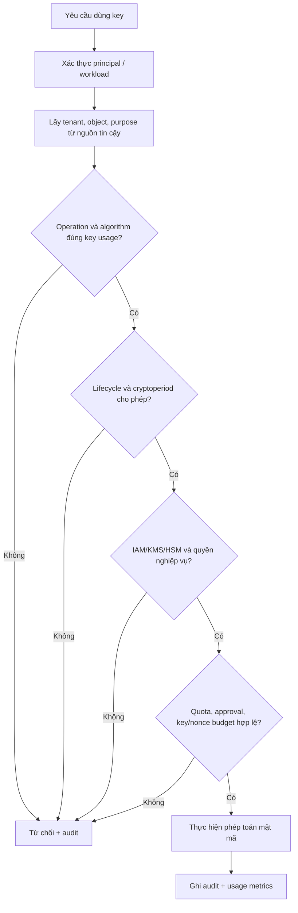
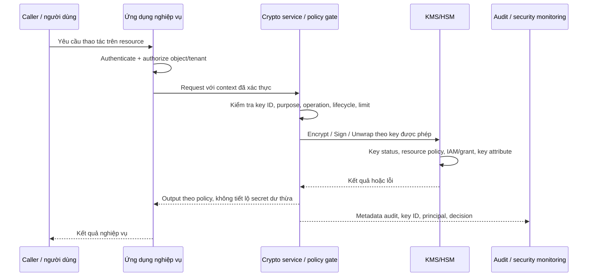
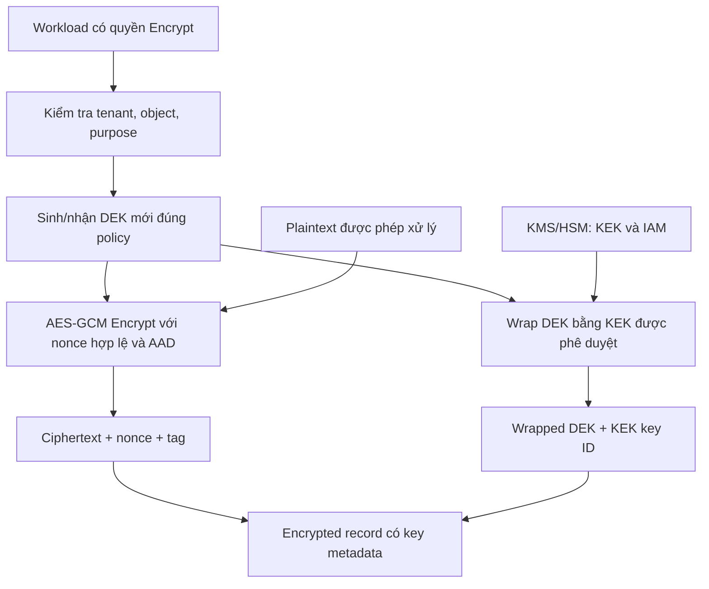
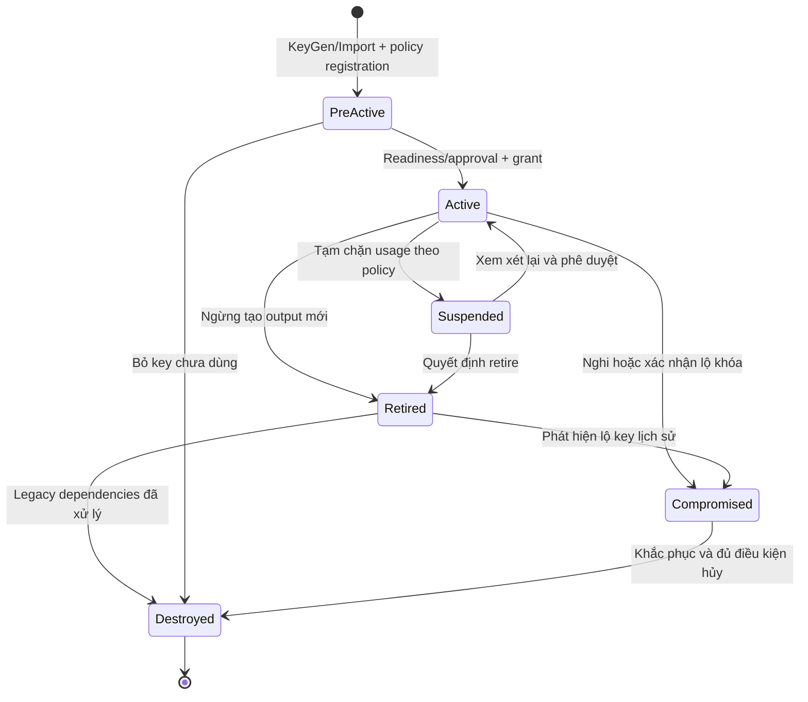
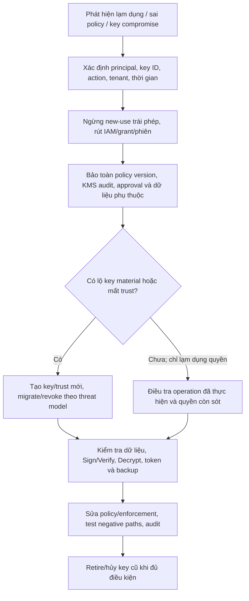

# Key usage policy: quy định ai được sử dụng khóa mật mã, để làm gì và trong điều kiện nào

> **Chương:** Key policy  
> **Module:** SECURITY_KEY_MANAGEMENT_FUNDAMENTALS

Một khóa mật mã có thể được tạo đúng thuật toán, lưu an toàn trong KMS/HSM và không thể export ra ngoài, nhưng hệ thống **vẫn có thể bị xâm phạm** nếu ứng dụng được phép dùng khóa sai mục đích. Ví dụ: workload chỉ cần mã hóa hóa đơn lại có quyền **Decrypt** toàn bộ dữ liệu khách hàng; một signing service có thể dùng cùng private key để ký bất kỳ JSON nào; hoặc một JWT verifier chấp nhận chữ ký của khóa thuộc issuer khác. Đó là những lỗi về **chính sách sử dụng khóa — key usage policy**.

**Key usage policy** là tập các quy tắc xác định **khóa hoặc phiên bản khóa được phép thực hiện phép toán mật mã nào, bởi chủ thể nào, cho mục đích/dữ liệu nào, ở môi trường nào, trong khoảng thời gian và giới hạn nào**. Nó còn quy định tình huống phải từ chối, cách kiểm toán và cách thay đổi quyền khi khóa xoay vòng, bị nghi lộ hoặc hết nhu cầu sử dụng.

Chính sách tốt không chỉ viết thành tài liệu; nó phải được **cưỡng chế ở những điểm thực sự có thể dùng khóa**: thuộc tính key object trong HSM/KMS, IAM/resource policy/grant, signing/encryption service, nơi định tuyến key version và logic phân quyền trên dữ liệu. Một cờ `purpose: "signing"` trong database chỉ có giá trị phòng vệ nếu không còn đường khác cho workload dùng cùng khóa để giải mã hay tạo MAC trái phép.

Trong **SECURITY_KEY_MANAGEMENT_FUNDAMENTALS**, key usage policy là một nhịp cầu giữa mật mã đối xứng/bất đối xứng, chữ ký số, KMS/HSM, envelope encryption, kiểm soát truy cập, kiểm toán và vòng đời khóa **tạo → cấp phát → lưu trữ → sử dụng → xoay vòng → thu hồi → hủy**. Bài học tập trung vào **quy tắc sử dụng**, không đồng nhất chúng với tất cả tính năng của một nhà cung cấp KMS.

Sau bài này, người học có thể:

- Phân biệt **key usage policy**, IAM, key policy của provider, HSM key attributes, cryptoperiod và authorization nghiệp vụ.
- Diễn đạt quy tắc theo **principal, key ID/version, action, purpose, resource/tenant, thời gian, trạng thái và hạn mức**.
- Phân tách quyền **Encrypt/Decrypt**, **Wrap/Unwrap**, **Sign/Verify**, **GenerateMac/VerifyMac** và **Encapsulate/Decapsulate** theo mô hình đe dọa.
- Hiểu vì sao **non-exportable key** vẫn có thể bị lạm dụng như signing/decryption oracle.
- Thiết kế key usage policy cho **DEK/KEK và envelope encryption**, khóa ký số, HMAC, KEM, pepper và dữ liệu cũ.
- Dùng ví dụ cấu hình và Java 17 để minh họa đánh giá policy; lập checklist, thử nghiệm và quy trình ứng phó sự cố.

## 1. Key usage policy là gì và bảo vệ điều gì?

Một key usage policy cần trả lời tối thiểu:

1. **Key nào?** Key ID bất biến, material version, thuật toán và nguồn quản lý.
2. **Ai sử dụng?** Workload/service identity, role, người vận hành hoặc client đã xác thực.
3. **Được làm gì?** Mã hóa, giải mã, wrap, unwrap, ký, xác minh, MAC, dẫn xuất khóa hay decapsulate.
4. **Với dữ liệu nào?** Tenant, object, loại chứng từ, môi trường, phân loại dữ liệu và mục đích.
5. **Trong điều kiện nào?** Trạng thái active/retired, cryptoperiod, phê duyệt, hạn mức, key version và các ràng buộc giao thức.
6. **Chứng minh bằng gì?** Audit event, approval ID, policy version, nguyên nhân từ chối và các số liệu giám sát.

Có thể mô hình hóa một quyết định ở mức khái niệm:

\[
\operatorname{Allow}(p,k,a,c,t) =
\operatorname{Authenticated}(p)
\land \operatorname{ValidKey}(k)
\land \operatorname{PermittedOperation}(k,a)
\land \operatorname{AuthorizedContext}(p,k,a,c)
\land \operatorname{WithinUseWindow}(k,a,t)
\land \operatorname{WithinLimits}(k,a).
\]

Trong đó:

| Ký hiệu | Ý nghĩa |
|---|---|
| \(p\) | Principal / danh tính workload hoặc chủ thể đã xác thực |
| \(k\) | Khóa cụ thể, gồm ID và version khi được hỗ trợ |
| \(a\) | Phép toán được yêu cầu, ví dụ `SIGN` hay `DECRYPT` |
| \(c\) | Context đáng tin: environment, tenant, object, purpose, approval |
| \(t\) | Thời điểm thực hiện theo nguồn thời gian có thẩm quyền |

**Default deny** là nguyên tắc phù hợp: khi thiếu thông tin, sai mục đích hoặc không chứng minh được quyền, không thực hiện phép toán. Tuy nhiên, policy engine phải có hợp đồng rõ ràng về thứ tự đánh giá, quyền từ nhiều lớp và cách xử lý lỗi; chỉ viết một biểu thức logic chưa làm hệ thống an toàn.

### 1.1. Ví dụ đơn giản

Một tổ chức có ba dịch vụ:

```text
orders-writer:
  được Encrypt bằng orders-dek-v3 cho đơn hàng thuộc tenant tương ứng.
  không được Decrypt dữ liệu của tenant khác.

orders-reader:
  được Decrypt record mà người gọi có quyền đọc.
  không được tự Rotate/Delete key.

invoice-signer:
  được Sign hóa đơn đã phê duyệt bằng invoice-sign-v5.
  không được ký JWT hoặc lệnh thanh toán bằng key này.
```

Ở đây policy không chỉ là **khóa có thể gọi API hay không**: riêng `orders-reader` còn cần authorization trên **từng record** trước khi giải mã, và `invoice-signer` phải kiểm tra trạng thái phê duyệt của **nội dung cụ thể** trước khi ký.

### 1.2. Bốn mục tiêu an ninh thường gặp

- **Confidentiality:** hạn chế ai có thể tạo/thu hồi plaintext bằng Encrypt/Decrypt/Unwrap.
- **Integrity và authenticity:** hạn chế ai có thể tạo chữ ký, MAC hoặc ciphertext có tag hợp lệ.
- **Blast-radius reduction:** chia key theo tenant, môi trường, purpose và lifetime để một lỗi không mở quyền trên toàn hệ thống.
- **Auditability:** biết key được dùng bởi ai, với permission nào, lúc nào và vì sao.

Policy không thay thế mật mã đúng chuẩn: một DEK được cấp quyền chính xác nhưng dùng trùng nonce AES-GCM dưới cùng key vẫn có thể làm hỏng bảo mật.

## 2. Phân biệt các lớp chính sách liên quan

Các sản phẩm có thể dùng cụm từ **key policy** cho một resource policy riêng. Bài này dùng **key usage policy** theo nghĩa **chính sách sử dụng từ đầu đến cuối**, rộng hơn một file IAM JSON hay một cờ HSM.

| Lớp | Quyết định chủ yếu | Ví dụ | Giới hạn |
|---|---|---|---|
| **Key usage policy cấp hệ thống** | Mục đích, vai trò, phép toán, cryptoperiod, dữ liệu được phép | “Chỉ service A ký hóa đơn đã duyệt” | Phải được triển khai/cưỡng chế ở các lớp bên dưới |
| **KMS key policy/resource policy/IAM** | Principal được gọi action nào trên key ID/ARN nào | Cho role `billing-signer` gọi `Sign` trên key đã định | KMS thường không hiểu nghiệp vụ hóa đơn hay quyền object |
| **HSM key object attributes** | Thuật toán và phép toán được key object hỗ trợ/cho phép | `sign=true`, `decrypt=false`, `extractable=false` khi được hỗ trợ | Phụ thuộc HSM/API; không thay phê duyệt nội dung |
| **Application authorization (RBAC/ABAC)** | Caller có quyền thao tác trên resource/tenant cụ thể không | User X được đọc invoice Y | Nếu caller có quyền gọi KMS trực tiếp, có thể bypass ứng dụng |
| **Cryptoperiod/lifecycle policy** | Khi nào key được tạo output mới, khi nào chỉ xử lý dữ liệu cũ | Ngừng Encrypt mới từ ngày N | Không tự sửa IAM, alias và cache |
| **Protocol/cryptographic rules** | Có dùng thuật toán, nonce, KDF, tag, key usage đúng đặc tả không | AES-GCM nonce duy nhất dưới DEK | Không tự biết người gọi/tenant được phép |
| **Audit/monitoring policy** | Ghi nhận và cảnh báo hành vi sử dụng | Alert `Sign` ngoài luồng approval | Phát hiện không thay thế cưỡng chế trước hành động |

**Lưu ý quan trọng:** mỗi KMS cloud có cách kết hợp identity policy, resource policy, grants và điều kiện khác nhau. Không mặc định “nếu có allow trong IAM thì chắc chắn được dùng key” hoặc “resource policy luôn thắng IAM” mà chưa đối chiếu mô hình quyền của provider. Cách an toàn là **kiểm thử effective permissions của chính môi trường đang dùng**.

### 2.1. Usage policy khác chính sách quản trị khóa

Các quyền như tạo key, cập nhật policy, disable, schedule deletion hoặc export không giống quyền `Encrypt`, `Sign`. Có thể phân nhóm:

- **Usage permissions:** Encrypt, Decrypt, GenerateDataKey, ReEncrypt, Sign, Verify, GenerateMac, VerifyMac, DeriveKey, WrapKey, UnwrapKey hoặc Decapsulate tùy dịch vụ.
- **Administrative permissions:** tạo, import, đặt alias, rotate, cấp/thu hồi grant, cập nhật policy, disable và hủy.
- **Audit permissions:** đọc metadata và nhật ký không bí mật, giám sát việc thay đổi.

Nếu một principal runtime vừa có `Sign` vừa có quyền **tự sửa key policy để mở quyền cho mình**, tách vai trò trên giấy không còn ý nghĩa.

### 2.2. Key usage theo X.509 không phải toàn bộ usage policy

Chứng thư **X.509** có thể chứa extension **Key Usage (KU)** và **Extended Key Usage (EKU)** để giới hạn mục đích chứng thư, ví dụ digital signature hoặc server authentication. Đây là **một lớp chính sách ở phía verifier/PKI**, khác với policy cấp quyền dùng private key trong HSM.

Một certificate có EKU serverAuth hợp lệ không tự cho phép ứng dụng dùng private key đó để **ký hóa đơn**, và việc một HSM cho phép `Sign` không bảo đảm certificate phù hợp với mọi purpose. Với TLS/PKI phải kiểm tra đầy đủ chain, name/SAN, KU/EKU, thời hạn và revocation theo ngữ cảnh.

## 3. Mô hình quy tắc: ai, khóa nào, thao tác gì, phạm vi nào?

Để policy có thể kiểm thử, mỗi quy tắc nên có cấu trúc cụ thể thay vì mô tả mơ hồ như “chỉ các service tin cậy mới được dùng key”.

| Trục policy | Nội dung cần xác định | Ví dụ |
|---|---|---|
| **Principal** | Workload identity/role, environment, tổ chức/đối tác | `serviceAccount:invoice-signer-prod` |
| **Key selector** | Provider key ID, material version, logical purpose | `invoice-sign-v5` |
| **Operation** | Các phép toán thuộc allowlist | `SIGN`, không `DECRYPT` |
| **Algorithm/key type** | Thuật toán và tính chất key | Ed25519 signing key; AES-256-GCM DEK |
| **Purpose** | Mục đích có ý nghĩa bảo mật | `invoice-approval` |
| **Resource** | Tenant, object, dữ liệu phân loại | `tenant=T-42`, `document=INV-014` |
| **Environment/region** | Prod/staging, vùng dữ liệu, cluster | `env=prod`, `region=eu-1` |
| **Time/lifecycle** | Active, new-use window, legacy-use window | `notBefore`/`stopNewUseAt` |
| **Limits** | Rate, quota, số lần, dữ liệu tối đa | Tối đa theo key budget và policy |
| **Approval/evidence** | Tài liệu hoặc thao tác cần phê duyệt | `approvalId` khớp digest đã duyệt |
| **Decision/audit** | Allow/deny, nguyên nhân và policy version | `DENY_PURPOSE_MISMATCH` |

### 3.1. Đừng tin context do client tự khai

Giả sử request gửi:

```json
{
  "tenantId": "T-42",
  "keyId": "prod-key-of-T-42",
  "purpose": "invoice-approval",
  "approved": true
}
```

Nếu API tin toàn bộ các trường trên chỉ vì chúng xuất hiện trong JSON, attacker có thể tự khai `approved=true` và chọn key người khác. **Context dùng trong policy phải được lấy hoặc xác nhận từ nguồn đáng tin**:

- Tenant từ identity/session đã xác thực và mapping server-side.
- Quyền object từ authorization service/database có kiểm soát.
- Key ID từ key registry đã ràng buộc với tenant và purpose.
- Approval từ workflow đáng tin, ràng buộc vào **chính dữ liệu sẽ ký**.
- Time từ server/nguồn có thẩm quyền; không tin đồng hồ phía client để mở quyền.

**Thông tin do client cung cấp vẫn có thể là input**, nhưng không được tự trở thành bằng chứng cấp quyền.

### 3.2. Default deny, explicit deny và policy composition

Một service có thể có nhiều lớp: KMS allow, HSM thuộc tính key, IAM allow, business deny, lifecycle deny. Kết quả cuối phải **không rộng hơn** lớp nào có tính cưỡng chế.



Sơ đồ là **kiến trúc mong muốn**. Quy tắc allow/deny cụ thể phụ thuộc KMS và policy engine; nên đảm bảo mọi điều kiện quan trọng được cưỡng chế **trước khi thực hiện hành động không thể thu hồi** như ký một tài liệu hoặc giải mã và trả plaintext cho caller.

## 4. Key usage: điều gì khác nhau giữa các họ khóa?

Không nên dùng một danh sách action chung cho mọi thuật toán. Một khóa có **purpose** và **khả năng mật mã** cụ thể.

| Key/secret | Phép toán điển hình | Không nên cho phép một cách tùy tiện |
|---|---|---|
| **AES DEK** | `Encrypt`, `Decrypt` theo mode được phê duyệt | `Sign`, export raw key cho mọi ứng dụng, dùng nonce lặp |
| **KEK / wrapping key** | `WrapKey`, `UnwrapKey` hoặc KMS data-key operations | Dùng KEK trực tiếp mã hóa mọi object khi không thuộc thiết kế |
| **RSA/EC/EdDSA private signing key** | `Sign` trên message/digest theo scheme | Decrypt/ký purpose khác hoặc export private key |
| **Public verification key** | `Verify` chữ ký | Tự tin key do attacker gửi mà không xác thực issuer |
| **HMAC key** | `GenerateMac`, `VerifyMac` | Dùng chung mọi tenant/đối tác hoặc chuyển vai trò secret khác |
| **KEM recipient private key** | `Decapsulate` khi được phép | Sign hoặc cấp phép decapsulate toàn bộ record cho caller bất kỳ |
| **KEM recipient public key** | `Encapsulate` | Sử dụng key chưa xác thực đúng recipient |
| **Key agreement private key** | `DeriveKey / ECDH` trong protocol được phê duyệt | Dùng lại cho ký hoặc mục đích không thuộc giao thức |
| **Password pepper** | Secret bổ sung trong password verification theo thiết kế | Đưa vào DB cùng verifier, sử dụng như password salt |
| **Password salt** | Đầu vào công khai của password KDF | Xem là secret key cần cấp phép Decrypt/Sign |

### 4.1. Purpose separation: một key không làm mọi việc

Một private key dùng cho **JWT signing** không nên tự động dùng cho **software release signing** chỉ vì cả hai đều gọi `Sign`. Nếu key bị lộ, một compromise có thể ảnh hưởng hai hệ thống vốn độc lập. Tách key theo **purpose, tenant và environment** giúp giảm blast radius.

**Key separation** cũng áp dụng với key được dẫn xuất. Từ một root secret có entropy phù hợp, **HKDF** với thông tin ngữ cảnh và domain separation có thể tạo ra các khóa con khác nhau theo giao thức. Tuy nhiên, chỉ đổi tên biến `jwtKey` và `invoiceKey` mà cả hai trỏ tới cùng byte key **không phải** key separation.

### 4.2. Key algorithms và usage không hoán đổi

- **Ed25519** là thuật toán chữ ký; **X25519** thường phục vụ key agreement. Không dùng cùng key material tùy tiện giữa hai mục đích.
- **AES-GCM** là AEAD; tính toàn vẹn dựa trên tag và nonce đúng, không tạo chữ ký số xác minh công khai.
- **HMAC-SHA-256** tạo MAC từ shared secret, không cung cấp non-repudiation như một cơ chế chữ ký bất đối xứng theo điều kiện hệ thống phù hợp.
- **ML-KEM** là key encapsulation hậu lượng tử, không phải chữ ký số **ML-DSA**.
- **RSA-PSS** là scheme ký, còn **RSA-OAEP** là scheme mã hóa khóa công khai; không thay đổi purpose chỉ bằng cách chọn padding khác cho cùng RSA key mà không có chính sách/đánh giá riêng.

Policy phải định danh **algorithm và parameter set** (nếu có), không chỉ ghi `asymmetric=true`.

## 5. Phân tách quyền tạo và kiểm tra kết quả mật mã

Một đặc điểm quan trọng của key usage policy là nhiều phép toán **tạo** kết quả có giá trị bảo mật khác với phép toán **xác minh**:

| Mục đích | Quyền tạo | Quyền kiểm tra | Vì sao phải tách? |
|---|---|---|---|
| **Chữ ký số** | `Sign` với private key | `Verify` với public key | Người xác minh không cần private key; ngăn tạo chữ ký trái phép |
| **HMAC** | `GenerateMac` | `VerifyMac` | Dù cùng shared secret, có thể tách API roles và hạn chế lạm dụng |
| **AEAD** | `Encrypt` | `Decrypt/Open` | Quyền mở plaintext nhạy cảm hơn quyền tạo ciphertext trong nhiều bối cảnh |
| **Envelope encryption** | `WrapKey` | `UnwrapKey` | Unwrap có thể cấp quyền truy cập DEK và dữ liệu lịch sử |
| **KEM** | `Encapsulate(pk)` | `Decapsulate(sk)` | Bên gửi chỉ cần public key; quyền decapsulate phải bảo vệ |

Không phải nhà cung cấp nào cũng hỗ trợ action tách biệt như bảng trên. Với một key đối xứng được đưa nguyên vào bộ nhớ, ứng dụng có key bytes có thể tự tính nhiều phép toán mà IAM không thấy. Nếu cần cưỡng chế **operation-level permissions**, phải chọn kiến trúc giữ key trong **HSM/KMS** có API/policy phù hợp, hoặc tách key/ứng dụng/khối lượng tin cậy.

### 5.1. “Verify only” với HMAC không hoàn toàn giống Verify public signature

Với chữ ký số, người kiểm tra **chỉ có public key** nên không thể tạo chữ ký mới theo giả định mật mã. Với HMAC, bên giữ **raw HMAC key** có thể tự tạo tag. Một API HSM/KMS có quyền chỉ `VerifyMac` có thể giảm quyền trong phạm vi dịch vụ đó, nhưng nếu verifier có bản sao raw key thì ranh giới “verify only” không còn chắc chắn.

### 5.2. Non-exportable không phải non-abusable

Nếu một HSM giữ private signing key không thể xuất nhưng service A được gọi `Sign` với **digest tùy ý**, attacker chiếm service A có thể yêu cầu HSM ký lệnh gian lận. Họ không cần lấy byte private key. Tương tự, quyền `Decrypt/Unwrap/Decapsulate` có thể bị dùng như **oracle giải mã**.

Muốn chống lạm dụng cần **kiểm tra nội dung, ngữ cảnh, quyền đối tượng, rate limit và approval** ở trước KMS/HSM; audit chỉ là lớp hỗ trợ phát hiện/điều tra, không phải toàn bộ phòng vệ.

## 6. KMS/HSM thực thi key usage policy ở những điểm nào?

Một mô hình triển khai điển hình có ít nhất bốn ranh giới kiểm soát:



### 6.1. Key object và key attributes

Nơi tạo khóa phải chọn đúng **key type, algorithm, supported operations, exportability**. Những thuộc tính được HSM/keystore cưỡng chế giúp giảm nguy cơ một lời gọi sai kiểu vẫn hoạt động. Một số thuộc tính không thể sửa sau KeyGen; nếu tạo sai type/purpose, giải pháp an toàn thường là **tạo khóa khác**, không cố đổi nghĩa bằng label ứng dụng.

### 6.2. Identity và resource policies

KMS/HSM có thể cho phép hoặc từ chối request dựa trên principal, key ID, permission, environment/tag/condition theo tính năng provider. Trường hợp sử dụng key ngoài phạm vi phải bị chặn ngay cả khi app gọi API trực tiếp hoặc service bị chiếm một phần.

**Không giả định mọi provider có cùng action names, condition keys hoặc cơ chế resource policy.** Các nhãn `Sign`, `Decrypt`, `GenerateDataKey` dưới đây là khái niệm; khi triển khai phải đối chiếu API và policy language thực tế.

### 6.3. Application policy gate

Policy gate kiểm tra những thuộc tính KMS thường không biết: một user có quyền xem bản ghi không, hóa đơn đã được phê duyệt chưa, recipient có đúng tenant không, giao dịch có nằm trong hạn mức không. Đường này **không nên có lối vòng** để caller ngoài phạm vi dùng trực tiếp principal có quyền KMS rộng.

### 6.4. Quan sát và kiểm toán

Các event KMS/HSM có thể cho biết ai gọi `Sign` hoặc `Decrypt` và key nào được chọn. Log ứng dụng nên liên kết với **request ID, object ID hoặc digest không nhạy cảm, approval ID và quyết định policy**. Không ghi private key, DEK plaintext, shared secret hay bearer token vào log để “tăng khả năng kiểm toán”.

### 6.5. Nếu lớp policy gate gặp lỗi thì sao?

Khi policy engine, registry hoặc authorization service không khả dụng:

- Với thao tác nhạy cảm, **fail closed** thường là mặc định phù hợp: không dùng key khi không xác minh được quyền.
- Với nhu cầu đọc legacy để khôi phục dịch vụ, ngoại lệ **break-glass** phải được định nghĩa, phân quyền, giới hạn thời gian và kiểm toán độc lập.
- Không cache “allow” vĩnh viễn; đánh giá chính sách thay đổi, session expiry, revocation và cache invalidation.
- Phải phân biệt **lỗi tạm thời** với **quyết định từ chối** trong điều tra nhưng không tiết lộ thông tin nhạy cảm cho caller.

## 7. Key usage policy cho DEK/KEK và envelope encryption

**Envelope encryption** phân tách khóa mã hóa dữ liệu (**DEK**) và khóa bảo vệ DEK (**KEK**). Đây là ví dụ điển hình cho việc policy theo mục đích và vòng đời.

Một luồng khái niệm:



### 7.1. Policy cho DEK

Ví dụ các điều kiện:

- DEK phải là **key đối xứng đúng thuật toán**, sinh từ CSPRNG/KMS đáng tin.
- Chỉ dùng DEK cho dữ liệu trong **purpose và tenant** được quy định; không lấy DEK của production đưa sang test.
- Mỗi phép mã hóa bằng AES-GCM cần **nonce mới không lặp dưới cùng DEK** theo scheme, có ngân sách số lần/khối lượng dùng key.
- AAD ràng buộc những trường như tenant, object type, schema version hoặc purpose nếu có ý nghĩa bảo mật.
- Sau khi tạo ciphertext, raw DEK chỉ được giữ trong bộ nhớ theo lifetime cần thiết; không xuất vào log hoặc queue.
- Nếu DEK bị nghi compromise hoặc có lỗi nonce reuse, ngừng Encrypt mới bằng DEK ấy và đánh giá dữ liệu ảnh hưởng.

Đối với **DEK riêng mỗi object**, policy có thể tập trung vào phương thức sinh, phân loại dữ liệu và retention. Đối với **DEK tái sử dụng**, cần thêm kiểm kê phiên bản, lượt sử dụng và điều kiện rotation chặt hơn.

### 7.2. Policy cho KEK

KEK thường có phạm vi lớn hơn mỗi DEK, nên quyền **Unwrap/Decrypt** tác động tới nhiều record:

| Principal | Cho phép | Không nên mặc định |
|---|---|---|
| **Encryption writer** | Sinh data key hoặc wrap DEK với KEK thuộc service/tenant | Unwrap mọi DEK lịch sử nếu không cần |
| **Authorized reader** | Unwrap DEK gắn với object đã qua authorization | Đọc toàn bộ wrapped DEK của mọi tenant |
| **Key administrator** | Tạo, thiết lập policy, rotation theo phê duyệt | Tự động được quyền decrypt dữ liệu nghiệp vụ |
| **Migration worker** | Rewrap/reencrypt trong phạm vi danh sách object/phê duyệt cụ thể | Tự ý export KEK hoặc bỏ qua migration audit |
| **Auditor** | Đọc key metadata, policy version, usage logs | Đọc raw DEK/KEK hoặc thực hiện Decrypt |

Một **encryption context** do KMS hỗ trợ có thể giúp ràng buộc bản mã/key operation với metadata đã xác thực và/hoặc điều kiện policy, nhưng **không tự bảo đảm caller có quyền trên object** nếu caller được phép tự khai mọi context. Vì thế cần kiểm tra mapping principal ↔ tenant/resource **ngoài hoặc trước** API KMS.

### 7.3. Rewrap khác reencrypt

Khi rotate KEK từ v1 sang v2:

- **Rewrap DEK**: thay cách bảo vệ DEK, có thể giữ nguyên raw DEK và ciphertext dữ liệu.
- **Reencrypt dữ liệu**: tạo DEK mới và mã hóa lại plaintext; thay ciphertext, nonce, tag và metadata liên quan.

Policy phải nêu rõ **thao tác nào được phép** và ai làm. Cho migration worker quyền rewrap không nhất thiết có nghĩa được xem plaintext dữ liệu; kiến trúc nên giảm quyền không cần thiết.

**Không suy ra rotate KEK sẽ tự sửa sự cố DEK bị lộ hoặc AES-GCM nonce reuse**. Khi nguyên nhân nằm ở DEK hoặc ciphertext dữ liệu, có thể phải đổi DEK và mã hóa lại các record bị ảnh hưởng.

### 7.4. Legacy decrypt khác encrypt mới

Sau khi khóa cũ hết cryptoperiod tạo dữ liệu mới, nhiều record vẫn cần **Decrypt** hoặc **Unwrap**:

```text
KEK v4:
  allow WRAP_NEW_DEK:  false
  allow UNWRAP_LEGACY: true (chỉ cho object đã có quyền)

KEK v5:
  allow WRAP_NEW_DEK:  true
  allow UNWRAP:        theo policy sản xuất

DEK v12:
  allow ENCRYPT_NEW:   false
  allow DECRYPT_OLD:   true, trong retention/migration
```

Đây là **chính sách logic**; một số provider khi key ở trạng thái `Disabled` sẽ chặn **cả hai hướng**. Muốn có trạng thái “decrypt-only”, có thể phải cưỡng chế bằng **app/IAM được tách role** khi key object vẫn có khả năng hoạt động kỹ thuật, hoặc dùng những tính năng hỗ trợ chính thức của provider.

## 8. Key usage policy cho chữ ký số và JWT

Một chữ ký số hợp lệ chứng minh quan hệ giữa nội dung, chữ ký và private key tương ứng với public key dùng khi xác minh. Nó **không tự chứng minh giao dịch đã được phê duyệt**, bên ký có đúng tư cách nghiệp vụ hoặc public key đã được gắn với issuer đáng tin.

### 8.1. Ký nội dung nào?

Giả sử một signing service có quyền dùng khóa `invoice-sign-v3`. Policy cần giới hạn:

1. **Purpose:** chỉ `invoice-approval`, không `jwt-access-token` hoặc `software-release`.
2. **Principal:** workload cụ thể, environment đúng, không cho build/test dùng key prod.
3. **Message:** canonical bytes chứa tenant, invoice ID, amount, currency, recipient, schema version và thời hạn cần thiết.
4. **Approval:** việc chấp thuận phải ràng buộc với **digest/nội dung cụ thể** chuẩn bị ký; không ký một bản đã đổi sau phê duyệt.
5. **Algorithm:** key và scheme trong allowlist, không nhận thuật toán tuỳ ý từ client.
6. **Audit:** request/approval ID, key ID, hash tham chiếu (khi phù hợp), policy version và kết quả.

**Signing oracle** xuất hiện nếu workload có `Sign` trên key chính thức nhưng nhận bất kỳ digest nào do attacker gửi mà không ràng buộc với nghiệp vụ. HSM có thể bảo vệ private key rất tốt mà vẫn tạo ra **chữ ký hợp lệ cho nội dung gian lận**.

### 8.2. JWT: xác minh chữ ký không thay kiểm tra quyền

Đối với token đã ký:

- Verifier chỉ chấp nhận **issuer (iss)** đã cấu hình và public key từ JWKS/trust registry đáng tin.
- Ràng buộc `kid` với đúng issuer/tenant; `kid` không phải bằng chứng danh tính.
- Có **algorithm allowlist** phù hợp với key type; không tin `alg` do token tự khai để tự động chọn chế độ bất kỳ.
- Kiểm tra `aud`, `exp`, `nbf`, token type và authorization theo scope/resource.
- Quy định key cũ nào có thể **Verify** trong giai đoạn rotation; khi key bị lộ, có thể phải ngừng tin khẩn cấp.

Một key usage policy cho **Sign JWT** không thể thay thế toàn bộ **token validation policy**. Đây là các lớp có quan hệ chặt nhưng chức năng khác nhau.

### 8.3. Public-key trust là một phần của usage

Quyền `Verify` thường không cần private key, nhưng verifier vẫn có thể sai nếu public key đến từ attacker. Khi sử dụng X.509/PKI phải xét trust chain, danh tính tên, KU/EKU, thời hạn, thu hồi và mục đích theo chuẩn/giao thức. Khi dùng key pinning hoặc JWKS, phải bảo vệ **quyền ghi trust registry** và xác minh nguồn cấp key.

**Không tự kích hoạt khóa ký mới ở signer trước khi các verifier cần thiết tin public key mới**, trừ khi giao thức có kế hoạch chuyển đổi/cửa sổ chồng lấn đã được thiết kế.

## 9. Key usage policy cho HMAC, webhook và pepper

### 9.1. HMAC: cả hai bên có secret nên không có public Verify

HMAC thường được dùng để kiểm tra toàn vẹn và xác thực message theo **shared secret**. Hai dịch vụ giữ cùng HMAC key đều có khả năng tạo MAC nếu có raw key, do đó:

- **Không dùng một HMAC key chung cho mọi partner/tenant** nếu cần giảm phạm vi compromise.
- Chỉ cho phép `GenerateMac` ở producer được quyền tạo message; verifier dùng `VerifyMac` hoặc raw key được bảo vệ theo thiết kế.
- Ràng buộc message với **purpose, issuer, recipient, timestamp/message ID** khi giao thức yêu cầu.
- Kiểm tra **replay window/idempotency**; HMAC hợp lệ không chứng minh message chưa từng được xử lý.
- Trong rotation, producer và verifier phải phối hợp **key version**; không chấp nhận khóa cũ vô hạn.

Ví dụ:

```text
partner-webhook-key-A-v2:
  keyPurpose: webhook-auth
  producer: orders-webhook-prod
  recipient: partner-A
  allowedOperations: [GENERATE_MAC, VERIFY_MAC]
  disallowFor: [password-pepper, object-encryption]
  messageBinding: [method, path, body, timestamp, messageId]
```

**Nếu producer nắm raw key**, IAM của KMS không kiểm soát được mọi phép HMAC diễn ra trong bộ nhớ của producer. Muốn thu hẹp quyền cần thiết kế giới hạn việc phân phối key hoặc chọn API mật mã trong ranh giới phần cứng/dịch vụ phù hợp.

### 9.2. Pepper: secret khác password salt

**Password salt** thường công khai và sinh riêng cho từng credential, không phải một key bí mật cần cho KMS thực thi action `Decrypt`. **Pepper** (tùy chọn) là secret bổ sung dùng chung theo phạm vi thiết kế để bảo vệ password verification trong trường hợp chỉ bảng verifier bị lộ.

Policy cho pepper có thể quy định:

- Chỉ **authentication service** được đọc/dùng phiên bản pepper theo thuật toán được phê duyệt.
- Raw pepper không đặt trong cùng database với password verifier hoặc trong source/log.
- Có **pepper version**, phương án backup, migration và xử lý nếu pepper bị lộ/mất.
- Khi pepper được giữ dưới dạng HMAC key trong KMS/HSM, không giả định API VerifyMac có thể thay mọi thuật toán password hashing; quy trình phải được thiết kế và kiểm thử đầy đủ.

**Không coi pepper là salt**, không dùng một pepper làm AES KEK cho dữ liệu khách hàng và không tự nghĩ rằng bật pepper mới sẽ tự nâng cấp tất cả verifier cũ.

## 10. Key usage policy cho KEM và key agreement

**Key Encapsulation Mechanism (KEM)** thường cung cấp `KeyGen`, `Encaps(publicKey)` và `Decaps(privateKey, ciphertext)`. Policy cần phân biệt:

| Bên | Cần quyền gì? | Điều phải kiểm tra |
|---|---|---|
| **Sender** | Sử dụng **public key đã xác thực** để Encaps | Đúng recipient, algorithm/parameter set, key version, context |
| **Recipient** | Decapsulate bằng private key được bảo vệ | Principal, object authorization, đúng KEM ciphertext/key ID |
| **Key administrator** | KeyGen, cấu hình/rotation theo approval | Không tự có quyền mở dữ liệu khách hàng |
| **Verifier/trust service** | Kiểm tra nguồn public key và metadata | Không nhận key thay thế từ input chưa tin |

**Base KEM không tự xác thực sender.** Bất kỳ ai có public key recipient có thể encapsulate. Nếu yêu cầu xác thực người gửi, cần giao thức có chữ ký/PSK/authenticated HPKE hoặc cơ chế tương đương đã được thiết kế.

### 10.1. Static recipient key và forward secrecy

Một private KEM key dài hạn cho **lưu trữ dữ liệu at rest** có thể cần tồn tại nhiều năm để decapsulate ciphertext cũ. Nếu key đó bị lộ về sau và attacker đã lưu encapsulation cũ, dữ liệu lịch sử có thể bị giải mã. Policy phải phản ánh **cryptoperiod và retention**, không mặc định KEM mang lại forward secrecy chỉ vì Encaps dùng randomness mới.

Đối với **ephemeral key agreement**, policy có thể yêu cầu tạo key tạm thời theo handshake, cấm tái sử dụng ngoài phạm vi và loại bỏ secret khi không còn cần; điều này phục vụ một mô hình bảo mật khác với static KEM key để khôi phục dữ liệu.

### 10.2. Hỗ trợ ML-KEM và các thuật toán hybrid

**ML-KEM** là KEM hậu lượng tử được chuẩn hóa trong FIPS 203, có các parameter set như ML-KEM-512/768/1024. Một KMS/HSM không mặc nhiên hỗ trợ mọi KEM hoặc version. Policy phải chỉ rõ **algorithm ID, parameter set, wire format, KDF combiner và giao thức xác thực**, đặc biệt khi ghép ECDHE/classical với thành phần hậu lượng tử.

Đừng cho phép **downgrade** từ cấu hình hybrid sang classical-only chỉ vì client tự đề nghị mà không có xác thực transcript và chính sách fallback. “Hỗ trợ PQC” trong cấu hình không chứng minh handshake **thực sự** dùng bộ thuật toán đã đặt.

## 11. Chính sách theo thời gian: Active, cryptoperiod và sử dụng lịch sử

Một key có thể hợp lệ để **tạo output mới** nhưng không còn được phép sau một mốc thời gian; và một key đã retire khỏi output mới vẫn cần cho **Decrypt/Verify dữ liệu cũ**.

| Trạng thái logic | Encrypt/Sign/MAC mới | Decrypt/Verify cũ | Lưu ý |
|---|---|---|---|
| **Pre-active** | Không | Thường chưa có dữ liệu phụ thuộc | Có thể test trong môi trường được phê duyệt |
| **Active** | Theo operation/purpose được cấp | Theo object authorization | Phải kiểm soát nonce, quota, algorithm |
| **Retired for new use** | Không | Có thể cho phép trong retention | Không mặc định dùng key cũ vô hạn |
| **Suspended/disabled** | Theo policy hoặc bị chặn | Có thể cũng bị chặn ở KMS | Provider state có semantics khác nhau |
| **Compromised** | Không nên cho dùng mới | Chỉ xử lý dữ liệu cũ theo kế hoạch sự cố | Phải đánh giá rò rỉ plaintext/chữ ký giả |
| **Destroyed** | Không | Không thể dùng material đã hủy nếu không có đường khác | Hủy quá sớm có thể mất dữ liệu |

### 11.1. Originator-use và recipient-use

- **Originator-use period**: thời gian được phép tạo ciphertext, signature, MAC hoặc wrapped keys mới.
- **Recipient-use period**: thời gian có thể cần giải mã, xác minh hoặc mở thông tin đã tồn tại.

Khi chính sách ngừng originator-use, đừng tự động **disable KMS key** nếu hành động ấy chặn cả Decrypt/Unwrap cho dữ liệu còn retention. Phải chọn phương pháp enforcement phù hợp với provider và use case.

### 11.2. Tại sao key creation time không đủ?

Một DEK được tạo hôm qua vẫn có thể đã vượt **ngân sách mã hóa** hoặc dùng nonce AES-GCM lặp. Một private key tạo năm trước có thể cần tiếp tục **Verify chữ ký lịch sử** dù không còn được phép Sign mới. Policy thời gian phải dựa trên **mục đích, thuật toán và dữ liệu phụ thuộc**, không chỉ `now - keyCreatedAt`.

### 11.3. Key rotation thay đổi chính sách như thế nào?

Trong rotation bình thường:

1. Tạo key/version mới theo thuật toán và policy đã duyệt.
2. Cấp quyền/kiểm thử, công bố public key/trust khi cần.
3. Đưa key mới thành lựa chọn cho **new operations**.
4. Ngừng chọn key cũ cho new operations; giữ quyền legacy được giới hạn theo retention.
5. Rewrap/reencrypt/migrate dữ liệu và retire/hủy khi đủ điều kiện.

**Thay alias không tự đổi ciphertext hoặc chữ ký đã phát hành.** Mỗi record/token cần key ID/version hoặc cơ chế lựa chọn khóa cũ chính xác. Khi key bị compromise, cần xử lý khẩn cấp thay vì áp dụng nguyên xi grace period bình thường.

## 12. Hạn mức sử dụng: tần suất, số lần và ngân sách mật mã

Key usage policy còn cần những giới hạn **định lượng**, không chỉ một cờ `allow=true`:

| Loại giới hạn | Mục đích |
|---|---|
| **Rate / burst** | Giảm rủi ro signing/decryption oracle, brute force và DoS |
| **Per-principal quota** | Giới hạn phạm vi workload bị chiếm |
| **Per-tenant quota** | Ngăn một tenant dùng hết tài nguyên KMS của tenant khác |
| **Cryptoperiod limit** | Ngừng dùng mới theo mốc được phê duyệt |
| **Total encryption invocations/bytes per DEK** | Kiểm soát giới hạn thuật toán, ví dụ nonce/record budget của AEAD |
| **Approval/human control** | Giới hạn thao tác giá trị cao như ký chứng từ pháp lý |
| **Max data size / message purpose** | Ngăn biến dịch vụ thành oracle xử lý payload tùy ý |

### 12.1. Giới hạn AES-GCM không chỉ là tuổi khóa

Với **AES-GCM**, không được dùng trùng cặp **(key, nonce)** giữa những lần mã hóa cần nonce duy nhất. Nếu dùng random nonce 96 bit, xác suất va chạm tăng theo tổng số lần mã hóa dưới **cùng DEK**; phải có chính sách key budget và nonce construction phù hợp chuẩn.

Số lần mã hóa là **tổng từ mọi node/writer** cùng sử dụng key. Rotate **KEK** nhưng giữ nguyên **DEK** không đặt lại ngân sách nonce của DEK. Policy nên theo dõi key ID/version thực sự sử dụng thay vì chỉ alias.

### 12.2. Hạn mức trong hệ thống phân tán

Nếu mỗi pod tự đếm `SignRequests < 1000` trong bộ nhớ nhưng có 500 pod, giới hạn toàn dịch vụ không phải 1.000. Dùng **quota/budget cấp phạm vi thích hợp**, trạng thái bền vững hoặc cơ chế ủy quyền có kiểm soát, và xử lý concurrency/retry.

Đối với giới hạn an ninh cần cưỡng chế mạnh, đừng chỉ dùng metrics sau khi thao tác đã xảy ra. Metrics rất hữu ích để phát hiện xu hướng nhưng không ngăn một request vượt quyền đã tạo signature hoặc giải mã plaintext.

## 13. Policy-as-code: biểu diễn quy tắc rõ ràng và có phiên bản

Đối với tổ chức có nhiều key/service, quy tắc sử dụng nên được biểu diễn theo một **schema có phiên bản**, có quy trình review và test tự động. Chính sách cần đủ tường minh để triển khai được, nhưng không tự giả định một file YAML có thể trở thành IAM policy của mọi cloud KMS.

Ví dụ **định dạng minh họa của ứng dụng**, không phải cú pháp của bất kỳ provider nào:

```yaml
schemaVersion: 1
policyId: orders-data-key-policy
policyVersion: "2026-11-28.1"
defaultDecision: DENY

key:
  keyId: "orders/dek/v13"
  type: SYMMETRIC
  algorithm: AES-256-GCM
  ownerService: orders-service
  environment: production
  keyState: ACTIVE
  nonExportable: true   # Chỉ đúng khi kiến trúc/provider hỗ trợ.

scope:
  tenantBinding: "trusted-workload-and-object-metadata"
  allowedObjectTypes: [order]
  purpose: orders-data-encryption
  allowedRegions: [region-a, region-b]

useWindow:
  encryptNotBefore: "2026-11-28T00:00:00Z"
  stopNewEncryptAt: "2027-02-01T00:00:00Z"
  legacyDecryptUntil: "2028-02-01T00:00:00Z"

grants:
  - principal: "orders-writer-prod"
    operations: [ENCRYPT]
    requiresObjectAuthorization: true
  - principal: "orders-reader-prod"
    operations: [DECRYPT]
    requiresObjectAuthorization: true

cryptographicRequirements:
  nonceScheme: "AES-GCM-96-bit-unique-per-DEK"
  authenticationTagBits: 128
  aadFields: [tenantId, objectId, schemaVersion, purpose]
  keySelection: "explicit-version-in-record"

limits:
  perPrincipalRatePolicy: "kms-use-ratelimit-v3"
  perKeyEncryptionBudgetPolicy: "aes-gcm-dek-budget-v2"

controls:
  auditRequired: true
  separationOfDuties: true
  requireReadbackTestBeforeActivation: true
  denyDirectKeyExport: true
  onMissingPolicy: DENY
  onCompromise: "STOP_NEW_USE_AND_INCIDENT_RESPONSE"
```

Đây là **mô hình ý định**. Không thể biến `nonExportable: true` trong YAML thành bảo đảm vật lý nếu key đã được sinh dưới dạng exportable hoặc runtime giữ raw key. Phải có bước **kiểm tra và cưỡng chế** ở provider, HSM, IAM, ứng dụng và monitoring.

### 13.1. Quy tắc chỉ áp dụng cho hành động mới khi key đã active

Ví dụ key trong YAML đang cho Encrypt mới từ cuối tháng 11/2026 đến đầu tháng 02/2027. Sau `stopNewEncryptAt`, hệ thống **không được mã hóa mới bằng DEK này**, nhưng có thể cho **Decrypt** bản ghi còn retention theo policy. Việc cấp quyền ở KMS phải tương thích; nếu provider chỉ cho enable/disable toàn bộ key, có thể cần tách role và dùng application policy gate.

### 13.2. Điều kiện dữ liệu phải xuất phát từ nguồn đáng tin

Các trường `tenantId`, `objectId` và `purpose` trong AAD có thể bảo vệ tính toàn vẹn metadata khi dùng AEAD, nhưng **không tự tạo authorization**. Caller không được tự đổi `tenantId` trên request để vượt quyền. Policy gate phải đối chiếu tenant từ **identity và object storage server-side**.

### 13.3. Một policy phải có cơ chế đối chiếu cấu hình thực

Một pipeline quản trị nên so:

1. **Declared policy:** YAML/schema xác định ý định.
2. **Effective KMS/HSM/IAM configuration:** những gì provider thực sự cho phép.
3. **Application runtime policy:** route, cache, feature flags, context/authorization.
4. **Observed use:** log những phép toán đã thực hiện và key ID thực tế.

Nếu declared policy cấm Decrypt nhưng principal vẫn thành công khi gọi Decrypt trực tiếp, phải coi đó là **policy drift/bypass**, không phải trạng thái bình thường.

## 14. Java 17: minh họa đánh giá Key usage policy trước phép toán mật mã

Đoạn code sau minh họa một **policy gate thuần logic**, không chứa raw key và **không gọi KMS thật**. Nó kiểm tra:

- Key ID và môi trường yêu cầu có khớp policy không.
- Principal có nằm trong grant cho **đúng operation** không.
- Tenant từ nguồn identity đáng tin có khớp tenant của object không.
- Hành động trên object đã được kiểm tra quyền ở tầng nghiệp vụ chưa.
- Key đang active hoặc đã retired, và có còn nằm trong cửa sổ dùng tương ứng không.

**Cảnh báo:** Đây là ví dụ học tập, không phải một authorization server, không thể chống bypass nếu caller vẫn có quyền gọi KMS trực tiếp; cũng chưa có database transaction, phân quyền nhiều tenant thật, cache invalidation, KMS/IAM hoặc quota.

```java
import java.time.Clock;
import java.time.Instant;
import java.time.ZoneOffset;
import java.util.Map;
import java.util.Set;

public final class KeyUsagePolicyDemo {
    enum Operation { ENCRYPT, DECRYPT, SIGN, VERIFY }
    enum KeyState { ACTIVE, RETIRED, COMPROMISED }

    record KeyRule(
            String keyId,
            String environment,
            String tenantId,
            KeyState state,
            Instant activeFrom,
            Instant stopNewUseAt,
            Instant legacyReadUntil,
            Map<String, Set<Operation>> grants) {}

    // TrustedRequest chỉ được xây từ danh tính và quyền
    // đã được kiểm tra, KHÔNG lấy nguyên từ JSON của client.
    record TrustedRequest(
            String principal,
            String keyId,
            Operation operation,
            String environment,
            String authenticatedTenant,
            String objectTenant,
            boolean objectAccessApproved) {}

    record Decision(boolean allowed, String reason) {
        static Decision permit() {
            return new Decision(true, "PERMIT");
        }
        static Decision deny(String reason) {
            return new Decision(false, reason);
        }
    }

    static boolean isLegacyRead(Operation op) {
        return op == Operation.DECRYPT || op == Operation.VERIFY;
    }

    static Decision evaluate(
            KeyRule policy, TrustedRequest req, Instant now) {
        // Null request/policy phải được API boundary từ chối.
        if (policy == null || req == null || now == null) {
            return Decision.deny("INVALID_CONTEXT");
        }
        if (!policy.keyId().equals(req.keyId())
                || !policy.environment().equals(req.environment())) {
            return Decision.deny("KEY_OR_ENV_MISMATCH");
        }
        if (!policy.tenantId().equals(req.authenticatedTenant())
                || !policy.tenantId().equals(req.objectTenant())
                || !req.objectAccessApproved()) {
            return Decision.deny("OBJECT_NOT_AUTHORIZED");
        }
        Set<Operation> allowedOps =
                policy.grants().getOrDefault(req.principal(), Set.of());
        if (!allowedOps.contains(req.operation())) {
            return Decision.deny("OPERATION_NOT_ALLOWED");
        }
        if (policy.state() == KeyState.COMPROMISED) {
            return Decision.deny("KEY_COMPROMISED");
        }
        if (now.isBefore(policy.activeFrom())) {
            return Decision.deny("NOT_ACTIVE_YET");
        }

        if (isLegacyRead(req.operation())) {
            if (policy.state() != KeyState.ACTIVE
                    && policy.state() != KeyState.RETIRED) {
                return Decision.deny("INVALID_KEY_STATE");
            }
            if (!now.isBefore(policy.legacyReadUntil())) {
                return Decision.deny("LEGACY_READ_EXPIRED");
            }
        } else {
            if (policy.state() != KeyState.ACTIVE
                    || !now.isBefore(policy.stopNewUseAt())) {
                return Decision.deny("NEW_USE_EXPIRED_OR_RETIRED");
            }
        }
        return Decision.permit();
    }

    public static void main(String[] args) {
        Clock clock = Clock.fixed(
                Instant.parse("2026-11-28T09:00:00Z"),
                ZoneOffset.UTC
        );
        KeyRule rule = new KeyRule(
                "orders-dek-v13",
                "production",
                "T-42",
                KeyState.ACTIVE,
                Instant.parse("2026-11-28T00:00:00Z"),
                Instant.parse("2027-02-01T00:00:00Z"),
                Instant.parse("2028-02-01T00:00:00Z"),
                Map.of(
                        "orders-writer", Set.of(Operation.ENCRYPT),
                        "orders-reader", Set.of(Operation.DECRYPT)
                )
        );

        TrustedRequest permitted = new TrustedRequest(
                "orders-writer", rule.keyId(),
                Operation.ENCRYPT, "production",
                "T-42", "T-42", true
        );
        TrustedRequest crossTenant = new TrustedRequest(
                "orders-reader", rule.keyId(),
                Operation.DECRYPT, "production",
                "T-42", "T-99", true
        );
        TrustedRequest wrongOperation = new TrustedRequest(
                "orders-writer", rule.keyId(),
                Operation.DECRYPT, "production",
                "T-42", "T-42", true
        );

        System.out.println(
                evaluate(rule, permitted, clock.instant()));
        System.out.println(
                evaluate(rule, crossTenant, clock.instant()));
        System.out.println(
                evaluate(rule, wrongOperation, clock.instant()));
    }
}
```

### 14.1. Kết quả kỳ vọng

| Yêu cầu | Quyết định | Vì sao? |
|---|---|---|
| Writer Encrypt key đúng, tenant đúng, object đã được duyệt | `PERMIT` | Đủ các điều kiện minh họa |
| Reader Decrypt object thuộc tenant khác | `OBJECT_NOT_AUTHORIZED` | Tenant identity và object không khớp |
| Writer gọi Decrypt dù chỉ được cấp Encrypt | `OPERATION_NOT_ALLOWED` | Action không thuộc grant |

Trong Java, `Set.of` và `Map.of` tạo tập/bảng bất biến; policy version production cũng nên được quản lý **bất biến theo snapshot/epoch**, để không có request dùng một nửa policy trước và một nửa policy sau cutover.

### 14.2. Những phần còn thiếu để áp dụng thực tế

1. **Không xác minh được principal từ string**: service phải xác thực workload identity/token/mTLS và chỉ truyền vào policy engine dữ liệu đã được tin.
2. **Không cưỡng chế trong KMS**: vẫn cần đúng IAM/grant/resource policy/HSM attributes; không cấp quyền dùng key cho client không qua policy gate.
3. **Chưa có crypto operation**: khi thực hiện AES-GCM thật, phải dùng nonce/AAD/tag đúng, key ID/version và key budget.
4. **Chưa có persistent policy, policy version hay audit transaction**: phải thiết kế nguồn chân lý, cập nhật có điều kiện và ghi log không thể sửa tùy ý.
5. **Chưa có quota và break-glass**: phải chọn enforcement layer phù hợp với phạm vi nhiều node/region.
6. **Chưa có policy cho mọi loại key**: `SIGN/VERIFY` trong enum chỉ minh họa, không cho phép dùng AES key để ký nếu thiếu type/algorithm rules.
7. **Chưa xử lý mọi lỗi input/runtime**: production cần parse/validation an toàn, deny trên dữ liệu không hợp lệ, không lộ thông tin nhạy cảm qua thông báo từ chối.

**Điểm học quan trọng:** kiểm tra `allowedOps.contains(operation)` là điều kiện cần; để một key thực sự được dùng an toàn, phải xét **ngữ cảnh, trạng thái, thời gian, quyền dữ liệu và enforcement ở KMS/HSM**.

## 15. Effective permissions: cách xác minh chính sách có thật sự hoạt động

Một policy được review trên Git chưa chứng minh runtime không thể lạm dụng key. Kiểm thử cần đi từ **yêu cầu cụ thể** đến **hành động KMS/HSM được thực thi hoặc bị từ chối**, bao gồm cả đường gọi trực tiếp.

### 15.1. Ma trận thử nghiệm tối thiểu

| Kịch bản | Kết quả mong đợi |
|---|---|
| Workload đúng gọi action đúng trên key đúng | Thành công nếu object authorization cho phép |
| Workload đúng gọi action không được cấp | **DENY** trước KMS hoặc bị KMS từ chối |
| Workload khác environment cố dùng key prod | **DENY** |
| Tenant A chọn key hoặc object của tenant B | **DENY** |
| Key state `RETIRED`, request Encrypt/Sign mới | **DENY** |
| Key retired, Decrypt record cũ có quyền và còn retention | Có thể **ALLOW** theo chính sách |
| Key compromised, request Sign mới | **DENY** và đưa vào incident flow |
| Client tự khai approval/tenant mà không có bằng chứng server | **DENY** |
| KMS policy gate app từ chối nhưng direct KMS grant vẫn cấp quyền | **FAIL TEST**: phát hiện đường bypass |
| Sai AEAD nonce/tag/AAD hoặc thuật toán không được phép | Từ chối theo scheme/crypto policy |
| Policy service/KMS không khả dụng | Fail-closed hoặc đúng quy trình ngoại lệ đã duyệt |
| Request rate/quota vượt giới hạn | **DENY/THROTTLE** theo scope có trạng thái đáng tin |

### 15.2. Positive test và negative test đều quan trọng

Một test Encrypt/Decrypt thành công chỉ chứng minh **một đường có thể hoạt động**. Negative tests phải chứng minh các đường **không được phép** thật sự thất bại. Với các key có giá trị cao, nên thử principal thực tế/role tương đương môi trường production mà không chạm dữ liệu nhạy cảm.

Nếu provider IAM có nhiều cách ủy quyền, cần kiểm tra **hiệu lực tổng hợp** chứ không chỉ nhìn một policy document. Những grant còn tồn tại sau migration/rotation có thể mở quyền ngoài dự kiến.

### 15.3. Policy drift và cấu hình động

Policy drift xảy ra khi **declared usage rules** khác với trạng thái thực:

- Alias trỏ sang key mới nhưng app vẫn cache key cũ.
- Workload đã chuyển sang role mới nhưng role cũ vẫn giữ `Decrypt`.
- Key đã retired trong registry nhưng KMS grant còn được gọi trực tiếp.
- Bản sao vùng khác có cấu hình key trust hoặc chính sách chưa cập nhật.
- HSM key object cho phép `Sign` trong khi ứng dụng đánh dấu purpose chỉ là Decrypt.

Giải pháp là **reconcile định kỳ** declared policy với provider state, usage logs và key inventory; lưu bằng chứng kết quả và cảnh báo sai lệch thay vì chờ đến khi xảy ra sự cố.

## 16. Thay đổi chính sách sử dụng khóa trong vòng đời khóa

Một key usage policy không tồn tại cố định mãi mãi. Nó thay đổi khi **tạo key mới**, **mở quyền cho một workload**, **đổi thuật toán**, **thay tenant owner**, **rotate key**, **ngừng tạo dữ liệu mới** hoặc **xử lý sự cố**.

### 16.1. Chuỗi trạng thái và quyền theo giai đoạn



Đây là **sơ đồ trạng thái logic**, không phải state machine của một cloud KMS cụ thể. Provider có thể dùng Enabled/Disabled/PendingDeletion hoặc những trạng thái khác, và **Disabled** có thể chặn cả Decrypt lẫn Encrypt.

Khi chuyển trạng thái, không chỉ đổi field `status`. Phải xem **effective IAM grants, application routing, cache, cryptoperiod, nơi phân phối public key và dữ liệu phụ thuộc**.

### 16.2. Quy trình thay đổi policy theo nhiều bước

1. **Đề xuất:** ghi rõ principal, key ID/version, operation, purpose, tenant, window, lý do và ticket/approval.
2. **Phân tích blast radius:** kiểm tra key dùng cho những ciphertext/chữ ký/token nào, có chia sẻ giữa các tenant/region không.
3. **Preflight:** xác minh thuật toán/key attributes, IAM, ứng dụng, trust distribution, key usage tests và phương án rollback.
4. **Review:** separation of duties hoặc dual control cho thao tác giá trị cao; kiểm tra người phê duyệt có đủ quyền.
5. **Triển khai:** thay đổi policy ở KMS/HSM và application registry theo thứ tự hợp lý; nếu cần dùng **epoch/CAS** để tránh cập nhật chồng lấn.
6. **Kiểm thử thực tế:** positive/negative tests với role tương ứng, canary và kiểm tra key ID thực tế trong output.
7. **Quan sát:** theo dõi từ chối quyền, lỗi Decrypt/Verify/Sign, traffic từ workload cũ và audit.
8. **Retire/quản lý hậu kỳ:** thu hồi grant dư thừa, xử lý dữ liệu cũ và cập nhật key inventory.

### 16.3. Có cần rollback policy không?

Có thể cần **rollback control plane** nếu triển khai làm tăng lỗi, nhưng phải đánh giá an ninh:

- Nếu key cũ **không bị compromise**, còn trong cryptoperiod và không vượt key budget, rollback tuyến sử dụng mới có thể là biện pháp tạm thời được phê duyệt.
- Nếu private signing key cũ **bị lộ**, **không được** bật lại Sign chỉ để tránh lỗi verifier chưa cập nhật.
- Nếu dữ liệu đã được mã hóa bằng key mới, việc rollback alias **không đổi dữ liệu ấy**; record vẫn phải giữ key ID/nonce/tag của key đã dùng.
- Nếu policy mới đã ngăn một hành vi nguy hiểm, rollback vô điều kiện có thể tái mở lỗ hổng.

**Rollback an toàn là một quyết định theo threat model**, không phải mặc định “trở lại cấu hình trước luôn tốt hơn”.

## 17. Key usage policy trong cụm nhiều node và nhiều vùng

Các cluster có hàng trăm service instance thường gặp ba thách thức:

1. **Phân phối policy không đồng thời:** cache, IAM propagation và alias thay đổi có độ trễ.
2. **Hạn mức không tập trung:** mỗi node tự kiểm tra quota không bằng tổng usage của toàn khóa.
3. **Nhiều đường gọi KMS:** có thể có workload phụ, job migration hoặc đường debug không đi qua policy gate chính.

### 17.1. Policy version và epoch

Gắn một phiên bản cho policy được phê duyệt:

```text
policyId: orders-data-key-policy
policyVersion: "2026-11-28.1"
epoch: 43
activeKeyId: "orders/dek/v13"

Encryption request:
  effectivePolicyEpoch = 43
  selectedKeyId = "orders/dek/v13"
  output metadata contains keyId, algorithm, nonce, tag...
```

Nếu node đang dùng epoch cũ, có thể **tạm chặn new-use** hoặc cho chạy trong cửa sổ overlap được phê duyệt. Không dựa vào timestamp local của mỗi pod để khẳng định tất cả đã chuyển key.

### 17.2. Retry và idempotency

Nếu một request Encrypt được retry:

- Lặp lại thao tác **lưu cùng ciphertext + nonce + tag** không phải mã hóa mới.
- Nếu gọi **Encrypt lại dưới cùng DEK**, phải dùng nonce hợp lệ mới theo scheme.
- Nếu key version chuyển trong lúc retry, mỗi ciphertext phải ghi **key ID thực tế đã sử dụng**, không chỉ key alias hiện tại.

Policy có thể yêu cầu **operation ID** và hạn mức theo business event, nhưng không nên để client tự khai “đã được phê duyệt trước đó” mà không đối chiếu trạng thái server.

### 17.3. Policy theo vùng dữ liệu

Nếu yêu cầu lưu/xử lý dữ liệu ở region cụ thể, policy phải ràng buộc **principal/tenant/resource với vùng được phép**. KMS key ở đúng region chưa bảo đảm plaintext không được chuyển qua nơi khác sau Decrypt; cần kiểm soát cả **data path, network, logging, backup và service authorization**.

## 18. Kiểm toán và giám sát usage policy

Một audit event hữu ích cho phép trả lời:

**“Ai yêu cầu phép toán nào trên key nào, theo policy phiên bản nào, để xử lý đối tượng nào và kết quả ra sao?”**

Ví dụ minh họa:

```json
{
  "eventType": "KEY_USAGE_DECISION",
  "eventVersion": 1,
  "timestamp": "2026-11-28T09:12:00Z",
  "requestId": "req-4918",
  "principal": "orders-reader-prod",
  "keyId": "orders-dek-v13",
  "keyVersion": "v13",
  "operation": "DECRYPT",
  "purpose": "orders-data-encryption",
  "tenantId": "T-42",
  "objectReference": "order:87310",
  "policyId": "orders-data-key-policy",
  "policyVersion": "2026-11-28.1",
  "decision": "DENY",
  "reason": "OBJECT_NOT_AUTHORIZED",
  "kmsInvocationPerformed": false
}
```

Không ghi **AES key bytes, private key, HMAC key, KEM shared secret, full access token hoặc plaintext khách hàng** trong audit. Ngay cả key ID, object ID và tenant ID cũng có thể là metadata nhạy cảm: giới hạn quyền đọc, thời hạn lưu và mục đích xử lý.

### 18.1. Tối thiểu những tín hiệu cần theo dõi

| Tín hiệu | Tại sao quan trọng? |
|---|---|
| `Sign/GenerateMac` tăng đột biến | Có thể là service bị chiếm, signing/MAC oracle |
| `Decrypt/Unwrap/Decapsulate` tăng bất thường | Có thể là đọc dữ liệu hàng loạt không hợp lệ |
| Direct KMS calls không có application authorization trace | Gợi ý bypass policy gate hoặc luồng chưa instrument |
| Workload lạ được cấp grants/policy change | Thay đổi bề mặt tấn công của key |
| Usage từ sai environment/tenant/region | Rủi ro phân quyền và cô lập dữ liệu |
| New-use trên key đã retired | Stale cache, direct call hoặc policy drift |
| Phép toán gần nonce/key budget | Cần rotate/split key trước giới hạn |
| Lỗi tag/AAD/KEM decapsulation data path tăng | Có thể sai metadata, sửa ciphertext hoặc cấu hình thuật toán |
| Truy cập ngoài giờ/hạn mức approval | Cần điều tra tính hợp lệ của request |
| Key inventory thiếu owner/purpose/status | Khó cưỡng chế và ứng phó sự cố |

### 18.2. Audit completeness và enforcement

Nếu policy engine ghi `DENY` nhưng caller có thể dùng một **IAM credential khác** để gọi KMS, việc có dòng log từ chối không chứng minh an toàn. Cần kiểm tra **actual KMS usage events** và đối chiếu với application authorization, đặc biệt cho thao tác có thể trả plaintext hoặc chữ ký có giá trị.

Một số KMS cho phép request thành công mà ứng dụng không log đủ metadata nghiệp vụ; hãy dùng **correlation ID, key ID, thời gian, principal và request ID** để liên kết các nguồn. Không tạo log chứa dữ liệu bí mật chỉ để cố đạt tương quan hoàn hảo.

### 18.3. Cảnh báo và bằng chứng thay đổi

Với những quyền nhạy cảm như `ScheduleKeyDeletion`, `Export`, thay key policy hoặc mở quyền Decrypt rộng, nên kiểm toán riêng khỏi usage events thông thường. Ghi change ticket, approval, actor, state trước/sau và kết quả đối soát. **Hủy khóa** khác thu hồi quyền; hủy quá sớm có thể phá khả năng khôi phục dữ liệu.

## 19. Sự cố Key usage policy: lộ key, lạm dụng quyền hay policy drift?

Những sự cố liên quan usage policy có thể xảy ra dù thuật toán và key material không bị phá:

| Tình huống | Khả năng tác động | Phản ứng ban đầu |
|---|---|---|
| Raw AES/KEK/private key bị lộ | Attacker có thể dùng key ngoài KMS | Ngừng dùng mới, tạo key thay, đánh giá dữ liệu và bản sao đã lộ |
| Workload có quyền `Sign` bị chiếm | Chữ ký giả có thể hợp lệ bằng key chính thức | Rút phiên/grant, cô lập signer, điều tra các lệnh đã ký |
| Quyền `Decrypt` quá rộng | Đọc dữ liệu trái phép mà không cần export key | Giới hạn IAM/object authorization, điều tra data access |
| Public-key trust registry bị tráo | Verifier/recipient tin key attacker | Khôi phục trust, kiểm tra output đã chấp nhận/gửi sai người |
| Key retired vẫn dùng cho Encrypt mới | Vượt cryptoperiod/chính sách | Chặn new-use, kiểm tra key ID/routing và phạm vi record |
| DEK bị reuse nonce AES-GCM | Có thể phá confidentiality và integrity | Ngừng encrypt bằng DEK, thay DEK, đánh giá/reencrypt dữ liệu |
| Pepper bị lộ cùng DB verifier | Tăng nguy cơ offline password guessing | Đánh giá credential, reset/rotation/migration theo rủi ro |
| KMS key disabled gây mất khả năng Decrypt cũ | Gián đoạn hoặc mất dữ liệu nếu key bị hủy | Khôi phục quyền đọc legacy nếu key còn an toàn; kiểm tra retention |

### 19.1. Quy trình phản ứng theo bước



**Bước 1 — Khoanh vùng.** Xác định key ID/version, operation, principal, tenant, giai đoạn bắt đầu và đường gọi API. Ngừng đường sử dụng gây hại và thu hồi credential/grant bị chiếm.

**Bước 2 — Phân biệt mất material với mất quyền.** Nếu **private key bytes đã lộ**, rút IAM không thu hồi bản sao attacker. Nếu chỉ workload có quyền `Sign` bị chiếm và key non-exportable, vẫn phải điều tra chữ ký đã được tạo và khả năng key tiếp tục được sử dụng.

**Bước 3 — Đánh giá dữ liệu phụ thuộc.** Ciphertext, wrapped DEK, token, chữ ký, MAC, certificate, key registry và backup nào phụ thuộc vào key? Thay KEK đơn thuần không khắc phục DEK bị lộ hoặc những bản mã đã dùng trùng nonce.

**Bước 4 — Khắc phục.** Đưa key mới vào vận hành qua policy/trust đúng, sửa object authorization và entitlement, kiểm tra migration và revocation. Nếu dữ liệu đã bị đọc hoặc chữ ký giả đã phát hành, cần biện pháp nghiệp vụ tương ứng; **không có phép toán mật mã nào thu hồi lại plaintext đã bị sao chép**.

**Bước 5 — Xác minh.** Test không chỉ “đường hợp lệ chạy được” mà cả **các đường cấm thực sự bị từ chối**, kiểm tra policy drift và audit thực tế. Chỉ hủy khóa khi không còn phụ thuộc và chính sách retention cho phép.

### 19.2. Khi key usage policy sai nhưng chưa ghi nhận hành vi bất thường

Không có log Sign/Decrypt lạ **không chứng minh key an toàn** nếu audit chưa đầy đủ hoặc có đường sử dụng key ngoài KMS. Thay đổi quyền để đóng lỗ hổng là cần thiết, nhưng muốn kết luận phạm vi sự cố phải xem:

- Các bản sao key, quyền export, backup và host logs.
- Những principal có access trong khoảng thời gian policy sai.
- Tính đầy đủ của audit/trace.
- Những ciphertext/chữ ký có thể bị tạo hoặc giải mã trong giai đoạn đó.

Khi chứng cứ thiếu, nêu rõ **mức độ không chắc chắn**, không tự kết luận “không có sự cố vì không thấy cảnh báo”.

## 20. Case study: Key usage policy cho nền tảng nhiều tenant

Giả sử một nền tảng SaaS xử lý hóa đơn của nhiều doanh nghiệp. Hệ thống có `billing-writer`, `billing-reader`, `invoice-signer`, `key-rotation-controller` và một KMS/HSM.

### 20.1. Mục tiêu

- Tenant A không thể dùng key của tenant B để Decrypt.
- Writer chỉ mã hóa hóa đơn, không đọc toàn bộ hồ sơ khách hàng.
- Invoice signer chỉ ký hóa đơn đã được workflow phê duyệt.
- Rotation không làm mất khả năng giải mã/Verify bản ghi lịch sử.
- Khi một workload bị chiếm, attacker không có đường trực tiếp đến mọi key hoặc mọi tenant.

### 20.2. Tách key theo mục đích

```text
Tenant A:
  billing-a-dek-v7   -> AES-GCM cho dữ liệu hóa đơn
  billing-a-kek-v3   -> wrap/unwrap DEK theo KMS

Tenant B:
  billing-b-dek-v4
  billing-b-kek-v2

Issuer của nền tảng:
  invoice-sign-v5    -> chỉ ký manifest/hóa đơn đã duyệt
  jwt-sign-v3        -> chỉ ký access tokens

Webhook:
  webhook-mac-A-v2   -> HMAC cho partner A
  webhook-mac-B-v1   -> HMAC cho partner B
```

Không nhất thiết mọi SaaS phải có số key giống hệt mô hình này; đây là **một thiết kế giảm blast radius**. Có thể dùng KEK chung kết hợp encryption context và IAM chặt nếu threat model/chí phí/quản trị phù hợp, nhưng phải hiểu phạm vi ảnh hưởng khi key hoặc quyền bị lộ.

### 20.3. Quyền theo vai trò

| Principal | Key/action | Điều kiện |
|---|---|---|
| `billing-writer-A` | Encrypt bằng DEK A hoặc GenerateDataKey qua KEK A | Chỉ resource tenant A; nonce/AAD đúng |
| `billing-reader-A` | Decrypt/Unwrap record A được phép đọc | Authorization trên object trước KMS |
| `billing-writer-B` | Encrypt bằng DEK B hoặc KEK B | Không có grants tới key A |
| `invoice-signer` | Sign bằng `invoice-sign-v5` | Approval ràng buộc canonical invoice digest |
| `token-service` | Sign bằng `jwt-sign-v3` | Token type/issuer/audience và lifetime đã duyệt |
| `rotation-controller` | Tạo, cập nhật key routing, retire theo ticket | Không tự có quyền đọc mọi plaintext |
| `auditor` | Xem policy metadata và KMS use events | Không có raw keys/Sign/Decrypt |

### 20.4. Một yêu cầu Decrypt bị từ chối

```text
Caller authenticated as tenant A
Requested object: invoice of tenant B
Requested keyId: billing-b-dek-v4
Operation: DECRYPT

Policy gate:
  identity tenant: A
  object owner: B
  requested key tenant: B
  result: DENY_OBJECT_NOT_AUTHORIZED

KMS:
  no Decrypt call should be made.
```

Nếu chỉ dựa vào việc caller đã xác thực mà bỏ kiểm tra **object owner/key mapping**, một lỗ hổng IDOR có thể dẫn tới giải mã dữ liệu của tenant khác. Nếu role caller có quyền Decrypt mọi key ở KMS, object-level deny chỉ ở frontend còn có thể bị bypass qua đường API khác.

### 20.5. Cutover và xử lý dữ liệu lịch sử

Khi DEK A v8 active cho Encrypt mới, những record cũ vẫn mang metadata `keyId=billing-a-dek-v7`. Reader có thể dùng v7 để Decrypt trong retention nếu policy cho phép. Đừng đổi key ID trên ciphertext cũ chỉ để báo cáo “đã hoàn tất rotation”.

Khi signing key được rotate, issuer phải công bố public key mới qua trust registry đáng tin trước khi signer chuyển, giữ phương án xác minh chữ ký lịch sử. JWT key cũ có thể ngừng tin sau thời hạn token/hành vi thu hồi phù hợp; chữ ký hóa đơn cần xử lý retention khác.

### 20.6. Nếu workload signer bị chiếm

KMS/HSM có thể vẫn giữ private key non-exportable, nhưng attacker có thể yêu cầu Sign nếu vượt qua approval. Cần tách **quyền gọi KMS** khỏi **quyền xác nhận nội dung được ký**, ràng buộc approval với digest, theo dõi bất thường và hỗ trợ ngừng Sign khẩn cấp. Không dùng chung `jwt-sign` với `invoice-sign` chỉ vì cả hai là RSA/Ed25519 để giảm nguy cơ lan truyền sự cố.

## 21. Anti-pattern: những chính sách sử dụng khóa dễ tạo cảm giác an toàn giả

| Anti-pattern | Rủi ro thực tế | Cách điều chỉnh |
|---|---|---|
| Chỉ ghi `purpose` trong metadata rồi cho mọi principal mọi phép toán | Không có cơ chế cưỡng chế đúng mục đích | Ràng buộc key type/action ở KMS/HSM và policy gate |
| Role runtime có `Encrypt`, `Decrypt`, `Sign` trên mọi key | Một danh tính bị chiếm tác động diện rộng | Least privilege theo principal, action, key ID và environment |
| Non-exportable private key nên cho `Sign` với digest tùy ý | Attacker dùng HSM như signing oracle | Kiểm tra canonical message, approval và purpose trước Sign |
| “Đã mã hóa bằng AES-GCM” nên không cần nonce policy | Lặp (key, nonce) có thể phá confidentiality/integrity | Cấp nonce đúng, quản lý total invocations và key budget |
| Dùng cùng key cho JWT, invoice và software release | Compromise lan sang các miền trust khác nhau | Tách key theo purpose/issuer/environment |
| Mọi tenant dùng chung HMAC key vì thuận tiện | Lộ một secret ảnh hưởng nhiều đối tác | Per-tenant/per-partner key hoặc isolation được phân tích |
| KMS cho phép Decrypt nên user chắc có quyền xem record | KMS không hiểu object-level authorization | Kiểm tra resource/tenant trước KMS; chống direct bypass |
| Tin tenant, approval hoặc key ID do client khai trực tiếp | Caller có thể tự chọn context để vượt quyền | Derive/verify context từ identity, workflow và server-owned data |
| Chỉ kiểm tra `kid` khi Verify JWT | Public key có thể thuộc issuer không tin cậy | Trusted issuer/JWKS mapping, allowlist algorithm và claim validation |
| Public key do sender gửi kèm được tự tin | Chữ ký/KEM đúng thuật toán nhưng sai danh tính | PKI, key pinning hoặc registry có xác thực |
| Dùng KEM rồi kết luận có sender authentication | Base KEM không chứng minh người gửi | Authenticated handshake, signature/PSK theo protocol |
| Đổi alias sang key mới rồi ghi lại key ID trên record cũ | Dữ liệu cũ không tự đổi khóa, Decrypt sai | Lưu actual key version và migrate có xác minh |
| Disable key cũ ngay sau new-use cutover | Legacy Decrypt/Unwrap bị chặn | Tách new-use retirement với recipient-use retention |
| Rotate KEK để xử lý DEK bị lộ | DEK/ciphertext vẫn có nguy cơ | Đánh giá đổi DEK và reencrypt dữ liệu |
| Policy chỉ check ở frontend | Worker, batch job hoặc KMS direct API có thể bypass | Kiến trúc bảo vệ mọi đường gọi key |
| Ràng buộc quyền theo giờ local máy client | Có thể sửa giờ hoặc sai timezone | Clock/trạng thái server có thẩm quyền |
| Chọn cấu hình KMS dựa vào một file YAML chưa đối soát | Declared policy không phản ánh effective access | Reconciliation và negative integration tests |
| Giữ grant cũ sau rotation vì “đề phòng” | Khóa cũ tiếp tục được dùng trái cryptoperiod | Có cửa sổ overlap rõ và thời điểm retire quyền |
| Log raw DEK/HMAC key/private key để audit | Log trở thành nguồn lộ secret | Chỉ log metadata/correlation IDs và bảo vệ log |
| Policy engine lỗi thì mặc định ALLOW | Mở rộng quyền lúc mất kiểm soát | Fail closed hoặc break-glass được phê duyệt/giám sát |
| Không kiểm tra limits ở cụm nhiều node | Quota per pod bị nhân lên toàn cụm | Quota toàn phạm vi và key budget theo version |
| Xóa key theo tuổi mà không xem dữ liệu phụ thuộc | Không Decrypt/Verify được lịch sử | Inventory/dependency/retention trước destroy |

## 22. Checklist triển khai Key usage policy

**A. Key identity, algorithm và purpose**

- [ ] Mỗi key có **key ID/version, owner, environment, algorithm, key type, purpose** rõ ràng.
- [ ] Có phân biệt **DEK, KEK, signing key, HMAC key, KEM key, session key và pepper** không?
- [ ] Key attributes/capabilities ở KMS/HSM có phản ánh phép toán được phép không?
- [ ] Các use case khác nhau có được **tách khóa hoặc domain-separated derived keys** phù hợp không?
- [ ] Có kiểm soát **imported key** và nguồn tạo/cryptoperiod khi key không sinh trực tiếp ở provider không?

**B. Identity, action và context**

- [ ] Principal/workload identity được xác thực; không tin input tự khai về user/tenant/approval?
- [ ] Các phép toán `Encrypt/Decrypt`, `Wrap/Unwrap`, `Sign/Verify`, `MAC`, `KEM` được cấp riêng theo nhu cầu?
- [ ] Quyền trên key được gắn với **object/resource authorization và tenant isolation**?
- [ ] Runtime không tự được quyền sửa key policy, export key, disable hoặc destroy?
- [ ] Có kiểm soát những đường **direct KMS calls** ngoài application policy gate?
- [ ] Các trust registry/JWKS/certificate, key IDs và thuật toán có được xác thực, versioned và bảo vệ khỏi sửa trái phép?

**C. Cryptography và usage limits**

- [ ] AES-GCM/AEAD có nonce/AAD/tag đúng, budget theo tổng số Encrypt dưới DEK?
- [ ] KDF/HKDF có key separation và context binding đúng giao thức?
- [ ] Quy tắc ký số ràng buộc message, purpose, approval, issuer và canonical bytes?
- [ ] HMAC có version theo partner/tenant và chống replay khi yêu cầu?
- [ ] KEM có public-key authentication, Decaps authorization và key schedule đúng scheme?
- [ ] Có limits theo principal/tenant/key, quota và cảnh báo sử dụng bất thường?
- [ ] Phân biệt **originator-use** và **recipient-use period**, trạng thái Active/Retired/Compromised?

**D. Lifecycle, vận hành và ứng phó**

- [ ] Có kế hoạch **Prepare → Validate → Approve → Activate → Observe → Retire → Migrate → Destroy**?
- [ ] Có phân biệt đổi alias, rewrap DEK và reencrypt dữ liệu?
- [ ] Dữ liệu/chữ ký lịch sử có key ID/version đúng và đường Decrypt/Verify phù hợp?
- [ ] Có version/epoch và kiểm soát nhiều writer/region/cache trong rollout?
- [ ] Có tách quyền key administrator, rotation operator, signer/decryptor và auditor?
- [ ] Có các negative tests về sai principal, tenant, purpose, key ID, trạng thái và direct bypass?
- [ ] Declared policy có được **đối soát với effective KMS/HSM/IAM access**?
- [ ] Audit có ghi actor, action, key ID, policy version, context đã được tin và kết quả nhưng không ghi secret?
- [ ] Có kế hoạch **rút grant/phiên, thay key, cập nhật trust, migrate, xử lý dữ liệu bị lộ** khi xảy ra sự cố?
- [ ] Quy trình break-glass có phê duyệt, thời hạn và kiểm toán độc lập?

## 23. Câu hỏi tự kiểm tra

**1. Key đã được tạo bằng AES-256 và lưu trong HSM non-exportable. Như vậy đã an toàn chưa?**  
Chưa đủ. Phải xác minh ai được gọi Encrypt/Decrypt, key dùng đúng dữ liệu/tenant/purpose, nonce/AAD/tag và cryptoperiod. HSM bảo vệ material nhưng không tự kiểm tra mọi quyền nghiệp vụ.

**2. Khác nhau giữa KMS key policy và key usage policy là gì?**  
KMS key policy/resource policy là **một lớp cơ chế ủy quyền** của provider. Key usage policy là yêu cầu đầu-cuối về **phép toán, danh tính, bối cảnh, thời gian, giới hạn, vòng đời và audit**, cần nhiều lớp phối hợp.

**3. Vì sao service có quyền Sign vẫn có thể là lỗ hổng dù private key không thể export?**  
Attacker chiếm service có thể gọi Sign trên nội dung trái phép, tạo chữ ký hợp lệ. Đó là **signing oracle**; cần quyền tối thiểu và kiểm tra approval/ràng buộc message trước Sign.

**4. Vì sao một ứng dụng có quyền Decrypt KMS vẫn phải kiểm tra tenant và object?**  
KMS thường xác thực **principal có quyền trên key**, không biết user có được đọc **object cụ thể** hay không. Phải kiểm tra authorization ở tầng resource và bảo vệ đường gọi trực tiếp.

**5. Có nên dùng cùng private key để ký JWT và hóa đơn?**  
Không nên mặc định. Hai purpose có trust và rủi ro khác nhau. Tách key giảm blast radius và giúp đặt lifecycle/quyền độc lập.

**6. Chữ ký số được Verify thành công bằng public key do sender gửi kèm có chứng minh sender đúng là công ty phát hành không?**  
Không. Nếu public key chưa được **xác thực và ràng buộc danh tính**, attacker cũng có thể tự ký rồi gửi public key của họ.

**7. HMAC key có cung cấp Verify công khai như chữ ký Ed25519 không?**  
Không. HMAC dùng shared key; bên có raw key có thể tạo MAC. HSM/KMS có thể tách API tạo/xác minh, nhưng không biến HMAC thành chữ ký có public verification.

**8. Key usage policy có giúp chống AES-GCM nonce reuse không?**  
Có thể đặt quy tắc về nonce và ngân sách DEK, nhưng chỉ hiệu quả khi được **cưỡng chế đúng ở đường Encrypt**. IAM allow không tự bảo đảm nonce duy nhất.

**9. Rotate KEK có làm dữ liệu được mã hóa bằng DEK cũ an toàn trước việc DEK đã lộ không?**  
Không. Rewrap chỉ thay lớp bảo vệ DEK; nếu DEK đã lộ, có thể cần **tạo DEK mới và reencrypt dữ liệu**.

**10. Vì sao “key retired” không đồng nghĩa “key destroyed”?**  
Retired thường nghĩa là ngừng **new use**. Key có thể còn cần Decrypt/Unwrap/Verify dữ liệu cũ cho tới khi hết retention hoặc migration hoàn thành.

**11. KMS key vẫn Enabled nhưng app policy ghi PRE_ACTIVE. Key có chắc chưa thể dùng không?**  
Không. Nếu principal có grant trực tiếp tới KMS, họ có thể bypass app state. Cần enforcement khớp giữa KMS/IAM, application và routing.

**12. Trong JWT, chỉ kiểm tra signature và `kid` có đủ không?**  
Không. Cần issuer/JWKS trust, algorithm allowlist, `iss`, `aud`, thời hạn, token type và authorization nghiệp vụ.

**13. KEM có chứng minh bên gửi là ai chỉ bằng phép Encaps/Decaps không?**  
Không. Base KEM cho phép bất kỳ ai biết public key recipient encapsulate. Authentication cần giao thức bổ sung, public-key trust và kiểm tra quyền.

**14. Tại sao một limit 1.000 request trong mỗi pod không phải limit 1.000 request toàn hệ thống?**  
Vì nhiều pod có bộ đếm độc lập, tổng thao tác có thể cao hơn. Key usage limits cần được cưỡng chế theo **phạm vi thực tế của key/service**, có state/coordination phù hợp.

**15. Một cấu hình policy-as-code ghi `DENY` nhưng KMS thực tế vẫn cho role gọi Decrypt. Đánh giá thế nào?**  
Đó là **policy drift hoặc bypass**. File cấu hình chỉ là ý định; phải kiểm tra và sửa effective IAM/grants/HSM/runtime.

**16. Sau khi private signing key bị lộ, có thể khôi phục an toàn bằng cách chỉ rút IAM không?**  
Không. Nếu raw key bytes đã lộ, attacker có thể dùng ngoài KMS. Cần thay key/trust, điều tra chữ ký/token và xử lý phạm vi dữ liệu bị ảnh hưởng.

**17. Tại sao pepper rotation không giống salt rotation?**  
Salt thường công khai và gắn với từng password verifier. Pepper là secret có quyền truy cập/vòng đời riêng; thay pepper có thể ảnh hưởng cách xác minh credential cũ và cần kế hoạch migration/reset.

**18. Có nên log raw shared secret KEM hoặc DEK để chứng minh audit đầy đủ?**  
Không. Audit cần thông tin **ai dùng key nào, action/purpose/context, kết quả và correlation ID**, không cần xuất vật liệu khóa bí mật. Log key có thể tạo sự cố mới.

## 24. Ghi nhớ

**Key usage policy là hợp đồng bảo mật về việc sử dụng khóa mật mã**, không chỉ là một danh sách IAM permissions. Chính sách phải mô tả **key nào, ai dùng, làm gì, cho dữ liệu/mục đích nào, trong trạng thái và thời hạn nào, với hạn mức gì**; mọi ngoại lệ phải được kiểm soát và có bằng chứng kiểm toán.

Điểm cốt lõi là **cưỡng chế nhiều lớp**: thuật toán và khả năng của key object ở KMS/HSM, danh tính/quyền sử dụng ở IAM, object authorization và phê duyệt ở ứng dụng, quy tắc mật mã đúng cho DEK/KEK, Sign/MAC/KEM, cùng version/cryptoperiod/rotation và audit. **Khóa không export được vẫn có thể bị lạm dụng qua quyền Sign/Decrypt; chữ ký đúng thuật toán vẫn có thể cho nội dung trái phép; KMS cho phép Decrypt không có nghĩa caller được xem mọi object.**

Trong vòng đời **tạo → cấp phát → lưu trữ → sử dụng → xoay vòng → thu hồi → hủy**, usage policy phải thay đổi theo từng giai đoạn: **active cho output mới, retire khỏi new-use, giữ legacy decrypt/verify khi cần, ngừng tin khi compromise, và chỉ hủy sau khi xem xét retention/dependencies**. Một chính sách thực sự an toàn là chính sách được **định nghĩa rõ, triển khai đúng, thử cả các đường bị cấm, đối soát với quyền hiệu lực và giám sát liên tục**.
