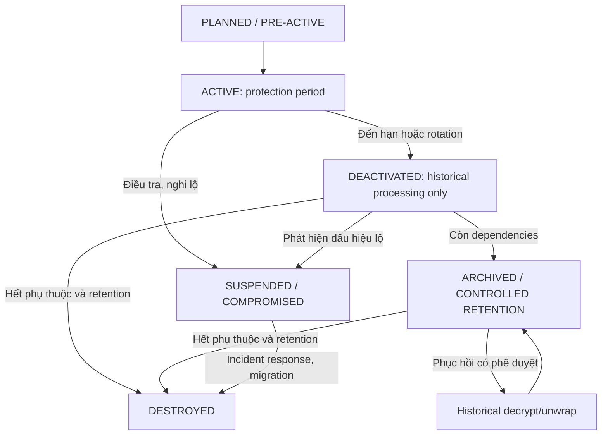
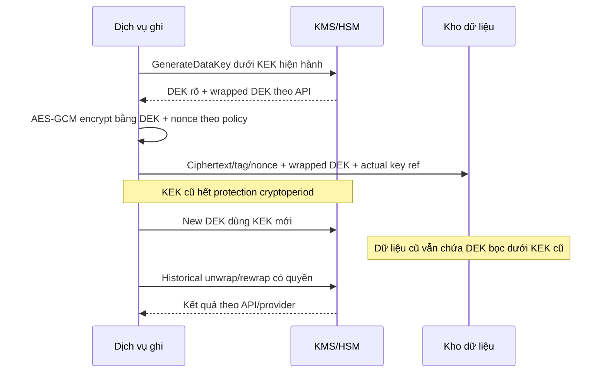
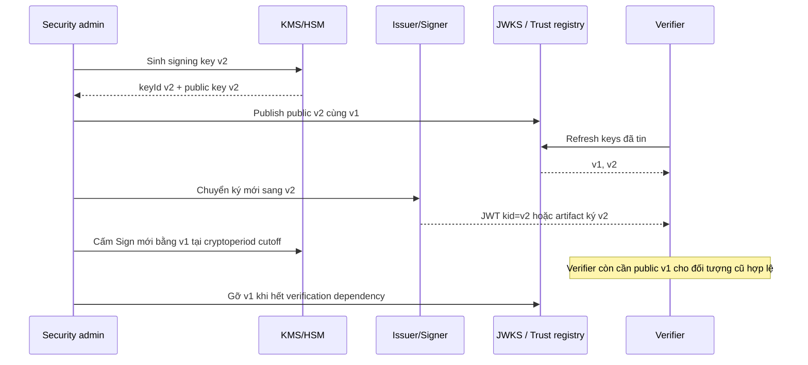
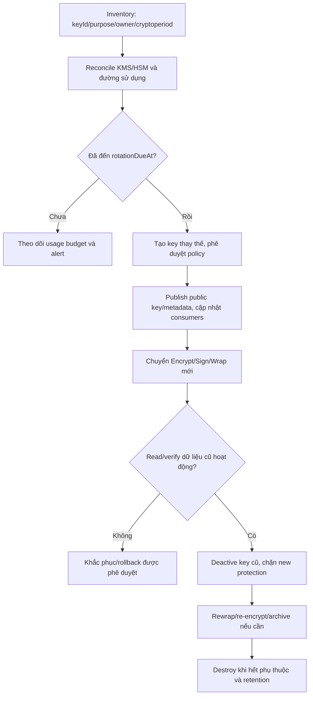

# Cryptoperiod policy — Chính sách thời hạn sử dụng khóa mật mã

Trong chương **Key policy** của module **SECURITY_KEY_MANAGEMENT_FUNDAMENTALS**, **cryptoperiod policy** quy định **khoảng thời gian một khóa mật mã được phép sử dụng cho từng mục đích và thao tác**. Đây không chỉ là việc gán một ngày `expiresAt` vào cơ sở dữ liệu. Chính sách còn phải trả lời: *khóa nào được phép tạo bảo vệ mới đến khi nào, ai được phép dùng, sau mốc đó có còn được giải mã/xác minh dữ liệu cũ không, khi nào xoay khóa, và điều kiện nào cho phép hủy vật liệu khóa?*

Cryptoperiod có ảnh hưởng trực tiếp đến **vòng đời khóa từ tạo, cấp phát, lưu trữ, sử dụng, xoay vòng, thu hồi đến hủy**. Một chính sách quá dài kéo dài thời gian khóa có thể bị lạm dụng và tăng lượng dữ liệu chịu ảnh hưởng nếu khóa lộ. Một chính sách quá ngắn nhưng thiếu đường chuyển đổi có thể khiến các dịch vụ không ký được token, không giải mã được backup hoặc ngừng hoạt động hàng loạt. Mục tiêu là **giảm rủi ro mà vẫn đáp ứng thời hạn xử lý dữ liệu hợp pháp**.

Bài học kết nối cryptoperiod với mật mã đối xứng và bất đối xứng, chữ ký số, HMAC, KMS/HSM, envelope encryption, DEK/KEK, IAM, kiểm toán và quy trình vận hành. Trọng tâm là **thiết kế, thực thi và kiểm chứng chính sách thời hạn**, không phải tìm một con số thời hạn chung cho tất cả khóa.

## 1. Mục tiêu học tập

Sau bài này, bạn có thể:

- Giải thích **cryptoperiod** và phân biệt thời hạn **tạo bảo vệ mới** với thời hạn **xử lý dữ liệu đã được bảo vệ trước đó**.
- Phân biệt `createdAt`, `activatedAt`, `rotationDueAt`, `protectionExpiresAt`, `processingUntil`, `deactivatedAt`, `destroyAfter`, hạn chứng chỉ và hạn token.
- Chọn thời hạn theo **loại khóa, thuật toán, mục đích, vòng đời dữ liệu, mô hình đe dọa, tần suất sử dụng và khả năng khôi phục**.
- Thiết kế policy theo thao tác: khi nào cho `Encrypt`, `Wrap`, `Sign`, `GenerateMac`, `Decrypt`, `Unwrap` hay `Verify`.
- Lập kế hoạch **rotation**, chuyển trạng thái `DEACTIVATED`, giữ khả năng xử lý dữ liệu lịch sử, archive và hủy khóa khi hết phụ thuộc.
- Áp dụng một policy gate minh họa bằng **Java 17**, đồng thời nhận ra vì sao kiểm tra ở ứng dụng không thay thế IAM/KMS/HSM.
- Xây cơ chế cảnh báo, kiểm toán, xử lý sự cố và kiểm thử để chính sách thực sự có hiệu lực.

## 2. Cryptoperiod là gì?

**Cryptoperiod** là khoảng thời gian mà một khóa mật mã được **ủy quyền sử dụng trong một chức năng mật mã nhất định**. Từ khóa quan trọng là **được ủy quyền**, không phải “API còn chạy được” hay “byte khóa còn tồn tại”.

Có thể mô hình hóa chính sách qua hai khoảng thời gian:

- **Protection / originator-usage period**: giai đoạn khóa được phép **tạo bảo vệ mới**, như mã hóa dữ liệu mới, bọc DEK mới, tạo MAC hoặc chữ ký mới.
- **Processing / recipient-usage period**: giai đoạn khóa hoặc vật liệu xác minh liên quan còn được phép dùng để **xử lý đối tượng lịch sử**, như giải mã ciphertext cũ, unwrap DEK cũ hoặc xác minh chữ ký đã phát hành.

Các thuật ngữ *originator-usage period* và *recipient-usage period* thường xuất hiện trong hướng dẫn quản lý khóa, nhưng tên thao tác thực tế phải được diễn giải theo **key type và giao thức**. Đối với chữ ký bất đối xứng, private signing key phục vụ giai đoạn ký, còn public verification key có thể cần tồn tại lâu hơn. Không áp dụng máy móc cùng một mô hình cho mọi primitive.

```text
Thời gian ------------------------------------------------------>

Key generated
    |
    v
    [ PRE-ACTIVE ] [ ACTIVE / PROTECTION ] [ DEACTIVATED / HISTORICAL ] [ END ]
                    ^                     ^                              ^
                    |                     |                              |
                activatedAt        protectionExpiresAt            processingUntil
                      |                    |
                      +--- được tạo bảo vệ mới
                                           +--- chỉ xử lý lịch sử theo policy

Archive, legal hold và destruction là các quyết định riêng.
```

**Ví dụ:** KEK `billing-kek-v1` được phép bọc DEK mới tới ngày 01/12/2026. Sau thời điểm đó, dịch vụ chỉ được **unwrap các DEK đã bọc trước đây** cho các bản ghi được ủy quyền, trong khi dữ liệu mới dùng KEK `v2`. Nếu tất cả wrapped DEK đã được rewrap an toàn, tổ chức có thể không còn cần giữ KEK cũ. Nếu một backup bất biến vẫn chứa DEK bọc bằng v1, khả năng khôi phục v1 có thể cần kéo dài hơn.

### 2.1. Khái niệm liên quan nhưng không đồng nghĩa

| Thuật ngữ | Nó mô tả điều gì? | Có tự động cho phép hủy khóa không? |
| --- | --- | --- |
| **Key lifetime** | Thời gian vật liệu khóa tồn tại từ khi tạo đến lúc hủy. | Không. Có thể lớn hơn thời gian được phép sử dụng. |
| **Protection cryptoperiod** | Thời gian được tạo bảo vệ mật mã mới. | Không. Có thể còn dữ liệu lịch sử cần xử lý. |
| **Processing / verification period** | Thời gian còn phải giải mã, unwrap hoặc verify dữ liệu cũ. | Không. Phải xét retention, backup, legal hold và phụ thuộc. |
| **Rotation due date** | Hạn vận hành để chuẩn bị hoặc chuyển sang khóa mới. | Không. Rotation có thể xảy ra trước thời hạn sử dụng. |
| **Certificate validity** | Khoảng `NotBefore`–`NotAfter` của chứng chỉ X.509. | Không. Chứng chỉ và raw key có vòng đời khác nhau. |
| **Token expiration** | Hạn của JWT, session hoặc bearer token cụ thể. | Không. Token và key ký token có thời hạn khác nhau. |
| **Secret TTL** | Hạn của credential hoặc secret được cấp cho một chức năng. | Không nhất thiết. Cần biết loại secret và sự phụ thuộc. |
| **Data retention** | Thời gian cần giữ đối tượng nghiệp vụ. | Không trực tiếp. Có thể phải giữ khả năng giải mã hoặc bằng chứng xác minh. |
| **Scheduled destruction** | Thời điểm dự định tiêu hủy key material. | Chỉ là lịch trình; phải thỏa điều kiện hủy. |

**Quy tắc nền tảng:** một thời điểm hết hạn **không đồng nghĩa** quyền `Decrypt`, `Unwrap` hoặc `Verify` lịch sử phải bị chặn ngay; cũng **không đồng nghĩa** quyền đó được giữ vô thời hạn.

## 3. Xác định phạm vi chính sách theo mục đích khóa

Một chính sách cryptoperiod chỉ có nghĩa khi gắn với **loại khóa, mục đích và miền tin cậy**.

| Loại khóa | Hoạt động tạo bảo vệ mới cần hết hạn | Hoạt động lịch sử có thể còn cần | Lưu ý rủi ro |
| --- | --- | --- | --- |
| **AES DEK** | `Encrypt` đối tượng hoặc thông điệp mới bằng DEK cũ. | `Decrypt` ciphertext cũ đúng quyền và AEAD tag. | Lộ DEK có thể làm lộ toàn bộ dữ liệu đã mã hóa bằng khóa đó. |
| **Symmetric KEK** | `Wrap` DEK mới dưới KEK cũ. | `Unwrap` wrapped DEK lịch sử đến khi rewrap/retention hoàn tất. | Xóa KEK sớm có thể khiến backup không thể đọc. |
| **HMAC key** | Tạo MAC/tag mới. | `VerifyMac` thông điệp cũ trong cửa sổ đã định và chống replay. | Ai biết secret cũng có thể tạo tag mới, dù chính sách chỉ cho verify. |
| **Private signing key** | `Sign` token, tài liệu hoặc artifact mới. | Thường không cần private key để xác minh chữ ký cũ. | Quyền `Sign` bị lạm dụng có thể tạo chữ ký giả hợp lệ. |
| **Public verification key** | Không trực tiếp tạo chữ ký mới. | Kiểm tra chữ ký lịch sử với issuer/trust/evidence thích hợp. | Khóa công khai không bí mật nhưng **phải xác thực nguồn gốc**. |
| **Recipient private key RSA/KEM** | Được phép dùng public key tương ứng làm đích bảo vệ mới theo policy. | `Decrypt`/`Decapsulate` bản mã cũ nếu còn phụ thuộc. | Lộ private key dài hạn có thể ảnh hưởng ciphertext quá khứ bị thu thập. |
| **Ephemeral ECDH key** | Thiết lập phiên mới bằng khóa tạm thời cũ. | Thường không cần giữ khi phiên hoàn tất. | Giữ private key tạm thời quá lâu làm yếu mục tiêu forward secrecy. |
| **Root/KDF key** | Dẫn xuất khóa con mới cho mục đích đã hết hạn. | Có thể cần tái dẫn xuất khóa con cũ nếu thiết kế phụ thuộc. | Phạm vi ảnh hưởng của root key thường rộng. |
| **Password pepper** | Tạo bản ghi xác minh mật khẩu mới theo phiên bản pepper cũ. | Có thể cần xác minh verifier cũ trong thời gian migration. | Mất pepper có thể chặn đăng nhập; lộ pepper tăng rủi ro offline. |

Không lấy thời hạn của **KEK** để mặc nhiên áp cho tất cả **DEK**, cũng không lấy hạn của **JWT** để đặt thời hạn **private signing key**. Những đối tượng đó có mối quan hệ nhưng khác vòng đời.

### 3.1. Tách tenant, môi trường và purpose

Một khóa ký cho `payments-prod` không nên được tái sử dụng tùy tiện cho `developer-test` hoặc `artifact-release`. Việc tách khóa làm giảm **blast radius** khi một miền bị chiếm quyền và giúp đặt cryptoperiod đúng mô hình rủi ro.

Ví dụ cách phân vùng:

```text
payments/prod/signing/v4     -> ký chứng từ thanh toán
identity/prod/jwt/v7        -> ký access token
billing/prod/kek/v3         -> wrap DEK hóa đơn
partner/acme/webhook/v2     -> HMAC cho một đối tác

Mỗi key có:
  keyId + algorithm + owner + purpose + policyVersion
  activatedAt + protectionExpiresAt + rotationDueAt
  historical policy + dependencies + audit
```

Đây là định dạng logic. **Key ID không phải secret** và không tự chứng minh một workload được quyền dùng khóa.

## 4. Chọn thời lượng cryptoperiod theo rủi ro

**Không có một thời lượng mặc định đúng cho mọi thuật toán, mọi khóa và mọi tổ chức.** Cryptoperiod phải xuất phát từ threat model, yêu cầu nghiệp vụ, thuật toán và điều kiện vận hành; nếu có tiêu chuẩn hoặc nghĩa vụ tuân thủ bắt buộc, chính sách phải phản ánh chúng.

Những yếu tố cần đánh giá:

1. **Loại khóa và thao tác:** DEK, KEK, private signing key, HMAC key hay khóa thiết lập phiên có tác động khác nhau nếu lộ.
2. **Độ nhạy của dữ liệu:** dữ liệu khách hàng, thanh toán, định danh, chứng từ lưu dài hạn hay cache tạm.
3. **Lượng dữ liệu/giao dịch dưới một khóa:** số object, số byte, số lần `Encrypt`/`Sign` và số bên có thể tiếp cận khóa.
4. **Mức an toàn thuật toán và giới hạn giao thức:** kích thước khóa, khả năng suy giảm thuật toán, giới hạn lượng dữ liệu/nonce, chính sách PKI và thuật toán được hỗ trợ.
5. **Cách giữ khóa:** private key non-exportable trong HSM/KMS khác với secret được cấp vào bộ nhớ nhiều workload; nhưng non-exportable vẫn không ngăn gọi `Sign` trái phép nếu quyền bị chiếm.
6. **Tần suất bị phơi lộ:** khóa dùng trực tiếp trong hot path, ở client không tin cậy, trong batch offline hay chỉ trong HSM.
7. **Khả năng rotation:** key mới có thể phân phối, public key có thể publish, ciphertext cũ có thể rewrap/re-encrypt nhanh đến đâu.
8. **Yêu cầu sẵn sàng:** mất key có thể làm gián đoạn dịch vụ, mất khả năng giải mã backup hoặc phá vỡ chuỗi xác minh lịch sử.
9. **Thời hạn giá trị của dữ liệu:** dữ liệu cần giữ và giữ bí mật bao lâu; bản mã có thể bị thu thập để giải mã về sau không.
10. **Rủi ro vật lý và tổ chức:** quyền admin, backup, số tenant, độ tin cậy KMS/HSM, incident response và khả năng audit.
11. **Yêu cầu pháp lý/ngành:** thời hạn lưu, chữ ký được công nhận, quy trình phê duyệt, kiểm định và chính sách nội bộ.
12. **Kiểm soát bù trừ:** hạn mức sử dụng khóa, rate limit, approval, audit, access boundaries, domain separation và kiểm soát nonce.

### 4.1. Ma trận ra quyết định — không phải bảng thời hạn chuẩn

| Tình huống | Câu hỏi cần trả lời trước khi đặt hạn | Hướng thiết kế |
| --- | --- | --- |
| **DEK riêng từng đối tượng** | Mỗi DEK mã hóa bao nhiêu dữ liệu? Có còn ghi thêm vào cùng đối tượng không? | Giới hạn phạm vi sử dụng; thời hạn bảo vệ mới có thể kết thúc ngay sau khi mã hóa xong. |
| **KEK dịch vụ** | Có bao nhiêu DEK được bọc? Có thể rewrap, backup và restore như thế nào? | Đặt lịch rotation trước hạn và theo dõi các wrapped DEK lịch sử. |
| **Signing key JWT** | Token TTL tối đa, JWKS cache, skew và số issuer/verifier là bao nhiêu? | Xoay theo chính sách ký; duy trì verification overlap tách khỏi hạn ký. |
| **Private key ký chứng từ lâu dài** | Có bằng chứng thời điểm ký và yêu cầu lưu chữ ký trong bao lâu? | Hạn ký riêng; lưu public key/cert/trust evidence lâu hơn khi cần. |
| **HMAC webhook** | Đối tác triển khai khóa mới nhanh đến đâu, có chống replay không? | Phối hợp overlap hạn chế, phân biệt giai đoạn tạo MAC và giai đoạn verify. |
| **KEM recipient key** | Dữ liệu có giá trị bí mật lâu dài? Có threat “harvest now, decrypt later”? | Đánh giá thuật toán, chuyển đổi hậu lượng tử/hybrid, vòng đời private key và dữ liệu cũ. |
| **Khóa phiên** | Phiên tồn tại bao lâu, có rekey/forward secrecy hay không? | Dùng giao thức thiết lập phiên; không giữ khóa tạm lâu không cần thiết. |

Bảng trên **không** quy định “KEK phải 365 ngày” hay “private signing key luôn 90 ngày”. Nếu dùng những con số như vậy trong tài liệu nội bộ, cần ghi rõ **đó là quyết định risk-based của tổ chức**, ai phê duyệt và mốc rà soát.

### 4.2. Ngoài thời gian còn có hạn mức sử dụng

Một khóa có thể cần dừng **trước thời hạn trên lịch** vì đạt giới hạn sử dụng theo mật mã hoặc rủi ro. Do đó cryptoperiod policy có thể cần **điều kiện ngừng sớm**:

```text
key usable for new protection iff:
  state == ACTIVE
  now thuộc khoảng thời gian cho phép
  operation thuộc capabilities và purpose
  principal/tenant có quyền
  usageCount / dataVolume / nonceBudget chưa vượt policy
  key chưa compromised hoặc suspended
  không có yêu cầu dừng khẩn cấp
```

Với **AES-GCM**, số lần mã hóa, độ dài nonce, cách cấp phát nonce và giới hạn theo chế độ là yếu tố quan trọng: **đừng chỉ dựa vào ngày hết hạn** rồi cho cùng một khóa dùng không giới hạn số thông điệp. Nonce không được lặp với cùng key. Với chữ ký và KMS, cũng cần giới hạn tần suất, dữ liệu được ký và quyền nghiệp vụ.

## 5. Chính sách thời gian nên được biểu diễn như thế nào?

Nên tách **mốc kế hoạch**, **mốc thực tế** và **mốc dữ liệu lịch sử**.

| Thuộc tính | Ý nghĩa | Ai là nguồn sự thật? |
| --- | --- | --- |
| `createdAt` | Thời gian cặp khóa/vật liệu khóa được tạo. | KMS/HSM/provider hoặc key generation audit. |
| `activatedAt` | Bắt đầu được phép tạo bảo vệ mới. | Key registry + change/approval. |
| `rotationDueAt` | Hạn chuẩn bị/chuyển khóa trong vận hành. | Policy owner/security. |
| `protectionExpiresAt` | **Mốc chặn tạo bảo vệ mới**. | Chính sách đã được phê duyệt và enforce. |
| `deactivatedAt` | Thời điểm đã chuyển trạng thái thực tế. | State transition event/audit. |
| `processingUntil` | Hạn xử lý đối tượng cũ theo policy. | Data retention và crypto policy; có thể cần review. |
| `archiveReviewAt` | Mốc đánh giá tiếp tục giữ secret/evidence. | Records/security policy. |
| `destroyAfter` | Mốc sớm nhất có thể cân nhắc hủy sau khi đủ điều kiện. | Phê duyệt retention và dependency review. |
| `destroyedAt` | Mốc hủy được ghi nhận và xác minh. | Provider/HSM destruction evidence. |

**Quan trọng:** `processingUntil` không phải giấy phép mặc định để đọc mọi dữ liệu cũ đến mốc đó. Vẫn cần quyền nghiệp vụ, phạm vi tenant, nguồn metadata đáng tin, tag/chữ ký hợp lệ và điều kiện lưu trữ.

### 5.1. Khoảng hiệu lực và quy tắc biên

Dùng khoảng **nửa mở** cho thời gian tạo bảo vệ mới:

```text
activatedAt <= now < protectionExpiresAt
```

Tại **đúng thời điểm** `protectionExpiresAt`, khóa **đã hết hạn** để `Encrypt`, `Sign`, `Wrap` hoặc tạo MAC mới. Không dùng `now <= protectionExpiresAt` nếu chính sách xác định mốc kết thúc là **exclusive**.

- Lưu mốc bằng **UTC `Instant`** (ví dụ `2026-12-01T00:00:00Z`), không bằng chuỗi ngày địa phương mơ hồ.
- Xác định nguồn thời gian server, đồng bộ đồng hồ và chính sách clock skew của từng giao thức.
- Với giao dịch dài, phải định nghĩa điểm quyết định: lúc yêu cầu được nhận, lúc cấp grant hay lúc thao tác cryptographic hoàn tất.
- Kiểm soát cache IAM/policy, deployment nhiều region và các thao tác bắt đầu trước khi hết hạn nhưng kết thúc sau đó.
- Grace period để **xác minh token cũ** không tự cho phép **ký token mới** quá hạn.

### 5.2. Một policy record minh họa

```json
{
  "schemaVersion": 2,
  "keyId": "billing/prod/kek-v3",
  "providerKeyRef": "kms://example/region/key/uuid-v3",
  "keyType": "SYMMETRIC_KEK",
  "algorithm": "AES-256",
  "purpose": "wrap-billing-dek",
  "tenantScope": "billing",
  "owner": "billing-security",
  "state": "ACTIVE",
  "activatedAt": "2026-01-15T00:00:00Z",
  "rotationDueAt": "2026-11-15T00:00:00Z",
  "protectionExpiresAt": "2026-12-01T00:00:00Z",
  "processingUntil": "2028-12-01T00:00:00Z",
  "archiveReviewAt": "2027-12-01T00:00:00Z",
  "replacementKeyId": "billing/prod/kek-v4",
  "dependencyManifestRef": "billing/kek-v3/dependencies",
  "policyVersion": 9,
  "lastApprovedChangeId": "chg-2026-042"
}
```

**Đây là schema giả định để học, không phải định dạng KMS chuẩn.** Những mốc trên chỉ minh họa cách liên kết các trường. Một `processingUntil` dài **không bắt buộc** phải giữ KEK thật đến hết năm 2028 nếu toàn bộ wrapped DEK đã được rewrap và xác minh không còn phụ thuộc v3.

Mọi trường có ảnh hưởng quyền phải có **nguồn sự thật, quyền sửa, version và audit**. Đừng để client gửi một JSON tự khai `protectionExpiresAt` hay `policyVersion` để mở rộng quyền dùng khóa.

## 6. Trạng thái khóa và tác động đến cryptoperiod

Một vòng đời logic điển hình:



Sơ đồ là **quy ước kiến trúc**, không phải state machine chung của tất cả KMS/HSM. Một số hệ thống có thể cho khôi phục `SUSPENDED` khi chứng minh an toàn; trạng thái `COMPROMISED` không được tùy tiện quay lại `ACTIVE` chỉ bằng sửa database.

### 6.1. Expired khác deactivated, disabled, revoked và destroyed

| Thuật ngữ | Hệ quả chính | Không tự suy ra |
| --- | --- | --- |
| **Expired theo cryptoperiod policy** | Không còn được phép **tạo bảo vệ mới**. | Khóa đã bị disable trong KMS hoặc tự bị xóa. |
| **Deactivated** | Một chuyển trạng thái chủ động ngừng bảo vệ mới. | Không còn khả năng xử lý dữ liệu cũ. |
| **Disabled ở KMS** | Provider có thể chặn toàn bộ hoặc một số thao tác. | Hệ thống vẫn có thể decrypt cũ; phải kiểm tra API. |
| **Certificate revoked** | Trust PKI bị thay đổi theo cơ chế thu hồi. | Private key đã bị xóa hoặc mọi chữ ký lịch sử đều sai. |
| **Compromised** | Có nghi vấn khóa bị lộ hoặc quyền dùng bị lạm dụng. | Routine rotation hoặc chờ hết hạn là đủ. |
| **Destroyed** | Vật liệu khóa được loại bỏ trong phạm vi kiểm soát. | Ciphertext cũ còn giải mã được nếu không có key/đường thay thế. |

**Expiry trong key registry không phải biện pháp thực thi nếu KMS vẫn chấp nhận thao tác bị cấm.** Cần kiểm soát tại **điểm gọi crypto thực tế**: key policy, IAM, signing/encryption service có policy gate, hoặc HSM capability nếu được hỗ trợ.

## 7. Thiết kế policy theo operation và dữ liệu lịch sử

Ví dụ bộ quyền logic:

```text
Khi ACTIVE và nằm trong protection cryptoperiod:
  ENCRYPT_NEW       -> Conditional allow
  WRAP_NEW          -> Conditional allow
  SIGN_NEW          -> Conditional allow
  MAC_CREATE        -> Conditional allow
  DECRYPT_HISTORIC  -> Conditional allow
  UNWRAP_HISTORIC   -> Conditional allow
  VERIFY_HISTORIC   -> Conditional allow

Khi DEACTIVATED hoặc quá protectionExpiresAt:
  ENCRYPT_NEW       -> DENY
  WRAP_NEW          -> DENY
  SIGN_NEW          -> DENY
  MAC_CREATE        -> DENY
  NEW_KEY_AGREEMENT -> DENY
  DECRYPT_HISTORIC  -> Allow only with authenticated history + IAM
  UNWRAP_HISTORIC   -> Allow only with authenticated history + IAM
  VERIFY_HISTORIC   -> Allow only with valid trust/evidence/policy

Khi COMPROMISED hoặc DESTROYED:
  Normal business operations -> DENY
  Forensics/recovery          -> Separate incident workflow
```

**Không thể “chỉ cho verify HMAC” nếu người xử lý có thể đọc raw HMAC secret**: về mặt mật mã, ai có secret đều tạo được tag mới. Nếu cần hạn chế chỉ verify, phải dùng API/ranh giới thực thi ngăn xuất secret và không cấp đường tạo MAC, kết hợp audit và anti-replay. Với **public-key signature**, verifier chỉ cần public key và bản thân không thể ký giả nếu không có private key.

**Chứng minh tính lịch sử không thể chỉ dựa vào `createdAt` client tự khai.** Dữ liệu cũ cần được nhận dạng bằng metadata được xác thực, manifest/timestamp đáng tin, đối tượng trong kho có quyền, key reference thực và tag/chữ ký hợp lệ. Cần kiểm tra cả **quyền nghiệp vụ**, không chỉ toán học của ciphertext.

## 8. Java 17: policy gate cho cryptoperiod

Ví dụ sau mô hình hóa thời hạn sử dụng và phân biệt **tạo bảo vệ mới** với **xử lý lịch sử**. Mốc thời gian dùng `Instant` và `Clock` để có thể kiểm thử chính xác tại thời điểm hết hạn.

Đây là **minh họa policy**, không phải triển khai KMS hoặc mã hóa. Trạng thái, danh tính, `historicalObjectVerified` và tập capability **phải được xác lập từ nguồn tin cậy phía server**, không được nhận nguyên từ request chưa xác thực.

```java
import java.time.Clock;
import java.time.Instant;
import java.time.ZoneOffset;
import java.util.EnumSet;
import java.util.Objects;
import java.util.Set;

public final class CryptoperiodPolicyDemo {
    enum State { ACTIVE, DEACTIVATED, SUSPENDED, COMPROMISED, DESTROYED }

    enum Operation {
        ENCRYPT_NEW, WRAP_NEW, SIGN_NEW, MAC_CREATE,
        DECRYPT_OLD, UNWRAP_OLD, VERIFY_OLD
    }

    record KeyPolicy(
            String keyId,
            State state,
            Instant activatedAt,
            Instant protectionExpiresAt,
            Instant processingUntil,
            Set<Operation> allowedOperations) {
        KeyPolicy {
            Objects.requireNonNull(keyId);
            Objects.requireNonNull(state);
            Objects.requireNonNull(activatedAt);
            Objects.requireNonNull(protectionExpiresAt);
            Objects.requireNonNull(processingUntil);
            allowedOperations = Set.copyOf(allowedOperations);
            if (!activatedAt.isBefore(protectionExpiresAt)
                    || processingUntil.isBefore(protectionExpiresAt)) {
                throw new IllegalArgumentException("Invalid key periods");
            }
        }
    }

    // Kết quả của bước xác thực/ủy quyền và đối chiếu object lịch sử
    // do server thực hiện. Không tạo record này từ cờ do client gửi.
    record TrustedContext(
            boolean authorizedPrincipal,
            boolean correctTenantAndPurpose,
            boolean historicalObjectVerified) {}

    static boolean isNewProtection(Operation op) {
        return switch (op) {
            case ENCRYPT_NEW, WRAP_NEW, SIGN_NEW, MAC_CREATE -> true;
            case DECRYPT_OLD, UNWRAP_OLD, VERIFY_OLD -> false;
        };
    }

    static boolean allowed(
            KeyPolicy key, Operation op, TrustedContext ctx, Clock clock) {
        if (!ctx.authorizedPrincipal() || !ctx.correctTenantAndPurpose()
                || !key.allowedOperations().contains(op)) {
            return false;
        }

        Instant now = clock.instant();
        if (now.isBefore(key.activatedAt())) {
            return false;
        }

        if (isNewProtection(op)) {
            return key.state() == State.ACTIVE
                    && now.isBefore(key.protectionExpiresAt());
        }

        // Chỉ giải mã/unwrap/verify đối tượng lịch sử đã xác thực.
        return (key.state() == State.ACTIVE
                     || key.state() == State.DEACTIVATED)
                && ctx.historicalObjectVerified()
                && now.isBefore(key.processingUntil());
    }

    public static void main(String[] args) {
        KeyPolicy oldKek = new KeyPolicy(
                "billing/kek-v3",
                State.ACTIVE,
                Instant.parse("2026-01-15T00:00:00Z"),
                Instant.parse("2026-12-01T00:00:00Z"),
                Instant.parse("2028-12-01T00:00:00Z"),
                EnumSet.of(Operation.WRAP_NEW, Operation.UNWRAP_OLD));

        TrustedContext authorized = new TrustedContext(true, true, true);
        Clock before = Clock.fixed(
                Instant.parse("2026-11-30T23:59:59Z"), ZoneOffset.UTC);
        Clock atExpiry = Clock.fixed(
                Instant.parse("2026-12-01T00:00:00Z"), ZoneOffset.UTC);

        System.out.println("Wrap before expiry: " +
                allowed(oldKek, Operation.WRAP_NEW, authorized, before));
        System.out.println("Wrap at expiry: " +
                allowed(oldKek, Operation.WRAP_NEW, authorized, atExpiry));
        System.out.println("Historical unwrap at expiry: " +
                allowed(oldKek, Operation.UNWRAP_OLD, authorized, atExpiry));

        TrustedContext unproven = new TrustedContext(true, true, false);
        System.out.println("Unproven historical unwrap: " +
                allowed(oldKek, Operation.UNWRAP_OLD, unproven, atExpiry));
    }
}
```

Đầu ra dự kiến:

```text
Wrap before expiry: true
Wrap at expiry: false
Historical unwrap at expiry: true
Unproven historical unwrap: false
```

### 8.1. Giới hạn của ví dụ

- `State.ACTIVE` cộng `now < protectionExpiresAt` **không đủ** cấp quyền trong production. Cần kiểm tra IAM, tenant, key type, algorithm, `keyId` thực, usage budget, business approval và tình trạng compromised.
- `processingUntil` trong demo là **hạn đóng xử lý lịch sử**; dữ liệu được đọc trước mốc đó vẫn phải thuộc phạm vi hợp lệ. Có thể cần **legal hold** và quyền lưu giữ riêng.
- `Clock.fixed` dành cho test. Production dùng đồng hồ server được quản lý, theo dõi drift, và không lấy `now` từ client.
- Java code không chặn được workload khác gọi KMS **trực tiếp**. Phải quản lý policy ở đúng enforcement point, kiểm thử bypass và quyền IAM.
- `trustedContext.historicalObjectVerified` là bằng chứng logic giả định; phải được chứng minh từ metadata/tags/manifest đáng tin, không phải một boolean do client cung cấp.
- Cần xử lý **TOCTOU** (*time-of-check to time-of-use*): khóa có thể hết hạn hoặc bị revoke giữa lúc kiểm tra và lúc crypto operation thực thi. Nên kiểm soát phiên bản policy/grant, điểm quyết định và audit theo kiến trúc.
- `EnumSet`/capability chỉ mô phỏng quyền theo **operation**; không nên cấp cùng quyền `Sign` và `Decrypt` cho mọi key type.
- Vòng đời thực tế của KMS có thể không có chế độ “write disabled, historical decrypt enabled” sẵn có; thiết kế có thể cần tách role, proxy, key alias hoặc migration.

## 9. Chính sách cryptoperiod cho DEK, KEK và envelope encryption

Trong **envelope encryption**, dữ liệu được mã hóa bằng **DEK**, còn **KEK** trong KMS/HSM bảo vệ DEK. Cryptoperiod phải quy định **hai vòng đời khác nhau**.



### 9.1. DEK cryptoperiod

Nếu mỗi DEK chỉ dùng mã hóa **một đối tượng**, protection cryptoperiod của nó có thể rất ngắn; **key lifetime** hoặc khả năng unwrap/decrypt có thể kéo dài theo thời hạn lưu dữ liệu.

Nếu một DEK được dùng cho nhiều bản ghi, cần đặt **cả giới hạn thời gian và giới hạn sử dụng**. Đặc biệt với AES-GCM, phải có quy trình **nonce duy nhất theo key** và giới hạn lượng dữ liệu; thời hạn một năm không cho phép bỏ qua nguy cơ trùng nonce.

### 9.2. KEK cryptoperiod

Khi KEK `v3` hết hạn để wrap mới:

1. **Sinh KEK v4** bằng KMS/HSM theo cơ chế được hỗ trợ.
2. Writer chuyển sang `v4` trước cutoff; các alias/config phải được cập nhật nhất quán.
3. **Cấm wrap mới bằng v3**, đồng thời duy trì historical `Unwrap` trong phạm vi và thời gian cần thiết nếu provider/policy cho phép.
4. **Rewrap** các DEK cũ dưới `v4`, có checkpoint, integrity check và audit.
5. Kiểm tra backup bất biến, vùng DR, cold storage và hệ thống ngoại tuyến trước khi hủy v3.
6. Khi không còn phụ thuộc hợp lệ, thực hiện archive/destruction theo chính sách.

**Rewrap** giữ cùng DEK nên ciphertext payload có thể không đổi. **Re-encrypt** dùng DEK mới, thường cần xử lý lại ciphertext/tag/nonce. Nếu **DEK đã lộ**, rewrap nó dưới KEK mới **không khôi phục** tính bí mật. Nếu **KEK lộ** và attacker có wrapped DEK cũ, phải đánh giá các DEK/dữ liệu bị ảnh hưởng; routine rotation không tự xóa thiệt hại.

### 9.3. Vì sao không chỉ dùng KMS `DisableKey`?

Một số API disable khóa chặn **cả Encrypt lẫn Decrypt/Unwrap**. Chính sách muốn “không wrap mới, vẫn unwrap dữ liệu cũ” cần kiểm tra **năng lực phân quyền theo operation** của provider và IAM.

Nếu provider không hỗ trợ trực tiếp, các hướng kiến trúc có thể gồm:

- routing qua một service có policy gate và hạn chế quyền gọi trực tiếp;
- tách writer role khỏi recovery role;
- rewrap hết dữ liệu phụ thuộc **trước** khi disable toàn diện;
- dùng key hierarchy/migration khác có bằng chứng đủ an toàn.

Không giả định một alias động đổi từ v3 sang v4 đã khiến raw key v3 tự hết quyền tại mọi nơi.

## 10. Cryptoperiod cho chữ ký số, JWKS và PKI

### 10.1. Signing key và public verification key



Trong **JWT/JWS**, có ít nhất ba giới hạn:

- **Signing key protection cryptoperiod**: khi issuer còn được phép ký **token mới** bằng private key đó.
- **`exp` của token**: khi **mỗi token** hết hạn; có thể ngắn hơn cryptoperiod nhiều lần.
- **Verification overlap**: khoảng các verifier còn phải giữ public key cũ do TTL token, cache JWKS, clock skew và chính sách.

Một JWT được ký bằng khóa cũ vẫn cần kiểm tra **issuer `iss`, audience `aud`, `exp`, `nbf`, signature, `alg` allowlist và trạng thái phiên**. `kid` chỉ giúp chọn khóa ứng viên **trong tập khóa đã tin**; không tin `kid`, `jku` hoặc URL cung cấp từ token để tự tải public key của attacker.

Đối với **chữ ký lưu trữ lâu dài**, cần bảo vệ **bằng chứng thời điểm ký đáng tin**, trust/certificate chain, thông tin thu hồi và chính sách xác minh lịch sử. Không coi trường `signedAt` do signer tự khai là bằng chứng thời gian độc lập. Private signing key **không cần giữ chỉ để verify** chữ ký đã phát hành.

### 10.2. Certificate validity là mốc riêng

Chứng chỉ X.509 có `NotBefore` và `NotAfter`. Hết hạn chứng chỉ không có nghĩa private key đã bị hủy. Ngược lại, một private key có thể bị ngừng dùng hoặc thay mới **trước** khi chứng chỉ hết hạn.

Với PKI/TLS, policy cần quản lý:

- thời gian hiệu lực chứng chỉ và thời điểm renew;
- mức độ tin cậy vào CA/trust anchor, certificate chain, key usage/EKU;
- trạng thái certificate revocation phù hợp;
- nơi cài đặt chứng chỉ thực tế và các endpoint vẫn phục vụ bản cũ;
- việc tạo key pair mới hay tái sử dụng khóa theo chính sách.

Nếu private key đã **compromised**, không chờ certificate `NotAfter` mới xử lý sự cố.

## 11. Cryptoperiod cho HMAC và thiết lập khóa

### 11.1. HMAC key

HMAC dùng secret **đối xứng**, người tạo MAC và người kiểm tra thường có cùng secret hoặc dùng capability tách biệt trong HSM/KMS.

```text
Trước rotation:
  Sender tạo MAC mới bằng key v1
  Receiver xác minh bằng key v1

Trong cửa sổ phối hợp:
  Sender tạo MAC mới bằng v2
  Receiver có thể chấp nhận v1/v2 theo policy
  Request có keyId, timestamp, nonce/requestId được MAC bảo vệ

Sau cutoff:
  Cấm tạo MAC mới bằng v1
  Chỉ verify v1 cho yêu cầu lịch sử hợp lệ trong cửa sổ rất rõ
  Hết phụ thuộc thì thu hồi/hủy v1
```

**Chống replay là yêu cầu độc lập**: tag hợp lệ của request cũ có thể được gửi lại. Khi đã tới hạn, việc giữ secret v1 để verify làm tăng rủi ro ai đó dùng secret tạo MAC mới ngoài luồng, nên cần giới hạn scope, thời gian, quyền, metadata đáng tin và idempotency.

### 11.2. Ephemeral ECDH, KEM và forward secrecy

Với **ECDH/X25519** hoặc KEM/HPKE, thời hạn khóa phụ thuộc giao thức:

- **Ephemeral key** chỉ nên tồn tại cho phiên/thỏa thuận được thiết kế; không tự archive private ephemeral key khi không còn nhu cầu.
- **Recipient private key tĩnh** có thể cần decapsulate ciphertext cũ; nếu bị lộ trong tương lai, các ciphertext cũ đã bị thu thập có thể bị giải mã theo cơ chế sử dụng, vì vậy không mặc định có **forward secrecy**.
- **KDF/HKDF** dùng secret đầu vào theo key schedule và domain separation của giao thức; cryptoperiod của root key và session key là các quyết định khác nhau.
- **Hybrid classical + post-quantum** phải dùng protocol/combiner đã được đánh giá, không thay cryptoperiod bằng việc tự ghép hai secret tùy tiện.

Khi yêu cầu bảo mật dữ liệu dài hạn có rủi ro “thu thập hôm nay, giải mã về sau”, lựa chọn thuật toán và thời gian sống private key là một phần của **cryptographic agility**, không đơn thuần là lịch rotation.

## 12. Từ chính sách đến kế hoạch rotation có thể vận hành

Một cryptoperiod policy không hoàn thành khi mới ghi mốc expiry. Nó cần **lead time, owner, dependency inventory và điểm chặn kỹ thuật**.



### 12.1. Mốc gợi ý cho một đợt chuyển đổi

Giả sử một **KEK giả định** có `protectionExpiresAt=2026-12-01T00:00:00Z`:

| Mốc vận hành | Công việc | Điều kiện để tiếp tục |
| --- | --- | --- |
| **Trước cutoff** | Xác định owner, các wrapped DEK, backup, phụ thuộc dịch vụ và kế hoạch thay thế. | Inventory đủ tin cậy, biết rollback/recovery. |
| **Prepare** | Tạo KEK mới trong KMS/HSM, kiểm tra phân quyền và test unwrap. | Key mới đúng thuật toán, policy và purpose. |
| **Rollout** | Đổi writer sang KEK mới, đồng bộ region/queue/cache. | Không còn writers phát sinh wrapped DEK mới bằng key cũ. |
| **Cutoff** | Cấm `Wrap` bằng KEK cũ tại điểm thực thi. | Có audit và giám sát xác nhận hiệu lực. |
| **Historical phase** | Chỉ `Unwrap` cũ theo quyền; rewrap và kiểm thử restore. | Mọi kết quả migration được xác minh, có checkpoint. |
| **Disposition** | Archive hoặc destroy KEK cũ sau review. | Không còn phụ thuộc; retention/legal hold đã giải quyết. |

Đây là **workflow mẫu**, không phải lịch thời hạn cố định bắt buộc. Một JWT signing key có bước công bố JWKS và overlap khác; HMAC partner key cần phối hợp bên thứ ba; DEK per-object có thể không cần chạy rotation theo lịch cho từng đối tượng nếu đã ngừng mã hóa mới ngay sau khi tạo.

### 12.2. Xử lý request chạy đúng lúc hết hạn

Một hệ thống phân tán có thể có:

```text
23:59:59.900: writer A được cho phép
00:00:00.000: key hết protection cryptoperiod
00:00:00.200: thao tác Encrypt hoàn tất
```

Policy phải quyết định **điểm tính thời hạn**: khi cấp grant, khi thao tác mật mã bắt đầu hay khi kết thúc. Không thể vừa tuyên bố “không có mã hóa nào xảy ra sau cutoff” vừa bỏ qua request đã vào hàng đợi hoặc đang chạy.

Các biện pháp hỗ trợ:

- Chuyển writers sang key mới **trước cutoff**, sau đó drain các request/queue có key cũ.
- Sử dụng policy version, short-lived grant và invalidation của cache.
- Thực thi hạn mức ở **điểm crypto operation** hoặc service có quyền độc quyền gọi KMS.
- Ghi audit mốc chấp nhận, mốc thực thi, `actualKeyId` và `policyVersion`.
- Kiểm thử trên các region và worker, không chỉ ở một endpoint.

## 13. Kiểm soát qua KMS/HSM, IAM và policy-as-code

KMS/HSM giúp bảo vệ vật liệu khóa và quản trị thao tác, nhưng **không có một khả năng cryptoperiod giống hệt ở mọi provider**. Một số dịch vụ cho phép đặt key state hoặc thời hạn key material, một số khác cần **ứng dụng/registry** thực thi policy theo mục đích.

### 13.1. Chính sách cần thực thi ở ba tầng

1. **Policy governance:** ai được đặt/đổi cryptoperiod, tiêu chí xét ngoại lệ và mức chấp nhận rủi ro.
2. **Operational control:** registry, scheduler, rotation workflow, inventory và approval.
3. **Technical enforcement:** IAM/KMS/HSM key policy, service API, authz, tenant checks và logging tại điểm sử dụng.

Nếu chỉ có tầng 2, admin hoặc workload có quyền KMS trực tiếp vẫn có thể dùng khóa **sau khi registry ghi expired**.

### 13.2. Phân quyền mẫu

| Role | Quyền phù hợp | Không cấp mặc định |
| --- | --- | --- |
| **Key owner** | Đề xuất purpose, cryptoperiod, rotation, dependency policy. | Gia hạn không qua phê duyệt hoặc lấy private key. |
| **Security approver** | Phê duyệt thời hạn, ngoại lệ, incident policy và destroy. | Tùy ý ký giao dịch nghiệp vụ. |
| **Key admin** | Tạo, activate, deactive, thay policy, xử lý rotation theo change đã duyệt. | Đọc plaintext nghiệp vụ nếu không được cấp riêng. |
| **Writer/Signer** | `Encrypt`/`Wrap`/`Sign` bằng key hiện hành và đúng purpose. | Sửa `protectionExpiresAt`, `DeleteKey` hay xuất private key. |
| **Reader/Verifier** | `Decrypt`/`Unwrap`/`Verify` đúng phạm vi được cấp. | Tạo bảo vệ mới bằng key đã expired. |
| **Recovery workflow** | Thao tác lịch sử có approval, thời gian và object scope cụ thể. | Unwrap mọi key/archive không giới hạn. |
| **Auditor** | Xem state, deadline, thay đổi quyền, key operations, bằng chứng. | Thực hiện `Sign`/`Decrypt` hoặc sửa log. |

**Tách quyền writer và reader** giúp deactivation rõ ràng, nhưng không đủ nếu cả hai vẫn có thể tải raw key rồi gọi API mật mã tùy ý. Ưu tiên key non-exportable, operation-specific grants, ranh giới dịch vụ và giám sát.

### 13.3. Audit nội dung gì?

Các sự kiện đáng ghi:

- `KEY_POLICY_CREATED`, `CRYPTOPERIOD_SET`, `CRYPTOPERIOD_EXTENDED` với mốc cũ/mới, lý do và người phê duyệt;
- `KEY_ROTATION_STARTED`, `KEY_ACTIVATED`, `KEY_DEACTIVATED`, `KEY_ARCHIVED`, `KEY_DESTROYED`;
- thao tác `Sign/Encrypt/Wrap` sau cutoff (phải từ chối) và `Decrypt/Unwrap/Verify` lịch sử có quyền;
- thay alias, IAM/key policy, độ dài tag/nonce, key origin và provider migration;
- các hành vi bất thường: ký quá nhiều, decrypt sau nhiều tháng không truy cập, lỗi tag hoặc lỗi key state liên tục.

Log nên gồm `actor`, `keyId/version`, `operation`, `purpose`, `tenant`, `timestamp`, `policyVersion`, `requestId`, `result` và tham chiếu change/approval phù hợp. **Không log raw DEK, private key, HMAC key, secret dẫn xuất, token còn hiệu lực hoặc plaintext nhạy cảm**.

## 14. Ngoại lệ và gia hạn cryptoperiod

Một lý do thực tế để xin **gia hạn** là hệ thống chưa triển khai xong key mới trước cutoff. Nhưng việc kéo dài `protectionExpiresAt` làm **tăng thời gian phơi lộ** và có thể vi phạm chính sách bảo mật hoặc giới hạn thuật toán.

Quy trình gia hạn tối thiểu:

1. Owner mở change request giải thích lý do, tác động, số liệu phụ thuộc và kế hoạch khắc phục.
2. Security đánh giá thuật toán, thời gian đã sử dụng, phạm vi quyền, usage budget và khả năng compromised.
3. Nếu **nghi lộ khóa**, không dùng gia hạn như giải pháp thay incident response.
4. Chỉ phê duyệt thời hạn ngoại lệ ngắn và có **mốc kết thúc cụ thể**, theo quyền và nghĩa vụ áp dụng.
5. Lưu `oldExpiry`, `newExpiry`, `approver`, `policyVersion`, `changeId`, lý do và thời điểm có hiệu lực.
6. Đồng bộ enforcement points; kiểm tra `Sign/Encrypt` hoạt động đúng chính sách mới và không xuất hiện bypass.
7. Theo dõi việc triển khai key thay thế; không lặp vô hạn ngoại lệ chỉ để tắt alert.

**Không chỉnh trực tiếp timestamp trong database** mà bỏ qua IAM/KMS policy, approval và audit. Một policy đã hết hạn có thể phải **không được tái kích hoạt** bằng cách sửa `expiresAt` nếu quy định an toàn yêu cầu một cặp khóa mới.

## 15. Sự cố: khóa bị lộ trước hoặc sau cryptoperiod

Cryptoperiod policy làm giảm thời gian sử dụng khóa nhưng **không làm khóa đã lộ trở lại bí mật**.

### 15.1. DEK bị lộ

Nếu attacker biết `DEK-v1`, deactivation ngăn mã hóa mới bằng v1 nhưng không ngăn attacker giải mã ciphertext cũ mà họ đã có. Chỉ **rewrap** v1 dưới KEK mới không tạo ra DEK mới. Cần đánh giá **re-encrypt dữ liệu bằng DEK mới**, phạm vi bản sao đã bị đánh cắp và các nghĩa vụ thông báo/xử lý phù hợp.

### 15.2. KEK bị lộ

Nếu wrapped DEK cũ đã bị lấy và KEK v1 bị lộ, những DEK đó có thể bị mở bọc. Chuyển KEK mới chỉ bảo vệ việc dùng khóa trong tương lai, không làm đối thủ quên vật liệu họ đã khôi phục. Cần đánh giá cả các DEK bị tác động và dữ liệu tương ứng.

### 15.3. Signing key bị lộ

Attacker có thể tạo chữ ký hợp lệ **ngoài KMS**, nên hệ thống audit `Sign` trên KMS **không nhất thiết ghi nhận** các chữ ký giả đó. Phải thay key pair, cập nhật trust/JWKS/PKI, đánh giá token/tài liệu đã ký, và dùng bằng chứng thời điểm đáng tin khi xác minh lịch sử.

### 15.4. Workload có quyền `Sign` bị chiếm

Private key vẫn non-exportable trong HSM nhưng workload bị chiếm quyền có thể gọi `Sign` hợp lệ. Cần chặn credential/workload, kiểm tra nội dung đã ký, mốc thời gian, audit và quyền nghiệp vụ. **HSM bảo vệ chống xuất key không tự ngăn lạm dụng capability.**

### 15.5. Tại sao lịch rotation không thay thế incident response?

Routine rotation có thể có verification/decryption overlap để giảm gián đoạn. Khi key **compromised**, cửa sổ chấp nhận thông thường có thể phải bị rút ngắn hoặc chặn khẩn cấp. Cần đánh giá **confidentiality, integrity, authenticity, backups và dữ liệu lịch sử**, không chỉ đổi alias.

## 16. Giám sát và đo hiệu quả chính sách

Những chỉ số giúp biết cryptoperiod policy có thực thi hiệu quả hay không:

| Chỉ số | Câu hỏi cần trả lời |
| --- | --- |
| **Key coverage** | Bao nhiêu key có owner, purpose, actual key ID, policy version và cryptoperiod hợp lệ? |
| **Upcoming expiry** | Bao nhiêu key sắp đến `rotationDueAt` hoặc `protectionExpiresAt` mà chưa có replacement? |
| **Expired-but-active** | Có key nào quá hạn nhưng vẫn được `Encrypt/Sign/Wrap` không? |
| **Policy drift** | Registry ghi trạng thái khác KMS/HSM/IAM/alias thực tế không? |
| **Post-cutoff usage** | Có thao tác tạo bảo vệ mới bằng key cũ sau cutoff không, từ service/region nào? |
| **Historical dependency** | Còn bao nhiêu ciphertext, wrapped DEK, token hoặc tài liệu cần key cũ? |
| **Migration progress** | Bao nhiêu đối tượng đã rewrap/re-encrypt, số lỗi, số bản backup chưa chuyển? |
| **Restore assurance** | Backup/DR có khôi phục bằng key mới/cũ đúng policy sau rotation không? |
| **Exception debt** | Bao nhiêu key gia hạn ngoại lệ, thời gian gia hạn và owner nào chưa xử lý? |
| **Compromise response** | Bao lâu để khóa quyền, thay key, cập nhật trust và xác định dữ liệu ảnh hưởng? |

Cảnh báo hữu ích không chỉ nói “key sắp hết hạn”. Nó nên nêu **actual key ID, purpose, owner, deadline, hệ thống phụ thuộc, replacement status, việc cần làm và mức độ ảnh hưởng** mà không chứa secret.

### 16.1. Cảnh báo trước hạn

Mốc như **90/30/7 ngày** có thể phù hợp một số KEK hoặc signing key dài hạn, nhưng **không phải quy tắc chung**. Khóa phiên ngắn, token vài phút, cert theo chu kỳ riêng hoặc DEK per-object cần cơ chế khác. Chính sách nên điều chỉnh lead time theo **thời gian cần để rollout, bên thứ ba, cache, kiểm thử và phê duyệt**.

Một job kiểm tra cần:

- đọc inventory đúng quyền và kiểm tra `lastReconciledAt`;
- xác nhận metadata đủ, key không bị bỏ sót vì stale cache;
- tính thời gian còn lại bằng UTC và clock có kiểm soát;
- gửi cảnh báo tới owner, escalation nếu thiếu replacement;
- tạo ticket/công việc có deadline, không gửi spam trùng;
- **không tự xóa khóa** chỉ vì hết protection cryptoperiod.

## 17. Tình huống: hệ thống Java bảo vệ chứng từ, API và webhook

Giả sử một nền tảng thanh toán có ba nhóm dịch vụ:

**Dịch vụ lưu chứng từ**

- Mã hóa hóa đơn bằng **AES-256-GCM DEK**, bọc DEK dưới KEK của KMS.
- Một DEK per-object chỉ được dùng tạo ciphertext của object đó trong thời hạn định trước; ciphertext cũ còn được đọc theo retention.
- KEK được dùng wrap mới trong protection cryptoperiod riêng; sau rotation, wrapped DEK cũ được rewrap theo batch hoặc giữ đường unwrap an toàn.
- Với backup bất biến, inventory phải biết phiên bản KEK cần khôi phục.

**Dịch vụ định danh**

- Dùng private signing key để phát JWT; public key được công bố qua **JWKS tin cậy**.
- Trước hết hạn ký, tạo key mới, publish trước rồi chuyển signer.
- Khi khóa cũ hết cryptoperiod, ngừng `Sign` mới nhưng có thể giữ public key cũ trong verification overlap.
- Verifier vẫn kiểm tra `iss`, `aud`, `exp`, `nbf` và revocation/session policy.

**Dịch vụ webhook**

- Mỗi partner có **HMAC-SHA256 key** riêng với thời hạn tạo tag mới.
- Rotation cần phối hợp hai phía, key ID và chống replay.
- HMAC key cũ có thể còn cần verify trong cửa sổ ngắn; giữ secret lâu làm tăng rủi ro tạo tag giả.

Một **policy registry** mẫu:

```text
billing/prod/kek-v3:
  newProtection=WRAP
  activatedAt=2026-01-15T00:00:00Z
  protectionExpiresAt=2026-12-01T00:00:00Z
  historical=UNWRAP with trusted object scope

identity/prod/sign-v2:
  newProtection=SIGN JWT
  protectionExpiresAt=2026-12-10T00:00:00Z
  historical=VERIFY through trusted public keys

partner/acme/hmac-v1:
  newProtection=MAC_CREATE
  protectionExpiresAt=2026-12-15T00:00:00Z
  historical=MAC_VERIFY during approved overlap with replay defense
```

Các mốc là **ví dụ giả định**, không phải khuyến nghị cứng về độ dài cryptoperiod. Mỗi key cần owner, policy version, rotation plan, audit và dependency inventory độc lập.

### 17.1. Khi KMS không sẵn sàng đúng ngày rotation

Không tự tạo một **KEK yếu**, log raw DEK hoặc dùng `java.util.Random` chỉ vì KMS đang lỗi. Phương án vận hành phải xác định trước: vùng dự phòng, rollback được phê duyệt, fail closed, thời hạn cache/grant và đường phục hồi. Nếu có ngoại lệ gia hạn, phải theo **quy trình duyệt rủi ro** chứ không phải cập nhật ngầm trong code.

## 18. Các sai lầm thường gặp

| Sai lầm | Hệ quả | Hướng xử lý |
| --- | --- | --- |
| Dùng một cryptoperiod cho tất cả DEK, KEK, HMAC và signing key. | Không phản ánh rủi ro hoặc nhu cầu lịch sử. | Phân loại theo key type, purpose, dữ liệu và trust model. |
| `protectionExpiresAt` bị đồng nhất với ngày hủy. | Mất khả năng decrypt/unwrap dữ liệu cũ hoặc phá bằng chứng. | Tách protection, processing, retention và destruction. |
| Chỉ gắn `expiresAt` trong database. | KMS vẫn cho thao tác mới nếu IAM không chặn. | Enforce tại crypto service/key policy, kiểm tra bypass. |
| Dùng `DisableKey` mà không kiểm tra API. | Có thể chặn cả decrypt/unwrap dữ liệu lịch sử. | Test provider behavior và lập recovery/migration. |
| Giữ private signing key chỉ để verify chữ ký cũ. | Secret tồn tại lâu, tăng nguy cơ giả mạo. | Giữ public key, certificate/trust evidence, hủy private key đúng policy. |
| Dùng `kid`/alias động làm key ID lịch sử duy nhất. | Sau rotation không biết khóa thực tế của ciphertext/chữ ký. | Lưu actual key ID/version cùng metadata được xác thực. |
| Cho HMAC key cũ verify vô thời hạn, không chống replay. | MAC cũ có thể bị phát lại hoặc secret bị dùng để tạo tag giả. | Overlap giới hạn, replay defense, key lifecycle rõ. |
| Coi certificate expiry là expiry của key material. | Xóa key sớm hoặc đánh giá sai chữ ký lịch sử. | Quản lý PKI/trust và cryptoperiod riêng. |
| Coi JWT `exp` là deadline để signer ngừng ký. | Token và signing key bị nhầm thời hạn. | Tách TTL token, signing period, verification overlap. |
| Dùng `createdAt` do client tự khai để cho historical decrypt. | Có thể backdate đối tượng và vượt policy. | Metadata đáng tin, integrity/AAD, object authorization. |
| Không xét hạn mức AES-GCM nonce và data volume. | Thời gian chưa hết nhưng bảo đảm mật mã có thể đã bị đe dọa. | Ràng buộc usage budget, uniqueness và rotation trigger. |
| Không drain queue/cache trước cutoff. | Request tạo bảo vệ mới bằng key cũ sau hạn. | Publish/rollout sớm, drain, policy version và giám sát. |
| Rewrap DEK đã lộ rồi tuyên bố dữ liệu bí mật trở lại. | Attacker vẫn biết DEK. | Re-encrypt với DEK mới khi cần sau incident review. |
| Gia hạn key không có approval, audit hoặc kế hoạch rotation. | Cryptoperiod bị vô hiệu hóa trên thực tế. | Exception workflow, TTL ngắn, review và escalation. |
| Hủy KEK khi backup bất biến còn wrapped DEK cũ. | Mất khả năng khôi phục. | Dependency inventory, restore drill và migration. |
| Quá tin vào KMS/HSM non-exportable. | Workload có quyền có thể lạm dụng `Sign/Decrypt`. | IAM tối thiểu, kiểm tra nghiệp vụ và audit anomaly. |

## 19. Checklist thiết kế cryptoperiod policy

1. **Purpose**: mỗi key có type, algorithm, owner, tenant, environment và purpose rõ ràng?
2. **Threat model**: đã đánh giá phạm vi dữ liệu, khả năng rò key, mô hình tấn công, mức sử dụng và mức an toàn thuật toán?
3. **Period definitions**: đã phân biệt protection cryptoperiod, historical processing, retention và destruction?
4. **Timestamps**: có `activatedAt`, `rotationDueAt`, `protectionExpiresAt`, `processingUntil` và nguồn UTC tin cậy?
5. **Operation policy**: đã xác định rõ thao tác nào dừng ở expiry và thao tác nào chỉ được dùng cho đối tượng lịch sử?
6. **Usage budget**: có giới hạn số lần/byte/nonce hoặc hạn mức giao thức ngoài mốc thời gian?
7. **Key inventory**: có actual key ID/version, policyVersion, owner, dependency manifest, provider reference và reconciliation?
8. **Rotation**: có lead time, khóa thay thế, publish-before-use và các bước chuyển writers/signers?
9. **Trust**: public key/certificate/JWKS và thuật toán được verifier xác thực, không tin dữ liệu `kid` tùy ý?
10. **KMS/HSM**: chính sách được enforce thực sự tại IAM/API, không chỉ ở registry? Có thể giữ historical decrypt/unwrap khi cần?
11. **Historical access**: có xác minh ciphertext/tag, signed metadata, quyền nghiệp vụ, tenant và replay defense?
12. **Backup/DR**: đã kiểm kê wrapped DEK/cold storage và thử restore trước khi destroy key cũ?
13. **Audit**: ghi key operation, trạng thái, gia hạn ngoại lệ, approval, policy version mà không lộ secret?
14. **Compromise handling**: khóa nghi bị lộ có runbook riêng, không chờ expiry hay chỉ đổi alias?
15. **Destruction**: có bằng chứng hết phụ thuộc, retention/legal hold và phê duyệt trước khi hủy?
16. **Testing**: đã kiểm thử ranh giới thời gian, race conditions, cache, nhiều region, provider lỗi và các nhánh deny?

## 20. Câu hỏi tự kiểm tra

1. Cryptoperiod khác key lifetime và data retention như thế nào? Vì sao protection cryptoperiod có thể ngắn hơn thời gian giữ key?
2. Khác nhau giữa **originator-usage period** và **recipient-usage period** là gì? Chúng biểu hiện thế nào ở DEK và signing key?
3. Vì sao không có một thời lượng cryptoperiod cố định phù hợp với tất cả khóa AES, KEK, HMAC và Ed25519?
4. Với `protectionExpiresAt = 2026-12-01T00:00:00Z`, request `Wrap` bắt đầu đúng thời điểm đó có được phép không khi dùng khoảng nửa mở?
5. Một KEK v1 hết hạn wrap mới nhưng vẫn bọc DEK trong backup. Nếu disable toàn diện KMS v1 thì chuyện gì có thể xảy ra?
6. Vì sao xoay KEK có thể chỉ cần rewrap DEK trong trường hợp bình thường, còn DEK bị lộ có thể cần re-encrypt?
7. Một private signing key không còn được ký mới: có cần giữ private key để verify chữ ký cũ không? Cần những thông tin gì khác?
8. JWT `exp`, certificate `NotAfter` và signing key `protectionExpiresAt` có thể khác nhau như thế nào?
9. Vì sao không thể chỉ dùng `createdAt` do client tự gửi để chứng minh một ciphertext được tạo trong cryptoperiod hợp lệ?
10. Nếu HMAC secret cũ vẫn dùng cho verification overlap, tại sao phải có chống replay và hạn chế quyền?
11. Nếu KMS key non-exportable nhưng workload bị chiếm quyền có `Sign`, những kiểm soát nào còn cần thêm?
12. Cần xử lý cache/policy version và các request đang chạy ra sao để chứng minh không có thao tác tạo bảo vệ mới sau cutoff?
13. Khi nào gia hạn cryptoperiod có thể là ngoại lệ được xét duyệt, và khi nào phải đi theo incident response?
14. Nếu `protectionExpiresAt` đã qua nhưng provider vẫn cho `Encrypt`, đó là lỗi inventory, lỗi enforcement hay cả hai?
15. Những trường key inventory và audit nào giúp tổ chức chứng minh cryptoperiod policy đang được thực thi?
16. Tại sao một khóa có thời hạn sử dụng chưa hết vẫn phải dừng sớm khi đạt nonce/usage budget của giao thức?

**Ghi nhớ:** **Cryptoperiod policy là chính sách quy định cửa sổ sử dụng khóa theo mục đích và thao tác, không phải chỉ một ngày hết hạn trong metadata.** Thiết kế đúng phải tách **tạo bảo vệ mới** khỏi **xử lý dữ liệu lịch sử**, đặt thời hạn theo rủi ro và giới hạn thuật toán, thực thi qua IAM/KMS/HSM, chuẩn bị rotation và migration trước cutoff, kiểm toán ngoại lệ, ứng phó lộ khóa ngay khi phát hiện và chỉ tiêu hủy key material sau khi giải quyết dữ liệu cùng nghĩa vụ lưu giữ liên quan.
