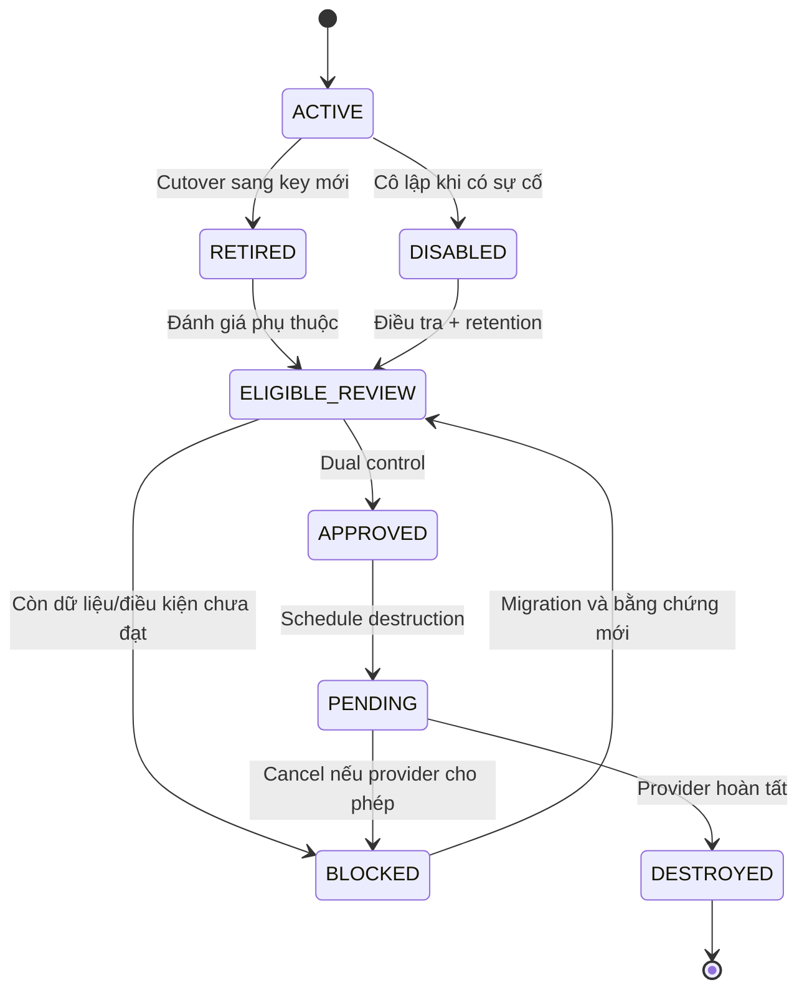
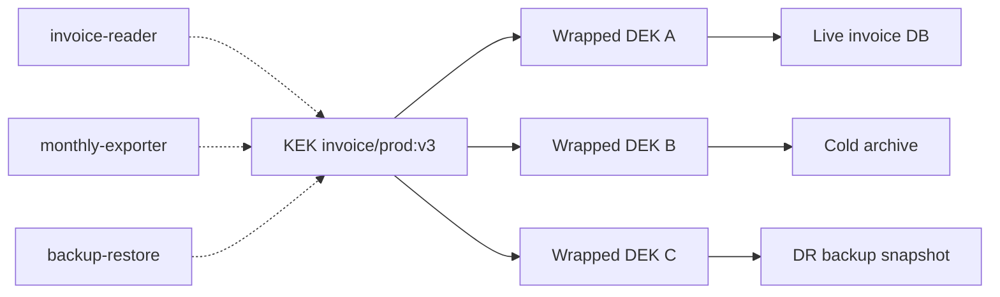
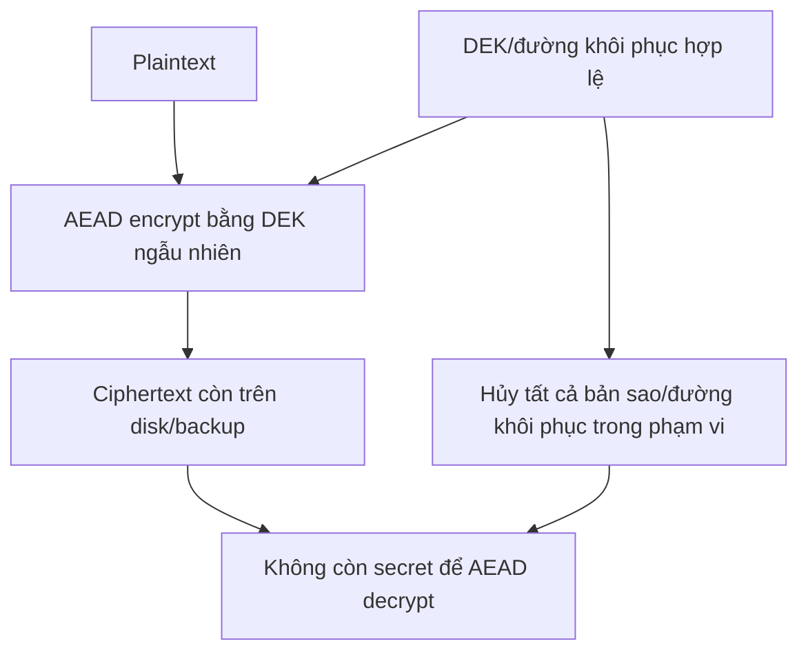
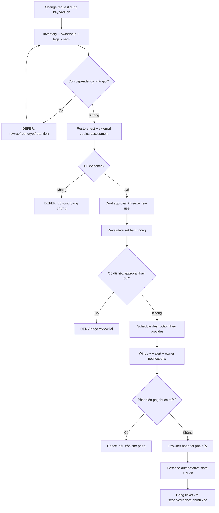

# Destruction policy

## 1. Destruction policy là gì?

**Destruction policy (chính sách hủy khóa mật mã)** là tập hợp **quy tắc, điều kiện, thẩm quyền, quy trình thực hiện và yêu cầu chứng cứ** để quyết định **khi nào một khóa hoặc một key version được phép bị phá hủy**, ai có quyền phê duyệt/thực thi, cần bảo đảm điều gì trước thao tác không thể đảo ngược và xác nhận kết quả như thế nào.

Một chính sách đúng không chỉ ghi “xóa khóa sau 90 ngày”. Nó phải giải quyết các câu hỏi:

- **Vì sao hủy?** Hết thời hạn lưu giữ, ngừng hệ thống, crypto-erasure có chủ đích, thay đổi kiến trúc hay xử lý khóa bị xâm phạm?
- **Hủy cái gì?** Một key version, toàn bộ key object, DEK, KEK, private signing key, HMAC secret, private KEM key hay bản sao ở đâu?
- **Hậu quả là gì?** Những bản ghi, wrapped DEK, snapshot, ciphertext, token, tài liệu ký số, hàng đợi và hệ thống khôi phục nào còn phụ thuộc?
- **Ai được quyết định?** Data owner, security owner, key administrator, backup/DR owner hoặc nhóm compliance?
- **Đã chứng minh được chưa?** Có inventory tin cậy, kết quả migration, restore test, clearance về retention/legal hold và phê duyệt ràng buộc đúng tài nguyên không?
- **Làm thế nào?** Disable trước, lên lịch chờ hủy, xác minh việc chưa còn sử dụng, gọi đúng API KMS/HSM và ghi audit?
- **Phạm vi xác nhận tới đâu?** Chỉ material trong KMS/HSM hay cả imported/exported copies, cache, backup và đối tác?

**Chính sách hủy** là **quy tắc để đưa ra quyết định và bảo đảm kiểm soát**. **Destroyed state** là **trạng thái đầu ra** khi vật liệu thuộc phạm vi đã thực sự bị hủy. Hai khái niệm liên quan nhưng không thay thế nhau.

Ví dụ: KEK `customer-kek:v3` đang ở trạng thái `RETIRED` vì v4 đã phục vụ mã hóa mới. Chính sách hủy có thể yêu cầu **không còn wrapped DEK phải khôi phục dưới v3, các bản backup còn lưu đã qua restore test, có phê duyệt hai bên và không có legal hold**. Nếu snapshot năm trước còn phụ thuộc v3, kết quả phải là **DENY/DEFER**, dù v3 không còn được dùng mã hóa mới.

Bài nằm trong chương **Key policy** của module `SECURITY_KEY_MANAGEMENT_FUNDAMENTALS`: học cách quản lý khóa qua **tạo, cấp phát, lưu trữ, sử dụng, xoay vòng, thu hồi và hủy**, kết nối mật mã đối xứng/bất đối xứng, chữ ký số, KMS/HSM, envelope encryption, IAM và kiểm toán. Destruction policy là một chính sách cuối vòng đời nhưng phải được thiết kế **ngay từ lúc tạo khóa**, vì khả năng khôi phục, backup và bản sao secret được quyết định rất sớm.

### Mục tiêu học tập

Sau bài này, bạn có thể:

1. Phân biệt **disable, retire, revoke, schedule deletion, destroy, key zeroization và cryptographic erasure**.
2. Xây dựng **điều kiện bắt buộc** để hủy theo loại khóa, mục đích, cryptoperiod và retention.
3. Thiết kế **dependency inventory** liên kết key version với DEK/KEK, dữ liệu, backup, hệ thống sử dụng và bằng chứng khôi phục.
4. Xác định **RACI/dual control**, quyền thao tác KMS/HSM và cơ chế tránh tự phê duyệt.
5. Áp dụng **quy trình hai giai đoạn**: ngừng sử dụng mới, chờ hủy, xác minh, thực thi và hậu kiểm.
6. Phân biệt **hủy có kế hoạch** với **ứng cứu compromise**, tránh coi xóa khóa là khôi phục tính bí mật của dữ liệu đã lộ.
7. Định nghĩa policy-as-code, cơ chế **fail closed**, ngoại lệ có thời hạn và kiểm toán.
8. Đọc ví dụ Java 17 về **preflight decision engine** trước khi gọi API destroy thực tế.

## 2. Điều gì nằm trong và ngoài phạm vi destruction policy?

Chính sách nên xác định rõ **phạm vi quản lý**, **loại khóa**, **đối tượng thực thi** và **đích dữ liệu**.

| Đối tượng | Ví dụ | Tác động nếu destroy |
| --- | --- | --- |
| **DEK** | AES-256-GCM key mã hóa từng file hoặc từng tenant | Dữ liệu dưới DEK không thể giải mã nếu không còn bản sao/đường khôi phục. |
| **KEK / master wrapping key** | Khóa KMS bọc nhiều DEK | Có thể mất khả năng unwrap **hàng loạt DEK**; blast radius lớn. |
| **HMAC/MAC key** | Shared secret dùng tạo/kiểm tra webhook MAC | Có thể mất cả khả năng tạo và xác minh tag lịch sử. |
| **Private signing key** | Ed25519/RSA-PSS ký JWT, tài liệu, gói phần mềm | Không ký mới bằng vật liệu đã hủy; chữ ký cũ vẫn có thể verify bằng public key. |
| **Private decapsulation/decryption key** | KEM/HPKE hoặc khóa riêng giải mã | Encapsulation/ciphertext cũ có thể không mở được nữa. |
| **Password pepper** | Secret KMS/HSM hỗ trợ password verifier | Có thể làm hash/verifier cũ không kiểm tra được nếu chưa có migration. |
| **Root/CA/attestation key** | Khóa gốc của PKI, firmware signing hoặc trust hierarchy | Ảnh hưởng phạm vi rộng; cần runbook chuyên biệt và bảo toàn verification evidence. |
| **Imported/external key material** | Khóa do bên khác sinh rồi nhập KMS | Phải xử lý **bản gốc/bản export** ở nơi khác; provider chỉ quản lý phạm vi của họ. |

**Một policy không cần ra lệnh xóa public key bằng mọi giá.** Public verification key, chứng chỉ, trusted timestamp, record kiểm toán và key ID có thể phải được giữ lâu hơn private signing key để chứng minh và xác minh sự kiện lịch sử.

### 2.1. Key ID, alias, version và material

- **Key ID** là định danh tài nguyên quản lý; key có thể gồm nhiều phiên bản.
- **Alias** là tham chiếu có thể chuyển đích, ví dụ `payment-current`.
- **Key version** xác định thế hệ vật liệu; envelope cũ có thể ghi `v3`.
- **Key material** là bí mật mật mã thật sự (hoặc trạng thái của module) giúp decrypt, unwrap, sign, decapsulate hoặc tạo MAC.
- **Replica/copy** là bản khác của vật liệu hoặc phương án lấy lại vật liệu, có thể nằm trong vùng quản lý hoặc bên ngoài.

**Xóa alias hoặc registry record không phải chứng minh material đã hủy.** Chỉ khi hành động thực sự vô hiệu hóa không thể phục hồi vật liệu trong **phạm vi được công bố**, mới dùng nhãn destroy đúng nghĩa.

### 2.2. Scope của xác nhận phải chính xác

Có thể báo cáo:

> “KMS xác nhận vật liệu của key version v3 đã bị hủy trong phạm vi dịch vụ vào thời điểm T, theo operation ID X.”

Không nên tuyên bố:

> “Mọi bản sao khóa và mọi dữ liệu từng được giải mã đã biến mất trên toàn thế giới.”

Báo cáo thứ hai chỉ có thể được hỗ trợ nếu phạm vi và bằng chứng tương ứng thật sự bao phủ tất cả các hệ thống; trong hệ thống phân tán, điều đó khó chứng minh tuyệt đối.

## 3. Phân biệt các thao tác vòng đời trước khi quy định destroy

| Trạng thái / thao tác | Ý nghĩa quản trị | Vật liệu khóa có thể còn? | Có thể đảo ngược? |
| --- | --- | --- | --- |
| **Rotate** | Bắt đầu dùng key material mới cho thao tác tương lai | Cả cũ và mới thường còn | Có thể đổi hướng dùng mới, không tự biến dữ liệu cũ thành v mới. |
| **Retire** | Ngừng dùng khóa cũ cho **tác vụ mới**, giữ đọc/xác minh lịch sử khi cần | Thường còn | Có thể có ngoại lệ theo policy. |
| **Disable / Suspend** | Chặn khả năng gọi key qua hệ thống quản lý | Thường còn | Có thể bật lại theo quyền và quy trình. |
| **Revoke / Distrust** | Thay đổi trạng thái **tin cậy hoặc quyền**, ví dụ chứng chỉ ký bị thu hồi | Có thể còn | Không tương đương xóa; hiệu lực và xử lý lịch sử theo giao thức. |
| **Schedule destruction / Pending deletion** | Đặt thao tác hủy trong tương lai | Tùy nhà cung cấp; thường còn trong cơ chế quản lý | Có nơi cho cancel trước khi hoàn tất. |
| **Destroy / Zeroize material** | Loại bỏ vật liệu bí mật trong phạm vi đã xác định | Không còn trong phạm vi đó | **Không thể bật lại chính vật liệu đã hủy.** |
| **Delete metadata/alias** | Xóa tên/tham chiếu/tài nguyên hiển thị | Chưa thể kết luận | Không phải bằng chứng cryptographic erasure. |

**Không áp đặt state machine chung lên mọi KMS/HSM.** Một provider có thể lên lịch xóa toàn bộ resource, provider khác destroy từng version, và HSM khác dùng API zeroization. Định nghĩa trong chính sách phải được **mapping với hành vi thực tế** của nền tảng.



Sơ đồ trên là **luồng quản trị minh họa**. Điều kiện để ghi `DESTROYED` là xác nhận **thao tác hủy đã hoàn tất**, không chỉ lệnh schedule thành công.

## 4. Tư duy policy: quyết định dựa trên điều kiện, không dựa vào ngày đơn lẻ

Một destruction policy tốt có tối thiểu bốn nhóm điều kiện:

1. **Business/legal eligibility:** có còn lý do hợp pháp và nghiệp vụ phải giữ khả năng giải mã/ký/xác minh không?
2. **Cryptographic dependencies:** có dữ liệu/khóa con/backup còn phụ thuộc vào vật liệu dự kiến hủy không?
3. **Authorization and change safety:** actor, approvals, segregation of duties, waiting period và thời hạn kiểm duyệt có đúng không?
4. **Execution and proof:** gọi đúng thao tác của provider, theo dõi trạng thái cuối và lưu bằng chứng trong phạm vi chuẩn xác.

Một quyết định có thể là:

- `ALLOW_SCHEDULE`: đủ điều kiện đưa vào cửa sổ chờ hủy.
- `DENY`: điều kiện cứng không đạt, **không gọi destructive API**.
- `DEFER`: thiếu chứng cứ hoặc đang chờ migration/retention.
- `REVIEW_REQUIRED`: cần đánh giá ngoại lệ hoặc tình huống pháp lý/ứng cứu.
- `DESTROYED_CONFIRMED`: provider xác nhận vật liệu đã hủy trong phạm vi và audit hoàn tất.

**Không dùng Boolean `canDestroy=true` từ request người dùng như nguồn chân lý.** Mọi điều kiện phải được lấy từ hồ sơ và hệ thống có thẩm quyền; Boolean chỉ có thể là kết quả của đánh giá đã xác thực.

### 4.1. Ma trận điều kiện bắt buộc

| Kiểm soát | Quy tắc policy | Bằng chứng tối thiểu | Nếu không đạt |
| --- | --- | --- | --- |
| **DEST-01 Exact target** | Nhắm đúng resource ID + **key version** + account/region | KMS Describe + change request đã ràng buộc | DENY |
| **DEST-02 Owner** | Key và data owner xác định được | CMDB/registry + approval | DEFER |
| **DEST-03 Purpose** | Có lý do hủy và ảnh hưởng được phê duyệt | Ticket và risk assessment | DENY |
| **DEST-04 No new use** | Không còn tạo ciphertext/chữ ký mới bằng key dự kiến hủy | IAM, producer config, audit | DEFER |
| **DEST-05 Dependencies** | Không còn dữ liệu *phải giữ* chỉ đọc được bằng key đó | Dependency graph có độ mới phù hợp | DENY/DEFER |
| **DEST-06 Backup/DR** | Các bản backup còn giữ đã được kiểm chứng khôi phục sau hủy | Restore test + backup inventory | DENY |
| **DEST-07 Retention/legal hold** | Không có nghĩa vụ lưu giữ hoặc hạn chế pháp lý chưa xử lý | Clearance từ nguồn được ủy quyền | DENY |
| **DEST-08 Copies** | Đã xét exported/imported key material, cache và replicas | Custody/copy assessment | DEFER |
| **DEST-09 Separation of duties** | Phê duyệt độc lập và người thực thi có quyền đúng | Authenticated approvals + IAM | DENY |
| **DEST-10 Fresh approvals** | Approval còn hiệu lực, đúng target và snapshot | Versioned ticket + timestamp | DEFER |
| **DEST-11 Freeze & TOCTOU** | Ngăn phát sinh dependency sau kiểm kê | Freeze + revalidation sát giờ thực thi | DEFER |
| **DEST-12 Waiting/cancel** | Tuân thủ thời gian chờ và khả năng can thiệp trước hủy | Provider schedule operation + alerts | DEFER |
| **DEST-13 Observability** | Có audit và cơ chế phát hiện sử dụng bất thường | KMS/HSM log + correlation ID | DEFER |
| **DEST-14 Final confirmation** | Chỉ gắn Destroyed khi provider xác nhận vật liệu đã hủy | Authoritative state + operation ID | Không ghi “hoàn thành” |
| **DEST-15 Scope statement** | Không tuyên bố ngoài phạm vi được kiểm chứng | Evidence report | REVIEW_REQUIRED |

Các mã `DEST-xx` là **ví dụ kiểm soát nội bộ để học và triển khai policy-as-code**, không phải mã điều khoản chính thức của một tiêu chuẩn hoặc cloud provider.

### 4.2. Hard stop so với điều kiện có thể chờ bổ sung

**Hard stop**: sai target, thiếu quyền, còn legal hold, vẫn có dữ liệu bắt buộc giữ và không có đường khôi phục, có nguy cơ ghi nhầm production key. Hệ thống không được đưa yêu cầu qua cửa sổ hủy chỉ bằng cách ghi log cảnh báo.

**Defer**: chờ đồng bộ inventory, chờ restore test hoặc chờ owner review. Không có nghĩa đã đạt điều kiện, nên cũng **không gọi API hủy**.

**Emergency exception** chỉ hợp lệ khi có **runbook riêng được ủy quyền** và căn cứ rủi ro; không được biến mọi hard stop thành một checkbox “force=true”.

## 5. Phụ thuộc dữ liệu: điều kiện nền tảng của destruction policy

**Khóa không chỉ có người sử dụng; khóa còn có dữ liệu phụ thuộc.** Cần mô hình hóa đồ thị:



Ngay cả khi `invoice-writer` đã đổi sang v4 và không còn ghi mới bằng v3, ba nhóm dữ liệu nói trên vẫn có thể cần v3 để **Unwrap**.

### 5.1. Các nguồn bắt buộc kiểm tra

- **Live data**: bảng DB, object storage, tệp/record có key ID/version.
- **DEK/key hierarchy**: wrapped keys, derived-key dependencies, các lớp KEK/master key.
- **Backup/snapshot**: bản đang giữ theo retention, bản ngoại tuyến hoặc lưu trữ lạnh.
- **DR/cross-region**: replicas, cluster dự phòng, hạ tầng backup, media.
- **Batch/queue**: tác vụ ít chạy, jobs bị retry, message chưa xử lý.
- **External consumers**: đối tác, thiết bị/agent ngoại tuyến, clients còn nhận public key cũ.
- **Caches/exports**: key material từng xuất ra, DEK trong memory, file, secret vault khác.
- **Chữ ký & verification evidence**: public key, chứng chỉ, trusted timestamp, CRL/OCSP theo nghĩa vụ.
- **Audit/legal**: các hiện vật phải giữ để điều tra hoặc chứng minh giao dịch.

**Không có log sử dụng gần đây không chứng minh không còn dependency.** Bản archive có thể chỉ được đọc sau nhiều năm; dịch vụ backup chỉ chạy restore khi có sự cố.

### 5.2. Phân biệt “không còn dùng mới” và “không còn cần giải mã cũ”

Một **cryptoperiod** có thể có giai đoạn:

- **Originator-use period**: khóa được phép tạo ciphertext/chữ ký mới.
- **Recipient-use period**: khóa vẫn cần giải mã/xác minh dữ liệu cũ.

Tùy loại khóa và chuẩn áp dụng, hai giai đoạn không nhất thiết kết thúc cùng lúc. Một version nên chuyển sang **legacy-read/decrypt-only** trước khi destroy nếu dữ liệu lịch sử vẫn cần đọc.

Ví dụ:

```yaml
key: invoice-kek/prod
new-use-version: v4
legacy-decrypt-versions:
  - v2
  - v3
candidate-for-destruction:
  - version: v1
    dependencyStatus: CLEARED
    restoreStatus: VERIFIED
```

Đây là **policy sketch**, không phải format KMS thực. Không lấy cấu hình này thay cho kiểm chứng IAM và dữ liệu.

### 5.3. Backup còn giữ là blocker thực tế

Giả sử live DB đã rewrap tất cả DEK sang v4, nhưng bản backup còn chứa wrapped DEK dưới v3. Nếu cần phục hồi bản backup ấy, hủy v3 có thể biến nó thành **backup không thể đọc**.

Policy phải nêu:

1. Những backup nào bắt buộc còn khả năng khôi phục?
2. Chúng có thể được **migrate/rewrap** an toàn không?
3. Có **restore test** từ backup thật với key ring sẽ còn tồn tại không?
4. Nếu backup hết retention, có bằng chứng hết hạn và cách xử lý đúng policy không?
5. Bản lưu ngoại tuyến hoặc bên thứ ba đã nằm trong inventory chưa?

Không bắt buộc luôn rewrap mọi backup nếu mục tiêu của policy là **chủ động crypto-erasure** và retention cho phép; nhưng khi tuyên bố dữ liệu còn phải giữ, việc hủy cần **bằng chứng không làm mất khả năng khôi phục**.

## 6. Cryptographic erasure: khi nào hủy khóa được coi là xóa dữ liệu?

**Cryptographic erasure (crypto-shredding)** là làm ciphertext **không thể giải mã một cách khả thi** bằng cách hủy vật liệu khóa cần thiết. Phương pháp này khác **xóa vật lý ciphertext** và phải dựa vào các giả định đúng về sơ đồ mã hóa.



### 6.1. Điều kiện phải thỏa

Một policy dùng crypto-erasure phải đánh giá:

1. Dữ liệu được mã hóa bằng **thuật toán, mode và key strength được phê duyệt** (ví dụ AEAD đúng cách).
2. DEK/KEK có **entropy đủ mạnh**; không khôi phục được bằng seed hoặc password yếu.
3. Không tồn tại **DEK dạng rõ** ngoài vùng kiểm soát, wrapped DEK có thể mở bằng KEK khác, hoặc backup/key escrow chưa xử lý.
4. Không còn **plaintext ở log, index, thumbnail, export, cache, file tạm hoặc hệ thống đối tác** nếu chính sách đang tuyên bố xóa dữ liệu.
5. Đường khôi phục qua KMS/HSM, DR, key replicas và imported/exported material được đánh giá theo phạm vi.
6. Không có lỗi sơ đồ nghiêm trọng (ví dụ **AES-GCM nonce reuse**) làm giả định bí mật mất hiệu lực.
7. Quy trình đáp ứng **retention/legal hold** và lưu được bằng chứng.

**Hủy một bản KEK trong cloud không làm biến mất DEK đã bị export hoặc plaintext đã bị kẻ tấn công sao chép.** Vì thế, crypto-erasure là một kết luận có điều kiện và phạm vi rõ ràng, không phải lời cam kết chung chung.

### 6.2. Blast radius theo loại khóa

| Khóa dự kiến hủy | Phạm vi có thể ảnh hưởng |
| --- | --- |
| **DEK riêng mỗi object** | Một object hoặc phân vùng dữ liệu phụ thuộc DEK. |
| **KEK dùng chung nhiều DEK** | Có thể ảnh hưởng hàng nghìn/millions object khi không còn đường unwrap khác. |
| **HMAC secret dùng chung** | Tác động tới nhiều producer/verifier và khả năng kiểm tra MAC cũ. |
| **Signing private key** | Ngừng khả năng ký hợp lệ trong vùng quản lý, nhưng không làm chữ ký cũ sai về toán học. |
| **Private KEM/decryption key** | Mất decapsulation/decryption với bản lưu cũ nếu không còn bản sao/đường khác. |
| **Root/master key** | Ảnh hưởng rộng toàn hệ thống khóa con hoặc trust hierarchy. |

Chính sách phải yêu cầu **risk review theo loại khóa**. Không dùng cùng một checklist “đếm số ciphertext” cho private signing key và KEK mà bỏ qua public verification evidence.

## 7. Chính sách dành cho chữ ký số, JWT, MAC và KEM

### 7.1. Private signing key và xác minh lịch sử

Với Ed25519, ECDSA hoặc RSA-PSS, **private key** dùng ký, còn **public key** dùng xác minh. Hủy private signing key:

- Ngăn việc **ký mới bằng bản vật liệu đã hủy** trong phạm vi hệ thống quản lý.
- **Không tự làm `Verify(publicKey, message, signature)` trả false** cho chữ ký đúng đã tồn tại.
- Không xóa các chữ ký giả được tạo **trước** khi hủy nếu signing key/quyền Sign từng bị chiếm.
- Có thể đòi hỏi tiếp tục giữ public key, chứng chỉ X.509, CRL/OCSP, trusted timestamp, issuance metadata hoặc bằng chứng ký dài hạn.

Policy nên tách **signing material destruction** khỏi **public verification material retention**. Không hủy chuỗi chứng cứ xác minh tài liệu đã phát hành nếu còn nghĩa vụ kiểm tra.

### 7.2. JWT/JWS cần trạng thái tin cậy ở verifier

Đối với access token JWT có chữ ký, hủy signing private key **không tự thu hồi token đã được ký**: resource server có thể tiếp tục verify với public key cũ trong JWKS và chấp nhận token chưa hết hạn.

Nếu mục tiêu là kết thúc sự tin cậy đối với khóa cũ, cần quản lý **issuer, key ID/`kid`, JWKS cache, denylist/introspection, expiration và verifier trust policy** theo giao thức.

Đặc biệt khi private key bị lộ, **rotation + destroy tại issuer không đủ** nếu verifier vẫn chấp nhận chữ ký của kẻ tấn công bằng public key cũ.

### 7.3. HMAC/MAC key

HMAC dùng shared secret cho tạo và xác minh MAC. Hủy toàn bộ HMAC secret có thể khiến các record lịch sử **không còn khả năng xác minh** nếu không có bằng chứng/thủ tục thay thế.

Chính sách cần định nghĩa thời gian lưu secret, khả năng verify history, phân quyền giữa bên tạo và bên kiểm tra MAC qua KMS/HSM nếu provider hỗ trợ, và thời điểm có thể phá hủy hoàn toàn vật liệu.

### 7.4. Private KEM decapsulation key

Với KEM, bên nhận cần **private decapsulation key** để tái tạo shared secret từ encapsulation. Nếu hủy quá sớm, ciphertext/envelope lịch sử có thể mất khả năng đọc. Với một khóa tĩnh bị lộ, việc destroy bản chính cũng không vô hiệu bản sao đã rò rỉ.

Chính sách phải inventory các encapsulations, data envelopes và backup; nếu cần, **re-encapsulate hoặc rewrap DEK** theo giao thức an toàn. Không thể chỉ sửa `keyVersion` trong metadata rồi coi ciphertext đã chuyển sang khóa mới.

## 8. Quyền hạn, dual control và separation of duties

**Quyền hủy khóa** thường có tác động lớn hơn quyền đọc metadata hoặc quyền dùng khóa bình thường. Một người có quyền `Decrypt` không nên mặc nhiên có `ScheduleDeletion` hoặc `DestroyKeyVersion`; một người có quyền destroy cũng không nên tự phê duyệt mọi điều kiện.

### 8.1. Vai trò và trách nhiệm

| Vai trò | Trách nhiệm | Không nên được phép tự làm |
| --- | --- | --- |
| **Key/service owner** | Đề xuất hủy, mô tả mục đích và consumers | Bỏ qua security/retention approval. |
| **Data owner** | Xác nhận dữ liệu cần giữ, thời hạn, hậu quả mất khả năng đọc | Tự xóa key material nếu không có quyền quản trị. |
| **Security owner** | Duyệt kiểm soát mật mã, sự cố, blast radius | Tự sửa evidence hoặc phê duyệt thay data owner. |
| **Backup/DR owner** | Kiểm chứng backup, restore, replicas và điều kiện phục hồi | Đánh dấu backup không còn cần bằng suy đoán. |
| **Legal/compliance** | Xác nhận legal hold/retention khi có | Bỏ qua bằng chứng kỹ thuật. |
| **Key administrator** | Thao tác chính xác API KMS/HSM theo quyền và ticket | Tự chấp thuận việc hủy khóa mà không qua review. |
| **Auditor** | Đánh giá quy trình, event, scope và kết quả | Đọc raw key hoặc tự thực hiện destructive API. |

Mô hình có thể dùng **four-eyes / dual approval**, quyền **just-in-time** hoặc phân tách chính sách và thao tác thực thi. Các kiểm soát này phải được hỗ trợ thực tế bằng IAM/workflow, không chỉ bằng tên người trong biên bản.

### 8.2. Ràng buộc approval vào target

Một approval đúng cần gắn:

- **Exact resource ID + exact key version**, tenant/account/region và môi trường.
- **Reason**, risk class, phạm vi dữ liệu dự kiến và thời điểm dự kiến.
- **Inventory snapshot ID** và hash/phiên bản của bằng chứng được duyệt.
- **Danh tính và vai trò approver đã xác thực**, thời gian duyệt, thời hạn hiệu lực.
- **Change ticket**, operation ID và quyền thực thi.

Phê duyệt kiểu “cho phép xóa mọi key cũ của billing” quá rộng và nguy hiểm. Khi target hoặc inventory thay đổi đáng kể, phải **review lại** thay vì tái sử dụng approval cũ.

### 8.3. IAM không được dựa vào policy-as-code phía client

Một Java method trả `ALLOW` **không thay thế** KMS key policy và IAM. Nếu service account thực thi có quyền xóa mọi key, bỏ qua guard là đủ để gây thiệt hại.

Thiết kế defense in depth:

1. **IAM cấp quyền hủy rất hẹp**, có điều kiện tài nguyên/tài khoản.
2. Workflow ký duyệt và **thực thi qua service được kiểm soát**.
3. API gateway/worker xác thực ticket/evidence không do caller tự khai.
4. Provider audit/alerts cho mọi thao tác schedule/cancel/destroy.
5. Các khóa nền tảng quan trọng có **quy trình break-glass** riêng và hậu kiểm bắt buộc.

## 9. Quy trình hủy hai giai đoạn và ngăn race condition

Thực tiễn an toàn thường dùng **prepare / execute**, cùng cửa sổ quan sát nếu provider hỗ trợ.



### 9.1. Giai đoạn chuẩn bị: không còn tạo dữ liệu mới phụ thuộc khóa

Trước khi hủy, cần **dừng các operation tạo dữ liệu mới** dưới key version cũ (Encrypt, Wrap, Sign hoặc Encapsulate theo loại khóa). Nên:

- Chuyển producer sang key mới qua cutover có kiểm chứng.
- Giữ decrypt/verify cũ khi còn dữ liệu phải giữ.
- Đặt alert nếu key candidate vẫn được dùng để ghi mới.
- Kiểm tra trạng thái key và IAM ở **cả producer, consumer, broker và batch**.
- Khoanh vùng các queue/jobs/retry có thể ghi trễ.

Nếu tiến trình tạo wrapped DEK v3 sau khi inventory chốt “0 dependency”, việc destroy v3 có thể gây mất dữ liệu ngay. Đây là **TOCTOU race (time-of-check to time-of-use)**. Policy cần yêu cầu **freeze + revalidate** sát thời điểm schedule/final destruction.

### 9.2. Cửa sổ chờ không phải biện pháp cứu hộ chắc chắn

Một số KMS cho phép schedule deletion sau thời gian chờ, có thể **cancel** trước khi hủy hoàn tất. Nhưng khả năng này phụ thuộc provider, loại key và điều kiện cụ thể.

Policy cần đặt:

- Thời gian chờ/khung giờ thực thi được phép theo mức rủi ro và contract.
- Danh sách owner được thông báo và người có quyền cancel.
- Giám sát các operation còn tham chiếu key candidate.
- Cách phát hiện mới một dependency và **cancel khi còn khả năng**.
- Hành vi khi provider không hỗ trợ pending deletion/cancel.
- Điều kiện để tuyên bố final state sau khi thời gian chờ hết.

Không ghi cứng “mọi KMS đều có 7 hoặc 30 ngày chờ” vào logic chung, cũng không coi lệnh `schedule` là hoàn tất destroy.

### 9.3. Hậu kiểm phải dựa trên nguồn có thẩm quyền

Sau destructive action, thu thập:

1. Operation ID, identity thực thi, thời điểm, API và target.
2. **Authoritative state** từ KMS/HSM xác nhận vật liệu/version đã bị hủy hoặc không còn tồn tại theo contract.
3. Bằng chứng đánh giá replicas/imported material/external copies theo phạm vi.
4. Kết quả smoke test được thiết kế để xác nhận đường sử dụng đã ngừng (không chỉ nhìn `PermissionDenied`).
5. Log đóng ticket, thông báo owner, retention của hồ sơ và kết luận scope.

**Một lỗi `Decrypt` đơn lẻ không chứng minh destroy**: có thể do key Disabled, IAM deny, sai key ID hoặc network timeout.

## 10. Cách áp dụng destruction policy vào KMS/HSM thực tế

Không có API `destroyKey()` áp dụng đồng nhất cho mọi môi trường. Chỉ gọi API **được provider công bố và đã kiểm tra**.

### 10.1. Key do KMS sinh và không export

Đây là mô hình thuận lợi hơn cho quản trị: private material nằm trong ranh giới KMS/HSM, không xuất ra cho ứng dụng. Chính sách có thể đối chiếu key ID/version, replicas, provider-state, IAM và audit để xác định phạm vi hủy.

Dù vậy, **non-exportable không có nghĩa không thể bị sử dụng trái phép**: tài khoản có quyền `Sign`, `Decrypt`, `Unwrap` hoặc `Decapsulate` vẫn có thể bị chiếm để gọi API. Với sự cố, cần đánh giá cả khả năng **lạm dụng quyền** trước khi quyết định hủy.

### 10.2. Imported key material / BYOK

Nếu khóa được tạo ở ngoài rồi nhập vào KMS, có thể còn:

- Bản gốc tại hệ thống sinh khóa.
- Bản backup của HSM nguồn.
- Bản export tạm, máy build/provisioning.
- Bản sao tại KMS/region/đối tác khác.

Xóa vật liệu **đã import vào một KMS** không làm bản gốc và exports ở nơi khác tự biến mất. Destruction policy phải có **custody inventory** và lời xác nhận theo từng vùng. Nếu không thể bao quát mọi copy, báo cáo scope chính xác và giữ finding.

### 10.3. HSM và key zeroization

Với HSM, cơ chế zeroization, hủy key object, hủy partition hoặc device-level destruction có **phạm vi rất khác nhau**. Không dùng một thao tác toàn thiết bị để thay cho hủy một key version nếu có thể ảnh hưởng các khóa khác.

Cần kiểm tra firmware/partition, key attributes, backup/replication, dual control, audit event, quy trình phục hồi và các giới hạn của module. Không tự suy ra từ “FIPS validated” rằng mọi thao tác xóa trong ứng dụng đáp ứng yêu cầu xóa toàn bộ bản sao.

### 10.4. File/key store trong ứng dụng

Nếu private key từng nằm trong file, Java KeyStore, volume, container hoặc VM snapshot, việc xóa file chưa chắc hủy được dữ liệu trên SSD, journal, snapshot và backup. Cần dùng phương pháp **media sanitization** hoặc crypto-erasure được policy/hạ tầng phê duyệt.

Trong Java, `Arrays.fill(secretBytes, (byte) 0)` có thể giảm thời gian tồn tại secret **trong mảng do ứng dụng sở hữu**, nhưng JVM/GC/native provider có thể giữ bản sao. Không coi thao tác này là bằng chứng Destroyed của toàn hệ thống.

### 10.5. Thu hồi quyền và destroy là các thao tác khác nhau

- `IAM Deny` ngăn identity dùng khóa trong một ranh giới thực thi.
- `Disable` chặn sử dụng qua provider theo state.
- `Revoke certificate/JWKS trust` thay chính sách chấp nhận chữ ký.
- `Destroy` loại bỏ key material trong phạm vi quản lý.
- `Crypto-erasure` là kết quả bảo mật về **khả năng giải mã dữ liệu** khi các điều kiện tiên quyết đáp ứng.

Không dùng một thao tác thay thế cho thao tác khác mà thiếu đánh giá mục tiêu.

## 11. Chính sách hủy có kế hoạch: runbook đề xuất

### Bước 1 — Nêu lý do và phạm vi

Tạo yêu cầu chứa key ID/version, loại khóa, owner, region, môi trường, dự kiến ảnh hưởng, ngày mong muốn, mục đích hủy và nhóm dữ liệu. Phân biệt **migrate để giảm nợ kỹ thuật** và **crypto-erasure có chủ đích**.

### Bước 2 — Thu thập inventory hai chiều

Truy vấn từ **key → services/operations** và **key → encrypted data/backup/dependencies**. Liệt kê producer, consumer, verifier, gateway, batch/DR, external systems và các bản sao material. Không kết luận hết sử dụng chỉ từ last-used log.

### Bước 3 — Ngừng tạo phụ thuộc mới

Chuyển Encrypt/Wrap/Sign/Encapsulate mới sang key version khác khi cần. Khóa đường ghi cũ bằng policy/IAM hoặc application control; giữ Legacy Decrypt/Verify nếu còn nghĩa vụ.

### Bước 4 — Migrate và kiểm tra

- **Rewrap** DEK nếu chỉ cần thay KEK mà DEK vẫn tin cậy.
- **Re-encrypt** dữ liệu bằng DEK mới nếu key trực tiếp mã hóa bị lộ hoặc chính sách yêu cầu.
- Di chuyển verifier/JWKS và key registry cho chữ ký số.
- Migrate ciphertext/encapsulation khi đổi KEM/private decapsulation key.
- Đối chiếu data count, AEAD tag/AD, tương thích format version và restore từ backup.

### Bước 5 — Kiểm tra chính sách dữ liệu

Xác nhận retention, legal hold, hợp đồng đối tác, archive và hồ sơ điều tra. Nếu chưa rõ nghĩa vụ, chọn **DEFER** chứ không chấp nhận mất dữ liệu không thể phục hồi.

### Bước 6 — Xác thực phê duyệt

Yêu cầu approval độc lập ràng buộc đúng version và inventory snapshot, kiểm tra IAM/principal của người thực thi. Đặt quyền hủy trong môi trường kiểm soát, có thay đổi/break-glass log.

### Bước 7 — Schedule, theo dõi, hủy

Gọi API provider phù hợp, ghi operation ID. Nếu có waiting window, giám sát và cho phép cancel theo quy trình; nếu không có, tăng mức phê duyệt trước destructive call.

### Bước 8 — Hậu kiểm và đóng hồ sơ

Đọc lại authoritative state, kết hợp audit/custody evidence và xác nhận scope. Lưu kết quả cho auditor; không log raw key hoặc dữ liệu nhạy cảm. Giám sát những request còn tham chiếu version bị hủy để phát hiện luồng chưa migrate.

## 12. Emergency destruction và xử lý key compromise

**Khóa bị xâm phạm** không đồng nghĩa ngay lập tức phải hủy bằng mọi giá. Đôi khi ưu tiên đúng là **cô lập quyền**, có thời gian bảo toàn chứng cứ và đưa dịch vụ sang khóa sạch, thay vì phá hủy chìa khóa duy nhất để đọc dữ liệu retention bắt buộc.

### 12.1. Nếu identity có quyền dùng key bị chiếm

Ví dụ HSM giữ private signing key **non-exportable**, nhưng service account được phép `Sign` bị tấn công.

Hành động ưu tiên:

1. Thu hồi phiên/credential, grant và quyền IAM bị chiếm.
2. Bảo toàn log `Sign`/`Decrypt` và approval/transcript nếu có.
3. Đánh giá thời điểm và nội dung thao tác trái phép.
4. Cân nhắc rotate, revoke trust, disable hoặc destroy theo mức độ và bằng chứng.
5. Kiểm tra tất cả verifier/consumer đã cập nhật policy hay chưa.

Hủy private key có thể ngăn **sử dụng qua chính HSM đó**, nhưng không xóa được các chữ ký đã phát hành. Nếu yêu cầu thu hồi độ tin cậy, phải cập nhật **public-key trust/issuer/certificate status** theo giao thức.

### 12.2. Nếu key material đã bị xuất

Nếu đối thủ đã sao chép DEK/KEK/private key:

- Hủy bản trong KMS **không xóa bản đã lấy cắp**.
- Rewrap KEK **không thu hồi DEK cũ** nếu đối thủ có nó.
- Rotate signing key **không xóa chữ ký giả** do kẻ tấn công đã tạo.
- Crypto-erasure nội bộ **không xóa plaintext** mà đối thủ đã tải xuống.

Chính sách ứng cứu phải xét **dữ liệu và khoảng thời gian bị ảnh hưởng, backup, key dependencies, verification trust, thông báo và pháp lý**. Có thể phải re-encrypt bằng DEK mới, thay token, thu hồi chứng chỉ hoặc di chuyển cặp KEM key.

### 12.3. Ngoại lệ khẩn cấp có thể bỏ qua điều gì?

Một exception được ủy quyền có thể **rút ngắn trình tự thao tác hoặc thời gian chờ** nếu provider cho phép, nhưng không nên âm thầm bỏ các hard stop nền tảng như xác thực đúng target, quyền thực thi và quyết định có căn cứ về mất dữ liệu.

| Tình huống | Hướng ưu tiên | Điều không được suy ra |
| --- | --- | --- |
| Có dấu hiệu tài khoản Sign bị chiếm, private key vẫn non-exportable | Chặn IAM/disable, điều tra, rotate/revoke trust nếu cần | Không mặc định private material đã export. |
| KEK đã lộ, live dữ liệu vẫn phải đọc | Cô lập, chuyển key mới, đánh giá ảnh hưởng/rewrap/re-encrypt | Hủy KEK cũ không làm dữ liệu đã bị lộ kín lại. |
| Khóa bảo vệ dữ liệu cần xóa theo yêu cầu đã hợp lệ | Kiểm tra retention/backup/copied keys, thực hiện crypto-erasure có scope | Xóa KEK một nơi không tự xóa mọi copy. |
| HSM root key sắp bị lạm dụng nghiêm trọng | Áp dụng emergency runbook, approval khẩn cấp và phục hồi trust | Không dùng lệnh zeroize toàn thiết bị theo phản xạ. |

**Emergency process** nên được chuẩn bị từ trước, gồm danh tính được phép, người duyệt thay thế, cách bảo toàn bằng chứng và hậu kiểm. Không tự thiết kế ngoại lệ khi đang bị tấn công.

## 13. Policy-as-code: biểu diễn chính sách thành dữ liệu kiểm soát

Một policy có thể được quản lý phiên bản và đánh giá tự động, nhưng **bộ thực thi phải dùng dữ liệu chứng thực**, không tin input từ người yêu cầu hủy.

Ví dụ YAML minh họa:

```yaml
policyId: cryptographic-key-destruction
policyVersion: 3
scope:
  environments: [production, staging]
  targetGranularity: exact-key-version
defaults:
  decision: DENY
  newUseFrozen: required
  dependencyInventoryFreshnessHours: 24
  requireNoUnresolvedDependencies: true
  requireBackupRestoreEvidence: true
  requireRetentionClearance: true
  requireExternalCopyAssessment: true
  requireAuditLogging: true
approval:
  requiredDistinctRoles: [data-owner, security-owner]
  disallowSelfApproval: true
  maxApprovalAgeHours: 72
  bindTo:
    - resourceId
    - keyVersion
    - environment
    - inventorySnapshotId
execution:
  scheduleWhenProviderSupports: true
  revalidateImmediatelyBeforeSchedule: true
  waitForAuthoritativeDestroyedState: true
  requireProviderOperationId: true
reporting:
  retainEvidenceRef: true
  describeDestructionScope: true
  neverStoreRawKeyMaterial: true
emergency:
  requireApprovedRunbook: true
  preserveForensicEvidence: true
  additionalSecurityReview: true
```

**Các giá trị 24 giờ hoặc 72 giờ chỉ để minh họa phiên bản policy**, không phải tham số chuẩn bắt buộc cho mọi hệ thống. Tổ chức phải chọn từ threat model, nhịp thay đổi dữ liệu, thời hạn retention và khả năng provider.

Policy-as-code hỗ trợ **nhất quán và audit**, nhưng không có nghĩa việc lập trình kiểm tra `dependencyInventoryFreshnessHours` tự đảm bảo inventory đã đầy đủ. Cần nguồn thu thập đáng tin, owner review và đối chiếu thực tế.

### 13.1. Lưu trạng thái đánh giá tách khỏi trạng thái vật liệu khóa

Một hồ sơ có thể chứa:

```json
{
  "requestId": "CHG-2026-0910",
  "target": {
    "resourceId": "invoice-kek/prod",
    "version": "v3",
    "environment": "production"
  },
  "policyVersion": 3,
  "preflightDecision": "DEFER",
  "blockers": [
    "BACKUP_STILL_REQUIRES_KEY",
    "RESTORE_EVIDENCE_MISSING"
  ],
  "providerMaterialState": "RETIRED",
  "destructionOperationId": null
}
```

Lưu `DEFER` trong ticket không được làm đổi KMS state thành Destroyed. Khi policy cho phép `ALLOW_SCHEDULE`, đó mới chỉ là **quyết định được schedule**, chưa phải chứng cứ đã hủy.

## 14. Java 17: ví dụ destruction preflight decision engine

Ví dụ dưới đây minh họa **chính sách chặn hủy dựa trên đúng target, retention, phụ thuộc, phê duyệt và restore**. Nó cố ý **không gọi KMS/HSM** và **không hủy khóa nào**. Kết quả được dùng làm một lớp preflight trước workflow quản trị có IAM và approvals độc lập.

```java
import java.time.Duration;
import java.time.Instant;
import java.util.ArrayList;
import java.util.List;
import java.util.Objects;

public final class KeyDestructionPolicyDemo {

    enum MaterialState {
        ACTIVE, RETIRED, DISABLED,
        PENDING_DESTRUCTION, DESTROYED
    }

    enum DecisionType {
        DENY, DEFER, ALLOW_SCHEDULE
    }

    record KeyTarget(
        String resourceId,
        String version,
        String environment,
        MaterialState state
    ) {}

    record Dependency(
        String reference,
        boolean stillRequiredForReadOrRestore
    ) {}

    record Approval(
        String actorId,
        String role,
        Instant approvedAt
    ) {}

    record TrustedEvidence(
        String inventorySnapshotId,
        Instant inventoryObservedAt,
        boolean newUseFrozen,
        boolean retentionAndLegalHoldCleared,
        boolean backupRestoreValidated,
        boolean externalCopiesAssessed,
        List<Dependency> dependencies,
        List<Approval> approvals
    ) {}

    record Request(
        String resourceId,
        String version,
        String environment,
        String changeTicket,
        String requesterId
    ) {}

    record Evaluation(
        DecisionType decision,
        List<String> blockers
    ) {}

    static Evaluation evaluate(
        KeyTarget target,
        Request request,
        TrustedEvidence evidence,
        Instant now
    ) {
        List<String> blockers = new ArrayList<>();
        if (target == null || request == null
                || evidence == null || now == null) {
            return new Evaluation(
                DecisionType.DENY, List.of("Missing trusted input")
            );
        }

        if (!Objects.equals(target.resourceId(), request.resourceId())
                || !Objects.equals(target.version(), request.version())
                || !Objects.equals(target.environment(),
                                   request.environment())) {
            blockers.add("TARGET_MISMATCH");
        }

        if (target.state() != MaterialState.RETIRED
                && target.state() != MaterialState.DISABLED) {
            blockers.add("KEY_NOT_RETIRED_OR_DISABLED");
        }

        if (request.changeTicket() == null
                || request.changeTicket().isBlank()) {
            blockers.add("CHANGE_TICKET_MISSING");
        }

        if (!evidence.newUseFrozen()) {
            blockers.add("NEW_CRYPTO_USE_NOT_FROZEN");
        }

        if (!evidence.retentionAndLegalHoldCleared()) {
            blockers.add("RETENTION_OR_LEGAL_HOLD_UNRESOLVED");
        }

        if (!evidence.backupRestoreValidated()) {
            blockers.add("RESTORE_TEST_NOT_VERIFIED");
        }

        if (!evidence.externalCopiesAssessed()) {
            blockers.add("EXTERNAL_COPIES_NOT_ASSESSED");
        }

        if (evidence.inventorySnapshotId() == null
                || evidence.inventorySnapshotId().isBlank()
                || evidence.inventoryObservedAt() == null
                || evidence.inventoryObservedAt().isAfter(now)
                || Duration.between(
                    evidence.inventoryObservedAt(), now
                ).compareTo(Duration.ofHours(24)) > 0) {
            blockers.add("INVENTORY_NOT_CURRENT");
        }

        if (evidence.dependencies() == null) {
            blockers.add("DEPENDENCIES_UNKNOWN");
        } else {
            boolean stillRequired = evidence.dependencies()
                .stream()
                .anyMatch(Dependency::stillRequiredForReadOrRestore);
            if (stillRequired) {
                blockers.add("REQUIRED_DATA_DEPENDENCY_REMAINS");
            }
        }

        if (evidence.approvals() == null
                || request.requesterId() == null) {
            blockers.add("APPROVALS_UNKNOWN");
        } else {
            // Hai role phải thuộc HAI actor độc lập, khác requester.
            String dataOwner = null;
            String securityOwner = null;

            for (Approval a : evidence.approvals()) {
                if (a == null || a.actorId() == null
                        || a.role() == null || a.approvedAt() == null
                        || a.actorId().equals(request.requesterId())
                        || a.approvedAt().isAfter(now)
                        || Duration.between(a.approvedAt(), now)
                            .compareTo(Duration.ofHours(72)) > 0) {
                    continue;
                }
                if ("data-owner".equals(a.role())) {
                    dataOwner = a.actorId();
                } else if ("security-owner".equals(a.role())) {
                    securityOwner = a.actorId();
                }
            }

            if (dataOwner == null || securityOwner == null
                    || dataOwner.equals(securityOwner)) {
                blockers.add("DUAL_APPROVAL_MISSING");
            }
        }

        boolean hardStop = blockers.contains("TARGET_MISMATCH")
            || blockers.contains("KEY_NOT_RETIRED_OR_DISABLED")
            || blockers.contains("CHANGE_TICKET_MISSING")
            || blockers.contains("RETENTION_OR_LEGAL_HOLD_UNRESOLVED")
            || blockers.contains("DUAL_APPROVAL_MISSING");

        return blockers.isEmpty()
            ? new Evaluation(
                DecisionType.ALLOW_SCHEDULE, List.of()
            )
            : new Evaluation(
                hardStop ? DecisionType.DENY : DecisionType.DEFER,
                List.copyOf(blockers)
            );
    }

    public static void main(String[] args) {
        Instant now = Instant.parse("2026-11-28T09:00:00Z");

        KeyTarget target = new KeyTarget(
            "invoice-kek/prod", "v3", "production",
            MaterialState.RETIRED
        );

        Request request = new Request(
            "invoice-kek/prod", "v3", "production",
            "CHG-2026-0910", "key-operator"
        );

        TrustedEvidence evidence = new TrustedEvidence(
            "inventory-v3-2026-11-28",
            now.minusSeconds(3600),
            true,  // No new use
            true,  // Retention checked
            false, // Backup restore has NOT passed
            true,  // Copies assessed
            List.of(
                new Dependency("live-db", false),
                new Dependency("backup-october", true)
            ),
            List.of(
                new Approval("owner-1", "data-owner",
                             now.minusSeconds(7200)),
                new Approval("owner-2", "security-owner",
                             now.minusSeconds(7200))
            )
        );

        Evaluation result =
            evaluate(target, request, evidence, now);

        System.out.println(result.decision()); // DEFER
        result.blockers().forEach(System.out::println);
        // RESTORE_TEST_NOT_VERIFIED
        // REQUIRED_DATA_DEPENDENCY_REMAINS
        // Không có thao tác destroy hoặc schedule thật.
    }
}
```

### 14.1. Ý nghĩa quyết định

Dù target v3 đã `RETIRED`, đã có hai role phê duyệt và new-use được đánh dấu dừng, kết quả vẫn là **DEFER** vì:

- Bản backup tháng trước còn phụ thuộc khóa v3.
- Restore test của tập dữ liệu cần giữ **chưa được xác minh**.

**Không nên cố ép engine trả `ALLOW` bằng cách sửa dữ liệu evidence mà không có kiểm chứng.** Tổ chức phải migrate/giải quyết retention và chứng minh backup còn cần đã phục hồi được với key ring dự kiến còn giữ.

### 14.2. Những giới hạn phải khắc phục trước production

- `TrustedEvidence` **phải do nguồn tin cậy cấp**, không phải Boolean do caller tự điền.
- `Approval.actorId` và `role` cần được xác thực từ hệ thống IAM/workflow và **ràng buộc đúng key, version, ticket, snapshot**. Ví dụ chỉ minh họa role/actor.
- `TARGET_MISMATCH`, ticket thiếu, sai state, thiếu dual approval hoặc legal hold chưa được giải quyết được phân loại **DENY**; còn thiếu bằng chứng có thể bổ sung được trả **DEFER**. Chính sách thực tế phải xác thực mọi nguồn dữ liệu trước khi ra quyết định.
- Độ mới inventory không bảo đảm tính **đầy đủ**; cần bằng chứng discovery và owner review.
- Đầu vào `dependencies` trống không chứng minh key đã hết phụ thuộc.
- Sau preflight, vẫn có nguy cơ **TOCTOU**; cần chặn writes và kiểm tra lại trước schedule.
- Không được tin `MaterialState` từ request; phải đọc từ KMS/HSM.
- Phê duyệt cần tách **người yêu cầu, người duyệt, người thực thi**, theo policy tổ chức.
- Không coi `ALLOW_SCHEDULE` là `DESTROYED`; phải theo dõi provider operation và authoritative final state.
- KMS/HSM vẫn phải áp dụng IAM/service policy để chặn việc gọi API ngoài workflow.
- Phải xử lý fail-safe khi inventory/evidence service mất kết nối, log thiếu hoặc legal hold chưa rõ.

**Đây là ví dụ kiểm soát tư duy**, không phải SDK KMS, thư viện policy production hay bảo đảm thỏa mọi tiêu chuẩn pháp lý.

## 15. Audit trail, bằng chứng và retention của chính sách

Destruction policy cần quy định **những bằng chứng nào phải được giữ**, trong bao lâu và ai được truy cập. Bằng chứng không cần chứa secret.

### 15.1. Những record tối thiểu

| Nhóm | Nội dung | Mục đích |
| --- | --- | --- |
| **Request** | Target exact ID/version/region, reason, owner, ticket | Chứng minh phạm vi và chủ đích. |
| **Policy** | Policy ID/version, bộ quy tắc, kết quả `ALLOW/DEFER/DENY` | Tái hiện lý do quyết định. |
| **Inventory** | Snapshot ID, dependencies, service consumers, backup, external copies | Chứng minh đã đánh giá mất dữ liệu. |
| **Migration** | Số record chuyển, rewrap/reencrypt result, validation | Chứng minh dữ liệu phải giữ đã chuyển. |
| **Restore** | Bản backup thử, thời điểm, kết quả AEAD/khôi phục nghiệp vụ | Chứng minh còn khả năng phục hồi. |
| **Approvals** | Identity/role, timestamp, target binding, hiệu lực | Chứng minh dual control. |
| **Provider action** | API, operation ID, actor, schedule time, final state | Xác nhận thao tác thật trong KMS/HSM. |
| **Final attestation** | Scope, thời điểm, hạn chế, external copies finding | Không tuyên bố quá mức. |
| **Incident link** | Root cause/compromise window nếu liên quan | Kết nối hủy khóa với xử lý rủi ro. |

Ví dụ event học thuật:

```yaml
event: key.destruction.completed
key_resource: invoice-kek/prod
key_version: v3
environment: production
operation_id: kms-delete-operation-0910
decision_policy: destruction-policy-v3
change_ticket: CHG-2026-0910
inventory_snapshot: inventory-v3-2026-11-28
restore_evidence: dr-test-0910
approval_refs:
  - data-owner-approval
  - security-owner-approval
final_state: provider-confirmed-destroyed
confirmed_at: "2026-11-29T03:00:00Z"
scope: provider-managed-key-version
external_copy_review: completed-with-recorded-limitations
```

**Không log private key, DEK dạng rõ, shared secret, password, token, plaintext hoặc key export tạm.** Log key ID, service owner và dependency graph cũng có thể nhạy cảm, nên cần access control, integrity, retention và audit riêng.

### 15.2. Những chỉ số policy nên theo dõi

- Tỷ lệ yêu cầu hủy bị **DENY/DEFER** do dependency còn tồn tại.
- Số key versions `RETIRED` vượt cryptoperiod và còn dữ liệu cần đọc.
- Tỷ lệ backup/DR đủ bằng chứng restore cho key cần hủy.
- Số external key copies/imported material chưa được inventory.
- Số key destroy operations không có ticket hoặc dual approval.
- Số pending operations bị cancel do phát hiện dependency mới.
- Thời gian từ `ALLOW_SCHEDULE` đến `DESTROYED_CONFIRMED`.
- Số consumer tiếp tục gọi key candidate sau freeze/cutover.
- Số ngoại lệ khẩn cấp và tình trạng hậu kiểm.

Đừng lấy “xóa được càng nhiều key càng tốt” làm chỉ số duy nhất. Một policy tốt có thể **chặn hủy đúng lúc** để tránh mất dữ liệu hoặc vi phạm retention.

## 16. Case study: policy hủy KEK của hệ thống hóa đơn

### 16.1. Bối cảnh

Hệ thống `invoice-archive-prod` mã hóa mỗi hóa đơn bằng DEK ngẫu nhiên với AES-256-GCM, sau đó dùng KMS KEK v3 để bọc DEK. Sau một đợt rotation, v4 được dùng cho hóa đơn mới.

```text
invoice:
  ciphertext + authentication tag
  data_nonce + aad_schema_version
  wrapped_dek
  kek_id = invoice-kek/prod
  kek_version = v3 or v4

KMS:
  invoice-kek/prod:v3 = RETIRED_FOR_NEW_USE
  invoice-kek/prod:v4 = ACTIVE_FOR_NEW_USE
```

Đội vận hành đề xuất destroy v3 sau khi báo cáo live database đã “100% migrated”.

### 16.2. Inventory phát hiện dependency chưa được xử lý

| Nguồn | Kết quả | Tác động đến policy |
| --- | --- | --- |
| Live database | Wrapped DEK đã rewrap sang v4 | Điều kiện cần, chưa đủ. |
| Backup ngày cũ còn retention | Wrapped DEK **v3** vẫn tồn tại | **BLOCKER** nếu còn phải restore. |
| Batch exporter | Không dùng v3 hơn một tháng | Không chứng minh hết phụ thuộc. |
| DR offline copy | Chưa thử khôi phục bằng key ring mới | **EVIDENCE MISSING**. |
| KMS audit | Có thao tác Unwrap v3 trong DR drill | Tăng ưu tiên kiểm tra dependency thực. |
| IAM | Writer đã mất Wrap v3 | Hạn chế new-use đúng hướng. |

**Quyết định:** `DEFER`; không schedule destroy.

### 16.3. Khắc phục theo policy

1. Data owner và backup owner xác định bản snapshot nào còn phải giữ.
2. Nếu backup có thể chuyển, thực hiện rewrap an toàn, có kiểm tra AEAD/format và không làm hỏng chain backup.
3. Nếu backup sẽ hết retention, ghi quyết định và bằng chứng hết hạn; không tự xóa trước hạn.
4. Chạy restore drill từ bản backup còn giữ bằng key ring dự kiến giữ sau destroy.
5. Xác nhận KMS không phát sinh thao tác Write/Wrap mới với v3 sau freeze.
6. Cập nhật inventory snapshot, approval và đánh giá lại tất cả DEST controls.
7. Khi đạt, schedule deletion theo contract; giám sát và xác nhận state cuối.
8. Lưu final attestation có phạm vi, không xóa metadata audit hoặc verification evidence.

### 16.4. Nếu v3 đang bị compromise?

Khi v3 **đã lộ vật liệu**, chính sách thay đổi từ routine migration sang **incident response**:

- Chặn kẻ tấn công tiếp tục dùng quyền KMS và bảo toàn bằng chứng.
- Đánh giá wrapped DEK/ciphertext mà đối thủ có thể đã lấy.
- Chuyển dùng key sạch và phân tích có cần **re-encrypt bằng DEK mới** hay không.
- Cân nhắc trade-off giữa hủy nhanh key cũ và nghĩa vụ giữ dữ liệu/backup.
- Thông báo và kiểm toán theo mức độ.

**Destroy v3 trong KMS không thu hồi bản v3 đã bị sao chép hoặc plaintext đã giải mã trước đó.**

## 17. Những sai lầm thường gặp

| Sai lầm | Hậu quả | Chính sách đúng |
| --- | --- | --- |
| “Khóa không dùng 30 ngày thì xóa” | Job hiếm chạy/backup mất khả năng khôi phục. | Kiểm kê dependency và retention. |
| Nhầm `Disabled` với `Destroyed` | Tin nhầm vật liệu đã bị xóa. | Đọc authoritative provider state. |
| Xóa alias rồi ghi `destroyed=true` | Vật liệu có thể vẫn tồn tại. | Gọi và kiểm chứng đúng API version/material. |
| Hủy KEK khi vừa rewrap live DB | Snapshot cũ vẫn cần KEK. | Restore test backup và inventory đầy đủ. |
| Một admin tự yêu cầu và tự phê duyệt | Dễ phá hủy nhầm hoặc bị lợi dụng. | Dual control, IAM hẹp, time-bound approvals. |
| Dùng bool `isApproved` từ request | Caller có thể tự tạo bằng chứng giả. | Evidence/approvals từ nguồn có thẩm quyền. |
| Bỏ qua imported/exported copies | Không đạt mục tiêu crypto-erasure rộng. | Custody assessment theo scope. |
| Coi schedule thành hoàn tất hủy | Báo cáo sai trong cửa sổ pending. | Theo dõi `DESTROYED_CONFIRMED`. |
| Đánh giá trước rồi để service ghi mới vào v3 | TOCTOU khiến dữ liệu mới mất khóa. | Freeze new use + revalidate. |
| Hủy private signing key và xóa public key/chứng cứ | Không còn kiểm chứng tài liệu lịch sử đúng chuẩn. | Retain verification evidence theo policy. |
| Hủy signing key để thu hồi JWT | Verifier có thể vẫn tin public key cũ. | Trust/JWKS/token revocation riêng. |
| Hủy HMAC key không đánh giá verify cũ | Mất khả năng xác minh MAC lịch sử. | Cryptoperiod và hồ sơ phụ thuộc. |
| Dùng KMS error `PermissionDenied` để chứng minh xóa | Có thể chỉ là lỗi quyền hoặc Disabled. | Describe state + audit + operation proof. |
| Hủy sau compromise rồi tuyên bố data an toàn | Đối thủ có thể còn key/plaintext copy. | Incident assessment, re-encrypt khi cần. |
| Dùng thuật toán crypto-erasure khi mã hóa yếu hoặc nonce reuse | Không đạt giả định bí mật. | Đánh giá sơ đồ, key entropy và modes. |
| Đưa key material vào báo cáo audit | Audit store thành kho secret mới. | Chỉ metadata, evidence references và quyền hạn. |
| Có exception “force delete” không giới hạn | Bỏ qua các điều kiện cứng. | Emergency runbook với người duyệt, giới hạn và hậu kiểm. |

## 18. Ma trận kiểm thử destruction policy

| Tình huống | Kỳ vọng |
| --- | --- |
| Sai resource ID, key version hoặc môi trường | **DENY**, không gọi API KMS. |
| Khóa đang Active cho thao tác mã hóa mới | **DEFER/DENY**, freeze new use trước. |
| Không có data owner hoặc key owner | **DEFER**, hoàn thiện ownership. |
| Chỉ một approver hoặc requester tự duyệt | **DENY**, yêu cầu dual control. |
| Approval đúng nhưng đã hết hạn hoặc sai snapshot | **DEFER**, xin duyệt mới. |
| Inventory chưa đủ hoặc quá cũ | **DEFER**, thu thập và review lại. |
| Live data còn wrapped DEK dưới key | **DENY** cho đến khi giải quyết dependency theo mục tiêu. |
| Live data đã migrate, backup vẫn cần key | **DENY/DEFER**, không coi đã xong. |
| Legal hold chưa được clearance | **DENY**. |
| Restore test chưa hoàn tất | **DEFER**, không tự xem là PASS. |
| Key imported, external copy chưa được xử lý | **DEFER** hoặc chỉ công bố scope hẹp theo policy. |
| Hệ thống vẫn tạo ciphertext mới sau inventory | Chặn operation, cập nhật snapshot, đánh giá lại. |
| Provider chỉ trả `scheduled` | Không ghi `DESTROYED`; giám sát pending. |
| Pending deletion phát hiện dependency mới | Cancel nếu provider còn hỗ trợ, điều tra và review. |
| Provider `Decrypt` trả lỗi nhưng state Disabled | Không được kết luận Destroyed. |
| Provider đã hủy nhưng backup còn phải giữ | Tình huống sự cố nghiêm trọng; xử lý mất dữ liệu và hậu kiểm. |
| Private signing key hủy, còn chữ ký số lịch sử | Giữ public key/certificate/timestamp cần thiết. |
| JWT signed bởi key cũ vẫn verify | Phải theo trust/revocation policy, không coi destroy là revoke. |
| KEK bị lộ trước destroy | Không tuyên bố dữ liệu đã lấy cắp được bảo mật trở lại. |
| Key copy tại region khác | Xác minh scope và chính sách replica/custody. |
| API destroy được gọi ngoài workflow | IAM/audit phát hiện và ngăn chặn khi có thể. |
| Báo cáo chứa raw private key hoặc DEK | Test hygiene thất bại, phải loại secret khỏi audit. |

## 19. Checklist triển khai production

Trước khi phê duyệt destruction policy hoặc một yêu cầu hủy cụ thể:

1. **Scope:** policy áp dụng cho DEK, KEK, HMAC, private signing/KEM key, master/root key hay imported material nào?
2. **Đúng mục tiêu:** target là exact key ID/version, tenant, môi trường, region, không chỉ alias?
3. **Mục đích:** cần Retire, Disable, Revoke hay Destroy? Có nhầm các trạng thái không?
4. **Dữ liệu:** inventory đã liên kết key version tới ciphertext/wrapped DEK, services, archive, batch và consumers?
5. **Backup/DR:** mọi bản phải giữ đã có restore evidence dùng key ring sẽ còn tồn tại?
6. **Cryptographic erasure:** nếu dựa vào xóa bằng khóa, có đánh giá mọi key copies, đường khôi phục, plaintext ngoài vùng và an toàn sơ đồ?
7. **Retention:** legal hold, lưu trữ hồ sơ, điều tra và yêu cầu bên thứ ba đã rõ?
8. **Chữ ký/MAC/KEM:** có giữ đúng public verification evidence hoặc key để đọc lịch sử khi cần?
9. **IAM:** tài khoản thực thi có quyền hẹp, không dùng quyền production admin chung?
10. **Approvals:** có hai bên độc lập, gắn đúng target, bằng chứng mới và không tự phê duyệt?
11. **Freeze:** producer không còn tạo record mới dưới key candidate; có alert nếu phát sinh use?
12. **TOCTOU:** có revalidate sát destructive call và handling khi policy/targets thay đổi?
13. **Cửa sổ chờ:** provider hỗ trợ schedule/cancel thế nào; có owner nhận thông báo và timeline?
14. **Provider mapping:** API hủy key version hay toàn resource; xử lý imported material/replica thế nào?
15. **Emergency:** runbook compromise có tách cô lập quyền, rotate/revoke trust và destroy không?
16. **Hậu kiểm:** có operation ID, authoritative final state, scope statement và audit evidence?
17. **Kiểm toán:** có thể truy vết từ request đến approvals, inventory, restore, provider operation và kết luận?
18. **Lỗi:** khi evidence thiếu, phải fail closed; khi hủy nhầm, đã có phương án sự cố và báo cáo hậu quả?
19. **Thực hành:** đã thử các trường hợp bị chặn bằng dữ liệu và key **test**, không dùng production key để thử xóa?
20. **Bảo mật hồ sơ:** không lưu raw secret, key material, DEK/KEK, plaintext hay token trong audit?

**Ghi nhớ:** **Destruction policy** không phải công tắc “Delete key”. Đây là **hợp đồng quản trị và kỹ thuật** xác định **đúng khóa nào được hủy, trong điều kiện nào, do ai phê duyệt, dữ liệu/backup còn phụ thuộc ra sao và bằng chứng nào xác nhận việc hủy hoàn tất**. Một quy trình tốt phải có **dependency inventory, retention/legal review, dual control, freeze và revalidation, provider-specific execution, audit đầy đủ và báo cáo scope trung thực**. Hủy khóa đúng lúc có thể giảm rủi ro và hỗ trợ cryptographic erasure; hủy sai lúc có thể gây mất dữ liệu không thể khôi phục, trong khi **không** xóa được bí mật hoặc dữ liệu mà kẻ tấn công đã sao chép trước đó.
