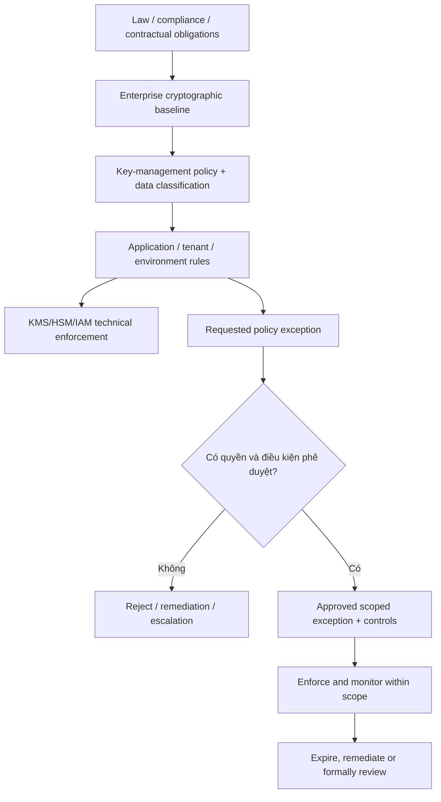
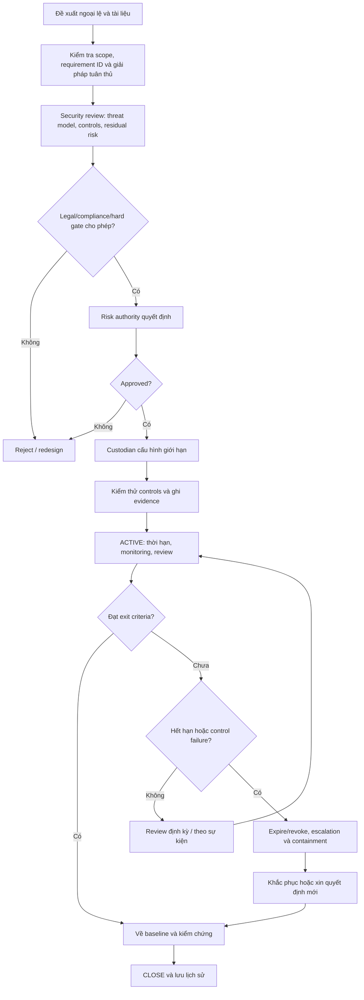
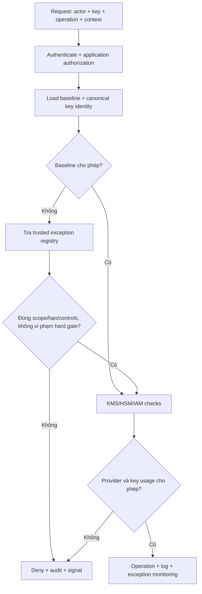
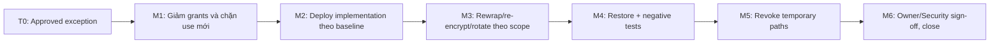

# Policy exception — Ngoại lệ chính sách quản lý khóa mật mã

> **Chương:** Key policy  
> **Module:** SECURITY_KEY_MANAGEMENT_FUNDAMENTALS — hiểu vòng đời khóa mật mã từ tạo, cấp phát, lưu trữ, sử dụng, xoay vòng đến thu hồi và hủy; kết nối mật mã đối xứng, bất đối xứng, chữ ký số, KMS/HSM, envelope encryption, kiểm soát truy cập và kiểm toán để thiết kế hệ thống bảo vệ khóa an toàn.

## 1. Mục tiêu học tập

Sau bài này, bạn có thể:

1. Giải thích **policy exception** là gì trong quản lý khóa mật mã, vì sao ngoại lệ chỉ được xem xét khi có lý do chính đáng và không làm biến mất rủi ro.
2. Phân biệt **ngoại lệ chính sách**, **ngoại lệ tạm thời**, **risk acceptance**, **thay đổi chính sách chung**, **sự cố vi phạm** và **quyền break-glass khẩn cấp**.
3. Mô tả hồ sơ ngoại lệ chứa **khóa/tài sản áp dụng, yêu cầu bị lệch, lý do, threat model, blast radius, biện pháp bù đắp, chủ sở hữu, phê duyệt, thời hạn và kế hoạch khắc phục**.
4. Đánh giá các ví dụ: chưa thể rotate KEK, dùng thuật toán legacy chỉ để giải mã, private key chưa ở HSM, key material exportable, một trường hợp kiểm kê thiếu owner hoặc service phải chuyển dần sang mTLS.
5. Thiết kế quy trình **đề xuất → phân tích rủi ro → phê duyệt → thực thi giới hạn → giám sát → hết hạn/đóng ngoại lệ**, theo nguyên tắc quyền tối thiểu và separation of duties.
6. Phân biệt **quyết định phê duyệt ngoại lệ** với **kiểm soát kỹ thuật thực tế** tại KMS/HSM/IAM/CI/CD; không coi một ticket là cơ chế bảo vệ khóa.
7. Phác thảo **YAML/JSON, Java rule validation và SQL** để quản lý ngoại lệ, kiểm tra thời hạn, phát hiện ngoại lệ mồ côi và tạo bằng chứng kiểm toán.
8. Liên hệ policy exception với **cryptoperiod, rotation/rewrap/re-encrypt, backup/DR, incident response, BYOK/HYOK, key inventory và audit**.

## 2. Policy exception là gì?

**Policy exception** là một **quyết định có kiểm soát, được phê duyệt bởi người có thẩm quyền**, cho phép một đối tượng/phạm vi **lệch khỏi một yêu cầu chính sách cụ thể** trong thời gian và điều kiện xác định. Ngoại lệ tồn tại để quản lý một bất tương thích thực tế, không phải để xóa bỏ tiêu chuẩn bảo mật.

Ví dụ chính sách của tổ chức yêu cầu: “Mọi KEK production phải có owner, được bảo vệ trong KMS/HSM được phê duyệt, có kế hoạch rotation và không được export nguyên liệu khóa.” Một hệ thống legacy chưa thể chuyển KEK sang KMS ngay vì còn phải nâng cấp thư viện, hệ thống có thể đề xuất một **ngoại lệ tạm thời** cho phần yêu cầu *lưu KEK trong KMS*.

Nhưng quyết định này phải trả lời rõ:

- **Khóa nào**, môi trường nào và dữ liệu nào bị ảnh hưởng?
- Yêu cầu nào đang bị lệch và **tại sao**?
- Rủi ro mới là gì; ai sẽ gánh hậu quả?
- Có **biện pháp bù đắp** nào có thể kiểm chứng?
- Ai có thẩm quyền **chấp nhận rủi ro còn lại**?
- Bao giờ phải khắc phục; ai chịu trách nhiệm?
- Nếu ngoại lệ hết hạn mà chưa khắc phục, **hệ thống sẽ làm gì**?

**Ngoại lệ đã được phê duyệt không khiến cấu hình yếu trở nên mạnh.** Nó chỉ ghi nhận một quyết định quản trị có phạm vi, rủi ro còn lại và các nghĩa vụ kiểm soát.

### 2.1. Một ví dụ ngắn

```text
Yêu cầu chuẩn:
  KEK production phải ở KMS/HSM được duyệt.

Thực trạng:
  LegacyArchive giữ KEK trong protected keystore trên một VM.
  Chưa tích hợp được KMS vì ứng dụng không hỗ trợ API wrap/unwrap.

Ngoại lệ được đề xuất:
  EXC-KEY-2026-041
  Chỉ áp dụng LegacyArchive production, đúng KEK version đã kiểm kê.
  Không cho phép tạo workload mới dựa vào cách giữ khóa cũ.
  Có rà soát quyền, không export KEK, kiểm soát truy cập host.
  Có phát hiện/ghi audit, backup được bảo vệ và restore test.
  Hạn hoàn tất migration do owner phê duyệt theo policy.
  Nếu quá hạn: chặn triển khai thay đổi mở rộng; escalation.
```

Đây là **ví dụ học tập**. Việc protected keystore trên VM có đủ điều kiện làm biện pháp bù đắp hay không phụ thuộc **threat model, hạ tầng thực và chính sách**, không phải cứ điền vào mẫu là hợp lệ.

### 2.2. Khác với “đã chấp nhận rủi ro, khỏi cần làm gì”

Một ngoại lệ được quản trị đúng phải tạo ra:

1. **Bằng chứng** vì sao không thể tuân thủ ngay.
2. **Quyền quyết định** của đúng cấp quản lý rủi ro và chủ sở hữu dữ liệu/khóa.
3. **Rào chắn kỹ thuật** và điều kiện sử dụng cụ thể.
4. **Chủ sở hữu thực thi** biện pháp bù đắp và phương án kết thúc.
5. **Thời điểm xem xét lại** và điều kiện thu hồi ngoại lệ.
6. **Audit trail** để chứng minh quyết định từng có hiệu lực trong đúng phạm vi.

Nếu chỉ có một comment như `// security exception approved` trong code, tổ chức chưa có cơ chế quản trị ngoại lệ đáng tin.

## 3. Vì sao ngoại lệ xuất hiện trong quản lý khóa?

Một chương trình quản lý khóa đủ chặt có thể gặp những ràng buộc thực tế:

- Hệ thống **legacy** cần thời gian để thay thuật toán hoặc định dạng ciphertext.
- Thiết bị **IoT/hardware** không hỗ trợ ngay đường cong, key size hoặc HSM API mới.
- Khóa phục vụ **giải mã dữ liệu lịch sử** chưa thể hủy vì retention/backup.
- Đối tác bên ngoài còn dùng **chứng thư/chữ ký/key transport profile cũ** trong hợp đồng.
- Việc **rotation đồng loạt** có thể gây gián đoạn dịch vụ nếu chưa kiểm thử restore.
- Một KMS/HSM region chưa hỗ trợ đúng mode/thuật toán hoặc khả năng import/unwrap.
- Trạng thái **owner/dependency inventory** chưa đầy đủ cần được khắc phục theo kế hoạch.
- Sự cố nhà cung cấp khiến phải vận hành **chế độ dự phòng đã thiết kế và được giới hạn**.

Những hoàn cảnh này có thể **giải thích nhu cầu xin ngoại lệ**. Chúng **không tự bảo đảm** ngoại lệ đáng được chấp thuận.

### 3.1. Ngoại lệ không phải lựa chọn mặc định

Nếu một team có thể áp dụng API được phê duyệt mà không làm ảnh hưởng đáng kể, việc đề xuất ngoại lệ chỉ vì “dễ code hơn” thường không có cơ sở. Bên đề xuất phải làm rõ:

- Đã xem xét giải pháp **tuân thủ tiêu chuẩn** nào?
- Vì sao không thể triển khai ngay, dựa trên bằng chứng gì?
- Chi phí, rủi ro vận hành và thời gian khắc phục thực tế?
- Có thể **giảm phạm vi** ngoại lệ chỉ cho dữ liệu lịch sử, không cho tạo khóa/ciphertext mới?
- Có cơ chế kiểm soát thay thế nào làm giảm xác suất/tác động tấn công?
- Nếu không chấp thuận, phương án an toàn nhất là gì?

### 3.2. Ngoại lệ không thể vượt qua mọi ranh giới

Một quy trình nội bộ **không thể dùng để hợp thức hóa** hành vi trái luật, trái hợp đồng bắt buộc hoặc phá bỏ những yêu cầu kiểm soát mà tổ chức đã xác định là **không được miễn trừ**.

Ví dụ, nếu quy định áp dụng **bắt buộc** key material nằm trong HSM được thẩm định cho một loại giao dịch, một người quản trị ứng dụng không thể tự ký ticket để bỏ qua yêu cầu đó. Cần chuyển lên **pháp chế, compliance, risk authority và cấp phê duyệt phù hợp**; có trường hợp **không thể phê duyệt** và hệ thống phải ngừng tác vụ liên quan.

**Risk acceptance là một quyết định quản trị, không phải quyền tạo ngoại lệ ngoài thẩm quyền.**

## 4. Phân biệt exception, deviation, waiver, change và break-glass

| Khái niệm | Ý nghĩa | Ví dụ | Điều cần tránh |
| --- | --- | --- | --- |
| **Policy exception** | Lệch một yêu cầu cụ thể, có phạm vi/thời hạn/phê duyệt | KEK legacy chưa đạt HSM requirement trong 60 ngày | Không dùng làm “miễn trừ mọi chính sách” |
| **Risk acceptance** | Chủ thể có thẩm quyền chấp nhận **residual risk** | Chấp nhận rủi ro còn lại sau kiểm soát bù đắp | Không đồng nghĩa hệ thống được miễn mọi điều kiện |
| **Temporary deviation** | Mô tả trạng thái thực tế lệch chuẩn trong một khoảng | Rotation trễ có kế hoạch | Có deviation chưa có nghĩa đã được duyệt |
| **Waiver** | Thuật ngữ miễn áp dụng một điều kiện trong phạm vi nào đó | Một yêu cầu không áp dụng cho thiết bị đặc thù | Định nghĩa cụ thể tùy tổ chức; không mặc định vĩnh viễn |
| **Policy change** | Sửa tiêu chuẩn áp dụng rộng hơn về sau | Thay chuẩn algorithm/cryptoperiod cho lớp hệ thống | Không dùng exception lặp lại để né sửa policy |
| **Incident / violation** | Hành vi sai hoặc sự cố đã xảy ra | Private key bị lộ, export trái phép | Không duyệt exception hồi tố để xóa dấu vết sự cố |
| **Break-glass** | Quyền/đường vận hành khẩn cấp có kiểm soát | Quyền tạm thời để khôi phục dịch vụ | Không biến thành grant thường trực |
| **Exception closure** | Ngoại lệ kết thúc sau khi đã khắc phục/xác minh | Chuyển KEK lên KMS, restore test đạt | Không đóng chỉ vì hết hạn trên giấy |

**Tên gọi** có thể khác theo GRC hoặc hệ thống ticketing. Điều cốt lõi là quy trình phân biệt **phát hiện sai lệch**, **phê duyệt trước**, **thực thi điều kiện**, **điều tra vi phạm** và **đóng bằng bằng chứng**.

### 4.1. Không tự động cho phép “ngoại lệ hồi tố”

Nếu nhóm đã export private key production trái policy vào một file plaintext, yêu cầu một ngoại lệ sau đó **không làm sự kiện đã xảy ra biến mất**. Đây có thể là sự cố cần điều tra:

- Key có bị đọc hoặc sao chép bởi người không được phép?
- Có cần rotate/revoke key, re-encrypt hoặc đánh giá chữ ký?
- Ai có quyền truy cập file/log/backup chứa key?
- Có phải kích hoạt incident response hoặc thông báo theo quy định?

Chỉ sau khi xử lý sự cố, tổ chức mới có thể đánh giá **một phương án vận hành tiếp theo**; nếu phải lệch policy, cần xét yêu cầu ngoại lệ riêng và không che giấu sự cố đã xảy ra.

## 5. Các nguyên tắc quản trị ngoại lệ an toàn

### 5.1. Ngoại lệ phải cụ thể, tối thiểu và có hạn

Một ngoại lệ phải giới hạn:

- **Đối tượng:** key resource/version, key family, certificate/key handle, service, tenant hoặc data asset.
- **Hoạt động:** chỉ `Decrypt` lịch sử, `Verify` chữ ký cũ, hoặc loại thao tác được phép; không tự bao gồm `Encrypt`/`Sign` mới.
- **Môi trường:** production/staging, account, region và trust domain.
- **Thuật toán/profile:** trường nào được lệch và cấu hình nào được dùng.
- **Thời gian:** `effectiveFrom`, `expiresAt`, kỳ review và điều kiện chấm dứt sớm.
- **Quyền:** principal và workload được phép, giới hạn số lượng/tần suất nếu phù hợp.

“Cho toàn công ty dùng khóa yếu khi cần” là **không đủ phạm vi** để điều hành ngoại lệ.

### 5.2. Có owner và approver chịu trách nhiệm

- **Requester:** đề xuất, cung cấp sự thật và phương án khắc phục.
- **Key owner:** chịu trách nhiệm lifecycle và khả năng tác động đến khóa.
- **Data/application owner:** đánh giá dữ liệu, khách hàng, availability và phụ thuộc.
- **Security/crypto architect:** phân tích threat model, những biện pháp bảo vệ còn có hiệu lực.
- **Risk/compliance authority:** xác nhận mức rủi ro có được chấp nhận và điều kiện tuân thủ.
- **KMS/HSM custodian:** triển khai kiểm soát trong giới hạn quyền, không tự phê duyệt miễn trừ.

Các vai trò không nhất thiết là sáu người khác nhau trong mọi hệ thống; tuy nhiên **không được để requester tự cấp quyền, tự phê duyệt ngoại lệ nhạy cảm và tự xác nhận đã khắc phục** mà không có kiểm soát độc lập.

### 5.3. Biện pháp bù đắp phải kiểm chứng được

“Bảo mật tăng cường”, “chúng tôi sẽ chú ý”, “đội vận hành theo dõi” **không đủ** nếu không định nghĩa:

- Kiểm soát **cụ thể** là gì.
- **Ai** vận hành.
- Bằng chứng và **cách kiểm thử**.
- Tần suất hoặc **điều kiện kích hoạt**.
- Phản ứng nếu kiểm soát lỗi hoặc bị vô hiệu hóa.

Ví dụ: với ngoại lệ rotation trễ, có thể yêu cầu **chặn cấp quyền mới**, chỉ cho decrypt dữ liệu lịch sử qua KMS/IAM scope hẹp, cảnh báo dùng key cũ cho `Encrypt` và kiểm thử restore trước ngày cutover.

### 5.4. Fail closed khi ngoài phạm vi

Một approval `KEY-EXC-42` cho `archive-prod-key-v1` không cho phép tự động sử dụng trên `archive-prod-key-v2` hoặc `payments-master-key`.

Nếu request có key ID, operation, principal, environment hoặc thời gian **không khớp**, hệ thống phải áp dụng **chính sách gốc**, thường là từ chối tác vụ không tuân thủ. Không fallback sang “có ngoại lệ gần giống” để hoàn tất request.

### 5.5. Ngoại lệ không được trở thành mặc định lâu dài

Tổ chức cần giới hạn **số lần gia hạn**, mức thẩm quyền tăng dần khi kéo dài và yêu cầu bằng chứng tiến độ migration. Nếu cùng một loại ngoại lệ lặp lại trên nhiều hệ thống, có thể đó là **vấn đề kiến trúc/chính sách cần sửa**, không phải chuỗi ticket độc lập.

## 6. Cấu trúc policy: baseline, hard requirements và exceptions

Một hệ thống có nhiều tầng chính sách:



Những yêu cầu có thể được phân lớp:

| Lớp | Ví dụ | Khả năng miễn trừ |
| --- | --- | --- |
| **Legal/contractual** | Dữ liệu phải được bảo vệ theo quy định bắt buộc | Không thể tự miễn bằng quyết định nội bộ |
| **Cryptographic hard gate** | Không chấp nhận plaintext private key qua log; không dùng export trái phép | Có thể bị xem là không thể cấp ngoại lệ |
| **Organization baseline** | KMS/HSM requirement, cryptoperiod, minimum key size | Chỉ đánh giá theo cơ chế risk exception được ủy quyền |
| **Operational standard** | Trường metadata inventory, lịch review, key tags | Có thể có phương án bù đắp và thời hạn khắc phục |
| **Technical implementation** | KMS key policy, CI/CD gate, workload IAM | Phải đồng bộ với quyết định được duyệt và có kiểm toán |

**Không gọi một điều kiện “hard gate” rồi vẫn mở nút phê duyệt vô điều kiện.** Nếu có lộ trình miễn trừ, phải định nghĩa rõ ai có thẩm quyền và điều kiện tối thiểu; nếu thực sự không được miễn, cần đưa hệ thống về cấu hình phù hợp hoặc ngừng chức năng liên quan.

### 6.1. Ghi đúng policy requirement ID

Một ngoại lệ tốt trỏ tới **policy version và requirement ID**, ví dụ:

```text
policyRef: KEY-MGMT-v3
requirementId: KM-ROT-04
requirementText:
  "Production KEK phải được kiểm tra cryptoperiod định kỳ
   và chuyển sang khóa mới trong thời hạn được duyệt."
```

Tránh ghi “ngoại lệ với policy bảo mật” mà không xác định điều khoản. Khi policy đổi version, phải biết ngoại lệ đang dựa trên **điều kiện nào**, có còn áp dụng hay cần xem xét lại.

### 6.2. Một exception có thể lệch nhiều điều kiện không?

Có thể xảy ra nhưng **thường nên tách** để tránh một approval quá rộng. Ví dụ vừa thiếu HSM, vừa key exportable, vừa không có owner, vừa rotation quá hạn là **nhiều loại rủi ro**; có thể cần nhiều findings và kiểm soát riêng.

Nếu tổ chức dùng một record cho nhiều điều khoản, phải lưu rõ **từng requirement ID, impact, control, owner, deadline và approval**, không gộp dưới chữ “exception approved”.

## 7. Xác định phạm vi chính xác cho ngoại lệ

### 7.1. Scope ở nhiều tầng

Có thể cần mô tả:

```text
organization / business domain
environment (prod/staging/dev)
cloud provider / account or project / region
service / application / workload identity
tenant / data classification / object family
key family / key resource / key material version / key ID
operation (Encrypt, Decrypt, Sign, Verify, Wrap, Unwrap, Export...)
algorithm / key size / wrapping mode / context
start time / expiration time
approval and compensating controls
```

Không phải mọi trường đều bắt buộc với mọi loại khóa; tuy nhiên **bất kỳ trường nào quyết định mức rủi ro** đều phải đủ chính xác để ngăn áp dụng ngoài ý muốn.

### 7.2. Alias không đủ để định danh khóa lịch sử

Một alias `billing-kek-prod` có thể chuyển từ key version `v1` sang `v2`. Nếu ngoại lệ cho phép **dùng v1 chỉ để decrypt**, nhưng enforcement chỉ kiểm tra alias, ngoại lệ có thể:

- Không còn áp dụng đúng v1 sau khi alias chuyển.
- Vô tình áp dụng cho v2.
- Bỏ sót bản backup vẫn cần unwrap với v1.

Cần ghi **concrete key resource/ID và version khi provider có semantics phù hợp**, cùng thông tin alias chỉ như tham chiếu tiện sử dụng.

### 7.3. Scope cũng gồm chủ thể và dữ liệu

Một ngoại lệ cho `archive-reader` không áp dụng cho mọi workload có thể gọi KMS. Một ngoại lệ cho dữ liệu `archive-before-2024` không tự cho phép tạo ciphertext mới bằng thuật toán legacy.

Đối với multi-tenant, phải biết:

- Tenant nào đã đồng ý/phụ thuộc ngoại lệ?
- Key được chia sẻ giữa nhiều tenant không?
- Có khách hàng hoặc hợp đồng cấm ngoại lệ trong phạm vi họ không?
- Ai xác định tác động tới việc xóa dữ liệu, backup và quyền truy cập?

**Không nhập `tenantId` do client tự khai báo làm bằng chứng phạm vi**. Nó phải được ràng buộc với authenticated identity và authorization policy.

## 8. Các nhóm ngoại lệ trong vòng đời khóa

| Loại ngoại lệ | Tình huống minh họa | Rủi ro cốt lõi | Hướng giới hạn |
| --- | --- | --- | --- |
| **Algorithm/profile** | Chữ ký lịch sử dùng SHA-1 phải verify trong migration | Không phù hợp policy thuật toán mới | Verify-only, pinned issuer, cutoff, không ký mới |
| **Key strength** | Một thiết bị cũ chỉ có RSA key size thấp hơn baseline | Biên an toàn thấp hơn và có thể bị tấn công | Chặn use mới khi có thể, giảm dữ liệu, sunset |
| **Key storage** | Private key chưa chuyển vào HSM | Key exposure từ OS/disk/backup/memory | Host hardening, ACL, monitoring, migration |
| **Exportability** | Một ứng dụng phải xuất DEK dưới dạng rõ tại runtime | Tăng blast radius khi workload bị chiếm | Không export KEK, scope hẹp, memory/log controls |
| **Rotation/cryptoperiod** | KEK quá kỳ rotation vì chưa test restore | Key sống lâu, quyền tích lũy | Decrypt-only nếu phù hợp, freeze new grants, plan |
| **Inventory metadata** | Thiếu dependency mapping cho key version cũ | Không biết blast radius/backup | Temporary owner, discovery, không hủy |
| **Access control** | Workload cần grant tạm thời qua đợt chuyển hệ thống | Abuse hoặc cross-tenant decrypt | Scoped principal, TTL, access review |
| **Backup/DR** | Legacy backup cần giữ private key cũ | Khóa cũ tồn tại lâu, quản trị khó | Archive access, dual control, restore tests |
| **Provider compatibility** | KMS chưa hỗ trợ profile wrap mong muốn | Dùng phương án bảo vệ thay thế | Đánh giá kỹ threat model và API được duyệt |
| **Certificate/PKI** | Client cũ chưa nhận CA mới | Có nguy cơ tin sai peer hoặc downtime | Controlled overlap, không trust-all, deadline |

### 8.1. Ngoại lệ “legacy decrypt-only” thường ít rủi ro hơn “legacy encrypt-new”

Giả sử có dữ liệu lịch sử dùng một thuật toán đã bị loại khỏi baseline. Nếu mục đích là **đọc lại dữ liệu để chuyển đổi**, ngoại lệ có thể giới hạn:

- Chỉ **Decrypt/Verify** lịch sử.
- Chỉ đúng key versions và dataset đã xác định.
- Không cho **Encrypt/Sign mới** theo profile cũ.
- Mọi lần dùng được audit và giới hạn principal.
- Dữ liệu sau đọc được **mã hóa lại bằng thuật toán hợp lệ** khi có thể.
- Có deadline, kế hoạch xóa phụ thuộc và kiểm tra backup.

Điều này **không biến thuật toán cũ thành an toàn**; rủi ro vẫn phụ thuộc kiểu primitive, dữ liệu, thời gian bảo vệ và khả năng attacker đã truy cập ciphertext.

### 8.2. Không ngoại lệ mơ hồ cho “password SHA-256”

Một legacy hệ thống lưu password bằng `SHA256(password)` có rủi ro offline cracking. Việc thêm salt hoặc “cho phép thêm một năm” **không tự biến SHA-256 trực tiếp thành password KDF phù hợp**.

Nếu phải vận hành trong giai đoạn chuyển:

- Giới hạn dịch vụ và người dùng liên quan.
- Thêm rate limit, MFA khi phù hợp và kiểm soát credential abuse.
- Chuyển dần sang **Argon2id/scrypt/bcrypt/PBKDF2** theo lựa chọn đã được đánh giá.
- Xem xét reset password hoặc migration-on-login phù hợp threat model.
- Đánh giá nguy cơ nếu database verifier đã bị lộ.

Ngoại lệ cho password storage có thể liên quan nhưng phải theo **policy mật khẩu** riêng; không ghi nó như “key rotation exception” để giảm nhẹ trách nhiệm.

## 9. Đánh giá rủi ro trước khi chấp thuận

Ngoại lệ là một quyết định **chấp nhận rủi ro còn lại** sau khi đã thử giải pháp tuân thủ và biện pháp giảm thiểu. Hồ sơ phải chứa threat model và tác động phù hợp quy mô.

### 9.1. Các thành phần đánh giá

1. **Asset:** khóa nào, đang bảo vệ dữ liệu/chữ ký nào, mức classification.
2. **Exposure:** nguyên liệu khóa tồn tại ở đâu; có thể export/read/Sign/Decrypt không.
3. **Threat actor:** insider, compromised workload, cloud admin, đối tác, attacker mạng, device theft.
4. **Attack path:** kẻ tấn công cần quyền gì để lộ/decrypt/forge/modify dữ liệu?
5. **Blast radius:** một object, một tenant, toàn bộ KEK family, CA root hay signing pipeline.
6. **Likelihood:** dựa trên quyền hiện có, lịch sử sự cố, mức tiếp xúc và kiểm soát kỹ thuật.
7. **Impact:** confidentiality, integrity, availability, pháp lý, compliance, trust.
8. **Residual risk:** tác động/xác suất sau khi thực hiện các biện pháp bù đắp.
9. **Time window:** thời gian ngoại lệ càng dài có thể tạo thêm cơ hội khai thác và drift.
10. **Dependencies:** backup/DR, các phiên bản khóa cũ, hợp đồng, đối tác và điều kiện thu hồi.

**Không trình bày một điểm rủi ro số học duy nhất như bằng chứng mật mã.** Mô hình xếp hạng nội bộ hữu ích để nhất quán quyết định, nhưng kết luận phải có phân tích tình huống cụ thể.

### 9.2. Ví dụ thang đánh giá minh họa

| Thành phần | Thấp | Trung bình | Cao |
| --- | --- | --- | --- |
| **Key scope** | Khóa test cô lập | Key của một service production | Root/KEK chung nhiều tenant |
| **Operation** | Verify-only | Decrypt dữ liệu lịch sử có ACL | Export private key hoặc Sign không hạn chế |
| **Exposure** | HSM với policy chặt | Encrypted keystore host giới hạn | File key readable trên nhiều máy |
| **Data impact** | Dữ liệu giả không nhạy cảm | Dữ liệu nội bộ | Tài chính/sức khỏe/PII nhạy cảm |
| **Duration** | Ngắn và có plan | Có milestone đáng tin | Không có ngày kết thúc |
| **Compensating controls** | Đã thử và đo hiệu lực | Một phần chưa đo | Chỉ dựa vào lời cam kết |

Bảng **không phải tiêu chuẩn chấm điểm chính thức**. Mức phê duyệt cần được quyết định bằng risk matrix do tổ chức và các nghĩa vụ áp dụng ban hành.

### 9.3. Không “bù” được mọi điểm yếu bằng logging

Nếu private signing key đã lộ ra ngoài, việc bật audit không thể khiến attacker **mất khả năng ký** bằng bản sao private key mà họ giữ. Khi đó cần **revoke/rotate** và điều tra chữ ký, không đề xuất logging là biện pháp đủ để cho phép tiếp tục dùng khóa bị lộ.

Tương tự, nếu AES-GCM đã dùng lại cùng key+nonce nhiều lần, chỉ ghi log nhiều hơn không phục hồi được những thuộc tính mật mã đã mất. Cần điều tra ciphertext, thay key và đánh giá re-encrypt phù hợp.

## 10. Biện pháp bù đắp: thay rủi ro bằng kiểm soát có hiệu quả

**Compensating control** là kiểm soát khác được thiết kế để giảm rủi ro khi yêu cầu gốc chưa thể thực hiện. Nó cần phù hợp với **đường tấn công cụ thể**, không chỉ là biện pháp chung chung.

### 10.1. Ví dụ theo loại ngoại lệ

| Yêu cầu chưa đáp ứng | Biện pháp bù đắp có thể cân nhắc | Giới hạn |
| --- | --- | --- |
| KEK chưa đặt trong HSM | Host hardening, disk encryption, strict ACL, cấm export/log, mTLS, monitoring | Không cung cấp đầy đủ assurance/isolated boundary của HSM |
| Rotation KEK chậm | Chặn Encrypt/Wrap mới nếu phù hợp, review grants, monitor usage, hạn chế scope | Không loại bỏ rủi ro key cũ đã bị lộ |
| Legacy verification key | Verify-only, pinned issuer/key, giới hạn nguồn dữ liệu/time, lưu bằng chứng lịch sử | Thuật toán cũ vẫn có yếu điểm |
| Thiếu owner/dependency | Temporary accountable owner, discovery, audit, freeze destructive change | Không chứng minh completeness trước khi điều tra xong |
| Grant `Decrypt` rộng | Tách IAM principal, scoped context, approval, rate limit, log/alert | Nếu workload vẫn có quyền rộng thực tế, residual risk còn lớn |
| PSK không thể rotate ngay | Tách thiết bị/nhóm, network isolation, re-auth monitoring, lịch nâng cấp | PSK bị lộ vẫn có thể bị dùng ngoài kênh nếu không bị chặn |
| HSM API chưa hỗ trợ | Đánh giá alternate provider, code review, protection boundary và cryptoperiod | Không được gọi alternate provider là HSM đã thẩm định nếu không đúng |
| Không thể hủy key cũ vì backup | Decrypt-only, locked archival role, dual control, restore test | Key cũ vẫn là tài sản cần bảo vệ |

### 10.2. Xác định bằng chứng kiểm tra

Thay vì “Có kiểm soát quyền chặt”, cần chỉ ra:

```text
controlId: CTRL-KEY-ACCESS-17
description:
  Chỉ workload archive-reader-v2 được gọi KMS Decrypt với key-v1.
enforcement:
  IAM key policy, workload identity và application object authorization.
test:
  Negative test từ 3 workload không được phép phải bị từ chối.
  Positive test chỉ trên tập dữ liệu archive theo policy.
monitoring:
  Alert khi có thay đổi grant hoặc Decrypt ngoài cửa sổ công việc.
owner:
  Platform Security + Archive Owner.
evidence:
  Link tới policy export không chứa secret, test run, audit review.
```

**Không coi `Denied` trong một lần test là bằng chứng tất cả đường truy cập đều bị chặn.** Cần kiểm tra role inheritance, break-glass, cross-account grants, service accounts và cloud admin capabilities theo ranh giới tin cậy.

### 10.3. Kiểm soát giảm exposure và kiểm soát giảm impact

Hai nhóm này khác nhau:

- **Giảm likelihood:** IAM scope hẹp, network segmentation, HSM, hardening, time-limited credential, detection.
- **Giảm impact:** per-tenant DEK/KEK, giới hạn data scope, tách signing key theo service, rotation nhanh, kill switch, incident plan.

Một ngoại lệ không nên để **một KEK dùng chung vô hạn** chỉ vì truy cập KEK đang được log. Có thể cần thay kiến trúc để giảm **blast radius**.

### 10.4. Khi không có bù đắp thực sự

Nếu rủi ro vượt ngưỡng có thể chấp nhận và không có kỹ thuật giảm thiểu thích hợp, cần **từ chối ngoại lệ, cô lập chức năng, ngừng tạo dữ liệu mới hoặc đổi kiến trúc**.

Không dùng câu “business need outweighs risk” như một công thức thay cho phân tích và thẩm quyền quản lý rủi ro.


## 11. Ai yêu cầu, ai phê duyệt và ai thực thi?

Một tổ chức cần **ma trận thẩm quyền phê duyệt ngoại lệ** theo mức rủi ro, data classification, mục đích và loại khóa. KMS admin có thể hiểu nền tảng nhưng không tự có thẩm quyền chấp nhận rủi ro kinh doanh hoặc pháp lý.

| Vai trò | Trách nhiệm | Không nên tự có |
| --- | --- | --- |
| **Requester / application owner** | Mô tả nhu cầu, giải pháp tuân thủ đã thử, kế hoạch migration | Quyền tự phê duyệt |
| **Key owner** | Xác nhận key inventory, scope, cryptoperiod, blast radius | Quyền export/decrypt không giới hạn |
| **Data owner** | Đánh giá dữ liệu, retention, khách hàng, hậu quả | Quyền thay IAM/KMS policy |
| **Security/crypto reviewer** | Review threat model, thuật toán, compensating controls | Quyền chấp nhận mọi rủi ro kinh doanh |
| **Risk/compliance authority** | Phê duyệt residual risk trong thẩm quyền và giới hạn tuân thủ | Khả năng làm primitive yếu trở nên an toàn |
| **KMS/HSM custodian** | Áp dụng cấu hình/grant, kiểm thử và audit theo thay đổi được duyệt | Quyền tự miễn chính sách |
| **SOC/auditor** | Giám sát, phát hiện drift, kiểm tra evidence | Quyền che hoặc xóa sự cố |
| **Incident commander** | Điều phối quyền break-glass khi khẩn cấp | Quyền giữ đặc quyền vô thời hạn |

### 11.1. RACI minh họa

| Hoạt động | Requester | Key owner | Security | Risk authority | Custodian | SOC/Audit |
| --- | --- | --- | --- | --- | --- | --- |
| Đề xuất ngoại lệ và roadmap | **R** | C | C | I | C | I |
| Xác định key scope và dependencies | R | **A** | C | I | R | I |
| Threat model, kiểm tra controls | C | C | **A/R** | C | C | I |
| Quyết định residual risk acceptance | I | C | C | **A/R** | I | I |
| Áp dụng thay đổi IAM/KMS/HSM | I | C | C | I | **A/R** | I |
| Theo dõi drift và vi phạm | I | C | C | I | R | **A/R** |
| Xác nhận hết ngoại lệ và khắc phục | R | **A** | C | C | R | I |

Đây là một **mẫu trách nhiệm**, không phải RACI bắt buộc cho mọi doanh nghiệp. Tổ chức cần một đầu mối **A — Accountable** rõ cho từng quyết định; đặc biệt với CA root key, master KEK hoặc khóa ký tài chính có thể cần dual control/quorum và cấp phê duyệt cao hơn.

### 11.2. Điều kiện phê duyệt

1. **Requester và approver** phải được phân tách phù hợp với mức rủi ro.
2. **Key owner** biết phạm vi và đồng ý trách nhiệm, kể cả khi risk authority phê duyệt cuối.
3. Người duyệt có **authority đúng risk tier**; trưởng nhóm không tự cấp ngoại lệ cho master key toàn tổ chức.
4. Ngoại lệ liên quan khách hàng/đối tác phải kiểm tra **hợp đồng, thông báo và thẩm quyền**.
5. Đổi scope, algorithm, owner, key version hoặc expiry có thể phải **tái phê duyệt**.
6. Ngoại lệ từng được duyệt **không tự tạo pre-approval** cho lần gia hạn.

### 11.3. Owner chuyển bộ phận hoặc nghỉ việc

Một exception record nên có `ownerTeamId`, người liên hệ, người dự phòng, escalation path và audit history. Khi owner thay đổi cần **bàn giao cả residual risk, deadline, controls và migration work**, không chỉ sửa một ô email. Đồng thời rà KMS grants, break-glass accounts và người có quyền phê duyệt.

## 12. Vòng đời của policy exception

Một quy trình đầy đủ có các trạng thái có ý nghĩa khác nhau:

```text
DRAFT
 -> SUBMITTED
 -> UNDER_REVIEW
 -> APPROVED / REJECTED
 -> ACTIVE (sau khi controls được xác minh)
 -> REMEDIATION_IN_PROGRESS
 -> RESOLVED / EXPIRED / REVOKED
 -> CLOSED (bằng chứng và sign-off)
```

- **APPROVED:** quyết định cho phép lệch theo điều kiện đã ban hành.
- **ACTIVE:** đang trong thời hạn hiệu lực, controls đã được kích hoạt/kiểm tra.
- **EXPIRED:** quá hạn, không còn là căn cứ cho phép hoạt động ngoài baseline.
- **REVOKED:** bị thu hồi sớm vì control failure, incident hoặc thay đổi rủi ro.
- **RESOLVED:** đã trở về baseline hoặc hoàn tất phương án kết thúc.
- **CLOSED:** đã kiểm chứng và lưu hồ sơ kiểm toán.

### 12.1. Sơ đồ workflow



### 12.2. Quyết định phê duyệt khác kích hoạt KMS

Ticket được duyệt **không tự tạo quyền `Decrypt`** nếu IAM/KMS vẫn từ chối. Ngược lại, KMS admin có thể cấp quyền kỹ thuật dù ticket chưa được duyệt; **việc grant thành công không có nghĩa đã chấp nhận rủi ro**.

Vì vậy cần đồng bộ **decision plane** (GRC/ticket/registry) với **enforcement plane** (KMS/HSM/IAM/CI/CD) và observation plane (audit/monitoring).

### 12.3. Những mốc thời gian khác nhau

```text
requestedAt
submittedAt
reviewedAt
approvedAt
effectiveFrom
activatedAt
expiresAt
reviewDueAt
lastControlVerifiedAt
closedAt
```

Không backdate approval để che thời gian thực tế vi phạm. Một ngoại lệ có thể được duyệt trước nhưng chỉ **ACTIVE** sau khi triển khai và thử controls đạt.

## 13. Metadata bắt buộc cho hồ sơ ngoại lệ

| Nhóm | Trường gợi ý | Vì sao cần |
| --- | --- | --- |
| **Identity** | `exceptionId`, `schemaVersion`, `status` | Phân biệt các quyết định và revision |
| **Policy** | `policyRef`, `policyVersion`, `requirementIds` | Biết chính xác điều khoản bị lệch |
| **Scope** | `keyResourceIds`, `keyVersions`, `services`, `tenantScope` | Không cho miễn trừ ngoài đối tượng |
| **Operations** | `allowedOperations`, `algorithmProfile` | Chỉ cho phép Decrypt/Verify khi được duyệt |
| **Ownership** | `requesterId`, `keyOwnerTeamId`, `dataOwnerId`, `custodianId` | Accountability và escalation |
| **Risk** | `riskTier`, `threatModelRef`, `residualRiskRef` | Bằng chứng chấp nhận rủi ro |
| **Controls** | `compensatingControls`, `testEvidenceRefs`, `monitoringRefs` | Kiểm chứng việc giảm rủi ro |
| **Approval** | `approvedBy`, `approvedAt`, `approvalScope` | Người và thẩm quyền ra quyết định |
| **Validity** | `effectiveFrom`, `expiresAt`, `reviewDueAt` | Hạn áp dụng và kiểm tra |
| **Exit** | `remediationPlanRef`, `milestones`, `exitCriteria` | Trách nhiệm hoàn thành |
| **Audit** | `changeHistoryRef`, `incidentRefs`, `revisions` | Truy vết và kiểm toán |
| **Dependencies** | `dataAssets`, `backupRefs`, `keyInventoryRefs` | Phạm vi ảnh hưởng khi hủy/rotation |

### 13.1. Scope phải đúng cấp khóa

Một alias `billing-kek-prod` có thể chuyển đích từ v1 sang v2. Ngoại lệ cho v1 decrypt-only **không tự áp dụng** cho v2. Nên dùng canonical key identity theo provider/account/region/resource/version nếu API có semantics phù hợp.

Với provider **không expose version** giống cách quản trị trên, cần mô tả identity riêng theo khả năng thực, không dựng version giả từ timestamp.

### 13.2. Hồ sơ không chứa vật liệu khóa

Không đặt các giá trị sau trong ticket/GRC/SQL inventory:

```text
privateKeyPem
plaintextDek
kekBytes
recoverySeed
hsmAdministratorPin
pskRaw
passwordPepper
apiTokenRaw
backupKeySecretShares
```

Hồ sơ giữ **tham chiếu và đường dẫn evidence kiểm soát quyền**, không đính kèm raw key.

## 14. YAML: ngoại lệ decrypt-only cho khóa legacy

Đoạn sau là **dữ liệu minh họa** về hồ sơ quản trị, không phải định dạng nhập trực tiếp vào một KMS.

```yaml
schemaVersion: 1
exceptionId: EXC-KEY-2026-041
status: ACTIVE
title: LegacyArchive decrypt-only during migration

policy:
  policyRef: KEY-MGMT-v3
  requirementIds: [KM-ROT-04, KM-STORAGE-02]

scope:
  environment: production
  service: LegacyArchive
  dataClassification: confidential
  tenantScope: [archive-business-unit]
  keyResources:
    - provider: managed-kms
      accountRef: security-prod
      region: primary-region
      resourceId: archive-kek-v1
      materialVersion: "v1"
  allowedOperations: [Decrypt, Unwrap]
  forbiddenOperations: [Encrypt, Wrap, Export, ScheduleDeletion]
  purpose: Read legacy files for migration only

risk:
  riskTier: high
  threatModelRef: risk/legacy-archive-key
  residualRiskDecisionRef: risk-acceptance/2026-041

ownership:
  requesterTeamId: archive-platform
  accountableKeyOwnerTeamId: archive-security
  dataOwnerTeamId: records-management
  custodianTeamId: kms-platform
  backupOwnerTeamId: security-operations

compensatingControls:
  - id: ctrl/approved-workload-only
    evidenceRef: test/legacy-archive-iam-deny
  - id: ctrl/unwrap-alert
    evidenceRef: audit/archive-unwrap-alert
  - id: ctrl/no-new-ciphertext
    evidenceRef: ci/archive-new-write-deny
  - id: ctrl/restore-validation
    evidenceRef: dr/archive-restore-evidence

approval:
  decision: APPROVED
  approverRole: enterprise-risk-authority
  approvalTicketRef: change/2026-041
  approvedAt: "2026-11-10T10:00:00Z"

validity:
  effectiveFrom: "2026-11-11T00:00:00Z"
  expiresAt: "2027-02-01T00:00:00Z"
  reviewDueAt: "2026-12-10T00:00:00Z"

exit:
  remediationPlanRef: project/archive-key-migration
  exitCriteria:
    - "No new writes under legacy key"
    - "All active objects migrated or documented for retention"
    - "Historical restore test passes"
    - "Legacy grants revoked after migration"
  closureEvidenceRef: null
```

### 14.1. YAML không tự thực thi kiểm soát

- `forbiddenOperations` chỉ là metadata; phải có **KMS IAM/key policy** tương ứng.
- `status: ACTIVE` chưa chứng minh control thực tế hoạt động.
- `approvalTicketRef` phải được xác minh trong registry đã tin cậy.
- `expiresAt` không tự thu hồi grant nếu thiếu automation/runbook.
- `tenantScope` phải gắn với authenticated identity/authorization.
- `riskDecisionRef` không miễn ràng buộc pháp luật hoặc hard gates.

Khi key version, owner, scope hoặc data classification thay đổi, cần **revision mới/tái phê duyệt** phù hợp và không ghi đè mất lịch sử quyết định.

## 15. Java: kiểm tra phạm vi ngoại lệ trước một thao tác sử dụng khóa

Mã Java 17 dưới đây là **ví dụ policy evaluator**. Nó không triển khai AES/RSA/KMS, không tự cấp quyền runtime và không xác minh được bằng chứng bên ngoài; các record phải được nạp từ **registry được kiểm soát và xác thực**.

```java
import java.time.Instant;
import java.util.Objects;
import java.util.Set;

public final class KeyPolicyExceptionEvaluator {
    private KeyPolicyExceptionEvaluator() {}

    public enum Status {
        DRAFT, SUBMITTED, UNDER_REVIEW, APPROVED, ACTIVE,
        EXPIRED, REVOKED, RESOLVED, CLOSED, REJECTED
    }

    public enum Operation {
        ENCRYPT, DECRYPT, WRAP, UNWRAP, SIGN, VERIFY, EXPORT
    }

    public record KeyIdentity(
            String provider,
            String accountRef,
            String region,
            String resourceId,
            String materialVersion
    ) {
        public KeyIdentity {
            requireText(provider, "provider");
            requireText(accountRef, "accountRef");
            requireText(region, "region");
            requireText(resourceId, "resourceId");
            requireText(materialVersion, "materialVersion");
        }
    }

    public record ExceptionRecord(
            String exceptionId,
            String requirementId,
            KeyIdentity key,
            String environment,
            String serviceIdentity,
            Set<Operation> allowedOperations,
            Status status,
            Instant effectiveFrom,
            Instant expiresAt,
            Instant controlVerifiedAt,
            boolean authorizedApprovalVerified
    ) {
        public ExceptionRecord {
            requireText(exceptionId, "exceptionId");
            requireText(requirementId, "requirementId");
            Objects.requireNonNull(key, "key");
            requireText(environment, "environment");
            requireText(serviceIdentity, "serviceIdentity");
            allowedOperations = Set.copyOf(allowedOperations);
            Objects.requireNonNull(status, "status");
            Objects.requireNonNull(effectiveFrom, "effectiveFrom");
            Objects.requireNonNull(expiresAt, "expiresAt");
        }
    }

    public record Request(
            KeyIdentity key,
            String environment,
            String authenticatedServiceIdentity,
            Operation operation,
            String requirementId
    ) {
        public Request {
            Objects.requireNonNull(key, "key");
            requireText(environment, "environment");
            requireText(authenticatedServiceIdentity, "authenticatedServiceIdentity");
            Objects.requireNonNull(operation, "operation");
            requireText(requirementId, "requirementId");
        }
    }

    public static boolean allowsException(
            ExceptionRecord exception,
            Request request,
            Instant now) {

        Objects.requireNonNull(exception);
        Objects.requireNonNull(request);
        Objects.requireNonNull(now);

        if (exception.status() != Status.ACTIVE
                || !exception.authorizedApprovalVerified()) {
            return false;
        }

        // Cửa sổ hợp lệ là [effectiveFrom, expiresAt).
        if (now.isBefore(exception.effectiveFrom())
                || !now.isBefore(exception.expiresAt())) {
            return false;
        }

        // Đây chỉ kiểm tra evidence có mặt; production còn
        // phải verify control effectiveness, freshness và drift.
        if (exception.controlVerifiedAt() == null
                || exception.controlVerifiedAt().isAfter(now)) {
            return false;
        }

        // So khớp chính xác. Không wildcard, alias/prefix hoặc fallback.
        return exception.key().equals(request.key())
                && exception.environment().equals(request.environment())
                && exception.serviceIdentity()
                       .equals(request.authenticatedServiceIdentity())
                && exception.requirementId().equals(request.requirementId())
                && exception.allowedOperations().contains(request.operation());
    }

    private static void requireText(String value, String field) {
        if (value == null || value.isBlank()) {
            throw new IllegalArgumentException(field + " is required");
        }
    }
}
```

### 15.1. Kết quả và giới hạn của ví dụ

- Đúng key resource/version, environment, authenticated service, requirement và operation mới được xem xét.
- Chỉ `ACTIVE`, được xác minh approval và trong thời hạn mới có thể áp dụng ngoại lệ.
- `now == expiresAt` phải trả `false`.
- Bằng chứng có timestamp không tự chứng minh **biện pháp bù đắp còn hoạt động**; thực tế phải kiểm tra đủ và liên tục.
- Chưa kiểm tra **tenant/data scope, policy version, key state, emergency authority, residual risk và hard requirements**.
- Hàm trả `false` nghĩa là **không có ngoại lệ hợp lệ**; phải áp dụng **baseline policy** chứ không tự chấp nhận request.
- Một kết quả `true` cũng **không thay** IAM/KMS/HSM authorization hoặc application object authorization.

### 15.2. Anti-pattern cần tránh

```java
// NGUY HIỂM: chỉ cần client gửi exceptionId là bỏ qua policy.
// if (request.hasExceptionId()) return true;

// NGUY HIỂM: thử mọi ngoại lệ cho đến khi tìm được một cái "gần giống".
// if (keyId.startsWith(exception.keyPrefix())) allow();
```

### 15.3. Negative tests

| Điều kiện | Kết quả |
| --- | --- |
| Đúng key/version/service/operation, còn hạn, controls được kiểm chứng | Có thể chấp nhận ngoại lệ, vẫn áp dụng IAM và policy khác |
| `APPROVED` nhưng chưa `ACTIVE` | Không cho qua ngoại lệ |
| `EXPIRED` hoặc `REVOKED` | Không cho |
| Khác material version dù cùng alias | Không cho |
| Chỉ duyệt `DECRYPT`, request `ENCRYPT` | Không cho |
| Service identity hoặc environment khác | Không cho |
| Requirement khác | Không cho |
| Timestamp bằng `expiresAt` | Không cho |
| Approval chưa được xác minh | Không cho |
| Không có control evidence | Không cho |

## 16. SQL: tìm ngoại lệ quá hạn, mồ côi và thiếu evidence

Một bảng GRC có thể lưu metadata của ngoại lệ, còn key inventory giữ canonical key identity và team directory giữ owner. Không bao giờ đưa plaintext secret vào bảng ngoại lệ.

```sql
-- PostgreSQL-style SQL, chỉ minh họa schema.
CREATE TABLE key_policy_exception (
    exception_id        VARCHAR(128) PRIMARY KEY,
    policy_ref          VARCHAR(255) NOT NULL,
    requirement_id      VARCHAR(128) NOT NULL,
    provider_key_id     VARCHAR(512) NOT NULL,
    material_version    VARCHAR(128),
    environment         VARCHAR(32) NOT NULL,
    owner_team_id       VARCHAR(128) NOT NULL,
    status              VARCHAR(32) NOT NULL,
    effective_from      TIMESTAMPTZ NOT NULL,
    expires_at          TIMESTAMPTZ NOT NULL,
    review_due_at       TIMESTAMPTZ,
    last_control_check  TIMESTAMPTZ,
    approver_ref        VARCHAR(255),
    approval_ref        VARCHAR(512),
    remediation_ref     VARCHAR(512) NOT NULL,
    updated_at          TIMESTAMPTZ NOT NULL,
    CONSTRAINT valid_exception_window
        CHECK (expires_at > effective_from)
);

CREATE TABLE organization_team (
    team_id    VARCHAR(128) PRIMARY KEY,
    is_active  BOOLEAN NOT NULL
);
```

### 16.1. Ngoại lệ còn ACTIVE nhưng quá hạn

```sql
SELECT
    exception_id,
    provider_key_id,
    material_version,
    owner_team_id,
    expires_at,
    remediation_ref
FROM key_policy_exception
WHERE status = 'ACTIVE'
  AND expires_at <= CURRENT_TIMESTAMP
ORDER BY expires_at;
```

Kết quả tạo finding và escalation; **không tự xóa key**. Nếu quyền còn tồn tại, cần containment theo runbook và quyết định mới của đúng thẩm quyền, **không mặc định gia hạn**.

### 16.2. Ngoại lệ có owner không còn hợp lệ

```sql
SELECT e.exception_id, e.owner_team_id, e.provider_key_id
FROM key_policy_exception AS e
LEFT JOIN organization_team AS t
       ON t.team_id = e.owner_team_id
WHERE e.status IN ('APPROVED', 'ACTIVE')
  AND (t.team_id IS NULL OR t.is_active = FALSE);
```

Tạo finding `EXCEPTION_OWNERLESS` và giao temporary accountable owner theo policy, xác minh lại risk acceptance khi chuyển chủ sở hữu.

### 16.3. Thiếu kiểm chứng controls

```sql
SELECT exception_id, owner_team_id,
       last_control_check, review_due_at
FROM key_policy_exception
WHERE status = 'ACTIVE'
  AND (
       last_control_check IS NULL
       OR review_due_at IS NULL
       OR review_due_at <= CURRENT_TIMESTAMP
  );
```

Truy vấn chỉ phát hiện **dấu hiệu thiếu thời gian kiểm chứng**, không thể chứng minh chất lượng evidence; cần liên kết với control test results.

### 16.4. Nhiều ngoại lệ cho cùng requirement

```sql
SELECT requirement_id, COUNT(*) AS active_count
FROM key_policy_exception
WHERE status = 'ACTIVE'
GROUP BY requirement_id
HAVING COUNT(*) > 5
ORDER BY active_count DESC;
```

Ngưỡng `5` là ví dụ để mở review: nhiều ngoại lệ cùng điều khoản có thể do policy chưa phù hợp, nợ kỹ thuật hoặc lạm dụng workflow. Cần phân tích thay vì tự đổi baseline.

## 17. Enforcement qua KMS/HSM/IAM và policy-as-code

Một hệ thống vững nên có ba lớp tách biệt:

1. **Governance:** GRC workflow, risk acceptance, scope, hạn, owner và approval.
2. **Enforcement:** IAM/KMS/HSM/CI/CD/ứng dụng áp dụng quyết định thành quyền hoặc từ chối tương ứng.
3. **Observation:** audit logs, metrics, evidence và phát hiện drift.

### 17.1. Luồng policy runtime



**Một policy exception không thể biến thuật toán không được provider hỗ trợ thành khả dụng.** Nếu HSM không hỗ trợ profile cần thiết, phải đổi thiết kế/thiết bị hoặc dùng phương án được phê duyệt, không đổi tên thuật toán.

### 17.2. Các điểm kiểm soát hữu ích

- **IaC lint/validation:** không tạo key ngoài baseline nếu không có approval phù hợp.
- **Grant workflow:** yêu cầu exception ID hợp lệ trước khi cấp quyền tạm thời.
- **Key rotation pipeline:** cho phép decrypt-only key cũ, chặn encrypt mới bằng key đó.
- **Certificate issuing process:** không phát hành key/cert ngoài profile trừ khi được phép trong phạm vi.
- **Runtime KMS wrapper:** validate workload identity và object scope trước khi unwrap.
- **Continuous drift monitoring:** cảnh báo khi grants, key state hoặc operations không khớp ngoại lệ đã duyệt.

Không tin một file `exceptions.yaml` từ pull request hoặc một header `X-Policy-Exception` do client gửi là bằng chứng được phê duyệt.

### 17.3. Expiry phải gắn với hành động thực tế

Đến hạn ngoại lệ, có thể cần:

- Thu hồi temporary grants/cấu hình bypass.
- Chặn **use mới ngoài policy**, đồng thời bảo đảm không phá dữ liệu còn cần decrypt/verify.
- Điều phối migration jobs, retry và rollback theo runbook.
- Kiểm tra IAM caches, service sessions, cross-account roles và break-glass.
- Cảnh báo nếu vẫn còn hoạt động trái phạm vi.
- Lưu evidence thu hồi và sign-off.

Không dựa vào **một cronjob duy nhất** rồi khẳng định mọi quyền đã bị thu hồi. Phải đo trên các enforcement paths thực tế.

### 17.4. Quyền nguy hiểm cần hạn chế riêng

`Sign` có thể tạo chữ ký hợp lệ dù private key non-exportable; `Decrypt/Unwrap` có thể trả DEK plaintext; `Export` có thể phát tán bí mật rất khó thu hồi; `Delete/Destroy` có thể làm dữ liệu không khôi phục được.

Do đó ngoại lệ về **metadata hoặc rotation** không tự cho phép bất kỳ quyền nào ở trên. Mỗi operation phải có scope, approver và kiểm soát riêng.

## 18. Thời hạn, renewal và thu hồi ngoại lệ trước hạn

Không có một số ngày áp dụng cho mọi ngoại lệ. Cửa sổ hiệu lực phụ thuộc risk tier, dữ liệu, khả năng migration, nghĩa vụ tuân thủ và hiệu quả controls. **Không để ngoại lệ tạm thời thành vô hạn**.

### 18.1. Gia hạn phải là quyết định mới

1. Requester cung cấp **tiến độ và nguyên nhân chậm** có bằng chứng.
2. Owner kiểm tra key scope, dependencies và controls.
3. Security đánh giá threat landscape, thuật toán, sự cố và dữ liệu.
4. Risk authority quyết định có tiếp tục chấp nhận residual risk hay không.
5. Nếu duyệt, tạo revision/approval/deadline mới.
6. Nếu từ chối, thực hiện containment, migration hoặc dừng tác vụ theo quy trình.

**Không backdate** approval để lấp khoảng thời gian vượt hạn.

### 18.2. Trigger thu hồi sớm

- Có bằng chứng private key/PSK/DEK bị lộ.
- Phát hiện lỗ hổng thuật toán khiến residual risk không còn chấp nhận được.
- Phạm vi dữ liệu hoặc tenant thay đổi.
- Owner thay đổi mà chưa tiếp nhận trách nhiệm.
- Compensating control thất bại hoặc audit bị vô hiệu hóa.
- IAM grant lan rộng, workload bị compromise.
- Nghĩa vụ pháp lý/hợp đồng thay đổi.
- Migration hoàn tất, ngoại lệ không còn cần.

Thu hồi ngoại lệ **không tự động nghĩa là xóa key ngay**: với key cũ còn cần giải mã/verify và backup, phải kiểm soát đường use phù hợp để tránh mất dữ liệu.

## 19. Các trường hợp kỹ thuật thường gặp

### 19.1. KEK quá hạn nhưng backup còn phụ thuộc

`ArchiveKEK-v1` đã hết thời hạn **wrap mới**, nhưng nhiều object và backup còn chứa DEK được bọc dưới v1. Phương án tạm thời có thể:

- Cho phép `Decrypt/Unwrap` lịch sử.
- Chặn `Encrypt/Wrap` mới bằng v1.
- Chỉ cấp quyền cho workload/tenant/dataset đã xác định.
- Có lịch rewrap và **restore test**.
- Cảnh báo nếu xuất hiện ciphertext mới tham chiếu v1.
- Đóng ngoại lệ sau khi đối soát cả active DB và backup/snapshot.

**Rewrap không thay DEK.** Nếu DEK đã lộ, cần đánh giá thay DEK/re-encrypt, không chỉ đổi KEK.

### 19.2. Khóa ký cũ và xác minh chữ ký lịch sử

Một khóa RSA có thể không còn được phép **Sign mới**, nhưng public verification key/chứng thư vẫn cần để verify chữ ký cũ. Trong nhiều trường hợp **không cần giữ private key chỉ để Verify**.

Ngoại lệ nếu có phải tách signing operation, verification operation và retention evidence; không dùng lý do “xác minh lịch sử” để giữ private key ngoài policy vô thời hạn.

### 19.3. Thuật toán legacy chỉ cho giải mã

Nếu file cũ dùng mode đã bị loại khỏi baseline:

1. Chạy decrypt/verify trong môi trường chuyển đổi có quyền hẹp.
2. Không mã hóa dữ liệu mới bằng thuật toán cũ.
3. Kiểm soát input integrity, format và object scope khi có thể.
4. Re-encrypt với AEAD/DEK mới theo phương án được duyệt.
5. Giữ evidence và backup plan.
6. Không tuyên bố re-encrypt hôm nay làm những bản sao cũ mà attacker đã lấy trước đây trở nên bí mật.

### 19.4. HSM chưa hỗ trợ RSA-PSS/curve mới

Không đổi `RSASSA-PSS` thành `SHA256withRSA` PKCS#1 v1.5 rồi ghi “tương đương”; không xuất private key ra plaintext để vượt API. Cần đánh giá thiết bị mới, provider khác và tính tương thích profile, rồi mới xem liệu ngoại lệ hẹp nào có thể được phê duyệt.

### 19.5. Hiểu đúng giới hạn các primitive

- **HPKE Base** không tự xác thực Sender.
- **TLS/mTLS** xác thực đầu kênh nhưng không thay quyền truy cập dữ liệu.
- **HSM non-exportable** không ngăn workload có quyền `Sign`/`Decrypt` bị lạm dụng.
- **AES-GCM** yêu cầu tránh nonce reuse với cùng key; rotation exception không cho phép dùng lại key+nonce.
- **Password SHA-256 trực tiếp** không thành password KDF chỉ nhờ có ngoại lệ và salt.

Phải mô tả **thuộc tính thực sự thiếu** và con đường tấn công, không chỉ ghi “đã bật encryption nên rủi ro thấp”.


## 20. Ngoại lệ khẩn cấp và break-glass

**Break-glass** là một cơ chế truy cập khẩn cấp có kiểm soát, dùng khi quy trình bình thường không đáp ứng kịp một sự cố nghiêm trọng. Nó **khác với policy exception định kỳ**.

Một ví dụ hợp lý là trong sự cố KMS region bị gián đoạn, một nhóm incident responder có thể cần **quyền tạm thời dùng key replica ở region dự phòng** theo runbook đã được phê duyệt. Nhưng phải kiểm tra key material và ciphertext có thực sự tương thích; **alias giống nhau không bảo đảm cùng khóa**.

### 20.1. Các guardrails cho emergency access

- **Trigger rõ:** incident severity, tác động thực tế, lý do phải xử lý ngoài đường thường.
- **Thẩm quyền:** incident commander và approver/dual control theo mức rủi ro.
- **Quyền tối thiểu:** principal, key ID/version, operations, tenant/data scope.
- **Thời hạn rất ngắn** hoặc cơ chế thu hồi/quorum phù hợp.
- **Logging/alert bắt buộc:** ai kích hoạt, vì sao, truy cập những gì, khi nào kết thúc.
- **Không xuất bí mật** trừ khi đã có quy trình và thẩm quyền cực kỳ hạn chế phù hợp.
- **Hậu kiểm:** tìm nguyên nhân, xác minh không còn grant tạm, đánh giá dữ liệu có bị truy cập bất thường.
- **Tách đường khôi phục:** không để một người vừa tạo sự cố giả, vừa cấp quyền, vừa xóa audit.

### 20.2. Không chờ hết sự cố mới lập ticket để “hợp thức hóa”

Trong tình huống khẩn cấp, quy trình có thể cho phép **phê duyệt nhanh, bằng chứng và review sau** theo chính sách được chuẩn bị từ trước. Nhưng không được dùng ticket hồi tố để che thao tác trái phép đã xảy ra.

Nếu có thể chuẩn bị từ trước, thiết kế:

```text
pre-approved emergency runbook
authorized incident roles and escalation
short-lived access mechanism
scoped KMS/HSM permissions
tamper-resistant audit evidence
automatic alert to security
post-incident independent review
```

**Cấp quyền khẩn cấp không nhất thiết là một ngoại lệ thuật toán.** Đừng đổi mật mã sang mode yếu hoặc bỏ certificate validation chỉ vì mạng/KMS gặp sự cố nếu điều đó không có căn cứ bảo mật và thẩm quyền.

### 20.3. Khi phải ngừng chức năng

Một hệ thống phải có phương án **fail closed**. Ví dụ HSM giữ private signing key bị mất khả năng truy cập, fallback sang private key plaintext trong image không phải phương án DR an toàn.

Nếu không có đường khôi phục hợp lệ, có thể phải **tạm dừng phát hành chữ ký/giải mã** thay vì tạo một ngoại lệ vô hạn gây mất kiểm soát bí mật.

## 21. Multi-cloud, nhiều tenant, BYOK và bên thứ ba

### 21.1. Multi-cloud không có cùng semantics về key

Một ngoại lệ cho phép API `Decrypt` ở provider A không thể được áp nguyên xi tới provider B nếu:

- Key state/version khác nhau.
- IAM, grants và key policy đánh giá principal khác nhau.
- HSM/KMS có khả năng export/import, wrap/unwrap khác.
- Region/replication/availability khác.
- Audit logs và cơ chế revoke/disable có độ trễ khác.

Trong registry ngoại lệ cần lưu **provider, account/project, region và resource ID chính xác** cùng mục đích. Thiết kế abstraction có thể chung ở lớp governance, nhưng enforcement phải **theo khả năng nền tảng thật**.

### 21.2. Ngoại lệ trong mô hình multi-tenant

Một key dùng chung cho nhiều tenant có **blast radius lớn hơn** key per-tenant. Nếu team xin trì hoãn rotation của master KEK dùng cho 500 tenant, phạm vi không thể ghi “chỉ ảnh hưởng service X” khi service X quản lý dữ liệu của tất cả tenant đó.

Cần:

1. Liệt kê **tenant và data classes** phụ thuộc key.
2. Kiểm tra chính sách riêng của khách hàng/hợp đồng.
3. Phân tích khả năng cô lập một tenant hoặc tách key scope.
4. Xác định ai chấp nhận rủi ro khi ảnh hưởng nhiều đối tác.
5. Thông báo phù hợp nếu có nghĩa vụ.
6. Lập lộ trình giảm phạm vi key, ví dụ per-tenant KEK/DEK.

Không cho phép tenant A dùng exception ID của tenant B chỉ vì hai bên dùng chung KMS account.

### 21.3. BYOK, CMEK, HYOK và trách nhiệm chia sẻ

Trong mô hình khách hàng quản lý khóa, tổ chức cung cấp dịch vụ có thể **không có quyền rotate hoặc export key material**. Tuy nhiên ứng dụng vẫn phụ thuộc key availability, quyền unwrap và retention.

Hồ sơ ngoại lệ có thể cần:

- External key reference và owner/contact phía khách hàng.
- Internal accountable owner cho tác động tới sản phẩm.
- Điều khoản hợp đồng và communication plan.
- Điều kiện gián đoạn nếu khách hàng revoke/disable key.
- Phân tích backup/DR và retention.
- Bằng chứng rằng service không tự vượt quyền khách hàng.

Một ticket nội bộ **không thể cấp quyền** sử dụng khóa mà khách hàng không cho phép. Cần phối hợp theo trách nhiệm và thỏa thuận thực tế.

### 21.4. Đối tác yêu cầu profile legacy

Ví dụ đối tác chỉ chấp nhận một định dạng chữ ký đã bị loại khỏi baseline. Có thể cần đường tích hợp chuyển tiếp:

- Chỉ định đúng partner, endpoint và loại thông điệp.
- Tách signing/verification key và policy khỏi dịch vụ khác.
- Dùng protocol/algorithm được hỗ trợ và đánh giá cụ thể, **không gắn nhãn sai scheme**.
- Giới hạn dữ liệu nhạy cảm và thời gian tồn tại.
- Có hợp đồng migration, deadline, negative tests và audit.
- Nếu yêu cầu không thể miễn hoặc rủi ro quá cao, dừng tích hợp hoặc thiết kế phương án khác.

## 22. Monitoring, audit và các chỉ số hiệu quả

Ngoại lệ chỉ có giá trị khi tổ chức có thể chứng minh **điều kiện vẫn được đáp ứng** trong thời gian hiệu lực.

### 22.1. Những sự kiện cần theo dõi

- Tạo, submit, approve, reject, activate, revoke, extend và close ngoại lệ.
- Thay đổi owner, policy version, scope, key ID/version và risk tier.
- Cấp/sửa/xóa grant, key policy, KMS/HSM access role.
- Hoạt động `Sign`, `Decrypt`, `Unwrap`, `Encrypt` theo khả năng provider.
- Key state thay đổi: enabled, disabled, pending deletion, destroyed.
- Control tests bị lỗi hoặc quá hạn.
- Runtime operation xảy ra ngoài danh sách operation được duyệt.
- Key resource bị chuyển alias/version và ngoại lệ không còn khớp.
- Application/dependency thay đổi khiến blast radius rộng hơn.
- Incident, security finding hoặc vulnerability mới ảnh hưởng residual risk.

### 22.2. Log gì và không log gì?

**Nên log metadata đã được kiểm soát:**

```text
timestamp
exceptionId / revision
actor or authenticated workload identity
provider key reference / key version
operation
authorization decision
policy requirementId
control result
approval/refusal reason code
correlationId
change or incident ticket reference
```

**Không log:** private key, KEK/DEK plaintext, PSK, pepper, seed, HSM PIN, bearer token hoặc dữ liệu nhạy cảm của tài liệu. Kể cả ciphertext và object ID cũng có thể là thông tin nhạy cảm tùy data policy; chỉ giữ lượng đủ phục vụ điều tra.

### 22.3. Chỉ số quản trị

| Chỉ số | Mục tiêu |
| --- | --- |
| **Active exceptions by risk tier** | Biết phân bố residual risk |
| **Exceptions expiring soon** | Phát hiện sớm deadline và công việc chưa hoàn tất |
| **Expired still in use** | Kiểm soát quyền hoạt động sau khi hết hạn |
| **Compensating-control pass rate** | Đo hiệu lực kiểm soát thay thế |
| **Median / maximum exception age** | Phát hiện lệch tạm thời trở thành thường trực |
| **Extensions per exception** | Theo dõi ngoại lệ bị gia hạn lặp lại |
| **Unowned exceptions** | Bảo đảm accountability |
| **Legacy-key usages after cutoff** | Phát hiện write/sign mới ngoài scope |
| **Policy drift remediation time** | Đo khả năng phát hiện và sửa sai |
| **Closure evidence coverage** | Đóng ngoại lệ bằng bằng chứng, không chỉ click trạng thái |

Một KPI “100% ngoại lệ được phê duyệt” **không tốt** nếu các approvals không đúng cấp, controls không hoạt động hoặc đa số ngoại lệ đã quá hạn.

### 22.4. Continuous monitoring không đồng nghĩa luôn cần realtime

Một số control phù hợp **kiểm tra liên tục hoặc gần realtime**: grant thay đổi, use key ngoài scope, break-glass. Những kiểm soát khác có thể kiểm tra định kỳ theo risk: owner attestation, restore test, exception portfolio review.

Cadence cần xuất phát từ **threat model, năng lực nền tảng và yêu cầu tuân thủ**, không dùng một tần suất chung cho mọi loại key.

## 23. Exit strategy: đưa hệ thống về baseline

Một exception nên có **điều kiện kết thúc đo được** ngay khi đề xuất. “Sẽ sửa khi có thời gian” không phải exit plan.

### 23.1. Các loại exit criteria

- **Kỹ thuật:** key đã chuyển sang HSM/KMS; chỉ còn thuật toán được phép dùng cho use mới.
- **Dữ liệu:** ciphertext/wrapped DEKs đã được migrate, không còn active references tới key cũ.
- **Quyền:** temporary grants, admin accounts hoặc legacy principal đã thu hồi.
- **Khôi phục:** restore/verify dữ liệu lịch sử và DR test thành công.
- **Theo dõi:** không có use ngoài policy trong cửa sổ kiểm chứng đã định.
- **Governance:** owner, security/risk và data owner ký xác nhận theo RACI; evidence được lưu.
- **Sự cố:** không còn finding mở liên quan tới scope, hoặc có quyết định xử lý phù hợp.

### 23.2. Rewrap và re-encrypt không thay thế nhau

| Thao tác | Cần khi nào? | Không giải quyết được |
| --- | --- | --- |
| **Rotate KEK** | Thay key bao DEK cho use mới | Dữ liệu cũ có thể vẫn cần KEK cũ |
| **Rewrap DEK** | Giữ DEK, thay lớp bao dưới KEK mới | Không làm DEK đã lộ trở lại bí mật |
| **Re-encrypt với DEK mới** | DEK yếu/bị lộ hoặc thay mô hình mã hóa dữ liệu | Không tự thu hồi bản sao plaintext/ciphertext kẻ tấn công đã lấy |
| **Revoke signing key** | Ngừng chấp nhận/chuyển sang key ký mới theo trust policy | Cần xem xét chữ ký và bằng chứng lịch sử |
| **Destroy key** | Hủy khả năng sử dụng khi không còn dependency hợp lệ | Không xóa mọi backup/key copy khác ngoài hệ thống |

**Không đóng ngoại lệ rotation** chỉ vì alias đã trỏ sang key mới. Cần kiểm kê **actual key material versions và dependencies**.

### 23.3. Lộ trình theo mốc



Các mốc phải có **người chịu trách nhiệm, dữ liệu đo tiến độ và phương án rollback**. Nếu việc di chuyển thất bại, không tự động gia hạn quyền hoặc bật fallback yếu; cần đánh giá sự cố, rủi ro và quyết định mới.

### 23.4. Kiểm chứng đóng ngoại lệ

Hồ sơ đóng cần trả lời:

1. Requirement bị lệch đã đạt baseline chưa?
2. Key ID/version, IAM grants và algorithm profile hiện tại được xác minh bằng **nguồn có thẩm quyền** chưa?
3. Có còn ciphertext, backup, tenant hoặc service ngoài phạm vi đã chuyển?
4. Hoạt động legacy có thực sự dừng hay chỉ đổi tên alias?
5. Log/audit có thể kiểm tra lịch sử quyết định và thao tác không?
6. Nếu còn residual risk, đã có hồ sơ/điều kiện mới hợp lệ hay chưa?

**Không xóa lịch sử ngoại lệ** sau khi đóng; retention của hồ sơ cần theo chính sách quản trị/audit.

## 24. Case study: trì hoãn rotation KEK của hệ thống Archive

### 24.1. Bối cảnh

Một nền tảng lưu trữ hóa đơn dùng envelope encryption:

- Mỗi hóa đơn được mã hóa bằng **DEK AES-256** qua AES-GCM.
- DEK được bọc bằng một **KEK** trong KMS.
- KEK `archive-kek-v1` sắp hết cryptoperiod được phép cho **wrap mới**.
- Đội Archive đang chuyển sang `archive-kek-v2`, nhưng **một số backup và batch job** còn dùng v1.
- Migration chưa có kiểm thử khôi phục đủ cho dữ liệu nhiều năm.

Đội Archive muốn “gia hạn dùng v1 mọi thao tác thêm sáu tháng”. Đây là một đề xuất **quá rộng**.

### 24.2. Threat model và đánh giá phạm vi

**Rủi ro nếu ngừng v1 ngay:** không giải bọc được DEK lịch sử, mất khả năng đọc hóa đơn và backup, ảnh hưởng retention.

**Rủi ro nếu giữ v1 cho use mới:** tăng thời gian tồn tại key, tích lũy ciphertext phụ thuộc v1 và mở rộng blast radius khi key bị lộ.

**Rủi ro nếu grants rộng:** workload bị chiếm quyền có thể unwrap hàng loạt DEK, dù KMS key không export.

**Phạm vi đúng hơn:**

- Chỉ `archive-kek-v1` concrete resource/version.
- Chỉ `Decrypt/Unwrap` dữ liệu lịch sử được xác định.
- Không cho `Encrypt/Wrap` mới hoặc cấp grant rộng.
- Giới hạn authorized workloads, data scope, tenant và account/region.
- Có audit, cảnh báo, time window và exit milestones.

### 24.3. Quyết định theo vai trò

- **Archive owner** liệt kê phụ thuộc, backup, tiến độ rewrap và acceptance criteria.
- **Data owner** xác nhận thời hạn lưu và khả năng restore.
- **Security** đánh giá threat model, permissions và compensating controls.
- **Risk authority** phê duyệt residual risk trong phạm vi được phép.
- **KMS custodian** cấu hình grants/guardrails và test.
- **SOC** giám sát `Decrypt/Unwrap` và cảnh báo use ngoài scope.

### 24.4. Các biện pháp bù đắp

| Control | Cách thực hiện | Bằng chứng |
| --- | --- | --- |
| **No-new-wrap** | Từ chối mọi request Wrap/Encrypt mới dưới v1 | Negative tests và logs |
| **Workload restriction** | Chỉ archive-migration/approved-reader principals | KMS grants + service auth tests |
| **Object authorization** | Kiểm tra tenant/object trước khi KMS Decrypt | Integration tests, audit |
| **Usage visibility** | Alert mọi `Encrypt` v1, grant change, unwrap burst | Dashboard + alert test |
| **Migration tracking** | Đếm wrapped DEK references còn dùng v1 | Dependency reconciliation |
| **Restore validation** | Khôi phục backup ở các mốc thời gian | DR evidence |
| **Expiry handling** | Event trước hạn và containment khi hết hạn | Runbook + access revocation test |

### 24.5. Điều gì có thể xảy ra nếu làm sai?

**Lỗi A — Xóa KEK v1 khi alias sang v2.** Backup cũ không còn khả năng unwrap nếu không có đường khôi phục key hợp lệ. Vì vậy phải đối soát **version/dependencies** trước khi hủy.

**Lỗi B — Cho phép Encrypt mới dưới v1 trong cả thời gian ngoại lệ.** Lượng ciphertext phụ thuộc v1 tăng thêm, migration không bao giờ kết thúc đúng kế hoạch.

**Lỗi C — Phê duyệt nhưng IAM grant không được giới hạn.** Ngoại lệ trên giấy hẹp nhưng một workload khác vẫn có thể `Decrypt`; controls không thực sự đạt.

**Lỗi D — DEK đã bị lộ từ trước.** Chỉ rewrap DEK sang v2 không sửa được rủi ro plaintext DEK cũ; cần đánh giá thay DEK và re-encrypt.

### 24.6. Điều kiện đóng

Sau migration:

1. Không còn active ciphertext mới dưới v1.
2. Những dữ liệu còn tham chiếu v1 đều có quyết định retention/backup hợp lệ.
3. Rewrap/re-encrypt evidence đã được đối soát.
4. Restore/rollback test đạt.
5. Các temporary grants đã thu hồi.
6. Risk/owner/security xác nhận controls không cần ngoại lệ nữa.
7. Inventory, runbooks và audit được cập nhật.

**Kết luận của case:** một ngoại lệ tốt giúp hệ thống **giảm rủi ro dần và có đường quay về chính sách**, không cho phép nợ kỹ thuật tăng vô hạn.

## 25. Những sai lầm cần tránh

| Sai lầm | Hậu quả | Cách xử lý |
| --- | --- | --- |
| Dùng exception để bỏ mọi kiểm soát | Rủi ro không có ranh giới | Requirement IDs, scope và hard gates |
| Ticket được duyệt nhưng không áp dụng IAM | Quyền thực tế lệch quyết định | Đồng bộ governance và enforcement |
| KMS grant có sẵn nên xem là đã được duyệt | Bỏ qua risk authority | Approval tách khỏi execution |
| Ngoại lệ không có expiry | Bypass trở thành mặc định | Time window và review phù hợp |
| Tự động gia hạn | Không còn risk reassessment | Renewal có phê duyệt mới |
| Chỉ ghi “business need” | Không có threat model | Đánh giá alternatives và residual risk |
| Bù đắp bằng “đã bật logging” | Không ngăn key đã bị lộ hoặc nonce reuse | Controls theo attack path cụ thể |
| Phê duyệt cho alias, không key version | Áp nhầm scope sau rotation | Canonical key identity |
| Dùng wildcard service/account/tenant | Vượt phạm vi đã chấp nhận | Explicit allowlist, deny-by-default |
| Cho `Decrypt` thì tự cho cả `Encrypt` | Thêm ciphertext mới dùng key legacy | Scope theo operation |
| Export private key để “tiện migration” | Lộ key ngoài security boundary | HSM/KMS API phù hợp, key policy |
| Tắt cert validation khi PKI lỗi | MITM, sai peer | Sửa trust/identity đúng chuẩn |
| Fallback mật mã yếu khi API lỗi | Downgrade không được kiểm soát | Fail closed hoặc DR chuẩn |
| Xóa key cũ ngay khi hết hạn | Mất dữ liệu backup | Dependencies + restore test |
| Rewrap là đủ sau khi DEK lộ | DEK cũ vẫn giải mã được | Đánh giá re-encrypt với DEK mới |
| Một approver tự duyệt ngoại lệ của mình | Xung đột lợi ích | Separation of duties |
| Cứu outage bằng grant vĩnh viễn | Quyền nguy hiểm tồn tại sau sự cố | Break-glass TTL + hậu kiểm |
| Sửa decision history khi scope đổi | Mất traceability | Revision mới và audit |
| Ngoại lệ hết hạn vẫn tiếp tục use | Vi phạm policy, tăng exposure | Expiry handling và containment |
| Xóa hồ sơ sau khi đóng | Mất bằng chứng kiểm toán | Retention và lịch sử bất biến phù hợp |
| Chỉ kiểm tra happy path | Bypass qua account/region khác | Negative tests và drift monitoring |

## 26. Checklist phê duyệt và vận hành ngoại lệ

| Câu hỏi | Bằng chứng tối thiểu |
| --- | --- |
| **Đúng policy?** | Policy version và requirement ID |
| **Có giải pháp tuân thủ ngay không?** | Alternatives và phân tích lý do không khả thi |
| **Scope đã đủ hẹp?** | Key ID/version, operation, service, environment, tenant |
| **Owner và custodian đã xác nhận?** | Team directory, RACI và escalation |
| **Biết dữ liệu/backup phụ thuộc?** | Key inventory và dependency graph |
| **Threat model cụ thể?** | Attack paths, likelihood, impact, blast radius |
| **Có quyền phê duyệt?** | Authorized risk approver và approval reference |
| **Có ràng buộc không thể miễn?** | Legal/compliance/contract/hard-gate review |
| **Controls có hiệu lực?** | IAM/KMS config, negative tests, audit evidence |
| **Không lưu raw key trong hồ sơ?** | Schema/attachment review |
| **Có thời hạn và review?** | Effective/expiry/review timestamps |
| **Có exit criteria?** | Migration milestones và owner |
| **Có kế hoạch khi control failure?** | Escalation/containment/incident runbook |
| **Có chống drift?** | Monitoring grant/algorithm/use ngoài scope |
| **Có xử lý khi quá hạn?** | Revocation/expiry enforcement test |
| **Có hỗ trợ lịch sử/DR?** | Restore tests, retention/old key inventory |
| **Renewal có tái đánh giá?** | Decision revision, risk evidence mới |
| **Closure có bằng chứng?** | Baseline restored, grants removed, owner sign-off |
| **Có kiểm thử cross-cloud/tenant?** | Negative tests cho scopes không được phép |
| **Có audit trail?** | Actor, action, reason, timestamps, approvals |

## 27. Bài tập tự kiểm tra

**Câu 1.** Một nhóm chưa rotate KEK đúng hạn và ghi comment `// exception approved`. Đã đủ điều kiện ngoại lệ chưa?

**Gợi ý:** Chưa. Cần requirement ID, scope, risk review, authorized approval, controls, expiry, exit plan và audit.

**Câu 2.** Ticket cho phép `Decrypt` bằng key v1, nhưng workload yêu cầu `Encrypt` bằng v1. Có được phép không?

**Gợi ý:** Không. Scope operation khác; ngoại lệ không cho phép dùng key cũ để tạo ciphertext mới.

**Câu 3.** Key alias đã chuyển từ v1 sang v2, ngoại lệ chỉ ghi alias. Vấn đề gì xảy ra?

**Gợi ý:** Dễ áp nhầm phạm vi. Dùng canonical resource ID/key material version phù hợp semantics provider.

**Câu 4.** Security analyst thấy API Decrypt thành công nên cho rằng ngoại lệ đã được phê duyệt. Đúng không?

**Gợi ý:** Không. Khả năng thực hiện là enforcement; approval là quyết định governance riêng.

**Câu 5.** Một ngoại lệ hết hạn hôm qua, nhưng KMS grant vẫn tồn tại. Hệ thống nên làm gì?

**Gợi ý:** Xem như ngoại lệ không còn hiệu lực; containment/thu hồi quyền theo runbook, log/escalation, không tự gia hạn.

**Câu 6.** Có thể dùng monitoring làm biện pháp bù đắp nếu private key ký số đã bị attacker sao chép không?

**Gợi ý:** Không đủ. Kẻ giữ key có thể ký ngoài hệ thống monitoring; cần revoke/rotate, đánh giá chữ ký và phạm vi sự cố.

**Câu 7.** Một team muốn ngoại lệ export KEK để debug lỗi unwrap. Đâu là câu hỏi an ninh đầu tiên?

**Gợi ý:** Có phương án chẩn đoán không cần export không? Export làm tăng blast radius; phải xem hard gates, thẩm quyền, môi trường và rủi ro.

**Câu 8.** Một khách hàng BYOK đã revoke key, nhưng nhà cung cấp có ticket ngoại lệ nội bộ cho phép continue decrypt. Ticket có làm KMS cấp quyền lại không?

**Gợi ý:** Không. Quyền của khách hàng, hợp đồng và key availability là các ranh giới riêng; cần xử lý theo shared responsibility.

**Câu 9.** Một ngoại lệ được phê duyệt cho staging. Có thể áp sang production vì cùng ứng dụng không?

**Gợi ý:** Không. Environment là thành phần scope; rủi ro production khác.

**Câu 10.** Vì sao ngoại lệ không nên tự động gia hạn theo cronjob?

**Gợi ý:** Risk, threat landscape, data scope, controls và tiến độ có thể thay đổi. Gia hạn là quyết định mới cần authority.

**Câu 11.** Một service có mTLS nhưng có thể gọi KMS Decrypt cho mọi tenant. Ngoại lệ mạng có đủ bảo vệ dữ liệu không?

**Gợi ý:** Không. mTLS xác thực peer, không thay object/tenant authorization và IAM scope.

**Câu 12.** Vì sao rewrap DEK không giải quyết được DEK plaintext đã lộ?

**Gợi ý:** Rewrap chỉ thay key bọc. Attacker giữ DEK cũ vẫn có thể giải mã dữ liệu đã dùng DEK đó.

**Câu 13.** Một backup còn wrapped DEK dùng KEK cũ. Có nên hủy KEK ngay khi exception hết hạn?

**Gợi ý:** Không nếu sẽ mất khả năng restore. Cần containment và phương án migration/retention theo thẩm quyền, không mặc định destroy.

**Câu 14.** Một policy exception có status `ACTIVE` trong YAML, nhưng audit kiểm tra thất bại. Có thể tin status không?

**Gợi ý:** Không. Status không chứng minh compensating controls hoạt động; cần kiểm thử và evidence.

**Câu 15.** Khi nào nên thay đổi baseline policy thay vì liên tục tạo exception?

**Gợi ý:** Khi một vấn đề có tính hệ thống, tiêu chuẩn không còn phù hợp threat model/công nghệ và được governance review đầy đủ. Không thay chỉ để che nợ kỹ thuật.

**Câu 16.** Root CA signing key thiếu HSM, owner xin ngoại lệ bằng quyền quản lý dự án. Có thể chấp nhận trực tiếp không?

**Gợi ý:** Không. Phải xem yêu cầu không được miễn, ảnh hưởng trust toàn tổ chức, thẩm quyền cao hơn và phương án bảo vệ thích hợp.

**Câu 17.** Một ngoại lệ giúp giải mã file legacy dùng thuật toán cũ. Có thể dùng cùng scheme để mã hóa file mới không?

**Gợi ý:** Không nếu scope chỉ decrypt-only; migration phải giảm phụ thuộc legacy và tránh tạo thêm ciphertext yếu.

**Câu 18.** Trong Java evaluator, vì sao `now == expiresAt` phải từ chối?

**Gợi ý:** Cửa sổ hiệu lực `[effectiveFrom, expiresAt)` loại thời điểm hết hạn; không có “gia hạn ngầm”.

**Câu 19.** Nếu requester thay đổi danh sách tenant sau khi approval đã cấp, cần xử lý gì?

**Gợi ý:** Scope thay đổi làm thay residual risk và blast radius; cần revision/tái phê duyệt, không chỉnh âm thầm.

**Câu 20.** Một grant tạm được dùng khi incident, sau khi ổn định cần làm gì?

**Gợi ý:** Thu hồi grant, kiểm tra audit, rà truy cập, hậu kiểm break-glass, khắc phục nguyên nhân và xác nhận không còn đường quyền tạm.

**Câu 21.** Một ngoại lệ được đóng sau khi alias đổi sang key mới. Điều gì cần xác minh thêm?

**Gợi ý:** Key resource/version cũ, wrapped DEK, backup, grants và restore. Alias chuyển đích không chứng minh dependencies đã hết.

**Câu 22.** Vì sao không thể gọi `RSA-PSS` và `SHA256withRSA` là hai tên tương đương trong một ngoại lệ?

**Gợi ý:** RSA-PSS và RSASSA-PKCS1-v1_5 là scheme khác nhau; profile phải được ghi nhận chính xác và kiểm tra theo giao thức.

## 28. Ghi nhớ

1. **Policy exception là một quyết định chấp nhận lệch yêu cầu theo phạm vi và thời gian**, không phải cách biến rủi ro thành an toàn hoặc thay luật/chuẩn bắt buộc.
2. **Ngoại lệ cần gắn requirement ID, key resource/version, operation, workload, environment, tenant và purpose** để không áp dụng nhầm ngoài scope.
3. **Approval khác enforcement.** Ticket không cấp quyền KMS và KMS grant không chứng minh đã có phê duyệt hợp lệ.
4. **Compensating controls phải đo được và liên quan đường tấn công.** Logging không khắc phục key lộ, thuật toán yếu hoặc nonce reuse.
5. **Risk authority và key owner có trách nhiệm khác nhau**, cần RACI, separation of duties và cấp phê duyệt theo blast radius.
6. **Ngoại lệ tạm thời phải có expiry, review và exit criteria**. Renewal cần quyết định mới; hết hạn phải kích hoạt containment phù hợp, không tự động destroy khóa còn được backup sử dụng.
7. **Chỉ cho use legacy trong phạm vi tối thiểu** như decrypt-only/verify-only nếu chính sách cho phép, hạn chế phát sinh dữ liệu/chữ ký mới ngoài baseline.
8. **KMS/HSM, IAM và crypto inventory là nơi thực thi/quan sát**; phải kiểm tra key versions, phụ thuộc DEK/KEK, tenant scope, backup/DR và audit trước khi đóng ngoại lệ.
9. **Rotation, rewrap, re-encrypt và revocation có hiệu ứng khác nhau**. Đổi KEK không xóa rủi ro khi DEK cũ đã bị lộ; xóa key cũ không đồng nghĩa dữ liệu được xóa an toàn.
10. **Mục tiêu cuối cùng của một ngoại lệ là giảm và chấm dứt trạng thái lệch policy**, có bằng chứng kiểm toán — không phải duy trì workaround vô hạn.

### Tài liệu tham khảo

- **NIST SP 800-57 Part 1 — Recommendation for Key Management: General:** phân loại khóa, key usage, cryptoperiod, rotation, key lifecycle.
- **NIST SP 800-57 Part 2 — Best Practices for Key Management Organizations:** trách nhiệm, chính sách và vận hành hệ thống quản lý khóa.
- **NIST SP 800-130 — A Framework for Designing Cryptographic Key Management Systems:** CKMS, policy, chức năng và quản trị khóa.
- **NIST SP 800-53 — Security and Privacy Controls:** các nhóm kiểm soát risk assessment, access control, audit, configuration, incident response và contingency.
- **NIST Risk Management Framework (SP 800-37):** các bước quản lý và chấp nhận rủi ro trong hệ thống được áp dụng.
- **ISO/IEC 27001 và ISO/IEC 27002:** quản lý rủi ro, quản trị chính sách, quyền và kiểm soát vận hành theo phạm vi tổ chức.
- **OWASP Key Management Cheat Sheet:** sinh, phân phối, lưu, sử dụng, rotation, revocation, backup và destruction của khóa.
- **OWASP Cryptographic Storage Cheat Sheet:** DEK/KEK, bảo vệ ciphertext, key separation và thuật toán phù hợp.
- **NIST SP 800-38D — GCM:** yêu cầu IV/nonce và các giới hạn vận hành AES-GCM.
- **RFC 8017 — PKCS #1:** RSAES-OAEP, RSASSA-PSS và khác biệt giữa các scheme RSA.
- **RFC 9180 — Hybrid Public Key Encryption:** các mode HPKE và thuộc tính bảo mật/giới hạn của chúng.
- **Tài liệu chính thức KMS/HSM/IAM của provider đang sử dụng:** key state, key material versions, grants, exportability, audit, rotation và API thực tế.

**Lưu ý:** những ID, ngày, risk tiers và ví dụ YAML/SQL/Java trong bài mang tính minh họa. Việc phê duyệt ngoại lệ phải tuân **chính sách, phân loại dữ liệu, thẩm quyền quản lý rủi ro, luật/hợp đồng và khả năng của hệ thống thực tế**. Bài hoàn tất phạm vi kiến thức nền; QA chuyên môn và kiểm thử theo sản phẩm sẽ thuộc giai đoạn tiếp theo.
