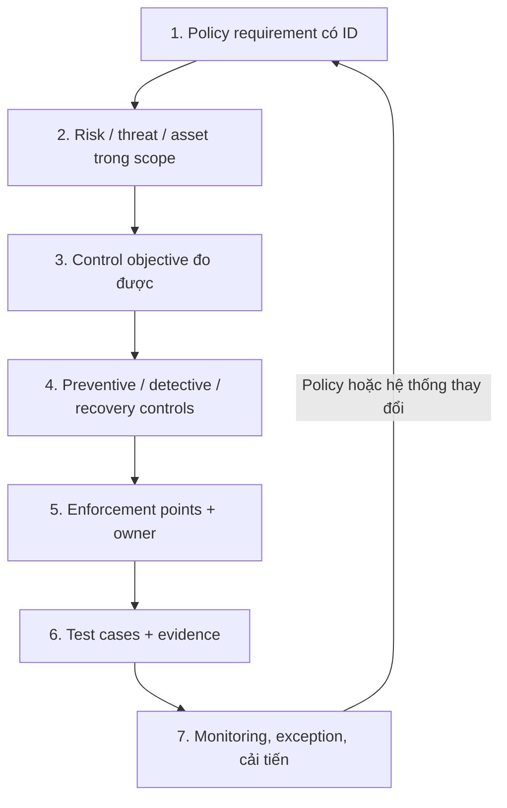
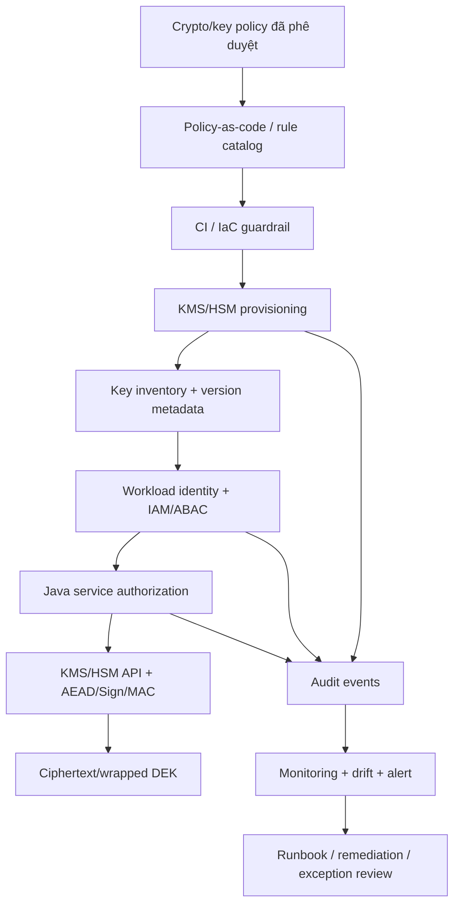
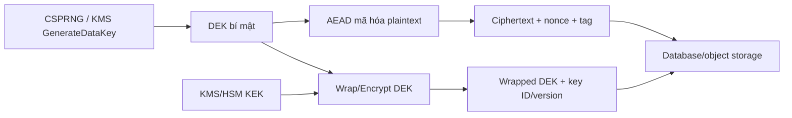
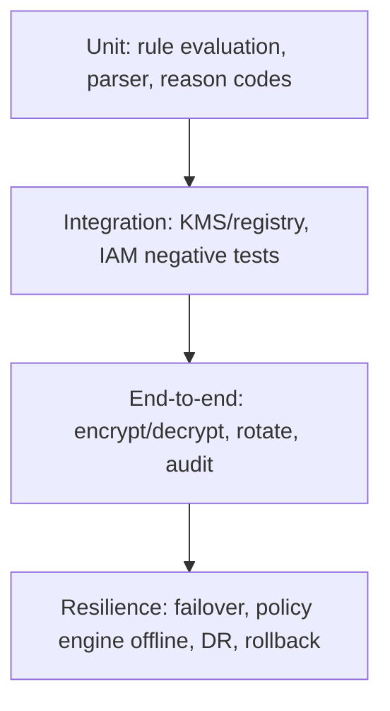
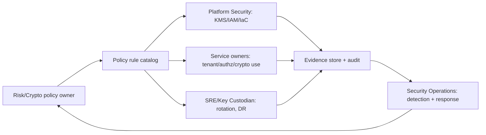

# Mapping policy sang control: Biến chính sách quản lý khóa thành kiểm soát có thể thực thi và kiểm toán

> **Chương:** Key policy  
> **Bài học:** Mapping policy sang control  
> **Module:** `SECURITY_KEY_MANAGEMENT_FUNDAMENTALS` — hiểu vòng đời khóa mật mã từ tạo, cấp phát, lưu trữ, sử dụng, xoay vòng đến thu hồi và hủy; kết nối mật mã đối xứng, bất đối xứng, chữ ký số, KMS/HSM, envelope encryption, kiểm soát truy cập và kiểm toán để thiết kế hệ thống bảo vệ khóa an toàn.

## 1. Tình huống mở đầu: Có policy nhưng vẫn lộ khóa

Một doanh nghiệp có tài liệu chính sách:

> “Khóa mã hóa dữ liệu production phải được bảo vệ an toàn, giới hạn quyền truy cập, xoay vòng định kỳ và ghi nhận đầy đủ hoạt động.”

Nhưng thực tế:

- Một service Java có quyền gọi `Decrypt` đối với mọi KMS key của công ty.
- DEK đã giải mã bị ghi vào log khi ứng dụng gặp lỗi.
- CI/CD vẫn cho triển khai tài nguyên khóa không có owner hoặc rotation policy.
- Một alias KMS trỏ sang key mới nhưng hàng triệu wrapped DEK cũ chưa được kiểm kê.
- Log thao tác quản trị KMS có nhưng chỉ giữ được vài ngày; không ai theo dõi cảnh báo.
- Khi private signing key bị nghi ngờ lộ, không có runbook biết phải thu hồi key, chứng thư, phiên và bằng chứng nào.

Như vậy **chính sách có tồn tại**, nhưng các thành phần kỹ thuật và vận hành **không buộc hệ thống tuân thủ**. Khoảng cách giữa câu “phải bảo vệ khóa” và những cấu hình, kiểm thử, log, phê duyệt có thể kiểm tra được chính là vấn đề của **policy-to-control mapping**.

**Mapping policy sang control** là việc biến từng yêu cầu chính sách thành một hoặc nhiều **biện pháp kiểm soát (controls)** có:

1. **Đối tượng và phạm vi** rõ ràng: khóa nào, môi trường nào, vai trò nào.
2. **Hành vi mong muốn** có thể quan sát/đo được.
3. **Điểm thực thi**: KMS/HSM, IAM, ứng dụng, IaC, CI/CD, registry hoặc quy trình con người.
4. **Cách kiểm thử** và xác định điều kiện đạt/không đạt.
5. **Bằng chứng kiểm toán** và lịch sử thay đổi.
6. **Chủ sở hữu và phương án xử lý sai lệch**.
7. **Ngoại lệ** có thời hạn, mức rủi ro và người phê duyệt.

Mục tiêu không phải có càng nhiều checkbox càng tốt, mà là bảo đảm một yêu cầu bảo mật quan trọng có **control thực sự hoạt động**, phát hiện được khoảng trống và có người chịu trách nhiệm khắc phục.

### Mục tiêu học tập

Sau bài này, bạn có thể:

- Phân biệt **policy**, **standard**, **baseline**, **procedure**, **technical control**, **evidence** và **test**.
- Phân loại control thành **preventive**, **detective**, **corrective/recovery** và **compensating**.
- Thiết kế ma trận truy vết `policy → risk → control → enforcement → test → evidence → owner`.
- Mapping các yêu cầu về sinh khóa, entropy, key size, DEK/KEK, KMS/HSM, IAM, rotation, lưu trữ, thu hồi/hủy và audit thành biện pháp cụ thể.
- Nhận diện giới hạn của các control chỉ dựa vào naming, tags, alerts hoặc báo cáo định kỳ.
- Viết ví dụ Java 17 kiểm tra policy khi một ứng dụng sử dụng khóa.
- Xây dựng kiểm thử negative case, phát hiện drift, xử lý exception và chứng minh hiệu lực control.

---

## 2. Từ ngôn ngữ chính sách tới hành vi có thể kiểm chứng

### 2.1. Sáu khái niệm không nên trộn lẫn

| Khái niệm | Mục đích | Ví dụ trong key management |
|---|---|---|
| **Policy** | Thể hiện yêu cầu/quyết định rủi ro cấp tổ chức: *phải làm gì*. | “Không được để private signing key production xuất ra dưới dạng rõ.” |
| **Standard** | Quy định lựa chọn kỹ thuật có tính bắt buộc hoặc chuẩn hóa. | “Khóa ký mới dùng parameter set và thuật toán được Crypto Policy phê duyệt.” |
| **Baseline** | Cấu hình tối thiểu nhất quán của một lớp hệ thống. | “KMS production bắt buộc audit API quản trị, IAM least privilege, deletion delay theo policy.” |
| **Procedure / runbook** | Hướng dẫn *ai làm gì, theo thứ tự nào* trong tình huống cụ thể. | “Quy trình rotate signing key và ngừng phát hành chữ ký bằng khóa cũ.” |
| **Control** | Biện pháp thực tế ngăn, phát hiện hoặc xử lý một rủi ro. | “HSM chặn export private key; IAM chỉ cấp `Sign` cho workload định danh.” |
| **Evidence / test** | Chứng minh control đã cấu hình và **có hoạt động hay không**. | “Key spec non-exportable, IAM evaluation, API deny test, audit event trong kỳ.” |

Một tài liệu văn bản là **bằng chứng có chính sách**, không phải bằng chứng hệ thống **đang tuân thủ** chính sách. Tương tự, một dashboard có màu xanh chỉ có ý nghĩa khi ta biết **nguồn dữ liệu, phạm vi bao phủ, độ trễ và cách kiểm tra**.

### 2.2. Policy thường trừu tượng; control phải cụ thể

Ví dụ policy:

> “Chỉ dịch vụ được ủy quyền được sử dụng khóa mã hóa dữ liệu production.”

Để kiểm chứng, cần định nghĩa:

- **Được ủy quyền** là principal nào? Trong môi trường, tenant, account nào?
- **Sử dụng khóa** gồm `Encrypt`, `Decrypt`, `GenerateDataKey`, `ReEncrypt`, `DescribeKey` hay chỉ một số thao tác?
- **Khóa dữ liệu** là DEK, KEK hay cả hai?
- Quyền được xác định trong IAM/KMS policy, ứng dụng hay gateway?
- Cross-tenant access bị từ chối ở đâu?
- KMS policy bị thay đổi trái phép có được phát hiện không?
- Test nào chứng minh workload A không thể dùng key tenant B?

Một mapping hoàn chỉnh có thể là:

```text
Policy clause : KP-AUTH-01
Risk          : Cross-tenant decrypt / lạm dụng key
Control       : IAM/KMS deny-by-default + tenant-bound authorization
Enforcement   : Workload identity + key resource + encryption context
Test          : Workload A thử Decrypt key của B -> DENIED
Evidence      : KMS policy snapshot, negative test, audit event
Owner         : Platform Security + Service Owner
Response      : Alert, revoke privilege, review blast radius
```

**Tên control phải chỉ một hành vi đủ rõ để kiểm tra**, không chỉ là “bảo mật AES”, “quản lý quyền” hoặc “tuân thủ ISO”.

### 2.3. Đặt câu hỏi “khi policy bị vi phạm, điều gì xảy ra?”

Nếu policy nói “DEK phải được tạo an toàn” nhưng control là một trang wiki hướng dẫn developer sử dụng `SecureRandom`, khi developer dùng `java.util.Random` hệ thống có tự ngăn được không?

- Nếu chỉ có wiki: biện pháp **hướng dẫn/đào tạo**, không phải kỹ thuật enforcement.
- Nếu CI có rule và unit test để cấm `Random` ở keygen code path: **preventive control** trong quy trình build, còn có thể có bypass.
- Nếu runtime chỉ cho gọi `GenerateDataKey` của KMS được phê duyệt: **preventive control** ở runtime.
- Nếu phát hiện DEK mới không có provenance: **detective control**.
- Nếu phát hiện DEK đã sinh yếu, tạo DEK mới và re-encrypt: **corrective control**.

Nhiều yêu cầu cần **phối hợp control ở nhiều lớp** thay vì chỉ một quy định.

---

## 3. Phân loại control theo thời điểm và chức năng

### 3.1. Preventive, detective, corrective và compensating

| Nhóm | Khi tác động? | Ví dụ trong quản lý khóa | Giới hạn |
|---|---|---|---|
| **Preventive** | Trước/tại thời điểm xảy ra vi phạm. | IAM từ chối `Decrypt` ngoài phạm vi; HSM không xuất private key; CI chặn thuật toán bị cấm. | Có thể bị misconfigure, bị bỏ qua ở đường khác, hoặc lỗi fail-open. |
| **Detective** | Phát hiện vi phạm, sai lệch hoặc hành vi đáng ngờ. | Cảnh báo KMS policy drift, export attempt, key sắp quá cryptoperiod. | Phát hiện sau sự kiện; không tự chặn hậu quả. |
| **Corrective / recovery** | Sau khi phát hiện để giảm tác động và khôi phục. | Thu hồi grant, rotate DEK, re-encrypt dữ liệu, kiểm thử DR, khôi phục audit. | Không thu hồi được dữ liệu đã bị sao chép ra ngoài. |
| **Compensating** | Giảm rủi ro khi control chuẩn không khả thi tạm thời. | Với HSM legacy chưa hỗ trợ một tính năng: tăng phê duyệt nhiều bên, mạng cô lập, audit nâng cao, thời hạn ngoại lệ. | Phải được chấp nhận rủi ro; không mặc định tương đương control gốc. |

Một control có thể thuộc nhiều nhóm tùy cách dùng. Ví dụ audit log được thu thập để **phát hiện**, và log được bảo vệ, lưu giữ nhằm **phục vụ điều tra**. Nhưng **bật logging** không tự động đồng nghĩa **có giám sát hữu hiệu**.

### 3.2. Control tự động và thủ công

**Tự động:**

- KMS policy deny `Decrypt` với principal không hợp lệ.
- Key management API không cho export key non-exportable.
- CI kiểm tra IaC có owner, key purpose, deletion protection.
- Hệ thống inventory định kỳ phát hiện key không có owner.
- Cảnh báo thay đổi key policy ngoài maintenance window.

**Thủ công có kiểm soát:**

- Review và phê duyệt key exception.
- Hội đồng thay đổi chứng thư/root CA.
- Xác nhận kế hoạch re-encrypt dữ liệu nhạy cảm.
- Thử diễn tập phục hồi key/backup.
- Báo cáo tác động nếu signing key bị lộ.

**Đừng coi control thủ công là vô giá trị.** Một số quyết định như phá hủy key, escrow, BYOK hoặc thu hồi khóa ký có thể cần phê duyệt hai người. Tuy nhiên phải có người phụ trách, biểu mẫu, bằng chứng và thời gian xử lý rõ ràng.

### 3.3. Một policy có nhiều control, một control có thể phục vụ nhiều policy

Ví dụ:

```text
KP-KEY-01 (Key generation)
  -> CT-KEYGEN-01 KMS-generated DEKs
  -> CT-KEYGEN-02 approved CSPRNG fallback
  -> CT-KEYGEN-03 key-provenance inventory
  -> CT-KEYGEN-04 audit GenerateDataKey failures

KP-AUTH-01 (Least privilege)
  -> CT-IAM-01 KMS deny-by-default
  -> CT-IAM-02 app tenant authorization
  -> CT-IAM-03 IAM drift monitoring
```

Một control `CT-IAM-01` có thể phục vụ cả **least privilege**, **segregation of duties** và **tenant isolation**. Vì vậy cần **mối quan hệ nhiều–nhiều và ID ổn định**, không ép mỗi policy thành đúng một control.

---

## 4. Khung mapping: Từ yêu cầu tới bằng chứng

### 4.1. Bảy bước xây dựng mapping



**Bước 1 — Định danh policy.** Mỗi yêu cầu có ID và phiên bản, tránh chỉ dùng số trang có thể thay đổi.

**Bước 2 — Xác định rủi ro.** Mối đe dọa nào được giải quyết? Lộ DEK, giả mạo chữ ký, xuất khóa từ HSM, thiếu audit hay mất khả năng khôi phục?

**Bước 3 — Viết control objective.** Nêu kết quả có thể quan sát, không chỉ ngôn từ “an toàn”.

**Bước 4 — Chọn control.** Phân bổ preventive/detective/corrective ở những lớp thực sự chịu trách nhiệm.

**Bước 5 — Xác định nơi thực thi và owner.** KMS, IAM, CI, service, SIEM, registry, SRE hay quy trình vận hành.

**Bước 6 — Thiết kế kiểm thử.** Negative tests, unit/integration, IaC plan, KMS policy simulation, audit reconciliation và diễn tập.

**Bước 7 — Duy trì.** Theo dõi drift, ngoại lệ, metric và thay đổi policy khi thuật toán/nền tảng thay đổi.

### 4.2. Các cột của một control mapping record

| Cột | Nội dung |
|---|---|
| `policyId`, `policyVersion` | Chính sách gốc và phiên bản hiệu lực. |
| `requirementId` | Câu yêu cầu cần kiểm tra riêng. |
| `riskId` / `threat` | Rủi ro được giảm. |
| `assetScope` | KMS key, HSM partition, DEK, private key, backup hoặc ứng dụng. |
| `controlId` | ID control độc lập, bền vững qua lần cập nhật. |
| `controlType` | PREVENTIVE / DETECTIVE / CORRECTIVE / COMPENSATING. |
| `controlObjective` | Hành vi và điều kiện thành công. |
| `implementation` | API/policy/IaC/service/approval cụ thể. |
| `enforcementPoint` | Nơi yêu cầu được buộc thực hiện. |
| `owner` và `reviewer` | Người phụ trách vận hành/kiểm tra. |
| `evidenceSource` | KMS config, audit, CI artifact, kiểm thử, ticket. |
| `testCaseId` / `expectedResult` | Kiểm tra chứng minh effective/ineffective. |
| `frequency` | Theo request, mỗi deployment, hằng ngày hoặc theo event. |
| `exceptionId`, `expiresAt` | Ngoại lệ được duyệt, phạm vi và thời hạn. |
| `coverage` / `status` | Độ bao phủ, kết quả, thời điểm kiểm chứng gần nhất. |

Không cần nhồi tất cả vào một bảng phẳng trong production. Có thể tách các entity `Policy`, `Requirement`, `Control`, `Implementation`, `Evidence`, `Test`, `Exception` và tạo liên kết bằng IDs bất biến.

### 4.3. Mức độ đầy đủ của mapping

Một dòng chỉ chứa:

```text
Policy: Rotate keys
Control: KMS rotation enabled
```

**Chưa đủ.** Đối với encrypted DEK bên ngoài KMS, việc bật automatic rotation có thể chỉ thay phiên bản bảo vệ **trong dịch vụ KMS**, không tự rewrap mọi DEK hoặc re-encrypt mọi bản dữ liệu. Cần nêu rõ **khóa tầng nào**, **cryptoperiod**, **action**, **evidence**, **data dependencies** và cách kiểm thử thực sự.

---

## 5. Ma trận mẫu: Mười hai yêu cầu thành controls

Bảng dưới là **ví dụ thiết kế**; chính sách thật cần được tổ chức phê duyệt theo nhu cầu và tiêu chuẩn hiện hành.

| Policy requirement | Preventive control | Detective control | Corrective/recovery | Evidence / kiểm thử |
|---|---|---|---|---|
| **KP-01. Khóa mới phải dùng nguồn sinh được phép** | KMS/HSM keygen; CSPRNG được phê duyệt | Inventory phát hiện khóa thiếu origin/không có provenance | Khắc phục nguồn, tạo khóa mới, re-encrypt/reissue khi cần | Key creation event, provider metadata, test nguồn |
| **KP-02. Algorithm/key size phải đúng chuẩn** | Allowlist ở provisioning CI/KMS adapter | Scanner key inventory và certificate inventory | Migration, rotate và giới hạn legacy operations | IaC policy tests, key spec, exception records |
| **KP-03. Private signing key không được export** | Non-exportable key trong HSM/KMS phù hợp | Monitor export attempts và thay policy | Disable/revoke, tạo key mới, điều tra | Key spec, export-deny test, audit |
| **KP-04. Least privilege với thao tác khóa** | IAM/KMS grants giới hạn theo workload/operation | Policy drift, excessive permission detection | Thu hồi grants, rotate credential, rà truy cập | Access evaluation và negative test |
| **KP-05. Tenant phải được cách ly** | App authorization + key resource/context binding | Cross-tenant denial logs, test đối kháng | Cô lập tenant, revoke quyền, đánh giá dữ liệu | Test tenant A không thể Decrypt tenant B |
| **KP-06. DEK phải được bọc khi lưu** | Envelope encryption với KEK được bảo vệ | Scan dữ liệu/khai báo schema, kiểm tra wrapped DEK | Rewrap/re-encrypt và xử lý dữ liệu đã lộ | Schema, API test, encryption context validation |
| **KP-07. Khóa phải có owner và version** | Provisioning bắt metadata + registry reservation | Inventory tìm missing owner/version/drift | Gán owner, reconcile và chặn tạo mới sai chuẩn | Inventory snapshot, reconciliation report |
| **KP-08. Rotation đúng phạm vi và thời hạn** | Automated scheduled workflow có phê duyệt | Cryptoperiod alerts + dependency report | Rotate/rekey/rewrap/re-encrypt có kiểm thử | Timeline, version history, migration tests |
| **KP-09. Khóa bị compromise phải thu hồi nhanh** | Incident kill switch/disable permissions | Signal từ SIEM, KMS anomaly | Revoke, key rotation, session reset, forensic | IR runbook, incident drill, audit chronology |
| **KP-10. Key deletion phải được kiểm soát** | Approval, retention/deletion delay, dependency gate | Alert delete scheduling, missing backup | Cancel deletion nếu còn có thể, restore theo policy | Approval ticket, KMS events, DR tests |
| **KP-11. Có audit và phát hiện abuse** | Bảo vệ log ingestion và quyền sửa/xóa | Rules cho Sign/Decrypt abnormal và policy changes | Điều tra/contain/revoke | Immutable log store, alert delivery test |
| **KP-12. Backup/DR giữ tính toàn vẹn key hierarchy** | Encrypted backups + key version catalog | Kiểm tra restore dependency và drift | Phục hồi có kiểm soát, rekey nếu cần | DR drill, restoration verification, retention |

Một số control là **defense in depth**; không phải control nào cũng bảo đảm loại bỏ rủi ro hoàn toàn. Cần mô tả *residual risk* và tình huống fail-open/fail-closed.

### 5.1. Chọn control theo tầng khóa

Yêu cầu “rotate encryption keys” phải trả lời **tầng nào**:

```text
DEK  : trực tiếp mã hóa dữ liệu.
KEK  : bảo vệ/wrap DEK.
HMAC : xác thực request/message.
Signing private key: ký số, gắn danh tính.
TLS traffic keys   : key của phiên truyền dữ liệu.
Recovery key       : mở đường khôi phục.
```

Thay **KEK** và rewrap cùng DEK không làm tăng entropy của **DEK đã yếu**. Thay signing key không tự ngắt TLS sessions đang hoạt động. Thay alias không nhất thiết thay key material. Vì vậy mapping theo từng purpose là bắt buộc.

---

## 6. Từ policy statement tới control có tiêu chí chấp nhận

### 6.1. Viết requirement theo cấu trúc rõ ràng

Câu quá chung:

> “Khóa phải an toàn và được xoay vòng thường xuyên.”

Câu có thể mapping:

> “Trong môi trường production, các KEK cấp tổ chức thuộc phạm vi `data-encryption` phải có owner xác nhận, tạo bởi KMS/HSM được phê duyệt, giới hạn thao tác `Decrypt/ReEncrypt` theo workload identity, có cryptoperiod theo policy hiện hành và có khả năng khôi phục ciphertext lịch sử qua key version metadata.”

Tách ra thành requirement IDs:

```text
KP-PROD-01: Approved key origin
KP-PROD-02: Key ownership + inventory
KP-PROD-03: Least-privilege cryptographic operations
KP-PROD-04: Rotation/cryptoperiod
KP-PROD-05: Historical ciphertext recoverability
```

Mỗi câu nên có tiêu chí đo riêng. Không nhất thiết nhồi nhiều mục tiêu vào một control.

### 6.2. Có phạm vi và ngoại lệ hợp lệ

Một requirement nên nêu:

- Scope: production hay tất cả môi trường?
- Asset class: KEK, DEK, signing key, HMAC secret, recovery key?
- Required operations: create/sign/encrypt/decrypt/verify/rotate/destroy?
- Deadline hoặc tần suất kiểm tra.
- Người có thẩm quyền phê duyệt exception.
- Điều kiện kết thúc exception và control bù trừ.

Ví dụ có thể cho phép public key RSA cũ **chỉ dùng xác minh chứng cứ lịch sử**, trong khi chặn việc tạo chữ ký mới bằng private key cùng key version. Kiểm soát ở runtime phải hiểu **allowed operation**, không chỉ nhãn “legacy”.

### 6.3. Không dùng một câu chung thay cho threat model

Yêu cầu về KMS key của server-side SaaS khác với key của ứng dụng end-to-end encryption. Ví dụ:

- SaaS backend có thể cho phép workload đã xác thực gọi KMS `Decrypt`.
- Ứng dụng zero-knowledge có thể yêu cầu server không bao giờ biết raw DEK.

Hai thiết kế có thể cùng tuân thủ yêu cầu “dữ liệu được mã hóa” nhưng có mô hình tin cậy khác. Mapping phải nêu **ai có thể sử dụng key, ở đâu và bằng cách nào**, không chỉ kết quả ciphertext tồn tại.

---

## 7. Gắn control với đúng enforcement point

### 7.1. Defense-in-depth theo chuỗi provisioning tới runtime



**Điểm enforce** phải phù hợp khả năng:

- **CI/IaC:** chặn khai báo KMS key mới sai chuẩn trước deployment.
- **Control plane:** giới hạn ai được tạo, disable, sửa policy hoặc schedule destruction.
- **KMS/HSM data plane:** giới hạn quyền sử dụng key theo principal và operation.
- **Ứng dụng:** kiểm tra tenant, purpose, object ID, state, request authorization.
- **Registry:** cấm dùng key version không còn hợp lệ và phát hiện sai lệch metadata.
- **SIEM:** phát hiện sử dụng bất thường, kể cả control runtime bị bypass.

Một KMS chỉ biết key ID và IAM principal có thể **không biết tất cả điều kiện nghiệp vụ**, ví dụ “hóa đơn này thực sự thuộc merchant X”. Điều kiện ấy phải được ứng dụng/authorization service kiểm tra.

### 7.2. Đặt control càng gần rủi ro càng tốt

Ví dụ policy “private signing key không được export”:

- **Mạnh:** key được sinh và giữ non-exportable trong HSM được tin cậy, API không cho export.
- **Yếu hơn:** app code dùng software private key nhưng có convention “đừng gọi getEncoded”.
- **Detective:** log cảnh báo khi file chứa PEM private key xuất hiện.
- **Corrective:** revoke/replace key khi nghi ngờ raw private key lộ.

Nếu tổ chức có yêu cầu non-exportable bắt buộc, chỉ kiểm tra naming hoặc quy định code review **không tương đương** với enforcement ở HSM. Phải nêu ranh giới tin cậy và giới hạn provider.

### 7.3. Chọn điểm kiểm soát không tạo bypass path

Một doanh nghiệp dùng KMS cho keygen nhưng một số service vẫn được phép tự tạo DEK bằng `java.util.Random`. Control “mọi khóa đều từ KMS” có lỗ hổng dù inventory KMS rất đẹp.

Cần kiểm kê **mọi đường tạo và sử dụng khóa**:

```text
KMS GenerateDataKey
JCA KeyGenerator / SecureRandom
HSM GenerateKey
Import/BYOK
Passphrase-derived KEK
Secrets manager và các key được cấp ngoài tổ chức
```

Một control chỉ bao phủ 70% đường dùng key thì không thể báo “100% compliant” cho toàn hệ thống.

---

## 8. Mapping policy tạo khóa sang control thực tế

### 8.1. Policy: mọi key mới phải có nguồn tin cậy

**Requirement KP-GEN-01:**

> “Các DEK production phải do CSPRNG/KMS/HSM được phê duyệt tạo; không dùng seed từ timestamp, `java.util.Random` hoặc vật liệu cố định.”

**Controls:**

1. KMS/HSM provision có danh sách nguồn được phép.
2. Java crypto helper dùng `KeyGenerator`/`SecureRandom` an toàn trong những luồng được phép tự sinh DEK.
3. Static analysis/CI tìm những code path dùng PRNG thường cho bí mật mật mã.
4. Key creation inventory lưu `keyOrigin`, `provider`, `keyPurpose`, `creationTime`.
5. Theo dõi lỗi keygen, provider entropy failure và resource anomalies.
6. Khi phát hiện sinh khóa yếu: dừng issuance, cô lập, tạo lại key, re-encrypt/reissue theo tác động.

**Acceptance test:**

```text
Given: service cấu hình sinh DEK bằng java.util.Random
When : chạy CI policy gate
Then : build bị từ chối ở workflow có yêu cầu cryptographic keygen

Given: app không có quyền GenerateDataKey trong production
When : gọi KMS GenerateDataKey
Then : API trả AccessDenied và event được ghi audit
```

Static analysis có false positive/false negative; test kỹ thuật và runtime IAM cần phối hợp.

### 8.2. Policy: key algorithm và key size được phép

**Requirement KP-ALG-01:**

> “Khóa tạo mới phải dùng algorithm/parameter set được phê duyệt theo purpose và thời điểm.”

Controls gồm:

- Validation trước `CreateKey`/`GenerateKey`.
- Provider configuration allowlist.
- Inventory scanner kiểm tra `algorithm`, `keyLength`, `parameterSet`, `allowedOperations`.
- Không cho dùng key legacy để ký hoặc mã hóa dữ liệu **mới** khi policy cấm.
- Exception cho verify/decrypt lịch sử có owner và hạn dùng.

**Không triển khai:** `if (keyBits >= 256) permit`. RSA-3072, AES-256, P-256 và Ed25519 có ngữ nghĩa khác nhau. Policy engine phải hiểu **họ thuật toán** và **mục đích**.

### 8.3. Policy: key purpose separation

**Requirement KP-PURPOSE-01:**

> “Khóa ký không được dùng thay DEK; HMAC key không dùng làm AES key; KEK không phải secret dùng trực tiếp cho mọi nội dung.”

Controls:

- Key spec/usage attribute ở provider nếu có.
- API/service-specific operation allowlist.
- KDF domain separation khi dẫn xuất nhiều khóa từ một secret nguồn đủ entropy.
- Registry lưu `purpose`, `algorithm`, `allowedOperations`.
- Unit/integration tests thử dùng key signing cho decrypt và ngược lại.

Mục tiêu là **cấm dùng nhầm vật liệu giữa các chức năng**, giảm tác động lộ khóa và hạn chế confused deputy.

---

## 9. Mapping yêu cầu lưu trữ và envelope encryption

### 9.1. Requirement: DEK không được lưu plaintext cùng dữ liệu

**Policy KP-STORAGE-01:**

> “DEK dùng mã hóa dữ liệu lưu trữ phải được wrap dưới KEK được bảo vệ; không lưu raw DEK trong database hoặc log ứng dụng.”

Kiến trúc:



**Controls tại các lớp:**

- Preventive: KMS KEK non-exportable theo chính sách, chỉ workloads cần thiết có `Decrypt`/`ReEncrypt`.
- Preventive: crypto library phải xử lý data key qua wrapper, không serialize raw DEK vào entity.
- Preventive: phân quyền database không thay thế quyền unwrap key.
- Detective: schema/data-lineage review, secret scanning, log redaction checks, inventory orphaned wrappers.
- Corrective: rotate/re-encrypt khi raw DEK lộ, rewrap khi chỉ KEK thay và DEK còn đáng tin.

**Acceptance tests:**

- Raw key không xuất hiện ở DB row/log test artifact.
- Bản mã được giải mã bằng đúng key ref/version và AAD; sai context bị từ chối.
- Workload khác không có quyền unwrap DEK.
- DR có thể giải mã những bản ghi lịch sử hợp lệ.

### 9.2. Policy không thể chỉ nói “AES-256 là đủ”

AES-256-GCM có thể bị phá vỡ mức bảo đảm nếu nonce bị lặp dưới cùng key, nếu AAD/tenant không kiểm tra, hoặc nếu ciphertext được ghi ra log.

Cần control bổ sung:

```text
CTR-NONCE: không tái sử dụng GCM nonce dưới cùng DEK.
CTR-AAD:   bind tenant/object/purpose từ context đã xác thực.
CTR-LOG:   không log raw DEK/KEK/secret/nonce derivation state nhạy cảm.
CTR-USE:   giới hạn dữ liệu/số lần encrypt mỗi DEK theo thiết kế.
```

**GCM nonce unique control không tự chống replay ciphertext cũ.** Replay tại phía nhận cần sequence, version hoặc trạng thái nghiệp vụ.

### 9.3. Policy đổi passphrase không đồng nghĩa DEK rotation

Nếu passphrase tạo KEK bảo vệ DEK:

```text
old passphrase -> KDF -> KEK_old -> unwrap DEK
new passphrase -> KDF -> KEK_new -> rewrap cùng DEK
```

Có thể chỉ cần **rewrap** và giữ data ciphertext khi DEK chưa lộ. Nếu DEK sinh yếu/bị lộ, rewrap dưới KEK mạnh **không khắc phục**; cần tạo DEK mới và re-encrypt dữ liệu, đồng thời điều tra snapshot cũ.

Mapping phải quy định **trigger** nào cho rewrap, **trigger** nào cho DEK rotation/re-encryption và bằng chứng hoàn thành tương ứng.

---

## 10. Mapping kiểm soát truy cập KMS/HSM và tenant isolation

### 10.1. Chính sách least privilege

**Requirement KP-IAM-01:**

> “Mỗi workload chỉ được gọi những thao tác mật mã cần thiết trên key resources thuộc phạm vi được cấp, trong môi trường được phép.”

Control có thể nằm ở:

- Cloud IAM/service identity.
- KMS key policy, grants, encryption context conditions.
- HSM partitions/roles, quorum approval, non-exportable attributes.
- Ứng dụng: mapping principal đến tenant và key purpose.
- Alert khi grant mới không được phê duyệt hoặc access denied tăng bất thường.

**Không chỉ dùng tên alias để cấp quyền.** Alias có thể đổi đích, và request input không đáng tin có thể khiến ứng dụng dùng key ngoài phạm vi.

### 10.2. Ma trận quyền minh họa

| Principal | Được phép | Không được phép |
|---|---|---|
| `orders-writer` | `GenerateDataKey` hoặc `Encrypt` bằng KEK riêng, dùng DEK đúng tenant | Export KEK, DisableKey, Decrypt key mọi tenant |
| `orders-reader` | `Decrypt` wrapped DEK của tenant/object được kiểm tra | Thay key policy hoặc ký JWT |
| `identity-signer` | `Sign` bằng signing key phục vụ issuer được phép | `Decrypt` payment data, export private key |
| `key-admin` | Quản lý lifecycle theo approval | Tự động đọc plaintext doanh nghiệp nếu không có nhiệm vụ |
| `auditor` | Đọc metadata/log và policy results | `Decrypt`, `Sign`, xóa hoặc sửa audit evidence |
| `recovery-operator` | Recovery có phê duyệt, giới hạn thời gian/phạm vi | Quyền recovery vô hạn, tự phê duyệt |

### 10.3. Cross-tenant negative test

```text
Principal: orders-service thuộc tenant-A
Key:       key-wrap thuộc tenant-B
Request:   KMS Decrypt ciphertext/DEK của B
Expected:  DENIED

Nguyên nhân:
  1. App authorization xác định tenant từ phiên đã xác thực.
  2. Registry buộc keyId thuộc đúng tenant/scope.
  3. KMS/IAM tiếp tục giới hạn quyền trên resource/context.
  4. Audit ghi denial và có cảnh báo nếu vượt ngưỡng.
```

Không được chỉ kiểm tra `tenantId` do client gửi, vì client có thể giả mạo. KMS không biết mô hình tenant nghiệp vụ nếu không có resource/context mapping thích hợp, nên **app và KMS phải phối hợp**.

### 10.4. SoD và two-person approval

Một số thao tác rủi ro cao:

- Export/import key material.
- Thay đổi KMS key policy hoặc grant privileged.
- Disable/xóa khóa gốc của nhiều hệ thống.
- Khôi phục/recovery key bảo vệ toàn tenant.
- Thay root CA hoặc chứng thư ký có tác động lớn.

Có thể yêu cầu **separation of duties (SoD)** và hai người phê duyệt độc lập. Một control chỉ kiểm tra “đã có hai click approve” nhưng cả hai đến từ cùng principal hoặc một người nắm hai role không đạt mục tiêu độc lập.

---

## 11. Mapping rotation, cryptoperiod, revoke và destroy

### 11.1. Cryptoperiod và trigger

**Requirement KP-LIFE-01:**

> “Khóa phải có cryptoperiod và điều kiện thay thế được quản lý theo purpose, mức rủi ro, lượng sử dụng, trạng thái compromise và yêu cầu lưu trữ dữ liệu.”

Controls:

- Registry bắt `createdAt`, `activateAt`, `rotateBy`, `allowedOperations`, `owner`.
- Job cảnh báo trước deadline với owner.
- Workflow rotation có kiểm thử và phê duyệt nếu cần.
- Policy chặn tạo chữ ký/encrypt mới bằng version đã hết hạn **sử dụng tạo mới**, trong khi có thể cho verify/decrypt lịch sử theo điều kiện.
- Incident response thực hiện rotation ngoài lịch khi có lộ khóa hoặc RNG yếu.

**Không có con số “rotate mỗi 90 ngày” đúng cho mọi loại khóa.** Thời hạn phải xuất phát từ crypto policy và đặc tính của từng loại/nhà cung cấp.

### 11.2. Ma trận chuyển trạng thái khóa

| Trạng thái | New Encrypt/Sign | Historical Decrypt/Verify | Hành động quản trị |
|---|---|---|---|
| `PRE_ACTIVE` | Không, trừ kiểm thử được phép | Tùy policy | Kiểm tra metadata, chuẩn bị cutover |
| `ACTIVE` | Được phép theo quyền và thuật toán | Được phép theo quyền | Monitor cryptoperiod |
| `DECRYPT_ONLY` / `VERIFY_ONLY` | Không | Có thể được phép trong phạm vi giữ lại | Hoàn tất migration và retention |
| `SUSPENDED` | Không | Theo lý do tạm khóa và policy; thường chặn | Điều tra/review |
| `COMPROMISED` | Không | Chỉ theo quy trình ứng cứu rất hạn chế, nếu có | Revoke/replace/assess historical data |
| `DESTROY_PENDING` | Không | Cẩn trọng và theo policy | Kiểm tra dependencies/approval |
| `DESTROYED` | Không | Không thể dùng secret/private key nữa | Giữ evidence, xử lý dữ liệu không đọc được |

Tên trạng thái chỉ là ví dụ trong registry. Provider thực tế có các state khác nhau; cần mapping cẩn thận.

### 11.3. Khi thay KEK và DEK cần evidence khác nhau

**KEK rotation:**

```text
KEK-v3 -> KEK-v4
DEK-A có thể giữ nguyên
WrappedDEK cũ -> WrappedDEK mới
Content ciphertext: có thể không đổi
```

Evidence:

- Version KEK mới được provision.
- Các wrapper thuộc scope đã được rewrap và **xác minh giải bọc**.
- Key references trong records cập nhật phù hợp.
- Backup/DR có khả năng khôi phục.
- Old KEK bị giới hạn theo policy.

**DEK rotation:**

```text
DEK-A -> DEK-B
Content ciphertext cần được mã hóa lại dưới DEK-B nếu thay data key.
```

Evidence:

- DEK mới có nguồn sinh đáng tin.
- Payload đã re-encrypt và kiểm tra toàn vẹn.
- Các record/metadata/counter đã chuyển.
- Bản dữ liệu cũ/backup có kế hoạch retention.
- Key cũ không bị xóa trước khi dependency xử lý xong.

### 11.4. Deletion gate

Một control trước khi schedule deletion nên kiểm tra:

```text
keyState cho phép?
owner/phê duyệt hợp lệ?
keyVersions còn đang bảo vệ ciphertext?
chữ ký/chứng thư lịch sử còn yêu cầu verification?
backup và DR còn key dependency?
retention/legal hold có áp dụng?
recovery plan đã test?
```

**Đừng chỉ dựa vào cảnh báo “khóa đã quá hạn” rồi hủy key.** Hủy KEK/private key có thể làm dữ liệu và chứng cứ trở nên không thể phục hồi.

---

## 12. Mapping audit, monitoring và kiểm soát bằng chứng

### 12.1. “Bật logging” chưa phải control hoàn chỉnh

Requirement:

> “Các thao tác key management có rủi ro cao phải được ghi nhận, bảo vệ và có khả năng phát hiện lạm dụng.”

Mẫu mapping:

| Khía cạnh | Control |
|---|---|
| **Collection** | Audit events cho key create, rotate, disable, policy/grant changes, usage thất thường. |
| **Identity** | Ghi principal, workload, resource key ID/version, operation, time, result. |
| **Protection** | Audit storage có quyền tối thiểu, chống sửa/xóa theo yêu cầu, retention rõ. |
| **Correlation** | Correlation ID liên kết với application/CI change/approval. |
| **Detection** | Rules cho `Decrypt` tăng đột ngột, grant sai scope, disable trái lịch. |
| **Response** | Alert có người trực, escalation và playbook. |
| **Verification** | Tạo sự kiện test an toàn và xác nhận pipeline ghi, phân tích, gửi cảnh báo. |

Không ghi raw key, passphrase, DEK, HMAC secret, session key, plaintext hoặc recovery secret. Metadata cũng có thể nhạy cảm và cần kiểm soát quyền.

### 12.2. Phân biệt design effectiveness và operating effectiveness

**Design effectiveness:** control được thiết kế có khả năng giảm rủi ro không?

Ví dụ KMS policy từ chối `Decrypt` ngoài tenant, bằng điều kiện được hỗ trợ đúng.

**Operating effectiveness:** control có **thật sự hoạt động trong kỳ kiểm toán** không?

Ví dụ:

- Tất cả workload trong scope đã dùng policy?
- Có exception/bypass nào không?
- Negative test chạy khi deployment hoặc đổi IAM?
- Có event `AccessDenied` đúng?
- Người phụ trách xử lý alert trong SLA?

Một policy tồn tại trên một key không bảo đảm các key khác cũng có policy đó.

### 12.3. Evidence chất lượng tốt

Bằng chứng nên có:

```text
controlId
requirementId/policyVersion
resourceId/keyVersion
environment/tenant scope
testId
timestamp
result (PASS / FAIL / UNKNOWN / EXEMPTED)
source (KMS API/CI/test)
artifact reference + integrity information
owner/reviewer
exception ID (nếu có)
```

Với bằng chứng dùng trong audit, nên bảo vệ tính toàn vẹn, giới hạn sửa/xóa và có retention. Không tự tuyên bố “tamper-proof” chỉ vì lưu trên object storage; khả năng chống sửa phụ thuộc cấu hình quyền và cơ chế lưu trữ.

### 12.4. Evidence từ configuration chưa đủ chứng minh behavior

Ví dụ:

```text
KMS key has tag owner=security
```

Điều này chỉ chứng minh metadata, không chứng minh:

- Owner thực sự chịu trách nhiệm.
- Người dùng trái quyền bị chặn.
- Key không bị export qua đường khác.
- Key được rotate đúng.
- Dữ liệu lịch sử vẫn decrypt được.

Cần **negative tests, kiểm tra nguồn, event evidence và đối soát sử dụng**, ngoài config snapshot.

---

## 13. Policy-as-code: Diễn đạt yêu cầu dưới dạng máy kiểm tra được

### 13.1. Rule catalog minh họa bằng YAML

Đây là **định dạng ví dụ của bài học**, không phải syntax của một policy engine hoặc một KMS cụ thể.

```yaml
policyId: key-management-baseline
version: 1
scope:
  environments: [prod]
  assetTypes: [KEK, SIGNING_KEY, DEK]
requirements:
  - requirementId: KP-KEY-01
    statement: Production KEKs must be non-exportable.
    controlIds: [CT-KEK-EXPORT-01, CT-KEK-EXPORT-02]

  - requirementId: KP-ALG-01
    statement: New keys must use approved algorithms per purpose.
    controlIds: [CT-ALGORITHM-ADMISSION]

  - requirementId: KP-IAM-01
    statement: Decrypt must be limited to authorized workloads.
    controlIds: [CT-KMS-IAM, CT-APP-TENANT-AUTH]

controls:
  - controlId: CT-KEK-EXPORT-01
    type: PREVENTIVE
    enforcementPoint: KMS_OR_HSM_PROVISIONING
    expected: exportable == false
    owner: platform-security
    evidence: kms-key-spec-readback

  - controlId: CT-KEK-EXPORT-02
    type: DETECTIVE
    enforcementPoint: INVENTORY_RECONCILIATION
    expected: every-prod-KEK-is-non-exportable
    owner: security-operations
    evidence: signed-scan-report

  - controlId: CT-KMS-IAM
    type: PREVENTIVE
    enforcementPoint: KMS_KEY_POLICY
    expected: unauthorized-decrypt-is-denied
    owner: platform-security
    evidence: negative-authorization-test

  - controlId: CT-APP-TENANT-AUTH
    type: PREVENTIVE
    enforcementPoint: JAVA_SERVICE
    expected: cross-tenant-key-use-is-denied
    owner: orders-team
    evidence: integration-test
```

Một rule được ghi trong YAML **không tự có hiệu lực**. Cần parser/validator, control-plane enforcement, CI gate, runtime guard và evidence collector hoạt động thực tế.

### 13.2. Quy tắc không nên chỉ dựa vào tags

Một đoạn kiểm tra kiểu:

```text
if tags["keyPurpose"] == "sign":
    allow Sign
```

không đủ vì tags có thể bị sửa hoặc không đại diện key state/rights. Tags hữu ích để phân loại và audit, nhưng **sự cho phép phải gắn với principal, resource, key spec, state và chính sách đáng tin**, chứ không chỉ một nhãn.

### 13.3. Các điểm tích hợp policy-as-code

| Lớp | Ví dụ kiểm tra | Fail behavior |
|---|---|---|
| Pull request / IaC | Không tạo KMS key thiếu owner, algorithm, environment | Chặn merge/plan khi policy bắt buộc |
| CI build | Không dùng crypto helper sai thuật toán/PRNG | Build fail và hiển thị rule ID |
| Admission/deploy | Workload không được nhận wildcard KMS policy sai chuẩn | Từ chối deploy hoặc yêu cầu exception |
| Key provisioning | Chỉ tạo key với spec/purpose được duyệt | Từ chối tạo; lưu lý do |
| Runtime service | Principal không được Decrypt/Sign ngoài tenant/purpose | Deny trước khi gọi KMS; ghi audit |
| KMS/HSM | Resource policy giới hạn API và key usage | Provider từ chối trực tiếp |
| Continuous monitoring | Phát hiện key state, IAM hoặc metadata drift | Alert và khởi tạo remediation workflow |

Lỗi không kết nối được policy engine **không nên tự biến thành permit** cho hành động bảo mật cao. Tuy nhiên chiến lược fail-closed, caching và availability cần thiết kế trước để không gây outage không kiểm soát.

---

## 14. Java 17: Guard kiểm tra key policy tại ứng dụng

Ví dụ dưới đây biểu diễn **một lớp authorization bên trong Java service** trước khi gọi KMS. Nó không thay thế IAM tại KMS; mục tiêu là minh họa **mapping policy requirement thành điều kiện deny cụ thể**, có reason code và test case.

Giả định:

- `Principal` được tạo từ **session/mTLS/identity token đã xác thực**, không phải JSON tùy ý của client.
- `KeyMetadata` đến từ **registry/KMS metadata đáng tin**, không nhận trực tiếp từ người gọi.
- Tenant context được xác định từ authorization layer.
- KMS/HSM vẫn thực thi quyền riêng; kiểm tra ứng dụng là defense in depth.
- `exportable=false` là metadata minh họa; trong production phải do provider bảo đảm thực tế.

```java
import java.util.Objects;
import java.util.Set;

public final class KeyPolicyGuardDemo {

    enum KeyPurpose {
        DATA_ENCRYPTION, KEY_WRAP, DIGITAL_SIGNATURE, MESSAGE_AUTH
    }

    enum Operation {
        ENCRYPT, DECRYPT, SIGN, MAC, DESTROY
    }

    enum KeyState {
        ACTIVE, DECRYPT_ONLY, VERIFY_ONLY, DISABLED, DESTROY_PENDING
    }

    record Principal(
            String id,
            String tenantId,
            String environment,
            Set<Operation> allowedOperations) {
        Principal {
            Objects.requireNonNull(id);
            Objects.requireNonNull(tenantId);
            Objects.requireNonNull(environment);
            allowedOperations = Set.copyOf(allowedOperations);
        }
    }

    record KeyMetadata(
            String keyId,
            String tenantId,
            String environment,
            KeyPurpose purpose,
            String algorithm,
            int keyBits,
            boolean exportable,
            KeyState state) {
        KeyMetadata {
            Objects.requireNonNull(keyId);
            Objects.requireNonNull(tenantId);
            Objects.requireNonNull(environment);
            Objects.requireNonNull(purpose);
            Objects.requireNonNull(algorithm);
            Objects.requireNonNull(state);
        }
    }

    record Decision(boolean permitted, String reasonCode) {
        static Decision allow() {
            return new Decision(true, "ALLOW");
        }
        static Decision deny(String reason) {
            return new Decision(false, reason);
        }
    }

    static Decision authorize(
            Principal principal,
            KeyMetadata key,
            Operation operation,
            String authorizedTenant,
            String deploymentEnvironment) {

        if (principal == null || key == null || operation == null) {
            return Decision.deny("INVALID_CONTEXT");
        }

        // authorizedTenant và deploymentEnvironment phải lấy từ
        // server-side authenticated context, KHÔNG từ client claim.
        if (!principal.tenantId().equals(authorizedTenant)
                || !key.tenantId().equals(authorizedTenant)) {
            return Decision.deny("CROSS_TENANT_DENIED");
        }

        if (!principal.environment().equals(deploymentEnvironment)
                || !key.environment().equals(deploymentEnvironment)) {
            return Decision.deny("CROSS_ENVIRONMENT_DENIED");
        }

        if (!principal.allowedOperations().contains(operation)) {
            return Decision.deny("OPERATION_NOT_GRANTED");
        }

        if (key.state() == KeyState.DISABLED
                || key.state() == KeyState.DESTROY_PENDING) {
            return Decision.deny("KEY_NOT_USABLE");
        }

        // Bài học này chọn chính sách minh họa:
        // production KEK không được export.
        if (key.purpose() == KeyPurpose.KEY_WRAP
                && key.exportable()) {
            return Decision.deny("EXPORTABLE_KEK_DENIED");
        }

        if (!algorithmPermitted(key)) {
            return Decision.deny("ALGORITHM_POLICY_DENIED");
        }

        if (operation == Operation.DESTROY) {
            // Quyền ở role chưa đủ: cần separate approval
            // và kiểm tra dữ liệu/chứng cứ phụ thuộc.
            return Decision.deny("REQUIRES_DESTROY_WORKFLOW");
        }

        if (operation == Operation.SIGN) {
            if (key.purpose() != KeyPurpose.DIGITAL_SIGNATURE
                    || key.state() != KeyState.ACTIVE) {
                return Decision.deny("SIGN_KEY_POLICY_DENIED");
            }
        } else if (operation == Operation.MAC) {
            if (key.purpose() != KeyPurpose.MESSAGE_AUTH
                    || key.state() != KeyState.ACTIVE) {
                return Decision.deny("MAC_KEY_POLICY_DENIED");
            }
        } else if (operation == Operation.ENCRYPT) {
            if (key.purpose() != KeyPurpose.DATA_ENCRYPTION
                    || key.state() != KeyState.ACTIVE) {
                return Decision.deny("ENCRYPT_KEY_POLICY_DENIED");
            }
        } else if (operation == Operation.DECRYPT) {
            boolean allowedPurpose =
                    key.purpose() == KeyPurpose.DATA_ENCRYPTION
                    || key.purpose() == KeyPurpose.KEY_WRAP;
            boolean allowedState =
                    key.state() == KeyState.ACTIVE
                    || key.state() == KeyState.DECRYPT_ONLY;
            if (!allowedPurpose || !allowedState) {
                return Decision.deny("DECRYPT_KEY_POLICY_DENIED");
            }
        }

        return Decision.allow();
    }

    private static boolean algorithmPermitted(KeyMetadata key) {
        // Đây là catalog ví dụ; production phải version hóa,
        // tách key purpose và cryptographic operation chi tiết.
        return switch (key.purpose()) {
            case DATA_ENCRYPTION, KEY_WRAP ->
                    key.algorithm().equals("AES")
                    && (key.keyBits() == 128 || key.keyBits() == 256);
            case DIGITAL_SIGNATURE ->
                    (key.algorithm().equals("Ed25519")
                        && key.keyBits() == 0)
                    || (key.algorithm().equals("RSA-PSS")
                        && key.keyBits() >= 3072);
            case MESSAGE_AUTH ->
                    key.algorithm().equals("HmacSHA256")
                    && key.keyBits() >= 256;
        };
    }

    public static void main(String[] args) {
        Principal orders = new Principal(
                "orders-service", "tenant-a", "prod",
                Set.of(Operation.ENCRYPT, Operation.DECRYPT));

        KeyMetadata dekA = new KeyMetadata(
                "dek-a-v2", "tenant-a", "prod",
                KeyPurpose.DATA_ENCRYPTION,
                "AES", 256, false, KeyState.ACTIVE);

        KeyMetadata dekB = new KeyMetadata(
                "dek-b-v1", "tenant-b", "prod",
                KeyPurpose.DATA_ENCRYPTION,
                "AES", 256, false, KeyState.ACTIVE);

        KeyMetadata oldDek = new KeyMetadata(
                "dek-a-v1", "tenant-a", "prod",
                KeyPurpose.DATA_ENCRYPTION,
                "AES", 256, false, KeyState.DECRYPT_ONLY);

        print("Encrypt own DEK",
                authorize(orders, dekA, Operation.ENCRYPT,
                        "tenant-a", "prod"));
        print("Cross-tenant decrypt",
                authorize(orders, dekB, Operation.DECRYPT,
                        "tenant-a", "prod"));
        print("Encrypt with retired DEK",
                authorize(orders, oldDek, Operation.ENCRYPT,
                        "tenant-a", "prod"));
        print("Decrypt historical data",
                authorize(orders, oldDek, Operation.DECRYPT,
                        "tenant-a", "prod"));
        print("Unauthorized signing",
                authorize(orders, dekA, Operation.SIGN,
                        "tenant-a", "prod"));
    }

    private static void print(String name, Decision decision) {
        System.out.println(name + ": "
                + decision.reasonCode());
    }
}
```

### 14.1. Kết quả dự kiến

```text
Encrypt own DEK: ALLOW
Cross-tenant decrypt: CROSS_TENANT_DENIED
Encrypt with retired DEK: ENCRYPT_KEY_POLICY_DENIED
Decrypt historical data: ALLOW
Unauthorized signing: OPERATION_NOT_GRANTED
```

Đây là kết quả dự kiến về mặt logic; **chưa phải báo cáo đã compile/test production**.

### 14.2. Mapping từng nhánh code về requirement

| Code path | Requirement | Control ID minh họa | Negative test |
|---|---|---|---|
| Tenant check | KP-IAM-02 | CT-APP-TENANT-AUTH | Tenant A dùng key B bị deny |
| Environment check | KP-IAM-03 | CT-APP-ENV-BOUNDARY | Dev workload không dùng prod key |
| Allowed operations | KP-IAM-01 | CT-APP-OPERATION-GUARD | `SIGN` không có grant bị deny |
| Key state check | KP-LIFE-01 | CT-APP-KEY-STATE | Disabled key bị deny |
| Non-exportable KEK check | KP-STORAGE-02 | CT-KEK-EXPORT-METADATA | Exportable KEK bị deny |
| Algorithm policy | KP-ALG-01 | CT-ALG-ADMISSION | RSA-PSS dưới threshold bị deny |
| Destroy workflow gate | KP-DELETE-01 | CT-DESTROY-APPROVAL | Direct destroy bị deny |
| Decrypt-only state | KP-LIFE-02 | CT-HISTORICAL-DECRYPT | Old DEK không dùng encrypt mới |

**Điểm rất quan trọng:** đoạn code này chỉ **đọc metadata** rồi quyết định permit/deny. Nó **không thể chứng minh một key HSM thực sự không xuất được** chỉ vì field `exportable=false`; phải xác minh thuộc tính và hành vi từ provider. Nó cũng không thể ngăn workload gọi thẳng KMS bằng credentials quá rộng. Runtime IAM/KMS policy và network controls vẫn phải chặn đường bypass.

### 14.3. Những giới hạn cần ghi nhớ

- Không có authentication: `Principal` được giả định đáng tin.
- Không có KMS API thật, token validation, audit pipeline, cache consistency hoặc permission revocation.
- Không mô tả đầy đủ chính sách cho `GenerateDataKey`, `ReEncrypt`, `Verify`, `GenerateMac` và mọi key state.
- Dấu `keyBits=0` cho Ed25519 là **quy ước demo** để không suy đoán security strength từ kích thước PEM; production nên dùng `parameterSet`.
- `AES 128/256` chỉ là policy ví dụ; thuật toán/mode/nonce/AAD và độ mạnh phù hợp thực tế cần được đánh giá riêng.
- Không có quy tắc cryptoperiod theo thời gian hay evidence/test collection.
- Không xử lý multi-tenant storage object ID và quyền business operation.
- Không có quyết định exception hoặc emergency override.
- Không thay thế KMS/HSM IAM, cấm export thực sự, approval/workflow hoặc kiểm soát người vận hành.

---

## 15. Kiểm thử control: Không chỉ happy path

### 15.1. Test pyramid cho key policy



**Unit tests** phát hiện logic sai của policy engine. Nhưng một unit test mock KMS trả AccessDenied không chứng minh production IAM đã cấu hình đúng.

**Integration tests** trên môi trường kiểm thử có thật cần thử principal trái phép, key state không cho phép và metadata sai.

**End-to-end tests** chứng minh dữ liệu được bảo vệ, metadata đúng, decrypt đúng context, audit thu được và rotation không gây mất dữ liệu.

**Resilience tests** chứng minh phản ứng khi registry/KMS/SIEM bị lỗi, policy thay đổi giữa request, multi-node sync hoặc backup restore.

### 15.2. Bộ negative tests bắt buộc

| Test ID | Điều kiện | Kỳ vọng |
|---|---|---|
| `T-AUTH-01` | Service A gọi `Decrypt` key của tenant B | Deny, audit |
| `T-AUTH-02` | Workload dev dùng prod key | Deny |
| `T-ALG-01` | Create signing key với algorithm/size không được phép | Provisioning reject |
| `T-KEY-01` | Signing key bị dùng cho AES data decrypt | Deny |
| `T-STATE-01` | Key `DISABLED` gọi `Sign` | Deny |
| `T-STATE-02` | Old DEK `DECRYPT_ONLY` gọi `Encrypt` | Deny |
| `T-HSM-01` | Attempt export non-exportable private key | Provider deny |
| `T-LOG-01` | KMS key policy bị sửa trái phê duyệt | Alert đúng owner |
| `T-DR-01` | Restore backup dữ liệu cũ | Đúng key version và decrypt/verify được |
| `T-DELETE-01` | Yêu cầu hủy KEK còn ciphertext phụ thuộc | Workflow chặn |
| `T-NONCE-01` | Encrypt reuse AES-GCM nonce cùng DEK trong implementation test | Không cho reuse theo thiết kế |
| `T-FAIL-01` | Policy service timeout khi có request privileged | Không tự permit |
| `T-ROTATE-01` | Alias cutover nhưng một nhóm wrapped DEK chưa migrate | Detector phát hiện outstanding dependencies |

### 15.3. Đặc tính của một test đáng tin

Một test nên công bố:

```text
policyId/requirementId/controlId
testId + version
test environment
principal/role đã dùng
key resource ID/version
action và request context
actualResult, expectedResult
timestamp, log correlation
PASS/FAIL/UNKNOWN
evidenceArtifactRef
```

Với test `AccessDenied`, cần xác nhận lệnh thực sự đến **đúng KMS key/resource trong phạm vi**. Nếu test fail từ gateway do URL sai, nó chưa chứng minh KMS IAM deny hoạt động.

### 15.4. Kiểm thử không làm lộ bí mật thật

Khi test các hành vi nguy hiểm:

- Dùng key tài khoản/môi trường test, tránh xuất/chạm vào production private keys.
- Dùng dữ liệu mẫu không nhạy cảm.
- Dùng provider API được phép để kiểm tra thuộc tính.
- Với destructive workflow, kiểm thử trước trên key không có dependency hoặc bằng simulation/two-person approval.
- Không dùng kiểu thử “xuất private key production rồi xem có bị chặn không” nếu thao tác có thể thực sự làm lộ key.
- Audit test events phải phân biệt với sự kiện incident thật để tránh false alarm.

---

## 16. Chứng minh độ bao phủ và hiệu lực control

### 16.1. “100% policies mapped” có nghĩa gì?

Nếu có 20 requirements và mỗi requirement có ít nhất một control ID, bạn có thể báo **mapping coverage 100%**. Nhưng còn các câu hỏi:

- Control đã triển khai ở tất cả tài nguyên trong scope chưa?
- Control preventive có thể bị bypass không?
- Detective alerts có người xử lý không?
- Evidence mới nhất cách đây bao lâu?
- Có exception nào hết hạn mà chưa giải quyết?
- Có key/version nào nằm ngoài inventory không?

**Mapping coverage không đồng nghĩa operating effectiveness.**

### 16.2. Các KPI hữu ích

| Metric | Ý nghĩa | Lưu ý |
|---|---|---|
| `% requirements mapped` | Tỷ lệ yêu cầu có control được gán. | Chỉ đo tính đầy đủ của thiết kế. |
| `% assets covered` | Tỷ lệ key/workload trong scope có enforcement. | Cần inventory đáng tin; tránh bỏ sót BYOK/app keys. |
| `% key versions verified` | Tỷ lệ key có metadata/provider evidence mới. | Unknown phải được thể hiện, không coi là pass. |
| `% preventive negative tests passing` | Tỷ lệ test từ chối hành vi trái quyền đúng. | Phân theo key type, environment và tenant. |
| `policy drift MTTR` | Thời gian trung bình xử lý drift. | Cần timestamp và định nghĩa sự cố rõ. |
| `exceptions expired` | Ngoại lệ quá hạn chưa khắc phục. | Cảnh báo escalation phù hợp. |
| `keys past cryptoperiod` | Khóa vượt mức sử dụng được phê duyệt. | Tách Sign/Encrypt mới khỏi Verify/Decrypt lịch sử. |
| `audit delivery lag` | Trễ nhận sự kiện audit. | Hữu ích cho phát hiện lạm dụng. |
| `DR decrypt success rate` | Khả năng khôi phục dữ liệu mã hóa còn hiệu lực. | Cần kiểm thử với backup thật được phép. |

Một con số tổng hợp không nên che việc control quan trọng **không bao phủ production**. Có thể báo riêng theo risk tier và các key có blast radius lớn.

### 16.3. UNKNOWN khác PASS

Nếu không truy vấn được HSM metadata trong kỳ:

```text
Control: CT-HSM-NONEXPORT
Status: UNKNOWN
Reason: Provider metadata unavailable
```

Không được tự suy ra `PASS` chỉ vì tuần trước key có thuộc tính đúng. Cũng không nên kết luận ngay key đã bị compromise. `UNKNOWN` là trạng thái cần xử lý, có thể gây hạn chế key operation theo policy và mức rủi ro.

### 16.4. Drift detection

```text
Ngày T0:
  Key K được cấu hình non-exportable; Sign chỉ cho identity-signer.

Ngày T1:
  IAM grant mới mở quyền Sign cho một workload khác.

Ngày T2:
  IaC scan không thấy thay đổi vì grant được tạo thủ công.
```

Nếu chỉ kiểm tra trong CI, sự kiện T1 bị bỏ sót. Cần continuous reconciliation từ KMS/IAM **thực tế** và audit phát hiện thay đổi ngoài quy trình.

---

## 17. Exceptions: Không thể coi bypass là trạng thái bình thường

### 17.1. Một exception hợp lệ cần những gì?

Ví dụ `Archive Service` vẫn phải xác minh chữ ký RSA legacy trong giai đoạn retention. Việc cho phép đó phải có:

```text
exceptionId: EX-KEY-0042
requirementId: KP-ALG-01
affectedAssets: [archive-verifier-key-v2]
allowedOperation: VERIFY_HISTORICAL
disallowedOperations: [SIGN_NEW]
riskOwner: archive-security-owner
reason: retain signed records during migration
approvedBy: authorized-risk-approver
expiresAt: defined-date
compensatingControls: restricted endpoints + heightened audit
remediationPlan: migrate verification and retire dependency
```

Bản này chỉ là mô hình minh họa, không phải ngoại lệ có thật.

Một exception nên được **định lượng phạm vi** theo key ID/version, principal, environment, operation và thời gian. Tránh ngoại lệ kiểu “mọi key cũ đều được bỏ qua policy cho đến khi có thông báo”.

### 17.2. Compensating control có giới hạn

Nếu một HSM legacy chưa hỗ trợ non-exportable key theo nhu cầu mới, tăng giám sát hoặc phê duyệt có thể giảm nguy cơ nhưng **không xóa được rủi ro export vật liệu**.

Phải ghi lại:

- Control gốc không đáp ứng.
- Rủi ro còn lại và lý do.
- Control bù trừ áp dụng.
- Kế hoạch thay thế, người chịu trách nhiệm và hạn kết thúc.
- Bằng chứng hoạt động của control bù trừ.

### 17.3. Break-glass và emergency access

Một số tổ chức có cơ chế cấp quyền khẩn cấp để khôi phục dữ liệu. Policy mapping phải đảm bảo:

- Quyền chỉ mở trong thời hạn và phạm vi hẹp.
- Danh tính/approval được lưu rõ.
- Hành động được audit và đánh dấu emergency.
- Quyền bị revoke tự động hoặc theo workflow đã phê duyệt.
- Có hậu kiểm và kiểm tra mọi ciphertext/DEK chịu tác động.
- Không mặc định một tài khoản admin vĩnh viễn có thể export/Decrypt mọi khóa.

**Break-glass không đồng nghĩa bypass logging và authorization.**

---

## 18. Case study: Mapping key policy cho hệ thống thanh toán

### 18.1. Kiến trúc

Một nền tảng có:

- `Payment Service` Java 17 xử lý giao dịch và token hóa một số dữ liệu.
- `Ledger Service` nhận sự kiện đã xác thực.
- KMS/HSM quản lý KEK và private signing keys.
- DEK riêng cho một nhóm bản ghi hoặc đối tượng theo kiến trúc.
- Multi-tenant với các merchant có quyền riêng.
- Database chứa ciphertext, wrapped DEK và key version metadata.
- CI/IaC, key inventory, SIEM và backup/DR.

### 18.2. Yêu cầu nghiệp vụ và rủi ro

Các tài sản:

| Asset | Rủi ro | Yêu cầu liên quan |
|---|---|---|
| Payment DEK | Lộ dữ liệu tài chính | Keygen, envelope encryption, tenant isolation, rotation |
| KMS KEK | Giải bọc nhiều DEK | Least privilege, HSM/KMS protection, audit, deletion gate |
| Signing key | Giả mạo sự kiện hoặc chứng cứ | Non-exportable, Sign IAM, cert/key version, incident response |
| HMAC webhook key | Giả mạo webhook và replay | Key separation, rotation, MAC verification, nonce/idempotency |
| Key registry | Chọn sai key/tenant, rollback | Immutable IDs/versions, RBAC, integrity, drift |
| Backup | Mất dữ liệu sau key deletion | Dependency catalog, DR restore test, retention |

### 18.3. Mapping cho năm rủi ro trọng yếu

**R1 — Cross-tenant decrypt**

```text
Policy        : KP-IAM-02
Preventive    : server tenant authorization + KMS resource/context restrictions
Detective     : denial/abnormal Decrypt audit
Recovery      : revoke grant, audit affected data, rotate if compromised
Test          : tenant-A tries to decrypt tenant-B DEK -> DENY
Owner         : Payments + Platform Security
```

**R2 — Signing key export**

```text
Policy        : KP-SIGN-01
Preventive    : key non-exportable at HSM + restricted Sign grants
Detective     : export attempt + grant/config drift alert
Recovery      : revoke compromised credential/key; issue new signing key
Test          : safe provider metadata and export-deny verification
Owner         : PKI/Key Custodian
```

**R3 — Incorrect DEK rotation**

```text
Policy        : KP-LIFE-01
Preventive    : workflow distinguishes rewrap vs re-encrypt; dependency check
Detective     : inventory finds ciphertext using retired DEK/key version
Recovery      : data migration, restore/reconcile if records unreadable
Test          : historical and newly encrypted records remain readable
Owner         : Data Platform + Service Owner
```

**R4 — Missing audit**

```text
Policy        : KP-AUDIT-01
Preventive    : logging configured and protected from routine deletion
Detective     : event pipeline heartbeat, missing-events alert
Recovery      : restore pipeline, reconstruct supported evidence where possible
Test          : synthetic control-plane change event reaches SIEM and alert
Owner         : Security Operations
```

**R5 — Uncontrolled key deletion**

```text
Policy        : KP-DELETE-01
Preventive    : approval quorum + deletion delay + dependency gate
Detective     : immediate alert on ScheduleDeletion
Recovery      : cancel pending deletion, DR plan if possible
Test          : deletion blocked while active ciphertext references key
Owner         : Key Custodian + Compliance Owner
```

### 18.4. Sơ đồ trách nhiệm



Đội risk/policy xác định chuẩn và mức chấp nhận; đội platform triển khai KMS/IAM; app team kiểm tra ngữ cảnh nghiệp vụ; SRE thực hiện vận hành/DR; Security Operations theo dõi, phát hiện và điều tra. **Không có một team đơn lẻ tự chịu trách nhiệm mọi control.**

### 18.5. Thử nghiệm release

Trước một đợt triển khai:

1. CI xác nhận IaC không cấp `Decrypt` wildcard và metadata key đủ.
2. Unit tests đánh giá policy engine với positive/negative cases.
3. Integration tests kiểm tra cross-tenant denial trên tài nguyên test.
4. Test crypto xác minh AEAD AAD, nonce và wrapped DEK.
5. Test rotation trên dữ liệu mẫu, bao gồm restore old ciphertext.
6. Audit kiểm tra event và SIEM alert cho thay policy/denial.
7. Exception list được soát để không có ngoại lệ hết hạn.
8. Deployment gate chỉ pass khi những control **bắt buộc** có evidence phù hợp.

Không nhất thiết phải chạy destructive KMS tests trên production để chứng minh compliance. Cần xác định mức bằng chứng an toàn và scope test rõ ràng.

---

## 19. Các lỗi mapping policy sang control thường gặp

| Sai lầm | Vì sao thất bại | Cách sửa |
|---|---|---|
| Policy chỉ ghi “bảo vệ khóa” | Không có hành vi đo được | Tách requirement theo asset, action, scope |
| Mỗi policy gắn một control tên “security review” | Không rõ ngăn/kiểm tra điều gì | ID control, owner, enforcement, test, evidence |
| Chỉ dựa vào tài liệu/wiki | Developer vẫn có thể bỏ qua | Thêm preventive CI/runtime/KMS và detective |
| Kiểm tra IaC nhưng không xem runtime drift | Thay đổi thủ công lọt qua | Continuous reconciliation + event monitoring |
| Tag `nonExportable=true` tự khai | Không bảo đảm provider chặn export | Lấy verified key spec và negative provider test |
| Dùng naming policy để cấp phép cryptographic operations | Tên do client tự khai hoặc alias có thể đổi | Identity, IAM, context, immutable key reference |
| Có KMS log nhưng không alert | Phát hiện chậm hoặc không ai nhận | Rules, owner, escalation, test end-to-end |
| Dùng AES-256 nhưng thiếu nonce/AAD control | Lỗi vận hành làm mất bảo đảm AEAD | Nonce uniqueness, AAD binding và tests |
| Coi KMS rotation là mọi DEK đã rewrapped | Dữ liệu bên ngoài KMS còn phụ thuộc key cũ | Dependency inventory và migration evidence |
| Rewrap DEK đã lộ và tuyên bố an toàn | Cùng DEK vẫn có thể bị attacker dùng | DEK rotation + re-encryption/incident response |
| Delete key chỉ vì vượt hạn | Ciphertext/backup hoặc chứng cứ mất khả năng truy cập | Deletion gate và DR test |
| Cho auditor quyền `Decrypt` để kiểm chứng key | Tăng blast radius | Read-only metadata và test role riêng |
| Exception không có hạn | Bypass trở thành chuẩn lâu dài | Time-bound exception + remediation |
| Dùng PASS khi API kiểm kê bị lỗi | Không có bằng chứng mới | UNKNOWN, escalation và policy xử lý |
| Chỉ test happy path | Không biết control có từ chối trái quyền | Negative/abuse tests và fail-closed |
| Không gắn policy version vào evidence | Khó biết đúng chuẩn nào | Policy/versioned control catalog |
| Có nhiều control trùng nhưng không có owner | Bỏ trống remediation khi có lỗi | RACI, single accountable owner |
| Chỉ đo số control | Không biết control có hiệu quả | Coverage, enforcement, tests, incident metrics |
| Không xét backup/DR khi rotate | Nguy cơ không khôi phục dữ liệu | Historical decrypt/verify và recovery test |

---

## 20. Checklist production: Mapping policy thành control

### Chuẩn hóa policy

- [ ] Có policy ID, version, owner và phạm vi áp dụng.
- [ ] Mỗi yêu cầu có câu chữ cụ thể, tránh “an toàn”, “đầy đủ” không đo được.
- [ ] Đã phân loại assets: DEK, KEK, signing key, HMAC, KMS/HSM, backup.
- [ ] Có threat model và risk owner cho những control quan trọng.
- [ ] Thuật toán, key size, purpose, cryptoperiod được đánh giá theo chuẩn hiện hành.

### Triển khai controls

- [ ] Mỗi requirement đã liên kết preventive/detective/corrective controls phù hợp.
- [ ] Có enforcement point rõ: KMS/HSM, IAM, app, CI/IaC, registry.
- [ ] Không có đường bypass dễ thấy như direct KMS access trái phép.
- [ ] Tenant/context và key purpose được lấy từ nguồn đáng tin.
- [ ] Key non-exportable, allowed operations và key state được thực thi tại provider nếu cần.
- [ ] DEK được bảo vệ dưới KEK, không log raw key.
- [ ] Rewrap, re-encrypt, rotate và revoke được phân biệt trong workflow.
- [ ] Key deletion có approval, retention và dependency gate.
- [ ] Control failure có cách xử lý fail-closed hoặc cơ chế availability đã phê duyệt.

### Kiểm thử và evidence

- [ ] Có test ID, expected result và actual result cho mỗi control trọng yếu.
- [ ] Có negative tests: cross-tenant, key state, wrong purpose, unauthorized operations.
- [ ] Có kiểm thử audit event đến SIEM và người chịu trách nhiệm nhận alert.
- [ ] Inventory đủ key versions, aliases và ciphertext dependencies.
- [ ] Có nguồn bằng chứng, timestamp, integrity protection và retention.
- [ ] Phân biệt PASS, FAIL, UNKNOWN, EXEMPTED.
- [ ] Có kiểm thử DR và decrypt/verify lịch sử phù hợp.
- [ ] Có monitoring drift sau deployment.

### Vận hành và quản trị

- [ ] Owner/control reviewer được phân công, có escalation.
- [ ] Control mapping cập nhật khi threat model, KMS provider hoặc policy thay đổi.
- [ ] Exception có scope, approval, expiry, compensating controls và remediation plan.
- [ ] Có chỉ số coverage, hiệu lực control, drift MTTR và overdue rotation.
- [ ] Có runbook xử lý lộ key, RNG yếu, KMS outage, IAM compromise, key deletion.
- [ ] Audit và access records không chứa raw secret/private key.
- [ ] Không coi “đã map” là đồng nghĩa “đã triển khai và được kiểm chứng”.

---

## 21. Câu hỏi tự kiểm tra

**Câu 1.** Một tài liệu nói “khóa production phải được bảo vệ”. Tại sao chưa đủ để trở thành technical control?

**Gợi ý:** chưa xác định resource, operation, enforcement point, test, evidence, owner và hành vi khi vi phạm.

**Câu 2.** Một KMS key có tag `exportable=false`. Có chứng minh private key không thể xuất ra không?

**Gợi ý:** không. Cần thuộc tính/cơ chế non-exportable được provider thực thi và evidence phù hợp.

**Câu 3.** Vì sao CI IaC scan chưa đủ chứng minh IAM đang an toàn?

**Gợi ý:** grant có thể đổi trực tiếp ngoài pipeline; cần runtime reconciliation và audit drift.

**Câu 4.** Nêu một preventive, một detective và một corrective control cho lộ DEK.

**Gợi ý:** KMS/least privilege + wrapped DEK; alert truy cập bất thường; rotate DEK/re-encrypt và ứng cứu.

**Câu 5.** Vì sao key rotation ở KMS chưa chắc đã xoay vòng mọi DEK trong database?

**Gợi ý:** DEK/wrapped DEK có thể tồn tại ngoài KMS; alias/version mới không tự rewrite toàn bộ wrapper hoặc ciphertext.

**Câu 6.** Khi thử cross-tenant Decrypt, điều gì chứng minh control hoạt động?

**Gợi ý:** thử trên key/resource đúng, identity của tenant A, tenant B được xác định từ nguồn tin cậy, có denial và audit kết quả.

**Câu 7.** Tại sao cần kiểm tra `DECRYPT_ONLY` khác `ACTIVE`?

**Gợi ý:** cho đọc dữ liệu lịch sử nhưng ngăn mã hóa mới bằng key đã retire theo policy.

**Câu 8.** Vì sao “bật logging” chưa đủ cho control phát hiện?

**Gợi ý:** cần bảo vệ log, rule tương quan, cảnh báo, owner, escalation và test delivery.

**Câu 9.** Một control policy ghi PASS nhưng nguồn KMS metadata đã lỗi ba ngày. Kết luận nào phù hợp?

**Gợi ý:** không tự kết luận PASS mới; báo trạng thái thiếu bằng chứng/UNKNOWN và xử lý theo risk policy.

**Câu 10.** Khi buộc xóa KEK đã quá cryptoperiod, tại sao phải kiểm tra dependency?

**Gợi ý:** dữ liệu cũ/backup có thể còn wrapped DEK thuộc KEK ấy; xóa sớm có thể mất khả năng giải mã.

**Câu 11.** Một exception tốt cần những trường nào?

**Gợi ý:** yêu cầu/control bị ảnh hưởng, key IDs, môi trường, operation, risk owner, approval, expiry, compensating controls, kế hoạch khắc phục.

**Câu 12.** Nếu policy engine ở app permit nhưng KMS IAM deny thì request có thành công không?

**Gợi ý:** không. Các lớp điều kiện đều cần cho phép. App guard không thay provider authorization.

**Câu 13.** Tại sao policy theo key length mà không xét algorithm family dễ sai?

**Gợi ý:** AES 256 bit, RSA modulus 3072 bit, ECC P-256 có security strength không bằng số bit thô; còn purpose/mode/padding cũng quan trọng.

**Câu 14.** Khi raw DEK bị lộ, chỉ rewrap DEK bằng KEK mới có đáp ứng mục tiêu bảo vệ dữ liệu tương lai không?

**Gợi ý:** không. Cần sinh DEK mới và re-encrypt theo phạm vi; dữ liệu đã bị sao chép có thể không thu hồi được.

**Câu 15.** Sự khác biệt giữa mapping coverage và operating effectiveness?

**Gợi ý:** coverage phản ánh requirement được gán control, operating effectiveness phản ánh control thật sự triển khai và hoạt động trong kỳ.

---

## 22. Tổng kết: Policy chỉ có giá trị khi control tạo ra hành vi

**Mapping policy sang control** không phải gắn một checklist compliance vào cuối tài liệu. Đó là thiết kế một **chuỗi bằng chứng liên tục**:

```text
Policy requirement
   -> risk/control objective
   -> preventive/detective/corrective implementation
   -> enforcement point + accountable owner
   -> test (đặc biệt negative tests)
   -> evidence + monitoring
   -> exception/remediation/continuous improvement
```

Với **key management**, chuỗi đó phải bao phủ đúng **loại khóa và vòng đời thực tế**: DEK, KEK, HMAC, signing key, key establishment, KMS/HSM, IAM, envelope encryption, metadata, rotation, revoke, destroy, backup và audit.

Một control tốt giúp trả lời không mơ hồ:

1. **Điều gì bị cấm/bắt buộc?**
2. **Cơ chế nào thực sự ngăn hoặc phát hiện?**
3. **Ai chịu trách nhiệm vận hành và sửa lỗi?**
4. **Kiểm thử nào chứng minh nó hoạt động?**
5. **Bằng chứng nào đủ tin cậy và còn hiệu lực?**
6. **Khi không đạt, hệ thống và con người phải làm gì?**

Chỉ khi có các câu trả lời này, tổ chức mới có thể biến chính sách quản lý khóa từ văn bản thành **hệ thống kỹ thuật kiểm chứng được, có kiểm soát rủi ro và có thể cải tiến theo thời gian**.

### Tài liệu nền

- **NIST SP 800-57 Part 1**, *Recommendation for Key Management* — phân loại mục đích, vòng đời, cryptoperiod và bảo vệ khóa.
- **NIST SP 800-130**, *A Framework for Designing Key Management Systems* — thiết kế và yêu cầu của hệ quản lý khóa.
- **NIST SP 800-131A**, *Transitioning the Use of Cryptographic Algorithms and Key Lengths* — đánh giá thuật toán và chuyển đổi chính sách.
- **NIST SP 800-53 Rev. 5**, *Security and Privacy Controls for Information Systems and Organizations* — tư duy lựa chọn, đánh giá và duy trì controls.
- **NIST SP 800-37 Rev. 2**, *Risk Management Framework for Information Systems and Organizations* — liên kết risk, control assessment và continuous monitoring.
- **ISO/IEC 27001** và **ISO/IEC 27002** — khung quản trị bảo mật, lựa chọn và triển khai control theo rủi ro.
- **OWASP Key Management Cheat Sheet** — thực hành quản lý khóa, phân quyền, rotation và bảo vệ vật liệu khóa.
- **OWASP Cryptographic Storage Cheat Sheet** và **Secrets Management Cheat Sheet** — cách thực thi controls với mật mã và bí mật lưu trữ.
