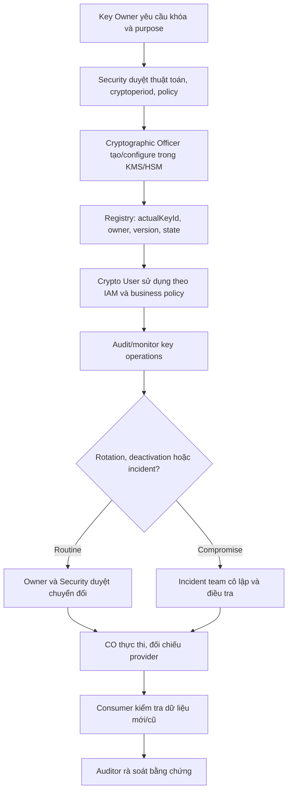
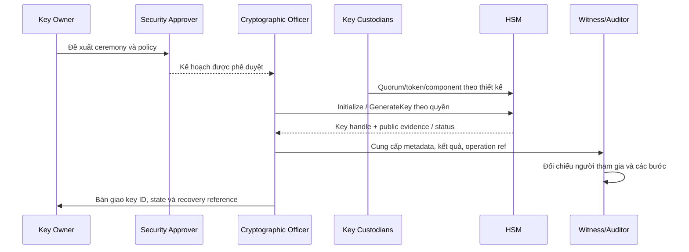
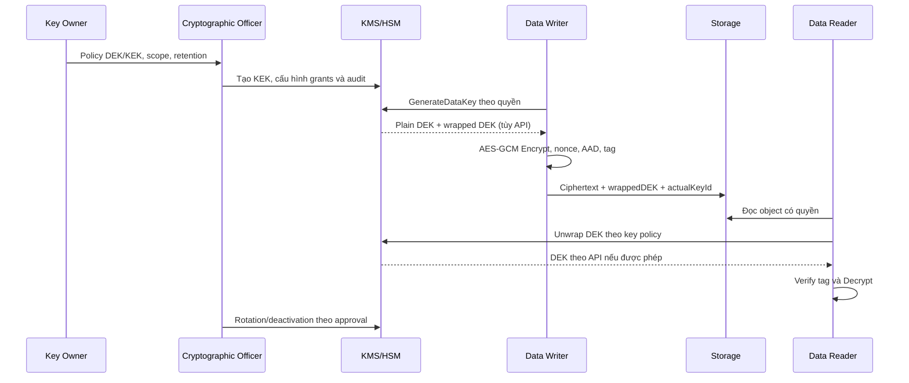

# Cryptographic officer — Vai trò quản trị mật mã và trách nhiệm bảo vệ khóa

Trong chương **Vai trò và trách nhiệm** của module **SECURITY_KEY_MANAGEMENT_FUNDAMENTALS**, **Cryptographic Officer (CO)** là vai trò được giao những trách nhiệm hoặc quyền quản trị mật mã có đặc quyền, đặc biệt khi tổ chức sử dụng **HSM** (*Hardware Security Module*), **KMS** (*Key Management Service*), hệ thống PKI hoặc các quy trình quản lý khóa quan trọng. Tùy thiết bị và chính sách, CO có thể thực hiện cấu hình ban đầu, quản lý chính sách khóa, tham gia sinh hoặc nhập khóa, vận hành rotation, backup, recovery và chuẩn bị hủy khóa.

**Điểm cần hiểu đúng:** Cryptographic Officer không mặc nhiên là người sở hữu mọi khóa, người phê duyệt mọi giao dịch, người kiểm toán độc lập hoặc người được phép sử dụng mọi private key. Trong một số module mật mã, **Crypto Officer** là vai trò kỹ thuật được định nghĩa trong *security policy* của thiết bị; ở cấp tổ chức, chức danh tương tự có thể mang phạm vi khác. Không nên tự suy rằng mọi HSM/KMS đều cung cấp đúng một role tên `CryptoOfficer` hoặc mọi role như vậy có cùng quyền.

Bài này gắn vai trò CO với **vòng đời khóa từ tạo, cấp phát, lưu trữ, sử dụng, xoay vòng, thu hồi đến hủy**, đồng thời kết nối mật mã đối xứng, bất đối xứng, chữ ký số, KMS/HSM, envelope encryption, IAM và kiểm toán. Mục tiêu là xây dựng một hệ thống trong đó **quyền tác động lên khóa được cấp đúng người, đúng thao tác, đúng thời điểm và có thể kiểm chứng**.

## 1. Mục tiêu học tập

Sau bài học, bạn có thể:

- Giải thích vai trò **Cryptographic Officer** trong module mật mã và trong mô hình quản trị của doanh nghiệp.
- Phân biệt CO với **Key Owner**, **Key Custodian**, **Crypto User**, **Security Officer**, **Business Approver**, **Auditor** và người vận hành hạ tầng.
- Thiết kế **separation of duties (SoD)**, **least privilege**, **RBAC/ABAC**, **dual control** và quorum **M-of-N** theo mức nhạy cảm của thao tác.
- Phân định nhiệm vụ quản trị cặp khóa ký, AES DEK, KEK, HMAC key, private key KEM, key backup và chứng chỉ số.
- Lập **RACI** cho hoạt động sinh, cấp quyền, xoay, vô hiệu hóa, lưu trữ, khôi phục và hủy khóa.
- Tổ chức **key ceremony** có phê duyệt, nhân chứng và bằng chứng, không lộ vật liệu khóa.
- Hiểu nguy cơ khi quản trị viên có khả năng **tự cấp quyền `Sign`/`Decrypt`**, hoặc workload có quyền ký bị chiếm quyền dù private key non-exportable trong HSM.
- Đọc ví dụ Java 17 mô phỏng phê duyệt độc lập trước khi lên lịch hủy khóa và nhận diện giới hạn của policy gate ứng dụng.

## 2. Cryptographic Officer là ai?

**Cryptographic Officer** là một **vai trò chức năng liên quan tới quản trị mật mã**. Khi nói về HSM hay module mật mã trong ngữ cảnh FIPS 140, CO thường biểu thị vai trò có quyền truy cập vào các **dịch vụ quản trị được nêu trong chính sách bảo mật của module**. Tuy nhiên, dịch vụ cụ thể, cách xác thực, chế độ hoạt động và khả năng xuất hoặc sử dụng khóa phải đọc từ chính sách của **đúng sản phẩm, firmware và cấu hình**.

Một CO có thể được giao các nhiệm vụ sau, nhưng **không phải tất cả đều mặc định có sẵn**:

1. Khởi tạo/provision HSM hoặc miền/partition theo quy trình được duyệt.
2. Tạo và quản trị danh tính, role, policy, authentication hoặc key access grants trong phạm vi được cấp.
3. Tạo, nhập, đăng ký, phân loại và gắn metadata cho khóa mật mã.
4. Cấu hình hoạt động của key: quyền mã hóa, ký, bọc/mở bọc, backup và thời hạn sử dụng.
5. Thực hiện rotation, chuyển trạng thái deactivated hoặc hỗ trợ phục hồi khóa theo runbook.
6. Vận hành key ceremony, backup/replication và các thủ tục M-of-N khi thiết bị hỗ trợ.
7. Thiết lập hoặc xác nhận nguồn audit, theo dõi thao tác key-management và sự kiện bất thường.
8. Thực thi hủy khóa **sau khi** có phê duyệt và bằng chứng đủ điều kiện.

**Điều CO không tự quyết định:** một giao dịch có được thanh toán hay không, dữ liệu khách hàng nào được đọc, chứng từ phải lưu bao lâu, hoặc một private key đã bị lộ có thể tiếp tục được tin cậy hay không. Các quyết định đó thuộc **key owner, business owner, security approver, compliance và incident response** theo mô hình tổ chức.

### 2.1. Role của module và chức danh tổ chức khác nhau

| Ngữ cảnh | CO thường được hiểu là | Phải xác minh điều gì? |
| --- | --- | --- |
| **HSM/module mật mã** | Vai trò truy cập những dịch vụ quản trị theo security policy. | API thực tế, xác thực role, khả năng key import/export/backup và quorum. |
| **Cloud KMS** | Chức năng quản trị thông qua IAM/key policy; role có thể không mang tên CO. | Ai có quyền sửa policy, grant, alias, key state, schedule deletion? |
| **Doanh nghiệp** | Người/nhóm chịu trách nhiệm vận hành quản trị mật mã theo chính sách. | Phân định với key owner, business approver và auditor. |
| **PKI/CA** | Người phối hợp khởi tạo HSM, CA key, backups hoặc trust operations. | Quy trình CA, chứng chỉ, chứng thực, key ceremony và revocation. |
| **Hệ thống thanh toán có key ceremony** | Người vận hành thiết bị và thao tác đã phê duyệt, cùng key custodians. | Split knowledge, dual control và người làm chứng thực thi ra sao? |

Một sản phẩm công bố chứng nhận hoặc yêu cầu tuân thủ không có nghĩa **mọi quyền CO tự động an toàn**. Đánh giá phải gắn với *đúng module*, mode hoạt động, phiên bản và quy trình tổ chức.

### 2.2. Phân biệt responsibility, authority và capability

Có ba tầng độc lập:

- **Responsibility — trách nhiệm:** ví dụ điều phối xoay KEK, kiểm kê khóa, bảo đảm audit.
- **Authority — thẩm quyền:** ví dụ người duyệt thay key policy hoặc cho phép hủy KEK sau retention review.
- **Capability — khả năng kỹ thuật:** ví dụ tài khoản thật sự gọi được `CreateKey`, `PutKeyPolicy`, `Sign`, `Decrypt` hoặc `ScheduleDeletion`.

CO có thể **chịu trách nhiệm thực thi** một hành động nhưng **không có quyền tự phê duyệt**. Ngược lại, một tài khoản có capability `DeleteKey` không có nghĩa hành động xóa đã được tổ chức cho phép. Governance, approval, IAM và audit phải đồng bộ cả ba tầng.

## 3. Vai trò liên quan trong quản lý khóa

| Vai trò | Trách nhiệm chính | Không nên mặc định có quyền |
| --- | --- | --- |
| **Cryptographic Officer** | Thiết lập/cập nhật cơ chế và trạng thái khóa theo policy; vận hành HSM/KMS. | Tùy ý `Sign` giao dịch, `Decrypt` dữ liệu khách hàng, tự phê duyệt xóa. |
| **Key Owner / Data Owner** | Xác định mục đích, chủ sở hữu, cryptoperiod, dữ liệu phụ thuộc và mức độ rủi ro. | Xuất private key hay tự thao tác HSM vượt quyền. |
| **Security Officer / Policy Approver** | Ban hành tiêu chuẩn, duyệt thuật toán, ngoại lệ, thao tác nhạy cảm và risk acceptance. | Trực tiếp xem mọi plaintext hoặc sử dụng mọi private key. |
| **Key Custodian** | Giữ key component, backup material, smart card hoặc phương tiện khôi phục được giao. | Nắm toàn bộ secret hoặc một mình tái dựng khóa khi chính sách yêu cầu quorum. |
| **Crypto User / Workload** | Dùng khóa theo purpose: `Encrypt`, `Decrypt`, `Sign`, MAC, verify. | Quản trị policy, xóa khóa, xuất key material không cần thiết. |
| **Business Approver** | Phê duyệt nội dung giao dịch/tài liệu trước khi ký hoặc giải mã. | Quyền quản trị HSM chỉ vì có quyền nghiệp vụ. |
| **Platform Operator** | Duy trì máy chủ, cập nhật, giám sát và năng lực hạ tầng. | Truy cập bí mật và quyền ký mặc định. |
| **Incident Responder** | Điều tra, cô lập quyền, thay khóa và phục hồi khi có sự cố. | Quyền vô thời hạn hoặc truy cập ngoài phạm vi vụ việc. |
| **Auditor** | Đánh giá log, quy trình, SoD, quyền và bằng chứng. | Sửa key policy, hủy log hoặc đọc private key. |

**Một người có thể kiêm nhiều vai trò trên giấy nhưng không được bỏ qua xung đột nhiệm vụ.** Nếu tổ chức nhỏ thiếu nhân sự, cần kiểm soát bù trừ: phê duyệt từ cấp độc lập, session được ghi nhận, hạn quyền ngắn, audit ở miền không thể tự xóa và kiểm tra định kỳ.

### 3.1. CO khác Crypto User như thế nào?

```text
CO được cấp theo nhu cầu:
  ConfigureKey, RotateKey, ChangeKeyState, ManageGrant

Workload payments-signer được cấp:
  Sign trên payments/sign-v4
  chỉ khi business policy chấp nhận giao dịch

Không được mặc định:
  CO có quyền ký giao dịch thay workload.
  Workload có quyền sửa policy hoặc xuất private key.
```

Nguy cơ lớn xuất hiện khi CO có thể **tự sửa policy để cấp quyền `Sign` hay `Decrypt` cho chính mình**. Vì thế ngoài role separation, cần **permission boundary** hoặc approval độc lập đối với thay đổi grant/key policy, kết hợp audit ở bên ngoài quyền chỉnh sửa của CO.

## 4. RACI cho vòng đời khóa

**RACI** là công cụ phân định nhiệm vụ:

- **R — Responsible:** thực hiện tác vụ.
- **A — Accountable:** chịu trách nhiệm cuối cùng cho một quyết định cụ thể.
- **C — Consulted:** được hỏi ý kiến.
- **I — Informed:** được thông báo.

Bảng dưới là **ví dụ**, cần điều chỉnh theo tổ chức. Đối với quyết định có cả yếu tố nghiệp vụ và bảo mật, phân tách thành các quyết định nhỏ để tránh một hàng có nhiều người cùng là A mà không rõ người quyết định cuối.

| Công việc | Key Owner | CO | Security Approver | Crypto User | Auditor |
| --- | --- | --- | --- | --- | --- |
| Xác định purpose/tenant/data scope | **A/R** | C | C | C | I |
| Duyệt algorithm/cryptoperiod | R | C | **A** | C | I |
| Tạo cặp khóa/key version | **A** | **R** | C | I | I |
| Cấu hình IAM/grants | **A** về phạm vi | **R** | C | I | I |
| Ký/mã hóa dữ liệu nghiệp vụ | **A** về dữ liệu | I | I | **R** | I |
| Rotation và rollout | **A** | **R** | C | R trên consumer | I |
| Deactivate key cũ | **A** | **R** | C | I | I |
| Backup/archive/restore có kiểm soát | **A** về phụ thuộc | **R** | C hoặc duyệt độc lập | C | I |
| Cô lập khóa khi compromise | C | **R** | **A** về phản ứng bảo mật | C | I |
| Hủy sau retention | **A** về dữ liệu | **R** | Duyệt an ninh theo policy | I | I |
| Kiểm toán tuân thủ | C | C | I | I | **R** |

**RACI không thay thế IAM.** Nếu ghi CO là R còn key owner là A nhưng CO vẫn có thể một mình dùng API xóa và xóa log thì bảng trách nhiệm không giúp cưỡng chế chính sách.

### 4.1. Luồng quyền từ yêu cầu đến kiểm tra



## 5. Least privilege và chính sách theo thao tác

Một CO thường có quyền tác động đến phần lớn cơ chế bảo vệ của tổ chức. Cần giới hạn theo **operation, key ID, algorithm, purpose, tenant, environment, change request và thời gian**.

| Nhóm quyền | Ví dụ tác vụ | Rủi ro |
| --- | --- | --- |
| **Read metadata** | List keys, xem state/alias/algorithm. | Rò metadata nhạy cảm; quyền thường thấp hơn quyền secret. |
| **Create/import** | Tạo key pair, DEK/KEK, import key material. | Nguồn gốc khóa sai, import secret lộ từ ngoài. |
| **Policy/grant management** | Thay key policy, cấp `Sign`/`Decrypt`, thay trust. | **Privilege escalation** và bypass separation of duties. |
| **Export/backup/restore** | Sao lưu/nhập/xuất key theo API. | Lộ vật liệu khóa; tạo bản sao ngoài kiểm soát. |
| **Rotate/disable** | Đổi alias, trạng thái, cryptoperiod. | Có thể làm ngừng dịch vụ hoặc mở lại khóa cũ. |
| **Destroy/schedule deletion** | Lên lịch hoặc thực thi xóa khóa. | Mất khả năng giải mã/khôi phục vĩnh viễn. |
| **Crypto operations** | `Sign`, `Decrypt`, `Unwrap`, `GenerateMac`. | Lạm dụng nội dung nghiệp vụ; không nên nằm trong role quản trị chung. |
| **Audit configuration** | Thay nơi thu log hoặc retention. | Cho phép xóa dấu vết thao tác quản trị. |

### 5.1. RBAC và ABAC

**RBAC** gán quyền dựa trên vai trò, ví dụ `RotationOperator`. **ABAC** bổ sung điều kiện từ các thuộc tính đáng tin:

```text
principal.role       == "KeyRotationOperator"
principal.mfa        == verified
key.environment      == "production"
key.purpose          == "wrap-billing-dek"
action               == "DEACTIVATE"
key.actualId         == approvedChange.keyId
approvedChange.validUntil > trustedServerNow
change.approvers     đạt policy độc lập
```

Đây là **pseudocode chính sách**, không phải cú pháp của nhà cung cấp KMS. Thuộc tính không được lấy trực tiếp từ JSON client: vai trò, owner, approval, key ID và thời gian phải được xác thực qua IAM, registry và approval workflow.

### 5.2. Quyền có thời hạn

Các cơ chế hữu ích gồm:

- **Just-in-time access (JIT):** cấp CO privilege khi có công việc được duyệt, sau đó thu hồi.
- **Just-enough-access:** cấp đúng key ID và action, tránh wildcard quản trị mọi tenant.
- **Strong authentication:** MFA, token phần cứng nếu phù hợp, session tách biệt và giới hạn thời hạn.
- **Privileged Access Management (PAM):** giám sát và lưu dấu hành động quản trị.
- **Break-glass:** quyền khẩn cấp có cảnh báo, audit và đánh giá sau sự cố.
- **Permissions boundary:** CO không thể tự vượt mức quyền tối đa hoặc tự cấp `Decrypt` cho mình.

Một API gateway chỉ có giá trị khi **đường gọi trực tiếp tới KMS/HSM không thể bypass** các bước phê duyệt. Quyền và session phải được xác minh ngay tại ranh giới tin cậy.

## 6. Separation of duties, dual control và quorum

**Separation of duties (SoD)** giảm khả năng một chủ thể đơn phương thực hiện toàn bộ một hoạt động nhạy cảm.

Các cặp nhiệm vụ thường cần tách:

1. Đề xuất thay key policy **và** phê duyệt chính thay đổi đó.
2. Tạo khóa và tự quyết định đưa khóa vào trust store production.
3. Tự cấp `Decrypt` và truy cập dữ liệu nghiệp vụ không qua kiểm soát.
4. Thực hiện hủy KEK và tự xác nhận mọi backup đã được rewrap.
5. Quản trị KMS và có quyền xóa nhật ký KMS không để lại dấu.
6. Là người giữ key component và cũng tự tạo đủ các component khác.

**Dual control** thường yêu cầu hai chủ thể độc lập tham gia. **M-of-N quorum** yêu cầu tối thiểu M trong N chủ thể hoặc yếu tố được ủy quyền; tùy hệ thống, quorum có thể áp dụng cho login, backup, restore, activation hoặc thao tác mật mã cụ thể.

### 6.1. Đừng nhầm quorum với chia khóa

| Cơ chế | Ý nghĩa | Không tự đảm bảo |
| --- | --- | --- |
| **Dual approval** | Hai người độc lập phê duyệt một yêu cầu. | Không chia key material hoặc ngăn bypass API. |
| **M-of-N authorization** | Đủ M chủ thể/yếu tố chấp thuận hoặc xác thực theo policy. | Không mặc nhiên sử dụng secret sharing. |
| **Split knowledge** | Tổ chức giữ các phần thông tin bí mật sao cho không một bên đơn lẻ biết toàn bộ theo thiết kế. | Không tự có authorization và audit. |
| **Secret sharing** | Chia bí mật thành các share với ngưỡng tái dựng theo scheme. | Không tự có phân quyền nghiệp vụ hoặc chống lạm dụng sau tái dựng. |
| **Threshold cryptography** | Nhiều bên tham gia phép mật mã mà không cần tập hợp private key thô theo scheme. | Không tự thay quy trình phê duyệt. |
| **Witness/Auditor** | Chứng kiến và xác minh quy trình. | Không thay cơ chế kỹ thuật quản lý key access. |

Một sản phẩm quảng cáo “M-of-N” không đủ thông tin để kết luận nó đang dùng threshold cryptography. CO phải kiểm tra **M-of-N bảo vệ thao tác nào, share nằm ở đâu, phục hồi ra sao và ai có thể thay đổi quorum**.

## 7. Key ceremony — nghi thức mật mã quan trọng

*Key ceremony* là quy trình tạo/thao tác khóa trọng yếu trong điều kiện được chuẩn bị, có phân vai và lưu bằng chứng. Các tình huống thường gặp: khởi tạo HSM, tạo CA root key, nạp key component vào payment HSM, thiết lập backup quorum hoặc chuyển môi trường bảo vệ khóa.

Một key ceremony nên bao gồm:

1. **Phê duyệt kế hoạch:** purpose, thuật toán, key type, cryptoperiod, owner, participants, dependencies và điều kiện thành công/thất bại.
2. **Kiểm soát môi trường:** địa điểm, thiết bị, firmware, security policy, chế độ vận hành và chứng cứ danh tính thiết bị.
3. **Phân vai:** CO vận hành, custodian giữ component/token, witness chứng kiến, approver chịu trách nhiệm quyết định.
4. **Chứng thực người tham gia:** xác minh danh tính/quorum, không dùng chung một tài khoản cho nhiều vai trò độc lập.
5. **Sinh/import an toàn:** dùng cơ chế thiết bị và nguồn ngẫu nhiên/định dạng wrapping được phép, không tự làm thuật toán sinh khóa.
6. **Xác minh khóa:** key handle, public key, fingerprint hoặc key check evidence phù hợp; không in private key.
7. **Backup và replication:** thực hiện theo cơ chế HSM/KMS hỗ trợ, có quyền và bản ghi.
8. **Niêm phong quy trình:** kiểm kê component, khóa phiên đặc quyền, bảo vệ chứng từ.
9. **Biên bản và audit:** change ID, key ID/version, policy, actor, kết quả, device operation references, witness.
10. **Restore drill:** kiểm chứng đường khôi phục trong phạm vi được duyệt và không lộ bí mật.

### 7.1. Trách nhiệm của từng người trong ceremony



Không được tự tạo “secret sharing” bằng cách cắt các byte khóa thành ba đoạn rồi phát cho ba người. Nếu chính sách yêu cầu cơ chế chia bí mật, hãy dùng scheme hoặc thiết bị được đánh giá, có kiểm tra khả năng tái dựng và ranh giới tin cậy.

### 7.2. Bằng chứng cần giữ

| Bằng chứng | Mục đích |
| --- | --- |
| Ceremony/change ID | Liên kết yêu cầu, phê duyệt và các thao tác. |
| Device identity, firmware và cấu hình | Xác minh đúng thiết bị/chế độ được phép. |
| Key ID/algorithm/purpose/owner | Truy xuất đúng khóa và phạm vi sử dụng. |
| Participants và role | Chứng minh SoD/quorum đã được thực hiện. |
| Policy version và trạng thái khóa | Phát hiện thay đổi quyền ngoài kế hoạch. |
| Public key/fingerprint được phép công bố | Xác nhận danh tính khóa mà không lộ private key. |
| Provider operation IDs | Đối chiếu thao tác thực tế. |
| Backup/restore reference và kết quả thử nghiệm | Hỗ trợ khả năng phục hồi. |
| Biên bản và audit có bảo vệ tính toàn vẹn | Chứng minh trách nhiệm giải trình. |

Không ghi **raw private key, plaintext DEK/KEK, HMAC secret, PIN, seed, recovery phrase hay component bí mật** vào biên bản.

## 8. Trách nhiệm CO theo vòng đời khóa

### 8.1. Sinh khóa (Generate)

CO kiểm tra kế hoạch có **owner, purpose, algorithm, key size/curve, source of randomness, exportability và cryptoperiod**. Khi được phê duyệt, CO dùng KMS/HSM hoặc API key generator phù hợp.

Với AES/HMAC key, phải dùng nguồn CSPRNG hoặc cơ chế sinh khóa của nhà cung cấp. Với RSA/EC/Ed25519, dùng key pair generation chuyên dụng; không tự ghép private key từ timestamp/UUID. Đối với HSM non-exportable, việc kiểm tra có thể dựa trên key handle, public key và test operation, **không cần xuất private key**.

### 8.2. Cấp phát và kích hoạt (Provision)

CO có thể tạo policy cho phép `payments-signer` sử dụng `Sign` trên key `payments/sign-v4`. Nhưng business owner vẫn phải quyết định **ai được yêu cầu ký giao dịch gì**.

```text
CO:
  Tạo signing key, key ID/version, policy, auditing.
  Grant Sign cho đúng workload và mục đích.
  Không tự cấp Sign cho chính mình nếu không có approval độc lập.

Signing workload:
  Kiểm tra yêu cầu nghiệp vụ, canonically encode signing input.
  Gọi KMS/HSM Sign bằng key được cấp.
  Ghi audit đối tượng, actor và kết quả.

Verifier:
  Dùng public key đáng tin, kiểm tra signature và business constraints.
```

**Một chữ ký đúng về mặt mật mã không chứng minh giao dịch đã được phê duyệt về nghiệp vụ.** CO bảo vệ khả năng ký, còn business service phải bảo vệ tính hợp lệ của nội dung được ký.

### 8.3. Sử dụng và giám sát (Operate)

CO giám sát:

- Key state, hạn **cryptoperiod**, key usage count, lỗi policy hoặc dấu hiệu lạm dụng.
- KMS/HSM operation logs, thay đổi key policy, grants và permissions drift.
- Dấu hiệu tải/nhân bản key material ngoài phạm vi, vi phạm non-exportability.
- Nguy cơ **AES-GCM nonce reuse** và số lần mã hóa theo cùng DEK; yêu cầu kiểm soát thuộc nhóm Crypto User và owner nhưng CO phối hợp policy.
- Chữ ký/MAC được tạo bất thường, sử dụng key đã deactivated, request từ tenant/region không đúng.

Không cần CO giữ plaintext secret hay trực tiếp mã hóa dữ liệu nếu thao tác đó thuộc ứng dụng.

### 8.4. Xoay vòng (Rotate)

Một quy trình rotation an toàn:

1. Key Owner đề xuất và Security phê duyệt scope, lịch, thuật toán, kế hoạch rollback.
2. CO tạo khóa mới, đăng ký **actual key ID/version**, cập nhật IAM/key policy.
3. Với signing key, **publish public key mới trước khi** chuyển signer.
4. Với KEK/DEK, phối hợp rewrap hoặc re-encrypt dữ liệu tùy mục đích.
5. Các writer/signer chuyển sang khóa mới trước cutoff.
6. CO chặn `Encrypt`/`Sign`/`Wrap` mới bằng khóa cũ tại điểm thực thi.
7. Reader/verifier xác minh dữ liệu/chữ ký cũ còn xử lý được khi policy cho phép.
8. Audit lưu change ID, người duyệt, mốc chuyển, key references và kết quả.

**Rotation không phải chỉ đổi alias**. Alias `current-key` có thể trỏ từ v1 sang v2, nhưng quyền dùng trực tiếp v1 có thể vẫn tồn tại. Cần xử lý cả policy và các đường bypass.

### 8.5. Deactivate, archive và destroy

- **Deactivate:** dừng tạo bảo vệ mới; có thể giữ thao tác xử lý dữ liệu lịch sử theo policy.
- **Archive:** giữ vật liệu khóa hoặc bằng chứng xác minh trong ranh giới an toàn; phải quản lý retention, quyền restore và backup.
- **Destroy:** hủy key material khi không còn dữ liệu/backup phụ thuộc, đã xử lý legal hold và có phê duyệt phù hợp.

Một nút `DisableKey` của KMS có thể chặn **cả `Decrypt` lẫn `Encrypt`**, không nhất thiết tương đương trạng thái deactivated logic. CO phải biết khả năng của provider trước khi thao tác, đặc biệt khi KEK còn bọc các DEK trong backup.

## 9. Phân biệt trách nhiệm theo loại khóa

| Loại khóa | Vai trò CO cần quản lý | Điều không được nhầm |
| --- | --- | --- |
| **AES DEK** | Nguồn sinh, purpose/tenant, phạm vi truy cập, cryptoperiod. | DEK không được ghi log hoặc dùng lại nonce GCM sai. |
| **Symmetric KEK** | Key policy `Wrap`/`Unwrap`, backup, rotation, dependencies. | Xóa KEK có thể làm mất khả năng mở DEK cũ. |
| **Private signing key** | HSM protection, `Sign` grants, rotation, public-key distribution. | Không cần giữ private key chỉ vì còn chữ ký cũ cần verify. |
| **HMAC key** | Sinh/cấp phát cho các bên được phép, lịch xoay và verify overlap. | Ai biết secret cũng có thể tạo MAC mới; cần chống replay. |
| **RSA/KEM recipient private key** | Quản lý `Decrypt`/`Decapsulate`, key references, ciphertext cũ. | KEM không tự xác thực sender; key tĩnh bị lộ có thể ảnh hưởng ciphertext cũ. |
| **CA/root key** | Key ceremony, HSM, quorum, backup, trust lifecycle. | Không để một CO tự ký CA và tùy ý thêm trust anchor. |
| **Root/KDF key** | Tách purpose, key hierarchy và phạm vi ảnh hưởng. | Một root bị lộ có thể ảnh hưởng nhiều key con. |
| **Password pepper** | Secret storage, cấp quyền HMAC, version/rotation. | Mất pepper có thể làm verifier cũ không dùng được. |

### 9.1. Envelope encryption: ai làm gì?



CO quản trị **KEK và quyền**, còn writer/reader chịu trách nhiệm bảo vệ dữ liệu và **nonce/tag**. Key Owner chịu trách nhiệm retention và migration. Auditor kiểm tra quy trình mà không phải sở hữu DEK plaintext.

**Rewrap khác re-encrypt:** rewrap đổi KEK bọc cùng DEK; re-encrypt dùng DEK mới và mã hóa lại dữ liệu. Nếu **DEK đã lộ**, chỉ rewrap nó không khôi phục tính bí mật. Nếu **KEK bị lộ**, wrapped DEK trong quá khứ có thể đã bị attacker mở bọc; cần incident response chứ không chỉ đổi alias.

## 10. Java 17: policy gate cần hai phê duyệt

Đoạn mã sau **chỉ mô phỏng quyết định quản trị** cho tác vụ `SCHEDULE_DESTROY`. Nó không gọi API KMS và không động vào vật liệu khóa. Đầu vào `Actor`, `Approval`, `KeyRecord` phải đến từ **hệ thống tin cậy phía server**, không phải client tự khai.

Mục tiêu:

- Người thực thi có role `CryptoOfficer` và quyền quản lý **đúng key ID**.
- Khóa đã deactivated/archived; mọi dependency đã xử lý, retention hoàn thành và không có legal hold.
- Hai approval còn hạn, cùng change ID/action/key ID và đến từ **hai người khác nhau**, không trùng người thực thi hoặc requester.
- Chỉ khi các điều kiện cùng đúng, workflow có thể chuyển sang bước yêu cầu KMS thực hiện theo quyền thật.

```java
import java.time.Clock;
import java.time.Instant;
import java.time.ZoneOffset;
import java.util.HashSet;
import java.util.List;
import java.util.Set;

public final class CryptoOfficerApprovalDemo {
    enum State { ACTIVE, DEACTIVATED, ARCHIVED, COMPROMISED, DESTROYED }
    enum Action { SCHEDULE_DESTROY }

    record Actor(String id, Set<String> roles, Set<String> scopes) {
        Actor {
            roles = Set.copyOf(roles);
            scopes = Set.copyOf(scopes);
        }
        boolean canManage(String keyId) {
            return roles.contains("CryptoOfficer") && scopes.contains(keyId);
        }
    }

    record KeyRecord(
            String keyId, State state,
            boolean dependenciesCleared,
            boolean retentionComplete,
            boolean legalHold) {}

    record Change(
            String changeId, String keyId,
            Action action, String requesterId) {}

    record Approval(
            String approverId, String approverRole,
            String keyId, String changeId,
            Action action, Instant expiresAt) {}

    static boolean mayScheduleDestroy(
            Actor officer, KeyRecord key, Change change,
            List<Approval> approvals, Clock clock) {

        if (!officer.canManage(key.keyId())) return false;
        if (!key.keyId().equals(change.keyId())
                || change.action() != Action.SCHEDULE_DESTROY) return false;

        if (key.state() != State.DEACTIVATED
                && key.state() != State.ARCHIVED) return false;

        if (!key.dependenciesCleared()
                || !key.retentionComplete()
                || key.legalHold()) return false;

        Instant now = clock.instant();
        Set<String> approvedBy = new HashSet<>();

        for (Approval approval : approvals) {
            boolean valid =
                    approval.keyId().equals(key.keyId())
                    && approval.changeId().equals(change.changeId())
                    && approval.action() == change.action()
                    && now.isBefore(approval.expiresAt())
                    && Set.of("SecurityApprover", "RecordsApprover")
                            .contains(approval.approverRole())
                    && !approval.approverId().equals(officer.id())
                    && !approval.approverId().equals(change.requesterId());
            if (valid) approvedBy.add(approval.approverId());
        }

        // Demo: cần hai danh tính phê duyệt độc lập.
        return approvedBy.size() >= 2;
    }

    public static void main(String[] args) {
        Clock clock = Clock.fixed(
                Instant.parse("2026-11-28T00:00:00Z"), ZoneOffset.UTC);

        Actor officer = new Actor("co-01",
                Set.of("CryptoOfficer"), Set.of("billing/kek-v2"));
        KeyRecord key = new KeyRecord(
                "billing/kek-v2", State.ARCHIVED, true, true, false);
        Change change = new Change(
                "chg-0042", "billing/kek-v2",
                Action.SCHEDULE_DESTROY, "owner-01");

        List<Approval> approvals = List.of(
                new Approval("security-01", "SecurityApprover",
                        "billing/kek-v2", "chg-0042",
                        Action.SCHEDULE_DESTROY,
                        Instant.parse("2026-11-29T00:00:00Z")),
                new Approval("records-01", "RecordsApprover",
                        "billing/kek-v2", "chg-0042",
                        Action.SCHEDULE_DESTROY,
                        Instant.parse("2026-11-29T00:00:00Z"))
        );

        System.out.println("Two approvals: " +
                mayScheduleDestroy(officer, key, change, approvals, clock));
        System.out.println("One approval: " +
                mayScheduleDestroy(officer, key, change,
                        approvals.subList(0, 1), clock));

        KeyRecord hold = new KeyRecord(
                key.keyId(), key.state(), true, true, true);
        System.out.println("Legal hold: " +
                mayScheduleDestroy(officer, hold, change, approvals, clock));
    }
}
```

Đầu ra dự kiến:

```text
Two approvals: true
One approval: false
Legal hold: false
```

### 10.1. Những giới hạn phải xử lý trước production

1. **Nguồn approval:** `Approval` phải được tạo từ workflow có xác thực, chữ ký/bằng chứng và logs, không từ input client.
2. **Độc lập vai trò:** code mới kiểm tra *hai danh tính khác nhau*, chưa bắt buộc **một người thuộc SecurityApprover và một người thuộc RecordsApprover**. Nếu policy yêu cầu cả hai nhóm, phải kiểm tra vai trò theo từng nhóm.
3. **Identity governance:** hai username có thể cùng một người kiểm soát; quy trình tổ chức phải ngăn việc này.
4. **Single-use và replay:** approval cần liên kết key version, state version, change revision, thời hạn và cơ chế chống tái sử dụng.
5. **Bằng chứng dependency:** `dependenciesCleared` phải dựa vào inventory, backup/DR và dữ liệu thực tế đã được kiểm chứng.
6. **TOCTOU:** legal hold, backup hoặc key state có thể đổi sau kiểm tra. Cần tái kiểm tra tại điểm cấp grant/thực thi, kết hợp transaction/version.
7. **KMS semantics:** thao tác schedule deletion không đồng nghĩa key đã bị hủy; provider có thể có thời gian chờ, restore và trạng thái riêng.
8. **Đường bypass:** CO không được trực tiếp gọi quyền destroy rộng để vượt policy gate.
9. **Audit:** lưu actor, change, approval refs, key ID/version, provider operation ID và outcome, không log secret.
10. **Break-glass:** khẩn cấp có workflow riêng; không dùng break-glass để bỏ qua hoàn toàn tính toàn vẹn dữ liệu và legal hold.

### 10.2. Tách role vận hành rotation khỏi quyền phá hủy

```text
RotationOperator:
  tạo key version mới, cập nhật key alias theo change
  dừng new protection bằng key cũ
  không có quyền ExportPlaintext hoặc Destroy

KeyDestructionOperator:
  schedule destroy khi retention + dependencies + approval đạt
  không mặc nhiên có quyền Sign/Decrypt dữ liệu

CryptoUser:
  gọi Sign/Encrypt/Decrypt đúng purpose
  không thay IAM, key policy, backup, destroy

Auditor:
  đọc audit và metadata
  không thay key state, không xóa log, không dùng secret
```

Đây là **tên quyền minh họa**, không khẳng định mọi KMS có các API tương ứng. Điều cốt lõi là phân tách *management plane* khỏi *data plane* và giới hạn từng role.

## 11. Onboarding và offboarding Cryptographic Officer

### 11.1. Onboarding

- Ghi nhu cầu, business justification, scope các key và environments.
- Được người có thẩm quyền độc lập phê duyệt.
- Dùng danh tính quản trị riêng với tài khoản thường ngày; bảo vệ MFA/token.
- Cấp JIT/JEA hoặc quyền tối thiểu phù hợp, có TTL và logging.
- Kiểm tra SoD với các vai trò đang có: signer, key owner, auditor, approver.
- Huấn luyện key ceremony, incident handling, non-exportable policy và backup/restore.
- Kiểm thử rằng CO **không thể tự cấp `Sign`/`Decrypt` vượt policy**.
- Lưu bằng chứng cấp quyền và lịch **access recertification**.

### 11.2. Thay vai trò hoặc rời tổ chức

Khi một CO thay nhóm hoặc rời tổ chức:

1. Thu hồi IAM/PAM role, session, API token, smart card, HSM login và quyền vật lý.
2. Cập nhật key custodian roster, quorum, backup holders và recovery process.
3. Kiểm tra có bản sao secret/key component hoặc grant dài hạn không được quản lý không.
4. Đánh giá lịch sử các thao tác `ModifyKeyPolicy`, `Export`, `Backup`, `Destroy` và hoạt động bất thường.
5. Nếu credential bị nghi lộ, cô lập và thay credential; nếu **key material đã lộ**, phải theo incident response cho khóa tương ứng.
6. Kiểm thử quy trình restore/quorum sau khi thay nhân sự để tránh lệ thuộc người cũ.

**Không mặc định rằng đổi mật khẩu CO là đủ** khi tài khoản có thể từng xuất private key hoặc tự thêm trust/grants.

## 12. CO và ứng phó sự cố

### 12.1. Khi private signing key bị lộ

- **Incident lead:** chỉ huy cô lập, điều tra, quyết định thông báo và mức chấp nhận rủi ro.
- **CO:** thu hồi key grants, vô hiệu hóa `Sign`, tạo key pair mới và cập nhật policy.
- **Issuer/Service Owner:** chuyển signer, phát hành public key đáng tin, cập nhật JWKS/certificate.
- **Verifier Owner:** kiểm tra token/tài liệu cũ, issuer/algorithm/trust và chính sách thu hồi.
- **Auditor/Forensics:** đối chiếu logs, bằng chứng thời gian và các đối tượng đã ký.

Nếu attacker đã có bản sao **private key**, khóa API `Sign` trên HSM **không** ngăn họ ký bên ngoài. Cần cập nhật trust/acceptance và đánh giá chữ ký giả đã phát hành.

### 12.2. Khi KEK/DEK bị lộ

Nếu **DEK bị lộ**, rewrap dưới KEK mới không khôi phục bí mật; cân nhắc re-encrypt bằng DEK mới. Nếu **KEK bị lộ**, wrapped DEK đã bị thu thập có thể được mở. CO phối hợp Data Owner và Incident team để xác định dữ liệu bị ảnh hưởng, điều kiện giữ backup, thay key material và thông báo phù hợp.

### 12.3. Khi workload có quyền `Decrypt` hoặc `Sign` bị chiếm

HSM có thể giữ private key **non-exportable** nhưng workload đã có quyền vẫn có thể gọi API và tạo chữ ký hoặc giải mã dữ liệu trái phép. CO giúp thu hồi grant, điều tra operation logs và phục hồi cấu hình. Business owner vẫn cần xác định **giao dịch/dữ liệu bị ảnh hưởng**.

### 12.4. Break-glass

Quyền khẩn cấp cần:

- Mục đích và phạm vi rõ, TTL ngắn, xác thực mạnh.
- Notification và audit độc lập ngay khi kích hoạt.
- Giới hạn action quan trọng, đặc biệt với export hoặc destroy.
- Review sau sự cố và thu hồi toàn bộ grant/session.
- Không coi break-glass là quyền quản trị thường trực.

## 13. Kiểm toán và giám sát đặc quyền CO

Những hoạt động cần cảnh báo:

| Tín hiệu | Điều cần điều tra |
| --- | --- |
| Sửa key policy/grant không có change | Tự cấp quyền `Decrypt`/`Sign` hoặc mở rộng tenant scope. |
| Thử export private key/KEK | Non-exportability, hành vi copy secret và khả năng provider cho export. |
| Tạo backup/restore ngoài lịch | Bản sao mới có được phê duyệt và lưu đúng vùng tin cậy? |
| Disable/delete key bất thường | Dữ liệu/backup phụ thuộc, outage và bằng chứng approval. |
| Sửa trust anchor hoặc public key registry | Nguy cơ thay khóa xác minh bằng khóa của đối thủ. |
| Nhiều lần login HSM thất bại | Credential lỗi, tấn công hoặc device issue. |
| CO truy cập từ thiết bị/địa điểm lạ | Nguy cơ session compromise và MFA bypass. |
| Sửa logging/retention | Có dấu hiệu xóa dấu vết thao tác? |
| Dùng key đã deactivated cho `Sign`/`Encrypt` | Policy bypass, cache stale hoặc lạm dụng quyền. |
| Quyền CO tồn tại sau offboarding | Lỗ hổng identity governance và key management. |

Audit record nên có `actor`, `sessionId`, `actualKeyId`, `operation`, `tenant`, `changeId`, `approvalRefs`, `policyVersion`, `timestamp`, `providerOperationId`, `result`. **Không log** raw key, PIN, token, DEK plaintext, HMAC secret hay dữ liệu nhạy cảm không cần thiết.

Một lần kiểm toán định kỳ nên xác minh cả **effective permissions** ở IAM/KMS/HSM, không chỉ sơ đồ quyền. Người kiểm toán thường không cần đọc plaintext key; metadata, device evidence, approval history và audit logs có thể cung cấp đủ bằng chứng về quy trình.

## 14. Tình huống: nền tảng thanh toán với nhiều loại khóa

Một hệ thống quản lý hóa đơn và thanh toán gồm:

- **AES-256-GCM DEK** dùng mã hóa hóa đơn, có KEK trong KMS.
- **Private signing key** trong HSM cho chứng từ thanh toán.
- **JWT signing key** có public key được công bố qua JWKS tin cậy.
- **HMAC key** riêng cho mỗi đối tác webhook.
- **Key inventory** theo dõi key ID/version, purpose, owner, cryptoperiod, state và dependencies.

### 14.1. Phân công

| Nhóm | Trách nhiệm |
| --- | --- |
| **Billing Key Owner** | Quyết định retention hóa đơn, các DEK/KEK và phụ thuộc backup. |
| **Identity Key Owner** | Xác định JWT issuer, TTL, trust và thời hạn signing key. |
| **Crypto Officer** | Tạo/configure KEK, signing key, grant, HSM key ceremony, rotation và backup theo approval. |
| **Payments Business Approver** | Phê duyệt nội dung giao dịch cần ký. |
| **Crypto User Workloads** | Gọi mật mã được cấp quyền, quản lý AAD, nonce, signing input và kiểm tra nghiệp vụ. |
| **Security Approver** | Duyệt policy/ngoại lệ/export/destructive operations. |
| **Independent Auditor** | Kiểm tra SoD, logs, inventory và bằng chứng. |

### 14.2. Ví dụ xoay KEK

```text
1. Billing Owner đề xuất chuyển kek-v3 -> kek-v4.
2. Security duyệt algorithm, scope, change window.
3. CO tạo v4 trong KMS, thiết lập grants, audit, key reference.
4. Writer bắt đầu wrap DEK mới bằng v4.
5. Reader kiểm tra unwrap DEK lịch sử dùng v3 vẫn hoạt động.
6. CO chặn wrap mới bằng v3 tại enforcement point.
7. Recovery rewrap wrapped DEKs cũ khi cần; kiểm tra backup.
8. Auditor xác minh policy version và operation logs.
9. Owner + Security quyết định archive/destroy v3 khi không còn phụ thuộc.
```

Nếu KEK cũ bị **compromised**, đây không chỉ là rotation routine; phải đánh giá các wrapped DEK trong tay attacker và dữ liệu tương ứng.

### 14.3. Ví dụ ký chứng từ thanh toán

```text
User -> Business approval -> Payment Service -> Signing Service -> HSM

Business layer:
  xác thực người duyệt, amount, transaction ID, tenant, trạng thái
  chuẩn hóa signing input và chống replay

CO / key-management layer:
  giới hạn Sign capability, private key non-exportable, cryptoperiod
  audit, key version, rotation và trust distribution

Verification layer:
  kiểm tra signature bằng public key tin cậy
  kiểm tra context và quyền nghiệp vụ
```

**CO chịu trách nhiệm bảo vệ năng lực mật mã, không tự đảm bảo mọi quyết định nghiệp vụ là hợp lệ.**

## 15. Sai lầm phổ biến

| Sai lầm | Hệ quả | Cách phòng tránh |
| --- | --- | --- |
| Coi CO là super-admin toàn bộ khóa và dữ liệu. | Một tài khoản bị chiếm làm lộ nhiều miền. | Scope theo key/purpose/operation, JIT và SoD. |
| Nhầm CO role của HSM với chức danh trong org chart. | Effective permissions không phù hợp chính sách. | Đối chiếu security policy module và IAM. |
| CO vừa đề xuất, tự phê duyệt, tự thực thi và xóa log. | Không có kiểm soát độc lập. | Dual control, auditor riêng, tamper-evident logs. |
| Hai approval dùng hai user nhưng do cùng một người kiểm soát. | Quorum chỉ tồn tại trên giấy. | Identity governance và xác thực độc lập. |
| Coi M-of-N approval tự động là secret sharing. | Chọn sai cơ chế bảo vệ secret. | Định nghĩa rõ quorum, split knowledge, threshold. |
| Lưu private key/key component trong ceremony report. | Rò secret qua document/ticket. | Chỉ ghi metadata và evidence không bí mật. |
| Cho CO tự cấp `Decrypt`/`Sign` cho mình. | Leo thang quyền và truy cập dữ liệu trái phép. | Boundary, independent policy approval, alerts. |
| Private key non-exportable nên bỏ qua business approval. | Workload vẫn có thể tạo chữ ký trái phép. | Kiểm tra giao dịch và phạm vi dữ liệu cần ký. |
| Disable KEK sau rotation mà không kiểm tra dữ liệu cũ. | Có thể không đọc được backup. | Kế hoạch rewrap/restore, phân biệt disable/deactivate. |
| Hủy private key ký vì hết hạn token mà chưa xét chứng cứ. | Lẫn vòng đời JWT, certificate và signing key. | Policy riêng cho signing/verification, giữ public key khi cần. |
| Hủy KEK chưa kiểm kê wrapped DEK. | Mất khả năng giải mã lịch sử. | Dependency inventory, DR drill và approval. |
| Quên thu hồi token/quorum khi CO nghỉ việc. | Credential cũ vẫn có thể quản trị HSM. | Offboarding, roster update, recertification. |
| Chỉ có registry chặn key cũ, KMS vẫn cho gọi trực tiếp. | Vượt policy không bị phát hiện. | Enforce ở IAM/KMS/proxy độc quyền. |
| Break-glass không TTL hoặc không hậu kiểm. | Tài khoản khẩn cấp thành backdoor. | Hạn ngắn, audit/alert và review. |

## 16. Checklist triển khai vai trò Cryptographic Officer

1. **Role definition:** phân biệt rõ CO trong module/HSM với vai trò CO ở cấp tổ chức?
2. **Key ownership:** mỗi key có owner, purpose, environment, algorithm và tenant scope?
3. **SoD:** CO tách khỏi key owner, business approver, crypto user và auditor ở thao tác nhạy cảm?
4. **Least privilege:** quyền quản trị theo key ID/operation, tránh wildcard và `Decrypt`/`Sign` mặc định?
5. **Self-escalation:** CO có thể tự cấp quyền dùng khóa hoặc xóa audit không; có permission boundary?
6. **Strong authentication:** MFA, session TTL, PAM và thiết bị quản trị được bảo vệ?
7. **Approval:** export/backup/recovery/destroy có dual control/quorum đúng threat model?
8. **Key ceremony:** role và witness rõ, logs, hồ sơ không chứa secret, restore được kiểm thử?
9. **Generation:** algorithm, entropy/provider, key origin/exportability, key ID đúng policy?
10. **Provisioning:** `Sign`/`Decrypt`/`Wrap`/`Unwrap` grants phù hợp principal, scope và cryptoperiod?
11. **Business gate:** signer và decryption service có kiểm tra quyền nội dung, tenant và replay không?
12. **Rotation:** có public key publish-before-use, migrate rewrap/re-encrypt và quản lý actual key ID?
13. **Historical processing:** decrypt/verify cũ có giới hạn, không nhầm deactivation với disable provider?
14. **Destruction:** backup/retention/legal hold được xem xét, có approval và evidence từ provider?
15. **Audit:** key actions, grants, exports, backups, deletion, policy changes nằm ngoài quyền tự xóa của CO?
16. **Incident:** có quy trình cô lập CO credential/key material và đánh giá dữ liệu bị ảnh hưởng?
17. **Offboarding:** thu hồi tài khoản, card/token, HSM grants, cập nhật quorum/backup holders?
18. **Access review:** kiểm tra effective permissions và các trường hợp SoD exceptions định kỳ?

## 17. Câu hỏi tự kiểm tra

1. Vai trò Crypto Officer trong HSM có nhất thiết giống chức danh quản trị khóa của doanh nghiệp không?
2. Vì sao CO có quyền sửa key policy có thể nguy hiểm dù chưa được cấp trực tiếp `Decrypt`?
3. Key Owner, Crypto User, Key Custodian, Security Approver và Auditor khác nhau như thế nào?
4. Một bảng RACI có thể thay thế key policy của KMS hay không? Tại sao?
5. Dual control, M-of-N quorum, split knowledge và threshold cryptography khác nhau ở đâu?
6. Vì sao key ceremony của CA root key cần phân vai CO, custodian và witness?
7. Private signing key non-exportable trong HSM đã đủ ngăn ký giao dịch trái phép chưa?
8. Trong envelope encryption, tại sao CO cần phân biệt rewrap KEK với re-encrypt bằng DEK mới?
9. Vì sao không nên hủy KEK khi vẫn còn wrapped DEK trong backup lạnh?
10. Khi JWT signing key đã ngừng ký, vì sao public verification key vẫn có thể cần giữ?
11. Hai approval hợp lệ theo record Java có thể bị giả nếu chúng đến từ client không tin cậy bằng cách nào?
12. Demo Java còn thiếu những kiểm soát gì về approval replay, role diversity, TOCTOU và provider state?
13. Nếu một CO bị xâm nhập và từng export key material, chỉ thu hồi đăng nhập của CO có đủ chưa?
14. Khi nào break-glass hợp lý và làm sao kiểm soát để nó không thành super-admin thường trực?
15. Audit có thể chứng minh key ceremony thành công mà không đọc plaintext key bằng những chứng cứ nào?
16. Vì sao policy gate ứng dụng không thể chặn CO nếu người đó vẫn có API quyền trực tiếp ở KMS?
17. Trong hệ nhiều tenant, một CO có thể quản lý key của tenant A nhưng vẫn bị từ chối thao tác với tenant B bằng những cơ chế nào?

**Ghi nhớ:** **Cryptographic Officer là vai trò quản trị cơ chế mật mã, không phải quyền sở hữu mọi khóa hoặc quyền tự phê duyệt mọi thao tác.** Vận hành khóa an toàn đòi hỏi **least privilege, separation of duties, approval/quorum đúng mức, key ceremony có bằng chứng, thực thi IAM/KMS/HSM tại điểm thao tác, kiểm toán độc lập và vòng đời khóa đầy đủ**. Khả năng bảo vệ không chỉ nằm ở chỗ private key được giữ trong HSM, mà còn ở việc **ai có quyền yêu cầu, ai được phép phê duyệt, hành động nào được thiết bị thực hiện và bằng chứng nào chứng minh điều đó**.
