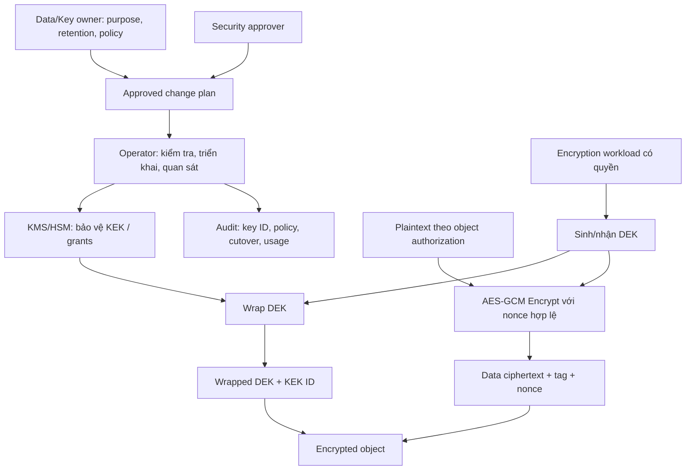
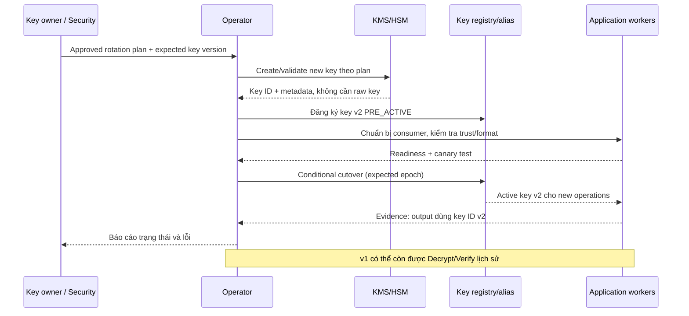

# Operator responsibility: trách nhiệm của người vận hành trong quản lý khóa mật mã

> **Chương:** Vai trò và trách nhiệm  
> **Module:** SECURITY_KEY_MANAGEMENT_FUNDAMENTALS

Trong một hệ thống bảo mật, việc lựa chọn AES-GCM, RSA-PSS, Ed25519, KMS hoặc HSM chỉ giải quyết **một phần** bài toán. Khóa vẫn có thể bị dùng sai, mất khả năng khôi phục hoặc bị lộ nếu người vận hành (operator) cấp quyền quá rộng, bỏ qua phê duyệt, xóa key còn dữ liệu phụ thuộc, bật lại key đã bị compromise hoặc vô tình ghi secret vào log.

**Operator responsibility** là tập trách nhiệm của cá nhân, nhóm hoặc workload được giao **thực thi và giám sát hoạt động vận hành khóa** theo chính sách được phê duyệt. Trách nhiệm đó bao gồm: xác minh điều kiện trước thay đổi, triển khai tác vụ đúng quyền và phạm vi, bảo đảm tính liên tục của dịch vụ mật mã, ghi bằng chứng, phát hiện sai lệch, phối hợp ứng phó sự cố và bàn giao trạng thái có thể kiểm chứng.

Operator không đồng nghĩa với người **sở hữu dữ liệu**, người **phê duyệt rủi ro** hay người **giữ toàn bộ khóa bí mật**. Một hệ thống an toàn cần ranh giới quyền và trách nhiệm rõ ràng giữa các vai trò; sự phân chia chính xác tùy quy mô, mô hình quản trị và năng lực KMS/HSM của tổ chức.

Bài học thuộc phạm vi **SECURITY_KEY_MANAGEMENT_FUNDAMENTALS**: quản lý vòng đời khóa từ **tạo → cấp phát → lưu trữ → sử dụng → xoay vòng → thu hồi → hủy**, gắn với mật mã đối xứng, bất đối xứng, chữ ký số, KMS/HSM, envelope encryption, kiểm soát truy cập và kiểm toán.

Sau bài học, bạn có thể:

- Xác định **operator chịu trách nhiệm làm gì, không được tự quyết định gì** và phối hợp với những vai trò nào.
- Áp dụng **least privilege, separation of duties, dual control, four-eyes, break-glass** và quản lý đặc quyền tạm thời.
- Lập runbook vận hành **DEK/KEK, private signing key, HMAC key, KEM key**, chính sách cấp quyền và vòng đời khóa.
- Giải thích trách nhiệm kiểm tra **key inventory, cryptoperiod, key version, phụ thuộc dữ liệu, khả năng khôi phục** trước rotation hoặc destruction.
- Thiết kế audit và giám sát giúp chứng minh **ai đã làm gì, trên key nào, theo phê duyệt nào và kết quả thực tế ra sao**.
- Phân loại hành động trong sự cố **lộ key material, lạm dụng quyền Sign/Decrypt, sai IAM, nonce reuse hoặc KMS outage**.
- Đọc ví dụ Java 17 minh họa việc kiểm tra điều kiện và approvals của một thay đổi khóa; hiểu vì sao demo **không thay thế** cơ chế authorization/KMS production.

## 1. Operator là ai trong hệ thống quản lý khóa?

**Key operator** là chủ thể được ủy quyền **thực hiện thao tác vận hành** trong phạm vi định nghĩa. Đây có thể là một kỹ sư thuộc đội platform/security operations, một operator của HSM, một người trực on-call hoặc một **pipeline/workload identity** dùng cho rotation tự động.

Ví dụ nhiệm vụ một operator:

- Xác nhận một KMS key object đã sẵn sàng và policy không lệch chuẩn.
- Thực thi rotation đã được phê duyệt, theo dõi key ID thực tế trên bản ghi mới.
- Cấu hình hoặc thu hồi grant theo change ticket hợp lệ.
- Đối chiếu key inventory với KMS/HSM, cảnh báo các key không có owner hoặc hết cryptoperiod.
- Thực hiện restore test và kiểm chứng dữ liệu cũ còn giải mã được.
- Trong sự cố, thực hiện thao tác containment thuộc runbook rồi bàn giao chứng cứ cho incident commander.

Những việc **không tự động** thuộc quyền operator:

- Tự quyết định mọi key cần được hủy, bất kể owner và retention.
- Tự phê duyệt việc export private key hay bỏ kiểm soát hai người.
- Dùng quyền vận hành để đọc plaintext khách hàng hoặc ký nghiệp vụ thay người có thẩm quyền.
- Sửa audit log để “dọn cảnh báo” hoặc thay đổi key creation time cho phù hợp báo cáo.
- Khẳng định hệ thống đạt mức bảo mật cụ thể chỉ vì công cụ KMS hiển thị key là `Enabled`.

**Một cá nhân có thể giữ nhiều vai trò trong tổ chức nhỏ**, nhưng phải xác định rõ những nhiệm vụ nào cần **kiểm soát độc lập** và hành động nào không được tự phê duyệt. Không thể xem tên chức danh là bằng chứng đủ quyền.

### 1.1. Responsibility, authority, accountability khác nhau

| Khái niệm | Câu hỏi chính | Ví dụ |
|---|---|---|
| **Responsibility — trách nhiệm thực thi** | Ai thực hiện và kiểm tra bước vận hành? | Operator áp dụng grant, chạy canary, theo dõi lỗi |
| **Authority — thẩm quyền** | Ai được phép ra quyết định hoặc cấp quyền? | Security approver cho phép kích hoạt private signing key |
| **Accountability — chịu trách nhiệm cuối** | Ai chịu trách nhiệm về chính sách và kết quả? | Key owner chịu trách nhiệm mục đích, cryptoperiod, rủi ro |
| **Evidence — chứng cứ** | Làm sao biết việc thực thi đúng? | Approval ID, audit event, key ID, test decrypt/verify, epoch |

Operator có thể chịu trách nhiệm **thực hiện một kế hoạch**, nhưng trách nhiệm cuối đối với **mục đích sử dụng khóa và mức rủi ro chấp nhận được** thường thuộc key owner hoặc chủ thể quản trị đã được chỉ định.

## 2. Bản đồ vai trò: operator phải phối hợp với ai?

| Vai trò | Trách nhiệm thường gặp | Ranh giới quan trọng |
|---|---|---|
| **Key owner / system owner** | Xác định purpose, dữ liệu phụ thuộc, retention, mức rủi ro, thời hạn dùng | Không nhất thiết được xuất private key |
| **Security approver / policy owner** | Phê duyệt algorithm, key usage policy, quyền nhạy cảm và ngoại lệ | Không tự đồng nghĩa quyền dùng key |
| **Key custodian / HSM custodian** | Giữ/khôi phục phần vật liệu khóa theo thủ tục, dual control khi áp dụng | Không tự phê duyệt giao dịch nghiệp vụ |
| **Key operator / platform operations** | Thực thi runbook, cấu hình, cutover, monitoring, rollback có kiểm soát | Không tự phê duyệt mọi tác vụ nguy hiểm |
| **Application owner / data owner** | Phân loại dữ liệu, xác minh object authorization, kiểm thử nghiệp vụ | Không được tự dùng key của tenant khác |
| **Crypto service / workload identity** | Gọi Encrypt/Decrypt, Sign, Wrap/Unwrap theo quyền cụ thể | Không có quyền sửa/hủy key theo mặc định |
| **Auditor / compliance reviewer** | Kiểm tra metadata, approvals, key access, correction history | Không cần raw secret/Decrypt/Sign để audit |
| **Incident commander / security responder** | Quyết định phạm vi và thứ tự ứng phó khi xảy ra sự cố | Cần phối hợp owner trước hành động phá hủy khó đảo ngược |

Tên vai trò ở mỗi công ty có thể khác nhau. Nhiều HSM phân tách **Security Officer, Crypto Officer, User**; KMS cloud thường cung cấp IAM/resource policies và service roles. Điều quan trọng là **quyền hiệu lực thực tế** phải khớp với trách nhiệm, không phải chỉ đặt tên tài khoản đẹp.

### 2.1. RACI minh họa cho một số hoạt động

Trong bảng sau:

- **R (Responsible):** thực hiện công việc.
- **A (Accountable):** chịu trách nhiệm kết quả và chấp thuận hướng đi.
- **C (Consulted):** được tham vấn.
- **I (Informed):** được thông báo.

| Hoạt động | Key owner | Security approver | Operator | App/data owner | Auditor |
|---|---|---|---|---|---|
| Định nghĩa purpose/cryptoperiod | **A** | C | C | **R** | I |
| Đánh giá key policy và thuật toán | C | **A/R** | C | C | I |
| Tạo key đã được phê duyệt | A | C | **R** | I | I |
| Kích hoạt/cutover key version | **A** | C | **R** | C | I |
| Kiểm thử Decrypt/Verify lịch sử | A | I | R | **R** | I |
| Rotation theo lịch | **A** | C | **R** | C | I |
| Hủy vật liệu khóa sau retention | **A** | C | **R** | C | I |
| Kiểm tra audit và bằng chứng | C | A | C | C | **R** |
| Xử lý key compromise | A theo phạm vi | **R** | **R** containment | C/R recovery | I |

Bảng **chỉ là ví dụ tổ chức**; một hoạt động nên có **một đầu mối A rõ ràng**. Với sự cố nghiêm trọng, incident commander có thể chịu trách nhiệm điều phối cao nhất theo quy trình riêng, thay vì gán cứng “key owner quyết định mọi thứ”.

### 2.2. Operator và key custodian có phải một không?

Không mặc định. **Custodian** có thể tham gia giữ key share, khôi phục vật liệu trong HSM hoặc thực hiện nghi thức M-of-N. **Operator** có thể chỉ định tuyến alias, kiểm tra trạng thái, chạy job rotation, theo dõi monitoring mà **không bao giờ nhìn thấy raw key**.

Thiết kế tốt thường cho phép nhiều hoạt động thường ngày chỉ cần **key handle, key ID, trạng thái, policy version**, không cần export vật liệu bí mật. Quyền custodian càng nhạy cảm càng cần thủ tục và giám sát độc lập.

## 3. Nền tảng trách nhiệm: least privilege và separation of duties

**Least privilege (ít quyền nhất)**: chỉ cấp những quyền cần thiết cho công việc, trên đúng key ID, đúng phép toán và trong thời hạn cần thiết.

**Separation of duties (SoD — tách nhiệm vụ)**: phân chia những hành động dễ tạo xung đột lợi ích hoặc quyền lực quá lớn, ví dụ **đề nghị → phê duyệt → thực hiện → kiểm toán**.

**Dual control/four-eyes**: những thao tác nguy hiểm cần **sự tham gia/phê duyệt độc lập** của tối thiểu hai người hoặc chủ thể khác nhau theo chính sách. Đây là kiểm soát tổ chức hoặc kỹ thuật; một “approval” do cùng actor tự cấp không đạt mục tiêu độc lập.

### 3.1. Ma trận quyền tối thiểu theo nhóm thao tác

| Nhóm thao tác | Operator thường có thể cần | Nên tách/cấm theo mặc định |
|---|---|---|
| **Key metadata** | Describe/List key, đọc key usage, policy version và trạng thái | Đọc raw private key/KEK/DEK |
| **Key creation** | Gọi KeyGen trong phạm vi kế hoạch đã phê duyệt | Tự tạo key ngoài policy/algorithm allowlist |
| **IAM/grants** | Áp dụng grant đã có approval và policy validation | Tự cấp admin quyền Export/Decrypt trên mọi key |
| **Lifecycle** | Kích hoạt/retire/rotate theo runbook | Hủy ngay key còn dữ liệu phụ thuộc |
| **Runtime use** | Test bằng dữ liệu kiểm thử và key ID được phép | Decrypt dữ liệu khách hàng không có object authorization |
| **Signing operations** | Kiểm tra Sign service, audit, public key trust | Tự ký hóa đơn/lệnh thanh toán tùy ý |
| **Audit/logs** | Đọc telemetry cần cho vận hành | Sửa/xóa chứng cứ hoặc log secret để debug |
| **Emergency action** | Containment theo break-glass/incident authorization | Giữ đặc quyền khẩn cấp vĩnh viễn |

### 3.2. Role-based và attribute-based controls

- **RBAC:** quyền gắn theo role như `kms-key-operator`, `signing-service` hoặc `key-auditor`.
- **ABAC:** quyền còn phụ thuộc thuộc tính như environment, tenant, project, purpose, key tags, loại dữ liệu và trạng thái của request.
- **Resource/key policies:** có thể ràng buộc quyền trên **một key object** và điều kiện provider hỗ trợ.
- **Application authorization:** kiểm tra caller có quyền trên **invoice, user account hoặc object** cụ thể hay không.

Operator phải hiểu **effective permissions** là kết quả của các lớp đó. Không thể chỉ nhìn một file IAM và kết luận mọi đường sử dụng key đều bị khóa; có thể tồn tại grants cũ, service account phụ, nhóm admin hoặc đường gọi trực tiếp KMS.

### 3.3. Non-exportable không có nghĩa không thể bị lạm dụng

Một HSM có thể giữ private signing key non-exportable. Nếu workload bị chiếm có quyền `Sign` cho **digest tùy ý**, attacker vẫn tạo chữ ký hợp lệ mà không cần lấy raw private key.

Tương tự, một principal có quyền `Decrypt`, `UnwrapKey` hoặc `Decapsulate` có thể được sử dụng như **oracle giải mã**. Operator phải giới hạn quyền theo **action, key ID và ngữ cảnh nghiệp vụ**, đồng thời giám sát usage bất thường.

## 4. Bốn nguyên tắc operator phải duy trì

### 4.1. Không tự ý xuất hoặc tiếp xúc với vật liệu khóa

Nguyên tắc mặc định: **operator làm việc với key references**, không với raw AES DEK, HMAC key, KEK, KEM private key hoặc private signing key.

Nếu quy trình phải import/backup/restore key material, cần sử dụng **cơ chế wrap/secure transport, HSM ceremony, dual control hoặc threshold procedure** thích hợp. Tránh copy raw key qua clipboard, email, ticket, chat hoặc terminal log.

### 4.2. Mọi thay đổi phải có identity và approval rõ

Trước khi chạy một lệnh thay policy, operator cần biết:

- Ai yêu cầu và **ai phê duyệt**?
- Key ID/ARN/handle nào, ở account/project/region/tenant nào?
- Phép toán, algorithm, key purpose và **trạng thái hiện tại**?
- Thay đổi áp dụng cho key mới hay dữ liệu/chữ ký lịch sử?
- Có phương án **khôi phục an toàn** nếu lỗi không?
- Bằng chứng thực thi sẽ lưu ở đâu?

Không dùng một ticket chung “cho phép thao tác KMS” làm ủy quyền vĩnh viễn cho mọi key.

### 4.3. Kiểm tra trước, xác minh sau

Không đánh dấu hoàn thành chỉ vì API trả HTTP thành công. Sau khi đổi alias hoặc key policy, operator cần kiểm tra **đường sử dụng thực tế**: bản ghi mới gắn key version đúng không; các consumer có Verify được chữ ký; legacy Decrypt còn chạy; có request bị Denied ngoài dự kiến hay không.

### 4.4. Mọi thao tác phải có thể truy vết

Audit tối thiểu cần **actor/workload identity, key ID/version, action, thời gian, approval ID, policy version, request/correlation ID, trạng thái trước/sau và kết quả**. Không đưa key material hoặc plaintext khách hàng vào log.

Một hành động thiếu log có thể đã thành công về mặt kỹ thuật nhưng **không đủ bằng chứng vận hành an toàn** theo chính sách.

## 5. Trách nhiệm khi tạo, nhập và đăng ký khóa

### 5.1. Tạo khóa (KeyGen)

Trước khi tạo khóa, operator cần xác minh:

1. **Purpose**: mã hóa dữ liệu, wrap DEK, ký số, HMAC, KEM, key agreement hay một mục đích khác.
2. **Thuật toán và parameter set**: AES-256, RSA-PSS, Ed25519, X25519, ML-KEM-768… phải đúng bản thiết kế.
3. **Nguồn ngẫu nhiên**: KeyGen dùng CSPRNG/nguồn HSM được phê duyệt, không tự tạo seed từ thời gian/PID.
4. **Exportability**: key có cần non-exportable không; HSM/keystore có cưỡng chế đúng ngay từ khi tạo không.
5. **Cryptoperiod**: thời điểm kích hoạt, ngừng new-use, khả năng Decrypt/Verify lịch sử và thời hạn retention.
6. **Owner và inventory**: key ID/version, environment, tenant, source/provenance, createdAt và policy ID.

Với HSM, nhiều thuộc tính có thể **không sửa được sau KeyGen**. Nếu tạo sai key type, không nên “sửa” bằng nhãn ứng dụng mà phải đánh giá **tạo key mới đúng policy**.

### 5.2. Import/BYOK: thời gian nhập khác thời gian sinh

Một key được import từ HSM cũ vào KMS mới không tự trở thành **key material mới**. Operator phải ghi riêng:

```text
keyObjectCreatedAt  = thời điểm tạo resource đích
materialGeneratedAt = thời điểm KeyGen gốc, nếu có chứng cứ
materialImportedAt  = thời điểm import vào provider hiện tại
origin              = IMPORTED
sourceSystem        = legacy-hsm / nguồn được xác minh
```

Nếu không biết `materialGeneratedAt`, ghi **UNKNOWN** thay vì lấy ngày import để đánh giá key age. Operator cũng cần kiểm tra **hạn sử dụng của imported material, quyền được restore, nguồn key wrapping và cách tránh lưu bản sao raw key**.

### 5.3. Đăng ký inventory không phải kích hoạt

Một key object được tạo và đăng ký trong inventory có thể vẫn ở trạng thái **PRE_ACTIVE**. Operator cần hoàn thành preflight, phê duyệt và kiểm tra quyền runtime trước khi key tham gia phép toán sản xuất.

Các trường cơ bản nên có:

| Nhóm | Metadata hữu ích |
|---|---|
| **Identity** | Provider key ID/handle, logical name, material version khi có |
| **Ownership** | Owner service/team, environment, tenant/project |
| **Cryptography** | Key type, algorithm, parameter set, allowed operations |
| **Provenance** | Generated/imported/restored, time source, event ID |
| **Lifecycle** | Pre-active, active, retired/disabled, compromised, pending deletion |
| **Dependencies** | Dữ liệu/DEK/chữ ký/certificate còn phụ thuộc |
| **Governance** | Policy version, approval ID, audit correlation, backup/retention |

**Không dùng createdAt làm key ID**; nhiều key có thể được tạo cùng thời điểm, và provider có thể rotate material trong một logical key object.

## 6. Trách nhiệm khi kích hoạt và cấp quyền sử dụng khóa

**Activate** là đưa khóa vào phạm vi **được phép thực hiện một hành động mật mã theo chính sách**. Nó khác với `Create`, `Import`, `Enable` và `Publish public key`.

Operator phải phân biệt:

- **Provider state:** KMS/HSM hiện chấp nhận phép toán trên key object không?
- **Application lifecycle state:** ứng dụng có được chọn key cho **new operations** không?
- **Key usage policy:** principal nào được dùng key, cho purpose/tenant/object nào và tới mốc nào?
- **Trust readiness:** verifier/recipient đã nhận public key/certificate mới qua nguồn đáng tin chưa?

### 6.1. Preflight trước Activate

| Điều kiện | Chứng cứ cần có |
|---|---|
| Key spec/algorithm đúng | KMS/HSM DescribeKey/metadata hoặc kiểm tra tương đương |
| Owner, purpose, environment đúng | Registry record + approval |
| Key policy/IAM tối thiểu | Effective-permission review, negative tests |
| Khả năng Encrypt/Decrypt hoặc Sign/Verify | Test tích hợp với dữ liệu kiểm thử |
| KMS quota, latency và monitoring | Dashboard/test KMS/HSM API |
| Public key/certificate trust (nếu cần) | Verifier readiness hoặc kế hoạch rollout |
| Legacy record compatibility | Kiểm thử Decrypt/Verify key cũ |
| Rollback và dữ liệu phát sinh sau cutover | Kế hoạch giữ key IDs/version cho output |

### 6.2. Trạng thái Enabled không đủ

Nếu KMS key `Enabled` nhưng registry ghi `PRE_ACTIVE`, một workload có IAM `Encrypt` trực tiếp vẫn có thể sử dụng key **nếu cơ chế KMS không cưỡng chế cờ ứng dụng**. Operator không được coi trạng thái ứng dụng là bảo đảm chặn mọi đường gọi.

### 6.3. Khi phát hành khóa ký số

Khi kích hoạt private key để `Sign`, operator phải xác nhận:

- Public key/certificate hoặc JWKS mới đã được **phân phối qua nguồn tin cậy**.
- Verifier biết mapping **issuer → key ID/algorithm** và quy tắc xác minh.
- Signer chỉ ký **đúng purpose/nội dung đã được phê duyệt**, không nhận digest tùy ý từ client không đáng tin.
- Key cũ vẫn được dùng **Verify lịch sử** trong khoảng thích hợp, trừ khi compromise yêu cầu thu hồi khẩn.

**Chữ ký hợp lệ về mặt toán học không bảo đảm giao dịch đã được phê duyệt hoặc issuer được tin.**

## 7. Trách nhiệm vận hành DEK/KEK và envelope encryption

**Envelope encryption** dùng một **DEK (data-encryption key)** để mã hóa dữ liệu và một **KEK (key-encryption key)** để wrap/bảo vệ DEK. Đây là lớp phân tách quan trọng: operator quản lý KEK không tự động có quyền **đọc nội dung** của mọi bản ghi dùng KEK đó.



### 7.1. Ranh giới quyền của operator đối với DEK

Đối với DEK được tạo cho từng object:

- Operator nên quản lý **quy tắc cấp khóa, thuật toán, nonce budget, lifecycle và monitor**, không cần thấy raw DEK.
- Workload mã hóa có thể nhận raw plaintext DEK trong thời gian ngắn nếu API yêu cầu, nhưng cần tránh log/dump hoặc phát tán qua kênh ngoài thiết kế.
- Metadata bản ghi phải giữ **key ID/version, wrapped DEK, nonce, tag, AAD cần thiết** để giải mã về sau.
- Những lần mã hóa độc lập dưới cùng DEK phải tuân thủ ràng buộc nonce của AEAD; với AES-GCM, **không được dùng trùng cặp (key, nonce)**.
- Khi một writer dùng chung DEK với nhiều node, **tổng phép mã hóa của tất cả node** phải nằm trong ngân sách được chấp nhận.

Operator không được giải quyết lỗi nonce reuse bằng cách **rotate KEK nhưng giữ nguyên DEK bị ảnh hưởng** rồi tuyên bố an toàn. Lỗi nằm ở cặp DEK/nonce của ciphertext; có thể cần sinh DEK mới và mã hóa lại dữ liệu theo quy trình sự cố.

### 7.2. Ranh giới quyền đối với KEK

KEK có thể bảo vệ hàng nghìn hoặc hàng triệu DEK, nên ảnh hưởng khi bị lộ hoặc quyền `Unwrap/Decrypt` bị lạm dụng là rất lớn. Operator cần:

- Giới hạn **key ID, principal, operation, tenant/environment** cho các API KMS.
- Tách **key administrators** khỏi **data readers/decryptors** nếu mô hình quản trị yêu cầu.
- Kiểm tra **encryption context/AAD** và mapping dữ liệu theo tenant ở tầng đáng tin; không chỉ chấp nhận context do caller tự khai.
- Giám sát spike `Decrypt`, `UnwrapKey`, `GenerateDataKey` theo principal và phạm vi.
- Có kế hoạch **rewrap** DEK khi rotate KEK và bảo đảm dữ liệu lịch sử còn đọc được.

### 7.3. Rewrap, reencrypt và rotate không phải một thao tác

| Thao tác | Thay đổi gì? | Điều không tự thay đổi |
|---|---|---|
| **Rotate KEK** | Material/version dùng wrap mới | DEK đã dùng trước đó và data ciphertext |
| **Rewrap DEK** | Wrapped DEK và metadata KEK | Raw DEK/data ciphertext có thể giữ nguyên |
| **Rotate DEK + reencrypt** | DEK, data ciphertext, nonce/tag và key metadata | Giá trị nghiệp vụ sau kiểm tra có thể không đổi |
| **Đổi alias key** | Tuyến lựa chọn key cho yêu cầu mới | Bản ghi cũ không tự mã hóa lại |

Operator phải xác định **mục tiêu thay đổi** từ owner/security plan, thay vì đánh đồng “rotation hoàn thành” với việc đặt alias trỏ sang key mới.

## 8. Trách nhiệm trong rotation và cutover key version

**Rotation** là quá trình đưa vật liệu/phiên bản khóa mới vào sử dụng và dần ngừng dùng khóa cũ theo mục đích. Với hệ thống đa vùng, đây là **thao tác phân tán**, không chỉ một API.

### 8.1. Mẫu quy trình Prepare → Publish → Cutover → Observe



**Trước cutover**, operator kiểm tra chính xác:

1. Key mới có algorithm, parameter set, purpose và provider key usage đúng?
2. Runtime role được quyền dùng key mới, không rộng hơn cần thiết?
3. Public key/JWKS/certificate của signer hoặc recipient đã được các bên tin?
4. Có record format và **key ID/version trong output** để phân biệt dữ liệu mã hóa/ký cũ mới?
5. Có thử **Decrypt/Verify dữ liệu cũ** và **new-key round-trip**?
6. KMS quota, region availability, alias/cache propagation và alarms đã được kiểm tra?
7. Có approval, expected epoch và điều kiện rollback an toàn?

### 8.2. Cutover và consistency nhiều node

Đối với cluster nhiều writer, alias hoặc registry cập nhật không đồng nghĩa tất cả node đã dùng key mới. Operator cần quan sát **key ID thực tế trên ciphertext/chữ ký mới**, không chỉ một cờ `currentKey=v2`.

Nếu policy bắt buộc mọi new-use dùng v2 kể từ epoch 45, những writer còn epoch 44 có thể phải **ngừng ghi mới** hoặc chạy trong một **overlap window được phê duyệt**. Không thể mặc định mỗi node đọc được trạng thái mới cùng thời điểm.

### 8.3. Rollback có giới hạn

Giả sử v2 gây lỗi khi Decrypt các record vừa tạo. Rollback tuyến new-use về v1 có thể chấp nhận **nếu v1 còn an toàn và vẫn thuộc cryptoperiod được phép**. Tuy nhiên:

- Bản ghi đã mã hóa bằng v2 vẫn cần key v2 để đọc, không được sửa metadata thành v1.
- Nếu v2 bị compromise hoặc nonce reuse nghiêm trọng, phải xử lý như sự cố mật mã, không chỉ giảm traffic.
- Nếu **v1 đã compromise**, tuyệt đối không cho Sign/Encrypt mới bằng v1 chỉ để cứu tính tương thích.
- Operator không thể tự “hợp thức hóa” rollback vượt policy bằng một thay đổi không được phê duyệt.

## 9. Ngừng dùng, thu hồi, vô hiệu hóa và hủy: trách nhiệm đặc biệt quan trọng

Các thao tác **retire, revoke, disable, destroy** có ảnh hưởng khác nhau, phải được tách rõ:

| Thao tác | Ý nghĩa vận hành | Rủi ro cần xét |
|---|---|---|
| **Retire for new use** | Ngừng tạo ciphertext/signature/MAC mới bằng key | Dữ liệu cũ có thể vẫn cần Decrypt/Verify |
| **Revoke grants/permissions** | Ngừng một principal dùng key | Key vẫn tồn tại; nếu raw bytes đã lộ, quyền bị rút không thu hồi bản sao |
| **Disable key object** | Provider chặn một số hoặc toàn bộ phép toán | Có thể chặn **cả Decrypt/Unwrap lịch sử** |
| **Revoke certificate/trust** | Bên xác minh ngừng tin theo chính sách | Có thể ảnh hưởng chứng thư/chữ ký lịch sử tùy ngữ cảnh |
| **Schedule deletion** | Lên lịch hủy key theo cơ chế provider | Nếu phụ thuộc chưa được xử lý, mất khả năng khôi phục |
| **Destroy key material** | Hủy vật liệu theo quy trình | Ciphertext phụ thuộc không thể mở nếu không có key/đường thay thế |

**Ngừng tạo dữ liệu mới không nhất thiết đồng nghĩa ngừng giải mã dữ liệu cũ.** Một key retired khỏi Encrypt có thể còn dùng Decrypt cho tới khi migration/retention hoàn tất. Một public verification key có thể còn cần để Verify chữ ký lịch sử dù private signing key đã ngừng Sign.

### 9.1. Trước khi hủy, operator phải chứng minh gì?

Checklist phá hủy:

- Key ID/version, material type và **owner** đã xác định.
- Approval cho hành động **khó/không thể đảo ngược** đã có, đúng separation of duties.
- Đã kiểm tra **ciphertext, wrapped DEK, KEM encapsulation, chữ ký và backup** phụ thuộc key.
- Có bằng chứng migration/rewrap/reencrypt hoặc đã hết retention hợp pháp.
- Có kiểm thử restore/decrypt/verify bằng đường mới đối với dữ liệu còn giữ.
- Đã xem xét DR site, replica, HSM backups, imported material copies và key escrow.
- Có audit/change ticket; đã kiểm tra provider deletion semantics.

Một lệnh API xóa key thành công **không chứng minh mọi bản sao key trên máy cũ đã được hủy**. Ngược lại, key chỉ bị disable trong provider **không đồng nghĩa key material đã bị hủy**.

### 9.2. Nếu key bị compromise

Khi private key, DEK, KEK hoặc HMAC secret đã lộ, operator **không tự bật lại key** sau khi reset credential của workload. Phải phối hợp đội security/owner để:

1. Chặn new-use/thu hồi quyền bị chiếm.
2. Đánh giá phạm vi dữ liệu, bản ghi, chữ ký, tokens và các bản sao vật liệu đã lộ.
3. Tạo key/trust mới và migrate/reencrypt theo rủi ro.
4. Cân nhắc revoke tokens/certificates hoặc xử lý dữ liệu đã bị đọc/giả mạo.
5. Duy trì bằng chứng cho điều tra và chỉ hủy theo quy trình được duyệt.

**Không có API nào thu hồi lại plaintext đã bị sao chép hoặc private key bytes đã rò rỉ.**

## 10. Backup, escrow, restore và disaster recovery

Một nhiệm vụ cốt lõi của vận hành khóa là cân bằng hai nguy cơ:

- **Lộ khóa** vì quá nhiều bản sao, quyền lưu trữ rộng hoặc cơ chế backup yếu.
- **Mất dữ liệu vĩnh viễn** vì không thể khôi phục khóa dùng mã hóa bản ghi còn retention.

### 10.1. Sao lưu đúng đối tượng

Với hệ thống dùng KMS/HSM, backup có thể là backup **metadata/policy, key hierarchy, wrapped DEK, key handles hoặc bản sao key material được bảo vệ** theo chức năng provider. Không phải mọi key non-exportable đều có thể đem backup sang nơi khác; khả năng restore tùy nguồn sinh, key type, chính sách và dịch vụ.

Operator cần hiểu rõ:

- Key nào **được provider quản lý backup** và giới hạn khôi phục/cross-region của nó.
- Key nào là **imported key material**, phải có nguồn/escrow hợp pháp riêng.
- Bản wrapped DEK cần **KEK** và metadata phiên bản nào để unwrap.
- Restore thành công ở DR region có thể dùng cùng material hay là key object mới; cần giữ key ID mapping.
- Các phiên bản khóa **retired** vẫn có thể cần để mở backup cũ.

### 10.2. Dual control và M-of-N

Đối với nghi thức khôi phục key quan trọng, tổ chức có thể dùng **M-of-N key shares / threshold controls**: cần tối thiểu \(M\) trong \(N\) người giữ các phần thông tin riêng biệt theo một cơ chế được thiết kế đúng.

**Không đồng nhất**:

- **Two-person approval:** hai người phê duyệt yêu cầu.
- **Dual control:** thao tác kỹ thuật đòi hỏi sự tham gia độc lập.
- **M-of-N secret sharing:** phân chia vật liệu/khả năng khôi phục thành các phần theo thuật toán.

Hai người cùng biết **một mật khẩu HSM root dùng chung** không tự trở thành M-of-N và không đạt mục tiêu bảo vệ khỏi một người sao chép mật khẩu.

### 10.3. Restore test phải kiểm tra end-to-end

Một test restore chỉ báo “KMS key object tồn tại” chưa đủ. Kiểm thử nên xác minh:

1. Key đúng algorithm, ID/version và purpose có khả dụng.
2. Một bản ghi thử có **wrapped DEK + ciphertext + nonce/tag/AAD** từ backup có thể Decrypt đúng.
3. Dữ liệu/chữ ký legacy vẫn được xử lý theo policy, không cần mở quyền admin quá rộng.
4. IAM và workload identity ở DR đúng phạm vi, không tự cho mọi service khả năng Unwrap.
5. Audit ghi được hoạt động restore và sử dụng key test, không chứa raw secret.
6. Quy trình không phá dữ liệu production và không làm phát sinh trùng nonce/counter nếu khôi phục trạng thái cũ.

### 10.4. Snapshot và bộ sinh ngẫu nhiên

Clone VM/container mang theo trạng thái RNG/nonce counter **có thể** tạo lại cùng chuỗi hoặc lặp counter trong một số thiết kế. Operator phải đánh giá khả năng **fork/restore safety** của runtime, không tự giả định mọi hệ điều hành/JVM đều mắc lỗi hoặc đều xử lý đúng mọi loại snapshot.

Nếu không chứng minh được an toàn của trạng thái nonce/DRBG sau restore, phải **khởi tạo lại đúng cách hoặc cấp key mới cho encrypt tiếp theo** theo policy. Việc restore cùng DEK nhưng đưa counter về 0 có thể dẫn tới reuse nonce AES-GCM nguy hiểm.

## 11. Trách nhiệm kiểm kê, cryptoperiod và quản lý phụ thuộc

**Key inventory** là căn cứ để operator biết những khóa nào tồn tại, ở đâu, thuộc ai, có material version nào và có được phép dùng tiếp không.

### 11.1. Các metadata quan trọng

| Trường | Operator dùng để làm gì? |
|---|---|
| **Key ID / provider handle** | Chọn đúng key, không dựa vào alias mơ hồ |
| **Material version / algorithm** | Xác định ciphertext/chữ ký phụ thuộc phiên bản nào |
| **Owner / purpose / tenant / environment** | Kiểm soát phạm vi và đưa đúng người vào vòng phê duyệt |
| **Created/generated/importedAt** | Đánh giá tuổi material và provenance, tránh nhầm ngày import là KeyGen |
| **Activated / stopNewUse / retiredAt** | Kiểm tra cryptoperiod tạo output mới |
| **Last observed usage** | Phát hiện workload còn dùng key cũ; chỉ là quan sát nếu audit không đầy đủ |
| **Policy/grant reference** | Đối soát effective permissions |
| **Dependent data / backups / public trust** | Quyết định migration trước disable/destroy |
| **Evidence / approval / audit IDs** | Khôi phục timeline và kiểm tra thay đổi |

### 11.2. Cryptoperiod không đồng nhất tuổi khóa

Một key có thể được tạo trước khi Activate hàng tháng. Để đánh giá đúng, cần phân biệt:

- **Key material age:** tính từ KeyGen thực nếu có chứng cứ.
- **Originator-use period:** thời gian key được phép tạo ciphertext/signature/MAC mới.
- **Recipient-use period:** thời gian cần Decrypt/Verify output cũ.

Nếu không biết thời điểm KeyGen gốc của một imported key, ghi **UNKNOWN** và đưa vào review; không tự điền ngày import thành material creation để báo cáo “key còn mới”.

### 11.3. Không dựa duy nhất vào tuổi khóa để hủy

DEK mới có thể gặp reuse nonce ngay hôm nay; private key ký cũ có thể còn cần cho Verify lịch sử dù đã retire. Operator phải xét **thuật toán, key budget, provenance, trạng thái compromise, retention và dữ liệu phụ thuộc**, không chỉ `now - createdAt`.

## 12. Giám sát, kiểm toán và bàn giao ca trực

Operator chịu trách nhiệm đảm bảo **tín hiệu vận hành** giúp phát hiện việc sử dụng key ngoài dự kiến, không chỉ lỗi KMS API.

### 12.1. Những tín hiệu cần theo dõi

| Tín hiệu | Câu hỏi vận hành |
|---|---|
| Sign/GenerateMac tăng đột biến | Có signing/MAC oracle hoặc workload bị chiếm không? |
| Decrypt/Unwrap/Decapsulate tăng bất thường | Có truy cập dữ liệu trái phép hoặc batch job sai phạm vi không? |
| Key policy/grant thay đổi ngoài change window | Ai mở quyền, có phê duyệt không? |
| Writer còn dùng key retired cho Encrypt mới | Cache/alias drift hay đường KMS trực tiếp? |
| Lỗi AEAD tag/AAD tăng | Metadata sai, ciphertext bị sửa hay key mismatch? |
| Nonce/key budget gần ngưỡng | Có cần rotate/split DEK trước giới hạn không? |
| KMS/HSM latency/quota/availability suy giảm | Dịch vụ có cần giảm tải/circuit breaker/DR theo runbook không? |
| Key thiếu owner hoặc provenance | Ai sẽ xử lý và phê duyệt quyết định về key? |
| Legacy decrypt vẫn phụ thuộc key sắp xóa | Còn bao nhiêu object chưa migrate? |
| Trust/JWKS/certificate propagation lỗi | Verifier có từ chối signature mới không? |

### 12.2. Audit event ví dụ

```json
{
  "eventType": "KEY_OPERATOR_ACTION",
  "timestamp": "2026-11-28T09:10:00Z",
  "operatorIdentity": "platform-key-operator-prod",
  "operation": "ACTIVATE_KEY_VERSION",
  "logicalPurpose": "orders-data-encryption",
  "keyId": "orders-dek-v13",
  "previousKeyId": "orders-dek-v12",
  "expectedEpoch": 42,
  "newEpoch": 43,
  "approvalId": "change-2026-184",
  "policyVersion": "orders-key-policy-v7",
  "environment": "production",
  "result": "SUCCESS",
  "verification": "CANARY_OK"
}
```

Đây là JSON minh họa. Audit production phải gắn với **nguồn danh tính đáng tin**, có quyền đọc/sửa hạn chế, bảo đảm đủ retention và xử lý độ trễ/lỗi gửi event. Không ghi raw secret, private key, session token hoặc dữ liệu khách hàng vào ticket/log.

### 12.3. Bàn giao ca trực

Một handoff tốt gồm:

- Key IDs/versions và tác vụ **đã thực hiện / đang chờ / bị chặn**.
- Change ticket/approval và **state/epoch hiện tại** của registry.
- Các cảnh báo đang mở, KMS quota, số key retired còn dùng và mốc sắp hết hạn.
- Lưu lượng nào đã cutover, vùng nào còn stale, cách xác nhận key ID thực tế.
- Những nhiệm vụ khẩn cần liên hệ owner/security/on-call.
- Đường rollback **được phép** và hành động **không được thực hiện** (ví dụ không bật lại compromised key).

Không ghi mật khẩu quản trị, HSM PIN hoặc raw key share trong thông điệp bàn giao. Cung cấp **vị trí quy trình/truy cập có kiểm soát** thay vì bí mật.

## 13. Nghi thức HSM, key custody và kiểm soát vật liệu khóa

Một số thao tác trên **root keys, master keys, key shares hoặc imported private keys** có yêu cầu vượt quá việc click API trong dashboard. Khi đó tổ chức có thể dùng **key ceremony**: quy trình có người chứng kiến, phương tiện được kiểm soát, nhiều vai trò độc lập, ghi nhận bằng chứng và đối chiếu kết quả.

### 13.1. Khi nào cần key ceremony?

Tùy chính sách và rủi ro, có thể xem xét cho:

- Tạo hoặc khôi phục **root of trust**, HSM master/wrapping key hoặc key có ảnh hưởng tổ chức.
- Thiết lập các phần khôi phục **M-of-N** và bàn giao quyền custodian.
- Import/restore key material nhạy cảm giữa HSM hoặc domain quản lý.
- Thay đổi HSM security domain, partition ownership, root credentials hoặc thiết lập trust.
- Thay thế các thiết bị có key vật liệu cần migrate dưới kiểm soát.

Không phải mọi DEK per-object đều cần nghi thức thủ công: automation có policy và audit là phù hợp cho nhiều khóa ngắn hạn. Nghi thức áp dụng theo **phạm vi bảo mật và khả năng kỹ thuật của sản phẩm**, không phải chỉ dựa vào việc khóa có tên “master”.

### 13.2. Việc operator cần chuẩn bị

| Trước buổi thao tác | Trong khi thao tác | Sau khi thao tác |
|---|---|---|
| Approval, danh sách participant và vai trò | Xác thực người tham gia và quyền thao tác | Kiểm tra key ID/attributes và kết quả |
| HSM health/firmware và cấu hình đã phê duyệt | Tuân thủ thứ tự bước, không bỏ qua chứng kiến | Cất giữ evidence ở nơi có quyền hạn chế |
| Kịch bản lỗi/khôi phục và điều kiện dừng | Ghi sự kiện, thời gian, kết quả không chứa raw secret | Kiểm tra phương án restore và tính khả dụng |
| Xác minh key material destination và thuật toán | Không để một người một mình gom đủ mọi key share nếu policy cấm | Đóng quyền tạm thời, kiểm kê vật tư/thiết bị |

Nếu nghi thức thất bại giữa chừng, operator cần **dừng ở trạng thái được định nghĩa trước**, không tự thử những thao tác có thể vô tình export hoặc hủy key. Mọi exception được phê duyệt phải được ghi lại.

### 13.3. Trách nhiệm khi HSM báo key không extractable

Thuộc tính `non-extractable` có thể hạn chế việc xuất raw key qua API thông thường. Nhưng cần hỏi:

1. Key có bản sao đã export/import trước đó không?
2. Có cơ chế backup hoặc key wrapping khác vẫn tạo được bản sao không?
3. Những principal nào có quyền **sử dụng key** để Sign/Decrypt/Unwrap?
4. Có API khôi phục/clone qua security domain không?
5. Khi xóa key trên một module, các replica/backup có còn không?

**Key material confidentiality** và **authorized key usage** là hai biên kiểm soát khác nhau. HSM không thay thế chính sách phê duyệt giao dịch, IAM hoặc giám sát nội dung đã ký.

## 14. On-call, break-glass và ứng phó khi có sự cố

Trong tình huống khẩn cấp, một operator có thể cần **quyền tạm thời** để ngăn tiếp tục khai thác, sửa tuyến KMS hoặc khôi phục khả năng giải mã. Nhưng break-glass không phải quyền admin vô hạn mà mọi người luôn có.

### 14.1. Thiết kế quyền break-glass

Một quy trình có thể gồm:

- **Trigger rõ:** KMS outage, nghi key compromise, thất bại rotation hoặc mất khả năng Decrypt dữ liệu quan trọng.
- **Danh tính riêng/JIT access:** quyền chỉ mở trong thời gian xác định, cho tập key và action hẹp.
- **Xác thực mạnh:** MFA hoặc điều kiện truy cập được tổ chức quy định.
- **Phê duyệt/ghi nhận độc lập:** với sự cố cần phản ứng tức thì, có thể cho phép hành động trước trong phạm vi tối thiểu rồi bắt buộc review sau, nếu policy cho phép.
- **Logging/giám sát:** mọi thao tác nhận quyền, cấp grant, sử dụng key, đổi alias và thu hồi quyền.
- **Auto-expiry:** quyền khẩn cấp được rút khi hết khoảng được phê duyệt hoặc khi incident kết thúc.

Không hard-code mật khẩu break-glass vào source, không chia sẻ qua nhóm chat không bảo vệ và không để một role khẩn cấp có quyền xóa mọi key sau khi sự cố đã kết thúc.

### 14.2. Nhận diện lỗi vận hành hay compromise

| Tình huống | Rủi ro chính | Phản ứng operator |
|---|---|---|
| **KMS AccessDenied** sau cutover | Sai IAM/grant/propagation | Đối chiếu effective access, không tự mở quyền wildcard |
| **KMS unavailable/quota exceeded** | Gián đoạn Encrypt/Decrypt/Sign | Giảm tải và áp dụng failover/DR đã duyệt, không đưa raw key ra ngoài để “tạm dùng” |
| **Private key đã lộ** | Attacker có thể Sign/Decrypt ngoài KMS | Ngừng new-use, thay key/trust, điều tra dữ liệu/chữ ký lịch sử |
| **Workload Sign bị chiếm, key không export được** | Signing oracle | Rút principal/grant/phiên, điều tra chữ ký đã được tạo |
| **Trùng AES-GCM nonce dưới cùng DEK** | Có thể phá confidentiality/integrity | Ngừng Encrypt bằng DEK, thay DEK, khoanh vùng/reencrypt |
| **Imported KEK không thể unwrap sau restore** | Dữ liệu không đọc được | Dừng migration, kiểm tra bản backup/handle/chính sách hợp lệ |
| **JWKS public key mới chưa được verifier tin** | JWT/chữ ký mới bị từ chối | Kiểm tra publish/issuer/kid/cache, không bật lại private key compromised |
| **Key bị xóa nhầm** | Có thể mất dữ liệu vĩnh viễn | Kích hoạt incident/DR procedure, tránh hành động tiếp gây mất chứng cứ |

### 14.3. Khi nào operator được phép làm trước?

Với một đường mã hóa đang tạo nonce trùng, **dừng new-use ngay** có thể là hành động containment đã được runbook tiền phê duyệt. Với việc **hủy một KEK** có thể làm mất khả năng đọc hàng năm dữ liệu, quyết định lại cần tham gia của owner/security và bằng chứng migration/retention.

Mức khẩn cấp **không biến thao tác không thể đảo ngược thành thao tác ít rủi ro**. Phân biệt thao tác **ngăn thiệt hại tiếp diễn** với thao tác **xóa key/dữ liệu**.

## 15. Runbook operator: quy trình chuẩn cho một thay đổi khóa

Một runbook dùng được phải có **input rõ, hành động hợp lệ, điều kiện dừng, điểm xác minh, bằng chứng và owner bàn giao**, không phải chỉ ghi “rotate key vào cuối tuần”.

### Phase A — Tiếp nhận và xác thực yêu cầu

1. Xác thực **change requester**, key owner và security approver theo chính sách.
2. Xác nhận **đúng key ID/ARN/handle**, account/project, region, tenant, environment và material version.
3. Nêu rõ **hành động**: CREATE, ACTIVATE, UPDATE_GRANT, ROTATE, RETIRE, REWRAP, REENCRYPT hay DESTROY.
4. Ghi **why/impact/approval ID**, policy version và mốc thời gian thực hiện.
5. Kiểm tra người phê duyệt **độc lập** với operator nếu quy định dual control.

### Phase B — Preflight bắt buộc

6. Đọc trạng thái provider và key registry; xác nhận expected key version/epoch chưa thay đổi.
7. Kiểm tra key purpose, algorithm, key usage, IAM grants và khả năng KMS/HSM của đúng môi trường.
8. Xác định **dependent ciphertext, wrapped DEK, verifier/certificate/JWKS, backup và dữ liệu legacy**.
9. Thử positive/negative paths: Encrypt/Decrypt, Sign/Verify hoặc Decaps/AEAD với dữ liệu kiểm thử; xác minh các principal không có quyền thực sự bị từ chối.
10. Kiểm tra monitoring, audit, quota, network, DR readiness và điều kiện rollback.

### Phase C — Thực thi có kiểm soát

11. Áp dụng thay đổi trong **phạm vi đã phê duyệt**; không tự mở rộng các action/key IDs khi API trả lỗi.
12. Nếu đổi active key pointer, dùng **expected version/epoch/CAS** hoặc cơ chế giao dịch phù hợp, tránh hai operator ghi đè nhau.
13. Nếu cập nhật IAM/grants, theo dõi **effective permissions** sau lan truyền, kể cả quyền cũ còn sót.
14. Nếu nhiều vùng/pod, dùng canary hoặc controlled rollout; theo dõi **actual key ID** trên output, không chỉ alias.
15. Ghi audit correlation/operation ID và trạng thái trước/sau. Không đưa raw secret vào output debug.

### Phase D — Readback và bàn giao

16. Đọc lại registry, KMS/HSM metadata, alias/grant/policy để xác minh đúng thay đổi.
17. Kiểm tra lưu lượng **mới** dùng key version hợp lệ và legacy Decrypt/Verify vẫn hoạt động khi cần.
18. Đánh giá lỗi, latency, denied calls, nonce/key budget và nghi vấn trust/tenant.
19. Nếu không đạt, **dừng/khôi phục theo runbook được phê duyệt**, không tự thực hiện hành động trái policy.
20. Gửi báo cáo cho key owner/approver, cập nhật inventory và danh sách phụ thuộc còn phải xử lý.

### 15.1. Tiêu chí hoàn thành

Một thay đổi có thể đánh dấu **COMPLETED** khi:

| Tiêu chí | Phải xác minh |
|---|---|
| **Authorization** | Approval hợp lệ, role đúng, separation of duties đúng |
| **Scope** | Đúng key ID, account, region, tenant, operation |
| **Cryptographic behavior** | Key type/algorithm đúng, Encrypt/Decrypt hoặc Sign/Verify hoạt động |
| **Negative tests** | Caller/operation không được phép thực sự bị từ chối |
| **Continuity** | Legacy ciphertext/signature xử lý được hoặc có kế hoạch an toàn |
| **State and readback** | Provider/registry phản ánh đúng trạng thái đã phê duyệt |
| **Audit evidence** | Có logs, approval, policy version, operation ID và kết quả |
| **Handoff** | Owner biết key version/cryptoperiod và việc chưa hoàn tất |

**API trả success không bằng việc thay đổi đã an toàn trên toàn hệ thống.** Với migration dài hạn, có thể kết thúc bước **cutover** nhưng vẫn còn những công việc **rewrap/reencrypt/retention** chưa hoàn thành; phải phản ánh trạng thái trung thực.

## 16. Minh họa policy-as-code cho thay đổi cần operator thực thi

Mẫu YAML sau là **định dạng học tập**, không phải IAM policy hay cú pháp lệnh của nhà cung cấp KMS:

```yaml
schemaVersion: 1
planId: "activate-orders-dek-v13"
operation: "ACTIVATE_FOR_NEW_ENCRYPT"
environment: "production"
owner: "orders-security"
target:
  logicalPurpose: "orders-data-encryption"
  keyId: "orders-dek-v13"
  algorithm: "AES-256-GCM"
expectedState:
  activeKeyId: "orders-dek-v12"
  registryEpoch: 42
approval:
  minIndependentApprovers: 2
  prohibitSelfApproval: true
  binding: "planId + keyId + operation + environment + expectedEpoch"
  expiresAt: "2026-11-28T14:00:00Z"
preflight:
  requireKmsKeyAvailable: true
  requireIamLeastPrivilege: true
  requireCanaryRoundTrip: true
  requireLegacyDecryptTest: true
  requireAuditSinkReady: true
runtimeLimits:
  enforceAesGcmNoncePolicy: true
  enforceDekUsageBudget: true
rollback:
  allowedOnlyIfPreviousKeySafe: true
  preserveActualKeyIdOnCiphertext: true
audit:
  requiredFields: [actor, planId, keyId, expectedEpoch, newEpoch, result]
```

Ý định trong YAML phải được **biến thành enforcement thật**: owner có phê duyệt đúng, KMS/HSM có quyền cấp theo thiết kế, operator không thể bypass, và key registry cập nhật atomically khi cần. Một file YAML có `prohibitSelfApproval: true` **không tự ngăn** người dùng giả mạo approver identity.

### 16.1. Ràng buộc approval với đúng thay đổi

Một approval không nên chỉ là dòng chữ “tôi đồng ý rotation”. Cần ràng buộc approval với:

- **Plan ID và canonical plan digest** hoặc cơ chế phiên bản nội dung tương đương.
- **Key ID/version, operation, account/environment, tenant/region**.
- **Expected current state/epoch**, để plan cũ không áp dụng sau khi trạng thái đã thay đổi.
- **Thời điểm hết hạn** và danh tính người duyệt từ identity provider đáng tin.
- Trạng thái **revoke/cancel** của approval nếu có.

Khi sửa scope hoặc key ID, **phê duyệt cũ không nên tự động có hiệu lực** cho kế hoạch mới. Điều này đặc biệt quan trọng với thao tác cấp thêm quyền `Decrypt` hoặc hủy key.

## 17. Java 17: mô phỏng kiểm tra trách nhiệm operator trước key activation

Đoạn code dưới đây mô phỏng **một coordinator quản lý state trong bộ nhớ**, nhằm minh họa các nguyên tắc:

1. Operator chỉ được thực thi **plan cụ thể** đang còn thời hạn.
2. Plan phải có **preflight PASS**.
3. Có **hai approval độc lập**, không tự phê duyệt và phải ràng buộc với **đúng plan digest**.
4. State hiện tại phải còn khớp **expected key ID và epoch**.
5. Chuyển active key pointer bằng **compare-and-swap** trong một tiến trình.

**Đây không phải một dịch vụ quản lý khóa production**, không gọi KMS/HSM, không xác thực approver từ identity provider, không tạo chữ ký số approval và không chứng minh bất kỳ key material nào đã được bảo vệ. Kết quả dùng để học **logic kiểm soát**, không phải để tự động mở quyền KMS.

```java
import java.time.Clock;
import java.time.Instant;
import java.time.ZoneOffset;
import java.util.HashMap;
import java.util.List;
import java.util.Map;
import java.util.concurrent.atomic.AtomicReference;

public final class OperatorResponsibilityDemo {
    enum KeyState { PRE_ACTIVE, ACTIVE, RETIRED, COMPROMISED }

    record Plan(
            String id,
            String canonicalDigest,
            String operation,
            String environment,
            String targetKeyId,
            String expectedOldKeyId,
            long expectedEpoch,
            Instant expiresAt) {}

    // Đây chỉ là biểu diễn approval đã được hệ thống tin cậy
    // xác minh; không cho caller tự gửi và tự khai approver.
    record Approval(
            String approverId,
            String planId,
            String planDigest,
            Instant expiresAt) {}

    record Snapshot(
            String activeKeyId,
            long epoch,
            Map<String, KeyState> keyStates) {}

    static final class Controller {
        private final AtomicReference<Snapshot> current;
        private final Clock clock;

        Controller(Snapshot initial, Clock clock) {
            this.current = new AtomicReference<>(initial);
            this.clock = clock;
        }

        synchronized Snapshot activate(
                Plan plan,
                List<Approval> approvals,
                String operatorId,
                boolean verifiedPreflight) {
            Instant now = clock.instant();

            if (!verifiedPreflight
                    || !"ACTIVATE_FOR_NEW_ENCRYPT".equals(plan.operation())
                    || !"production".equals(plan.environment())
                    || !now.isBefore(plan.expiresAt())) {
                throw new SecurityException("Invalid or expired plan");
            }

            long independentApprovers = approvals.stream()
                    .filter(a -> a.planId().equals(plan.id()))
                    .filter(a -> a.planDigest()
                            .equals(plan.canonicalDigest()))
                    .filter(a -> now.isBefore(a.expiresAt()))
                    .map(Approval::approverId)
                    .filter(id -> !id.equals(operatorId))
                    .distinct()
                    .count();

            if (independentApprovers < 2) {
                throw new SecurityException(
                        "Two independent approvals required"
                );
            }

            // Đây là CAS trong một JVM. Production cần registry
            // bền vững và xử lý transaction/audit/outbox riêng.
            while (true) {
                Snapshot before = current.get();
                if (before.epoch() != plan.expectedEpoch()
                        || !before.activeKeyId()
                                .equals(plan.expectedOldKeyId())
                        || before.keyStates().get(plan.targetKeyId())
                                != KeyState.PRE_ACTIVE
                        || before.keyStates().get(
                                plan.expectedOldKeyId())
                                != KeyState.ACTIVE) {
                    throw new IllegalStateException(
                            "Stale plan or key state mismatch"
                    );
                }

                Map<String, KeyState> nextStates =
                        new HashMap<>(before.keyStates());
                nextStates.put(
                        plan.expectedOldKeyId(), KeyState.RETIRED
                );
                nextStates.put(
                        plan.targetKeyId(), KeyState.ACTIVE
                );
                Snapshot after = new Snapshot(
                        plan.targetKeyId(),
                        before.epoch() + 1,
                        Map.copyOf(nextStates)
                );
                if (current.compareAndSet(before, after)) {
                    // Production: phát audit có correlation/approval,
                    // kiểm tra actual KMS grants và canary.
                    return after;
                }
            }
        }
    }

    public static void main(String[] args) {
        Clock clock = Clock.fixed(
                Instant.parse("2026-11-28T09:00:00Z"),
                ZoneOffset.UTC
        );
        Controller controller = new Controller(
                new Snapshot(
                        "orders-dek-v12", 42L,
                        Map.of(
                                "orders-dek-v12", KeyState.ACTIVE,
                                "orders-dek-v13", KeyState.PRE_ACTIVE
                        )
                ),
                clock
        );

        Plan plan = new Plan(
                "plan-184", "digest-of-approved-plan",
                "ACTIVATE_FOR_NEW_ENCRYPT", "production",
                "orders-dek-v13", "orders-dek-v12", 42L,
                Instant.parse("2026-11-28T14:00:00Z")
        );
        List<Approval> approvals = List.of(
                new Approval(
                        "security-approver-1",
                        plan.id(), plan.canonicalDigest(),
                        Instant.parse("2026-11-28T12:00:00Z")
                ),
                new Approval(
                        "key-owner-2",
                        plan.id(), plan.canonicalDigest(),
                        Instant.parse("2026-11-28T12:00:00Z")
                )
        );

        Snapshot result = controller.activate(
                plan, approvals, "operator-3", true
        );
        System.out.println("Active key: " + result.activeKeyId());
        System.out.println("New epoch: " + result.epoch());
        System.out.println("Old key state: " +
                result.keyStates().get("orders-dek-v12"));
    }
}
```

Kết quả kỳ vọng:

```text
Active key: orders-dek-v13
New epoch: 43
Old key state: RETIRED
```

### 17.1. Điều gì được minh họa?

- **Approval gắn với plan**: thay key ID hoặc canonical digest phải được xét như một kế hoạch khác.
- **SoD**: operator không được tính làm approver; hai approver ID phải khác nhau.
- **Time-bounded authorization**: plan/approval hết hạn không còn hiệu lực.
- **Preflight gate**: không đổi key khi readiness chưa được xác minh.
- **Conditional transition**: không áp dụng plan với epoch cũ hoặc target key không ở PRE_ACTIVE.
- **Retire for new use**: key v12 rời trạng thái ACTIVE của registry nhưng chưa bị destroy.

### 17.2. Giới hạn bảo mật quan trọng

1. `Approval` trong demo là record từ dữ liệu tin cậy giả lập. Trong thực tế phải **xác thực approver identity, vai trò, chữ ký/phê duyệt trong workflow đáng tin và trạng thái revoke**, không nhận danh sách do operator tự gửi.
2. Chuỗi `canonicalDigest` trong demo không phải hash được tính từ **canonical serialized plan**; production phải ràng buộc đầy đủ nội dung kế hoạch và phòng thay đổi sau duyệt.
3. `AtomicReference` và `synchronized` chỉ kiểm soát **một tiến trình**. Nhiều pod/region cần registry bền vững, CAS/transaction hoặc consistency protocol phù hợp.
4. Chuyển registry thành công **không có nghĩa KMS grants/alias đã cập nhật**. Cần cơ chế reconciliation, idempotency, transactional outbox hoặc workflow phân tán để xử lý trạng thái nửa chừng.
5. Chưa kiểm tra **IAM, KMS/HSM, key type/algorithm, tenant, nonce budget, readback, audit sink và dữ liệu phụ thuộc**.
6. Không có quyền cho người dùng tự nhìn thấy raw key; điều này là ý tưởng tốt nhưng không được bảo đảm chỉ vì demo không đọc key bytes.
7. Một approval đúng trên plan activation **không đồng nghĩa** approval cho `EXPORT` hoặc `DESTROY`; những action đó phải có policy và kiểm soát riêng.

**Không dùng chương trình này để trực tiếp vận hành production.** Lựa chọn triển khai thật phải dựa trên provider, threat model, bộ phận phê duyệt và khả năng transaction/audit của tổ chức.

## 18. Tình huống: operator disable KEK cũ quá sớm

Một nền tảng có:

- **KEK v4** trong KMS để bảo vệ DEK của hồ sơ khách hàng.
- **DEK per-object**, được wrap dưới KEK v4.
- **KEK v5** vừa được tạo và active để wrap DEK của bản ghi mới.
- Kho dữ liệu chứa hàng triệu bản ghi cũ còn tham chiếu KEK v4.

Sau một lần cutover thành công cho dữ liệu mới, operator thấy alias đã trỏ sang KEK v5 và **disable KEK v4 ngay** để “hoàn thành rotation”.

### 18.1. Hậu quả

Những bản ghi mới có thể hoạt động bình thường. Nhưng khi một reader mở object cũ, nó cần **unwrap DEK dưới KEK v4** và bị KMS từ chối vì key đã disabled. Nếu backup cũng chứa wrapped DEK dưới v4 mà không có đường khôi phục, lỗi mở rộng ra dữ liệu lịch sử.

**KMS key disabled không đồng nghĩa data ciphertext bị hỏng**; vấn đề là thiếu quyền/khả năng sử dụng key mở DEK. Tuy nhiên nếu operator tiến tới destroy v4 mà chưa migrate, hậu quả có thể **không đảo ngược được**.

### 18.2. Operator cần thực hiện gì?

1. **Chặn thay đổi tiếp theo**, giữ chứng cứ key ID, thời gian disable và approval plan.
2. Xác định đây là **lỗi policy/cutover** hay key v4 đã bị nghi compromise.
3. Nếu key v4 vẫn **an toàn**, owner/security có thể phê duyệt **khôi phục khả năng unwrap legacy** trong phạm vi kiểm soát, thay vì cấp Decrypt wildcard.
4. Đếm tập DEK/object còn phụ thuộc v4; lập kế hoạch **rewrap** dưới v5 hoặc phương án migration đã được phê duyệt.
5. Kiểm tra khôi phục bằng bản ghi thử; đối chiếu **key ID, wrapped DEK, AAD và output**.
6. Chỉ retire/hủy v4 khi dependency inventory, retention và restore tests đạt điều kiện.
7. Cập nhật runbook để yêu cầu **legacy-decrypt evidence trước disable** và thêm alert “retired key with active dependencies”.

Nếu key v4 **bị lộ**, cách xử lý sẽ khác: không nên đơn giản bật lại key cho mọi principal. Cần containment, thay key, đánh giá dữ liệu lịch sử và lựa chọn migration/rủi ro với incident commander.

### 18.3. Điều chỉnh RACI sau sự cố

- **Operator:** chịu trách nhiệm hành động đã thực hiện, ghi timeline trung thực, dừng thiệt hại và thực thi khắc phục đã phê duyệt.
- **Key owner:** xác nhận các dữ liệu cần retention và mức gián đoạn có thể chấp nhận.
- **Security:** đánh giá có compromise không và có được mở lại legacy-use hay không.
- **Application/data owner:** xác nhận khả năng Decrypt thực tế và tính toàn vẹn dữ liệu.
- **Auditor/postmortem reviewer:** xác minh approval, policy, nguyên nhân gốc, corrective actions.

Trách nhiệm của operator **không biến mất** chỉ vì ticket ghi “disable key”; nhưng cũng không hợp lý khi đặt toàn bộ trách nhiệm chính sách lên operator nếu việc thiếu dependency check xuất phát từ quy trình phê duyệt và kiểm kê không đầy đủ.

## 19. Tình huống: signing service có quyền quá rộng

Một private key ký hóa đơn được giữ non-exportable trong HSM. Signing service có quyền gọi `Sign` cho bất kỳ chuỗi byte nào và endpoint công khai chỉ kiểm tra caller đã đăng nhập. Attacker chiếm một tài khoản có quyền gọi endpoint và yêu cầu ký một nội dung gian lận.

### 19.1. Vì sao HSM không tự giải quyết?

HSM có thể bảo vệ private key material đúng chuẩn, nhưng **phép Sign được yêu cầu vẫn hợp lệ theo API**. Nếu ứng dụng không xác minh **nội dung, trạng thái phê duyệt, purpose và requester**, chữ ký gian lận vẫn có thể được tạo.

### 19.2. Phân công khắc phục

| Bên | Hành động phù hợp |
|---|---|
| **Operator** | Hạn chế/rút quyền Sign bị lạm dụng theo incident runbook; thu thập KMS/HSM logs |
| **Security/incident commander** | Điều tra phạm vi, quyết định key rotation/trust response |
| **Application owner** | Buộc ký **canonical invoice payload đã duyệt**, không raw digest tùy ý |
| **Key owner** | Phê duyệt purpose, phạm vi key và yêu cầu tách key với JWT/software signing |
| **Auditor** | Đối chiếu chữ ký đã phát hành và bằng chứng phê duyệt, review điều kiện SoD |

Operator không nên tự thiết kế lại thuật toán ký hoặc sửa canonical payload theo phán đoán trong lúc sự cố. Hành động vận hành có thể là **ngừng Sign/thu hồi principal và thu thập evidence**; thay đổi giao thức và business authorization cần owner/security review.

## 20. Anti-pattern trong trách nhiệm operator

| Cách làm sai | Vì sao nguy hiểm? | Thực hành đúng |
|---|---|---|
| Một admin tự request, approve, execute và audit mọi thao tác | Không có kiểm soát độc lập | Tách nhiệm vụ, dual control cho hành động nhạy cảm |
| Role operator được `Decrypt/Sign/Export/Destroy` mọi key | Blast radius rất lớn khi credential bị chiếm | Least privilege theo key ID, operation, environment |
| Operator dùng tài khoản người khác để có đủ quyền | Mất accountability và audit identity | Identity cá nhân/workload riêng, đặc quyền JIT |
| Lưu HSM PIN/private key trong ticket/chat | Tạo đường lộ secret ngoài ranh giới kiểm soát | Key handles, secret store và ceremony được bảo vệ |
| Tự mở `kms:*` để giải quyết AccessDenied | Cho phép bypass policy hoặc lạm dụng dữ liệu | Tìm root cause, cấp đúng action/resource theo approval |
| Tưởng `Enabled` nghĩa là app đã dùng đúng key mới | Sai alias/cache/trust/lifecycle | Đọc key ID output và chạy readback tests |
| Disable KEK cũ ngay khi alias đổi | Legacy DEK vẫn cần Unwrap | Dependency inventory, decrypt-only theo policy, migration |
| Dùng Key CreationDate làm ngày sinh material nhập | Báo cáo cryptoperiod sai | Tách KeyGen/import/object creation và nguồn evidence |
| Xóa private signing key vì đã hết hạn ký mới | Mất khả năng thực hiện yêu cầu xác minh/khôi phục theo thiết kế | Retention, public-key history, trusted timestamp khi cần |
| Gọi rotate KEK là đã đổi DEK/ciphertext | Hiểu sai phạm vi bảo vệ | Phân biệt rewrap và reencrypt |
| Xử lý nonce reuse bằng “lấy nonce khác từ giờ” | Ciphertext cũ vẫn có nguy cơ | Thay DEK, đánh giá/reencrypt và incident response |
| Lấy lại một key đã compromised để rollback | Tiếp tục rủi ro Sign/Decrypt giả mạo | Key/trust mới, không tái sử dụng material bị lộ |
| Break-glass có quyền vĩnh viễn | Đặc quyền khẩn cấp thành tài khoản tấn công thường trực | JIT, TTL, MFA, audit và revoke |
| Hai approvals do cùng một người dùng hai tài khoản | Không có tính độc lập thực | Xác minh danh tính và SoD bằng nguồn tin cậy |
| Chỉ kiểm tra successful path | Direct KMS grant hoặc tenant bypass có thể tồn tại | Negative tests và effective-permission checks |
| Không ghi bằng chứng sau KMS change | Không thể dựng lại timeline khi sự cố | Key ID, actor, plan, approval, epoch, request ID |
| Log DEK/KEM shared secret để debug | Log trở thành kho key không an toàn | Chỉ log metadata, hash tham chiếu khi phù hợp |
| Coi DR restore là KeyGen mới | Reset sai tuổi material và nonce state | Theo dõi lineage, restoreAt riêng, kiểm tra RNG/counter |
| Không bàn giao ca trực khi migration chưa xong | Operator khác hủy key cũ quá sớm | Handoff rõ dependencies và trạng thái đang mở |

## 21. Checklist operator trước, trong và sau mỗi thay đổi khóa

**A. Trước khi thực thi**

- [ ] Có **đúng key ID/handle, material version, account/project, region, tenant, environment**.
- [ ] Đã xác định **purpose, algorithm/key type, KMS/HSM capability và cryptoperiod**.
- [ ] Có **key owner, security approver và operator identity** rõ ràng; áp dụng SoD/dual control nếu cần.
- [ ] Approval còn hiệu lực, ràng buộc đúng action, scope, expected state/epoch và plan version.
- [ ] Đã kiểm tra **effective IAM/grants** và đường gọi API trực tiếp, không chỉ tài liệu policy.
- [ ] Biết key sẽ ảnh hưởng **DEK/KEK, ciphertext, chữ ký, token, HMAC tag, KEM encapsulation, backup** nào.
- [ ] Có preflight/negative tests và kiểm tra provider key material availability.
- [ ] Có kế hoạch **khôi phục không làm lộ key** và không hủy vật liệu trái retention.
- [ ] Audit sink và monitoring sẵn sàng, request/correlation ID được chuẩn bị.

**B. Khi thực thi**

- [ ] Thực hiện đúng các bước runbook trong **phạm vi đã phê duyệt**.
- [ ] Không mở thêm wildcard privileges để “sửa nhanh” lỗi ủy quyền.
- [ ] Nếu cần KeyGen/import, chỉ dùng RNG/provider/ceremony được cho phép; không xuất raw secret.
- [ ] Nếu chuyển alias/active key, dùng **version/epoch/CAS hoặc cơ chế điều phối** thích hợp.
- [ ] Khi Encrypt, **key ID/nonce/AAD/tag** đúng; khi Sign, **purpose/approval/trust** đúng.
- [ ] Khi thay KEK, phân biệt **wrap mới/rewrap** và **reencrypt dữ liệu bằng DEK mới**.
- [ ] Trước disable/destroy, kiểm tra **legacy Decrypt/Verify và dependency inventory**.
- [ ] Lưu audit metadata cần thiết mà không ghi private key, DEK, KEK, pepper hoặc shared secret.

**C. Sau khi thực thi**

- [ ] Đọc lại key registry, provider state, IAM/grants/alias và xác minh **đúng key version đã dùng thực tế**.
- [ ] Test **Encrypt/Decrypt, Sign/Verify, HMAC hoặc KEM** theo đúng purpose và vùng triển khai.
- [ ] Test những đường **phải bị từ chối** với principal/tenant sai hoặc key retired.
- [ ] Xác nhận dữ liệu/chữ ký lịch sử vẫn có thể đọc/xác minh khi cần.
- [ ] Theo dõi lỗi KMS/HSM, key budget, policy drift, JWKS/certificate propagation và quota.
- [ ] Báo cáo rõ việc hoàn thành/đang chờ, owner phụ trách và hành động chưa được phép.
- [ ] Thu hồi quyền tạm thời, kết thúc break-glass và giữ chứng cứ theo retention.

**D. Trước một quyết định không thể đảo ngược**

- [ ] Có bằng chứng **không còn ciphertext, wrapped DEK, chữ ký/backup** phụ thuộc key sẽ hủy hoặc đã có giải pháp khôi phục hợp lệ.
- [ ] Đã đối chiếu bản sao vật liệu ở HSM/DR/legacy systems với chính sách destruction.
- [ ] Đúng thẩm quyền và phê duyệt hai người/ceremony nếu quy định.
- [ ] Có thể giải thích rõ kết quả nếu **provider hủy vật liệu vĩnh viễn**.
- [ ] Không hủy key chỉ vì muốn làm sạch dashboard hoặc giảm cảnh báo tuổi khóa.

## 22. Câu hỏi tự kiểm tra và đáp án

**1. Operator có giống key owner hoặc security approver không?**  
Không mặc định. Operator thực thi và xác minh tác vụ theo thẩm quyền; key owner xác định mục đích/rủi ro/phụ thuộc; security approver phê duyệt policy hoặc quyền nhạy cảm. Một người có thể giữ nhiều vai trò nhưng vẫn phải tôn trọng SoD theo chính sách.

**2. Một HSM key non-exportable đã đủ ngăn nhân viên vận hành ký thông điệp trái phép chưa?**  
Chưa. Nếu operator/workload có quyền `Sign` với dữ liệu tùy ý, họ có thể dùng HSM như **signing oracle**. Cần giới hạn quyền và kiểm tra nội dung/approval trước phép toán.

**3. KMS key `Enabled` có nghĩa ứng dụng đã Activate an toàn không?**  
Không. Còn phải kiểm tra trạng thái nghiệp vụ, IAM, key routing, thời hạn, verifier trust, application authorization và output key ID thực tế.

**4. Sau khi alias KEK đổi sang v5, operator có thể hủy v4 ngay không?**  
Không nếu còn **DEK được wrap dưới v4**, backup hoặc dữ liệu lịch sử. Phải kiểm kê và rewrap/migrate hoặc hoàn thành retention trước khi hủy.

**5. Khi private signing key đã bị compromise, có thể rollback về key đó để giảm lỗi production không?**  
Không. Key đã mất tính bí mật có thể được attacker dùng ngoài hệ thống. Phải thay key/trust và xử lý chữ ký/token liên quan theo incident response.

**6. Tại sao hai người cùng biết một HSM master PIN không đồng nghĩa M-of-N secret sharing?**  
Vì mỗi người có thể có **toàn bộ secret** và tự sử dụng nếu có cơ hội. M-of-N yêu cầu vật liệu/quyền được phân chia theo một cơ chế bảo mật và ngưỡng nhất định; hai approvals cũng không tự tạo ra secret sharing.

**7. Operator đọc được key ID và metadata thì có cần quyền Decrypt dữ liệu khách hàng để làm audit không?**  
Không thông thường. Metadata và audit events thường đủ cho giám sát; truy cập plaintext chỉ được cấp khi có lý do nghiệp vụ/điều tra và thẩm quyền cụ thể.

**8. Một DEK vừa tạo hôm nay có thể đã cần dừng Encrypt chưa?**  
Có. Nếu đã vượt key budget hoặc có **AES-GCM nonce reuse**, tuổi ngắn không cứu được bảo mật. Cần điều tra và thay DEK theo mô hình sự cố.

**9. Vì sao operator phải quan sát key ID trên bản ghi mới sau cutover?**  
Vì alias/config cập nhật có thể chưa lan tới mọi writer; một số node còn cache key cũ. **Actual key ID** giúp kiểm tra quá trình chuyển phiên bản đã thực sự xảy ra.

**10. Tại sao việc thu hồi IAM không đủ khi raw private key đã lộ?**  
Vì attacker đã có bản sao byte secret có thể dùng ở ngoài KMS. Phải xem xét **replace/revoke trust/migrate** và dữ liệu đã ảnh hưởng.

**11. Nếu một operator phát hiện nguy cơ nonce reuse đang diễn ra, có cần lập tức hủy key không?**  
Không tự động. Việc quan trọng là **ngăn tạo ciphertext sai thêm**, giữ chứng cứ, thay DEK và đánh giá dữ liệu; hủy vật liệu ngay có thể phá khả năng decrypt/migration hoặc điều tra.

**12. Approval cho “activate key v13” có cho phép operator export key đó không?**  
Không. Approval cần ràng buộc **action và phạm vi**; `ACTIVATE` không phải `EXPORT` hay `DESTROY`.

**13. Tại sao restore key ở DR không được coi là KeyGen mới?**  
Vì đó có thể là **cùng vật liệu cũ**. Cần lưu provenance, khôi phục đúng key/version, xem khả năng giải mã và phòng lặp trạng thái nonce/RNG sau snapshot.

**14. Khi Key Management Service trả AccessDenied, operator có nên cấp `kms:*` để nhanh chóng sửa lỗi không?**  
Không. Phải tìm policy/principal/key ID/action đúng và áp dụng quyền tối thiểu theo approval; wildcard có thể mở khả năng Sign/Decrypt/Destroy ngoài dự kiến.

**15. Vì sao một thao tác KMS thành công chưa phải bằng chứng công việc hoàn tất?**  
Vì còn các lớp ứng dụng, cache, verifier, IAM, dữ liệu lịch sử, quota và quan sát khác. Hoàn tất cần **readback + canary/negative tests + audit + handoff**.

**16. Với HMAC key, có thể cho verifier chỉ Verify giống public key của Ed25519 không?**  
Không hoàn toàn. Người nắm **raw HMAC key** có thể tạo MAC. HSM/KMS có thể tách API GenerateMac/VerifyMac theo quyền, nhưng cần bảo vệ việc phân phối secret và kiểm tra provider thực tế.

**17. Operator có cần biết KEM, chữ ký số và password salt khác nhau không?**  
Có. KEM private key dùng Decapsulate, signing key dùng Sign, còn password salt thường **không bí mật** và không phải một key cần HSM Sign/Decrypt. Nhầm purpose có thể dẫn tới cấp quyền hoặc lưu trữ sai.

**18. Khi audit không ghi nhận Decrypt lạ, có thể kết luận không có lạm dụng không?**  
Không nếu audit chưa đủ, có bản sao raw key hoặc đường API không được ghi log. Cần nêu **giới hạn bằng chứng** và đánh giá các đường truy cập khác.

**19. Tại sao người làm rotation không nên tự phê duyệt rotation có rủi ro cao?**  
SoD hạn chế việc một người vừa đưa ra quyết định vừa thực hiện thay đổi mà không có kiểm tra độc lập. Những rủi ro như **nhầm key, mở quyền quá rộng hoặc xóa key chưa migrate** cần phê duyệt/kiểm tra bởi vai trò khác.

**20. Trách nhiệm cuối đối với sự cố key bị hủy nhầm có luôn thuộc operator không?**  
Không thể kết luận máy móc. Operator chịu trách nhiệm hành động theo vai trò; owner, approver, người thiết kế quy trình và hệ thống kiểm kê cũng có trách nhiệm phù hợp. Postmortem phải làm rõ **quyết định, quyền, thiếu kiểm soát và bằng chứng**, không chỉ tìm một người để quy lỗi.

## 23. Bảng thuật ngữ nhanh

| Thuật ngữ | Nghĩa và vai trò |
|---|---|
| **Operator** | Chủ thể thực thi/giám sát tác vụ khóa theo quyền và runbook |
| **Key owner** | Chủ thể chịu trách nhiệm mục đích, dữ liệu phụ thuộc và chính sách vòng đời |
| **Key custodian** | Vai trò bảo quản, tham gia khôi phục/vận chuyển vật liệu khóa theo quy trình |
| **Least privilege** | Cấp quyền tối thiểu đúng key/action/scope/time |
| **SoD** | Separation of duties: tách nhiệm vụ có xung đột quyền lợi |
| **Dual control / four-eyes** | Hành động cần kiểm soát hoặc sự tham gia độc lập từ nhiều người |
| **M-of-N** | Cơ chế khôi phục/quyền sử dụng dựa trên ngưỡng \(M\) trong \(N\) bên |
| **Break-glass** | Đường quyền khẩn cấp, giới hạn thời gian/phạm vi và có audit |
| **DEK / KEK** | Data-encryption key / key-encryption key |
| **KMS/HSM** | Dịch vụ/quản lý phần cứng bảo vệ khóa và phép toán theo tính năng |
| **Key inventory** | Sổ quản lý key ID/version, owner, purpose, provenance, lifecycle, dependencies |
| **Cryptoperiod** | Khoảng thời gian key được phép dùng cho một mục đích |
| **Rewrap** | Thay lớp wrap/bảo vệ DEK mà có thể không đổi data ciphertext |
| **Reencrypt** | Mã hóa lại dữ liệu với key/nonce/tag theo thiết kế mới |
| **Nonce** | Giá trị dùng theo quy tắc của thuật toán; với AES-GCM không lặp dưới cùng key |
| **Grant / IAM** | Cơ chế cấp quyền gọi phép toán trên key theo provider |
| **Policy drift** | Quyền/thực thi thực tế khác với chính sách đã phê duyệt |
| **Key compromise** | Mất bí mật/kiểm soát key material hoặc lạm dụng khả năng sử dụng khóa theo phạm vi |
| **Audit trail** | Chuỗi bằng chứng ai làm gì, khi nào và kết quả ra sao |

## 24. Ghi nhớ

**Operator responsibility không phải “có quyền admin để làm mọi thứ”, mà là thực thi một phần được ủy quyền của vòng đời quản lý khóa với điều kiện, chứng cứ và trách nhiệm rõ ràng.** Operator cần hiểu ranh giới giữa **người thực hiện, người phê duyệt, người sở hữu dữ liệu, người giữ vật liệu khóa và người kiểm toán**, duy trì **least privilege, separation of duties, dual control và quyền break-glass có kiểm soát**.

Trong những thao tác quan trọng, quy trình đúng là **xác định key ID và mục đích → xác minh approval/expected state → kiểm tra KMS/HSM, IAM và dữ liệu phụ thuộc → thực thi trong phạm vi → readback/canary/negative tests → audit và bàn giao**. Với DEK/KEK, operator phải phân biệt **rewrap với reencrypt**; với signing key, phải kiểm tra **public-key trust và nội dung được phép ký**; với KEM, cần đúng quyền **Decapsulate**; với backup/DR và key destruction, phải bảo vệ cả **bí mật khóa và khả năng khôi phục dữ liệu**.

Điểm cốt lõi của vận hành an toàn là **không dùng quyền mạnh hơn cần thiết, không coi API success là bằng chứng đủ, không bật lại khóa đã compromise và không hủy khóa khi chưa biết dữ liệu nào còn phụ thuộc**. Trách nhiệm operator được hoàn thành khi hành động **đúng thẩm quyền, đúng mục đích, có thể kiểm chứng, có khả năng khôi phục và được ghi nhận trung thực** trong toàn bộ vòng đời quản lý khóa mật mã.
