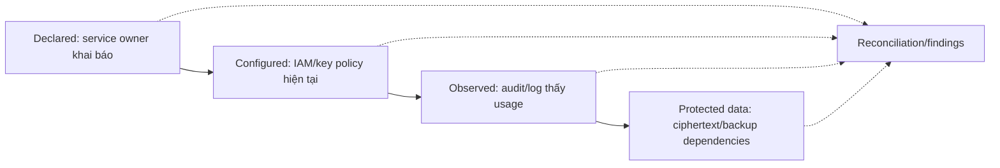
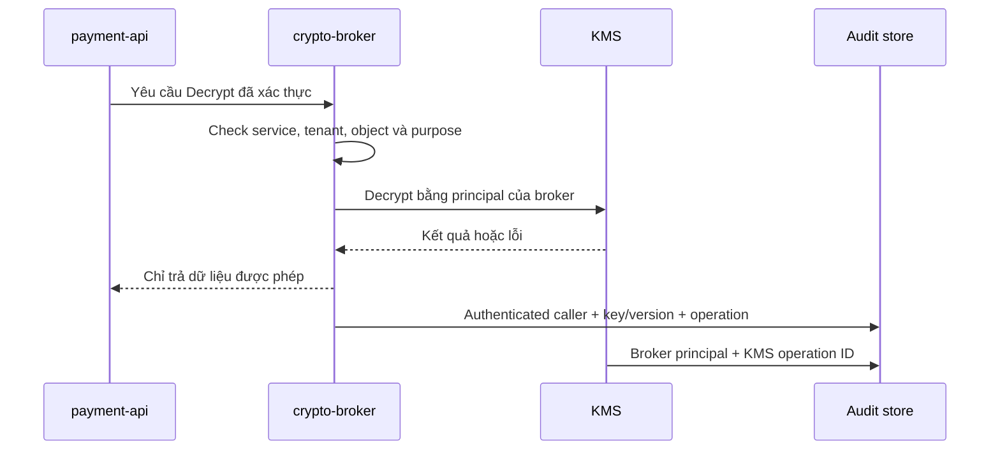
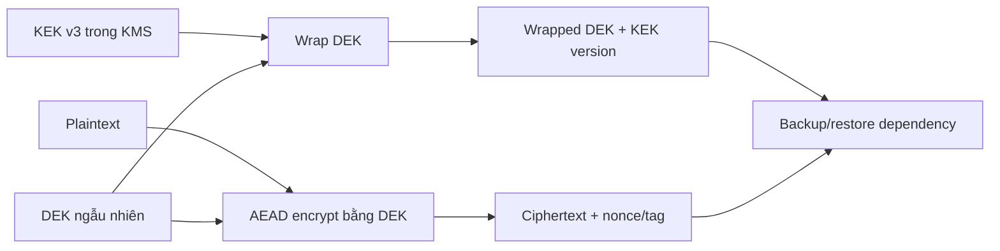
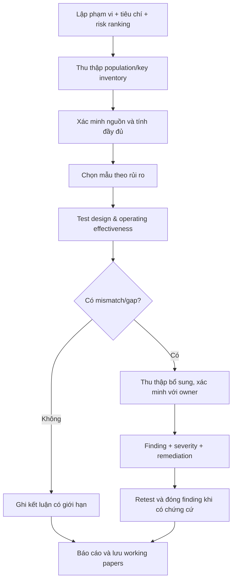

# Auditor responsibility

## 1. Auditor responsibility là gì?

**Auditor responsibility (trách nhiệm của kiểm toán viên)** trong quản lý khóa mật mã là trách nhiệm **đánh giá độc lập**, dựa trên tiêu chí và bằng chứng có thể kiểm chứng, rằng tổ chức đã thiết kế và vận hành các kiểm soát bảo vệ khóa phù hợp với mục tiêu an toàn, chính sách và nghĩa vụ áp dụng.

Một kiểm toán viên không chỉ hỏi “hệ thống có dùng AES-256 không?” mà phải xét đồng thời:

- **Ai tạo khóa**, bằng cơ chế ngẫu nhiên/thuật toán nào và được ai phê duyệt?
- **Ai giữ hoặc có thể sử dụng private key/DEK/KEK**, theo quyền IAM và mục đích nào?
- **Khóa được sử dụng ra sao**: Encrypt/Decrypt, Wrap/Unwrap, Sign/Verify, GenerateMac/VerifyMac, Encapsulate/Decapsulate?
- **Vòng đời có được thực hiện đúng không**: kích hoạt, cryptoperiod, rotation, ngừng cấp mới, thu hồi, hủy?
- **Dữ liệu lịch sử còn giải mã/xác minh được không** khi đổi hoặc hủy key version?
- **Hồ sơ nào chứng minh được sự việc**: KMS/HSM operation log, key registry, approval, policy, alert, kết quả restore test, sự kiện incident?
- **Hạn chế của kết luận là gì**: hoạt động đã được log đầy đủ chưa, có bản sao khóa ngoài KMS không, có quyền truy cập ngoài luồng không?

Auditor phải đưa ra nhận định về **thiết kế kiểm soát** (*design effectiveness*) và **việc kiểm soát có thực sự hoạt động trong kỳ đánh giá** (*operating effectiveness*), không dựa duy nhất vào một ảnh chụp cấu hình tại thời điểm kiểm tra.

Bài thuộc chương **Vai trò và trách nhiệm** của module `SECURITY_KEY_MANAGEMENT_FUNDAMENTALS`. Phạm vi gắn với toàn bộ vòng đời khóa từ **tạo, cấp phát, lưu trữ, sử dụng, xoay vòng đến thu hồi và hủy**, cùng mật mã đối xứng/bất đối xứng, chữ ký số, KMS/HSM, envelope encryption, IAM và kiểm toán.

### Kết quả học tập

Sau bài, bạn có thể:

1. Phân biệt **auditor**, **security owner**, **key custodian**, **key user**, **system owner** và **incident responder**.
2. Thiết kế **phạm vi, tiêu chí và ma trận bằng chứng** cho một đợt kiểm toán khóa.
3. Đọc và đối chiếu **key inventory, key policy, IAM grants, key usage/audit logs, ciphertext dependencies**.
4. Xác định bằng chứng cần thiết cho **key generation, distribution, storage, use, rotation, revoke và destruction**.
5. Phát hiện **separation-of-duties violation**, khóa không có owner, quyền Decrypt/Sign rộng, bản sao secret không quản lý và log bị thiếu.
6. Đánh giá khác biệt giữa **khóa không thể export** và **quyền gọi API để dùng khóa**.
7. Kiểm tra **tính toàn vẹn, đầy đủ, nguồn gốc, thời gian và tính lặp lại** của bằng chứng kiểm toán.
8. Viết finding có điều kiện, impact, evidence, owner, remediation và cách kiểm chứng đóng finding.
9. Thực hành qua ví dụ Java 17, truy vấn SQL minh họa, case study và checklist.

## 2. Auditor có trách nhiệm gì và không có trách nhiệm gì?

Một ranh giới quan trọng: **kiểm toán là hoạt động bảo đảm/đánh giá; vận hành khóa là trách nhiệm của chủ sở hữu và người được ủy quyền**.

| Việc | Auditor chịu trách nhiệm | Trách nhiệm không nên tự nhận |
| --- | --- | --- |
| **Định nghĩa phạm vi đánh giá** | Xác định hệ thống, khóa, giai đoạn, tiêu chí và bằng chứng cần xem | Tự đổi yêu cầu nghiệp vụ hoặc chính sách quản lý khóa không qua phê duyệt |
| **Kiểm tra kiểm soát** | Đối chiếu policy, cấu hình, log, approval, dependency và vận hành thực tế | Tự thay IAM grant hay tắt KMS để “kiểm thử” |
| **Xác minh bằng chứng** | Kiểm tra tính đầy đủ, nguồn gốc, sự nhất quán, dấu thời gian | Đòi xuất private key hoặc DEK dạng rõ để xác nhận bằng mắt |
| **Đánh giá tính độc lập** | Kiểm tra người tạo/duyệt/dùng/hủy khóa có tách nhiệm vụ phù hợp không | Tự là người duyệt và người thực thi thao tác đang kiểm toán |
| **Báo cáo** | Nêu phát hiện, nguyên nhân, rủi ro, mức độ chắc chắn và hạn chế phạm vi | Tuyên bố an toàn tuyệt đối khi bằng chứng còn thiếu |
| **Theo dõi remediation** | Xác minh bằng chứng khắc phục và kiểm tra vận hành lại | Tự triển khai bản vá và tự xác nhận không cần kiểm tra độc lập |
| **Hỗ trợ sự cố** | Đối chiếu nhật ký, phê duyệt và bằng chứng điều tra khi được giao | Tự thực hiện emergency key destruction nếu không có vai trò và ủy quyền riêng |

**Đọc được audit event không đồng nghĩa được quyền Decrypt; có quyền đọc public key không đồng nghĩa được quyền Sign.** Auditor thông thường nên có quyền **read-only đối với metadata, cấu hình, policy và log đã bảo vệ**, chứ không cần key material.

### 2.1. Ba tuyến trách nhiệm

Mô hình quản trị thường phân biệt:

- **Tuyến vận hành:** service owner, key administrator, key custodian, KMS/HSM operator, application team trực tiếp thực thi kiểm soát.
- **Tuyến giám sát rủi ro/chính sách:** security governance, compliance hoặc risk function đặt yêu cầu, đánh giá ngoại lệ, giám sát vận hành.
- **Tuyến bảo đảm độc lập:** internal/external auditor kiểm tra có căn cứ, lập finding và theo dõi đáp ứng.

Đây là **mô hình quản trị khái niệm**, không áp đặt sơ đồ tổ chức cho mọi công ty. Quan trọng là **người kiểm toán không tự kiểm chứng công việc do mình trực tiếp tạo và phê duyệt** mà thiếu biện pháp bảo đảm độc lập.

### 2.2. Độc lập nhưng vẫn cần hiểu kỹ thuật

Auditor không phải lập trình viên triển khai hệ mã, nhưng cần hiểu đủ để nhận ra sai lệch kỹ thuật:

- `AES/GCM/NoPadding` không tự bảo đảm nonce uniqueness.
- HMAC là MAC dùng shared secret, **không phải chữ ký bất đối xứng có public verification key**.
- Xóa alias không đồng nghĩa xóa key material.
- Chỉ nhìn `KMS Encrypt success` không chứng minh caller có quyền truy cập dữ liệu nghiệp vụ.
- Private signing key trong HSM non-exportable vẫn có thể bị lạm dụng qua quyền `Sign`.
- Rotate sang v4 không làm wrapped DEK cũ tự chuyển sang v4.
- `Decrypt` bị từ chối có thể do IAM, Disabled hoặc thiếu key; không đủ chứng minh Destroyed.

## 3. Ma trận vai trò và trách nhiệm (RACI)

**RACI** là một cách mô tả ai **Responsible** (thực hiện), **Accountable** (chịu trách nhiệm cuối), **Consulted** (được tham vấn) và **Informed** (được thông báo).

Một tổ chức có thể dùng bảng minh họa sau, điều chỉnh theo quy mô và chính sách:

| Hoạt động | Key custodian / admin | Service/data owner | Security governance | Auditor |
| --- | --- | --- | --- | --- |
| Đề xuất thuật toán và key purpose | R | A/C | C | I |
| Phê duyệt key creation và quyền dùng | R | A | C | I |
| Sinh và bảo quản material trong KMS/HSM | R | A | C | I |
| Cấp hoặc sửa IAM grant | R | A | C | I / đánh giá sau |
| Sử dụng Encrypt/Decrypt/Sign theo workload | R (hạ tầng) | A/R (nghiệp vụ) | I | I / kiểm tra |
| Rotation và key version migration | R | A | C | I / kiểm tra |
| Đánh giá retention/backup trước destroy | R (kỹ thuật) | A | C | I / kiểm tra |
| Phê duyệt và thực thi destroy | R | A/C | C/A theo policy | I / đánh giá độc lập |
| Thu thập bằng chứng audit | R (cung cấp nguồn) | C | C | R (đánh giá) |
| Kết luận audit/finding | C | C | C | **A/R** |
| Khắc phục finding | R | A | C | I / xác minh lại |

**Lưu ý:** bảng chỉ là ví dụ tổ chức; chính sách thực tế phải làm rõ **một đầu mối Accountable** theo từng hoạt động và quy trình phê duyệt. Không hiểu rằng auditor được quyền tạo, cấp phát hoặc hủy khóa vì auditor “chịu trách nhiệm về kiểm toán”.

### 3.1. Separation of duties cần kiểm tra

Các xung đột quyền điển hình:

1. Người đề nghị hủy key cũng tự phê duyệt và tự gọi destructive API.
2. Một service account vừa có quyền `Sign`, vừa được sửa signing key/JWKS trust policy.
3. Người quản trị IAM vừa cấp `Decrypt` cho bản thân vừa truy cập toàn bộ ciphertext.
4. Người điều hành audit logging có thể tắt log, sửa log và phê duyệt finding của chính mình.
5. Quyền break-glass không có người duyệt, deadline và hậu kiểm.

Auditor kiểm tra **quyền khả thi thực tế** chứ không chỉ mô tả vai trò. Nếu hai tài khoản khác tên nhưng do cùng một người kiểm soát, việc có “hai approval IDs” chưa chắc đáp ứng nguyên tắc dual control.

## 4. Lập phạm vi kiểm toán dựa trên rủi ro

Một đợt kiểm toán phải có **đối tượng, kỳ đánh giá, tiêu chí, nguồn bằng chứng và giới hạn** được ghi rõ từ đầu.

### 4.1. Đối tượng có thể thuộc phạm vi

- **Cloud KMS / HSM:** key resources, key versions, policy, IAM, event logs, backups, replicas.
- **Ứng dụng và microservices:** workload identity, crypto SDK, local key cache, service-to-key bindings.
- **Secret manager / Java KeyStore:** password pepper, MAC secrets, exported private keys nếu có.
- **PKI / certificate stores:** key usage, certificate lifecycle, root/intermediate, revoked trust.
- **Encryption envelopes:** metadata key ID/version, wrapped DEK, AES-GCM nonce/tag/AAD.
- **Key establishment:** ECDH/KEM keypairs, decapsulation access, long-term key dependencies.
- **CI/CD và build/deployment:** cơ chế cung cấp keys, service account, quyền khẩn cấp, logging.
- **Backup/DR và archival:** khả năng khôi phục dữ liệu còn retention, key replicas/copies.
- **Tích hợp đối tác:** public key distribution, webhook HMAC, API secrets và rotation.
- **Quy trình tổ chức:** approval, exception, incident response, destruction policy, review định kỳ.

### 4.2. Xác định tiêu chí có nguồn gốc

Tiêu chí nên lấy từ **chính sách nội bộ đã được phê duyệt**, yêu cầu hợp đồng/pháp lý, chuẩn hoặc control framework phù hợp và **contract/API thực tế của provider**.

Các tài liệu tham khảo kỹ thuật có thể gồm **NIST SP 800-57** về quản lý khóa, **NIST SP 800-53** cho kiểm soát an ninh, **NIST SP 800-88** về sanitization của media hoặc yêu cầu của tiêu chuẩn ngành áp dụng. Tuy nhiên, auditor phải chỉ rõ **phiên bản và điều khoản** thực sự áp dụng trong kỳ, không tự suy ra mọi tổ chức đều bắt buộc áp dụng cùng bộ tiêu chuẩn.

Ví dụ tiêu chí nội bộ:

```yaml
controlId: KM-ACCESS-04
policyVersion: key-governance-2026-v3
objective: "Chỉ service được phê duyệt có quyền Decrypt/Unwrap"
scope: "production invoice KEKs"
requiredEvidence:
  - trusted-key-inventory-snapshot
  - IAM-actual-grants
  - approved-service-bindings
  - KMS-usage-audit
testingPeriod: "2026-10-01/2026-10-31"
```

Đây là **schema minh họa**, không phải mã điều khoản chính thức.

### 4.3. Đặt mức độ ưu tiên

Một cách phân loại theo nguy cơ:

| Yếu tố | Câu hỏi | Ưu tiên khi |
| --- | --- | --- |
| **Loại khóa** | Là root/CA key, signing key, KEK, DEK hay MAC secret? | Key có blast radius rộng hoặc trust cấp cao |
| **Dữ liệu** | Dữ liệu được mã hóa nhạy cảm và lưu trong bao lâu? | PII, giao dịch tài chính, hồ sơ phải lưu lâu |
| **Exportability** | Private key/secret có thể lấy khỏi KMS/HSM? | Exportable hoặc từng có bản copy ngoài vùng bảo vệ |
| **Quyền** | Ai có thể `Decrypt`/`Sign`/`Destroy`? | Shared identity, admin grant rộng, quyền không qua phê duyệt |
| **Lịch sử sự cố** | Có dấu hiệu compromise, audit gap, exception chưa đóng? | Sự cố chưa xác định hết phạm vi |
| **Thay đổi** | Có rotation/migration/KMS replacement gần đây? | Nhiều version, consumer cũ, backup chưa kiểm chứng |
| **Tích hợp** | Có external signer/verifier hoặc crypto broker? | Thiếu attribution và trust boundary |

Cần ghi **lý do chọn mẫu** và giới hạn kết luận. Một mẫu nhỏ thuận tiện không đủ đại diện cho những khóa rủi ro nhất nếu không có căn cứ.

## 5. Kiểm toán vòng đời khóa: từng giai đoạn phải có bằng chứng gì?

Một audit tốt bám **hành vi thực tế** của vòng đời, không chỉ checklist “có tài liệu hay không”.

| Giai đoạn | Câu hỏi kiểm toán | Bằng chứng phù hợp |
| --- | --- | --- |
| **Generate / Create** | Key được sinh bởi CSPRNG/KMS/HSM được duyệt? Algorithm, key size, purpose đúng policy? | Provider key spec/origin, provisioning record, approval, build/config |
| **Register / Inventory** | Key ID/version, owner, environment, consumer, classification có đầy đủ? | Key registry snapshot, CMDB, provider Describe, tagging |
| **Provision / Distribute** | Public key/secret/key reference được cấp đúng nơi; bản export có kiểm soát? | IAM grants, certificate/JWKS registry, distribution ticket, custody evidence |
| **Store / Protect** | Private key/KEK được bảo vệ bởi HSM/KMS, export policy, backups phù hợp? | HSM/KMS configuration, key attributes, secret-store metadata, access review |
| **Use** | Dùng đúng operation, key purpose, tenant, nonce/KDF/AAD và quyền dữ liệu? | Crypto usage logs, app design/config, integration test, code review evidence |
| **Rotate** | Đổi key đúng cryptoperiod, v mới dùng cho new use, v cũ còn read/verify khi cần? | Rotation ticket, key versions, usage trend, cutover/restore tests |
| **Retire / Revoke** | Có chặn new use và cập nhật verifier/trust/consumer đúng hạn? | IAM changes, key state, JWKS/certificate status, client rollout |
| **Destroy / Zeroize** | Đã đánh giá dependencies, retention, backups, exports, approvals và final state? | Inventory, restore evidence, dual approvals, provider operation & attestation |
| **Incident / Recovery** | Khi compromise, phát hiện, cô lập, đánh giá dữ liệu và key copies thế nào? | Incident timeline, grants revoked, key actions, audit correlation, postmortem |

### 5.1. Thiết kế kiểm soát và vận hành thực tế khác nhau

- **Design effectiveness:** policy yêu cầu hai người độc lập duyệt hủy KEK; IAM không cho một người tự bypass.
- **Operating effectiveness:** xem **mẫu các yêu cầu hủy thực tế** trong kỳ: có hai approval từ danh tính khác nhau, đúng resource/version, được ghi trước thao tác, và trạng thái provider xác nhận hay không.

Một workflow được vẽ đẹp trong tài liệu **không chứng minh các lần thực thi thực tế đều tuân thủ**. Ngược lại, thiếu sự kiện trong log không chứng minh không có thao tác nếu phạm vi logging chưa được kiểm tra.

### 5.2. Không “test” destruction trên production key

Auditor không nên gọi destructive API với khóa thật để xem điều gì xảy ra. Hành vi API có thể được chứng minh qua:

- Contract/describe và log sự kiện đã có.
- **Test key** trong môi trường cho phép, do đội vận hành thực hiện với người kiểm toán quan sát.
- Bản ghi change ticket, trạng thái key trước/sau, audit operation ID.
- Bằng chứng restore test trên dữ liệu thử hoặc dữ liệu được phê duyệt.

Đối với thao tác không thể khôi phục, **người kiểm toán ưu tiên quan sát và đối chiếu bằng chứng**, không trực tiếp phá hủy tài sản đang bảo vệ dữ liệu.

## 6. Kiểm tra Key inventory và service sử dụng key

Key inventory là nền tảng để xác định **đầy đủ population** và **đường phụ thuộc**.

Một bản ghi tối thiểu nên cho biết:

| Metadata | Vì sao auditor cần? |
| --- | --- |
| `keyId` và `version` | Không nhầm alias hiện tại với bản ciphertext/DEK lịch sử |
| `keyType`, `algorithm`, `parameters` | Đánh giá phù hợp thuật toán và mục đích |
| `origin`, `exportability`, `provider` | Đánh giá custody, external copies và ranh giới KMS/HSM |
| `purpose`, `allowedOperations` | Phát hiện key misuse, quyền `Sign`/`Decrypt` rộng |
| `owner`, `serviceConsumers`, `principalIds` | Gán trách nhiệm và kiểm toán IAM thực tế |
| `environment`, `tenantScope`, `region` | Phát hiện staging/prod hoặc cross-tenant access |
| `state`, `rotationAt`, `cryptoperiod` | Rà soát new use và legacy read |
| `lastObservedAt`, `auditRefs` | Đối chiếu khai báo với sự kiện KMS |
| `dataDependencies`, `backupRefs` | Quyết định retirement, revoke, destroy và DR |

**Không nên đưa raw key material vào inventory chỉ để auditor đối chiếu.** Khi key non-exportable, việc không đọc được private key là đặc tính bảo vệ, không phải một lỗ hổng kiểm toán.

### 6.1. Những trạng thái cần phân biệt



Ví dụ:

- Owner khai `invoice-writer chỉ Wrap DEK`.
- IAM thực tế cho `Encrypt + Decrypt`.
- KMS audit có `Decrypt` từ principal của writer.
- Ciphertext inventory còn DEK v3 ở backup.

Đây là **mismatch cần điều tra**, không phải lý do cập nhật bảng khai báo thành “writer có quyền Decrypt” rồi coi là hợp lệ.

### 6.2. Một service có thể dùng KMS gián tiếp

Giả sử `payment-api` gọi `crypto-broker`, còn broker gọi KMS. KMS audit có thể chỉ thấy principal của broker.



Auditor phải nối được **caller → broker → KMS → resource**, nhưng không cần xem raw DEK hoặc plaintext. Nếu broker chỉ ghi tên service do header tự khai báo, attribution **chưa đáng tin**.

## 7. Bằng chứng kiểm toán: đủ, đúng nguồn và còn toàn vẹn?

**Audit evidence** không phải mọi thứ có trong log đều có giá trị ngang nhau. Một đánh giá phải cân nhắc:

1. **Relevance:** bằng chứng trả lời đúng control objective không?
2. **Authenticity/provenance:** từ API chính thức, hệ thống audit tin cậy hay ảnh chụp không xác minh được?
3. **Completeness:** có bao phủ tất cả accounts, regions, clusters, key versions, service identities và kỳ kiểm toán?
4. **Integrity:** record có bị xóa/sửa mà không phát hiện, hoặc người quản trị KMS có quyền sửa audit store?
5. **Timeliness:** dữ liệu có được lấy đúng thời điểm, đồng hồ và phiên bản policy?
6. **Reproducibility:** auditor khác có thể thực hiện lại phép đối chiếu mà không cần biết secret?
7. **Confidentiality:** hồ sơ có vô tình chứa raw token, key, DEK, plaintext, PII không?
8. **Limitations:** nếu có log gap, provider không hỗ trợ một event hoặc external keys không được nhìn thấy, kết luận đã giới hạn tương ứng?

### 7.1. Các nguồn bằng chứng và hạn chế

| Nguồn | Giúp chứng minh | Không tự chứng minh |
| --- | --- | --- |
| **KMS/HSM Describe/List** | Key state, spec, origin, một số policy/metadata | Không có bản export ở ngoài hoặc mọi lần local decrypt đã được log |
| **IAM/key policies** | Quyền có thể được thực thi với provider | Một service đã thực sự dùng khóa hoặc có quyền nghiệp vụ với dữ liệu |
| **KMS operation log** | Actor đã gọi API nào, key reference, kết quả | Đầy đủ mọi lần dùng secret nếu secret đã export/cache trong ứng dụng |
| **Application trace** | Caller nghiệp vụ, object context, correlation ID | Chính xác nếu caller ID lấy từ header không xác thực |
| **Key inventory** | Owner, version, purpose, dependencies khai báo | Không có orphan key hoặc metadata hoàn toàn chính xác |
| **Backup/restore evidence** | Bản snapshot thử đã khôi phục được | Mọi snapshot/region sẽ luôn khôi phục được |
| **Code/config review** | Thuật toán và cách xử lý key theo implementation được xem | Binary hiện đang chạy chắc chắn khớp code ở repository |
| **Approval/ticket** | Có một quyết định/phê duyệt được ghi | Người duyệt thực sự độc lập hoặc dữ liệu đầu vào đúng, nếu chưa xác minh |
| **Provider attestation/report** | Phạm vi provider công bố và kết quả theo hợp đồng | Export/copies/consumer ở ngoài ranh giới đã được kiểm soát |

### 7.2. Kiểm tra tính đầy đủ, không chỉ tính bất biến

Ngay cả khi log được lưu bất biến (*immutable/append-only*), auditor vẫn phải xét liệu **mọi sự kiện cần ghi có thực sự được ghi**.

Ví dụ chuỗi sai:

```text
KMS thực hiện 10.000 Decrypt
  -> chỉ 8.000 event đi qua collector
  -> 8.000 event được lưu bất biến
Kết luận sai: "log không sửa được nên bao phủ 100% use"
```

Một phép đối chiếu nên so sánh:

- Metrics/counters của KMS hoặc API gateway với số operation events có thể kiểm chứng.
- IAM grants với actor/principal thực sự xuất hiện trong audit.
- Bản ghi crypto-broker với KMS operation IDs.
- Danh sách key/region/accounts với nguồn log collector cấu hình.
- **Gap window**, ingestion lag, dropped events, retry hoặc retention hết hạn.

Bằng chứng **chưa đầy đủ** phải tạo finding hoặc **limitation**, không tự nâng thành bằng chứng không có rủi ro.

### 7.3. Tính toàn vẹn log và chain of custody

Một quy trình thu thập tốt có thể dùng:

- **Log storage chỉ-ghi hoặc append-only** với quyền quản trị tách khỏi key admins.
- **Digest và chữ ký/attestation** trên log batch hoặc checkpoint để phát hiện thay đổi kể từ thời điểm chốt.
- **Object versioning, retention locks** hoặc cơ chế lưu giữ bất biến theo chính sách.
- **Nguồn giờ đồng bộ** và timestamp theo timezone rõ ràng (ví dụ UTC), kiểm tra clock skew.
- **Chain of custody:** ai xuất bản ghi, lúc nào, bằng lệnh/API gì, hash, chỗ lưu và quyền truy cập.
- **Phân vùng môi trường:** production/staging, region, account và tenant.
- **Giới hạn quyền xóa/sửa**, cảnh báo nếu audit configuration bị thay đổi.

Hash một file log **sau khi nó đã bị sửa** không khôi phục được tính trung thực. Hash/digital signature cần gắn với nguồn, thời điểm, quy trình bảo vệ và cơ chế đối chiếu đáng tin cậy.

### 7.4. Thời gian và sự kiện không đồng bộ

Một KMS request có thể thành công ở thời điểm T nhưng sự kiện audit được ingest sau vài phút, hoặc event xuất hiện từ nhiều nguồn có thứ tự khác nhau. Auditor nên:

- Phân biệt **event time** với **ingestion time**.
- Dùng **correlation ID / operation ID** để nối chuỗi.
- Xem xét eventual consistency và retention window.
- Không suy ra absence nếu chỉ truy vấn một cửa sổ quá hẹp.
- Giữ mốc thời gian cùng policy/approval version dùng lúc thao tác.

Khi kiểm tra destructive action, **lệnh `ScheduleDelete` lúc T không phải bằng chứng `Destroyed` tại T**. Phải kiểm tra trạng thái cuối theo hợp đồng provider.

## 8. Bảo vệ tính bí mật trong quá trình kiểm toán

Một audit có thể vô tình tạo **kho bí mật thứ hai** nếu copy private key, token hay plaintext vào báo cáo.

### 8.1. Nguyên tắc tối thiểu hóa dữ liệu

Auditor thông thường chỉ cần:

- Key ID/version, key class, algorithm, origin, trạng thái, provider reference.
- Service/principal, operation, policy decision, approval references.
- Timestamp, correlation ID, event result, metadata của môi trường.
- Fingerprint/public key reference nếu phục vụ việc kiểm tra tin cậy.
- Bằng chứng kiểm thử/khôi phục được tổng hợp, không phải DEK dạng rõ.

**Không thu thập** raw private key, KEK/DEK, shared secret, password/pepper, OAuth bearer token, session cookie, ciphertext mang PII không cần thiết hoặc bản giải mã đầy đủ chỉ vì “audit cần xem”.

### 8.2. Khi cần chứng minh khả năng giải mã

Auditor có thể yêu cầu:

1. Đội vận hành được ủy quyền chọn **test object** hoặc dataset được phê duyệt.
2. Hệ thống dùng key reference đúng version qua KMS/HSM.
3. Người vận hành thực hiện decrypt/restore; **không gửi secret cho auditor**.
4. Auditor xem kết quả kiểm tra toàn vẹn, hash/tổng hợp nghiệp vụ được phép và event log.
5. Lưu evidence rằng restore thành công theo phương án thử.

**Không yêu cầu export private key hoặc in DEK ra stdout** để chứng minh nó tồn tại. Nếu một phần thông tin có tính nhạy cảm là cần thiết, phải thực hiện qua quy trình bảo vệ riêng, có căn cứ và giới hạn thời gian.

### 8.3. Access to audit data cũng là quyền nhạy cảm

Key IDs, mapping service–key và patterns của operation có thể tiết lộ hệ thống trọng yếu hoặc khách hàng. Auditor nên có quyền **read-only, time-bound, scoped**, với logging cho chính hoạt động truy cập audit records.

Không tự cấp `KMS Decrypt`/`Sign`/`Destroy` cho account auditor vì “sẽ dễ kiểm tra hơn”. Đó là **vi phạm phân tách trách nhiệm** và mở rộng bề mặt tấn công.

## 9. Kiểm toán KMS/HSM và IAM

KMS/HSM giảm nguy cơ xuất private key, nhưng không tự giải quyết toàn bộ bài toán quản trị.

### 9.1. Các kiểm soát IAM cần đánh giá

| Kiểm soát | Câu hỏi | Dấu hiệu bất thường |
| --- | --- | --- |
| **Least privilege** | Principal nào được `Decrypt`, `Sign`, `Unwrap`, `Destroy`? | Shared wildcard grant với mọi key production |
| **Purpose binding** | Một signing key có bị dùng cho decrypt/unwrap? | Mixed operations không có phê duyệt |
| **Environment isolation** | Staging có truy cập key production? | Cross-account grant không giải thích được |
| **Tenant isolation** | Key/context có bị dùng chéo tenant? | Client chọn key ID tự do |
| **Separation of duties** | Người cấp grant có tự phê duyệt và sử dụng key? | Self-approval, admin bypass |
| **Privileged access** | Break-glass có hết hạn, hậu kiểm, MFA? | Quyền khẩn cấp tồn tại lâu dài |
| **Revocation** | Khi service nghỉ/nhân sự rời, grant có bị thu hồi? | Orphaned principal |
| **Audit disable** | Ai được tắt/sửa logging hoặc xóa bằng chứng? | Key admin cùng quản trị log không giám sát |
| **Exportability** | Có non-exportable/private key export policy? | Private key export không giải trình |

### 9.2. “Non-exportable” không có nghĩa “không thể lạm dụng”

Nếu private signing key nằm trong HSM không thể xuất, tài khoản có quyền `Sign` vẫn có thể yêu cầu HSM ký một thông điệp độc hại. Tương tự, quyền KMS `Decrypt` có thể trả về DEK dạng rõ cho service nếu API/protocol cho phép.

Auditor phải kiểm cả:

- **Ranh giới vật liệu:** key material có thể export/import không?
- **Ranh giới thao tác:** ai được phép gọi cryptographic API?
- **Ranh giới dữ liệu:** service được phép xử lý đối tượng/tenant nào?
- **Ranh giới vận hành:** ai có thể thay IAM, state, rotation, log hoặc backup?

Một thông báo HSM “private key không xuất được” **không đủ** để kết luận mọi luồng ký/giải mã đều được ủy quyền.

### 9.3. Truy cập qua broker và confused deputy

Nếu nhiều service dùng chung `crypto-broker`, IAM có thể cho broker `Decrypt` nhiều key. Auditor cần kiểm tra broker:

1. Xác thực caller bằng danh tính đáng tin.
2. Ràng buộc caller với **key/resource/tenant/purpose**.
3. Chặn một service yêu cầu decrypt ciphertext của tenant khác.
4. Ghi audit cả **upstream principal** và **KMS principal**.
5. Không trả raw key hoặc plaintext ngoài phạm vi cần thiết.
6. Không tin `X-Service-Name` do caller tự điền mà thiếu xác thực.

## 10. Các tình huống mật mã auditor phải hiểu

### 10.1. AES-GCM và quản lý nonce

Kiểm tra key algorithm và cấu hình đơn thuần chưa đủ. Với AES-GCM, **nonce không được lặp dưới cùng key**; reuse có thể phá hủy cả tính bí mật và tính toàn vẹn.

Auditor thường không cần tự phân tích ciphertext bí mật, nhưng có thể kiểm:

- Thiết kế sinh nonce/IV, usage bounds và monitoring.
- Key rotation policy cho volume và long-lived keys.
- Quy trình test phát hiện nonce reuse và AAD binding.
- Mã hóa theo đúng `AES/GCM/NoPadding` hoặc suite được phê duyệt, không phụ thuộc default.

### 10.2. Envelope encryption: DEK, KEK và backup

Trong envelope encryption:



Auditor cần kiểm:

- DEK được sinh bằng CSPRNG, không được lưu/log dạng rõ vô thời hạn.
- KEK chỉ cấp cho service/principal cần `Wrap` hoặc `Unwrap`.
- Ciphertext lưu **đúng version, nonce, tag, AAD schema** theo định dạng.
- Trước khi hủy KEK v3, mọi wrapped DEK cần giữ và backup đã được xử lý.
- Restore drill không phụ thuộc một key version đã bị hủy.
- Key alias đổi đích không tự làm encrypted DEK lịch sử đổi version.

### 10.3. Chữ ký số, JWT và trust

Khi kiểm toán private signing key và hệ thống JWT:

- Issuer có quyền `Sign`; verifier thông thường chỉ cần **public verification key/JWKS**.
- Verifier kiểm `signature, alg, kid, issuer, audience, expiry, nbf` và claims cần thiết.
- Public key đến từ **trusted registry/PKI** và key ID có binding chính xác.
- Private key bị lộ thì việc xoay vật liệu không đủ nếu verifier vẫn tin key cũ.
- **Hủy private key không làm chữ ký đúng cũ sai về toán học**; việc chấp nhận là quyết định trust/retention riêng.
- Long-term signatures có thể yêu cầu giữ public key, chứng chỉ, status/revocation evidence và trusted timestamp.

### 10.4. HMAC khác digital signature

HMAC dùng **shared secret**. Một service biết HMAC key bytes có thể **tạo MAC** chứ không chỉ kiểm tra, trừ khi cơ chế KMS/HSM tách quyền và key không xuất.

Đừng ghi finding “MAC đã bảo đảm non-repudiation như chữ ký số” chỉ vì tag hợp lệ. Kiểm toán phải phân biệt mục tiêu **message integrity/authenticity giữa các bên chia sẻ secret** với chữ ký bất đối xứng có verification key riêng.

### 10.5. KEM, key agreement và private decapsulation key

KEM decapsulation tạo **shared secret**, không trực tiếp giải mã dữ liệu người dùng. Kiểm toán viên xem:

- Ai có quyền **Decapsulate**; public key phân phối có đáng tin không?
- KDF/key schedule, AEAD và metadata version có được kiểm soát không?
- Có xử lý implicit rejection/invalid ciphertext và tránh error oracle không?
- Bản ghi/backup lịch sử còn cần private decapsulation key cũ không?
- Việc dùng thuật toán hậu lượng tử/hybrid có bằng chứng từ provider và giao thức hay chỉ là tên trong tài liệu?

## 11. Kiểm toán rotation, revoke và destruction

### 11.1. Rotation

Một đợt rotation có thể cần phân biệt:

- **Producer:** chuyển Encrypt/Wrap/Sign mới sang version mới.
- **Consumer:** còn Decrypt/Unwrap/Verify cũ trong khoảng retention.
- **Backup/DR:** snapshot cũ có thể cần key v cũ.
- **External partner:** có thể còn dùng public key/verifier cũ.
- **KMS/IAM:** quyền cho old/new versions cần đúng policy.

Auditor kiểm tra **bằng chứng cutover**, không chỉ thấy alias `current` chuyển từ v3 sang v4. Phải xem log old-version new use, data dependency, restore drill và kế hoạch retirement.

### 11.2. Revocation khác destruction

- **Revocation** có thể là thu hồi trust/chứng chỉ hoặc quyền IAM.
- **Disable** chặn sử dụng qua provider mà vật liệu thường còn.
- **Destroyed** là vật liệu đã bị hủy trong phạm vi được xác nhận.
- **Crypto-erasure** là kết quả mất khả năng giải mã khi không còn đường lấy key và các giả định mật mã đúng.

Một lệnh `Decrypt` trả `PermissionDenied` không chứng minh key đã bị Destroyed; cũng có thể do IAM bị chặn. Auditor cần mô tả đúng nguồn/loại bằng chứng.

### 11.3. Destruction policy và kiểm tra tiền điều kiện

| Điều kiện | Auditor yêu cầu bằng chứng |
| --- | --- |
| Target chính xác | Key resource + version + môi trường + region, không chỉ alias |
| Dữ liệu cần giữ | Dependency inventory live/backup/archive/queue/consumer |
| Retention/legal hold | Clearance từ owner có thẩm quyền |
| Migration/rewrap | Đối chiếu số bản ghi, version mới, kiểm tra AEAD/format |
| DR/restore | Restore test từ backup còn giữ với key ring sau hủy |
| Imported/exports | Custody assessment cho các bản copy ngoài KMS/HSM |
| Dual control | Approvers độc lập, đúng target, đúng thời hạn và vai trò |
| Waiting period | Schedule operation, cảnh báo/cancel theo contract provider |
| Authoritative final state | Provider xác nhận material destruction chứ không chỉ disabled |
| Scope statement | Không tuyên bố những bản sao ngoài vùng quản lý đều biến mất |

Khi còn **backup phải phục hồi bằng KEK v3**, một request destroy v3 phải bị **chặn hoặc trì hoãn**, dù live data đã chuyển v4. Đó là một ví dụ auditor cần xác nhận **quy trình đã ngăn được thao tác nguy hiểm**.

## 12. Kiểm tra tính an toàn của bằng chứng logging

### 12.1. Log gì và không log gì?

Một event metadata minh họa:

```yaml
event_id: "evt-7e20"
event_time: "2026-11-28T02:00:00Z"
ingested_at: "2026-11-28T02:00:08Z"
environment: "production"
actor_principal: "principal://prod/billing/invoice-reader"
service_id: "invoice-reader"
key_id: "billing/prod/invoice-kek"
key_version: "v4"
operation: "Unwrap"
result: "success"
policy_ref: "key-access-policy-v5"
request_id: "req-4ba8"
provider_operation_id: "provider-9c2d"
source: "kms-audit"
```

Các trường là **schema học thuật**, không phải event format mặc định của một KMS. Không ghi raw `DEK`, `KEK`, private key, shared secret, plaintext, bearer token, password hoặc toàn bộ authorization header.

**Lưu ý:** `result: success` ở KMS chỉ xác nhận bước API KMS theo contract, **không đồng nghĩa** caller đã được cấp quyền xem dữ liệu nghiệp vụ hoặc AEAD ciphertext hợp lệ ở tầng sau.

### 12.2. Kiểm tra retention của log

Auditor cần xác minh:

1. Kỳ giữ log đủ cho kiểm toán, xử lý sự cố và nghĩa vụ áp dụng.
2. Ai có quyền xóa, sửa, thay retention, tắt logging.
3. Có sự kiện/alert khi logging bị vô hiệu hoặc export thất bại.
4. Audit archive có thể được truy cập và xác minh tính toàn vẹn.
5. Chính sách bảo vệ thông tin nhạy cảm của chính audit trail.
6. Mốc thời gian và event ID có dùng nhất quán qua các nguồn.

Một record tồn tại không có nghĩa tất cả sự kiện đã được ghi. Kiểm tra **độ phủ và tính liên tục** phải tách khỏi kiểm tra **tính bất biến** của log.

## 13. Quy trình thực hiện một cuộc kiểm toán khóa



### 13.1. Bước 1 — Xác định objective và tiêu chí

Ví dụ objective: “Mọi private signing key production phải non-exportable, chỉ identity issuer có quyền Sign, rotation đúng policy và mọi thay đổi IAM trong tháng được phê duyệt”.

Auditor lưu **chính sách cụ thể**, phiên bản, target systems, thời gian đánh giá và key types. Không nêu mục tiêu quá rộng kiểu “xác nhận mã hóa an toàn 100%” khi không có phương pháp tương ứng.

### 13.2. Bước 2 — Lấy population đầy đủ

Có thể bắt đầu từ tất cả key objects/versions có trong provider, đối chiếu inventory và service registry. Rà soát:

- Keys do mọi account/project/region/cluster quản lý.
- Key versions đang active, disabled, retired hoặc pending destroy.
- Keys imported/external hoặc quản lý trong ứng dụng.
- Public keys/JWKS/certificates có quan hệ với private keys.
- Keys đã hủy trong kỳ: cần audit event/retention dù không còn trong danh sách active.

Không chọn mẫu từ bảng inventory nội bộ nếu chưa chứng minh inventory không bỏ sót một nhóm quan trọng.

### 13.3. Bước 3 — Chọn mẫu theo rủi ro

Ưu tiên:

- Root/KEK/signing keys có phạm vi lớn.
- Keys có quyền export hoặc `Decrypt/Sign/Destroy` rộng.
- Rotation/destruction xảy ra trong kỳ.
- Production keys có external consumers, backup retention dài.
- Những ngày có audit gaps hoặc IAM changes.
- Exceptions chưa được đóng hoặc service không còn owner.

Ghi lý do chọn mẫu và **không kết luận về toàn bộ population ngoài mức độ được bằng chứng cho phép**.

### 13.4. Bước 4 — Walkthrough và reperformance

**Walkthrough:** theo một request thật/tình huống được chọn từ approve → tạo key → cấp IAM → sử dụng → audit, nhằm hiểu điểm kiểm soát.

**Reperformance:** auditor hoặc công cụ độc lập **đối chiếu lại** điều kiện từ bằng chứng, ví dụ:

- IAM grants có đúng scope đã duyệt?
- Rotation ticket có được thực hiện và old-key `Encrypt` mới ngừng?
- Restore test có dùng backup thuộc kỳ đang đánh giá?
- Change approvals có khác người thực thi?
- `Destroy` final event có khớp exact key version?

Không cần gọi trực tiếp API phá hủy hoặc tiết lộ raw key để thực hiện những bước này.

### 13.5. Bước 5 — Kết luận và lưu working papers

Một working paper tốt có:

- Control ID/objective/criteria và thời kỳ.
- Population, method, sample rationale.
- Evidence references, extraction time, source, integrity checks.
- Test procedure và observed result.
- Exceptions, owner response, limitation.
- Kết luận và người review độc lập.

Kết luận phải phân biệt **control thiếu thiết kế** với **control có nhưng không được thực thi trong kỳ**.

## 14. Ví dụ truy vấn SQL để đối chiếu bằng chứng

Các truy vấn sau là **pseudocode SQL gần với PostgreSQL**, giả định tổ chức có bảng inventory/audit riêng; không phản ánh schema mặc định của KMS.

### 14.1. Tìm key version thiếu owner hoặc purpose

```sql
SELECT key_id, key_version, environment, key_type, state
FROM key_versions
WHERE owner_id IS NULL
   OR purpose IS NULL
   OR algorithm_suite IS NULL;
```

Không nên tự gán `owner` hoặc `purpose` từ tên key; tạo finding để người có trách nhiệm xác nhận.

### 14.2. Tìm principal có quyền Decrypt/Sign rộng

```sql
SELECT
    principal_id,
    COUNT(DISTINCT key_id) AS key_count,
    COUNT(DISTINCT tenant_scope) AS tenant_count
FROM service_key_bindings
WHERE operation IN ('Decrypt', 'Unwrap', 'Sign')
  AND binding_status = 'APPROVED'
GROUP BY principal_id
HAVING COUNT(DISTINCT key_id) > :approved_key_limit
    OR COUNT(DISTINCT tenant_scope) > :approved_tenant_limit;
```

Đây là **chỉ báo cần kiểm tra**, không tự động kết luận vi phạm. Một DR principal có thể có quyền rộng nhưng cần exception, MFA, time-bound grant và audit phù hợp.

### 14.3. Tìm key retired nhưng còn new-use operation

```sql
SELECT
    e.key_id, e.key_version, e.principal_id,
    e.operation, e.event_time, e.event_id
FROM crypto_events e
JOIN key_versions k
  ON k.key_id = e.key_id
 AND k.key_version = e.key_version
WHERE k.state = 'RETIRED_FOR_NEW_USE'
  AND e.operation IN ('Encrypt', 'Wrap', 'Sign')
  AND e.result = 'success'
  AND e.event_time >= :period_start
  AND e.event_time < :period_end;
```

Cần kiểm tra **state tại thời điểm event**, không chỉ state hiện tại khi truy vấn. Với hệ thống production, nên dùng lịch sử state transitions và effective timestamps để tránh kết luận sai cho event xảy ra trước lúc retire.

### 14.4. Kiểm tra destructive operation thiếu phê duyệt

```sql
SELECT e.event_id, e.key_id, e.key_version,
       e.principal_id, e.event_time, e.request_id
FROM crypto_events e
LEFT JOIN approved_changes c
  ON c.request_id = e.request_id
 AND c.key_id = e.key_id
 AND c.key_version = e.key_version
WHERE e.operation IN ('ScheduleDestroy', 'Destroy')
  AND e.event_time >= :period_start
  AND e.event_time < :period_end
  AND (
      c.request_id IS NULL
      OR c.approval_state <> 'APPROVED'
      OR c.approved_at > e.event_time
  );
```

Query này chỉ phát hiện một số mẫu; **không thay thế** xác minh hai approver độc lập, retention clearance, inventory snapshot và kết quả provider. Tùy hệ thống, schedule event và final destruction event có actor/operation ID khác nhau.

### 14.5. Đối chiếu audit coverage

```sql
SELECT
    date_trunc('hour', event_time) AS hour_bucket,
    source,
    COUNT(*) AS observed_events
FROM crypto_events
WHERE event_time >= :period_start
  AND event_time < :period_end
GROUP BY date_trunc('hour', event_time), source
ORDER BY hour_bucket, source;
```

Một nhóm không có event phải được đối chiếu với **KMS/API metrics**, cấu hình collectors và việc có traffic thực sự hay không; không tự kết luận log bị mất nếu workload vốn không chạy.

## 15. Java 17: kiểm tra bằng chứng audit mà không đụng key material

Ví dụ Java dưới đây minh họa kiểm tra **metadata** của một sự kiện hủy key:

- Target `resourceId` và `keyVersion` khớp ticket.
- Actor thực thi khác người đề nghị và hai approver có vai trò/định danh khác nhau.
- Có dependency inventory, restore evidence và retention clearance.
- Operation/time hợp lệ, nguồn có thẩm quyền xác nhận trạng thái cuối.
- Khi thiếu bằng chứng, trả `NEEDS_REVIEW` thay vì kết luận `DESTROYED_CONFIRMED`.

**Ví dụ không kết nối KMS, không kiểm tra chữ ký log thật và không gọi Destroy.** Nó mô tả cách nghĩ *fail closed* khi auditor đánh giá hồ sơ.

```java
import java.time.Instant;
import java.util.ArrayList;
import java.util.List;
import java.util.Objects;

public final class KeyAuditorEvidenceDemo {

    enum Result {
        VERIFIED_FOR_REVIEW, NEEDS_REVIEW
    }

    record Approval(
        String actorId,
        String role,
        Instant approvedAt
    ) {}

    record DestructionTicket(
        String requestId,
        String resourceId,
        String keyVersion,
        String requesterId,
        Instant requestedAt,
        boolean retentionCleared,
        String dependencyInventoryRef,
        String restoreEvidenceRef,
        List<Approval> approvals
    ) {}

    record ProviderEvent(
        String requestId,
        String resourceId,
        String keyVersion,
        String actorId,
        String operationId,
        Instant completedAt,
        String finalMaterialState,
        String source
    ) {}

    record Assessment(Result result, List<String> findings) {}

    static Assessment review(
        DestructionTicket ticket,
        ProviderEvent event
    ) {
        List<String> findings = new ArrayList<>();

        if (ticket == null || event == null) {
            return new Assessment(
                Result.NEEDS_REVIEW,
                List.of("TICKET_OR_EVENT_MISSING")
            );
        }

        if (ticket.requestId() == null
                || !Objects.equals(
                    ticket.requestId(), event.requestId())
                || ticket.resourceId() == null
                || !Objects.equals(
                    ticket.resourceId(), event.resourceId())
                || ticket.keyVersion() == null
                || !Objects.equals(
                    ticket.keyVersion(), event.keyVersion())) {
            findings.add("TARGET_OR_REQUEST_MISMATCH");
        }

        if (ticket.requestedAt() == null
                || event.completedAt() == null
                || (ticket.requestedAt() != null
                    && event.completedAt() != null
                    && event.completedAt().isBefore(
                        ticket.requestedAt()))) {
            findings.add("INVALID_TIMELINE");
        }

        if (!ticket.retentionCleared()) {
            findings.add("RETENTION_CLEARANCE_MISSING");
        }

        if (isBlank(ticket.dependencyInventoryRef())) {
            findings.add("DEPENDENCY_EVIDENCE_MISSING");
        }

        if (isBlank(ticket.restoreEvidenceRef())) {
            findings.add("RESTORE_EVIDENCE_MISSING");
        }

        if (isBlank(event.operationId())
                || !"provider-management-audit".equals(
                    event.source())
                || !"DESTROYED".equals(
                    event.finalMaterialState())) {
            findings.add("AUTHORITATIVE_STATE_NOT_CONFIRMED");
        }

        if (isBlank(ticket.requesterId())
                || isBlank(event.actorId())
                || Objects.equals(
                    ticket.requesterId(), event.actorId())) {
            findings.add("EXECUTOR_NOT_INDEPENDENT_OF_REQUESTER");
        }

        String dataOwner = null;
        String securityOwner = null;
        if (ticket.approvals() != null) {
            for (Approval a : ticket.approvals()) {
                if (a == null || isBlank(a.actorId())
                        || a.approvedAt() == null
                        || ticket.requestedAt() == null
                        || event.completedAt() == null
                        || a.approvedAt().isAfter(
                            event.completedAt())
                        || a.actorId().equals(
                            ticket.requesterId())
                        || a.actorId().equals(
                            event.actorId())) {
                    continue;
                }
                if ("data-owner".equals(a.role())) {
                    dataOwner = a.actorId();
                } else if ("security-owner".equals(a.role())) {
                    securityOwner = a.actorId();
                }
            }
        }
        if (dataOwner == null || securityOwner == null
                || dataOwner.equals(securityOwner)) {
            findings.add("INDEPENDENT_DUAL_APPROVAL_NOT_VERIFIED");
        }

        return new Assessment(
            findings.isEmpty()
                ? Result.VERIFIED_FOR_REVIEW
                : Result.NEEDS_REVIEW,
            List.copyOf(findings)
        );
    }

    private static boolean isBlank(String value) {
        return value == null || value.isBlank();
    }

    public static void main(String[] args) {
        Instant t0 = Instant.parse(
            "2026-11-28T08:00:00Z"
        );
        Instant t1 = Instant.parse(
            "2026-11-28T09:00:00Z"
        );

        DestructionTicket ticket = new DestructionTicket(
            "CHG-2026-451",
            "billing/prod/invoice-kek",
            "v3",
            "requester-1",
            t0,
            true,
            "inventory-snapshot-v3",
            null, // Chưa có restore evidence.
            List.of(
                new Approval(
                    "data-owner-1", "data-owner", t0),
                new Approval(
                    "security-owner-1", "security-owner", t0)
            )
        );

        ProviderEvent event = new ProviderEvent(
            "CHG-2026-451",
            "billing/prod/invoice-kek",
            "v3",
            "key-admin-1",
            "kms-operation-451",
            t1,
            "DESTROYED",
            "provider-management-audit"
        );

        Assessment assessment = review(ticket, event);
        System.out.println(assessment.result());
        assessment.findings().forEach(System.out::println);

        // NEEDS_REVIEW
        // RESTORE_EVIDENCE_MISSING
    }
}
```

### 15.1. Những điều ví dụ cố tình không làm

- Không cấp `KMS Decrypt/Sign/Destroy` cho auditor.
- Không lấy raw key/DEK/secret; chỉ đánh giá metadata.
- Không tin một cờ `retentionCleared=true` từ client chưa xác thực.
- Không kết luận dữ liệu an toàn chỉ vì provider báo `DESTROYED`.
- Không tự kiểm thử destruction trên production key.

### 15.2. Để dùng trong hệ thống kiểm toán thực

Cần bổ sung:

1. Lấy ticket/approvals **từ hệ thống workflow đã xác thực**, kiểm tra vai trò, danh tính, chữ ký và version.
2. Xác minh source event **từ provider/collector tin cậy**, có bằng chứng toàn vẹn, đúng account/region.
3. Ràng buộc approval với **inventory snapshot**, target, chính sách và thời hạn hiệu lực.
4. Kiểm tra evidence references dẫn tới dữ liệu **thực sự tồn tại và đáng tin**, không chỉ string khác null.
5. Phân biệt `ScheduleDeletion`, `PendingDeletion` và `Destroyed`, kiểm tra provider contract.
6. Kiểm tra **backup/DR còn cần** bằng restore test được chứng thực.
7. Đánh giá **imported/exported key copies**; final state chỉ xác nhận trong phạm vi provider.
8. Phân biệt user requester, operator, approver và người kiểm tra cuối; policy có thể yêu cầu vai trò khác theo tổ chức.
9. Quản lý clock skew, late events, duplicated events, timezone và log gaps.
10. Đánh giá nguyên nhân và severity của finding; công cụ không tự đóng hồ sơ chỉ vì không có warning.

**`VERIFIED_FOR_REVIEW` chỉ có nghĩa metadata tối thiểu qua được bộ lọc demo**, không phải chứng nhận đầy đủ rằng key đã được hủy an toàn hoặc crypto-erasure đạt hiệu lực.

## 16. Viết finding có thể hành động

Một finding tốt thường gồm:

- **Condition:** thực tế quan sát được.
- **Criteria:** yêu cầu chính sách/kiểm soát cụ thể.
- **Cause:** lý do, nếu đã có bằng chứng đủ.
- **Effect/Risk:** hậu quả có thể xảy ra và phạm vi ảnh hưởng.
- **Evidence:** nguồn, thời điểm, key IDs/versions, event references.
- **Severity/Priority:** mức độ phù hợp threat model và business impact.
- **Owner:** người chịu trách nhiệm khắc phục.
- **Corrective action:** hành động có thể đo/kiểm tra.
- **Due date:** thời hạn được chấp thuận.
- **Retest/closure evidence:** điều kiện được xem là đã khắc phục.

### 16.1. Mẫu finding: quyền Unwrap quá rộng

```yaml
findingId: KM-AUDIT-014
control: KM-ACCESS-04
condition: "Principal invoice-writer có quyền Unwrap trên KEK production."
criteria: "Writer chỉ được Wrap; quyền Unwrap phải do reader role riêng đảm nhiệm."
evidence:
  - "IAM policy snapshot 2026-11-28"
  - "KMS usage query reference audit-014"
impact: "Có thể mở bọc DEK ngoài nhiệm vụ của writer nếu principal bị chiếm."
severity: HIGH
owner: billing-platform
remediation:
  - "Thu hẹp IAM grant tới operation được phê duyệt."
  - "Rà soát những Unwrap events từ principal này."
  - "Kiểm tra data-level authorization tại crypto broker."
closureCriteria:
  - "IAM policy mới không còn quyền Unwrap."
  - "Negative test Unwrap bị từ chối; Wrap hợp lệ vẫn hoạt động."
  - "Audit review không còn truy cập trái phép chưa giải trình."
status: OPEN
```

Mẫu này chỉ có ý nghĩa khi các criteria và nguồn evidence được xác minh trong môi trường cụ thể. **Auditor không tự đổi IAM**; owner thực thi remediation, auditor xác nhận lại.

### 16.2. Mức độ nghiêm trọng không phải kết quả của một ô checkbox

Một quyền `Decrypt` rộng có thể là **CRITICAL** nếu cho phép đọc dữ liệu khách hàng hàng loạt, hoặc **MEDIUM** nếu là grant có điều kiện, được quản lý chặt và thiếu một bằng chứng review. Auditor cần dựa vào **khả năng khai thác, dữ liệu, phạm vi, compensating controls, thời gian tồn tại và hậu quả**.

Không tự coi một key `DEPRECATED` là đã bị phá; cũng không tự coi “HSM” là đủ để giảm severity về thấp.

### 16.3. Remediation verification

Sau khi owner báo “đã sửa”:

1. Thu thập **cấu hình/role policy sau thay đổi** từ nguồn tin cậy.
2. Chạy **negative test** an toàn với test key hoặc kiểm soát do owner thực hiện.
3. Kiểm tra grant đã bị thu hồi ở mọi account/region/replica/broker path.
4. Xem event trong giai đoạn sau fix, cân nhắc log delay.
5. Lưu evidence và xác nhận finding đã đóng đúng tiêu chí.

Đừng đánh dấu `CLOSED` chỉ vì một ticket được chuyển trạng thái `DONE`.

## 17. Case study: xoay KEK và đề nghị hủy quá sớm

### 17.1. Bối cảnh

Hệ thống `invoice-archive-prod` có:

- `invoice-writer` mã hóa hóa đơn bằng DEK ngẫu nhiên và bọc bằng KEK v3.
- `invoice-reader` mở bọc DEK để đọc hóa đơn.
- `monthly-exporter` dùng dữ liệu cuối tháng.
- `backup-restore` khôi phục snapshot trong DR.

Sau rotation, KEK v4 được dùng để bọc DEK mới. Key administrator gửi ticket hủy v3 vì “live DB đã rewrap 100%”.

### 17.2. Kiểm toán phát hiện khác biệt

| Bằng chứng | Quan sát | Phân tích |
| --- | --- | --- |
| **Key inventory** | `v3=RETIRED`, `v4=ACTIVE` | Hợp lý cho new-use cutover. |
| **Live DB report** | Wrapped DEK đang hoạt động dùng v4 | Tốt, nhưng không bao phủ backup. |
| **Backup catalog** | Snapshot cũ còn wrapped DEK v3 | Còn dependency. |
| **DR restore test** | Chưa chứng minh restore snapshot cũ bằng key ring còn giữ | Thiếu bằng chứng khôi phục. |
| **KMS log** | Vẫn có `Unwrap v3` từ DR drill | Key cũ vẫn có sử dụng hợp lệ. |
| **Destroy approval** | Admin và data owner đã ký, thiếu review DR | Approval chưa đủ theo policy giả định. |

**Kết luận phù hợp:** request destroy v3 phải **DEFER/DENY theo policy**, chưa được schedule; đây là phát hiện về **dependency và completeness của approval**. Không tự hủy hoặc thử phá hủy v3.

### 17.3. Hướng khắc phục

1. Backup owner xác nhận snapshot nào còn retention.
2. Rewrap/migrate backup nếu kiến trúc cho phép; hoặc giữ v3 decrypt-only đến hết retention.
3. Kiểm thử restore từ backup cần giữ, xác minh AES-GCM tag/AAD và dữ liệu nghiệp vụ.
4. Chặn Wrap/Encrypt mới bằng v3, cập nhật service bindings.
5. Cập nhật dependency inventory và approval từ data/security/DR owners.
6. Chỉ khi đủ điều kiện, schedule destruction qua provider với audit.
7. Hậu kiểm authoritative state và external copies assessment.

### 17.4. Nếu auditor thấy “Destroyed” nhưng backup vẫn phụ thuộc?

Đây có thể là **sự cố mất khả năng phục hồi**, không chỉ lỗi giấy tờ. Auditor cần báo cáo kịp thời theo kênh phù hợp, xác định bằng chứng trạng thái, thời điểm, trách nhiệm và phạm vi backup bị ảnh hưởng. Việc phục hồi có thể **không khả thi** nếu vật liệu đã bị phá hủy và không còn bản sao được phép.

Auditor **không được tự tạo một bản copy key ngoài policy để giữ khả năng restore**; đó lại là vi phạm key custody và destruction policy.

## 18. Case study: signing key bị lạm dụng nhưng vẫn non-exportable

### 18.1. Dấu hiệu

KMS/HSM lưu private key Ed25519 non-exportable dùng ký JWT. SIEM phát hiện lượng `Sign` tăng bất thường từ principal của `auth-issuer`.

### 18.2. Trách nhiệm auditor

- Kiểm tra log `Sign`, IAM policy, token issuance/caller telemetry và incident timeline.
- Đối chiếu principal nào được phép ký, thay policy, rotate key và cập nhật JWKS.
- Xác định signing private material có bằng chứng bị export không (nếu non-exportable, vẫn phải đánh giá phạm vi khả năng API).
- Kiểm tra việc thu hồi/khóa principal và điều chỉnh **verifier trust policy** khi cần.
- Kiểm tra incident owner đã đánh giá token giả, ảnh hưởng đến các resource servers và thời gian trust overlap.
- Ghi finding nếu key admins hoặc issuer có thể bỏ qua phê duyệt, logging bị thiếu hoặc trust cache không được quản lý.

**Điểm mấu chốt:** non-exportable private key không bảo đảm tài khoản Sign không thể bị lạm dụng. Việc destroy key trong HSM cũng không tự khiến những token đã ký mất hiệu lực tại verifier.

## 19. Những hiểu nhầm thường gặp về trách nhiệm auditor

| Hiểu nhầm | Thực tế |
| --- | --- |
| “Auditor phải xem private key để biết key tồn tại.” | Kiểm qua KMS/HSM metadata, attributes, operation/evidence, không cần export secret. |
| “Có AWS/cloud/HSM là đã đạt mọi tiêu chí.” | Cần xem cấu hình, phạm vi provider, IAM và vận hành thực tế. |
| “Key non-exportable thì không thể lạm dụng.” | Có thể abuse `Decrypt`/`Sign` qua API nếu principal bị chiếm. |
| “Audit log lưu immutable nghĩa là log đầy đủ.” | Phải kiểm tra coverage, dropped events và nguồn phát sinh. |
| “Không thấy `Decrypt` trong log 30 ngày nghĩa là không dùng key.” | Backup, batch, local cached key và offline consumer có thể bị bỏ sót. |
| “Auditor có thể sửa IAM để kiểm tra chính sách.” | Phải giữ độc lập; test thay đổi quyền có phê duyệt do owner thực hiện. |
| “Auditor có quyền destroy để chứng minh destroy.” | Không phá hủy production key; dùng evidence/test key. |
| “Rotate alias là hoàn thành chuyển dữ liệu.” | Ciphertext/DEK cũ thường còn phụ thuộc key version cũ. |
| “`PermissionDenied` chứng minh key Destroyed.” | Có thể chỉ là IAM deny, Disabled hoặc sai resource. |
| “Hủy private signing key làm JWT cũ sai chữ ký.” | Public key cũ vẫn verify được; cần trust/revocation policy. |
| “HMAC có public key, verifier không thể tạo tag.” | HMAC dùng shared secret; người biết key bytes có thể tạo MAC. |
| “CSPRNG mạnh thì key custody không quan trọng.” | Key mạnh vẫn có thể bị lộ/export/log hoặc dùng ngoài scope. |
| “KMS success xác nhận quyền đọc dữ liệu nghiệp vụ.” | KMS chỉ xác nhận operation thuộc contract; object authorization phải kiểm tra riêng. |
| “Phát hiện finding là auditor phải tự sửa hệ thống.” | Owner thực hiện remediation; auditor xác minh độc lập. |
| “Ảnh chụp UI là bằng chứng đầy đủ.” | Cần provenance, timestamp, scope và đối chiếu nguồn authoritative. |
| “Hủy khóa sau compromise làm dữ liệu đã lộ trở lại an toàn.” | Bản sao key/plaintext đã bị lấy không tự biến mất. |
| “Báo cáo audit nên có raw token để dễ truy vết.” | Log raw token biến hồ sơ audit thành nguồn rò rỉ credential. |
| “Không có finding nghĩa là mọi khóa đều an toàn.” | Kết luận luôn phụ thuộc phạm vi, kỳ và mức đầy đủ bằng chứng. |

## 20. Ma trận kiểm thử dành cho auditor

| Nhóm | Tình huống thử | Bằng chứng/kỳ vọng |
| --- | --- | --- |
| **Population** | KMS có key version không có trong registry | Tạo finding hoặc reconcile đúng nguồn. |
| **Owner** | Key production không có owner | Không được coi control coverage đầy đủ. |
| **Algorithm** | AES key dùng mode/nonce strategy ngoài policy | Review thiết kế, config và test evidence. |
| **Identity** | Staging principal có quyền Decrypt production | Phát hiện IAM isolation failure. |
| **Privilege** | Verifier có quyền `Sign` private key | Cần thu hồi/giải trình quyền thừa. |
| **Shared principal** | Nhiều service dùng một KMS identity | Kiểm tra attribution, blast radius và ngoại lệ. |
| **Audit coverage** | KMS metrics có calls nhưng log events thấp hơn | Điều tra gap/ingestion/dropped events. |
| **Audit integrity** | Admin có thể xóa log không cần approval | Phát hiện và yêu cầu bảo vệ tamper-resistance. |
| **Sensitive logs** | Event chứa raw DEK, Authorization header | Báo cáo rò rỉ và hạn chế truy cập ngay. |
| **Rotation** | Alias v4 nhưng ciphertext v3 còn backup | Không xác nhận đã hết phụ thuộc v3. |
| **Legacy use** | Key retired còn Encrypt/Wrap mới | Kiểm tra state timeline và policy violation. |
| **KEM** | Receiver key v1 dự kiến hủy nhưng còn encapsulation | Chặn destroy cho đến khi giải quyết retention/migration. |
| **JWT** | Signing key bị lộ nhưng verifier vẫn trust | Yêu cầu trust/revocation assessment. |
| **HMAC** | Verifier có raw shared secret nhưng khai chỉ có thể Verify | Điều chỉnh threat model và quyền. |
| **Destruction** | Ticket thiếu approval hoặc restore evidence | Kiểm soát phải chặn hoặc defer. |
| **Post-destroy** | Có `Decrypt denied` nhưng KMS state Disabled | Không kết luận key đã bị hủy. |
| **Imported key** | KMS hủy import nhưng bản gốc còn trong vault khác | Scope report và custody review. |
| **Crypto-erasure** | Có plaintext export ngoài phạm vi hoặc DEK backup còn tồn tại | Không tuyên bố xóa dữ liệu hoàn toàn. |
| **Incident** | Service có quyền Unwrap bị chiếm | Map key/data scope, actor, audit timeline. |
| **Remediation** | Owner nói IAM đã sửa nhưng grant vẫn hiện trong provider | Finding chưa được đóng. |

## 21. Checklist Auditor responsibility cho production

Trước khi kết luận một cuộc kiểm toán khóa, hãy xác nhận:

1. **Phạm vi:** systems, accounts, regions, key types, kỳ đánh giá và controls được xác định rõ?
2. **Tiêu chí:** policy/version, yêu cầu tuân thủ và provider contracts có căn cứ?
3. **Độc lập:** auditor không tự phê duyệt hoặc thực thi những key operations đang đánh giá?
4. **Population:** inventory có bao phủ key versions, owners, imported/exported keys, KMS/HSM và hệ thống ngoại tuyến?
5. **Key purpose:** algorithm, key size/curve, operation và scope có được kiểm chứng?
6. **Service bindings:** biết service nào có quyền và service nào đã dùng key, kể cả broker?
7. **IAM:** `Decrypt`/`Sign`/`Unwrap`/`Destroy` được cấp tối thiểu, time-bound và có approvals?
8. **Phân tách quyền:** key admins, users, data owners, auditors và log admins có kiểm soát xung đột?
9. **Generation:** CSPRNG, key origin, entropy/algorithm policy và non-exportability có evidence?
10. **Storage:** HSM/KMS, secret manager, key caches/exports/backups và key custody có được đánh giá?
11. **Usage:** AEAD nonce/AAD, wrapping, signatures, MAC và KEM có được dùng đúng purpose?
12. **Rotation:** các service producer/consumer, data dependencies, version và compatibility đã kiểm tra?
13. **Retirement:** new use của old versions được chặn và legacy read/verify có policy?
14. **Revocation:** certificate/JWKS/issuer trust và IAM changes được áp dụng tới verifier?
15. **Destruction:** exact target, dependencies, retention, DR restore, dual control, waiting/final state có chứng cứ?
16. **Compromise:** đã đánh giá khả năng abuse API khác với export key material, kiểm tra dữ liệu lịch sử?
17. **Bằng chứng:** log có nguồn gốc, tính toàn vẹn, coverage và timeline đáng tin?
18. **Bảo mật audit:** không có raw key, token, plaintext, pepper hoặc DEK trong working papers?
19. **Finding:** condition–criteria–cause–risk–owner–due date và evidence references rõ ràng?
20. **Remediation:** owner sửa; auditor retest độc lập và không tự đóng chỉ theo ticket `DONE`?
21. **Giới hạn:** có nêu những hệ thống, thời gian hoặc logs không thể kiểm chứng?
22. **Truy xuất:** audit report có thể lần lại từ kết luận đến chính sách, dữ liệu và phương pháp kiểm tra?

**Ghi nhớ:** **Auditor responsibility** là **đánh giá độc lập dựa trên bằng chứng về việc thiết kế và vận hành các kiểm soát quản lý khóa**, chứ không phải vận hành khóa thay key custodian hoặc tự giải mã dữ liệu. Kiểm toán viên phải nối được **key inventory, service/IAM grants, cryptographic operations, data/backup dependencies, rotation và destruction evidence** để phát hiện rủi ro thực tế; đồng thời **giữ bí mật vật liệu khóa, bảo vệ log, thừa nhận giới hạn bằng chứng và theo dõi remediation đến khi được kiểm chứng**. Một hệ thống có KMS/HSM mạnh vẫn cần auditor có phương pháp, độc lập và hiểu đúng ranh giới kỹ thuật của những gì có thể khẳng định.
