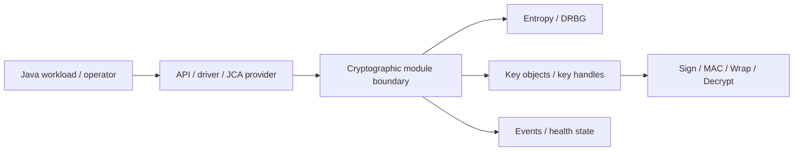
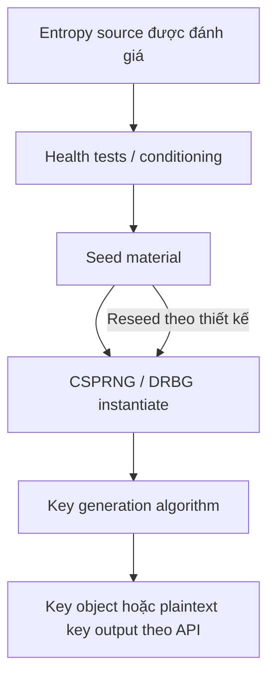
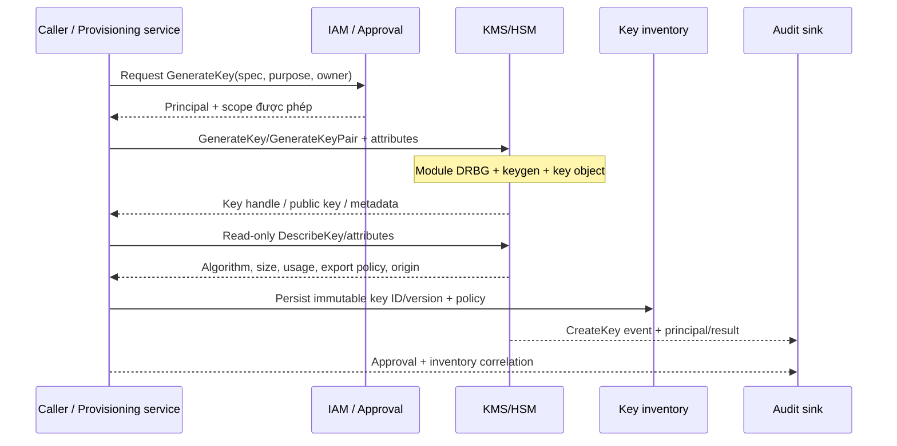
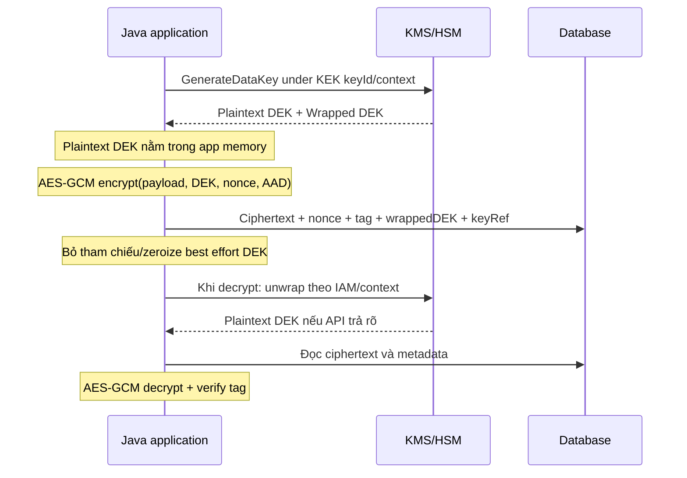
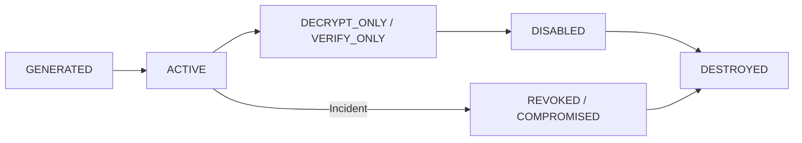
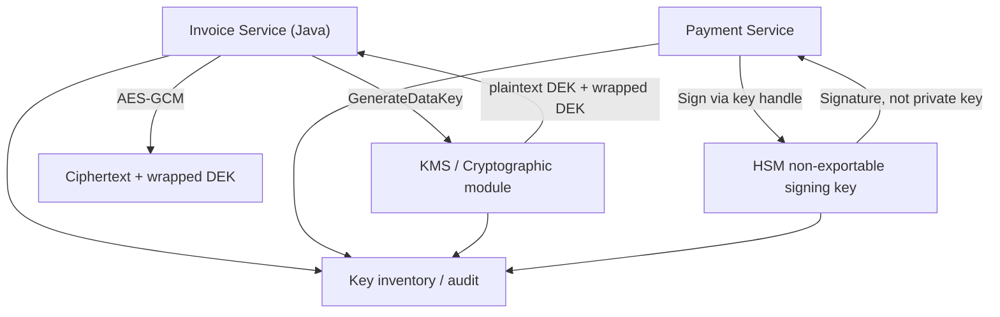

# Sinh key trong cryptographic module: Tạo vật liệu khóa tại ranh giới bảo mật đáng tin cậy

> **Chương:** Key generation  
> **Bài học:** Sinh key trong cryptographic module  
> **Module:** `SECURITY_KEY_MANAGEMENT_FUNDAMENTALS` — hiểu vòng đời khóa mật mã từ tạo, cấp phát, lưu trữ, sử dụng, xoay vòng đến thu hồi và hủy; kết hợp mật mã đối xứng/bất đối xứng, chữ ký số, KMS/HSM, envelope encryption, IAM và kiểm toán để bảo vệ khóa an toàn.

## 1. Tình huống mở đầu: Tạo khóa ở đâu mới quan trọng?

Một hệ thống xử lý thanh toán cần hai loại khóa:

- **Signing private key** của `Payment Service`: dùng ký lệnh thanh toán. Doanh nghiệp muốn private key không bao giờ xuất khỏi phần cứng bảo mật.
- **Data Encryption Key (DEK)**: dùng AES-GCM để mã hóa dữ liệu hóa đơn tại ứng dụng. Dịch vụ Java cần dùng một DEK trong bộ nhớ trong thời gian rất ngắn để mã hóa, sau đó chỉ lưu bản được bọc (wrapped DEK).

Có ba cách thường bị hiểu nhầm là tương đương:

```text
Phương án A:
    Java SecureRandom -> tạo khóa ở heap -> ghi database/plain config

Phương án B:
    KMS/HSM GenerateKey -> sinh và giữ key trong module
    Java chỉ gọi Sign/Decrypt/Wrap thông qua key handle

Phương án C:
    KMS GenerateDataKey -> sinh DEK trong hệ thống KMS
    -> trả plaintext DEK + encrypted/wrapped DEK cho ứng dụng
    -> Java mã hóa dữ liệu bằng plaintext DEK
```

**Phương án B và C không có cùng ranh giới bí mật.** Với B, khóa riêng hoặc KEK có thể được tạo và **không xuất dưới dạng rõ** khỏi thiết bị/mô-đun theo cấu hình. Với C, **plaintext DEK có chủ đích đi vào tiến trình ứng dụng**, dù nó được sinh từ nguồn ngẫu nhiên đáng tin trong hệ thống KMS.

**Sinh key trong cryptographic module** là sử dụng một thành phần mật mã được xác định rõ **ranh giới, thuật toán, nguồn ngẫu nhiên, cơ chế quản lý vật liệu khóa và quyền truy cập** để tạo khóa. Mục tiêu là **giảm rủi ro khi sinh và tiếp xúc key material**, chứ không đơn thuần gọi một API có tên `GenerateKey`.

Một hệ thống có thể dùng KMS/HSM để bảo vệ KEK và signing key, đồng thời dùng Java/JCA để xử lý DEK ở phía client. Điều quan trọng là phải chỉ ra **key nào xuất hiện ở đâu, ai có quyền dùng và bằng chứng nào chứng minh các giả định đó**.

### Mục tiêu học tập

Sau bài này, bạn có thể:

1. Phân biệt **cryptographic module**, **HSM**, **KMS**, **TPM**, **JCA provider** và **software CSPRNG**.
2. Giải thích **generation**, **derivation**, **import**, **unwrapping**, **key agreement** và **key transport**.
3. Hiểu đường đi **entropy source → DRBG/CSPRNG → key generation → key object/handle**.
4. Nhận diện các thuộc tính key như **sensitive**, **extractable**, **usage**, **key ID**, **lifetime** và **origin**.
5. Thiết kế luồng tạo AES/KEK/HMAC/private signing key đúng mục đích, tránh xuất khóa không cần thiết.
6. Đọc ví dụ **Java 17 JCA/JCE với provider được chỉ định tường minh** và hiểu giới hạn của demo.
7. Phân biệt **key generation tại module** với việc **KMS trả plaintext DEK** để dùng tại ứng dụng.
8. Xây dựng IAM, audit, rotation, incident response, backup/DR và negative tests cho quy trình sinh khóa.
9. Hiểu cách đánh giá tuyên bố **FIPS 140-3/CMVP** mà không nhầm “dùng KMS/HSM” với “mọi thứ đều được chứng nhận”.

---

## 2. Trước hết: Cryptographic module là gì?

### 2.1. Khái niệm ranh giới module

Một **cryptographic module** là tổ hợp phần cứng, phần mềm hoặc firmware thực hiện các chức năng mật mã trong một **ranh giới (cryptographic boundary)** được định nghĩa. Tùy thiết kế, ranh giới bao gồm thuật toán, bộ sinh số ngẫu nhiên, trạng thái và cơ chế xử lý/giữ khóa.

Ở cấp hệ thống, thường có các lớp:



Sơ đồ chỉ mang tính khái niệm. **Entropy source** có thể nằm trong hoặc ngoài cryptographic boundary, tùy mô-đun và thiết kế kiểm định; **audit service** cũng có thể nằm ngoài boundary. Không suy đoán vị trí thực chỉ từ sơ đồ.

**Cryptographic boundary** trả lời: dữ liệu và thao tác nào thuộc phần được kiểm soát theo thiết kế? Nhưng **security boundary của toàn hệ thống** còn bao gồm KMS control plane, IAM, mạng, máy chủ ứng dụng, nhân viên vận hành và quy trình khôi phục.

### 2.2. Không phải mọi thứ mang tên HSM/KMS đều tương đương

| Thành phần | Vai trò điển hình | Điều cần xác minh |
|---|---|---|
| **HSM** (Hardware Security Module) | Phần cứng chuyên dụng để quản lý và sử dụng khóa qua API an toàn. | Module/firmware thực tế, key attributes, policy, tenancy, backup và các thuật toán được hỗ trợ. |
| **Cloud KMS** | Dịch vụ quản lý khóa và API Create/Encrypt/Decrypt/Sign/Rotate. | Khóa nằm/được dùng ở đâu; loại key, service mode, IAM, key origin và plaintext outputs. |
| **TPM** | Thành phần phần cứng phục vụ identity, attestation, sealing và một số tác vụ khóa theo nền tảng. | Thuật toán/khả năng, endorsement hierarchy, policy, resource limits; không mặc nhiên là HSM đa dụng. |
| **Java JCA/JCE Provider** | Abstraction đưa thuật toán và thao tác mật mã tới ứng dụng Java. | Provider đó thực thi trong JVM, qua native OS hay thực sự chuyển tới token/HSM. |
| **Software cryptographic module** | Thư viện/phần mềm có boundary bảo mật được xác định. | Bản build, cấu hình, trạng thái approved mode nếu yêu cầu và vị trí key material trong RAM. |
| **Secrets Manager** | Lưu/phân phối secret theo IAM và lifecycle. | Không tự suy ra secret được **sinh** bên trong HSM hoặc non-exportable. |

**KMS là lớp dịch vụ quản lý**, không đồng nghĩa mỗi key trong KMS đều là private key không xuất được hoặc mọi thao tác client đều thực hiện bên trong HSM. Phải đọc **API semantics** của từng loại khóa và provider.

### 2.3. Ranh giới khóa cần được mô tả như đường đi dữ liệu

Đối với mỗi loại key, cần biết:

- **Ai** yêu cầu tạo?
- **Mật mã nào** sinh ra key?
- **Nguồn entropy/DRBG** ở đâu?
- **Key bytes** tồn tại ở đâu sau khi sinh?
- **Key có thể export** dưới dạng rõ hoặc wrapped không?
- **Ai** có quyền gọi cryptographic operations?
- **Key được lưu/persist/backup** theo cơ chế gì?
- **Log, crash dump và tracing** có thể giữ bản sao nào?
- **Khi rotate/disable/destroy**, còn bản sao hay phiên nào ở ngoài module?

Một kiến trúc an toàn không dừng lại ở câu “key tạo trong HSM”.

---

## 3. Đừng nhầm sinh khóa với các cách nhận khóa khác

### 3.1. Các thao tác khác nhau

| Thao tác | Mô tả | Rủi ro chính |
|---|---|---|
| **Generate key** | Sinh vật liệu khóa mới từ cơ chế ngẫu nhiên mật mã được thiết kế phù hợp. | Entropy yếu, sai thuật toán, sai scope, xuất khóa không cần thiết. |
| **Derive key** | Dẫn xuất từ input keying material/secret bằng KDF. | IKM yếu, sai context, không tách purpose, password yếu. |
| **Import key** | Đưa vật liệu đã tồn tại từ bên ngoài vào module. | Nguồn key không rõ, đã bị lộ, import không bảo vệ, bản sao bên ngoài. |
| **Unwrap key** | Khôi phục khóa được bọc dưới wrapping key. | Phân quyền unwrap quá rộng, không bind metadata/AAD, lộ raw key. |
| **Key agreement** | Các bên tính shared secret qua giao thức, ví dụ authenticated ECDHE. | MITM, replay, sai identity/transcript, lưu ephemeral state sai. |
| **Key transport** | Một bên sinh key và chuyển cho bên kia bằng cơ chế bảo vệ. | Sai recipient key, thiếu xác thực sender, chấp nhận gói cũ. |
| **Rekey / rotate** | Thay vật liệu hoặc khóa đang dùng theo lifecycle. | Nhầm alias cutover với DEK re-encryption, mất khả năng giải mã cũ. |

### 3.2. Sinh RSA key trong HSM khác import RSA key vào HSM

**Generate inside module:**

```text
HSM DRBG -> module key generation -> private key object
                                   -> private key handle
```

**Import from application:**

```text
App CSPRNG -> RSA private key ở host RAM
            -> import/wrap transport -> HSM key object
```

Sau import, object trong HSM có thể được đặt non-extractable theo khả năng provider. Nhưng private key đã từng tồn tại **ngoài HSM**. Không được kết luận nó “chưa bao giờ lộ khỏi HSM”.

Do đó key inventory cần trường `origin=GENERATED_IN_MODULE` khác `origin=IMPORTED`, cùng event/attestation hoặc provider metadata có căn cứ.

### 3.3. Derivation không tự tạo entropy

Ví dụ:

```text
password yếu -> PBKDF2/Argon2id -> KEK dài 32 byte
```

KEK dài 256 bit **không đồng nghĩa có 256 bit entropy** nếu passphrase dễ đoán. Password KDF tăng chi phí đoán, không thay thế CSPRNG khi mục đích là **sinh khóa ngẫu nhiên độc lập**.

HKDF cũng cần IKM có chất lượng phù hợp. Việc dẫn xuất key trong HSM không sửa được IKM có entropy thấp, trừ khi giao thức thực sự trộn thêm nguồn bí mật đủ bảo đảm và đánh giá đúng.

### 3.4. Unwrap không tương đương key generation

Khi hệ thống:

```text
Unwrap(KEK, wrappedDEK) -> DEK
```

nó đang **khôi phục vật liệu cũ**; không sinh một DEK mới. Nếu DEK đã bị lộ hoặc sinh từ seed yếu, unwrap rồi rewrap bằng KEK mạnh không làm DEK an toàn hơn. Muốn thay khóa nội dung phải **generate DEK mới và re-encrypt dữ liệu** theo phạm vi cần thiết.

---

## 4. Nguồn ngẫu nhiên: Điều kiện đầu tiên của key generation

### 4.1. Entropy source, seed và DRBG

Một quy trình sinh khóa điển hình:



Mô hình **không đòi entropy vật lý mới cho từng byte khóa**. Sau khi DRBG được khởi tạo từ seed đủ chất lượng và trạng thái được bảo vệ, nó có thể sinh nhiều output khó đoán theo cơ chế đã thiết kế.

Cần phân biệt:

- **Entropy source**: nguồn bất định với tính chất cần được đánh giá.
- **Seed**: dữ liệu nạp để khởi tạo/cập nhật trạng thái generator.
- **DRBG**: bộ sinh giả ngẫu nhiên mật mã xác định có state nội bộ.
- **Generate**: quá trình dùng output để tạo khóa đúng định dạng và tham số.
- **Reseed**: cập nhật trạng thái với seed material mới khi cơ chế/chính sách yêu cầu.

### 4.2. Vì sao random-looking output chưa đủ?

Một key 256 bit tạo bằng:

```text
SHA256(timestamp || processId)
```

có thể trông rất ngẫu nhiên nhưng đầu vào dễ đoán. Hash không làm tăng độ bất định của nguồn. Kẻ tấn công có thể tìm seed trong không gian nhỏ và khôi phục key.

**Không đánh giá nguồn entropy chỉ bằng việc nhìn hex dump, cân bằng bit 0/1 hoặc bài kiểm tra thống kê output.** Những phép thử có thể phát hiện lỗi thô, nhưng không chứng minh key bất khả dự đoán trong mô hình tấn công.

### 4.3. Entropy starvation và trạng thái lỗi

Trong thiết bị mới boot, IoT ít biến động, VM clone hoặc module có health check lỗi, nguồn seed có thể chưa sẵn sàng.

Một cryptographic module nghiêm túc có thể:

- Chờ khởi tạo nguồn đủ điều kiện.
- Trả mã lỗi/health error.
- Chặn thao tác keygen theo security policy.
- Yêu cầu thao tác reseed hoặc khởi tạo lại theo thủ tục.

**Không được giải quyết bằng cách thay DRBG bằng `Random`, seed cứng hay timestamp chỉ để tránh treo.**

Tuy nhiên, mọi lỗi `GenerateKey` không phải entropy starvation. Còn có nguyên nhân từ quota, slot/session, permission, key size unsupported, HSM offline, network timeout hoặc firmware lỗi. Chẩn đoán cần dựa vào metric/provider logs, không đoán từ latency.

### 4.4. VM snapshot và clone

Nếu hai VM khôi phục từ cùng trạng thái PRNG mà không có cơ chế unique state/reseed phù hợp, chúng có thể phát ra những chuỗi output trùng. Điều đó đe dọa key, token, nonce hoặc ephemeral secrets.

Mô-đun HSM tách biệt có thể giảm một phần rủi ro do host clone, nhưng không thay thế kiểm soát **đường tạo key còn tồn tại tại app**, **unique key ID** và **runtime state** của những phần mềm dùng CSPRNG riêng.

---

## 5. Sinh từng loại khóa trong cryptographic module

### 5.1. Symmetric key cho AES

AES theo FIPS 197 có những độ dài khóa được định nghĩa:

| Biến thể | Độ dài key | Byte |
|---|---:|---:|
| AES-128 | 128 bit | 16 |
| AES-192 | 192 bit | 24 |
| AES-256 | 256 bit | 32 |

Khi yêu cầu module sinh AES key, cần chỉ rõ:

```text
algorithm = AES
keySizeBits = 256
purpose = KEY_WRAP hoặc DATA_ENCRYPTION
origin = GENERATED_IN_MODULE
exportPolicy = theo mục đích
allowedOperations = theo key purpose
```

Một key AES-256 không được tự xem là an toàn nếu tồn tại plaintext trong cấu hình hoặc bị sử dụng cho nhiều mục đích không kiểm soát.

### 5.2. KEK: khóa bảo vệ khóa khác

**Key Encryption Key (KEK)** có nhiệm vụ bọc/giải bọc một hoặc nhiều DEK.

Ví dụ:

```text
KEK: được tạo và bảo vệ bởi KMS/HSM
DEK: được sinh theo yêu cầu và wrap dưới KEK
Ciphertext: mã hóa bằng DEK, không trực tiếp bằng KEK
```

**Ưu tiên bảo vệ KEK với phạm vi chặt chẽ** vì một KEK có thể bảo vệ nhiều bản DEK. Với HSM, có thể áp key attributes hạn chế export và chỉ cho phép các thao tác wrapping/unwrapping theo cơ chế được hỗ trợ.

### 5.3. DEK: hai mô hình phát hành khác nhau

**Mô hình 1 — DEK không rời module dưới dạng rõ:**

```text
App -> Encrypt keyHandle, plaintext
HSM -> ciphertext
```

App có thể không nắm raw DEK, nhưng phải gửi plaintext tới module/API và cân nhắc throughput, data locality, network và hỗ trợ thuật toán.

**Mô hình 2 — Sinh DEK trong KMS rồi trả plaintext cho app:**

```text
App -> KMS GenerateDataKey
KMS -> plaintext DEK + encrypted DEK
App -> AES-GCM Encrypt(plaintextDEK, applicationData)
App -> lưu ciphertext + wrapped DEK + metadata
```

Trong mô hình 2, **DEK đã ở trong bộ nhớ ứng dụng**. Cần giới hạn thời gian tồn tại, cấm log/dump secret, kiểm soát quyền `GenerateDataKey`, bảo vệ key context và không tạo bản sao bất hợp lý.

Không nên nói “dùng KMS GenerateDataKey nên DEK không rời module”. Điều này **sai với các API trả plaintext data key**.

### 5.4. HMAC key

HMAC key cần vật liệu bí mật khó đoán và đủ mạnh cho thuật toán/mô hình. Trong HSM có thể:

- Sinh symmetric secret key cho HMAC.
- Đánh dấu allowed operations là `SIGN`/`VERIFY` theo API MAC của module.
- Cấm export nếu ứng dụng chỉ cần gọi module `GenerateMac`/`VerifyMac`.
- Dùng key ID/version và phân tách theo đối tác/tenant/trust boundary.

**HMAC-SHA-256** có digest 256 bit, nhưng không suy ra `hmacKeyBits=256` chỉ từ tên thuật toán. Inventory phải lưu key spec thực tế.

### 5.5. Private signing key

Với Ed25519, ECDSA, RSA-PSS:

```text
Inside cryptographic module:
    GenerateKeyPair(...)
    private key: module object/handle
    public key: có thể phân phối qua PKI/trust registry
    Sign(data digest/transcript): authorized API
```

Private key nên không xuất dưới dạng rõ nếu policy yêu cầu. Public key thường có thể công khai nhưng **phải ràng buộc với danh tính được xác thực**; ai cũng có thể tự sinh một cặp khóa và ký.

Để chữ ký có ý nghĩa truy vết/chống chối bỏ, cần kiểm tra **quyền người yêu cầu Sign, bằng chứng phê duyệt, thời điểm, bản tin được ký, PKI và audit**, không chỉ tính chất non-exportable.

### 5.6. Khóa ECDH/X25519 và ephemeral secrets

Một bên có thể cần cặp khóa ephemeral cho một phiên authenticated key agreement. Cryptographic module có thể thực hiện key pair generation/agreement nếu provider hỗ trợ.

Cần xem:

- Ephemeral private key có được giữ trong module hay xuất ra JVM?
- Shared secret được trả ra ngoài hay chỉ có thể dùng cho `DeriveKey` bên trong?
- Public key có được chứng thực trong transcript với peer identity?
- Có chống replay và key confirmation?
- Session key có thời hạn dùng/ngừng dùng thế nào?

Việc tạo X25519 keypair trong HSM **không tự tạo một giao thức an toàn** nếu transcript, danh tính và freshness không được xác thực.

### 5.7. RSA key parameters

Một policy ví dụ có thể yêu cầu `RSA-3072` cho key ký mới trong một bối cảnh. Nhưng mức độ an toàn còn liên quan **padding** (ví dụ RSA-PSS cho chữ ký), hash, public exponent, nguồn sinh và khả năng bảo vệ private key.

RSA-3072 modulus **không có 3072 bit security strength**; mức cổ điển tương đương xấp xỉ 128 bit theo những bảng quy chiếu thường dùng. Khi kiểm kê phải phân biệt key length và security strength.

---

## 6. Key attributes: Quyết định liệu khóa có thể thoát khỏi module

Một HSM/cryptographic provider có thể cấp các thuộc tính cho key object tại lúc sinh. Cách biểu diễn phụ thuộc API. Với PKCS#11, có những tên thường gặp:

| Thuộc tính PKCS#11 | Ý nghĩa khái niệm | Lưu ý |
|---|---|---|
| `CKA_CLASS` | Loại object, ví dụ secret/private/public key. | Cần kết hợp key type và usage. |
| `CKA_KEY_TYPE` | Loại thuật toán khóa, ví dụ AES/RSA. | Không đủ cho key usage policy. |
| `CKA_TOKEN` | Object tồn tại trên token hay trong phạm vi session theo API. | Persistence cụ thể phụ thuộc module/provider. |
| `CKA_SENSITIVE` | Key material cần được bảo vệ khỏi tiết lộ qua API phù hợp. | Không đồng nghĩa mọi đường sao chép đều bất khả. |
| `CKA_EXTRACTABLE` | Key có được xuất/wrap theo capability của module không. | Kiểm tra hành vi/provider policy; không chỉ dựa vào tên label. |
| `CKA_ENCRYPT`, `CKA_DECRYPT` | Quyền áp dụng thao tác mã hóa/giải mã. | Không thay thế IAM của caller. |
| `CKA_SIGN`, `CKA_VERIFY` | Key được phép dùng ký/MAC hoặc verify theo cơ chế. | Phải có authorization/principal. |
| `CKA_WRAP`, `CKA_UNWRAP` | Khả năng bọc/giải bọc key objects. | Rủi ro lộ key qua cơ chế wrap sai thiết kế. |
| `CKA_DERIVE` | Cho phép dùng khóa làm input derivation. | Key separation và KDF context vẫn quan trọng. |
| `CKA_ID`, `CKA_LABEL` | Tham chiếu/nhãn đối tượng. | **Không phải bí mật** và không được dùng làm chứng minh quyền. |
| `CKA_ALWAYS_SENSITIVE`, `CKA_NEVER_EXTRACTABLE` | Thuộc tính phản ánh lịch sử nhạy cảm/không extractable theo semantics PKCS#11. | Có ý nghĩa khi do module/provider báo đúng, nhưng không chứng minh provenance ngoài module. |

### 6.1. Sensitive và non-extractable không cùng nghĩa

Một key có thể được bảo vệ tránh đọc trực tiếp nhưng vẫn được phép **wrap/export dưới dạng được bảo vệ**. Một key không extractable theo policy sẽ hạn chế khả năng đưa vật liệu ra ngoài qua cơ chế extract. Tùy provider, hai thuộc tính và cơ chế object creation khác nhau.

**Không suy ra:**

```text
Key is sensitive -> chắc chắn không thể xuất
Key is non-extractable -> không ai lạm dụng được key
```

Một attacker chiếm được credential có quyền `Sign` có thể yêu cầu ký những thông điệp trái phép dù không trích xuất private key.

### 6.2. Usage flags phải được thiết lập ngay khi generate

Trong một số module, key attributes được chốt hoặc hạn chế khả năng đổi sau khi key object tạo. Vì vậy, việc tạo khóa cần ràng buộc:

```text
key purpose: SIGNING
privateKey operations: SIGN
publicKey operations: VERIFY
exportable: false theo chính sách
```

Không nên tạo key với quyền rộng rồi “sửa sau” trong một bước không có giao dịch, vì có thể tạo cửa sổ lộ quyền hoặc quên bước hậu xử lý.

### 6.3. `getEncoded() == null` có đủ chứng minh non-exportable không?

**Không.** Trong Java, một đối tượng `Key` do provider trả có thể không có encoding hoặc không hỗ trợ xuất raw key. Nhưng **việc `getEncoded()` trả `null` không phải một chứng chỉ độc lập** rằng thiết bị đã vô hiệu hóa mọi cơ chế xuất hoặc mọi bản sao khóa chưa từng tồn tại ngoài module.

Cần kiểm chứng bằng:

- Provider/HSM key attributes thực tế.
- Chính sách và quyền export/wrap.
- Key origin/generation audit.
- Module security policy và kiểm thử an toàn.
- Trust boundary và quyền truy cập của host/client.

### 6.4. Key handle không phải secret

Một key handle, resource URI hoặc `CKA_LABEL` có thể lộ trong log mà không trực tiếp lộ key bytes. Tuy nhiên, nó vẫn có thể tiết lộ kiến trúc, tenant hoặc mục đích, và có thể bị dùng trong confused-deputy attack nếu service cho client tùy chọn handle.

Server phải resolve **principal + tenant + purpose → approved immutable key ID/handle**, không tin trực tiếp handle do caller tự khai.

---

## 7. Trong KMS/HSM: Luồng key generation an toàn nên như thế nào?

### 7.1. Các bước theo thứ tự



Đây là mô hình nghiệp vụ, không phải API chuẩn duy nhất. HSM/PKCS#11/KMS có **các lệnh, tính năng, ngữ nghĩa persist và tham số khác nhau**.

### 7.2. Pre-generation checks

Trước khi tạo:

1. Xác thực request principal và workload.
2. Kiểm tra `environment` (dev/stg/prod), account/region/tenant.
3. Kiểm tra `owner`, `purpose`, `algorithm`, `parameterSet`, `keyLengthBits`.
4. Xác định key có **non-exportable** hay được phép plaintext output hay không.
5. Xác định key state/lifecycle/cryptoperiod/rotation owner.
6. Kiểm tra quota, naming reservation và key ID uniqueness.
7. Kiểm tra quyền Create/Generate trong KMS/HSM và approval nếu cần.
8. Chọn đúng provider/module/firmware đã được phê duyệt.

**Không để người dùng cung cấp một chuỗi `kmsKeyId` tùy ý rồi dịch vụ dùng quyền admin để tạo/sử dụng khóa ngoài ranh giới của họ.**

### 7.3. Khi tạo xong, phải đối soát metadata

Việc API trả success chưa đủ để kết luận mọi thuộc tính đúng. Cần kiểm tra:

```text
algorithm, parameter set, key length
key usage / allowed operations
key class and key origin
non-exportable policy / module key attributes
immutable key ID, material version
owner, environment, tenant scope
createdAt, policyVersion, audit reference
```

Với HSM non-exportable, dùng **metadata API** để kiểm tra thay vì thử xuất raw key. Khi cần test export prohibition, phải làm trên test key và theo phương thức an toàn được nhà cung cấp hỗ trợ.

### 7.4. Idempotency và lỗi nửa chừng

Một nguy cơ vận hành:

```text
Provisioning -> HSM: GenerateKey
HSM tạo thành công key-42
Network timeout trước khi provisioning nhận response
Provisioning retry -> sinh thêm key-43
```

Nếu không có reconciliation, key-42 có thể trở thành **orphaned key**, không có owner, rotation policy hoặc inventory entry.

Giải pháp tùy API:

- Idempotency token hoặc request ID khi được hỗ trợ.
- State machine provisioning: `REQUESTED`, `CREATED`, `VERIFIED`, `ACTIVE`.
- Reconcile bằng resource ID, audit event hoặc key label/metadata đáng tin.
- Không retry tạo khóa một cách mù quáng.
- Có quy trình dọn orphaned key **sau khi** chứng minh không còn dependency.

### 7.5. Ghi nhận key origin

Metadata ví dụ:

```json
{
  "keyId": "hsm-key-0a91",
  "keyVersion": "v1",
  "purpose": "DIGITAL_SIGNATURE",
  "algorithm": "RSA-PSS",
  "parameterSet": "RSA-3072",
  "origin": "GENERATED_IN_MODULE",
  "exportPolicy": "NON_EXPORTABLE",
  "owner": "payment-signing-service",
  "environment": "prod",
  "state": "ACTIVE",
  "sourceRef": "hsm://example/partition/key-0a91",
  "createdAt": "2026-11-28T00:00:00Z",
  "policyVersion": "crypto-key-policy-example-v1"
}
```

Đây là **metadata minh họa**, không phải mô tả API provider thực. Không ghi raw private key, seed, passphrase, DEK hoặc HMAC secret vào inventory.

---

## 8. FIPS 140-3, CMVP và approved mode: Hiểu đúng mức độ bảo đảm

### 8.1. FIPS 140-3 đánh giá điều gì?

**FIPS 140-3** là tiêu chuẩn yêu cầu an toàn cho cryptographic modules, với quá trình đánh giá và công bố chứng nhận theo chương trình phù hợp (ví dụ NIST CMVP).

Đối tượng được đánh giá thường bao gồm **mô-đun cụ thể trong cấu hình/phiên bản nhất định**, các thuật toán, dịch vụ, cơ chế bảo vệ khóa và các giới hạn nêu trong **Security Policy** của mô-đun.

Không nên khẳng định:

```text
Ứng dụng dùng KMS -> toàn bộ ứng dụng đạt FIPS 140-3
HSM của nhà cung cấp đã từng được chứng nhận
  -> mọi version firmware và mọi cách gọi API đều hợp lệ
```

Cần kiểm tra certificate, Security Policy, phiên bản module, mode sử dụng, thuật toán được phép và phạm vi boundary thực tế.

### 8.2. Security Policy của module quan trọng hơn nhãn marketing

Một bảng đánh giá nên có:

| Hạng mục | Câu hỏi |
|---|---|
| **Module identifier** | Module nào, phiên bản nào, chứng nhận nào? |
| **Boundary** | Những thành phần nào nằm trong cryptographic boundary? |
| **Mode** | Approved mode được kích hoạt/thỏa điều kiện thế nào? |
| **Algorithm services** | Keygen, signing, RNG, wrap/unwrap nào được cho phép trong mode? |
| **Entropy/DRBG** | Cơ chế seed/DRBG và health requirements được mô tả ra sao? |
| **Key handling** | Key export/import, zeroization và roles/identity thế nào? |
| **Environment** | Firmware, phần cứng, OS/provider được hỗ trợ ở những cấu hình nào? |
| **Operational constraints** | Có self-tests, error states, dependencies hoặc điều kiện đặc biệt không? |

**Tuân thủ hệ thống** còn đòi ứng dụng dùng module đúng cách. Ví dụ phần mềm tự tạo DEK bằng timestamp rồi chỉ wrap dưới KEK của HSM vẫn có thể chứa điểm yếu **ngoài boundary**.

### 8.3. Các tài liệu chuẩn liên quan

- **FIPS 140-3:** yêu cầu bảo mật đối với cryptographic modules.
- **NIST SP 800-90A:** thiết kế các DRBG.
- **NIST SP 800-90B:** đánh giá entropy source.
- **NIST SP 800-90C:** cấu trúc random bit generator kết hợp nguồn entropy và cơ chế sinh.
- **NIST SP 800-133:** khuyến nghị về sinh khóa mật mã.
- **NIST SP 800-57:** vòng đời, mục đích, cryptoperiod và security strength của khóa.

**Không tự suy ra một tổ hợp module/DRBG là đã validated** chỉ vì sử dụng thuật toán được nêu trong tiêu chuẩn. Cần kiểm tra chứng nhận/scope của cấu hình thực tế khi compliance bắt buộc.

---

## 9. Java 17: JCA/JCE là abstraction, không phải bằng chứng key nằm trong HSM

### 9.1. Provider quyết định đường thực thi

Java có giao diện:

```java
KeyGenerator.getInstance("AES");
KeyPairGenerator.getInstance("RSA");
Signature.getInstance("SHA256withRSA");
Cipher.getInstance("AES/GCM/NoPadding");
```

Nếu gọi như trên **mà không chỉ định provider**, JCA chọn provider theo cấu hình runtime. Trong nhiều cấu hình phổ biến, key material có thể được tạo/giữ trong phần mềm.

Muốn làm việc với HSM qua JCA, cần cấu hình provider thích hợp (ví dụ provider dựa trên PKCS#11 được tích hợp hỗ trợ trên runtime), kiểm tra thuật toán provider và dùng **explicit provider selection** ở những code path bắt buộc.

**Không đồng nhất** một API Java với bảo đảm “sinh trong module”. Phải biết provider thực hiện thao tác ở đâu, object class/key attributes và cách kết nối tới module.

### 9.2. Software `SecureRandom` có thể rất phù hợp nhưng không tương đương HSM

Ví dụ:

```java
SecureRandom rng = new SecureRandom();
byte[] dek = new byte[32];
rng.nextBytes(dek);
```

Đây có thể là cách dùng CSPRNG chuẩn để sinh vật liệu khóa trong JVM theo một policy chấp nhận, **không phải bằng chứng khóa được sinh bên trong HSM**.

Nếu yêu cầu key non-exportable thì sinh mảng byte trong heap ngay từ đầu **không đáp ứng yêu cầu**. Ngược lại, một DEK cần mã hóa dữ liệu tốc độ cao trong ứng dụng có thể cố ý được cấp plaintext qua KMS và được bảo vệ bằng chính sách runtime.

### 9.3. SunPKCS11 là adapter, không phải tên module có đủ nghĩa

Trong một môi trường Java có provider PKCS#11 được cấu hình, tên provider có thể chứa hậu tố cấu hình riêng. Ví dụ:

```text
SunPKCS11-MyTestToken
```

Chỉ minh họa cách nhận diện. Tên provider thực tế và khả năng hỗ trợ được xác định bởi hệ thống đang chạy.

**Không gọi `Security.getProvider("SunPKCS11")` và mặc định rằng nó đã gắn với HSM production.** Phải chọn đúng provider đã được cấu hình, được nhà cung cấp hỗ trợ và xác minh trạng thái module.

---

## 10. Java 17: Ví dụ tạo khóa bằng provider được chỉ định

Đoạn chương trình dưới đây **chỉ dành cho test token/module được cấp phép** và minh họa cách chọn **provider tường minh**. Nó có thể tạo key objects thực trên provider, tiêu thụ quota/session và cần authorization; vì vậy không tự chạy trên production HSM khi chưa có kế hoạch.

Mục tiêu:

1. Chọn provider theo tên cấu hình **đã được người vận hành phê duyệt**.
2. Xác minh provider có dịch vụ `KeyGenerator.AES` và `KeyPairGenerator.RSA`.
3. Yêu cầu AES-256 và RSA-3072 qua provider.
4. Ghi nhận metadata **không nhạy cảm** của kết quả.
5. Không gọi `getEncoded()` để đọc key bytes và không log private key.
6. Nhấn mạnh: **Java API không xác minh toàn bộ thuộc tính non-exportable**; vẫn phải dùng metadata/attributes của HSM.

```java
import java.security.GeneralSecurityException;
import java.security.KeyPair;
import java.security.KeyPairGenerator;
import java.security.Provider;
import java.security.Security;
import java.security.interfaces.RSAPublicKey;

import javax.crypto.KeyGenerator;
import javax.crypto.SecretKey;

public final class ModuleBackedKeyGenerationDemo {

    private ModuleBackedKeyGenerationDemo() {}

    public static void main(String[] args)
            throws GeneralSecurityException {

        if (args.length != 1) {
            throw new IllegalArgumentException(
                    "Pass the exact configured, approved provider name");
        }

        // Tên do operator cấu hình; không lấy từ input client tùy ý.
        String configuredProviderName = args[0];
        Provider provider = Security.getProvider(configuredProviderName);

        if (provider == null) {
            throw new IllegalStateException(
                    "Approved crypto provider was not registered");
        }

        if (provider.getService("KeyGenerator", "AES") == null
                || provider.getService("KeyPairGenerator", "RSA") == null) {
            throw new IllegalStateException(
                    "Provider lacks required key generation services");
        }

        // Ví dụ AES keygen trong provider được chọn.
        KeyGenerator aes = KeyGenerator.getInstance("AES", provider);
        aes.init(256);
        SecretKey secretKey = aes.generateKey();

        // Chỉ in metadata không nhạy cảm.
        System.out.println(
                "Provider: " + provider.getName());
        System.out.println(
                "AES requested bits: 256");
        System.out.println(
                "AES algorithm: " + secretKey.getAlgorithm());

        // Ví dụ RSA keygen: chỉ kiểm tra modulus qua PUBLIC key.
        KeyPairGenerator rsa =
                KeyPairGenerator.getInstance("RSA", provider);
        rsa.initialize(3072);
        KeyPair pair = rsa.generateKeyPair();

        RSAPublicKey publicKey =
                (RSAPublicKey) pair.getPublic();
        System.out.println(
                "RSA modulus bits: "
                + publicKey.getModulus().bitLength());

        // KHÔNG in secretKey.getEncoded().
        // KHÔNG in pair.getPrivate().getEncoded().
        // Không kết luận non-exportable chỉ từ output này.
        // Đọc lại CKA_* / keySpec / origin qua API đáng tin.
    }
}
```

### 10.1. Cách hiểu kết quả

Ví dụ output kỳ vọng nếu provider hỗ trợ đầy đủ:

```text
Provider: SunPKCS11-MyTestToken
AES requested bits: 256
AES algorithm: AES
RSA modulus bits: 3072
```

Kết quả này **không phải báo cáo đã chạy thử**; phụ thuộc cấu hình token/PKCS#11/JDK, quyền session, thuật toán và firmware.

**Điều chương trình chứng minh:** JCA được yêu cầu thực thi thao tác keygen qua **provider được chọn** và có thể thu được public key metadata.

**Điều nó không chứng minh:**

- Provider thật sự kết nối đúng HSM/firmware đã phê duyệt.
- Key object có `CKA_EXTRACTABLE=false`.
- Private key chưa từng xuất hiện ở host khi module thuộc mô hình phần mềm khác.
- Chứng nhận FIPS hoặc approved mode đang hợp lệ.
- Có key persistence, key version/label và rotation đúng.
- Tất cả tác vụ sử dụng key cũng được route về cùng provider.
- IAM/tenant authorization thực sự đủ hẹp.

### 10.2. Tại sao không truyền một `SecureRandom` bất kỳ vào keygen?

Một số API JCA nhận tham số `SecureRandom`. Nhưng nếu yêu cầu **sinh trong cryptographic module dùng RNG nội bộ**, phải xác nhận semantics provider. Truyền một `SecureRandom` của host vào `KeyPairGenerator.initialize(...)` **không chứng minh** module đã dùng host seed, cũng không chứng minh **không dùng** host seed.

Ví dụ trên không chỉ định RNG vì mục đích là minh họa provider-backed keygen, **nhưng vẫn cần xác minh theo Security Policy và tài liệu provider**. Không nên suy đoán chỉ qua chữ ký phương thức Java.

### 10.3. Tạo key chưa chắc đồng nghĩa lưu persistent key

Một HSM/PKCS#11 provider có thể tạo **session object** hoặc **token object** theo attributes/config. Một số object chỉ tồn tại trong session; một số được persist và cần label/ID/cleanup.

Khi requirement là “tạo signing key lâu dài”, cần kiểm tra:

- Key object tồn tại qua logout/restart theo đúng policy.
- Stable handle/key ID và registry mapping.
- Non-exportable và usage attributes.
- Hệ thống backup/recovery phù hợp nếu cho phép.
- Private key không bị lộ ở bước provisioning.

Đoạn code JCA bên trên **không tự thực hiện những việc này**.

### 10.4. Nếu token/provider không hỗ trợ thuật toán?

Không âm thầm fallback từ HSM provider sang software provider cho một private key bắt buộc non-exportable. Cần **fail closed** và trả lỗi cấu hình rõ ràng.

Với một số workloads, policy có thể chấp nhận software provider/CSPRNG cho ephemeral keys hoặc DEKs; trường hợp đó phải là **quyết định thiết kế rõ ràng**, không là fallback ngoài ý muốn khi HSM offline.

---

## 11. Java 17: Kiểm tra yêu cầu tạo key trước khi gọi module

Phần mềm provisioning có thể dùng một policy guard độc lập với provider. Ví dụ dưới đây minh họa:

- Chỉ chấp nhận những **mục đích** đã được định nghĩa.
- Khóa ký production phải **không xuất raw private key** theo policy.
- AES DEK/KEK được xử lý khác RSA signing.
- Principal phải có quyền tạo cho tenant, môi trường và operation.
- Quyết định có **reason code** để test và audit.

Đây là **policy demo**, không phải bộ quy tắc crypto chuẩn cho mọi tổ chức.

```java
import java.util.Objects;
import java.util.Set;

public final class KeyGenerationPolicyDemo {

    enum Purpose {
        DATA_ENCRYPTION,
        KEY_WRAP,
        DIGITAL_SIGNATURE,
        MESSAGE_AUTH
    }

    record Principal(
            String id,
            String tenantId,
            String environment,
            Set<Purpose> allowedPurposes) {
        Principal {
            Objects.requireNonNull(id);
            Objects.requireNonNull(tenantId);
            Objects.requireNonNull(environment);
            allowedPurposes = Set.copyOf(allowedPurposes);
        }
    }

    record GenerationRequest(
            String tenantId,
            String environment,
            Purpose purpose,
            String algorithm,
            int keyBits,
            boolean exportablePlaintext) {}

    record Decision(boolean allowed, String reason) {
        static Decision permit() {
            return new Decision(true, "ALLOW");
        }
        static Decision deny(String reason) {
            return new Decision(false, reason);
        }
    }

    static Decision validate(
            Principal principal,
            GenerationRequest request,
            String authenticatedTenant,
            String trustedEnvironment) {

        if (principal == null || request == null
                || request.purpose() == null
                || request.algorithm() == null) {
            return Decision.deny("INVALID_REQUEST");
        }

        if (!principal.tenantId().equals(authenticatedTenant)
                || !request.tenantId().equals(authenticatedTenant)) {
            return Decision.deny("TENANT_MISMATCH");
        }

        if (!principal.environment().equals(trustedEnvironment)
                || !request.environment().equals(trustedEnvironment)) {
            return Decision.deny("ENVIRONMENT_MISMATCH");
        }

        if (!principal.allowedPurposes().contains(request.purpose())) {
            return Decision.deny("PURPOSE_NOT_GRANTED");
        }

        return switch (request.purpose()) {
            case DATA_ENCRYPTION ->
                    request.algorithm().equals("AES")
                    && (request.keyBits() == 128
                        || request.keyBits() == 256)
                    ? Decision.permit()
                    : Decision.deny("DEK_ALGORITHM_POLICY");

            case KEY_WRAP ->
                    !request.exportablePlaintext()
                    && request.algorithm().equals("AES")
                    && request.keyBits() == 256
                    ? Decision.permit()
                    : Decision.deny("KEK_NON_EXPORTABLE_REQUIRED");

            case DIGITAL_SIGNATURE ->
                    !request.exportablePlaintext()
                    && request.algorithm().equals("RSA-PSS")
                    && request.keyBits() >= 3072
                    ? Decision.permit()
                    : Decision.deny("SIGNING_KEY_POLICY");

            case MESSAGE_AUTH ->
                    !request.exportablePlaintext()
                    && request.algorithm().equals("HmacSHA256")
                    && request.keyBits() >= 256
                    ? Decision.permit()
                    : Decision.deny("HMAC_KEY_POLICY");
        };
    }

    public static void main(String[] args) {
        Principal paymentService = new Principal(
                "payment-service", "merchant-a", "prod",
                Set.of(Purpose.DATA_ENCRYPTION, Purpose.KEY_WRAP));

        GenerationRequest goodKek = new GenerationRequest(
                "merchant-a", "prod", Purpose.KEY_WRAP,
                "AES", 256, false);
        GenerationRequest badKek = new GenerationRequest(
                "merchant-a", "prod", Purpose.KEY_WRAP,
                "AES", 256, true);
        GenerationRequest anotherTenant = new GenerationRequest(
                "merchant-b", "prod", Purpose.KEY_WRAP,
                "AES", 256, false);

        System.out.println(validate(
                paymentService, goodKek, "merchant-a", "prod").reason());
        System.out.println(validate(
                paymentService, badKek, "merchant-a", "prod").reason());
        System.out.println(validate(
                paymentService, anotherTenant, "merchant-a", "prod").reason());
    }
}
```

### 11.1. Kết quả dự kiến

```text
ALLOW
KEK_NON_EXPORTABLE_REQUIRED
TENANT_MISMATCH
```

### 11.2. Điểm giới hạn quan trọng

Kết quả `ALLOW` **không có nghĩa** module thực sự đã tạo key an toàn. Guard này chỉ xác nhận yêu cầu **phù hợp policy của ứng dụng**.

Khi phát lệnh:

1. KMS/HSM IAM phải xác minh principal và grants độc lập.
2. Tạo key với **attributes thực** phù hợp `exportPolicy`, usage, persistence.
3. Đọc metadata sau tạo và verify.
4. Ghi key ID/version, owner, purpose, origin vào inventory.
5. Audit request/result, không log raw key.
6. Nếu metadata sai, **không activate**, xử lý object theo runbook.

Ví dụ dùng RSA-PSS `keyBits>=3072` để mô tả rule cấp bài học. Trong thực tế cần whitelist thuật toán/parameter set theo standard hiện hành; không phải mọi key lớn hơn bất kỳ đều tự được phép và không nên cho key size không giới hạn. Policy cũng phải quy định OAEP/PSS parameters, cryptoperiod và approved modes.

---

## 12. Sinh KEK trong HSM và dùng envelope encryption

### 12.1. Luồng chuẩn



**Không phải mọi KMS có cùng API `GenerateDataKey` hoặc cùng return shape.** Sơ đồ dựa vào lớp API phổ biến có thể trả cả plaintext và wrapped data key.

### 12.2. Ranh giới bảo mật

| Vật liệu | Ở đâu? | Điều gì bảo vệ? |
|---|---|---|
| **KEK** | Trong KMS/HSM hoặc theo service model. | Key policy, cryptographic module, IAM, audit, cryptoperiod. |
| **Plaintext DEK** | Trong ứng dụng tại thời điểm sử dụng, nếu API trả plaintext. | Workload isolation, memory hygiene, least privilege, không log/dump. |
| **Wrapped DEK** | Database/object storage bên cạnh ciphertext. | Tính bảo mật và toàn vẹn của wrapping mechanism, key reference/context. |
| **Ciphertext** | Storage/backup. | AEAD và key management, version, nonce, AAD. |
| **Metadata** | Application DB/inventory. | Integrity, authorization, anti-rollback khi cần. |

Điểm dễ nhầm: chỉ vì KEK non-exportable không có nghĩa **DEK không thể bị lộ từ Java process**. Với dữ liệu nhạy cảm cao, phải cân nhắc threat model của app memory và có thể dùng dịch vụ crypto server-side nếu phù hợp.

### 12.3. Không lưu raw DEK cạnh ciphertext

Sai:

```json
{
  "ciphertext": "...",
  "rawDekBase64": "...",
  "nonce": "..."
}
```

Đúng về nguyên tắc:

```json
{
  "ciphertext": "...",
  "wrappedDek": "...",
  "wrappingKeyId": "immutable-key-id-or-version",
  "nonce": "...",
  "aeadAlgorithm": "AES-256-GCM",
  "aadVersion": 2
}
```

JSON chỉ là minh họa. Cần thiết kế **serialization version, tag, AAD, nonce uniqueness** và error handling thực tế.

### 12.4. AAD và encryption context

Đối với ứng dụng đa tenant, AAD có thể ràng buộc:

```text
protocolVersion
tenantId
objectId
purpose
keyMaterialVersion
```

Giá trị phải lấy từ **ngữ cảnh đã xác thực/được cấp quyền**, không chỉ từ input client. KMS encryption context nếu được hỗ trợ cũng phải có canonicalization/authorization đúng.

Encryption context có thể giúp ràng buộc wrapper với metadata, nhưng **không thay thế** IAM hoặc kiểm tra tenant/resource của ứng dụng.

### 12.5. AES-GCM nonce vẫn phải duy nhất

Dù DEK được sinh từ cryptographic module, nếu ứng dụng dùng lại nonce AES-GCM dưới cùng DEK, tính an toàn có thể bị phá hỏng.

Cần:

- Nonce strategy phù hợp (random 96 bit với giới hạn sử dụng hoặc counter được quản lý).
- Không trùng nonce dưới cùng key qua nhiều instance/restart.
- Key usage limits và rotation phù hợp.
- AAD và authentication tag có trong record.
- Xử lý replay/rollback ciphertext ở tầng giao thức/storage nếu cần.

**Nguồn DEK tốt không sửa được lỗi nonce hoặc replay.**

---

## 13. KMS `GenerateDataKey` và HSM `GenerateKey`: Không đánh đồng

### 13.1. So sánh ba mô hình

| Mô hình | Vị trí sinh | Plaintext key có ở app? | Điển hình |
|---|---|---|---|
| **HSM GenerateKey non-extractable** | Module/HSM | Không qua API bình thường theo policy/attributes. | KEK, long-term signing key, MAC key với thao tác trong HSM. |
| **KMS GenerateDataKey trả plaintext** | KMS service/module theo kiến trúc provider | **Có**, API trả plaintext DEK. | Envelope encryption tại client. |
| **Java KeyGenerator software** | JVM/provider phần mềm | **Có hoặc có thể truy cập được trong process/provider** theo implementation. | Ephemeral DEK và các trường hợp policy cho phép. |

**Không nên dựa vào tên “GenerateKey” để suy ra key output.** Phải đọc API contract và trạng thái `exportable` thực.

### 13.2. API có lựa chọn không trả plaintext DEK

Một số hệ KMS có API hoặc mode sinh data key **chỉ trả wrapped/encrypted key**, phù hợp khi plaintext sẽ được đưa sang bên xử lý khác hoặc giữ kín tới khi thực sự cần.

Nhưng **ciphertext của data key không tự cho phép mã hóa payload tại ứng dụng** nếu ứng dụng chưa có cách được ủy quyền để sử dụng/unwrap key. Phải thiết kế toàn bộ data flow thay vì chỉ chọn API “without plaintext” rồi giả định dữ liệu đã an toàn.

### 13.3. Key non-exportable vẫn có thể bị lạm dụng qua operations

Một kẻ tấn công chiếm workload có quyền `Sign` có thể tạo chữ ký cho dữ liệu trái phép bằng key HSM, dù không xuất được private key.

Vì vậy:

```text
Non-exportability -> giảm rủi ro trích xuất vật liệu.
IAM/authorization -> giới hạn ai, thao tác nào, dữ liệu nào.
Audit/approval     -> phát hiện và kiểm soát lạm dụng.
```

Ba nhóm control bổ sung nhau.

---

## 14. IAM, attestation, approval và kiểm soát quyền

### 14.1. Quyền tối thiểu theo key purpose

| Vai trò | Có thể cần | Không nên được cấp mặc định |
|---|---|---|
| **Key Provisioner** | Tạo key theo spec/approval; đọc metadata. | `Decrypt` toàn tenant hoặc export raw key. |
| **Signing Workload** | `Sign` trên key ID được phép với mục đích cụ thể. | `Decrypt` dữ liệu tài chính, thay key policy, destroy. |
| **Data Writer** | `GenerateDataKey` hoặc mã hóa theo KEK được phép. | `ScheduleDeletion`, `ExportKey`, Sign bằng CA key. |
| **Data Reader** | `Decrypt/Unwrap` đúng tenant/object theo policy. | Truy cập mọi key cross-tenant. |
| **Key Administrator** | Rotate/disable và lifecycle theo workflow. | Mặc nhiên đọc plaintext ứng dụng. |
| **Auditor** | Đọc audit/key metadata và compliance evidence. | Decrypt, Sign, xuất key, sửa log. |
| **Recovery Operator** | Recovery trong cửa sổ được phê duyệt. | Quyền vĩnh viễn tự phê duyệt mọi thao tác. |

### 14.2. Segregation of duties

Những tác vụ có rủi ro cao có thể yêu cầu hai người/phê duyệt độc lập:

- Thay đổi key policy/grants của KEK cấp tổ chức.
- Import/BYOK hoặc thay recovery credentials.
- Tạo root/signing key có phạm vi lớn.
- Export key trong môi trường được phép.
- Khôi phục/hủy vĩnh viễn private key hoặc KEK còn dependency.

**Phải phân biệt hai sự chấp thuận độc lập với hai lần click của cùng một principal.**

### 14.3. Attestation nên được hiểu đúng

Một số thiết bị/hệ thống có thể cung cấp bằng chứng attestation về key origin hoặc môi trường. Nhưng attestation **có phạm vi cụ thể**:

- Có thể chứng minh key được gắn với thiết bị/trạng thái nào.
- Không tự chứng minh danh tính người dùng thực sự có quyền.
- Không chứng minh mọi ciphertext ứng dụng đều an toàn.
- Cần xác minh chain, challenge freshness, Security Policy và thuật toán của chứng cứ.

Không dùng chuỗi `"origin": "HSM"` do ứng dụng tự ghi làm bằng chứng attestation.

### 14.4. Không cho client tùy ý chọn key handle

Sai:

```java
// Đừng chấp nhận resource ID có quyền cao do client khai.
kms.sign(request.getKeyId(), request.getMessage());
```

Cần:

1. Xác thực principal.
2. Xác định tenant, environment, purpose từ server.
3. Resolve logical name qua registry đáng tin.
4. Kiểm tra allowed operations và key state.
5. Gọi KMS trên immutable key ID/resource được cấp quyền.
6. Audit key ID/version và request correlation.

Đây là cách giảm **confused deputy** khi một backend có quyền KMS rộng hơn người gửi request.

---

## 15. Key inventory: Chứng minh khóa đã được sinh ở đâu

### 15.1. Schema metadata tối thiểu

Một bản ghi nên có:

| Field | Ý nghĩa |
|---|---|
| `logicalName` | Tên nhiệm vụ logic, ổn định khi rotation. |
| `keyId`, `materialVersion` | Định danh bất biến của key object/vật liệu. |
| `algorithm`, `parameterSet` | AES-256, RSA-3072, Ed25519 hoặc named set thích hợp. |
| `lengthKind`, `keyLengthBits` | Phân biệt AES bits, RSA modulus, EC group; không đo PEM length. |
| `keyPurpose` | DEK, KEK, HMAC, signing, key agreement. |
| `origin` | `GENERATED_IN_MODULE`, `IMPORTED`, `DERIVED`, `APPLICATION_GENERATED`. |
| `moduleRef`, `providerVersion` | Module/provider thực tế và cấu hình được duyệt. |
| `exportPolicy`, `usageAttributes` | Non-exportable, Sign/Wrap/Decrypt/Derive, theo khả năng. |
| `environment`, `tenantScope`, `owner` | Trust boundary và trách nhiệm. |
| `createdAt`, `activateAt`, `rotateBy` | Vòng đời và cryptoperiod. |
| `keyState` | ACTIVE, DECRYPT_ONLY, DISABLED, DESTROY_PENDING, DESTROYED. |
| `auditRef` | Correlation với lệnh GenerateKey/approval. |
| `policyVersion`, `lastVerifiedAt` | Quy tắc và thời điểm đối soát. |

**Không lưu raw key, private key, seed hoặc passphrase trong inventory.**

### 15.2. Source of truth và metadata consistency

Nếu một app khai:

```text
origin=GENERATED_IN_MODULE
exportPolicy=NON_EXPORTABLE
```

nhưng HSM metadata cho thấy object đã import hoặc có thể extract, hệ thống phải báo **drift/conflict**, không âm thầm sửa báo cáo cho đẹp.

Ưu tiên evidence từ provider đáng tin, kèm **bằng chứng provenance** khi cần; một flag nội bộ ở database không thay thế bảo đảm thực của module.

### 15.3. Khóa được sinh bên ngoài vẫn cần inventory

Không phải mọi khóa bắt buộc phải nằm trong KMS. Ví dụ ephemeral X25519 key hoặc DEK tạo bằng software CSPRNG được policy cho phép vẫn cần:

- Algorithm/size/parameter set.
- Origin/source và crypto library/provider.
- Purpose, scope, thời hạn sử dụng.
- Key ID/reference khi có lưu dữ liệu.
- Lifecycle/audit tùy mức rủi ro.

Một inventory chỉ liệt kê HSM keys có thể bỏ sót **rất nhiều DEK thực tế** trong envelope encryption.

---

## 16. Rotation và key lifecycle sau khi sinh

### 16.1. Các trạng thái chính



Đây là state model minh họa. KMS/HSM thực tế có state khác nhau, khả năng recovery và thời hạn xóa khác nhau. Việc chuyển tới `DESTROYED` cần kiểm tra dữ liệu/chứng cứ còn phụ thuộc.

### 16.2. KEK rotation

Nếu KEK-v3 bảo vệ nhiều DEK và KEK-v4 được sinh trong module:

```text
DEK giữ nguyên
wrappedDEK_v3 -> unwrap/rewrap -> wrappedDEK_v4
content ciphertext có thể không đổi
```

**Có thể** không cần mã hóa lại nội dung nếu DEK còn an toàn và rewrap được thực hiện đúng. Tuy nhiên, key origin, access controls, AAD, version metadata, backups và old wrapping copies vẫn phải xử lý.

### 16.3. DEK rotation

Nếu DEK cũ bị lộ hoặc không đáp ứng policy:

```text
DEK_old -> DEK_new (CSPRNG/KMS approved)
decrypt old ciphertext -> encrypt mới dưới DEK_new
```

**Rewrap cùng DEK cũ không sửa được vấn đề lộ hoặc yếu entropy của DEK.** Cần re-encrypt dữ liệu theo phạm vi và xem các bản sao backup/snapshot.

### 16.4. Signing key rotation

Khi tạo private signing key mới:

- Đăng ký immutable key ID/version và public key tương ứng.
- Nếu dùng chứng thư, phát hành và xác minh certificate/chain đúng.
- Chuyển việc ký mới sang key mới theo chính sách.
- Giữ khả năng verify chứng cứ lịch sử theo retention.
- Không cho untrusted request chọn public key tùy ý qua `kid`.
- Khi compromise, đánh giá cả tính tin cậy chữ ký đã phát hành, audit và timestamp.

### 16.5. Destroy và zeroization

`Destroy` trong module không tự xóa **mọi bản copy ở ngoài module** nếu trước đó key đã export/import, backup hoặc plaintext DEK tồn tại trên host.

Cần phân biệt:

- Xóa/zeroize key object trong module theo cơ chế được hỗ trợ.
- Hủy key version và key material ở các replica/HA theo policy.
- Dọn cache ứng dụng và giới hạn memory exposure.
- Xử lý wrapped copies/backups và key dependencies.
- Giữ bằng chứng quản trị/audit theo thời hạn.

Với Java, `Arrays.fill()` là **best effort cho một byte array cụ thể**, không đảm bảo mọi bản sao key do JVM/provider/GC tạo ra đều bị xóa. Đối với yêu cầu zeroization nghiêm ngặt, cần xem security boundary và cơ chế của HSM/module.

---

## 17. Backup, high availability và disaster recovery

### 17.1. Non-exportable có nghĩa backup thế nào?

Một private key non-exportable có thể không được xuất ở dạng rõ qua API, nhưng một hệ thống HSM vẫn có **cơ chế backup/replication chuyên dụng** được bảo vệ phù hợp (tùy loại, chính sách và nhà cung cấp).

Vì vậy cần hỏi:

- Có được phép backup theo security policy không?
- Key được replicate dưới dạng nào?
- Quorum/authorization cho backup và restore?
- Bản restore có giữ **key ID/version** hoặc mapping chính xác không?
- Backup có bao gồm key attributes/policies hay chỉ material?
- Sau restore có replay/rollback state hoặc quyền cũ không?

**Không mặc định non-exportable nghĩa là không thể phục hồi**, cũng không mặc định mọi HSM cung cấp backup an toàn.

### 17.2. Không tạo “root key thứ hai” sai kiểm soát

Để DR, một số đội tự xuất raw KEK rồi lưu vào file đã zip/password-protect. Cách này có thể phá vỡ mục tiêu non-exportable.

Recovery phải dùng **cơ chế được nhà cung cấp và policy phê duyệt**, với role separation và bằng chứng. Nếu cần key escrow, phải có threat model và quyền truy cập rõ ràng, không triển khai ad hoc.

### 17.3. Kiểm thử khả năng đọc dữ liệu cũ

Một bài kiểm thử DR an toàn cần:

1. Chọn ciphertext/wrapped DEK test thuộc nhiều key versions.
2. Khôi phục inventory/key reference tương ứng.
3. Xác minh module/KMS đã sẵn sàng đúng permissions.
4. Unwrap/decrypt bản mẫu bằng context hợp lệ.
5. Kiểm tra AEAD authentication tag/chữ ký.
6. Xác nhận logging, latency và audit.
7. Đảm bảo restore không làm active alias rollback về key bị retire.

**Key generation tốt nhưng DR làm mất key vẫn khiến dữ liệu không thể phục hồi.**

### 17.4. Multi-region và tenant isolation

Một cloud KMS có thể hỗ trợ multi-region key hoặc cross-region replica theo cấu trúc provider. Nhưng:

- Không mặc định key material và state tự đồng bộ theo mọi region.
- Không cho global replica phá ranh giới tenant hoặc data residency.
- Không thay key ID/version trong ciphertext bằng alias động của region.
- Kiểm tra độ trễ failover và quyền principal ở site khôi phục.
- Audit cả hoạt động replicate/import/export/restore được phép.

---

## 18. Chẩn đoán lỗi key generation

### 18.1. Phân nhóm lỗi

| Triệu chứng | Nguyên nhân có thể | Cách kiểm tra |
|---|---|---|
| `GenerateKey` denied | IAM/key policy/role/session. | Principal, allowed operations, HSM login và audit. |
| `InvalidKeySize` hoặc unsupported algorithm | Module không hỗ trợ parameter hoặc mode. | Key spec/provider capabilities và crypto policy. |
| Keygen latency cao | DRBG/entropy, HSM load, queue hoặc network. | Timing, module health, API metrics và kernel/provider. |
| Tạo key thành công nhưng key mất sau restart | Session-only object hoặc persistence config. | Token/session attributes và lifecycle docs. |
| Key có thể export dù policy cấm | Attributes/provisioning sai hoặc provider bypass. | Provider metadata và controlled test trên test key. |
| Ứng dụng ghi raw key vào log | Exception/serialization hoặc debug code. | Log scanning và code path review. |
| Alias trỏ nhầm key | Race, stale cache, thiếu conditional update. | Registry revision, audit cutover và reconciliation. |
| HSM không sẵn sàng | Device/cluster outage, network, quorum hoặc token state. | Health dashboard, HA state, support logs. |
| Keygen thành công nhưng inventory thiếu | Provisioning timeout/partial failure. | Audit operation ID, reconciliation jobs. |
| Key sử dụng sai tenant | Confused deputy hoặc IAM quá rộng. | Authenticated tenant context, key mapping và negative tests. |

**Không suy ra thiếu entropy chỉ từ một request treo**; lỗi có thể từ contention, quota hoặc quyền. Cũng không kết luận “không treo là entropy tốt”.

### 18.2. Fail closed đối với yêu cầu khóa non-exportable

Khi HSM offline, không fallback sang:

```text
Generate RSA keypair in JVM -> store private key in DB
```

nếu policy bắt buộc private key phải được sinh/giữ trong module và non-exportable.

Hệ thống nên:

- Từ chối/tạm hoãn key creation với lỗi có thể nhận diện.
- Không tạo raw private key không đạt chính sách.
- Alert owner/SRE và giữ audit request.
- Retry có giới hạn, backoff và idempotency khi có thể.
- Sau recovery, đối soát bất kỳ key object đã tạo nửa chừng.

### 18.3. Giữ dịch vụ sẵn sàng mà không hạ cấp bảo mật

Tùy thiết kế, những chức năng chỉ **verify public signatures** hoặc đọc dữ liệu đã cache an toàn có thể tiếp tục khi KMS offline, trong khi thao tác tạo khóa mới phải dừng. Đây là lựa chọn **graceful degradation theo risk policy**, không phải fallback dùng key yếu.

Mọi chế độ tạm thời phải rõ ràng về expiration, permission, audit và dữ liệu bị ảnh hưởng.

---

## 19. Kiểm thử chất lượng và bằng chứng module-backed keygen

### 19.1. Các loại test

**Functional:**

- Algorithm/parameter set/key size được hỗ trợ và tạo đúng.
- Public/private keypair tương ứng; Sign/Verify thành công.
- AES/HMAC key hoạt động đúng mục đích trong test.
- Key ID/version và metadata được lưu/đọc lại.

**Negative/security:**

- Principal không có quyền `GenerateKey` bị chặn.
- Key tạo với `exportable=true` bị chặn khi policy yêu cầu non-exportable.
- Client tenant-A không thể chỉ định key handle của tenant-B.
- Không thể dùng signing key thay DEK.
- Request sai algorithm/size/usage bị từ chối.
- Key ở trạng thái DISABLED không thực hiện operation mới.
- Provider mất kết nối không tạo key software fallback.
- Không log raw key hoặc secret trong lỗi.

**Operational:**

- Cold boot/entropy readiness.
- HSM full/near quota.
- Nhiều request đồng thời và retry sau timeout.
- Node failover, HSM replication, session reconnection.
- Inventory reconciliation tìm orphaned objects.
- Backup/DR decrypt/verify dữ liệu test lịch sử.

### 19.2. Test non-exportability an toàn

Không thử export production private key chỉ để “xem có bị chặn không”. Với test key và điều kiện được phép:

1. Tạo key non-exportable theo approved provisioning.
2. Đọc thuộc tính key trực tiếp qua API provider.
3. Dùng một đường export/wrap được kiểm soát để xác minh provider deny khi policy yêu cầu.
4. Ghi key ID/test result/audit, không ghi raw key.
5. Hủy test key theo quy trình và kiểm tra state.

Một test trả `DENIED` ở gateway do URL không tồn tại **chưa chứng minh** module deny export. Phải xác định yêu cầu đã tới đúng thành phần có trách nhiệm.

### 19.3. Mẫu evidence

```yaml
requirementId: KP-GENERATE-IN-MODULE
controlId: CT-HSM-KEYGEN-01
keyId: example-test-key-004
environment: controlled-test
moduleRef: approved-module-profile
operation: GenerateKeyPair
algorithm: RSA
keyBits: 3072
origin: GENERATED_IN_MODULE
exportPolicy: NON_EXPORTABLE
testCaseId: T-HSM-NONEXPORT-01
expectedResult: DENIED
actualResult: DENIED
evidenceRef: secure-audit-record-id
result: PASS
```

Đây là **mẫu evidence minh họa**. Các trường `origin`/`exportPolicy` phải được xác minh từ nguồn thật, không tự ghi nhãn mà coi là chứng minh.

### 19.4. Design vs operating effectiveness

**Design effectiveness:** module, key attributes và IAM được thiết kế để giữ private key non-exportable.

**Operating effectiveness:** trong kỳ đánh giá, **mọi signing keys trong scope** đã được tạo theo workflow đúng; không có bypass/import không kiểm soát; audit đầy đủ; negative tests và reconciliation pass.

Một tài liệu nói “HSM hỗ trợ non-exportable” không chứng minh mọi private key production đã được tạo bằng chế độ đó.

---

## 20. Case study: Sinh khóa cho nền tảng hóa đơn và thanh toán

### 20.1. Bối cảnh

Một doanh nghiệp có:

- `Invoice Service` Java 17 mã hóa hóa đơn.
- `Payment Service` ký chứng từ thanh toán.
- `Audit Service` xác minh và lưu chứng cứ.
- Cloud KMS/HSM bảo vệ KEK và private signing key.
- Nhiều tenant, môi trường `dev`, `stg`, `prod`.
- Database lưu ciphertext và wrapped DEK theo phiên bản.
- CI/IaC, key inventory, SIEM và backup/DR.

### 20.2. Yêu cầu khóa

| Key | Mục đích | Ranh giới yêu cầu |
|---|---|---|
| `invoice-DEK` | AES-256-GCM mã hóa từng tài liệu/nhóm dữ liệu. | Được sinh an toàn; plaintext có thể ở Java tạm thời theo policy. |
| `invoice-KEK` | Wrap các DEK. | Sinh trong KMS/HSM, hạn chế extract và quyền unwrap. |
| `payment-signing-key` | Ký thông điệp. | Sinh và giữ non-exportable trong HSM phù hợp; chỉ Sign qua API. |
| `webhook-HMAC-key` | Xác minh webhook đối tác. | Sinh riêng từng trust boundary; export policy theo nơi verify. |
| `tls-session-secret` | Bảo vệ kết nối giữa dịch vụ. | Tạo/dẫn xuất bởi TLS protocol, không tái sử dụng signing key/DEK. |

### 20.3. Thiết kế đề xuất

**Invoice Service:**

1. Xác thực workload và tenant.
2. Yêu cầu KMS GenerateDataKey hoặc dùng luồng keygen được cho phép.
3. Nhận plaintext DEK ở Java **chỉ khi policy cho phép**.
4. Encrypt bằng AES-GCM với nonce/AAD phù hợp.
5. Lưu wrapped DEK + immutable KEK ref + ciphertext/tag/nonce.
6. Không lưu raw DEK; giới hạn memory exposure.
7. Audit key ID/version mà không log raw key.

**Payment Service:**

1. Provisioner có quyền tạo signing key đúng spec ở HSM.
2. Kiểm tra non-exportability, key ID/version, algorithm, owner và audit.
3. Public key được liên kết với workload identity/PKI.
4. Payment Service chỉ có quyền `Sign` theo key cụ thể và operation policy.
5. Mỗi request Sign phải kiểm tra quyền nghiệp vụ; có thể cần approval hoặc record signing context.
6. Rotate signing key theo cryptoperiod và giữ ability verify chứng cứ lịch sử.

### 20.4. Sơ đồ ranh giới



Mũi tên `plaintext DEK + wrapped DEK` nhấn mạnh **DEK đã ra khỏi KMS boundary** theo API. Ngược lại, Sign trả **signature**, không trả private key.

### 20.5. Kiểm thử chấp nhận

| Tình huống | Kết quả kỳ vọng |
|---|---|
| Tạo `payment-signing-key` đúng policy | HSM key object non-exportable, audit và inventory đầy đủ. |
| Thử tạo signing key software khi HSM offline | Bị từ chối, không fallback. |
| Tenant-A yêu cầu dùng key Tenant-B | Bị chặn bởi app authz và KMS/IAM. |
| Invoice dùng KEK đúng | Wrapped DEK và ciphertext decrypt được theo key version/AAD. |
| Sai AAD hoặc ciphertext bị sửa | AES-GCM decryption thất bại. |
| Ghi DEK vào error log | Test log redaction fail; cần sửa ứng dụng. |
| Rotate KEK | Wrapped DEK migration được kiểm chứng; ciphertext vẫn đọc được. |
| DEK bị lộ | Sinh DEK mới, re-encrypt dữ liệu theo phạm vi; rewrap không đủ. |
| Signing key bị compromised | Revoke/replace, đánh giá chữ ký/chứng cứ lịch sử và phiên đang hoạt động. |
| Key tạo thành công nhưng API timeout | Reconcile orphaned key bằng audit/provider ID, không retry mù. |
| Khôi phục backup | Đúng key versions và dữ liệu mẫu decrypt/verify được. |

### 20.6. Bài học từ case study

Không có một đáp án “mọi khóa đều phải non-exportable” cho tất cả tác vụ:

- Một **HSM signing key** cần giữ bí mật và thực hiện `Sign` bên trong module.
- Một **KMS KEK** cần được bảo vệ khỏi export không cần thiết.
- Một **DEK phục vụ AES-GCM tại ứng dụng** có thể cố ý xuất plaintext từ KMS trong thời gian ngắn.
- Một **ephemeral TLS key** thuộc giao thức thiết lập khóa và key schedule riêng.

Thiết kế tốt đòi **ranh giới và policy cho từng key purpose**, không gắn một nhãn chung “được tạo trong HSM” rồi bỏ qua đường đi của secret.

---

## 21. Những sai lầm thường gặp

| Sai lầm | Hậu quả | Cách tiếp cận đúng |
|---|---|---|
| Gọi `new SecureRandom()` rồi nói key đã sinh trong HSM | Nhầm ranh giới lưu secret | Kiểm chứng provider/module thực tế |
| Coi KMS `GenerateDataKey` đảm bảo DEK không rời module | Plaintext DEK có thể ở JVM | Xác định API output, memory/authorization controls |
| Import key vào HSM rồi nói “chưa từng tồn tại bên ngoài” | Sai provenance, bỏ sót bản sao | Lưu `origin=IMPORTED` và đánh giá nguồn |
| Dùng PRNG không mật mã để tạo key rồi wrap bằng KMS | Key vẫn dễ đoán | Approved CSPRNG/DRBG ngay từ nguồn |
| Dùng `getEncoded()==null` làm chứng nhận non-exportable | Có thể hiểu sai API/provider | Xác minh HSM key attributes và policy |
| Coi sensitive đồng nghĩa không extractable | Có thể tồn tại export/wrap path | Hiểu các attributes riêng |
| Cho key `Sign` và `Decrypt` mọi nơi | Tăng blast radius và lạm dụng | Allowed operations tách theo purpose |
| Chỉ có key label/alias, không có immutable ID/version | Khó truy vết/giải mã lịch sử | Key registry với mapping bất biến |
| Không chặn fallback HSM→software | Private key có thể xuất trong RAM | Fail closed khi non-exportability bắt buộc |
| Coi FIPS logo là compliance toàn hệ thống | Sai boundary/approved mode | Kiểm tra CMVP/Security Policy và cấu hình thực |
| Test entropy bằng histogram output | Không chứng minh seed bất khả dự đoán | Đánh giá entropy source/DRBG/provider |
| Dùng key AES-256 nhưng nonce GCM lặp | Phá bảo đảm AEAD | Nonce uniqueness và usage limits |
| Sinh DEK đúng nhưng lưu raw DEK cạnh ciphertext | Mất tính bí mật dữ liệu | Wrapped DEK và least privilege |
| Non-exportable key có quyền Sign quá rộng | Attacker vẫn có thể lạm dụng signing oracle | IAM, operation authorization và audit |
| Không kiểm tra key persistence | Key mất sau session/restart | Token object/session object policy |
| Retry `CreateKey` mù sau timeout | Orphaned keys, lệch inventory | Idempotency/reconciliation |
| KMS rotate KEK nhưng coi mọi DEK đã đổi | Wrapped DEK cũ vẫn tồn tại | Dependency catalog + rewrap test |
| Rewrap DEK đã bị lộ | DEK không trở nên bí mật lại | DEK rotation và re-encryption |
| Xóa key trước khi kiểm tra backup | Có thể mất dữ liệu vĩnh viễn | Deletion gate và DR test |
| Không audit GenerateKey/Sign/Decrypt | Không truy nguyên quyền và sự cố | Audit immutable/retained đúng policy |
| Coi TPM là HSM tổng quát | Sai khả năng/giới hạn phần cứng | Chọn module theo purpose/capabilities |
| Ghi raw keys để audit | Tạo bản sao lộ bí mật | Chỉ log key ID, version, actor, result |

---

## 22. Checklist production: Sinh key trong cryptographic module

### Lựa chọn và kiểm định module

- [ ] Xác định cryptographic boundary, module/provider/firmware cụ thể.
- [ ] Kiểm tra thuật toán, key sizes và key generation capabilities phù hợp.
- [ ] Xác minh entropy source, DRBG và health behavior theo tài liệu/provider.
- [ ] Nếu cần FIPS, xác minh certificate, approved mode và security policy áp dụng.
- [ ] Không mặc định mọi KMS/HSM key đều non-exportable hoặc mọi thao tác đều nằm trong module.
- [ ] Có quy trình cấu hình, patch và kiểm tra module version.

### Provisioning và key attributes

- [ ] Request có owner, purpose, environment, tenant và thuật toán được duyệt.
- [ ] Chỉ principal có quyền mới được GenerateKey/GenerateKeyPair.
- [ ] Key usage attributes và export policy được thiết lập đúng lúc tạo.
- [ ] Private signing keys và KEK quan trọng non-exportable nếu policy yêu cầu.
- [ ] Kiểm tra metadata/readback sau tạo, lưu immutable key ID/version.
- [ ] Không xuất raw key chỉ để xác nhận key length/algorithm.
- [ ] Không nhầm generated, derived, imported và unwrapped.
- [ ] Có cơ chế idempotency hoặc reconciliation nếu provisioning timeout.

### Ứng dụng và envelope encryption

- [ ] Rõ key nào được phép xuất plaintext DEK vào JVM.
- [ ] Có least privilege cho `GenerateDataKey`, `Decrypt`, `Sign`, `Wrap` và `CreateKey`.
- [ ] Tenant/resource và allowed purpose lấy từ context đã xác thực.
- [ ] Không cho client tự chọn arbitrary key handle qua backend có quyền cao.
- [ ] DEK dùng AES-GCM đúng nonce/AAD/tag/usage limits.
- [ ] Lưu wrapped DEK + key reference, không lưu raw DEK cạnh ciphertext.
- [ ] Không ghi secret vào log, trace, crash report hoặc database.
- [ ] Khi HSM offline, không fallback thành keygen yếu hoặc export trái chính sách.

### Vòng đời và vận hành

- [ ] Có inventory của key origin, algorithm, size, purpose, state, version.
- [ ] Keygen, key policy changes, import/restore và key usage có audit.
- [ ] Rotation phân biệt alias cutover, KEK rewrap, DEK re-encryption và signing key rotation.
- [ ] Có kế hoạch disable/revoke/delete và dependency gate.
- [ ] Backup/DR kiểm chứng ability decrypt/verify dữ liệu lịch sử.
- [ ] Có health metrics, quota monitoring, latency và incident runbook.
- [ ] Có negative tests non-exportability, cross-tenant và no-fallback.
- [ ] Có review định kỳ orphaned keys, overprivileged grants và metadata drift.

---

## 23. Câu hỏi tự kiểm tra

**Câu 1.** Vì sao `KeyGenerator.getInstance("AES")` trong Java không chứng minh key được sinh trong HSM?

**Gợi ý:** JCA chọn provider theo cấu hình; thao tác có thể chạy trong phần mềm. Phải xác minh provider/module và key attributes.

**Câu 2.** Một KMS trả plaintext DEK và wrapped DEK cho Java. Có thể tuyên bố DEK chưa rời KMS boundary không?

**Gợi ý:** không. Plaintext DEK đã xuất sang ứng dụng theo API contract, cần memory security và least privilege.

**Câu 3.** HSM tạo private key non-exportable. Attacker có thể lạm dụng khóa nếu nắm được credential `Sign` không?

**Gợi ý:** có thể. Non-exportability không thay thế IAM, application authorization và audit.

**Câu 4.** Một private key được import vào HSM rồi đánh dấu non-exportable. Có thể khẳng định không từng tồn tại ngoài HSM không?

**Gợi ý:** không. Origin phải ghi là imported và đánh giá bản sao/nguồn bên ngoài.

**Câu 5.** `CKA_SENSITIVE` và `CKA_EXTRACTABLE` có đồng nghĩa không?

**Gợi ý:** không. Một thuộc tính liên quan bảo vệ tính nhạy cảm, thuộc tính kia về khả năng xuất key theo mechanisms và policy.

**Câu 6.** Vì sao output key 256 bit từ `SHA256(timestamp)` không đáp ứng yêu cầu sinh DEK ngẫu nhiên mạnh?

**Gợi ý:** entropy thấp của input vẫn thấp; hash không tự tạo ra nguồn bí mật 256 bit.

**Câu 7.** Lý do cần kiểm tra session object và token object khi tạo HSM key?

**Gợi ý:** ảnh hưởng persistence/lifetime; key có thể mất khi session kết thúc nếu tạo không đúng thuộc tính.

**Câu 8.** HSM có chứng nhận FIPS 140-3. Vậy toàn bộ Java app tự động đạt tuân thủ FIPS không?

**Gợi ý:** không. Cần đúng module/version/approved mode và mọi luồng mật mã trong scope phù hợp policy.

**Câu 9.** Tại sao cần idempotency trong CreateKey provisioning?

**Gợi ý:** HSM có thể tạo thành công nhưng response bị mất; retry mù sinh orphaned keys và lệch inventory.

**Câu 10.** Thay KEK mới có tự thay DEK hoặc ciphertext dữ liệu cũ không?

**Gợi ý:** không. KEK rotation có thể chỉ yêu cầu rewrap; nếu đổi DEK phải re-encrypt tương ứng.

**Câu 11.** Nếu raw DEK bị lộ, chỉ bọc nó bằng KEK non-exportable mạnh có đủ không?

**Gợi ý:** không. DEK vẫn bị lộ, cần sinh lại key và mã hóa lại dữ liệu theo tác động.

**Câu 12.** Khi signer private key non-exportable được tạo, public key có thể công khai không?

**Gợi ý:** có thể, nhưng phải được ràng buộc với đúng identity/PKI. Public key không tự chứng minh trust.

**Câu 13.** Một dịch vụ dev bị client yêu cầu sử dụng HSM key production. Control cần ở đâu?

**Gợi ý:** server-side authorization, resource registry và KMS/HSM IAM; không dựa vào tên/key ID do client khai.

**Câu 14.** Vì sao `getEncoded() == null` chưa đủ chứng minh module-backed non-exportability?

**Gợi ý:** JCA encoding behavior không bao quát mọi attributes, provider paths hoặc provenance. Cần metadata/controlled tests từ module.

**Câu 15.** Vì sao key generation đúng nhưng vẫn có thể mất dữ liệu vĩnh viễn?

**Gợi ý:** xóa key version/KEK trước khi migrate wrapped DEKs, backup không khôi phục được hoặc registry không giữ key references lịch sử.

---

## 24. Tổng kết

**Sinh key trong cryptographic module** là một quyết định **kiến trúc và ranh giới tin cậy**, không chỉ là lựa chọn API. Mô-đun có thể cung cấp CSPRNG/DRBG, key generation, key objects/handles và các thuộc tính bảo vệ, nhưng ứng dụng vẫn phải quản lý **IAM, purpose, metadata, lifecycle, audit và những secret thực sự đi qua host memory**.

Để triển khai đúng:

1. **Định nghĩa loại khóa và yêu cầu boundary:** KEK, DEK, signing key, HMAC hay key agreement.
2. **Xác minh module và keygen source:** entropy/DRBG, thuật toán, parameter set, firmware/provider, FIPS scope nếu bắt buộc.
3. **Thiết lập key attributes khi tạo:** usage, sensitivity, extractability, persistence, ownership và version.
4. **Không nhầm keygen với import/derive/unwrap**, cũng không nhầm HSM non-exportable với API KMS trả plaintext DEK.
5. **Bảo vệ toàn vòng đời:** provisioning, IAM, audit, rotation, revoke, deletion, backup/DR và negative tests.
6. **Không coi module thay thế application security:** AES-GCM nonce/AAD, tenant authorization, TLS handshake/replay protection và memory hygiene vẫn cần thiết.

Một hệ thống có thể tạo private key **không xuất được khỏi HSM**, dùng KMS để **sinh plaintext DEK có kiểm soát** và vận hành Java 17 một cách an toàn — nếu từng loại key có **mô hình đe dọa và luồng dữ liệu được mô tả chính xác**.

### Tài liệu nền

- **FIPS 140-3**, *Security Requirements for Cryptographic Modules* — yêu cầu an toàn module và ranh giới kiểm định.
- **NIST SP 800-133 Rev. 2**, *Recommendation for Cryptographic Key Generation* — nguyên tắc sinh key theo mục đích và nguồn ngẫu nhiên.
- **NIST SP 800-90A Rev. 1**, *Recommendation for Random Number Generation Using Deterministic Random Bit Generators* — họ DRBG.
- **NIST SP 800-90B**, *Recommendation for the Entropy Sources Used for Random Bit Generation* — entropy source và health tests.
- **NIST SP 800-90C**, *Recommendation for Random Bit Generator (RBG) Constructions* — kết hợp nguồn entropy và cơ chế sinh.
- **NIST SP 800-57 Part 1**, *Recommendation for Key Management* — security strength, cryptoperiod và vòng đời khóa.
- **PKCS #11 (Cryptoki) specification** — key objects, attributes, session/token objects và các thao tác GenerateKey/GenerateKeyPair.
- **Java SE 17 API**, *JCA/JCE Provider, KeyGenerator, KeyPairGenerator, SecureRandom* — giao diện và hành vi phụ thuộc provider.
- **OWASP Key Management Cheat Sheet** — nguồn key, HSM/KMS, IAM, lifecycle và audit.
- **OWASP Cryptographic Storage Cheat Sheet** — envelope encryption, AEAD và bảo vệ dữ liệu mã hóa.
