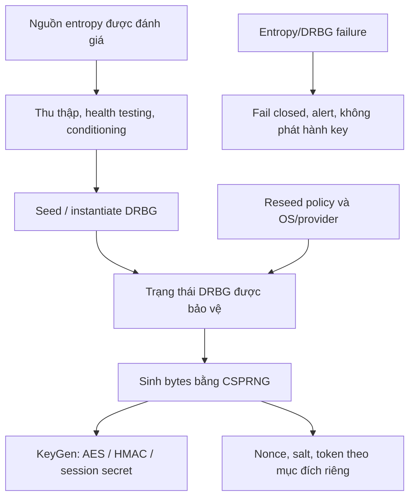
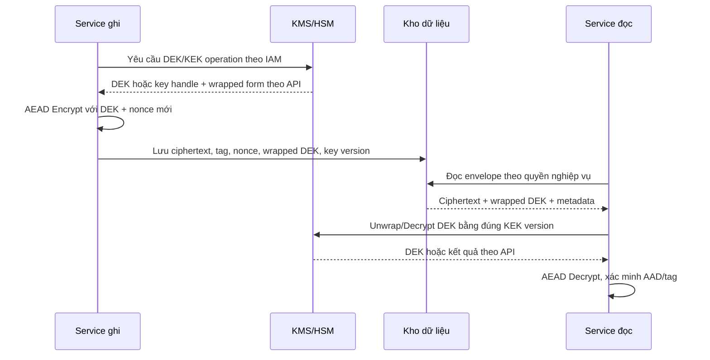
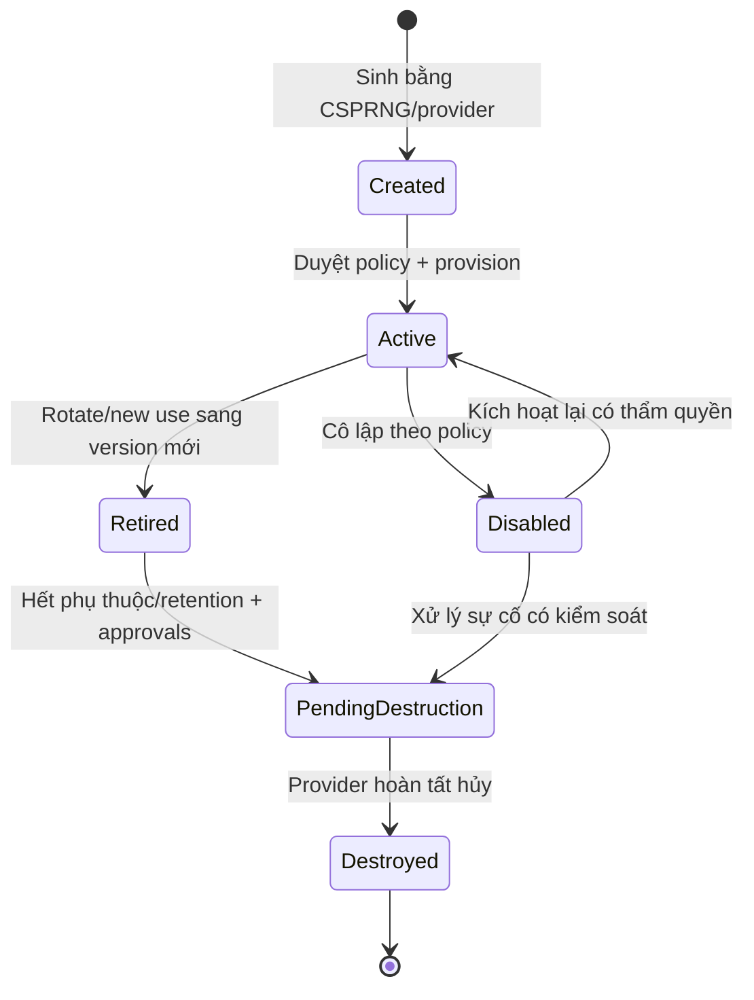
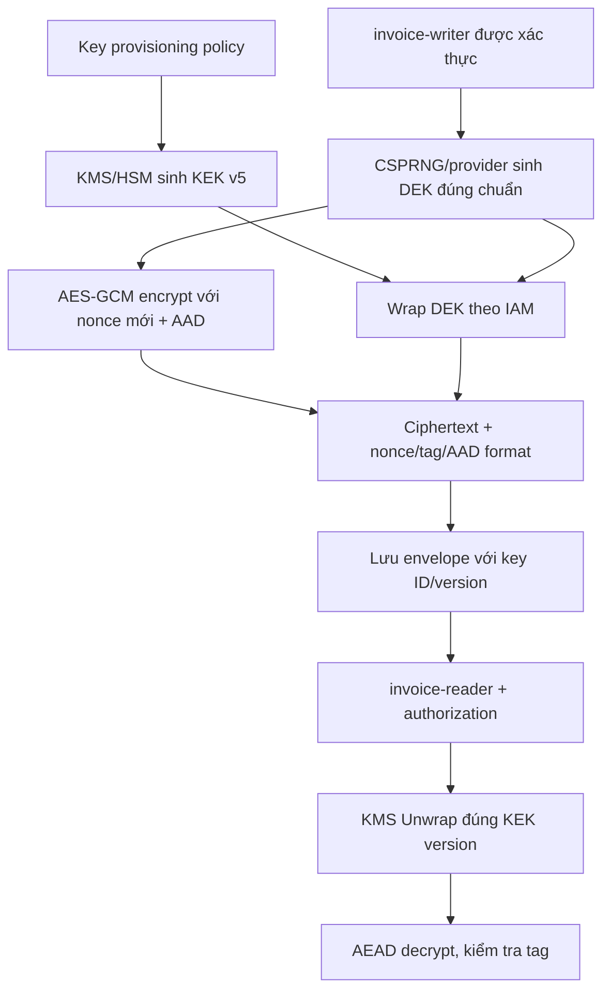

# Sinh key bằng CSPRNG

## 1. Sinh key bằng CSPRNG là gì?

**Sinh key bằng CSPRNG** là quá trình dùng **Cryptographically Secure Pseudorandom Number Generator** (bộ sinh số giả ngẫu nhiên an toàn cho mật mã) để tạo **vật liệu khóa không thể dự đoán trong giới hạn an toàn được thiết kế**. Mục tiêu không chỉ là tạo ra một chuỗi byte trông có vẻ ngẫu nhiên, mà là tạo ra secret có **độ khó đoán phù hợp với độ mạnh của thuật toán**, ngay cả khi kẻ tấn công biết cách hệ thống sinh khóa và quan sát nhiều giá trị đầu ra khác.

Ví dụ, một **AES-256 key** cần 256 bit vật liệu khóa được sinh đúng cách. Nếu dùng 32 byte từ CSPRNG đã được khởi tạo an toàn, ta có một ứng viên khóa AES-256 thích hợp. Nhưng nếu 32 byte đó chỉ là kết quả lặp từ `Math.random()`, timestamp hoặc một seed ngắn dễ đoán, **kích thước 256 bit không đồng nghĩa 256 bit entropy**.

Chủ đề này thuộc chương **Key generation** của module `SECURITY_KEY_MANAGEMENT_FUNDAMENTALS`. Nó là điểm bắt đầu của vòng đời khóa: **tạo → cấp phát → lưu trữ → sử dụng → xoay vòng → thu hồi → hủy**, đồng thời liên kết với khóa đối xứng, bất đối xứng, chữ ký số, KDF, KMS/HSM, envelope encryption, IAM và kiểm toán.

Một key được tạo an toàn vẫn có thể bị lộ do export, lưu trong log, cấp quyền Decrypt quá rộng hoặc giữ quá lâu. Ngược lại, một hệ thống có HSM hiện đại vẫn có thể gặp sự cố nếu đưa một khóa có entropy thấp từ bên ngoài vào mà không kiểm soát nguồn tạo.

### 1.1. Kết quả học tập

Sau bài học, bạn có thể:

1. Giải thích **PRNG**, **CSPRNG**, **entropy source** và **DRBG**; phân biệt chúng với **TRNG**.
2. Biết vì sao không dùng `Math.random()`, `java.util.Random`, `ThreadLocalRandom`, timestamp, UUID tùy tiện hoặc một hash của dữ liệu đoán được để sinh khóa bí mật.
3. Sinh **AES key, HMAC key và secret bytes** bằng API chuẩn Java 17; dùng **KeyPairGenerator** đúng cách cho Ed25519/X25519.
4. Phân biệt yêu cầu đối với **secret key**, **session token**, **salt**, **nonce/IV**, seed và derived key.
5. Hiểu **key strength, security strength, byte length, uniformity, freshness, reseeding** và rủi ro clone/snapshot.
6. Thiết kế **KMS/HSM key generation**, key custody, BYOK/imported material, non-exportability, IAM và audit.
7. Áp dụng CSPRNG vào **envelope encryption** với DEK/KEK, rotation, backup và ứng cứu sự cố lộ key.
8. Thiết lập **runbook, ma trận kiểm thử và checklist** cho môi trường production.

## 2. Ngẫu nhiên “trông giống” và ngẫu nhiên “đủ an toàn” khác nhau thế nào?

Không phải bộ sinh số nào có chữ `random` trong tên cũng thích hợp để tạo bí mật mật mã.

| Công cụ/nguồn | Mục đích điển hình | Có nên dùng trực tiếp để sinh secret key? |
| --- | --- | --- |
| `Math.random()` | Mô phỏng, dữ liệu thử, lựa chọn không cần bảo mật | **Không** |
| `java.util.Random` | PRNG tổng quát, có thể tái tạo chuỗi từ seed | **Không** |
| `ThreadLocalRandom` | Sinh số giả ngẫu nhiên hiệu năng cao ở đa luồng | **Không** |
| `SplittableRandom` | Mô phỏng/song song, kết quả có thể tái lập | **Không** |
| UUID ngẫu nhiên | Định danh/khử trùng lặp theo giao thức phù hợp | **Không thay thế tùy tiện cho AES/HMAC key** |
| Timestamp, PID, counter, MAC address | Metadata hoặc tính duy nhất trong những phạm vi nhất định | **Không** |
| SHA-256 của timestamp/hostname/UUID đoán được | Digest của dữ liệu đầu vào | **Không**; hash không tự tạo entropy |
| `java.security.SecureRandom` | API CSPRNG của Java Security | **Có**, khi provider/runtime được cấu hình và vận hành đúng |
| `javax.crypto.KeyGenerator` với nguồn ngẫu nhiên an toàn | Sinh khóa đối xứng đúng loại và kích thước | **Có**, cho thuật toán/provider phù hợp |
| KMS/HSM key generation | Sinh khóa trong miền quản lý được bảo vệ | **Có**, khi thuật toán/module/policy đáp ứng yêu cầu |
| TRNG/nguồn entropy vật lý | Thu thập bất định từ hiện tượng vật lý | **Không lấy raw output tùy ý**; dùng qua conditioning/DRBG được đánh giá |

### 2.1. PRNG tổng quát

Một **PRNG** sinh chuỗi có vẻ ngẫu nhiên từ một trạng thái/seed. Nhiều PRNG tổng quát được tối ưu cho **tốc độ, phân phối thống kê và khả năng tái lập**. Đó là những thuộc tính hữu ích cho trò chơi, mô phỏng hoặc benchmark, nhưng không đủ cho mật mã.

Ví dụ sai:

```java
import java.util.Random;

// SAI cho khóa mật mã: predictable / not cryptographically secure.
byte[] aesKey = new byte[32];
new Random(System.currentTimeMillis()).nextBytes(aesKey);
```

Vật liệu có **32 byte** nhưng lượng bất định thực tế bị giới hạn bởi cách chọn seed và cấu trúc PRNG. Nếu đối thủ thu hẹp khoảng thời gian khởi tạo hoặc đoán trạng thái, họ có thể tìm key dễ hơn rất nhiều so với vét cạn 2^256 ứng viên.

### 2.2. CSPRNG

**CSPRNG** được thiết kế để người quan sát không thể dự đoán các bit chưa công bố trong giới hạn bảo mật, kể cả khi đã thấy nhiều output và biết thuật toán. Cơ chế thường xây dựng trên **entropy ban đầu** và một **DRBG (Deterministic Random Bit Generator)** dùng các primitive mật mã.

Thuộc tính mong muốn:

- **Khó dự đoán output tiếp theo** khi chỉ biết output quá khứ.
- **Khó khôi phục secret state** từ output công khai.
- **Được seed đủ entropy**, không từ dữ liệu dễ đoán.
- **Quản lý reseed, lỗi và health checks** theo thiết kế của runtime/provider.
- **Không để state bị chia sẻ/nhân bản sai cách** giữa các instance/VM/process.

Các thuật ngữ **prediction resistance**, **backtracking resistance** hoặc **forward/backward security** có định nghĩa cụ thể trong từng DRBG/tiêu chuẩn. Không tự kết luận mọi instance `SecureRandom` có mọi bảo đảm mạnh nhất chỉ từ tên class; mức bảo đảm phụ thuộc thuật toán, provider, entropy source và cấu hình.

### 2.3. TRNG và DRBG

**TRNG/entropy source** có thể thu thập bất định từ phần cứng, nhiễu hệ thống hoặc cơ chế được đánh giá. **DRBG** dùng seed có entropy phù hợp để sinh nhiều output hiệu quả và có thể được **reseed** theo policy.



Đây là sơ đồ **khái niệm**, không phải lời khẳng định về pipeline nội bộ của mọi OS/JDK/HSM. Ứng dụng nên ưu tiên API được bảo trì và provider đáng tin, không tự thu tiếng ồn CPU hay nhiệt độ để “trộn ngẫu nhiên” vào khóa.

## 3. Entropy, độ dài khóa và security strength

**Entropy** liên quan tới lượng bất định của một biến ngẫu nhiên trước góc nhìn của đối thủ. Khi một key gồm 256 bit được chọn **đồng đều, độc lập** từ toàn bộ không gian 256 bit, việc đoán mù có thể xem xét tới không gian khoảng `2^256` ứng viên. Nhưng việc có 256 bit lưu trữ **không chứng minh** có 256 bit entropy.

### 3.1. Dài hơn không chữa được nguồn ngẫu nhiên yếu

Giả sử một hệ thống lấy timestamp chỉ có khoảng một triệu khả năng rồi hash bằng SHA-256:

```text
timestamp (tập giá trị có thể đoán)
       |
       v
SHA-256(timestamp)
       |
       v
256-bit digest đưa vào SecretKeySpec(AES)
```

Digest có 256 bit, nhưng kẻ tấn công chỉ cần duyệt những timestamp khả dĩ. **Hàm hash không tạo entropy từ hư không**. Tương tự, nối ba chuỗi UUID/timestamp không biến chúng thành một nguồn 768 bit entropy bảo đảm.

### 3.2. Chọn độ dài cho các loại key

| Trường hợp | Ví dụ kích thước | Điểm cần lưu ý |
| --- | --- | --- |
| **AES-128 key** | 16 byte = 128 bit | Chỉ dùng khi policy và threat model cho phép. |
| **AES-256 key** | 32 byte = 256 bit | Cần CSPRNG chất lượng; key length khác AEAD tag length. |
| **HMAC-SHA256 secret** | Thường có thể sinh 32 byte ngẫu nhiên | HMAC dùng key bí mật, không phải public key. |
| **Opaque reset token/API secret** | Ví dụ 32 byte ngẫu nhiên trước encoding | Token phải có scope, thời hạn, cơ chế thu hồi; không chỉ dựa vào randomness. |
| **GCM nonce/IV** | Thường 12 byte (96 bit) trong profile phổ biến | **Uniqueness under a given key** là tối quan trọng; không phải AES key. |
| **Password salt** | Ví dụ 16 byte ngẫu nhiên riêng cho mỗi password verifier | Salt không cần bí mật; phải có tính phân biệt/duy nhất và đúng KDF. |
| **RSA/EC/EdDSA private key** | Kích thước/định dạng theo thuật toán | Dùng `KeyPairGenerator`/KMS/HSM; không lấy 32 byte tự đặt làm RSA key. |
| **KEM key pair (ML-KEM...)** | Theo parameter set và provider | Dùng API KEM đúng thuật toán, không tự ghép bytes. |

**HMAC tag** 256 bit không đồng nghĩa HMAC key luôn có 256 bit security strength trong mọi mô hình; mức bảo mật còn phụ thuộc key entropy, message/tag policy và cấu trúc primitive. Với RSA/ECC, **độ dài private key encoding** không tương đương trực tiếp security strength như AES.

### 3.3. Xác suất trùng khóa

Sinh độc lập từ một không gian lớn cho xác suất hai khóa ngẫu nhiên trùng nhau rất nhỏ, nhưng **không phải bằng 0**. Với `q` mẫu đều từ không gian `2^n`, xác suất có ít nhất một cặp trùng ở chế độ xấp xỉ birthday là:

```text
p_collision ≈ q * (q - 1) / 2^(n + 1)
```

Không nên dùng quy tắc “vì xác suất nhỏ nên bỏ qua key ID/version”. Hệ thống vẫn cần quản lý **định danh và vòng đời của từng key**, tránh dùng chung một key vì lỗi logic, deployment hoặc copy state.

## 4. Điều gì có thể khiến CSPRNG không còn an toàn?

Một CSPRNG đúng thuật toán vẫn có thể gặp rủi ro vận hành.

### 4.1. Seed dễ đoán

Các nguồn seed sai thường gặp:

- `System.currentTimeMillis()` hoặc đồng hồ máy chủ.
- PID, process start time, hostname, địa chỉ MAC.
- ID tự tăng của bản ghi, UUID định dạng nào đó bị hiểu nhầm là entropy.
- Cấu hình `RANDOM_SEED=123456` dùng chung mọi deployment.
- Password hoặc secret entropy thấp được hash rồi coi là random key.
- Seed cố định để bài test “dễ reproduce” nhưng bị đưa lên production.

**Không tự gọi `new SecureRandom(fixedSeed)` với seed đoán được hoặc đưa vào cấu hình production.** Chọn API mặc định của runtime/provider hoặc KMS/HSM đã được đánh giá để seed từ nguồn entropy thích hợp.

### 4.2. Clone/snapshot/khởi động sớm

Một VM hoặc container image bị chụp lại **sau khi trạng thái RNG đã được khởi tạo** và tái sử dụng trạng thái ấy không đúng cách có thể gây chuỗi output trùng giữa các instance, tùy OS/runtime. Các nền tảng hiện đại có biện pháp phòng vệ, nhưng không nên coi mọi cơ chế clone/restore/embedded device đều tự an toàn.

Kiểm soát cần xem xét:

- Dùng OS/JDK/provider được bảo trì, cơ chế entropy khởi tạo và reseed phù hợp.
- Không lưu `SecureRandom` internal state/seed vào snapshot ứng dụng, file config hoặc image.
- Đánh giá VM clone, restore, fork, cold boot và thiết bị nhúng theo môi trường.
- Fail closed nếu nguồn ngẫu nhiên bắt buộc báo lỗi; không fallback sang `Random` hoặc timestamp.
- Không trộn entropy “tự chế” và tin rằng đã mạnh hơn một provider chuẩn.

### 4.3. Lộ trạng thái RNG hoặc memory

Nếu kẻ tấn công đọc được tiến trình, heap dump hoặc internal DRBG state, khả năng đoán output tương lai/quá khứ phụ thuộc thiết kế thuật toán và việc reseed. Tuy vậy, **khóa đã sinh trước đó có thể đã bị sao chép trực tiếp**.

Do đó, sự cố RNG state phải được xem xét cùng **key compromise**: phạm vi khóa được tạo trong khoảng rủi ro, ciphertext/DEK/token phụ thuộc, thời gian lộ, và việc key đã được export hoặc log.

### 4.4. “Randomness looks random” không phải bằng chứng bảo mật

Bài test đếm số bit 0/1, entropy ước lượng từ vài KB output, kiểm tra chuỗi không lặp hoặc biểu đồ histogram **không chứng minh CSPRNG khó dự đoán**. Một PRNG tổng quát có thể vượt các kiểm định thống kê đơn giản nhưng không đạt bảo mật mật mã.

Chất lượng RNG cần dựa vào **thuật toán và provider được thẩm định**, chất lượng entropy source, health tests phù hợp, cấu hình và giám sát vận hành. Có thể bổ sung test thống kê/health như **chỉ báo lỗi**, không dùng thay cho đánh giá cryptographic security.

## 5. Sinh secret bytes bằng SecureRandom trong Java 17

Java SE cung cấp `java.security.SecureRandom` cho nhu cầu random mật mã. Trong ứng dụng thông thường, `new SecureRandom()` sử dụng một implementation do Java Security provider lựa chọn, có cơ chế khởi tạo được quản lý bởi provider/runtime.

Ví dụ tối thiểu:

```java
import java.security.SecureRandom;
import java.util.Arrays;

public final class SecureRandomBytesExample {
    public static void main(String[] args) {
        SecureRandom rng = new SecureRandom();

        byte[] secret = new byte[32]; // 32 * 8 = 256 bits.
        rng.nextBytes(secret);

        // Dùng secret trong giao thức/key API phù hợp.
        // KHÔNG: System.out.println(Arrays.toString(secret));

        try {
            System.out.println("Generated 32 secret bytes securely");
        } finally {
            Arrays.fill(secret, (byte) 0); // Giảm lifetime mảng này.
        }
    }
}
```

### 5.1. Tại sao dùng `nextBytes`?

`SecureRandom.nextBytes(byte[])` yêu cầu provider tạo bytes có tính chất random mật mã. Nó khác việc lấy một số `nextInt()` rồi ghép chuỗi không kiểm soát bias.

Một mảng 32 byte có thể là **raw key material** khi giao thức cho phép, nhưng với AES/HMAC nên ưu tiên `KeyGenerator` để chọn đúng key type/length và để provider sở hữu vật liệu theo cách phù hợp.

### 5.2. Dùng `getInstanceStrong()` có luôn tốt hơn?

`SecureRandom.getInstanceStrong()` chọn một thuật toán theo thuộc tính cấu hình `securerandom.strongAlgorithms`. Tùy hệ thống, nó có thể có **độ trễ hoặc hành vi chờ entropy** khác. Không dùng nó theo phản xạ cho mỗi request vì tin rằng mặc định chắc chắn yếu.

Nguyên tắc:

- Dùng **provider/JDK được duyệt**, xác định yêu cầu bảo mật và hiệu năng.
- Kiểm tra khả năng khởi tạo, throughput, latency và hành vi fail khi entropy source gặp sự cố.
- Tránh tạo hàng nghìn instance mỗi request nếu thiết kế không yêu cầu.
- Không bắt buộc một thuật toán/provider dựa trên tên gợi cảm nếu chưa kiểm tra availability.
- Không log seed/state hoặc dựa vào tên thuật toán để tuyên bố chứng nhận FIPS.

`SecureRandom` không thay thế **key ownership, IAM, storage và rotation**.

### 5.3. Có nên tự seed `SecureRandom`?

Thông thường **không cần**: hãy để provider lấy seed từ nguồn an toàn. Dữ liệu dễ đoán do ứng dụng cung cấp có thể làm sai kỳ vọng bảo mật; cách `setSeed` kết hợp seed với trạng thái hiện tại có thể tùy implementation và thời điểm gọi.

Nếu một môi trường nhúng/bảo mật cao có yêu cầu entropy đặc biệt, phải thiết kế theo provider/DRBG và tiêu chuẩn được đánh giá. **Không tự biến timestamp, hostname, nhiệt độ CPU hoặc một password thành seed “mật mã”.**

## 6. Java 17: sinh AES-256 key và HMAC key bằng KeyGenerator

`javax.crypto.KeyGenerator` là API phù hợp khi cần một **SecretKey** theo thuật toán cụ thể. Ví dụ:

```java
import java.security.SecureRandom;
import javax.crypto.KeyGenerator;
import javax.crypto.SecretKey;

public final class SymmetricKeysExample {
    public static void main(String[] args) throws Exception {
        SecureRandom rng = new SecureRandom();

        KeyGenerator aes = KeyGenerator.getInstance("AES");
        aes.init(256, rng);
        SecretKey aesKey = aes.generateKey();

        KeyGenerator hmac = KeyGenerator.getInstance("HmacSHA256");
        hmac.init(256, rng);
        SecretKey macKey = hmac.generateKey();

        System.out.println("AES algorithm: " + aesKey.getAlgorithm());
        System.out.println("MAC algorithm: " + macKey.getAlgorithm());

        // Không in aesKey.getEncoded() hoặc macKey.getEncoded().
    }
}
```

**Vì sao tách hai key?** AES key và HMAC key phục vụ **mục đích khác nhau**. Không lấy cùng một raw secret để vừa mã hóa dữ liệu vừa tạo HMAC nếu chưa có giao thức/KDF chuẩn tách miền. Nếu dùng HKDF để dẫn xuất nhiều khóa từ một input có entropy cao, phải dùng `info`/domain separation theo protocol.

**KeyGenerator chỉ giải quyết việc sinh vật liệu.** Nó không tự đặt key vào KMS, không tự cấu hình IAM, không tự sinh nonce cho từng bản ghi và không tự định nghĩa thời hạn lưu giữ.

### 6.1. Bảo vệ `SecretKey` trong Java

Một số provider tạo `SecretKey` có thể export thành bytes qua `getEncoded()`, số khác có thể trả `null` hoặc dùng object handle tới HSM. Không gọi `getEncoded()` chỉ để log, đo key length hoặc lưu vào database dạng rõ.

Nếu cần persistent key:

- Ưu tiên **KMS/HSM** hoặc keystore có chính sách/permission phù hợp.
- Với local keystore, xác định quyền, mật khẩu/bảo vệ key store, backup, encrypted-at-rest và threat model.
- Không lưu key trong source code, config file plaintext, environment logs, stack traces hoặc hệ thống analytics.
- Kiểm soát lifetime của secret bytes trong process và tránh tạo `String` cho binary key.
- Java `Arrays.fill(...)` với một mảng do ứng dụng giữ là **giảm rủi ro**, không chứng minh zeroization toàn JVM/provider.

## 7. Ví dụ hoàn chỉnh Java 17: CSPRNG + AES-GCM + HMAC

Ví dụ sau tự chạy bằng **Java 17+** với provider hỗ trợ AES-256-GCM và HmacSHA256.

Nó minh họa:

1. Sinh **AES-256 key** và **HMAC-SHA256 key** riêng bằng `KeyGenerator` với `SecureRandom`.
2. Sinh **nonce mới 96 bit** cho một bản mã AES-GCM.
3. Gắn **AAD** để xác thực metadata nghiệp vụ.
4. Mã hóa, giải mã và kiểm tra AEAD tag.
5. Sửa một byte ciphertext để cho thấy decrypt phải bị từ chối.
6. Tạo HMAC trên một message mà không hiển thị secret.

```java
import java.nio.charset.StandardCharsets;
import java.security.MessageDigest;
import java.security.SecureRandom;
import java.util.Arrays;
import javax.crypto.AEADBadTagException;
import javax.crypto.Cipher;
import javax.crypto.KeyGenerator;
import javax.crypto.Mac;
import javax.crypto.SecretKey;
import javax.crypto.spec.GCMParameterSpec;

public final class CsprngKeyGenerationDemo {
    private static final SecureRandom CSPRNG = new SecureRandom();
    private static final int AES_BITS = 256;
    private static final int HMAC_KEY_BITS = 256;
    private static final int GCM_NONCE_BYTES = 12;
    private static final int GCM_TAG_BITS = 128;

    record Encrypted(byte[] nonce, byte[] ciphertextAndTag) {}

    private static SecretKey newAesKey() throws Exception {
        KeyGenerator keygen = KeyGenerator.getInstance("AES");
        keygen.init(AES_BITS, CSPRNG);
        return keygen.generateKey();
    }

    private static SecretKey newMacKey() throws Exception {
        KeyGenerator keygen =
                KeyGenerator.getInstance("HmacSHA256");
        keygen.init(HMAC_KEY_BITS, CSPRNG);
        return keygen.generateKey();
    }

    private static Encrypted encrypt(
            SecretKey aesKey, byte[] plaintext, byte[] aad
    ) throws Exception {
        byte[] nonce = new byte[GCM_NONCE_BYTES];
        CSPRNG.nextBytes(nonce);

        Cipher cipher = Cipher.getInstance("AES/GCM/NoPadding");
        cipher.init(
                Cipher.ENCRYPT_MODE,
                aesKey,
                new GCMParameterSpec(GCM_TAG_BITS, nonce)
        );
        cipher.updateAAD(aad);

        return new Encrypted(
                nonce,
                cipher.doFinal(plaintext)
        );
    }

    private static byte[] decrypt(
            SecretKey aesKey, Encrypted envelope, byte[] aad
    ) throws Exception {
        Cipher cipher = Cipher.getInstance("AES/GCM/NoPadding");
        cipher.init(
                Cipher.DECRYPT_MODE,
                aesKey,
                new GCMParameterSpec(GCM_TAG_BITS, envelope.nonce())
        );
        cipher.updateAAD(aad);
        return cipher.doFinal(envelope.ciphertextAndTag());
    }

    public static void main(String[] args) throws Exception {
        SecretKey aesKey = newAesKey();
        SecretKey hmacKey = newMacKey();

        byte[] plaintext =
                "invoice=INV-42;amount=1000"
                .getBytes(StandardCharsets.UTF_8);
        byte[] aad =
                "tenant=tenant-01;format=v1"
                .getBytes(StandardCharsets.UTF_8);

        Encrypted data = encrypt(aesKey, plaintext, aad);
        byte[] recovered = decrypt(aesKey, data, aad);

        System.out.println(
                "AEAD decrypt valid: " +
                MessageDigest.isEqual(plaintext, recovered)
        ); // true

        byte[] modified = data.ciphertextAndTag().clone();
        modified[0] ^= 1; // Cố tình sửa dữ liệu.
        boolean tamperRejected = false;
        try {
            decrypt(
                    aesKey,
                    new Encrypted(data.nonce().clone(), modified),
                    aad
            );
        } catch (AEADBadTagException expected) {
            tamperRejected = true;
        }
        System.out.println(
                "Tampering rejected: " + tamperRejected
        ); // true

        Mac mac = Mac.getInstance("HmacSHA256");
        mac.init(hmacKey);
        byte[] tag = mac.doFinal(plaintext);
        System.out.println("HMAC output length: "
                + (tag.length * 8) + " bits");

        Arrays.fill(plaintext, (byte) 0);
        Arrays.fill(recovered, (byte) 0);
        Arrays.fill(tag, (byte) 0);
        Arrays.fill(modified, (byte) 0);
    }
}
```

Cách chạy với JDK 17+:

```bash
javac CsprngKeyGenerationDemo.java
java CsprngKeyGenerationDemo
```

Ví dụ output khi provider hỗ trợ:

```text
AEAD decrypt valid: true
Tampering rejected: true
HMAC output length: 256 bits
```

### 7.1. Những gì ví dụ đã làm đúng

- Sử dụng CSPRNG được Java Security provider cung cấp.
- Dùng `KeyGenerator` theo algorithm và key size cụ thể.
- Không in/ghi raw key hoặc seed ra console/log.
- Tạo **AES key và HMAC key độc lập** cho hai mục đích.
- Dùng AES-GCM với nonce, AAD và authentication tag.
- Kiểm tra tampering bằng việc **decrypt thất bại khi tag không khớp**.
- Tránh dùng phép mã hóa kiểu ECB hoặc tự tạo MAC `SHA256(key || message)`.

### 7.2. Điều demo chưa thể thay thế trong production

- **Nonce management:** nonce random 96 bit có xác suất trùng nhỏ nhưng không bằng 0. Hệ thống lưu lượng lớn hoặc lưu khóa lâu cần chính sách giới hạn số lần mã hóa/key và cách bảo đảm uniqueness; random đơn thuần không tự giải quyết mọi kịch bản.
- **Key custody:** hai key đang nằm trong một process; production có thể cần KMS/HSM và API không xuất key.
- **Metadata:** envelope thật cần lưu key ID/version, algorithm suite, nonce, tag, AAD schema và ràng buộc đối tượng/tenant.
- **Storage/backup:** cần encrypt-at-rest, policy lưu giữ và khả năng restore.
- **Zeroization:** ghi đè mảng dữ liệu chỉ giảm lifetime một số bản sao, không chứng minh xóa mọi bản trong JVM.
- **Error handling:** dịch vụ cần giới hạn kích thước, xử lý exceptions an toàn, metrics và không trả ra oracle; không phân biệt lỗi quá chi tiết cho bên không tin cậy.
- **Concurrency:** việc cấp nonce ở nhiều instance và sau restart phải có thiết kế phù hợp, không chỉ xem mỗi lời gọi `nextBytes`.
- **IAM:** các phép toán được phép phải ràng buộc service/tenant/purpose; dữ liệu giải mã cần kiểm tra authorization nghiệp vụ.
- **Testing:** cần kiểm tra lỗi provider/entropy, duplicate configuration, scale, backup/restore và rotation.
- **Cryptoperiod:** key không nên là secret “sinh một lần dùng mãi” ngoài policy.

## 8. Sinh cặp khóa bất đối xứng phải dùng KeyPairGenerator/KMS

Một sai lầm là lấy 32 byte từ CSPRNG rồi coi chúng có thể dùng như private key RSA, ECDSA, Ed25519 hoặc X25519. Các thuật toán bất đối xứng có **cấu trúc và quy tắc sinh/kiểm tra khóa khác nhau**.

Trong Java 17:

```java
import java.security.KeyPair;
import java.security.KeyPairGenerator;
import java.security.Signature;
import java.nio.charset.StandardCharsets;

public final class Ed25519KeyGenerationDemo {
    public static void main(String[] args) throws Exception {
        // JDK/provider tạo cặp Ed25519 đúng định dạng/thuật toán.
        KeyPairGenerator keygen =
                KeyPairGenerator.getInstance("Ed25519");
        KeyPair pair = keygen.generateKeyPair();

        byte[] message =
                "release-manifest:v2".getBytes(StandardCharsets.UTF_8);

        Signature signer = Signature.getInstance("Ed25519");
        signer.initSign(pair.getPrivate());
        signer.update(message);
        byte[] signature = signer.sign();

        Signature verifier = Signature.getInstance("Ed25519");
        verifier.initVerify(pair.getPublic());
        verifier.update(message);

        System.out.println("Signature valid: "
                + verifier.verify(signature));
        // true

        // KHÔNG in/export pair.getPrivate().
    }
}
```

**Ed25519** dùng **chữ ký số**; **X25519** thường phục vụ ECDH/key establishment. Không dùng keypair Ed25519 trực tiếp làm keypair X25519 chỉ vì tên gần giống. Với RSA, ECDSA, ML-KEM hay thuật toán khác, chọn API/provider/parameters đã được thẩm định.

### 8.1. CSPRNG dùng ở đâu khi tạo keypair?

CSPRNG có thể được provider sử dụng để sinh seed/secret scalars, nguyên tố (RSA), hoặc randomness cần thiết theo thuật toán. **Ứng dụng không nên tự phát minh bước sinh private key** bằng cách chọn bytes rồi “ép” vào public-key encoding.

Ví dụ `KeyPairGenerator.getInstance("RSA")` phải được khởi tạo với **modulus size và tham số phù hợp policy**; keypair được tạo bởi provider. Với Ed25519, JCA provider có thể trực tiếp sinh cặp khóa đúng biến thể. Với KEM hậu lượng tử, cần library/provider hỗ trợ đúng **parameter set**, serialization và algorithm identifiers.

### 8.2. Randomness lúc ký không giống randomness lúc sinh key

Với **ECDSA**, chất lượng/non-reuse của nonce ký (giá trị bí mật mỗi chữ ký) có thể quyết định an toàn của private key; có thiết kế sinh nonce **deterministic** theo quy trình chuẩn như RFC 6979 để giảm phụ thuộc RNG ở bước ký. Đây là vấn đề **khác** với việc sinh keypair ban đầu bằng CSPRNG.

**Ed25519** có cơ chế ký mang tính deterministic theo thuật toán cho một key và message trong chế độ cơ bản; điều đó **không có nghĩa** có thể tạo private key từ một seed đoán được.

**RSA-PSS và RSA-OAEP** cũng có yêu cầu randomness liên quan tới phép toán riêng. Dùng provider được đánh giá để xử lý các tham số này, không tự ghép salt, padding hoặc nonce bằng cách viết lại thuật toán mật mã.

## 9. Key, nonce, salt, IV và token: đều có thể dùng random nhưng khác mục đích

Không nên gom mọi chuỗi ngẫu nhiên vào một khái niệm “key”.

| Giá trị | Cần bí mật? | Thuộc tính quan trọng | Sinh/ghi chú |
| --- | --- | --- | --- |
| **AES/HMAC key** | **Có** | Khó đoán, đủ entropy, đúng key size và purpose | CSPRNG/KeyGenerator hoặc KMS/HSM |
| **DEK/KEK** | **Có** | Khó đoán, phân tách chức năng và custody | KMS/HSM hoặc nguồn an toàn, policy/backup |
| **Opaque token** | **Có** khi còn hiệu lực | Khó đoán, scope/expiry/one-time/revocation | CSPRNG, encode an toàn, lưu dạng phù hợp |
| **Password salt** | Không | Phân biệt/duy nhất, ngăn hash giống nhau dùng chung | CSPRNG tạo riêng mỗi verifier |
| **AES-GCM nonce/IV** | Không | **Không trùng dưới cùng key**; đúng định dạng/độ dài | Counter hoặc random strategy theo protocol |
| **KDF salt** | Thường không | Đúng contract của KDF và domain separation | Có thể random, cố định hoặc được quy định tùy KDF |
| **AAD** | Không cần bí mật | Toàn vẹn metadata và canonical encoding | Không phải secret key và không nhất thiết random |
| **Key ID/version** | Thường không | Duy nhất trong registry, giúp định tuyến | Có thể dùng identifier có cấu trúc, không là key material |
| **Seed DRBG** | **Có hoặc nhạy cảm** theo thiết kế | Entropy, quản lý state/khởi tạo/reseed đúng provider | Không log hoặc tự phân phối như config bình thường |

### 9.1. Nonce AES-GCM: quan trọng nhất là không lặp dưới cùng một key

Một nonce ngẫu nhiên 96 bit rất thường gặp; tuy nhiên, nó **có thể va chạm theo xác suất birthday**. Khi có nhiều instance mã hóa đồng thời và cùng dùng một key lâu dài, policy nên xác định rõ:

- Phương pháp cấp nonce (counter/partitioned counter, random với usage bound, hay cơ chế được protocol quy định).
- Key identity/version dùng để đánh giá uniqueness.
- Giới hạn số invocation và thiết kế rotation.
- Cách tránh lặp counter sau restart/rollback/snapshot.
- Cách ghi nonce cạnh ciphertext, không cần giữ bí mật.
- Kiểm tra AAD và authentication tag.

**CSPRNG bảo vệ tính khó đoán; nó không thay thế việc bảo đảm nonce uniqueness** trong sơ đồ yêu cầu uniqueness. Đặc biệt, **tái sử dụng nonce dưới cùng AES-GCM key có thể làm mất bí mật và toàn vẹn**.

### 9.2. Salt password không phải encryption key

Salt riêng cho mỗi password verifier giúp chống nhiều hình thức tấn công dùng chung bảng/hash, nhưng không cần là secret. Password có entropy thấp nên phải dùng **password hashing/KDF phù hợp** như Argon2id hoặc PBKDF2 với tham số do policy quy định; không lấy `SHA256(password + salt)` hoặc `HKDF(password)` trực tiếp làm phương án hashing password production.

Một `pepper` nếu có là **secret riêng** được quản lý bằng KMS/secret manager; đừng nhầm pepper với salt công khai.

### 9.3. Random token cần thêm vòng đời

CSPRNG có thể sinh 32 byte cho password-reset token hoặc API secret, sau đó dùng Base64url không padding để truyền. Tuy nhiên, hệ thống còn phải:

- Giới hạn mục đích, người dùng, tenant và phiên.
- Đặt thời hạn đủ ngắn, hỗ trợ revoke và one-time redemption.
- Không lưu raw token vào log/analytics.
- Lưu digest/HMAC hoặc bản tương đương phù hợp với threat model, có kiểm tra an toàn và dữ liệu trạng thái riêng.
- Không dùng token như một AES key chỉ vì cùng có 32 byte.

**Encoding không thêm entropy**: Base64url chỉ biểu diễn bytes để truyền qua text, không làm secret an toàn hơn.

## 10. DEK, KEK và CSPRNG trong envelope encryption

Một thiết kế phổ biến là:

1. **DEK** được sinh bằng CSPRNG để mã hóa dữ liệu bằng AES-GCM.
2. **KEK** nằm trong KMS/HSM (được tạo bằng cơ chế sinh khóa được phê duyệt) để **wrap/encrypt DEK**.
3. Ứng dụng lưu **ciphertext**, nonce/tag, **wrapped DEK**, key ID/version và metadata cần thiết.
4. Khi đọc, service có quyền dùng KEK để **unwrap DEK**, rồi AEAD decrypt và xác thực tag.
5. Đến kỳ rotation, dữ liệu mới dùng key version mới, dữ liệu cũ vẫn cần được hỗ trợ hoặc migrate theo policy.



### 10.1. Hai cách sinh DEK thường gặp

**Cách A — Ứng dụng sinh DEK:**

- Ứng dụng sử dụng `KeyGenerator`/`SecureRandom` từ provider đáng tin cậy.
- Bọc DEK dưới KEK được KMS quản lý.
- Raw DEK tồn tại tạm thời trong process; cần threat model memory, logging, cache và garbage collection.
- Có thể phù hợp khi ứng dụng cần tự chạy AEAD nhưng không muốn gửi toàn bộ plaintext lên KMS.

**Cách B — KMS/HSM sinh DEK:**

- Ứng dụng gọi API tạo data key hoặc API tương đương được provider hỗ trợ.
- Hệ thống có thể nhận raw DEK tạm thời và bản wrapped/encrypted DEK, hoặc dùng handle/operation không export.
- Việc sinh vật liệu dựa trên cơ chế quản lý của provider, dễ theo dõi policy/audit hơn.
- Phải kiểm tra **hành vi API cụ thể**: không phải mọi KMS đều trả plain DEK; không phải mọi HSM hỗ trợ cùng thuật toán.

**Không mặc định “KMS sinh key” đồng nghĩa ứng dụng không bao giờ chạm raw DEK.** Một số data-key APIs trả plaintext DEK để ứng dụng mã hóa cục bộ. Phải bảo vệ DEK trong bộ nhớ và không đưa vào log.

### 10.2. Thông tin envelope cần lưu

Ví dụ schema học thuật:

```json
{
  "formatVersion": 1,
  "contentAlgorithm": "AES-256-GCM",
  "kekRef": "billing/prod/invoice-kek",
  "kekVersion": "v5",
  "wrappedDek": "<base64url-wrapped-dek>",
  "nonce": "<base64url-96-bit-nonce>",
  "ciphertextAndTag": "<base64url-aead-output>",
  "aadSchema": "billing-invoice-v1",
  "tenantId": "tenant-01",
  "objectId": "invoice-0042"
}
```

Đây **không phải một format KMS chính thức**; những trường như algorithm, key ref, tenant, object và format version phải được ràng buộc bằng **key schedule/AAD hoặc cơ chế xác thực được thiết kế đúng**. Nếu chỉ đổi `keyVersion` trong JSON mà không rewrap hoặc re-encrypt thích hợp, ciphertext **không tự chuyển** sang khóa mới.

### 10.3. Độ rộng phạm vi của KEK

Một KEK có thể bảo vệ rất nhiều DEK. Nếu KEK bị lộ hoặc bị destroy nhầm, hậu quả có thể liên quan cả một tập dữ liệu lớn. Chính sách sinh key nên xác định:

- **Key hierarchy** và granularity theo service/tenant/data class.
- Mỗi DEK dùng cho object, batch, session hoặc phạm vi nào.
- Entropy/key length và thuật toán bọc/giải bọc.
- KEK origin/custody, import/export, region, backup.
- Cryptoperiod, version và dữ liệu lịch sử phụ thuộc.

## 11. KMS/HSM: ai sinh key và ai được phép sử dụng?

Với hệ thống quan trọng, việc sinh key có thể diễn ra **bên trong miền bảo vệ của KMS/HSM**, nơi private key hoặc master key không được xuất.

| Mô hình | Lợi ích | Rủi ro/câu hỏi phải kiểm tra |
| --- | --- | --- |
| **Application-local CSPRNG** | Linh hoạt, hiệu năng tốt, dùng JCA trực tiếp | Private bytes trong process, secret storage, clone/backup, IAM của host |
| **Cloud KMS key generation** | Quản lý tập trung, policy/rotation/audit, ít cần export master key | Provider support, quotas, scopes, non-exportability, region/replicas |
| **HSM key generation** | Khóa có thể nằm trong vùng phần cứng, dùng theo PKCS#11/JCA/SDK | Partition, key attributes, backup, HA, access policies, vendor support |
| **BYOK/imported key material** | Kiểm soát nguồn key ngoài provider | Bản gốc/copies, kênh import, zeroization, custody và destruction scope |
| **Derived key từ master/key schedule** | Phân tách keys theo ngữ cảnh, giảm số key gốc | KDF chuẩn, entropy nguồn, salt/info, rotation/dependency mapping |

### 11.1. Non-exportable là giới hạn custody, không phải authorization đầy đủ

Một private signing key non-exportable không thể dễ dàng lấy bytes qua API, nhưng identity có quyền `Sign` có thể **yêu cầu HSM ký**. Một KEK non-exportable có thể vẫn được dùng thông qua `Decrypt`/`Unwrap` để giải mã DEK nếu IAM cho phép.

Cần kiểm soát **hai loại rủi ro**:

1. **Exfiltration:** vật liệu có thể xuất, bị copy, lưu ở đâu?
2. **Capability abuse:** ai có quyền sử dụng phép toán mật mã mà không cần lấy bytes?

Chỉ số “khóa không export được” **không đủ để chứng minh system confidentiality** nếu quyền Decrypt/Sign quá rộng.

### 11.2. IAM tách nhiệm vụ khi sinh khóa

| Vai trò | Quyền phù hợp | Không nên mặc định có |
| --- | --- | --- |
| **Key creator/provisioner** | `CreateKey` đúng thuật toán, scope, policy và approval | `Decrypt` mọi dữ liệu, tự duyệt destroy |
| **Key administrator** | Rotate/Disable/ScheduleDeletion theo quy trình | Đọc raw DEK, cấp quyền không kiểm soát |
| **Encryption service** | Encrypt/Wrap hoặc API data-key đúng service/purpose | Sign, export private key, truy cập tenant khác |
| **Decryption service** | Decrypt/Unwrap trong scope và authorization hợp lệ | Tự đổi key policy hoặc giải mã mọi object |
| **Signing service** | Sign bằng key đã duyệt, nội dung theo nghiệp vụ | Export private signing key, vô hiệu hóa audit |
| **Verifier** | Đọc public key/JWKS tin cậy để Verify | Quyền private Sign |
| **Security auditor** | List/Describe, metadata audit và evidence | `GenerateKey`/`Decrypt`/`Sign`/`Destroy` trừ khi có chức năng khác được ủy quyền |

**Quyền tạo khóa cũng phải có hạn chế.** Một principal có thể tạo nhiều key không kiểm soát sẽ gây chi phí, key sprawl, orphan keys và khó áp dụng lifecycle policy.

### 11.3. Khi dùng imported key material

Nếu sinh khóa bên ngoài KMS bằng CSPRNG rồi import, phải đánh giá:

- Nguồn sinh và provider có đáp ứng policy không?
- Có bản copy tại máy sinh, CI/CD, secret manager, backup hoặc HSM nguồn?
- Kênh import có được bảo vệ và xác thực?
- Provider hỗ trợ đúng loại khóa/key operation không?
- Sau khi hủy bản import trong cloud, bản ngoài cloud có được xử lý không?

**Hủy bản tại một KMS không tự hủy material đã export/import ở nơi khác.** Bản copy ngoài vùng bảo vệ là một yếu tố quan trọng của cả **key generation policy** lẫn **destruction policy**.

## 12. Key lifecycle bắt đầu ngay khi CSPRNG tạo ra bytes

Khóa không nên xuất hiện như một mảng bytes “vô chủ”. Ngay khi provision, cần gắn metadata quản lý.



**Sơ đồ khái niệm**; state machine thực tế phụ thuộc KMS/HSM. Không có đường `Destroyed → Active` cho cùng vật liệu đã bị hủy thực sự.

### 12.1. Metadata tối thiểu tại thời điểm tạo

```yaml
keyId: billing/prod/invoice-kek
keyVersion: v5
owner: billing-security
environment: production
tenantScope: tenant-billing
algorithm: AES-256
purpose: invoice-dek-wrapping
origin: provider-generated
custody: managed-kms
exportable: false
allowedOperations:
  - Wrap
  - Unwrap
state: ACTIVE
createdAt: "2026-11-28T00:00:00Z"
rotationReviewAt: "2027-02-28T00:00:00Z"
policyRef: key-policy-billing-v4
auditRef: kms-createkey-072
```

Đây là **metadata inventory minh họa**, không phải yêu cầu KMS phải có đúng API `Wrap` hay đúng field names. Các trường thuật toán/operation cần đối chiếu **capability thật của provider**; không gán `AES-256` cho một key chỉ vì tên resource có chữ `aes`.

### 12.2. Rotation không chữa được nguồn RNG yếu của key cũ

Nếu hệ thống phát hiện trong một giai đoạn đã sinh DEK bằng `java.util.Random`, việc chỉ thay alias/KEK không làm các DEK cũ trở nên khó đoán.

Có thể phải:

1. Dừng quy trình sinh key sai.
2. Khắc phục entropy/CSPRNG ở mọi service.
3. Sinh **key mới từ nguồn được tin cậy**.
4. **Re-encrypt dữ liệu bằng DEK mới** nếu DEK cũ có khả năng bị đoán, thay vì chỉ rewrap nguyên DEK yếu.
5. Rà soát ciphertext, backup, snapshots và đối tác còn dùng key cũ.
6. Kiểm tra tính toàn vẹn, read/restore và audit sau migration.
7. Thu hồi/hủy key cũ khi đáp ứng retention, recovery và policy.

**Rewrap một DEK đoán được bằng KEK mạnh không làm DEK đó có thêm entropy.** Nếu đối thủ có ciphertext được mã hóa trực tiếp bằng DEK yếu, họ có thể vẫn thử đoán DEK.

## 13. Sinh khóa từ KDF: khi nào đúng, khi nào sai?

CSPRNG có thể sinh **master secret** entropy cao, sau đó giao thức dùng **HKDF hoặc key schedule được đánh giá** để dẫn xuất keys theo mục đích. Đây là mô hình khác với sinh **một key độc lập cho mỗi usage**.

```text
CSPRNG / KMS --> high-entropy master secret
                      |
                      v
                 HKDF theo chuẩn
                      |
       +--------------+--------------+
       |              |              |
     key-A          key-B          key-C
  encrypt data    MAC messages    wrap subkeys
       |              |              |
 info="enc/v1"    info="mac/v1"   info="wrap/v1"
```

**Điều kiện:** sử dụng KDF được phê duyệt, salt/info/domain separation đúng contract, nguồn master secret có entropy phù hợp, version và rotation rõ ràng, và chỉ những bên được phép mới có quyền derive. Không tự lấy `SHA256(master || "purpose")` rồi coi là một key schedule được chứng minh an toàn.

### 13.1. Key derivation không tự tạo entropy

KDF có thể phân phối/tách đầu ra của secret đầu vào một cách an toàn theo sơ đồ, nhưng **không làm password yếu biến thành master key 256-bit entropy**. Với password, dùng password KDF/hash chuyên dụng như Argon2id/PBKDF2 theo chính sách.

Nếu dùng một master key có khả năng bị lộ để dẫn xuất tất cả tenant keys, cần tính **blast radius**: compromise master có thể kéo theo nhiều derived keys, tùy cấu trúc và dữ liệu quan sát được.

### 13.2. Salt và context trong HKDF

Thông thường HKDF có các bước `Extract` và `Expand`, dùng salt/info để tách miền theo giao thức. Không phải mọi salt đều bắt buộc ngẫu nhiên, cũng không phải `info` là key material bí mật.

Quan trọng là **hai mục đích khác nhau không vô tình nhận cùng một key** do dùng trùng context, và key version/tenant/algorithm được ràng buộc theo mô hình tin cậy. Đừng xây một KDF tự chế chỉ bằng `SecretKeySpec` mà không có thiết kế được phân tích.

## 14. Test CSPRNG thế nào cho đúng?

Có hai loại kiểm thử khác nhau: **kiểm tra tính đúng đắn của cách tích hợp** và **đánh giá độ tin cậy của nguồn entropy/DRBG**.

### 14.1. Kiểm thử tích hợp ứng dụng

Kiểm tra:

- API dùng `SecureRandom`/`KeyGenerator`/`KeyPairGenerator` đúng provider và algorithm.
- Kích thước key/secret đúng policy, không bị truncate khi encoding/serialization.
- Hai key tạo cho hai resource/version khác nhau không bị dùng lẫn bởi lỗi cấu hình.
- Không có seed cố định trong production code/config.
- Không có raw keys trong stdout, logs, exceptions, crash dumps, metrics và audit.
- Mã hóa/giải mã, MAC verify, signature verify và tamper negative tests hoạt động đúng.
- Key version của ciphertext trỏ tới đúng vật liệu được quản lý.
- Permission không cho service ngoài scope sinh/dùng/export key.
- Không có fallback từ nguồn RNG lỗi sang PRNG thường.

### 14.2. Không dùng uniqueness test làm bằng chứng CSPRNG

Ví dụ một test “sinh 100.000 key rồi so sánh không trùng” có thể bắt được lỗi **constant output/duplicate state** hiển nhiên, nhưng **không chứng minh** khả năng chống dự đoán hoặc entropy nguồn.

Một PRNG yếu vẫn có thể sinh hàng tỷ giá trị khác nhau. Do đó:

- Dùng test này như **regression/anomaly check**.
- Đánh giá provider/DRBG/entropy source bằng tài liệu/validation phù hợp.
- Theo dõi lỗi khởi tạo RNG, health tests và cảnh báo khi provider báo trạng thái bất thường.
- Xem xét hoạt động trong **VM clone, restore, cold boot, hardware entropy failure**.
- Xác nhận chính sách reseed/DRBG khi có yêu cầu đặc biệt.

### 14.3. Deterministic testing không đồng nghĩa seeding production

Unit tests có thể dùng các **test vectors** và dữ liệu cố định để kiểm tra AES-GCM, HKDF hoặc signature logic; không cần buộc production RNG thành deterministic bằng một seed.

Nếu test cần tạo ra kết quả tái lập, có thể **inject một test-only RNG abstraction** không được build/đưa vào production path, hoặc dùng các bytes cố định làm fixture cho thuật toán. Không tự giả định `SecureRandom(seed)` sẽ cho cùng sequence trên mọi JDK/provider.

### 14.4. Kiểm tra thuật toán và provider ở startup

Một service có thể ghi nhận **provider name, algorithm name, runtime/JDK version và kết quả self-check phù hợp** ở metadata vận hành, **không ghi seed/state/output secret**.

Nếu chính sách yêu cầu FIPS/validated module, phải đối chiếu **module, version, approved mode, thuật toán và phạm vi chứng nhận**; chỉ thấy `AES-256` hoặc `SecureRandom` không đủ chứng minh toàn hệ thống đạt tiêu chí tuân thủ.

## 15. Giám sát, IAM và kiểm toán hoạt động sinh key

Việc tạo key là một hành động có thể bị lạm dụng để **tạo secret ngoài policy**, bypass retention hoặc mở rộng key sprawl.

### 15.1. Bằng chứng audit nên giữ

Một event học thuật:

```yaml
event: crypto.key.created
eventTime: "2026-11-28T09:00:00Z"
service: billing-key-provisioner
principal: principal://prod/billing/key-provisioner
keyId: billing/prod/invoice-kek
keyVersion: v5
keyClass: symmetric
keyAlgorithm: AES-256
origin: provider-generated
provider: managed-kms
purpose: invoice-dek-wrapping
policyRef: key-policy-billing-v4
approvalRef: CHG-2026-1081
operationRef: kms-operation-1081
result: success
```

**Không** ghi raw AES/HMAC key, private signing key, seed, internal RNG state, raw DEK, plaintext hoặc bearer token. Nếu cần ghi fingerprint của **public key** để đối chiếu, dùng format và trust policy phù hợp; không tự biến digest của một symmetric secret thành metadata công khai nếu chưa đánh giá rò rỉ và nguy cơ kiểm tra khóa ngoại tuyến.

### 15.2. Các cảnh báo đáng có

| Dấu hiệu | Ý nghĩa có thể | Hướng xử lý |
| --- | --- | --- |
| Tạo key vượt ngưỡng hoặc tăng đột ngột | Key sprawl, abuse, lỗi vòng lặp provision | Xác minh caller, quota, resource owner, audit. |
| Key không owner/purpose | Khó rotation và xác định blast radius | Gán owner, tìm consumers, policy review. |
| Key exportable ngoài chính sách | Khả năng copy material cao | Kiểm tra origin, material custody và thay đổi cấu hình. |
| `GenerateKey` từ principal lạ | Có thể lộ credentials hoặc IAM quá rộng | Cô lập, điều tra và thu hồi quyền nếu cần. |
| Sử dụng non-approved algorithm/provider | Crypto policy mismatch | Fail closed, remediation, migration. |
| Randomness/provider initialization failure | Nguy cơ tạo material không đạt yêu cầu | Dừng key issue, alert, không fallback. |
| Key được sinh nhưng không thấy usage/rotation | Orphan key hoặc quên lifecycle | Reconcile inventory, service registry và logs. |
| Sinh key mới nhưng vẫn Encrypt bằng version cũ | Cutover chưa hoàn chỉnh | Kiểm tra producer, alias, IAM, backup. |

### 15.3. Metrics nào an toàn?

Có thể đo:

- Tần suất tạo key theo service/purpose/region.
- Tỷ lệ key có owner, algorithm, version, policy và audit record.
- Số lần generate thất bại từ provider/entropy.
- Số key ngoài cryptoperiod hoặc không còn consumer.
- Tình trạng rotation, import/export và custody exceptions.
- Chi phí/độ trễ KMS/HSM và rate limit.

Không thu thập histogram của **raw keys** vào metrics hay sampling logs. Chỉ cần metadata đã được bảo vệ và phù hợp privacy/security policy.

## 16. Sự cố: phát hiện RNG yếu hoặc khóa được sinh từ seed đoán được

Giả sử nhiều key đã được tạo bởi một service bằng `new Random(timestamp)`. Đây không còn là vấn đề “cấu hình chưa đẹp”, mà có thể là **sự cố an toàn vật liệu khóa**.

### 16.1. Các bước ứng cứu khuyến nghị

1. **Dừng luồng sinh khóa sai** và chặn phát hành secret mới.
2. Xác định **khoảng thời gian, service, version, tenant, loại key** bị ảnh hưởng.
3. Tìm tất cả ciphertext, wrapped DEK, MAC/JWT/opaque tokens, backup và external consumers phụ thuộc các keys nghi ngờ.
4. Đánh giá khả năng đối thủ **đoán hoặc đã sở hữu** key/seed, ảnh hưởng tới dữ liệu và chữ ký.
5. Sửa RNG/provisioning và kiểm tra môi trường/provider trước khi phát hành key mới.
6. Sinh **key mới thực sự bằng CSPRNG/KMS/HSM** từ miền tin cậy.
7. Nếu **DEK có entropy yếu**, cân nhắc **re-encrypt dữ liệu bằng DEK mới**, không chỉ rewrap DEK yếu.
8. Nếu **signing private key** có nguồn sinh yếu, rotate, thu hồi trust khi cần và kiểm tra tất cả signer/verifier/JWKS/certificates.
9. Nếu **HMAC secret** yếu, rotate secret và quản lý khả năng verify thông điệp cũ theo chính sách.
10. Nếu **random token/session** có thể đoán, revoke/reset tokens, kết thúc sessions có rủi ro và bổ sung phát hiện lạm dụng.
11. Kiểm thử đọc/restore dữ liệu sau migration, đánh giá snapshots và retention trước khi destroy khóa cũ.
12. Bảo toàn bằng chứng, lập timeline, owner, thông báo cần thiết và audit hậu kiểm.

### 16.2. Reseed không “sửa quá khứ”

Nếu một RNG đã phát hành khóa yếu, **reseed sau đó chỉ có thể cải thiện thế hệ tương lai** theo contract. Key cũ vẫn tồn tại và có thể bị đoán; đổi RNG không tự thay ciphertext/signatures/tokens đã phát hành.

Tương tự, **rotate KEK** không tự làm **DEK yếu** có entropy cao hơn. Phải xử lý **vật liệu phụ thuộc và dữ liệu được bảo vệ** theo threat model.

### 16.3. Nếu private key/DEK đã bị copy

Hủy bản managed key tại KMS/HSM **không xóa được bản sao** mà đối thủ giữ. Cần phân biệt:

- **Unpredictability failure:** key bị đoán từ seed/PRNG yếu.
- **Exfiltration:** key tốt nhưng bị copy.
- **Capability abuse:** private key non-exportable nhưng đối thủ có quyền `Sign`/`Decrypt` qua API.

Ba trường hợp có thể cần những hành động khác nhau; **đừng chỉ gọi DestroyKey rồi kết luận dữ liệu bí mật đã an toàn**.

## 17. Case study: sinh DEK cho nền tảng hóa đơn nhiều tenant

### 17.1. Bối cảnh

Dịch vụ `invoice-platform` nhận hóa đơn từ nhiều tenant. Mỗi hóa đơn được mã hóa bằng **DEK AES-256-GCM**; KMS giữ **KEK** và xử lý thao tác bọc DEK theo principal của service.

Yêu cầu:

- Khóa phải khó đoán, đúng loại và được sinh bằng nguồn mật mã đáng tin.
- Không dùng chung DEK cho tất cả tenants vô thời hạn.
- Không ghi raw DEK trong database/log.
- KEK có owner/policy/version và được xoay theo lịch.
- Hóa đơn cũ/backup vẫn đọc được khi đổi KEK.
- Audit ghi đúng service/tenant/purpose nhưng không lộ plaintext.

### 17.2. Thiết kế sai

```text
1. service khởi tạo java.util.Random(System.currentTimeMillis()).
2. Lấy 32 byte làm AES-256 key.
3. Tất cả invoice trong một ngày dùng lại key và nonce cố định.
4. Ghi key dưới dạng Base64 trong app log để "dễ debug".
5. Lưu ciphertext không có key version hoặc nonce.
6. Đổi alias KEK v3 -> v4 rồi destroy v3 ngay.
```

Rủi ro:

- Key có thể đoán được dù lưu 256 bit.
- AES-GCM nonce reuse dưới cùng key có thể phá bí mật và toàn vẹn.
- Log trở thành nguồn rò rỉ raw key.
- Ciphertext không có metadata để decrypt đúng.
- Backup còn wrapped DEK dưới KEK v3 có thể mất khả năng restore.
- Key origin/audit không đủ để đánh giá compromise.

### 17.3. Thiết kế cải thiện



Runbook:

1. Provision KEK v5 trong KMS bằng thuật toán và policy được duyệt; non-exportable nếu nền tảng hỗ trợ.
2. Phân quyền writer/reader theo operation, tenant và dữ liệu.
3. Tạo DEK độc lập theo scope được phê duyệt bằng CSPRNG; sinh nonce đúng chiến lược GCM.
4. Lưu `kekId`, `kekVersion`, `wrappedDek`, `nonce`, `tag`, `ciphertext` và AAD schema.
5. Chặn log raw DEK, seed, plaintext và credentials.
6. Khi rotation KEK, ghi mới bằng v5; cho phép v4 unwrap dữ liệu cũ trong kỳ còn phải giữ.
7. Đối chiếu dependencies của live DB, backup/DR và offline exports trước destroy v4.
8. Kiểm tra restore test và giám sát KMS usage.
9. Đánh giá key compromise/entropy failure riêng với key rotation thông thường.

### 17.4. Phần auditor cần xác minh

- Provision API/provider và key origin thực tế khớp policy.
- Ứng dụng dùng `SecureRandom`/`KeyGenerator` hoặc KMS data key API, không có seed cố định.
- Inventory có đầy đủ key purpose, version, owner và consumer.
- Ciphertext envelope có metadata đủ, AEAD tamper test phải fail.
- Logs không chứa raw key; KMS audit thể hiện đúng principal.
- Rotation có migration/backup restore; không chỉ đổi alias.
- Key deletion có dual approval và đánh giá mọi key dependencies.

## 18. Những hiểu nhầm phổ biến khi sinh key bằng CSPRNG

| Hiểu nhầm | Thực tế |
| --- | --- |
| “`Random` và `SecureRandom` đều là random.” | PRNG tổng quát không bảo đảm khó dự đoán cho mật mã. |
| “32 byte luôn là AES-256 an toàn.” | Nếu seed/entropy yếu, lượng bất định có thể thấp hơn nhiều. |
| “SHA-256(timestamp) tạo key 256 bit an toàn.” | Hash không tạo entropy mới từ input đoán được. |
| “Đổi Base64/hex làm key mạnh hơn.” | Encoding chỉ đổi biểu diễn, không thêm entropy. |
| “UUID.randomUUID có thể dùng như mọi loại khóa.” | UUID là identifier; không tự là AES/HMAC/KEM key đúng contract/security strength. |
| “`getInstanceStrong()` luôn tốt nhất và không có chi phí.” | Provider/latency/entropy behavior phụ thuộc môi trường. |
| “Cần tự truyền timestamp làm seed để tăng randomness.” | Dữ liệu đoán được không cải thiện nguồn CSPRNG đáng tin. |
| “Đã dùng `SecureRandom` thì AES-GCM nonce không thể lặp.” | Random nonce vẫn có xác suất trùng; phải có uniqueness strategy/usage bound. |
| “Nonce phải bí mật như AES key.” | GCM nonce thường công khai; **uniqueness** mới là điều quan trọng. |
| “Salt chính là encryption key.” | Salt không cần secret; password cần password KDF/hash phù hợp. |
| “Ed25519 deterministic ký nghĩa là key có thể dùng fixed seed.” | Keypair ban đầu vẫn cần secret được sinh an toàn. |
| “Tự lấy 32 byte để làm private RSA key.” | Bất đối xứng có KeyGen/parameter validation riêng. |
| “HMAC-SHA256 key và AES key có thể dùng chung tùy tiện.” | Tách mục đích; dùng independent keys hoặc KDF/domain separation chuẩn. |
| “Non-exportable key không thể bị lạm dụng.” | IAM `Decrypt`/`Sign` có thể bị abuse mà không export. |
| “KMS sinh key đồng nghĩa app không bao giờ thấy DEK.” | Một số API trả plaintext data key tạm để app mã hóa cục bộ. |
| “Rotate KEK là làm DEK yếu trở nên mạnh.” | Rewrap không thêm entropy cho DEK cũ. |
| “Key destroyed nghĩa là bản sao trong log/backup cũng mất.” | Cần xác định phạm vi và xử lý copies ngoài KMS. |
| “Histogram không có bias là đã chứng minh RNG an toàn.” | Statistical sanity checks không chứng minh cryptographic unpredictability. |
| “Re-seed sau lỗi làm key cũ an toàn.” | Keys đã tạo trong giai đoạn lỗi vẫn cần xử lý riêng. |

## 19. Ma trận kiểm thử và đánh giá vận hành

| Nhóm | Tình huống | Kết quả kỳ vọng |
| --- | --- | --- |
| **API selection** | Code dùng `Math.random()`/`Random` để sinh secret | Static scan/test phát hiện và ngăn release. |
| **Key size** | AES key không đạt kích thước policy | Provision hoặc encrypt bị từ chối. |
| **Provider support** | JDK/HSM không hỗ trợ algorithm đã duyệt | Fail closed; không fallback sang thuật toán yếu. |
| **Seed handling** | Config chứa fixed seed hoặc timestamp seeding | Chặn production deployment và điều tra keys đã tạo. |
| **Key separation** | AES và HMAC dùng cùng raw secret | Tạo finding, tách keys hoặc KDF chuẩn. |
| **Nonce uniqueness** | AES-GCM lặp nonce trong cùng key | Test/regression chặn; xử lý sự cố nếu đã xảy ra. |
| **AEAD tampering** | Sửa ciphertext, nonce hoặc AAD | Xác thực AEAD thất bại, không trả plaintext chưa xác thực. |
| **Secret logging** | Key bytes bị in vào log/error | Chặn; xử lý lộ secret và rotation theo phạm vi. |
| **Exportability** | Production private key bị yêu cầu export để debug | Từ chối theo policy. |
| **Wrong tenant** | Service tenant A dùng key B | IAM/object authorization từ chối. |
| **Clone/restore** | VM/container snapshot sinh các key giống nhau | Đánh giá RNG seeding/reseed; không phát hành khi không chắc an toàn. |
| **Entropy failure** | Provider báo lỗi khởi tạo/health | Ngừng key generation, alert, không fallback. |
| **Key inventory** | Key mới không có owner/purpose/version | Tạo finding, hạn chế kích hoạt. |
| **KMS audit** | GenerateKey/ImportKey không có ticket | Cảnh báo, kiểm tra principal/approval. |
| **Rotation** | KEK v4 mới nhưng writer vẫn dùng v3 | Cutover chưa PASS; kiểm tra logs/policy. |
| **Backup** | Wrapped DEK cũ chỉ mở được với KEK sẽ destroy | Chặn destruction cho đến khi restore/migration đạt. |
| **CSPRNG regression** | 10.000 outputs không trùng | Chỉ coi là sanity check, **không là chứng nhận entropy**. |
| **Weak-key incident** | DEK từng sinh bằng PRNG yếu | Đánh giá và re-encrypt với DEK mới nếu cần, không chỉ rewrap. |
| **HSM compromise** | Private non-exportable nhưng `Sign` bị lạm dụng | IAM/incident response, không tự suy ra private key đã export. |
| **Audit hygiene** | Monitoring lấy key samples để test randomness | Từ chối, chỉ thu metadata an toàn. |

## 20. Checklist production khi sinh key bằng CSPRNG

1. **Mục đích:** key dùng AES, HMAC, data encryption, key wrapping, signing hay key establishment? Không trộn các mục đích thiếu căn cứ.
2. **Thuật toán:** key algorithm, size/curve/parameter set có đáp ứng crypto policy và provider thật không?
3. **CSPRNG:** nguồn sinh là Java `SecureRandom`/`KeyGenerator`/`KeyPairGenerator` hay KMS/HSM được phê duyệt? Có dùng PRNG thường không?
4. **Entropy:** OS/provider/DRBG đã được đánh giá và cấu hình đúng? Không dùng timestamp/fixed seed/entropy tự chế.
5. **Khởi động:** có xử lý fail-closed khi entropy/provider unavailable và không phát hành secret yếu?
6. **Clone/fork:** có xem xét VM snapshot, container cloning, restore và vòng đời RNG state?
7. **Key length:** số bit key phản ánh thuật toán và policy, không nhầm với Base64 length hay digest size?
8. **Key separation:** AES/HMAC/DEK/KEK có vật liệu riêng hoặc KDF/domain separation được duyệt?
9. **Nonce:** AES-GCM có chiến lược không lặp nonce dưới cùng key và giới hạn usage?
10. **Salt/token:** có phân biệt salt công khai, token khó đoán, password KDF và secret key không?
11. **Asymmetric:** RSA/ECDSA/Ed25519/X25519/ML-KEM được tạo bởi KeyGen đúng thuật toán, không tự xây private key?
12. **Custody:** key được giữ ở KMS/HSM, keystore hay process? Có non-exportable khi cần?
13. **BYOK:** nhập key từ ngoài đã kiểm kê mọi copies, nguồn seed, transport và quyền export?
14. **IAM:** service nào được Generate/Import/Encrypt/Decrypt/Sign/Destroy? Có least privilege, scope và separation of duties?
15. **Inventory:** key ID/version, owner, algorithm, purpose, origin, state và consumers đã đăng ký ngay sau generation?
16. **Audit:** có event generation và policy/version mà không lưu raw key/seed/DEK?
17. **Envelope:** ciphertext có wrapped DEK, key reference/version, nonce/tag/AAD format và backup/restore path đúng?
18. **Rotation:** có cryptoperiod, kế hoạch migrate, legacy read và dữ liệu lịch sử còn phụ thuộc?
19. **Compromise:** nếu RNG yếu hoặc seed bị lộ, có runbook xác định key cohort và re-encrypt dữ liệu khi cần?
20. **Testing:** tampering, wrong-key, duplicate-state, provider failure, quota, concurrency và negative authorization đã được thử?
21. **Compliance:** nếu yêu cầu validated module, đã có chứng cứ về provider/module/mode, không chỉ nhãn `SecureRandom`?
22. **Destruction:** trước hủy có inventory live/backup/exports, retention clearance, restore test, approvals và authoritative final state?

**Ghi nhớ:** **CSPRNG là điều kiện nền tảng để sinh vật liệu khóa khó đoán**, nhưng độ dài bit, tên thuật toán hoặc kết quả kiểm định thống kê không tự chứng minh độ an toàn. Với Java, ưu tiên `SecureRandom` và `KeyGenerator`/`KeyPairGenerator`; với hệ thống quan trọng, cân nhắc KMS/HSM để kiểm soát nơi sinh và nơi sử dụng khóa. Sau khi tạo, key còn cần **mục đích rõ ràng, IAM tối thiểu, key ID/version, bảo vệ DEK/KEK, nonce đúng quy tắc, rotation, audit và kế hoạch xử lý sự cố**. Một khóa sinh từ nguồn yếu **không thể được chữa chỉ bằng rewrap hoặc đổi alias**; phải đánh giá và thay thế chính vật liệu cùng dữ liệu/phiên phụ thuộc theo threat model.
