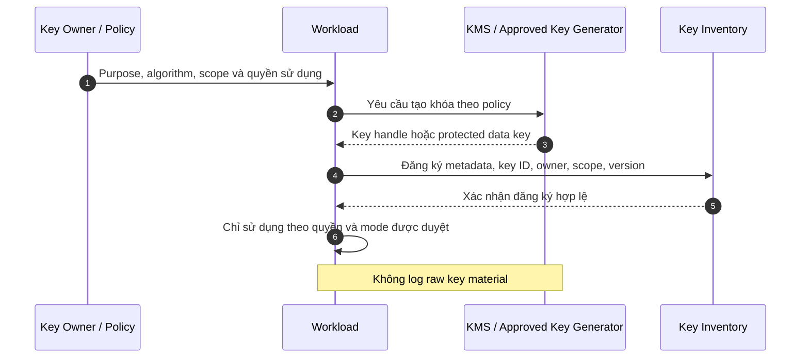
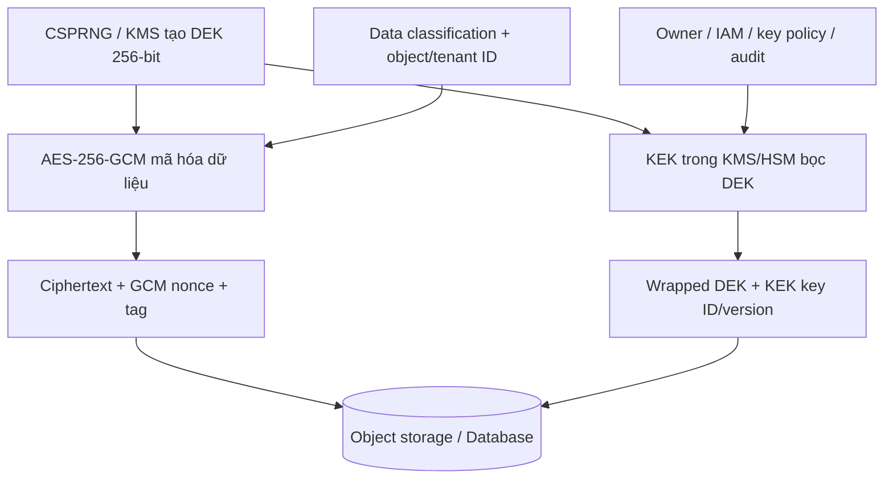
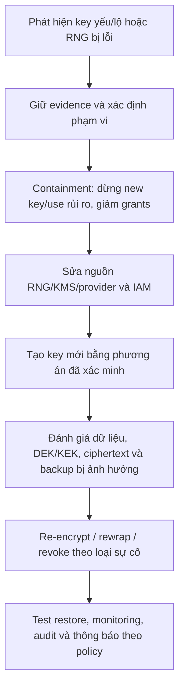
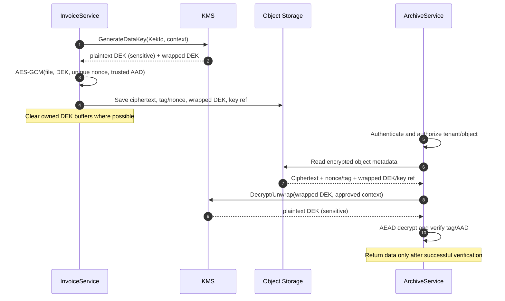

# Sinh key đối xứng — Tạo khóa mật mã an toàn cho hệ thống

> **Chương:** Key generation  
> **Module:** SECURITY_KEY_MANAGEMENT_FUNDAMENTALS — hiểu vòng đời khóa mật mã từ tạo, cấp phát, lưu trữ, sử dụng, xoay vòng đến thu hồi và hủy; kết nối mật mã đối xứng, bất đối xứng, chữ ký số, KMS/HSM, envelope encryption, kiểm soát truy cập và kiểm toán để thiết kế hệ thống bảo vệ khóa an toàn.

## 1. Mục tiêu học tập

Sau bài học, bạn có thể:

1. Giải thích **sinh khóa đối xứng** là gì và vì sao độ an toàn của AES/HMAC còn phụ thuộc vào **nguồn tạo key material**.
2. Phân biệt **độ dài khóa**, **entropy**, **CSPRNG/DRBG**, **seed**, **nonce/IV**, **salt** và **key derivation**.
3. Chọn độ dài khóa theo thuật toán và policy, chẳng hạn **AES-128, AES-192, AES-256**; tránh đồng nhất “256 bit đầu ra” với “256 bit bí mật thực sự”.
4. Sử dụng **Java `SecureRandom` và `KeyGenerator`** để sinh khóa AES, đồng thời biết khi nào nên để **KMS/HSM** tạo khóa.
5. Mô tả cách dùng **DEK/KEK và envelope encryption**, bao gồm lúc nào một data key plaintext đi vào bộ nhớ ứng dụng.
6. Phân biệt **khóa sinh ngẫu nhiên** và **khóa dẫn xuất bằng KDF**, đặc biệt với mật khẩu, master secret và domain separation.
7. Thiết kế vòng đời khóa từ **owner, scope, key inventory, storage, distribution, rotation, revocation, backup/DR đến destruction**.
8. Nhận diện các lỗi: dùng `Random`/`Math.random`, seed cố định, hash mật khẩu trực tiếp, reuse key/nonce, hardcode secret, log key và tự tạo key bằng phép ghép chuỗi.
9. Xây dựng kiểm thử, checklist và quy trình ứng phó khi phát hiện lỗi sinh khóa.

## 2. Sinh key đối xứng là gì?

**Khóa đối xứng (symmetric key)** là vật liệu bí mật được các bên hoặc thành phần được cấp quyền sử dụng để thực hiện một phép toán mật mã đối xứng: mã hóa/giải mã, xác thực thông điệp bằng MAC hoặc một nhiệm vụ cụ thể khác.

Ví dụ:

- **AES-256-GCM:** dùng một khóa AES 256 bit để bảo vệ tính bí mật và toàn vẹn dữ liệu theo đúng quy tắc AEAD.
- **HMAC-SHA-256:** dùng một khóa HMAC bí mật để tạo/kiểm tra mã xác thực thông điệp.
- **AES Key Wrap (AES-KW/KWP):** sử dụng **KEK** đối xứng để bọc/giải bọc khóa khác, thường là **DEK**.
- **PSK cho một giao thức:** vật liệu bí mật được cấp phát trước, dùng theo key schedule/kiểu xác thực mà giao thức quy định.

**Sinh khóa đối xứng** là quá trình tạo hoặc dẫn xuất vật liệu khóa có độ dài, entropy, mục đích và trạng thái phù hợp với thuật toán cùng threat model. Quá trình không kết thúc ở lệnh “tạo 32 byte”: phải xác định **ai được biết khóa, khóa bảo vệ dữ liệu nào, lưu ở đâu, dùng bao lâu và khi nào phải thay/hủy**.

### 2.1. “Key” không đồng nghĩa “một chuỗi đủ dài”

Một chuỗi:

```text
my-company-super-secret-key-2026!!
```

có thể dài hơn 32 ký tự nhưng **không có bảo đảm entropy tương đương khóa AES-256**. Nó chứa cấu trúc dễ dự đoán, có thể lộ qua code/config và không được sinh bởi nguồn ngẫu nhiên mật mã.

Ngược lại, **32 byte được tạo độc lập, đồng đều** bởi CSPRNG phù hợp có không gian khả năng lý tưởng là \(2^{256}\) giá trị. Hai giá trị đều dài “32”, nhưng **độ khó đoán hoàn toàn khác**.

### 2.2. Sinh khóa là một bước trong key management


Một thuật toán AES mạnh không bù được một khóa đã được đặt trong repository công khai hoặc sinh từ seed dễ đoán.

## 3. Thuộc tính an toàn cần có của khóa đối xứng

### 3.1. Không thể dự đoán

Đối thủ không được suy ra key material chỉ từ:

- Thời gian server khởi động.
- PID, hostname, địa chỉ IP hoặc MAC address.
- Số ngẫu nhiên của phiên trước.
- Trật tự key creation, request ID, tenant ID hoặc customer ID.
- Log/tracing/metadata không bí mật.

Một số giá trị trên có thể dùng làm **ngữ cảnh/domain separator** ở một giao thức phù hợp, nhưng **không phải nguồn entropy bí mật**.

### 3.2. Đủ entropy và đúng độ dài

Khóa AES-256 lý tưởng có 256 bit ngẫu nhiên phù hợp; nếu tất cả khóa được sinh từ một seed chỉ có 40 bit entropy, kẻ tấn công có thể chỉ cần tìm trong khoảng \(2^{40}\) seed có thể — dù mỗi khóa dài **256 bit**.

Ký hiệu đơn giản:

\[
\text{Key length} \neq \text{Security entropy}.
\]

Độ dài khóa là đặc điểm **định dạng và thuật toán**. Entropy là mức độ khó đoán của đầu vào theo mô hình nguồn ngẫu nhiên.

### 3.3. Độc lập đúng phạm vi

Các key phải được tách theo **mục đích và phạm vi bảo vệ**:

- Không sử dụng **cùng byte DEK** cho nhiều tenant chỉ vì tất cả đều dùng AES.
- Không lấy cùng một secret trực tiếp làm **AES key, HMAC key, password pepper và signing credential**.
- Khi có master secret, dùng KDF chuẩn với **labels/context** để dẫn xuất khóa con tách mục đích.
- Không tái sử dụng cùng cặp **AES-GCM key + nonce** cho hai bản tin.
- Không nhân bản trạng thái ngẫu nhiên khiến nhiều worker tạo lại cùng chuỗi khóa.

### 3.4. Bảo vệ được khi tồn tại

Một khóa dù sinh đúng vẫn có thể lộ qua:

- `println`, logs, stack traces, exception message, debug dump.
- Environment variables, process inspection, crash dump.
- Source code, version control, build artifact.
- File cấu hình hoặc database cùng quyền truy cập với ciphertext.
- Backup không được kiểm soát, CI secret không tách môi trường.
- API `Decrypt`/`Sign`/`Export` được cấp quyền quá rộng.

**Generation quality và key custody là hai lớp cần đồng thời tốt.**

## 4. Phân biệt key, entropy, seed, nonce, IV và salt

| Khái niệm | Mục đích | Bí mật? | Có thể tái sử dụng? |
| --- | --- | --- | --- |
| **Symmetric key** | Mã hóa, MAC, wrap... | **Có** | Chỉ trong phạm vi, cryptoperiod và usage limit đã định |
| **Entropy source** | Cung cấp bất định cho cơ chế tạo số ngẫu nhiên | Đầu ra nhạy cảm tùy thiết kế | Phải đáp ứng yêu cầu entropy/health testing |
| **DRBG seed** | Khởi tạo trạng thái DRBG từ entropy/input phù hợp | **Có thể là bí mật tối quan trọng** | Không dùng seed cố định/đoán được để tạo khóa production |
| **Nonce** | Đảm bảo uniqueness/freshness theo primitive | Thường **không** | Không reuse theo yêu cầu thuật toán; GCM cấm lặp key+IV |
| **IV** | Tham số khởi tạo của mode mã hóa | Thường **không**, tùy mode | Quy tắc phụ thuộc mode; không áp dụng một luật cho mọi IV |
| **Salt** | Phân biệt các lần KDF/hash, chống dùng chung kết quả | Thường **không** | Theo yêu cầu KDF; nên có salt mới khi cần tính độc lập |
| **Key ID/version** | Tham chiếu đến key material hoặc resource | Thường không | Có thể xuất hiện trong metadata/audit, không thay key |
| **AAD (AEAD)** | Ràng buộc dữ liệu ngữ cảnh khi kiểm tra tag | Không bắt buộc bí mật | Có thể lặp nếu ngữ cảnh hợp lệ, không thay nonce |

### 4.1. Ví dụ ba giá trị ngẫu nhiên khác nhau

Khi mã hóa một file hóa đơn:

```text
DEK     = 32 byte ngẫu nhiên mật mã, bí mật.
GCM IV  = 12 byte theo chiến lược đảm bảo uniqueness dưới DEK.
Salt    = không bắt buộc khi DEK đã được sinh ngẫu nhiên; chỉ cần
          nếu đang thực hiện một cơ chế KDF có salt.
```

**Không dùng 12-byte GCM nonce làm khóa AES. Không dùng 32-byte AES key làm nonce.** Dù các byte đều có thể trông ngẫu nhiên, vai trò và quy tắc bảo mật không giống nhau.

### 4.2. Salt không làm mật khẩu yếu thành mật khẩu mạnh

`salt` giúp chống cùng input cho cùng output và hạn chế bảng tính trước theo kiểu tấn công nhất định. Nó **không tự thêm đủ entropy vào mật khẩu người dùng**. Cần **password-based KDF** được phê duyệt, chi phí tính toán phù hợp, và chính sách xác thực.

## 5. Chọn độ dài khóa đối xứng theo thuật toán

### 5.1. AES-128, AES-192 và AES-256

**AES** theo FIPS 197 hỗ trợ khóa:

| Loại khóa | Độ dài | Số byte | Số vòng AES |
| --- | ---: | ---: | ---: |
| AES-128 | 128 bit | 16 byte | 10 |
| AES-192 | 192 bit | 24 byte | 12 |
| AES-256 | 256 bit | 32 byte | 14 |

Không có **AES-512** trong AES chuẩn. Nếu đưa 64 byte vào một API yêu cầu AES, provider có thể từ chối hoặc người viết chương trình tự cắt một phần — cả hai đều không phải cách tăng bảo mật có căn cứ.

### 5.2. Chọn 128 hay 256 bit?

- **AES-128** có biên an toàn rất lớn đối với tấn công brute-force cổ điển và có thể phù hợp nhiều hệ thống theo policy.
- **AES-256** thường được lựa chọn khi chính sách yêu cầu biên an toàn lớn hơn, thời hạn bảo vệ dài hoặc khi thiết kế cần mức security strength cụ thể.
- **AES-192** hợp lệ nhưng có thể ít phổ biến hơn trong ecosystem API/provider; chỉ chọn nếu có yêu cầu và hỗ trợ đầy đủ.

Sự lựa chọn phụ thuộc **data classification, thời gian bảo vệ, quy định, khả năng provider, giới hạn hiệu năng và threat model**. Không mặc định “mọi khóa dưới AES-256 đều sai”, cũng không tuyên bố AES-256 bảo vệ được dữ liệu nếu key hoặc nonce bị quản lý sai.

### 5.3. HMAC key và ChaCha20 không sao chép quy tắc AES

- HMAC dùng secret key có thể có kích thước linh hoạt, nhưng **security strength không đơn giản bằng toàn bộ số bit khóa**; phụ thuộc hàm băm, cấu trúc HMAC và policy.
- ChaCha20 thường dùng **khóa 256 bit** theo profile chuẩn; nonce/counter có quy tắc riêng.
- AES-KW/KEK chọn key size theo AES và profile wrapping được hỗ trợ.
- PSK cho một giao thức có thể cần cấu trúc/entropy và key schedule của **giao thức**, không phải chỉ “có 32 byte”.

**Thuật toán định nghĩa key format và usage.** Không tái sử dụng một `SecretKey` tuỳ ý chỉ vì key bytes có cùng độ dài.

## 6. Nguồn sinh ngẫu nhiên mật mã: CSPRNG và DRBG

### 6.1. CSPRNG là gì?

**CSPRNG (Cryptographically Secure Pseudo-Random Number Generator)** tạo byte khó đoán đối với attacker trong điều kiện được khởi tạo và vận hành đúng. Hệ điều hành/crypto provider có thể dùng entropy từ các nguồn phù hợp để tạo seed và duy trì **DRBG**.

Một DRBG là một cấu trúc sinh đầu ra giả ngẫu nhiên từ trạng thái nội bộ; tiêu chuẩn như **NIST SP 800-90A** mô tả các cấu trúc DRBG. Bảo đảm tổng thể còn phụ thuộc **entropy source** và cơ chế instantiation/reseed, được bàn trong những tiêu chuẩn liên quan.

### 6.2. Vì sao không dùng `java.util.Random` hoặc `Math.random()`?

`Random` và `Math.random()` phục vụ mô phỏng, UI, thử nghiệm hoặc chọn ngẫu nhiên thông thường. Chúng **không được thiết kế để bảo đảm không thể dự đoán key material**.

Ví dụ không an toàn:

```java
// SAI: java.util.Random không phải CSPRNG.
byte[] keyBytes = new byte[32];
new java.util.Random(System.currentTimeMillis()).nextBytes(keyBytes);

// SAI: cắt một mã cố định thành khóa AES.
byte[] key = "mysecretpassword-may-be-32bytes!"
    .getBytes(java.nio.charset.StandardCharsets.UTF_8);
```

Một key có thể mã hóa/giải mã đúng trong test, nhưng attacker có thể **đoán hoặc tái tạo** nó dễ hơn brute-force khóa AES đúng chuẩn.

### 6.3. Java `SecureRandom`

`java.security.SecureRandom` là API của JCA cho nguồn số ngẫu nhiên có mục tiêu bảo mật. Với ứng dụng Java phổ biến, dùng provider/JDK được cập nhật và cấu hình đúng:

```java
import java.security.SecureRandom;

SecureRandom secureRandom = new SecureRandom();

byte[] secretBytes = new byte[32];
secureRandom.nextBytes(secretBytes);
```

**Lưu ý:**

- Không bắt buộc phải chỉ định một thuật toán `SecureRandom` cố định cho mọi môi trường; provider/JDK có cơ chế và cấu hình khác nhau.
- `SecureRandom.getInstanceStrong()` chọn thuật toán theo cấu hình `securerandom.strongAlgorithms` và có thể có đặc điểm blocking/latency khác; **không mặc định nó luôn an toàn hơn hoặc tốt hơn** `new SecureRandom()` trong mọi ứng dụng.
- `setSeed(...)` không phải cách tạo một CSPRNG an toàn từ một chuỗi dễ đoán; trên một số provider nó bổ sung đầu vào, cách xử lý khác nhau.
- Đừng dùng seed cố định cho production chỉ để tạo output deterministic/reproducible.
- Kiểm tra chính sách FIPS/hardware assurance với provider/DRBG được chọn khi tổ chức có yêu cầu.

### 6.4. Entropy ban đầu, reseed và trạng thái bị nhân bản

Hệ thống có thể gặp rủi ro khi:

- VM/container được clone hoặc restore snapshot với trạng thái RNG đã có.
- Process fork và các child kế thừa trạng thái DRBG theo cách không an toàn.
- Thiết bị nhúng khởi động khi chưa có đủ entropy.
- Entropy source hoặc provider bị lỗi nhưng ứng dụng bỏ qua lỗi.
- Một thư viện tự quản lý DRBG không thực hiện reseed theo giới hạn của nó.

**Giải pháp không phải tự lấy timestamp/PID rồi băm thành seed.** Cần dùng nền tảng crypto/OS/JDK có bảo trì, kiểm tra hướng dẫn provider, đặc biệt cho embedded/virtualized environments, và đánh giá health testing/reseed theo threat model.

### 6.5. Khả năng phục hồi sau compromise

Nhiều thiết kế DRBG hướng đến thuộc tính như **backtracking resistance** và có thể hỗ trợ **prediction resistance** theo cấu hình/reseed. Không nên tự tuyên bố một Java `SecureRandom` bất kỳ có đủ mọi thuộc tính mà chưa kiểm tra provider, algorithm, mode và yêu cầu tiêu chuẩn.

Khi phát hiện trạng thái RNG đã bị lộ, việc chỉ tạo một file key mới trên **cùng cơ chế bị compromise** có thể chưa đủ. Cần khắc phục nguồn entropy/DRBG trước khi sinh lại key.

## 7. Quy trình sinh khóa đối xứng an toàn

Một quy trình phù hợp cho production:

1. **Xác định purpose:** mã hóa dữ liệu, MAC, KEK, session key, PSK hay một key usage khác.
2. **Xác định scope:** service, environment, tenant, data asset, region, cryptoperiod.
3. **Xác định owner và policy:** thuật toán, key size, key use allowlist, exportability, HSM requirement, access controls.
4. **Chọn nơi sinh:** KMS/HSM/protected provider hoặc JCA `KeyGenerator` kết hợp `SecureRandom` đáng tin.
5. **Tạo khóa:** gọi API phù hợp và kiểm tra kết quả; không tự ghép secret bằng password/ID/time.
6. **Bảo vệ ngay:** giữ trong key handle non-exportable nếu có thể, hoặc bọc bằng KEK/public key đúng trust boundary.
7. **Đăng ký metadata:** key ID/version, algorithm, createdAt, owner, policy, purpose và dependency graph.
8. **Cấp quyền:** người/service nào dùng `Encrypt/Decrypt/Sign/Wrap/Unwrap`; tách duty theo rủi ro.
9. **Kiểm thử:** interoperability, key length, mode/nonce, error paths, restore.
10. **Vận hành:** monitoring, rotation, incident response, backup/DR và hủy khi hết phụ thuộc.



Trong quy trình KMS `GenerateDataKey`, provider có thể trả **plaintext DEK lẫn wrapped DEK**, khác với một API chỉ trả key handle. Sơ đồ là khái quát; thiết kế thực phải xử lý chính xác ranh giới plaintext của API đã chọn.

## 8. Java JCA: sinh khóa AES bằng `KeyGenerator`

Ví dụ dưới đây tương thích Java 17 với một provider JCA hỗ trợ AES-256:

```java
import java.security.GeneralSecurityException;
import java.security.SecureRandom;
import javax.crypto.KeyGenerator;
import javax.crypto.SecretKey;

public final class AesKeyFactory {
    private static final SecureRandom CSPRNG = new SecureRandom();

    private AesKeyFactory() {}

    public static SecretKey newAes256Key()
            throws GeneralSecurityException {

        KeyGenerator generator = KeyGenerator.getInstance("AES");
        generator.init(256, CSPRNG);
        return generator.generateKey();
    }

    public static SecretKey newAes128Key()
            throws GeneralSecurityException {

        KeyGenerator generator = KeyGenerator.getInstance("AES");
        generator.init(128, CSPRNG);
        return generator.generateKey();
    }

    public static void main(String[] args)
            throws GeneralSecurityException {

        SecretKey key = newAes256Key();

        // Không log key.getEncoded(), không in Base64 của key,
        // không ghi khóa bí mật vào config hoặc source code.
        System.out.println("Key algorithm: " + key.getAlgorithm());
        System.out.println("Key format: " + key.getFormat());
        // Ở production: đăng ký key ID, owner, policy và bảo vệ khóa
        // bằng KMS/HSM hoặc cơ chế wrapping phù hợp trước khi lưu.
    }
}
```

### 8.1. Vì sao dùng `KeyGenerator` thay vì tự tạo 32 byte?

Cả hai có thể tạo key material phù hợp khi sử dụng đúng CSPRNG. Nhưng `KeyGenerator` có lợi ích:

- Gắn rõ thuật toán `AES` và key length mong muốn.
- Trả `SecretKey` phù hợp JCA, giảm bước tự lắp `SecretKeySpec`.
- Cho phép provider áp dụng kiểm soát hoặc cách sinh khóa cụ thể.
- Dễ tích hợp với provider hardware khi được hỗ trợ.

Điều này **không bảo đảm `SecretKey` luôn non-exportable**. Với provider phần mềm thông thường, `getEncoded()` có thể trả raw bytes. Với key handle nằm trong HSM/KMS provider, `getEncoded()` có thể trả `null` hoặc API từ chối export, tùy thiết kế. Không được dựa vào một giả định chung.

### 8.2. Không log `getEncoded()`

Không làm:

```java
// NGUY HIỂM: lộ trực tiếp byte của AES key.
System.out.println(java.util.Base64.getEncoder()
    .encodeToString(key.getEncoded()));
```

Base64 chỉ **mã hóa biểu diễn**, không mã hóa bảo mật. Ai đọc Base64 của key có thể giải mã về raw key material.

### 8.3. Đừng tự đặt seed cố định

```java
// KHÔNG DÙNG cho production key generation.
SecureRandom random = SecureRandom.getInstance("SHA1PRNG");
random.setSeed(new byte[] {1, 2, 3, 4});

// Không tự giả định mọi provider cho kết quả deterministic
// hoặc có cùng semantics nếu setSeed(seed) cố định.
```

Đoạn trên minh họa một **anti-pattern về seed đoán được**. `setSeed` có semantics phụ thuộc provider; không dùng nó để thay thế nguồn entropy của nền tảng. Nếu test yêu cầu kết quả cố định, hãy **inject dữ liệu test không nhạy cảm** tại lớp kiểm thử và tuyệt đối không mang test secrets sang production.

## 9. Java AES-GCM: sinh DEK, nonce và bảo vệ dữ liệu

Sinh đúng key chỉ là bước đầu. Một ứng dụng còn cần **thuật toán mã hóa có xác thực**, ví dụ AES-GCM, cùng cơ chế nonce an toàn.

Ví dụ đầy đủ dưới đây tạo **DEK AES-256**, tạo nonce 96 bit và mã hóa/giải mã một thông điệp nhỏ. Chỉ phù hợp để **minh họa luồng đơn phiên với lượng bản tin thấp**; production cần chính sách nonce/usage limits trên mỗi key, lưu trữ/wrapping và key lifecycle.

```java
import java.nio.charset.StandardCharsets;
import java.security.GeneralSecurityException;
import java.security.SecureRandom;
import java.util.Arrays;

import javax.crypto.Cipher;
import javax.crypto.KeyGenerator;
import javax.crypto.SecretKey;
import javax.crypto.spec.GCMParameterSpec;

public final class AesGcmDemo {
    private static final int NONCE_BYTES = 12; // 96 bit
    private static final int TAG_BITS = 128;
    private static final SecureRandom CSPRNG = new SecureRandom();

    public record Encrypted(byte[] nonce, byte[] ciphertextAndTag) {
        public Encrypted {
            nonce = nonce.clone();
            ciphertextAndTag = ciphertextAndTag.clone();
        }

        @Override
        public byte[] nonce() {
            return nonce.clone();
        }

        @Override
        public byte[] ciphertextAndTag() {
            return ciphertextAndTag.clone();
        }
    }

    static SecretKey generateDek() throws GeneralSecurityException {
        KeyGenerator kg = KeyGenerator.getInstance("AES");
        kg.init(256, CSPRNG);
        return kg.generateKey();
    }

    static Encrypted encrypt(
            SecretKey dek,
            byte[] plaintext,
            byte[] aad) throws GeneralSecurityException {

        byte[] nonce = new byte[NONCE_BYTES];
        CSPRNG.nextBytes(nonce);

        Cipher cipher = Cipher.getInstance("AES/GCM/NoPadding");
        cipher.init(
            Cipher.ENCRYPT_MODE,
            dek,
            new GCMParameterSpec(TAG_BITS, nonce)
        );
        cipher.updateAAD(aad);
        byte[] ciphertextAndTag = cipher.doFinal(plaintext);
        return new Encrypted(nonce, ciphertextAndTag);
    }

    static byte[] decrypt(
            SecretKey dek,
            Encrypted blob,
            byte[] aad) throws GeneralSecurityException {

        Cipher cipher = Cipher.getInstance("AES/GCM/NoPadding");
        cipher.init(
            Cipher.DECRYPT_MODE,
            dek,
            new GCMParameterSpec(TAG_BITS, blob.nonce())
        );
        cipher.updateAAD(aad);
        return cipher.doFinal(blob.ciphertextAndTag());
    }

    public static void main(String[] args)
            throws GeneralSecurityException {

        SecretKey dek = generateDek();
        byte[] aad = "tenant-42|invoice-813|format-v1"
            .getBytes(StandardCharsets.UTF_8);
        byte[] plaintext = "Confidential invoice"
            .getBytes(StandardCharsets.UTF_8);

        Encrypted blob = encrypt(dek, plaintext, aad);
        byte[] recovered = decrypt(dek, blob, aad);

        if (!Arrays.equals(plaintext, recovered)) {
            throw new GeneralSecurityException("Round-trip mismatch");
        }

        // Không in plaintext, DEK hoặc ciphertext nhạy cảm ra log.
        System.out.println("AES-GCM round-trip verified");

        Arrays.fill(plaintext, (byte) 0);
        Arrays.fill(recovered, (byte) 0);
    }
}
```

### 9.1. Vì sao nonce 12 byte?

**96-bit IV** là độ dài phổ biến và được GCM tối ưu theo chuẩn. Nhưng **không phải chỉ cần nó dài 12 byte là an toàn**. Với cùng DEK, mọi invocation phải tuân giới hạn và quy tắc đảm bảo **không reuse IV**.

Ví dụ dùng random nonce phù hợp **với lượng bản tin nhỏ và giới hạn số lần mã hóa trên mỗi key**. Với hệ thống số lượng bản tin lớn, nhiều worker hoặc cần đảm bảo uniqueness mạnh, phải thiết kế **nonce allocation** (counter/partition/sequence) đúng chuẩn và chống reuse sau restart, fork, rollback, DR.

NIST SP 800-38D quy định những yêu cầu về IV construction và giới hạn. **Không áp một số lượng invocation duy nhất cho mọi mode/kích thước IV/provider**; policy production phải căn cứ thiết kế IV và chuẩn áp dụng.

### 9.2. `AAD` ràng buộc ngữ cảnh nhưng không thay xác thực người gọi

AAD có thể bao gồm tenant ID, object ID, format version và algorithm profile theo quy tắc canonical hóa. AAD được xác thực cùng ciphertext, nhưng:

- Phải tái tạo **đúng byte** khi giải mã.
- Không dùng tenant ID do attacker tự nhập làm **nguồn quyền**.
- AAD không được mã hóa bí mật bởi GCM; đừng đưa dữ liệu nhạy cảm vào đó nếu lộ metadata là vấn đề.
- Trong hệ thống đa service, cần xác định **nguồn tin cậy** của metadata AAD.

### 9.3. Vì sao không bắt lỗi tag rồi trả plaintext?

Nếu tag không đúng, `doFinal` khi decrypt thường throw lỗi xác thực (như `AEADBadTagException`). Ứng dụng phải **từ chối toàn bộ plaintext**, không trả dữ liệu một phần hoặc fallback sang decrypt không xác thực.

### 9.4. Giới hạn bộ nhớ trong JVM

- `SecretKey` có thể được provider giữ trong heap hoặc native memory.
- Xóa một mảng byte do ứng dụng sở hữu **không đảm bảo** mọi bản sao plaintext/key bị xóa trong JVM, JIT, thư viện hoặc dump.
- `String` và constant demo ở đây phục vụ minh họa; tránh dùng immutable `String` để giữ bí mật có vòng đời cần xóa trong production.
- Nếu cần assurance cao, ưu tiên **key handle non-exportable và API của KMS/HSM** để giới hạn nơi key material tồn tại.

## 10. DEK và KEK: sinh khóa trong envelope encryption

**Envelope encryption** tách:

- **Data Encryption Key (DEK):** khóa đối xứng sinh riêng cho file/object/batch để mã hóa dữ liệu.
- **Key Encryption Key (KEK):** khóa bảo vệ DEK bằng một cơ chế wrap/encrypt key.
- **Wrapped DEK:** ciphertext của DEK được lưu cạnh ciphertext dữ liệu.
- **Key metadata:** key ID/version, algorithm, nonce/tag, AAD schema và định dạng.



### 10.1. Vì sao không dùng một master key trực tiếp mã hóa toàn bộ dữ liệu?

Sử dụng **một key** cho nhiều lượng dữ liệu, tenant hoặc hệ thống có thể:

- Tăng **blast radius** nếu key bị lộ.
- Tăng số invocation/nonce cần quản lý trên một key.
- Khó thực hiện rotation, re-encrypt hoặc hủy riêng theo object.
- Buộc nhiều workload chia sẻ quyền decrypt rộng.

DEK per object/batch và KEK theo security boundary giúp quản lý rủi ro linh hoạt, nhưng cũng tăng **metadata và lifecycle responsibilities**.

### 10.2. Bao nhiêu DEK cho một hệ thống?

Không có công thức chung:

- **Per object:** dễ khoanh vùng, cấp quyền và cryptographic erasure ở mức nhất định; tăng số wrapped DEKs.
- **Per tenant:** giảm số key nhưng cần tenant isolation/nonce management chặt.
- **Per batch/time window:** cân bằng throughput và quản trị, nhưng rủi ro lộ DEK ảnh hưởng nhiều object.
- **Per session:** phù hợp giao thức có key schedule/rekey, không đồng nghĩa DEK file-at-rest.

Chọn theo **data classification, blast radius, workload, cost, retention, provider quotas và khả năng audit**.

### 10.3. Sinh DEK không giống tạo master KEK

- **DEK** có thể được sinh thường xuyên, plaintext xuất hiện trong app memory khi sử dụng với AEAD.
- **KEK/master key** nên được bảo vệ chặt hơn, thường trong **KMS/HSM** và có key usage giới hạn `Wrap/Unwrap`, `Encrypt/Decrypt` tương ứng.
- Không copy raw KEK vào environment variables của mọi service.
- Không dùng DEK làm key signing hoặc KMS admin credential.

### 10.4. Nhiều người nhận

Một file có thể mã hóa **một lần** dưới DEK rồi tạo **nhiều wrapped DEK** cho các recipients có quyền. Nhưng nếu một recipient đã nhận plaintext DEK, **xóa wrapper của họ không làm họ quên DEK**. Thu hồi quyền có thể cần sinh DEK mới, re-encrypt và xử lý backup/bản sao.

## 11. KMS/HSM tạo key: nơi sinh và khả năng xuất khóa

### 11.1. KMS key và data key là hai loại tài sản khác nhau

Trong một số KMS, API `GenerateDataKey` có thể trả về:

- **Plaintext data key:** để ứng dụng mã hóa bằng AES hoặc primitive tương ứng.
- **Encrypted/wrapped data key:** để lưu cạnh ciphertext.
- **Key reference và metadata:** giúp biết KEK được dùng.

Không phải mọi nhà cung cấp/API đều có cùng output shape hoặc thuật toán. **Đọc đúng tài liệu dịch vụ** trước khi thiết kế; một API `CreateKey` cho KEK không tự động trả plaintext key.

### 11.2. Lưu ý quan trọng về key plaintext

Khi API trả plaintext DEK:

1. Chỉ cấp `GenerateDataKey` cho workload cần thực hiện mã hóa.
2. Giữ DEK trong bộ nhớ **ngắn nhất có thể**, không đưa vào log/trace/error.
3. Dùng DEK mã hóa dữ liệu bằng AEAD đúng quy tắc nonce.
4. Lưu **wrapped DEK** và ciphertext, không lưu plaintext key ở database.
5. Kiểm tra authorization cho tenant/object trước khi unwrap khi đọc.
6. Giảm bản sao memory/dump và xử lý cleanup best-effort.

**“DEK do KMS sinh” không đồng nghĩa “DEK chưa từng rời ranh giới bảo vệ KMS”.** Nếu plaintext DEK được trả về app, chính app phải quản lý exposure window.

### 11.3. HSM và non-exportable keys

Một HSM có thể sinh/giữ key material non-exportable, cho phép thao tác thông qua **key handle**, tùy API. Nhưng:

- `Non-exportable` không ngăn workload có quyền `Decrypt/Unwrap/Sign` lạm dụng khóa.
- Key nằm trong HSM **không tự xác thực user hoặc data object**.
- Backup/DR của non-exportable key cần quy trình riêng; không giả định có thể chuyển key material giữa HSM providers.
- API JCA có thể tương tác HSM qua provider, nhưng `SecretKey.getEncoded()` không phải đường export hợp lệ.

### 11.4. Phân quyền và kiểm toán

| Principal | Quyền nên xem xét | Không nên mặc định có |
| --- | --- | --- |
| **Key owner** | Phê duyệt lifecycle/policy | Raw key, decrypt mọi dữ liệu |
| **KMS/HSM custodian** | Vận hành phần cứng, key resource theo quy trình | Quyền đọc DEK tất cả tenant |
| **Write workload** | Sinh DEK và mã hóa đúng scope | Unwrap mọi key lịch sử |
| **Read workload** | Unwrap DEK theo object/tenant đã ủy quyền | Export KEK, thay IAM policy |
| **Auditor/SOC** | Đọc metadata/audit và alert | Bản sao raw key material |
| **Incident responder** | Containment/revoke trong workflow khẩn cấp | Quyền vĩnh viễn không giám sát |

### 11.5. Chọn ranh giới tin cậy

Một số hệ thống muốn:

- **Encryption at rest** với DEK plaintext ngắn hạn trong app.
- **Private signing operations** hoàn toàn trong HSM.
- **KEK** không export để giảm tác động khi app server bị compromise.
- **BYOK/HYOK** khiến khách hàng kiểm soát một phần key availability.

Không có một kiểu API phù hợp mọi use case. Ranh giới cần được thiết kế dựa trên **threat model và mô hình trách nhiệm chia sẻ**.

## 12. Key derivation: sinh mới hay dẫn xuất từ bí mật gốc?

### 12.1. Key generation trực tiếp

Khi cần một DEK độc lập:

```text
K = CSPRNG(32 bytes)
```

Trong điều kiện đúng, mỗi key mới có bất định phù hợp và không phụ thuộc có cấu trúc vào key khác.

### 12.2. Key derivation từ secret đủ mạnh

Khi đã có một master secret **được bảo vệ, có entropy đủ**, có thể dùng **HKDF** theo RFC 5869 để dẫn xuất nhiều khóa theo context:

\[
\mathrm{PRK} = \mathrm{HKDF\text{-}Extract}(\mathrm{salt},\ \mathrm{IKM})
\]

\[
K_{\mathrm{purpose}} =
\mathrm{HKDF\text{-}Expand}(\mathrm{PRK},\ \mathrm{info},\ L)
\]

Trong đó:

- **IKM:** input keying material có đủ entropy/đặc tính phù hợp.
- **Salt:** đầu vào extract theo profile.
- **info:** ràng buộc purpose, protocol, tenant, version và các domain separators.
- **L:** độ dài output theo thuật toán.

**HKDF không tạo entropy từ hư không.** Nếu IKM là một mật khẩu dễ đoán, đầu ra 32 byte vẫn có thể bị brute-force dựa trên password.

### 12.3. Tách khóa con

Ví dụ **ý tưởng**:

```text
masterSecret (do KMS/HSM hoặc giao thức tạo)
  -> HKDF(info="billing|prod|tenant42|aes-gcm|v1") -> dataKey
  -> HKDF(info="billing|prod|tenant42|hmac|v1")    -> macKey
  -> HKDF(info="billing|prod|tenant42|wrap|v1")    -> wrapKey
```

Không ghép string tùy tiện rồi tự coi format có chống ambiguity. Trong production cần **encoding canonical, nhãn được version hóa, định nghĩa domain separation đầy đủ** và mô hình khóa có tham số được phê duyệt. Với KMS/HSM non-exportable master secret, phải dùng API derivation được hỗ trợ; không export master secret để chạy HKDF trong app nếu policy cấm.

### 12.4. Từ mật khẩu người dùng: dùng password KDF

Nếu đầu vào là password/passphrase (entropy thấp hoặc không chắc chắn):

- Không dùng `SHA-256(password)` rồi coi là AES-256 key an toàn.
- Chọn password KDF phù hợp như **Argon2id, scrypt hoặc PBKDF2** theo tiêu chuẩn/khả năng tuân thủ và cấu hình được thẩm định.
- Có **salt** ngẫu nhiên theo profile; lưu salt và tham số KDF cùng metadata cần thiết.
- Tùy kiến trúc, có thể dùng **pepper** được bảo vệ riêng trong KMS/HSM.
- Kiểm soát online guessing, rate limit, MFA và độ mạnh password.
- Nếu nguồn gốc password không đủ mạnh, một password KDF tốn tài nguyên **làm chậm đoán** nhưng không biến mật khẩu yếu thành 256 bit entropy.

**Tốt nhất, DEK production thường nên được sinh trực tiếp từ CSPRNG/KMS**, không phụ thuộc mật khẩu con người nếu kiến trúc cho phép.

### 12.5. Không tái sử dụng master secret vượt miền

Ngay cả khi dùng HKDF, phải tránh:

- Một master secret dùng cho nhiều tổ chức/tenant không có chính sách tách.
- Dùng cùng `info` cho những thuật toán khác.
- Mất khả năng rotate master vì không có key version và dependency metadata.
- Dẫn xuất cùng key cho mọi object do truyền cố định cùng context mà tưởng là per-object.
- Bỏ qua key use limits và nonce requirements khi nhiều nơi dùng cùng derived key.


## 13. Phạm vi sử dụng: một khóa cho ai, dữ liệu nào, trong bao lâu?

Một trong những quyết định quan trọng nhất **trước khi gọi KeyGenerator** là phạm vi mà khóa mới có quyền bảo vệ.

### 13.1. Key scope quyết định blast radius

| Chiến lược | Ví dụ | Lợi ích | Rủi ro/chi phí |
| --- | --- | --- | --- |
| **Per object DEK** | Mỗi hóa đơn có DEK riêng | Lộ key ảnh hưởng phạm vi hẹp, rotation linh hoạt | Nhiều wrapped DEK và metadata |
| **Per tenant DEK** | Một khóa mã hóa tập dữ liệu của tenant | Đơn giản hơn cho tenant separation | Nonce/usage limit và key exposure lớn hơn |
| **Per data class** | Khóa riêng dữ liệu restricted | Tách quyền và policy | Cần mapping dữ liệu chính xác |
| **Per batch/time window** | Một key cho batch ETL | Phù hợp throughput theo đợt | Dữ liệu trong batch chung fate |
| **Per session** | Key do TLS 1.3 key schedule tạo | Giảm thời gian key sống, có rekey | Phụ thuộc giao thức, không phải key at-rest |
| **Global master key** | Một KEK bọc nhiều DEK | Quản lý bọc khóa tập trung | Blast radius, quota và yêu cầu governance cao |

Không nên lấy **một DEK toàn công ty** chỉ để “giảm chi phí key management”. Một sự cố có thể ảnh hưởng dữ liệu của tất cả tenant, hoặc buộc re-encrypt một khối lượng rất lớn.

### 13.2. Domain separation và phân quyền

Trong hệ thống multi-tenant:

- `tenantId` phải được xác định từ **identity/authorization đáng tin**, không từ chuỗi do request tự khai báo.
- DEK/KEK phải được ràng buộc với đúng tenant và purpose qua policy/metadata.
- Nếu tái sử dụng một khóa giữa tenant, phải đánh giá liệu một workload có thể decrypt dữ liệu ngoài quyền không.
- Tránh dùng chung key across `dev`, `staging` và `production`; tách trust boundary và incident scope.
- KMS grants, encryption context (nếu API hỗ trợ) và application authorization cần **phối hợp**, không dùng một lớp thay tất cả.

### 13.3. Cần giới hạn tổng lượng dữ liệu trên key

Với AEAD hoặc MAC, giới hạn an toàn thường phụ thuộc:

- Số lần dùng key.
- Tổng số block/byte được mã hóa.
- Cách cấp phát nonce.
- Xác suất va chạm/giới hạn tag.
- Quy tắc thuật toán/provider và cryptoperiod.

Không chỉ kiểm tra “key còn dưới 90 ngày tuổi” rồi cho phép encrypt vô hạn. **Usage limits và nonce policy** có thể là nguyên nhân cần rotate key trước ngày đã định.

## 14. Lưu trữ và phân phối khóa sinh ra

### 14.1. Bảo vệ khóa ngay từ thời điểm tạo

Nếu khóa sinh trong ứng dụng:

1. Hạn chế thời gian tồn tại plaintext trong RAM.
2. Tránh chuyển qua `String`, JSON debug, logging hoặc exception.
3. Không lưu raw key trong source/config/DB cạnh ciphertext.
4. Bọc bằng KEK hoặc gửi tới trusted key store theo API được phê duyệt.
5. Chỉ những workload được phép mới có thể phục hồi key.
6. Gắn key ID/owner/scope/key version để sử dụng và thu hồi sau này.
7. Nếu key không thể được bảo vệ/lưu atomically, **fail closed** và xử lý thất bại theo runbook.

Một khóa sinh an toàn nhưng lưu cạnh ciphertext plaintext làm suy yếu mục tiêu mã hóa dữ liệu at rest.

### 14.2. Các nơi nên cân nhắc lưu khóa

| Nơi giữ key | Trường hợp phù hợp | Lưu ý |
| --- | --- | --- |
| **Managed KMS/HSM** | KEK/master/signing key, key use controls | Provider semantics, IAM, region, non-exportability, DR |
| **JCA keystore/OS keystore** | Khóa cho ứng dụng/thiết bị theo policy | Protection, ACL, backup, host compromise |
| **TPM/secure element** | Device-bound credentials | Attestation, recovery, lifecycle thiết bị |
| **Secret manager** | Một số bí mật mà ứng dụng cần lấy | Phân quyền, rotation và export exposure |
| **Wrapped DEK trong DB/object metadata** | Envelope encryption | Chỉ ciphertext của DEK; cần key reference và version |
| **Plaintext environment variable** | Có thể xuất hiện trong legacy tooling | Không nên là mặc định cho master key/KEK; dễ lộ qua process/config/dump |
| **Hardcode trong source** | **Không phù hợp production secret** | Bị sao chép rộng, khó thu hồi và kiểm toán |

### 14.3. Key transport hoặc agreement trước khi chia sẻ khóa

Nếu hai service cần cùng một key, không gửi raw key qua:

- Email/chat hoặc file đính kèm.
- JSON/plaintext không có bảo vệ thích hợp.
- Log hoặc URL query.
- Một bảng database có quyền đọc quá rộng.

Các cơ chế có thể phù hợp:

- **KMS wrap/unwrap** bằng KEK chung được quản lý.
- **RSA-OAEP** để bảo vệ DEK cho recipient public key đã được xác thực.
- **HPKE** theo mode/giao thức và key schedule phù hợp.
- **Authenticated key agreement** để dẫn xuất session keys.
- **Kênh TLS/mTLS** với authorization đầy đủ kết hợp key wrapping theo mô hình lưu trữ.

**Mã hóa cho public key không mặc nhiên xác thực Sender.** Việc có shared key không tự chứng minh peer identity hoặc quyền nghiệp vụ.

### 14.4. Không nhầm version alias với key material

Một alias như `billing-kek-prod` có thể chuyển đích sau rotation. Metadata của wrapped DEK cần đủ để tìm **key resource/key material version** chính xác theo semantics provider. Đừng suy luận từ alias hiện tại rằng tất cả ciphertext lịch sử có thể được giải bọc bằng phiên bản mới.

## 15. Metadata và kiểm kê sau khi sinh khóa

**Key generation không hoàn tất về quản trị** nếu key được tạo nhưng không ai biết mục đích và cách thu hồi.

| Trường | Ví dụ | Vai trò |
| --- | --- | --- |
| `keyId` | `billing-dek-family` hoặc KMS resource ID | Định danh logical key/resource |
| `keyVersion` | `v3` nếu có | Mở bọc/verify dữ liệu lịch sử |
| `algorithm` | `AES` | Chọn primitive đúng |
| `keySizeBits` | `256` | Kiểm tra key format |
| `purpose` | `encrypt-invoice` | Giới hạn cách dùng |
| `usageAllowlist` | `Encrypt/Decrypt` | Không trộn MAC/wrap/sign |
| `ownerTeamId` | `billing-platform` | Accountability |
| `custodianTeamId` | `kms-platform` | Vận hành |
| `environment` | `production` | Không trộn dev/prod |
| `tenantScope` | `billing-tenants` | Đánh giá blast radius |
| `createdAt` | Timestamp có timezone | Theo dõi lifecycle |
| `rotationPolicyRef` | Policy ID/version | Nguyên tắc cryptoperiod |
| `protectionBoundary` | `managed-kms` | Biết nơi giữ key material |
| `dataAssetRefs` | `invoice-archive` | Truy vết dependencies |
| `state` | `enabled`, `decrypt-only`... | Kiểm soát new/old usage |
| `backupRunbookRef` | Runbook ID | Khôi phục và retention |
| `auditRef` | Event/change ticket | Chứng minh cấp phát/phê duyệt |

### 15.1. Record minh họa (không chứa raw key)

```json
{
  "inventoryId": "key-inventory-2026-003",
  "logicalKeyName": "billing-invoice-data-keys",
  "keyPurpose": "encrypt-invoice",
  "algorithm": "AES",
  "keySizeBits": 256,
  "keyKind": "DEK_FAMILY",
  "ownerTeamId": "billing-platform",
  "custodianTeamId": "kms-platform",
  "environment": "production",
  "tenantScope": "billing",
  "generationMethod": "kms-generate-data-key",
  "wrappingKeyRef": "kms://prod-region/keys/billing-kek-v3",
  "cryptoperiodPolicyRef": "policy/billing-data-key-v2",
  "dataAssetRefs": ["invoice-archive"],
  "createdAt": "2026-11-28T03:00:00Z",
  "state": "enabled"
}
```

Đây là **schema giả định**. Một key family record không nhất thiết đại diện từng DEK per object; object metadata phải giữ wrapped DEK, key reference và thông số AEAD thích hợp.

### 15.2. Vì sao không lưu entropy seed để “khôi phục khóa”?

**Một seed có thể tạo lại key** chỉ nếu cơ chế cố định/định nghĩa rõ, nhưng việc lưu seed là lưu **bí mật gốc nhạy cảm**, dễ làm lộ hàng loạt key cùng xuất phát từ seed đó. Không dùng seed cố định hoặc bản sao DRBG state làm “backup khóa” tùy tiện.

Muốn khôi phục dữ liệu:

- Sao lưu/nhân bản **KEK/key material** qua các cơ chế quản lý hợp lệ hoặc backup domain được kiểm soát.
- Giữ **wrapped DEK, ciphertext, nonce/tag, algorithm/format/key version metadata**.
- Kiểm thử restore thực tế và quyền dùng key ở DR.
- Không export raw master key ra file chỉ để “đảm bảo backup”.

## 16. Quản trị vòng đời của khóa vừa sinh

### 16.1. Các trạng thái không đồng nghĩa nhau

Một key có thể trải qua:

```text
PENDING_APPROVAL
 -> ENABLED_FOR_NEW_USE
 -> DECRYPT_ONLY / VERIFY_ONLY (nếu loại khóa phù hợp)
 -> DISABLED
 -> PENDING_DESTRUCTION
 -> DESTROYED
```

Những tên này là trạng thái quản trị minh họa. Provider có thể có **key state và operation semantics khác**, phải đối chiếu thực tế.

Đối với symmetric DEK/KEK:

- **Encrypt/Wrap mới** cần khóa còn được phép theo cryptoperiod.
- **Decrypt/Unwrap cũ** có thể vẫn cần sau khi ngừng new use.
- **Disable** chặn một số API access nhưng không xóa plaintext key đã bị sao chép.
- **Destroy** có thể làm ciphertext không thể phục hồi nếu không có bản sao hợp lệ.

### 16.2. Rotation, rewrap và re-encrypt

| Thao tác | Thay đổi | Điều chưa tự thay đổi |
| --- | --- | --- |
| **Rotate KEK** | Dùng khóa bọc mới cho DEK mới | Dữ liệu cũ có thể vẫn phụ thuộc KEK cũ |
| **Rewrap DEK** | Bọc **cùng DEK** dưới KEK mới | **DEK và ciphertext dữ liệu không đổi** |
| **Rotate DEK + re-encrypt** | Sinh DEK mới, mã hóa lại plaintext data | Bản sao plaintext/ciphertext cũ attacker giữ có thể còn tồn tại |
| **Rekey session** | Dẫn xuất session traffic keys mới | Không tự thay KEK at rest |
| **Revoke KMS grant** | Ngăn principal tiếp tục gọi API trong phạm vi | Không thu hồi raw DEK đã xuất/được cache |
| **Cryptographic erasure** | Hủy khả năng giải mã bằng cách hủy key phù hợp | Không chắc xóa toàn bộ plaintext/key copies khác |

### 16.3. Khi nào cần sinh DEK mới?

Một số tình huống:

- DEK có nguy cơ bị lộ hoặc đã dùng ngoài mục đích.
- Cần tách key scope sau thay đổi tenant/data classification.
- Đã tới **cryptoperiod/usage limit** hoặc giới hạn số invocation của AEAD.
- Phát hiện **nonce reuse** hoặc RNG/DRBG sai khi sinh key.
- Cần đáp ứng policy mới hoặc chuyển đổi thuật toán/format dữ liệu.

Nếu chỉ **KEK** cần thay và DEK vẫn an toàn, một quy trình rewrap có thể phù hợp. Nếu **DEK plaintext đã lộ**, rewrap một mình **không đủ**.

### 16.4. Bằng chứng rotation

Owner nên yêu cầu:

1. Danh sách key versions và data dependencies trước/sau thay.
2. Dữ liệu mới dùng key mới.
3. Dữ liệu cũ vẫn decrypt được theo retention.
4. Wrapped DEK metadata đã chuyển đúng phiên bản.
5. Backup/snapshot đã được xem xét.
6. IAM grants cũ được thu hồi/giới hạn khi có thể.
7. Monitoring xác nhận không có new use trái phép dưới key cũ.
8. Audit/approval và rollback plan đầy đủ.

## 17. Sao lưu, DR và hủy khóa

### 17.1. Backup ciphertext thôi chưa đủ

Một bản backup chỉ chứa file AES-GCM ciphertext mà mất **DEK hoặc khả năng unwrap DEK** có thể không đọc được. Muốn restore cần:

- Ciphertext và authentication tag.
- Nonce/IV đã dùng và AAD schema/metadata.
- Wrapped DEK tương ứng.
- KEK/key version hoặc key handle hợp lệ để giải bọc.
- Thuật toán/protocol version và cách canonical hóa metadata.
- Identity/authorization cần thiết ở môi trường DR.
- Kế hoạch khôi phục key material theo provider/HSM policy.

### 17.2. Tại sao non-exportable vẫn cần DR plan?

Một key không thể export qua API phần mềm có thể giúp giảm exposure, nhưng khi KMS/HSM/region không khả dụng, ứng dụng vẫn cần **phương án tiếp tục truy cập hợp lệ**. Một số provider hỗ trợ replica/backup/quorum theo sản phẩm; một số trường hợp cần thiết kế riêng.

**Không giả định alias cùng tên ở hai region là cùng key material**, hoặc key được “auto-rotate” có thể phục hồi mọi ciphertext khi mất quyền truy cập key cũ.

### 17.3. Cryptographic erasure

Hủy key có thể khiến dữ liệu mã hóa không còn đọc được **nếu tất cả các đường phục hồi key đã được loại bỏ**. Cần kiểm tra:

- Có bao nhiêu wrapped DEK copies dưới các KEK/recipient khác?
- Có bản sao DEK plaintext trong memory dump, debug artifact, backup hoặc các hệ thống phụ?
- Dữ liệu có bản plaintext/cached/export đã được phân phối?
- Key replica/backup/snapshot còn tồn tại không?
- Có legal hold hoặc retention cấm hủy?
- Hành động `ScheduleDeletion` đã thực sự hoàn tất hay vẫn trong thời gian chờ?

**Hủy một alias hoặc disable KMS key không chứng minh dữ liệu đã bị xóa mật mã hoàn toàn.**

## 18. Môi trường khó: container, serverless, VM snapshot và thiết bị nhúng

### 18.1. Bootstrapping entropy

Trên máy chủ và JDK hiện đại, các provider thường phối hợp với hệ điều hành để lấy entropy hoặc DRBG thích hợp. Nhưng hệ thống nhúng, thiết bị được nhân bản hoặc môi trường khởi động sớm có thể có rủi ro riêng.

Cần đánh giá:

- Platform cung cấp entropy source và health testing nào?
- Có sử dụng DRBG đã được phê duyệt theo chính sách không?
- Có cơ chế reseed khi fork/restart/restore snapshot không?
- Có khả năng process cloning lặp trạng thái nội bộ không?
- Khi entropy unavailable, ứng dụng **từ chối sinh key** hay tạo đầu ra yếu?
- Thiết bị có secure element/TRNG/HSM được hỗ trợ không?

### 18.2. Container không làm `SecureRandom` tự yếu

Việc chạy container **không tự khiến** `SecureRandom` không an toàn. Rủi ro nằm ở **nền tảng, entropy, provider, snapshot/fork semantics và cấu hình**. Không dùng ví dụ cũ về thiếu entropy để kết luận tất cả container phải có một workaround tự chế.

Cần kiểm tra OS/JDK/provider được deploy thật, không giả định từ tên runtime.

### 18.3. Tạo key khi build image là sai mô hình

Nếu pipeline tạo AES key rồi đóng vào image, mọi replica có thể **chia sẻ cùng key**:

```text
docker build -> tạo key -> embed key trong image
replica A và B -> cùng raw key
dev/staging/prod nếu reuse image -> cùng secret
```

Đây là anti-pattern nếu secret thuộc phạm vi runtime/tenant. Hãy dùng **provisioning có quản lý** hoặc KMS tại đúng environment, key scope và identity.

### 18.4. Cold start và `getInstanceStrong()`

Không thay mặc định mọi `new SecureRandom()` bằng `SecureRandom.getInstanceStrong()` mà chưa kiểm thử latency/availability. Sự khác biệt về blocking và provider có thể ảnh hưởng serverless/latency-critical systems. Điều kiện quan trọng là **đúng nguồn ngẫu nhiên mật mã và security policy**, không phải tên API nghe “mạnh”.

### 18.5. Nếu thiết bị không thể sinh đủ entropy

Không dùng `System.nanoTime()`, địa chỉ MAC hoặc chuỗi tăng dần làm “entropy thay thế”. Những lựa chọn cần xem xét:

- Secure element/TRNG đáp ứng yêu cầu.
- Provisioning key material từ hệ thống tin cậy bằng giao thức bảo vệ phù hợp.
- Cơ chế nhận entropy từ bên ngoài với xác thực/bảo vệ theo thiết kế.
- Ngăn phát hành key mới khi không đủ bảo đảm.
- Quản lý identity của từng thiết bị để tránh clone cùng key.

## 19. Test key generation mà không làm lộ key

### 19.1. Kiểm thử API và cấu hình

Nên kiểm tra:

1. `KeyGenerator.getInstance("AES")` dùng đúng provider/algorithm profile.
2. Khóa sinh ra tương thích với AES mode được chọn.
3. Độ dài key được cấu hình đúng 128/192/256 bit.
4. Trong môi trường yêu cầu HSM/FIPS, key generation thực sự đi qua **provider được phép**.
5. KMS API trả ciphertext/wrapped DEK đúng scheme và key reference.
6. Không có raw key trong log, debug, exception, CI artifact hoặc telemetry.
7. Quyền tạo/gọi sử dụng key bị từ chối cho workload không được phép.
8. Key inventory được cập nhật cùng owner, version và scope.
9. Key không thể bị dùng cho purpose ngoài allowlist.

### 19.2. Negative tests rất quan trọng

| Test | Cách kiểm tra | Kết quả mong đợi |
| --- | --- | --- |
| `java.util.Random` trong key generation | Static analysis/code review | Bị chặn hoặc tạo finding |
| Seed hardcoded | Scan code/config không trích secret | Không triển khai production |
| KMS `Decrypt` thiếu quyền | Caller không có grant | Từ chối và ghi audit |
| Wrong tenant | Caller tenant A yêu cầu unwrap key B | Từ chối ở app/IAM |
| Invalid key length | Cấu hình 20 byte cho AES | Không tạo key AES hợp lệ |
| Wrong GCM nonce/tag/AAD | Sửa một byte metadata | Decrypt thất bại, không trả plaintext |
| Reused nonce dưới cùng DEK | Kiểm tra nonce allocator/duplicate detection | Bị ngăn và xử lý theo incident policy |
| KMS outage | Dừng API key generation/unwrap | Không fallback sang weak random/hardcoded key |
| Restart/snapshot | Mô phỏng restore và nhiều workers | Không lặp key/nonce do trạng thái bị clone |
| Rotation migration | Mở dữ liệu trước/sau rotation | Dữ liệu hợp lệ còn đọc được |
| Backup restore | Khôi phục nhiều mốc dữ liệu | Key material/metadata/permissions đủ |
| Secret logging | Quan sát log/trace/dump theo quyền | Không xuất raw key |
| Key usage mismatch | Dùng KEK như DEK/HMAC key | Policy/provider từ chối |
| Provider mismatch | HSM provider không hỗ trợ scheme | Fail closed, không đổi algorithm âm thầm |

### 19.3. Thống kê ngẫu nhiên không chứng minh an toàn mật mã

Một test tạo 100.000 keys rồi thấy “không trùng” **không chứng minh** CSPRNG an toàn. Các phép kiểm tra thống kê có thể giúp phát hiện lỗi hiển nhiên, nhưng **không đủ để chứng minh entropy, unpredictability, prediction resistance** hoặc không có backdoor.

Kiểm soát cần dựa vào:

- Provider/algorithm được tin cậy và bảo trì.
- Thiết kế entropy source/DRBG phù hợp tiêu chuẩn và threat model.
- Tài liệu/đánh giá đảm bảo (khi có yêu cầu).
- Code review và kiểm tra cấu hình thực tế.
- Integration tests trên môi trường thật.
- Health monitoring/incident handling.

### 19.4. Không kiểm thử bằng cách ghi raw key

Không xuất một triệu key ra CSV để “phân tích entropy”. Cần sử dụng test harness **cô lập, không dùng production key, không lưu bí mật vào artifact**; khi đánh giá cấp cao có thể cần công cụ/provider test chuyên dụng được thẩm định.

## 20. Những lỗi phổ biến và cách tránh

| Sai lầm | Tác động | Thay bằng |
| --- | --- | --- |
| Dùng `Random`/`Math.random()` | Key dễ dự đoán | `SecureRandom`/KMS/HSM phù hợp |
| Seed bằng timestamp/PID | Entropy thấp, có thể brute-force | Entropy của provider/OS |
| Seed cố định để test rồi deploy | Keys bị trùng/dự đoán | Tách test fixture khỏi production |
| Dùng `SHA256(password)` làm AES key | Dễ brute-force password yếu | CSPRNG trực tiếp; nếu phải dùng password, KDF phù hợp |
| Cắt chuỗi secret thành 32 byte | Đủ byte nhưng không đủ entropy | `KeyGenerator` và `SecureRandom` |
| Giả định 256 bit output = 256 bit entropy | Đánh giá sai security strength | Phân tích nguồn entropy |
| Sinh một key dùng cho mọi tenant | Blast radius lớn | Scope/key hierarchy phù hợp |
| Dùng chung key AES và HMAC | Trộn key usage/cross-protocol | Key riêng hoặc HKDF domain separation |
| Reuse AES-GCM key+nonce | Phá bảo đảm bảo mật GCM | Nonce allocation unique và usage limits |
| Nghĩ nonce là key bí mật | Quản lý sai biến và metadata | Tách key/nonce/salt theo thuật toán |
| Dùng KMS GenerateDataKey rồi log plaintext | Lộ DEK | Chỉ lưu wrapped DEK, hạn chế memory |
| Lưu KEK plaintext cạnh ciphertext | Mất lợi ích mã hóa at rest | KMS/HSM/wrapping và IAM |
| Gửi raw DEK qua ticket/chat/email | Secret bị sao chép rộng | Key transport/wrapping chuẩn |
| Sinh key trong container image | Replicas dùng chung key | Provision theo runtime/tenant |
| Giả định HSM = không thể lạm dụng | `Decrypt/Sign` vẫn có thể bị gọi | Least privilege và audit |
| Không giữ key ID/version | Không decrypt dữ liệu cũ | Versioned metadata |
| Rewrap sau khi DEK lộ | Attacker vẫn biết DEK cũ | Tạo DEK mới và re-encrypt |
| Xóa KEK ngay sau rotation | Backup/old ciphertext có thể hỏng | Reconcile dependency và restore test |
| Chỉ kiểm tra key không trùng | Không chứng minh an toàn RNG | Provider assurance và threat model |
| Không có owner | Không ai chịu trách nhiệm lifecycle | Inventory và RACI |
| Dùng alias như identity duy nhất | Sai phiên bản sau rotation | Canonical key resource/version |
| Tự tạo IV bằng bộ đếm không bền vững | Lặp nonce sau restart/fork | Allocation có trạng thái và khả năng phục hồi |
| Khi KMS lỗi thì fallback key hardcode | Rủi ro nghiêm trọng, khó điều tra | Fail closed / DR đã thiết kế |

## 21. Ứng phó khi phát hiện key generation yếu hoặc khóa bị lộ

### 21.1. Các dấu hiệu cần điều tra

- Hai thiết bị hoặc container tạo cùng key đáng ngờ do clone/seed cố định.
- Key được sinh bằng `Random`/`Math.random` hoặc password dễ đoán.
- Có raw DEK/KEK trong repository, logs, crash dump hoặc ticket.
- Có bằng chứng AES-GCM nonce reuse dưới cùng key.
- RNG/DRBG provider có lỗi hoặc seed/state bị compromise.
- Một service không được phép đang có `Decrypt/Unwrap` calls bất thường.
- Mã hóa mới vẫn sử dụng key đã quá cryptoperiod hoặc bị thu hồi.

### 21.2. Hành động theo thứ tự hợp lý



**Không sinh lại key trên một RNG đang bị compromise** rồi tuyên bố sự cố đã giải quyết. Phải khắc phục/cô lập nguồn lỗi trước.

### 21.3. Sự cố khác nhau cần xử lý khác nhau

| Sự cố | Cách xử lý trọng tâm |
| --- | --- |
| **DEK bị đoán/lộ** | Tạo DEK mới, đánh giá re-encrypt dữ liệu, xử lý bản sao và quyền |
| **KEK bị lộ** | Thay KEK, đánh giá toàn bộ wrapped DEK có thể đã bị unwrap |
| **RNG bị lỗi** | Ngừng tạo khóa mới, sửa source, rà key được tạo trong khoảng ảnh hưởng |
| **AES-GCM nonce reuse** | Ngừng dùng key/nonce strategy, đánh giá confidentiality/integrity, thay key |
| **KMS grants quá rộng** | Revoke/giảm quyền, điều tra key-use logs và data access |
| **Private signing key lộ** | Revoke/rotate, rà chữ ký, certificate/trust distribution |
| **Key bị xóa nhầm** | Khôi phục theo DR nếu có; đánh giá ciphertext không thể giải mã |
| **Seed/DRBG state bị lộ** | Đánh giá key stream liên quan theo mô hình DRBG/provider, reseed/reinitialize đúng quy trình |

### 21.4. Không tuyên bố dữ liệu cũ trở lại bí mật

Nếu attacker đã có DEK và bản sao ciphertext, việc thay key hôm nay **không thể khiến attacker quên dữ liệu hoặc key cũ**. Rotation/re-encrypt giúp giảm ảnh hưởng về tương lai và hệ thống còn kiểm soát được; cần đánh giá notification, retention và privacy impact theo quy định.

## 22. Case study: sinh DEK cho dịch vụ hóa đơn

### 22.1. Bối cảnh

Một nền tảng SaaS có:

- **InvoiceService** tạo hóa đơn PDF cho nhiều tenant.
- **ArchiveService** lưu trữ và hỗ trợ đọc lại.
- **KMS** giữ KEK production.
- **Object storage** lưu ciphertext.
- **AuditService** cần theo dõi ai được phép truy cập khóa/dữ liệu.

Yêu cầu:

1. Mỗi hóa đơn có DEK bí mật đủ mạnh.
2. Lộ một DEK không làm lộ toàn bộ khách hàng.
3. Không lưu plaintext DEK trong DB hoặc log.
4. ArchiveService chỉ đọc hóa đơn của tenant được cấp quyền.
5. Có thể thay KEK mà không bắt buộc re-encrypt mọi file trong mọi trường hợp.
6. Backup cũ vẫn đọc được theo retention.
7. Có owner, inventory, audit và incident plan.

### 22.2. Thiết kế đề xuất

- Mỗi file có **DEK AES-256** được sinh bằng KMS `GenerateDataKey` (nếu provider đáp ứng policy).
- Plaintext DEK chỉ dùng trong memory của `InvoiceService` để mã hóa AES-GCM.
- Nonce 96 bit theo **chiến lược đã được kiểm chứng** cho mỗi DEK; một DEK per file làm giảm số invocation nhưng vẫn phải đảm bảo không reuse.
- AAD gắn tenant ID, invoice ID và version từ nguồn dữ liệu đáng tin.
- Lưu ciphertext và wrapped DEK cùng key reference/algorithm/nonce/tag.
- KEK không xuất khỏi KMS, có grants `GenerateDataKey`/`Decrypt` theo workload.
- Reader kiểm tra authorization trên **tenant+invoice** trước khi KMS unwrap.
- Audit log key ID, actor, time và operation **không có raw DEK**.

### 22.3. Luồng mã hóa và đọc lại



**Sơ đồ là khái niệm**: provider KMS có thể dùng API/metadata khác; không được coi `context` do client tự nhập là bằng chứng phân quyền.

### 22.4. Pseudocode an toàn ở mức thiết kế

```text
function writeInvoice(identity, tenantId, invoiceId, pdfBytes):
    authorizeWrite(identity, tenantId, invoiceId)

    (dekPlain, dekWrapped, kekRef) = kms.generateDataKey(
        approvedKekFor(tenantId),
        keySize = 256,
        trustedContext(tenantId, invoiceId)
    )

    try:
        nonce = nonceAllocator.nextUniqueNonceFor(dekPlain)
        aad = canonicalEncode("invoice-v1", tenantId, invoiceId)
        dataCiphertext = aesGcmEncrypt(
            dekPlain, nonce, pdfBytes, aad
        )

        saveAtomically(
            invoiceId,
            dataCiphertext,
            nonce,
            dekWrapped,
            kekRef,
            "AES-256-GCM",
            "invoice-v1"
        )
    finally:
        clearOwnedDekBytesIfPossible(dekPlain)

function readInvoice(identity, tenantId, invoiceId):
    authorizeRead(identity, tenantId, invoiceId)
    record = storage.loadVerifiedMetadata(invoiceId)
    validateAllowedAlgorithmsAndKeyRefs(record)

    dekPlain = kms.unwrapDataKey(
        authorizedKekFor(record, identity),
        record.wrappedDek,
        trustedContext(tenantId, invoiceId)
    )

    try:
        aad = canonicalEncode(record.aadSchema, tenantId, invoiceId)
        return aesGcmDecryptAndVerify(
            dekPlain,
            record.nonce,
            record.ciphertextAndTag,
            aad
        )
    finally:
        clearOwnedDekBytesIfPossible(dekPlain)
```

Đây **không phải source chạy nguyên trạng**: các hàm `nonceAllocator`, `saveAtomically`, `kms`, `authorizeRead` cần implementation được review, timeout/quota/rate-limit và telemetry không làm lộ secret.

### 22.5. Tình huống lỗi và cách xử lý

**Tình huống A — developer dùng `new Random()` để tạo DEK.** Thay bằng KMS/CSPRNG đúng; rà phạm vi các DEK đã sinh, khả năng đoán được và dữ liệu bị ảnh hưởng, re-encrypt khi cần.

**Tình huống B — API trả plaintext DEK và team log nó để debug.** Thu hồi đường log, khoanh vùng truy cập, điều tra backup log và tạo key mới cho dữ liệu bị ảnh hưởng.

**Tình huống C — KEK v1 sắp bị hủy nhưng wrapped DEK trong backup vẫn dùng v1.** Trì hoãn hủy theo quy trình quản trị, rewrap/restore test và xác minh dependency.

**Tình huống D — một workload tenant A có quyền KMS Decrypt toàn bộ hóa đơn tenant B.** Sửa IAM/authorization, xem KMS audit và truy vết dữ liệu đã bị truy cập. AES-256 vẫn mạnh nhưng quyền unwrap đã sai.

### 22.6. Kết luận của case

**Sinh đúng DEK là điều kiện cần, không đủ.** Một hệ thống cần kết hợp key generation, nonce safety, KMS/KEK, object authorization, metadata, rotation và kiểm toán để có khả năng bảo vệ dữ liệu thực tế.

## 23. Checklist trước khi đưa key generation vào production

| Hạng mục | Câu hỏi | Bằng chứng |
| --- | --- | --- |
| **Key purpose** | AES-GCM, HMAC, wrapping hay giao thức nào? | Key policy và algorithm profile |
| **Key length** | Độ dài đúng chuẩn và security level? | KeyGen config, API tests |
| **Random source** | CSPRNG/DRBG có phù hợp và được cập nhật? | Provider config, assurance review |
| **No weak seeds** | Có hardcode/time/PID seed hoặc duplicate state không? | Code review, static analysis |
| **Scope** | Key per object/tenant/session? | Data classification, architecture |
| **Key ownership** | Có owner, custodian, backup và approvals? | Inventory, RACI |
| **Protection boundary** | Raw key có xuất khỏi KMS/HSM không? | API contract, IAM tests |
| **No secret logging** | Key material có lọt vào log/dump/config không? | Logging/security test |
| **Key generation rights** | Workload nào có quyền tạo key? | IAM/grants |
| **Cryptographic usage** | Có tách AEAD, MAC, wrapping key không? | Key usage policy/KDF labels |
| **Nonce/IV rules** | Không reuse cùng key+nonce; có usage limits? | Nonce allocator design, tests |
| **AAD/context** | Metadata có canonical, từ nguồn tin cậy? | Object/tenant auth tests |
| **Key metadata** | Có key ID/version, algo, tag/nonce/schema? | Storage schema, readback |
| **KMS integration** | Đúng API GenerateDataKey/CreateKey/WrapKey? | Provider integration test |
| **Encryption at rest** | Chỉ wrapped DEK cạnh ciphertext? | Schema/backup review |
| **Access control** | Có deny decrypt ngoài tenant/object? | Negative tests |
| **Rotation** | Có plan rewrap/re-encrypt và cutoff? | Runbook/migration test |
| **Backup/DR** | Restore còn dùng đúng key versions/rights? | Restore evidence |
| **Failure behavior** | RNG/KMS lỗi có fail closed? | Chaos/negative tests |
| **Monitoring** | Grant changes, key creation, unusual decrypt? | Alerts/audit |
| **Incident response** | Khi key/RNG lộ có scope và kế hoạch thay? | Exercised playbook |
| **Deletion** | Hủy key chỉ sau khi hết dependencies? | Approval, retention, evidence |

## 24. Bài tập tự kiểm tra

**Câu 1.** Một developer dùng `Math.random()` tạo 32 byte rồi gọi đó là AES-256 key. Đã an toàn chưa?

**Gợi ý:** Chưa. Độ dài 32 byte không chứng minh 256 bit entropy; `Math.random()` không phải CSPRNG. Dùng `SecureRandom`, `KeyGenerator` hoặc KMS/HSM phù hợp.

**Câu 2.** Chuỗi secret dài 40 ký tự được tạo từ tên công ty và năm hiện tại. Có thể coi là mạnh hơn AES-256 key 32 byte do CSPRNG sinh không?

**Gợi ý:** Không. Entropy của secret phụ thuộc khả năng đoán, không phải số ký tự; cấu trúc dễ đoán thường yếu hơn nhiều.

**Câu 3.** AES hỗ trợ key sizes nào?

**Gợi ý:** 128, 192 và 256 bit (16, 24, 32 byte). Không có AES-512 chuẩn.

**Câu 4.** Vì sao không nên dùng cùng một raw key làm AES-GCM key, HMAC key và AES-KW KEK?

**Gợi ý:** Trộn mục đích tăng nguy cơ cross-protocol misuse và blast radius; dùng các khóa riêng hoặc KDF với domain separation đã được thẩm định.

**Câu 5.** `SecureRandom.getInstanceStrong()` có luôn tốt hơn `new SecureRandom()` cho mọi service latency-sensitive không?

**Gợi ý:** Không. Provider/cấu hình có thể khác về blocking/latency; chọn nguồn CSPRNG phù hợp policy và kiểm thử môi trường thực.

**Câu 6.** Nếu key AES 256 bit được tạo từ seed 40 bit entropy, nó có 256 bit security strength không?

**Gợi ý:** Không. Không gian seed có thể hạn chế khả năng đoán; key length không tự tạo entropy.

**Câu 7.** Tại sao nonce 96 bit của AES-GCM không phải là AES key?

**Gợi ý:** Nonce là tham số đảm bảo uniqueness theo key, thường không bí mật. Key phải bí mật và có độ dài phù hợp thuật toán.

**Câu 8.** Nếu mỗi tenant được cấp một DEK nhưng mọi request có thể ghi `tenantId` tùy ý trong AAD, tính cách ly đã đủ chưa?

**Gợi ý:** Chưa. AAD không thay authentication/authorization; tenant phải đến từ nguồn đáng tin và KMS grants/object access phải được giới hạn.

**Câu 9.** Dùng `SHA256(password)` tạo ra 32 byte rồi lưu dưới dạng `SecretKeySpec` có phải AES-256 key đủ mạnh không?

**Gợi ý:** Đúng độ dài nhưng có thể rất dễ brute-force password. Dùng password KDF phù hợp nếu buộc phải bắt nguồn từ password; tốt hơn sinh DEK ngẫu nhiên khi có thể.

**Câu 10.** HKDF có thể biến một mật khẩu yếu thành 256 bit entropy không?

**Gợi ý:** Không. HKDF không tạo entropy; đầu vào vẫn có thể bị đoán theo không gian password.

**Câu 11.** API KMS `GenerateDataKey` trả plaintext DEK và wrapped DEK. Có thể khẳng định DEK không rời KMS không?

**Gợi ý:** Không. Plaintext DEK có thể ở app memory; ứng dụng phải bảo vệ và chỉ lưu wrapped DEK.

**Câu 12.** Một AES-GCM key được dùng để mã hóa hai thông điệp với cùng nonce. Có nguy hiểm không dù key được sinh bằng HSM?

**Gợi ý:** Rất nguy hiểm. Chất lượng key không sửa được nonce reuse dưới cùng key; cần dừng sử dụng, đánh giá dữ liệu và thay key.

**Câu 13.** Sau rotation KEK v1→v2, có thể hủy v1 nếu một số backup vẫn có wrapped DEK dưới v1?

**Gợi ý:** Chưa. Phải kiểm tra backup/DR/retention, rewrap khi phù hợp và restore test trước khi hủy.

**Câu 14.** Vì sao rewrap DEK không sửa được việc plaintext DEK đã bị lộ?

**Gợi ý:** Rewrap giữ nguyên DEK. Người có DEK cũ vẫn có thể giải mã ciphertext liên quan; cân nhắc DEK mới và re-encrypt.

**Câu 15.** Một key nằm trong HSM, non-exportable, nhưng mọi workload có `Decrypt`. Bảo mật đã đủ chưa?

**Gợi ý:** Không. Có thể lạm dụng API decrypt/unwrap. Cần least privilege, IAM, object/tenant authorization và audit.

**Câu 16.** Bạn có nên lưu raw KEK vào key inventory để nhóm audit có thể xem độ dài 32 byte không?

**Gợi ý:** Không. Inventory giữ metadata/key handle/algorithm/size/provenance, không cần export secret để kiểm tra.

**Câu 17.** Container images được build một lần với AES key cố định rồi deploy tới 50 tenants. Rủi ro là gì?

**Gợi ý:** Các replica/tenant có thể dùng chung secret, dễ lộ qua image và khó thu hồi. Provision key theo environment/scope qua KMS.

**Câu 18.** Một team tạo 10.000 keys không trùng nhau và kết luận CSPRNG đã được chứng minh an toàn. Đúng không?

**Gợi ý:** Không. Collision testing không chứng minh entropy/unpredictability; cần provider assurance, cấu hình, threat model và kiểm soát nguồn RNG.

**Câu 19.** Bản backup có ciphertext + nonce + tag nhưng mất KEK/private key dùng unwrap DEK. Có thể restore không?

**Gợi ý:** Có thể không. Cần đường khôi phục key material, key references/versions và DR runbook phù hợp.

**Câu 20.** Khi `KMS GenerateDataKey` bị timeout, app có nên fallback sang key = SHA256(timestamp) để tiếp tục ghi dữ liệu không?

**Gợi ý:** Không. Fail closed hoặc dùng DR/failover được thiết kế; fallback yếu làm mất bảo mật.

**Câu 21.** Nếu kẻ tấn công lấy DEK và ciphertext năm trước, re-encrypt dữ liệu hiện tại dưới key mới có làm bản sao năm trước trở nên bí mật không?

**Gợi ý:** Không. Rotation bảo vệ tương lai và hệ thống còn kiểm soát; phải đánh giá bản sao đã lộ và nghĩa vụ thông báo.

**Câu 22.** Khi một KMS alias đã chuyển sang version v3, inventory vẫn cần ghi gì về v1/v2?

**Gợi ý:** Key material/resource version, ciphertext/wrapped DEK dependencies, retention/backup và decrypt-only rights theo provider.

**Câu 23.** Có nên dùng salt ngẫu nhiên làm “đủ entropy” cho password-based AES key không?

**Gợi ý:** Salt không nâng entropy mật khẩu. Dùng KDF chuyên dụng và kiểm soát độ mạnh password; khi có thể dùng DEK sinh CSPRNG.

**Câu 24.** Vì sao key generation phải có owner và usage policy trước khi đưa vào production?

**Gợi ý:** Không chỉ cần khóa mạnh; phải quản lý ai dùng, dùng để làm gì, bao lâu, backup/rotation/revocation thế nào và ai chịu trách nhiệm.

## 25. Ghi nhớ

1. **Sinh key đối xứng an toàn bắt đầu từ nguồn ngẫu nhiên mật mã** (`SecureRandom`/KMS/HSM/DRBG được phê duyệt), không phải từ việc tạo một chuỗi dài hay hash timestamp/password.
2. **Độ dài và entropy khác nhau.** AES-128/192/256 có kích thước 16/24/32 byte; key dài 32 byte từ seed dễ đoán không có bảo đảm 256-bit entropy.
3. **Key, nonce và salt có chức năng khác nhau.** Key phải bí mật; nonce GCM phải không trùng dưới cùng key; salt hỗ trợ KDF nhưng không tự làm secret yếu trở nên mạnh.
4. **Java JCA `KeyGenerator` kết hợp `SecureRandom`** là cách sinh AES key chuẩn ở tầng ứng dụng; yêu cầu assurance cao nên xem xét HSM/KMS và provider behavior.
5. **KMS tạo data key không đồng nghĩa plaintext key không rời KMS.** Nếu API trả DEK plaintext, app vẫn phải bảo vệ memory, logs và quyền dùng khóa.
6. **Envelope encryption tách DEK và KEK**, giúp quản lý key scope, quyền và rotation; lưu wrapped DEK + ciphertext + metadata, không lưu raw DEK.
7. **HKDF dùng để dẫn xuất khóa từ secret đủ mạnh**, có domain separation; password cần password KDF chuyên biệt, không dùng SHA-256 trực tiếp.
8. **Key generation phải nối với toàn bộ vòng đời khóa**: owner, inventory, policy, storage, distribution, use limits, rotation, rewrap/re-encrypt, revocation, audit, backup/DR và hủy.
9. **Nonce reuse, lộ key hoặc RNG lỗi không được giải quyết bằng logging.** Cần containment, sửa nguyên nhân, tạo key mới và đánh giá dữ liệu bị ảnh hưởng.
10. **Một hệ thống an toàn không chỉ sinh được khóa mạnh mà còn kiểm soát được ai, khi nào, ở đâu và vì sao khóa được sử dụng**.

### Tài liệu tham khảo

- **FIPS 197 — Advanced Encryption Standard (AES):** AES-128/192/256 và cấu trúc thuật toán.
- **NIST SP 800-90A — Recommendation for Random Number Generation Using Deterministic Random Bit Generators:** DRBG và các thiết kế sinh số giả ngẫu nhiên mật mã.
- **NIST SP 800-90B — Entropy Sources Used for Random Bit Generation:** yêu cầu và đánh giá nguồn entropy.
- **NIST SP 800-133 — Recommendation for Cryptographic Key Generation:** nguyên tắc sinh key material mật mã.
- **NIST SP 800-57 Part 1 — Recommendation for Key Management: General:** key usage, cryptoperiod, lifecycle và quản trị khóa.
- **NIST SP 800-38D — Galois/Counter Mode (GCM):** yêu cầu IV/nonce, tag và các giới hạn an toàn khi sử dụng GCM.
- **RFC 5869 — HKDF:** key extraction/expansion và domain separation.
- **RFC 3394 / RFC 5649 — AES Key Wrap và AES Key Wrap with Padding:** bảo vệ DEK bằng KEK theo profile.
- **RFC 9180 — Hybrid Public Key Encryption (HPKE):** KEM/KDF/AEAD và chuyển keying material theo cơ chế được chuẩn hóa.
- **OWASP Key Management Cheat Sheet:** sinh, lưu trữ, sử dụng, phân phối, rotation, backup và destroy key.
- **OWASP Cryptographic Storage Cheat Sheet:** chọn phương thức mã hóa, DEK/KEK và bảo vệ dữ liệu.
- **Java Platform SE JCA/JCE Reference Guides:** `SecureRandom`, `KeyGenerator`, `SecretKey`, `Cipher` và `GCMParameterSpec`.
- **Tài liệu chính thức của KMS/HSM provider được sử dụng:** API tạo/bọc khóa, key version semantics, non-exportability, grants, rotation, audit và DR.

**Lưu ý:** các key ID, tên dịch vụ, dữ liệu, ngày tháng, code Java và pseudocode là ví dụ học tập. Khi triển khai thật phải điều chỉnh theo **data classification, compliance requirements, provider/JDK, threat model và chính sách key management**. Phần QA chuyên môn, kiểm thử sản phẩm cụ thể và rà soát trùng lặp được thực hiện ở giai đoạn tiếp theo.
