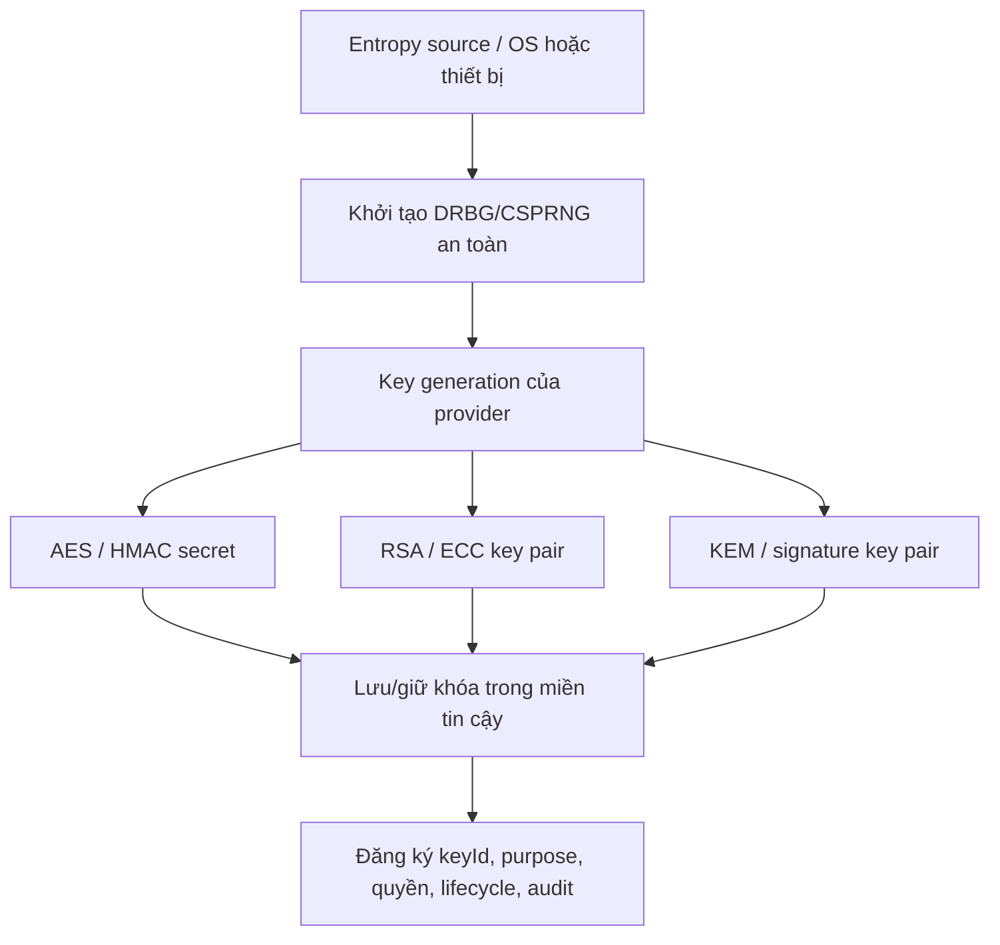
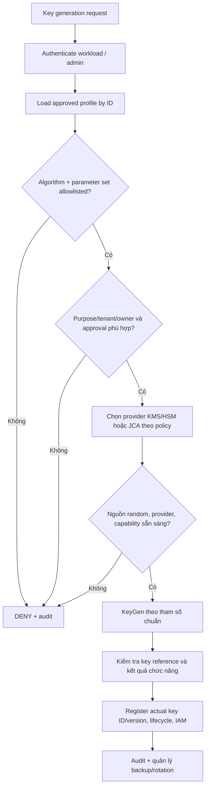
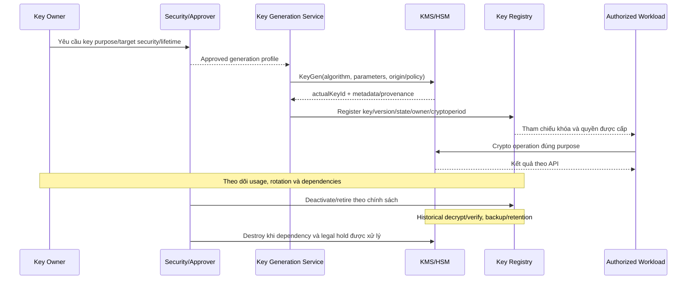

# Key generation parameters — Tham số sinh khóa mật mã

Trong chương **Key generation** của module **SECURITY_KEY_MANAGEMENT_FUNDAMENTALS**, **key generation parameters** là tập lựa chọn đầu vào quyết định **khóa mật mã được sinh bằng thuật toán nào, với mức an toàn nào, từ nguồn ngẫu nhiên nào, trong miền tin cậy nào và được phép sử dụng cho mục đích gì**. Cùng một lời gọi “tạo khóa” có thể tạo ra AES-256 DEK, RSA key pair, Ed25519 signing key, X25519 key agreement key hoặc ML-KEM recipient key; mỗi loại đòi hỏi **tham số và kiểm tra khác nhau**.

Điểm cốt lõi: **khóa dài không tự đồng nghĩa khóa an toàn**. Một RSA private key đủ dài nhưng được tạo từ nguồn ngẫu nhiên đoán được có thể bị lộ; một AES-256 key ngẫu nhiên tốt nhưng bị dùng lặp nonce trong AES-GCM vẫn có thể gây thảm họa; một Ed25519 key pair không thể tùy tiện dùng thay cho khóa X25519 chỉ vì cả hai có liên hệ với Curve25519. Ngược lại, một bộ tham số đạt chuẩn nhưng được nhập sai purpose, không có quản lý vòng đời hoặc cho phép export tùy tiện cũng không bảo vệ được hệ thống.

Bài này kết nối cách chọn tham số sinh khóa với **mật mã đối xứng, bất đối xứng, chữ ký số, KDF, KMS/HSM, envelope encryption, IAM, kiểm toán và vòng đời khóa từ tạo, cấp phát, lưu trữ, sử dụng, xoay vòng, thu hồi đến hủy**. Mục tiêu là hiểu cả **tham số mật mã** và **chính sách quản trị đi kèm**, đồng thời không nhầm các tham số sinh khóa với tham số của thao tác mã hóa, ký hoặc lưu trữ sau đó.

## 1. Mục tiêu học tập

Sau bài học, bạn có thể:

- Phân biệt **algorithm**, **security strength**, **key length**, **key pair parameters**, **CSPRNG/entropy**, **provider/origin**, **usage purpose** và **policy metadata**.
- Chọn đúng kiểu sinh khóa cho **AES**, **HMAC**, **RSA**, **NIST EC**, **X25519**, **Ed25519**, và nhận diện đặc điểm bộ tham số **ML-KEM**.
- Giải thích vì sao kích thước khóa RSA, ECC và AES không thể so sánh trực tiếp theo số bit.
- Biết tham số nào thuộc **key generation**, tham số nào thuộc **RSA-OAEP/PSS**, **ECDSA**, **AES-GCM**, **HKDF**, **password hashing** hay policy ở thời điểm sử dụng.
- Thiết kế yêu cầu tạo khóa tại **KMS/HSM** có mục đích, mức an toàn, key origin, exportability, key ID, owner, cryptoperiod và quyền phù hợp.
- Sử dụng **Java 17 JCA/JCE** sinh AES/HMAC secret và RSA/EC/Ed25519/X25519 key pair bằng API chuẩn; hiểu giới hạn provider.
- Xây quy trình **kiểm tra tham số, thử nghiệm âm tính, provenance, audit, rotation** và xử lý khi nguồn ngẫu nhiên hoặc provider gặp lỗi.

## 2. Bức tranh tổng thể: “tham số sinh khóa” gồm những gì?

Một yêu cầu sinh khóa thường chứa hai lớp thông tin:

1. **Tham số mật mã cốt lõi:** thuật toán/key type, kích thước hoặc bộ tham số chuẩn, curve/group, exponent khi thích hợp, nguồn ngẫu nhiên/DRBG và các lựa chọn thuật toán mà API thực sự chấp nhận.
2. **Ngữ cảnh quản trị khóa:** purpose, owner, tenant, environment, key usage, hạn sử dụng, exportability, key origin, provider, key alias/version, backup/recovery policy, quyền tạo và quyền sử dụng.

Lớp thứ hai **không nhất thiết là đầu vào trực tiếp của hàm toán học KeyGen**. Tuy nhiên, nếu hệ thống không ghi nhận và thực thi lớp này, khóa có thể được tạo đúng toán học nhưng **dùng sai mục đích hoặc mất kiểm soát** trong toàn bộ vòng đời.

| Nhóm tham số | Ví dụ | Ảnh hưởng |
| --- | --- | --- |
| **Algorithm/key type** | AES, HmacSHA256, RSA, Ed25519, X25519, ML-KEM. | Quyết định khóa dùng cho loại primitive nào. |
| **Key size/parameter set** | AES-256, RSA-3072, P-256, ML-KEM-768. | Quyết định nhóm mức an toàn, kích thước và hiệu năng. |
| **Algorithm-specific** | RSA public exponent, EC named curve, bộ tham số KEM. | Bảo đảm đúng cấu trúc toán học và tương thích. |
| **Random source** | CSPRNG, DRBG/provider, entropy source. | Ảnh hưởng tính khó dự đoán của private/secret key. |
| **Origin/storage** | HSM-generated, software-generated, imported. | Xác định ranh giới tin cậy và khả năng xuất khóa. |
| **Permitted operations** | Encrypt, Decrypt, Wrap, Sign, Verify, Derive, Decapsulate. | Ngăn sử dụng khóa sai purpose. |
| **Administrative metadata** | owner, tenant, cryptoperiod, key ID/version. | Hỗ trợ kiểm kê, phân quyền, rotation, audit và hủy khóa. |

### 2.1. Đừng nhầm key generation với crypto operation

Ví dụ:

```text
AES key generation:
  KeyGen(AES, keySize=256, CSPRNG) -> secretKey

AES-GCM encryption:
  Encrypt(secretKey, nonce, plaintext, AAD) -> ciphertext + tag

RSA key generation:
  KeyGen(RSA, modulusBits=3072, exponent=65537, CSPRNG) -> (public, private)

RSA-OAEP encryption/key transport:
  Encrypt(publicKey, OAEP hash/MGF parameters, plaintext) -> ciphertext

Ed25519 key generation:
  KeyGen(Ed25519, secure provider randomness) -> (public, private)

Ed25519 signing:
  Sign(privateKey, message) -> signature
```

**Nonce của AES-GCM không phải tham số sinh khóa AES.** **OAEP digest/MGF** không phải tham số sinh cặp RSA; chúng là tham số của phép encrypt/decrypt. **RSA-PSS salt length**, **ECDSA hash**, **HKDF info** và **JWT key ID** cũng phục vụ các tầng khác nhau, dù có thể cùng xuất hiện trong một “crypto profile” của ứng dụng.

## 3. Security strength khác key length

**Security strength** thường được biểu diễn dưới dạng mức công sức tấn công tương đương, ví dụ 128-bit hoặc 256-bit đối với mô hình an toàn nhất định. **Key length** chỉ là số bit của vật liệu khóa, không tự đo được mức an toàn của mọi hệ mật mã.

Ví dụ mang tính định hướng cho hệ thống cổ điển:

| Họ thuật toán | Ví dụ khóa/bộ tham số | Mức an toàn cổ điển thường được liên hệ |
| --- | --- | --- |
| **Đối xứng** | AES-128 | Khoảng **128-bit** trước brute force lý tưởng. |
| **Đối xứng** | AES-256 | Khoảng **256-bit** trước brute force lý tưởng. |
| **RSA** | Modulus 2048-bit | Khoảng **112-bit** theo bảng quy đổi thông dụng; không ngang AES-256. |
| **RSA** | Modulus 3072-bit | Khoảng **128-bit** theo quy đổi thông dụng. |
| **ECC** | NIST P-256 | Khoảng **128-bit** đối với bài toán log rời rạc cổ điển. |
| **ECC** | NIST P-384 | Khoảng **192-bit** cổ điển. |
| **ECC** | NIST P-521 | Khoảng **256-bit** cổ điển. |
| **X25519 / Ed25519** | Nhóm/thuật toán 255-bit | Thường được chọn cho mức an toàn cổ điển xấp xỉ **128-bit**. |

Bảng trên mang tính **so sánh khái niệm**, không phải tiêu chuẩn để khẳng định mọi protocol đạt mức bảo mật đó. An toàn thực tế còn phụ thuộc **scheme, triển khai, kiểm tra public key, hash/KDF, cấu hình provider, kích thước dữ liệu và rủi ro vận hành**. Mức an toàn của ML-KEM là **security category theo mô hình hậu lượng tử**, không nên quy đổi một cách sơ sài thành số bit RSA/AES trong bảng này.

### 3.1. Cách đặt mục tiêu an toàn

Trước khi chọn `RSA-3072` hay `P-256`, tổ chức phải trả lời:

- Cần chống đối thủ nào, dữ liệu nhạy cảm tới mức nào, bảo mật trong bao lâu?
- Chỉ xét tấn công cổ điển hay cần xem xét **harvest-now-decrypt-later** và dịch chuyển hậu lượng tử?
- Thuật toán có được phép trong **policy, chuẩn ngành, mode của KMS/HSM, môi trường phát hành** không?
- Kích thước key/parameter set có đáp ứng yêu cầu tương thích của các bên liên quan không?
- Khả năng rotation/migration và mức độ hỗ trợ thư viện là gì?

**Không nâng RSA lên vài nghìn bit bất kỳ để “càng dài càng tốt”** mà bỏ qua hiệu năng, giới hạn API, khả năng tương thích và giới hạn chính sách. Cũng không chọn thuật toán yếu chỉ vì tạo khóa nhanh hơn.

## 4. Nguồn ngẫu nhiên: CSPRNG, entropy và DRBG

Đối với nhiều primitive, khả năng bảo mật phụ thuộc trực tiếp vào **độ khó dự đoán của secret/private key**. Đây là điều kiện đầu tiên phải kiểm tra trước cả độ dài khóa.

### 4.1. Entropy và CSPRNG

- **Entropy source:** nguồn bất định đầu vào (thường do hệ điều hành/phần cứng quản lý) dùng để khởi tạo và làm mới trạng thái random.
- **CSPRNG:** bộ sinh số giả ngẫu nhiên mật mã; đầu ra không dễ dự đoán nếu trạng thái và seed được quản lý đúng.
- **DRBG:** cơ chế sinh bit ngẫu nhiên xác định có đặc tả rõ, vận hành với seed/entropy và cơ chế reseed.
- **SecureRandom trong Java:** abstraction cung cấp bit ngẫu nhiên mật mã qua provider; chất lượng và hành vi phụ thuộc provider/cấu hình/runtime.



Không dùng:

- `java.util.Random`, `Math.random()` hoặc UUID thông thường làm **nguồn tạo key bytes**.
- Timestamp, số thứ tự, địa chỉ MAC, mật khẩu thông thường hoặc hash của giá trị dễ đoán làm seed duy nhất.
- Một seed cố định để tái hiện cùng private key trong production.
- Một file chứa “random bytes” do người vận hành tạo thủ công nhưng không có bảo đảm entropy.

Ví dụ sai:

```java
// KHÔNG AN TOÀN: ví dụ anti-pattern, tuyệt đối không dùng production.
java.util.Random weak = new java.util.Random(123456L);
byte[] key = new byte[32];
weak.nextBytes(key);
```

Ở đây số lượng **32 byte** không cứu được bảo mật: attacker biết hoặc suy ra seed có thể tái tạo khóa.

### 4.2. Seed và reseed

Một **DRBG** sử dụng trạng thái bên trong; an toàn của nó phụ thuộc vào entropy đầu vào, cơ chế update/reseed và giới hạn số lần sinh theo thiết kế. Hệ điều hành/crypto provider hiện đại thường quản lý phần lớn quá trình này; ứng dụng không nên tự chế DRBG hay ghi seed vào log.

Đặc biệt quan trọng với:

- VM/container được **clone từ snapshot** với trạng thái random không được làm mới đúng cách.
- Môi trường khởi động sớm, IoT hoặc thiết bị entropy hạn chế.
- HSM với health tests, trạng thái nguồn ngẫu nhiên lỗi hoặc tạm khóa vận hành.
- Hệ thống tạo số lượng lớn khóa/session secrets trên nhiều node.

**Đừng cố “sửa” việc provider không có entropy bằng cách dùng seed có thể đoán.** Nếu cơ chế sinh ngẫu nhiên không đảm bảo yêu cầu, phải **fail closed**, báo lỗi, ghi nhận và xử lý môi trường/provider.

### 4.3. Java SecureRandom: nên và không nên

```java
java.security.SecureRandom rng = new java.security.SecureRandom();

byte[] nonce = new byte[12];
rng.nextBytes(nonce);

// Dùng rng trong KeyGenerator / KeyPairGenerator,
// không in bytes, không đặt seed cố định để "đồng bộ" khóa.
```

`SecureRandom.getInstanceStrong()` có thể lựa chọn một thuật toán/provider có hành vi chờ hoặc chi phí khác với `new SecureRandom()`. **Không mặc định “Strong” luôn phù hợp mọi hot path**; lựa chọn phải dựa trên chính sách, môi trường và provider. Khóa trong HSM thường nên được tạo **bằng API KeyGen bên trong HSM** thay vì tự tạo bytes trong Java rồi import, nếu yêu cầu là non-exportable.

## 5. Tham số sinh khóa đối xứng: AES và DEK/KEK

Với **AES**, tham số cốt lõi là **độ dài khóa**:

| AES key size | Byte | Ghi chú |
| --- | ---: | --- |
| AES-128 | 16 | Dùng khi threat model và policy cho phép. |
| AES-192 | 24 | Ít gặp hơn trong cấu hình ứng dụng, phải kiểm tra provider. |
| AES-256 | 32 | Phổ biến khi yêu cầu mức bảo vệ và chính sách cao hơn. |

Cả ba có cùng block size **128 bit**, bất kể độ dài khóa. `AES-256` không có nghĩa AES dùng block size 256 bit.

### 5.1. DEK và KEK là các vai trò khác nhau

- **DEK — Data Encryption Key:** dùng trực tiếp hoặc qua AEAD để mã hóa dữ liệu.
- **KEK — Key Encryption Key:** dùng bảo vệ/bọc DEK; thường quản lý trong KMS/HSM.

Hai khóa có thể cùng là **AES-256**, nhưng không vì vậy mà được tái sử dụng một secret cho cả encrypt payload và wrap key. Nên **phân tách key purpose**, giới hạn quyền và miền dữ liệu theo thiết kế.

```text
CSPRNG/KMS ----> DEK AES-256  ------> AES-GCM encrypt payload
           |
           +---- KEK AES-256 ------> Wrap/Encrypt DEK theo cơ chế được phép

Lưu kèm dữ liệu:
  ciphertext + authentication tag + nonce
  wrapped DEK + actual KEK key reference + algorithm/version metadata
```

**Key size là tham số lúc sinh khóa**, còn **nonce 96-bit cho AES-GCM**, AAD và tag length là các tham số thao tác mã hóa. Không gộp nonce vào key material hay coi nonce phải bí mật.

### 5.2. Nonce của AES-GCM liên quan thế nào tới chính sách sinh khóa?

Một AES key được tạo an toàn vẫn có thể bị sử dụng sai nếu **lặp nonce với cùng key**. Vì vậy key-generation profile cần **liên kết** tới **usage profile** quy định:

- Ai được mã hóa bằng key, và trong phạm vi object/tenant nào?
- Nonce được tạo bằng bộ đếm duy nhất hoặc cách cấp phát đã kiểm soát như thế nào?
- Có giới hạn số lần encrypt, tổng lượng dữ liệu và kích thước bản tin không?
- Khi nhiều writer dùng chung key, ai bảo đảm không trùng nonce?
- Khi đạt usage/nonce budget, có thay key trước khi đạt thời hạn cryptoperiod không?

Một nonce 12 byte được sinh ngẫu nhiên có thể phù hợp trong nhiều cấu hình nếu quản lý số lần và xác suất va chạm đúng theo mô hình; **không mặc định không thể trùng** khi lượng bản tin lớn. Với hệ thống phân tán có throughput cao, nên cân nhắc cơ chế cấp phát nonce đảm bảo uniqueness theo giao thức.

### 5.3. Ví dụ policy cho DEK mới

```yaml
# Schema GIẢ ĐỊNH cho tài liệu; không phải cấu hình KMS phổ quát.
keyType: SYMMETRIC
algorithm: AES
keySizeBits: 256
purpose: ENCRYPT_DATA
origin: KMS_GENERATED
exportable: false
tenantScope: billing-prod
keyUsage:
  - ENCRYPT
  - DECRYPT
rotationPolicy: per-object-or-bounded-usage
```

Tùy API, `exportable: false` có thể **không khả thi với DEK phải được trả plaintext cho ứng dụng**. Có KMS cho phép KEK non-exportable nhưng trả plaintext DEK từ `GenerateDataKey`; có HSM chỉ cho cryptographic operations trong thiết bị. **Không áp đặt cùng một cờ cho mọi key type mà không kiểm tra provider**.

## 6. HMAC key: kích thước secret không phải độ dài digest

Với **HMAC-SHA256**, hai thứ dễ nhầm:

- **Digest/tag output:** SHA-256 tạo đầu ra 256 bit; tag có thể có quy tắc truncate theo giao thức.
- **Secret HMAC key:** là một chuỗi bit bí mật có entropy cao, được tạo từ CSPRNG/KMS theo kích thước/policy thích hợp.

Một HMAC key có thể dài hơn hoặc ngắn hơn block size của hàm hash; thuật toán HMAC có quy tắc chuẩn hóa khóa nội bộ. Tuy nhiên, **khóa ngắn và dễ đoán không biến thành an toàn chỉ vì HMAC dùng SHA-256**. Trong nhiều hệ thống, sinh key **256 bit ngẫu nhiên** cho HmacSHA256 là một lựa chọn hợp lý nếu policy/provider chấp nhận.

**Không dùng mật khẩu người dùng làm raw HMAC key** nếu yêu cầu một secret mạnh. Nếu xuất phát từ password, phải có password-based KDF với salt và cost phù hợp, nhưng độ mạnh vẫn bị ràng buộc bởi entropy password.

### 6.1. Không dùng chung secret HMAC cho nhiều mục đích

Ví dụ các chức năng:

```text
webhook-partner-A: secret HMAC v3
webhook-partner-B: secret HMAC v2
session-ticket:    secret HMAC khác
audit-message:     secret HMAC khác hoặc key dẫn xuất được phân miền
```

Giữ các secret tách biệt hoặc áp dụng **KDF với domain separation** theo thiết kế làm giảm ảnh hưởng khi một bên bị lộ. Cần key ID/version, rotation, anti-replay và scope đối tác; `VerifyMac` vẫn nhạy cảm vì ai có raw HMAC key cũng có thể tạo tag mới.

## 7. RSA key pair: modulus và public exponent

Tham số quan trọng khi sinh RSA key pair gồm:

- **Modulus size** `nBits`: ví dụ 2048 hoặc 3072 tùy policy/độ dài bảo vệ và môi trường.
- **Public exponent** `e`: thông dụng và được chấp nhận rộng rãi là **65537**.
- **Nguồn ngẫu nhiên an toàn** để tạo các số nguyên tố theo thuật toán KeyGen được kiểm thử.
- **Provider, key format và usage policy**: RSA-OAEP key transport hay RSA-PSS signing, non-exportability và cryptoperiod.

```text
RSA keygen (khái niệm):
  chọn p, q bí mật ngẫu nhiên đủ điều kiện theo thuật toán chuẩn
  n = p * q
  chọn public exponent e phù hợp
  tính private exponent và tham số private key theo thuật toán

  public key  = (n, e)
  private key = vật liệu RSA bí mật (bao gồm d và có thể có CRT params)
```

**Không tự viết phép chọn p/q hoặc kiểm tra primality trong code ứng dụng**. Sử dụng KeyPairGenerator của provider tin cậy hoặc chức năng sinh RSA trong HSM.

### 7.1. Key size và mục tiêu an toàn

RSA-2048 vẫn xuất hiện trong nhiều môi trường có chính sách cho phép, nhưng **không phải mức 128-bit cổ điển**. Khi yêu cầu xấp xỉ 128-bit theo bảng quy đổi phổ biến, **RSA-3072** là một mốc thường được xét. Chọn modulus theo **quy định hiện hành của tổ chức, tiêu chuẩn áp dụng và vòng đời dữ liệu**, không chỉ theo ví dụ trong bài.

Modulus lớn hơn làm tăng chi phí tạo khóa, ký/giải mã và kích thước public key/signature. Nếu cần mức an toàn cao hơn mà môi trường cho phép, ECC hoặc chuẩn hậu lượng tử có thể có trade-off khác; phải xem **cả giao thức**.

### 7.2. Những tham số không thuộc RSA KeyGen

| Tham số | Thuộc thao tác nào? |
| --- | --- |
| `nBits` và public exponent `e` | **RSA key generation**. |
| OAEP digest, MGF1 digest, OAEP label | **RSA-OAEP encrypt/decrypt hoặc key transport**. |
| PSS message digest, MGF, salt length | **RSA-PSS sign/verify**. |
| Khóa DEK được bọc | Đầu vào của thao tác key transport/wrapping, **không** phải tham số sinh RSA key pair. |
| Key ID, tenant, IAM, retention | **Lifecycle và quản trị khóa**. |

Không gọi một key pair RSA “an toàn cho mọi mục đích” rồi dùng cùng một private key cho **RSA-OAEP decrypt và RSA-PSS signing** tùy tiện. Phân tách key purpose, capability và key pairs thường giúp giảm cross-protocol risk.

## 8. Elliptic-curve key pair: chọn đúng curve và primitive

Với ECC, thao tác sinh khóa cần **nhóm/đường cong cụ thể**. Các nhóm có cấu trúc, thuật toán, encoding và mô hình sử dụng khác nhau.

| Kiểu | Ví dụ Java/JCA | Mục đích chính | Ghi chú |
| --- | --- | --- | --- |
| **NIST EC** | `EC` + `secp256r1` | ECDSA hoặc ECDH theo policy. | Chọn named curve; tránh explicit arbitrary curve parameters nếu không cần. |
| **NIST EC** | `EC` + `secp384r1` | ECDSA/ECDH ở mức an toàn cổ điển cao hơn. | Kiểm tra provider và yêu cầu thuật toán. |
| **X25519** | `X25519` | **Key agreement** (XDH). | Không phải thuật toán chữ ký Ed25519. |
| **Ed25519** | `Ed25519` | **Digital signature** (EdDSA). | Không phải X25519 KEM/DH và không dùng làm raw ECDH key. |
| **X448 / Ed448** | Nhóm/thuật toán tương ứng khi có hỗ trợ. | Key agreement / signature. | Provider và chính sách phải hỗ trợ đúng tên. |

### 8.1. Đừng coi mọi khóa “curve25519” là thay thế được

**Ed25519** và **X25519** là hai thuật toán với **cách định dạng/diễn giải khóa và quy tắc sử dụng khác nhau**. Việc tên gọi có liên hệ về đường cong không cho phép copy nguyên key bytes để dùng một private key cho cả ký số và trao đổi khóa.

Trong thiết kế:

- Chọn `Ed25519` cho chữ ký số và giữ private signing key theo policy.
- Chọn `X25519` khi cần ECDH/key agreement đúng giao thức.
- Với ECDH, public key/peer input phải được xử lý theo spec; giao thức phải xử lý các kết quả bất hợp lệ như **X25519 all-zero shared secret**.
- Dẫn xuất key từ shared secret qua KDF/key schedule của giao thức, **không dùng trực tiếp ECDH output cho mọi mục đích**.
- Public key phải được **xác thực/binding đúng danh tính**, nếu không attacker có thể thay public key và tham gia man-in-the-middle.

### 8.2. ECDSA randomness khác ECC key generation randomness

Đối với ECDSA, randomness trong **quá trình ký** (giá trị nonce/signature ephemeral secret) quan trọng không kém key generation. Nếu nonce ECDSA lặp hoặc bị dự đoán, private key có thể bị lộ. Một số scheme dùng cách tạo nonce xác định theo chuẩn nhằm giảm rủi ro, nhưng **không vì thế mà được dùng nguồn seed cố định để tạo private key**.

**Ed25519** có thiết kế chữ ký với cơ chế tính toán khác ECDSA, nhưng **private key generation vẫn cần entropy an toàn**. Cần tách biệt chính sách **KeyGen** và **Sign** khi kiểm thử.

## 9. Key encapsulation hậu lượng tử: ML-KEM và bộ tham số

**ML-KEM**, được chuẩn hóa trong **FIPS 203**, là cơ chế **Key Encapsulation Mechanism** hậu lượng tử dựa trên module lattice. Nó có **bộ tham số**, không phải một lựa chọn `keySize=3072` như RSA.

| ML-KEM parameter set | Public encapsulation key | Encapsulation ciphertext | Shared secret |
| --- | ---: | ---: | ---: |
| **ML-KEM-512** | 800 byte | 768 byte | 32 byte |
| **ML-KEM-768** | 1184 byte | 1088 byte | 32 byte |
| **ML-KEM-1024** | 1568 byte | 1568 byte | 32 byte |

Các con số kích thước liên quan **encoding chuẩn** của public key/ciphertext/shared secret, không phải mức độ bảo mật tính bằng số bit. Các bộ tham số tương ứng **security categories** khác nhau theo chuẩn; lựa chọn phụ thuộc policy, threat model, hiệu năng, kích thước mạng và hệ sinh thái tương thích.

```text
ML-KEM KeyGen(parameterSet) -> (encapsulationKey, decapsulationKey)
ML-KEM Encaps(encapsulationKey) -> (ciphertext, sharedSecret)
ML-KEM Decaps(decapsulationKey, ciphertext) -> sharedSecret
```

**ML-KEM không phải thuật toán chữ ký số.** Chữ ký hậu lượng tử có họ riêng, ví dụ **ML-DSA** theo **FIPS 204** với các bộ tham số **ML-DSA-44/65/87**. Không gọi API ML-KEM rồi kỳ vọng có chữ ký, cũng không tự ghép thuật toán và định dạng không đúng chuẩn.

### 9.1. JDK/provider và khả năng tương thích

**Java 17 JCA/JCE tiêu chuẩn không nên được giả định cung cấp sẵn ML-KEM hoặc một API KEM thống nhất**. Muốn sử dụng ML-KEM cần chọn **provider/thư viện/phiên bản JDK** hỗ trợ đúng algorithm, parameter set, encoding và giao thức đã được đánh giá.

Các điểm kiểm tra:

1. Provider có triển khai đúng **ML-KEM** hay một thuật toán/biến thể tên gần giống nhưng không tương thích?
2. Parameter set và encoding của public/private key có đúng chuẩn không?
3. Private decapsulation key được lưu ở đâu, có thể export hay không, KMS/HSM có hỗ trợ thao tác không?
4. API decapsulation có xử lý ciphertext không hợp lệ và **implicit rejection** đúng spec không?
5. Giao thức phía trên có xác thực public key, KDF/AEAD, chống downgrade và key ID/version không?
6. Khi chuyển hybrid classical + PQ, combiner và protocol có được đặc tả/đánh giá không?

**Không tự viết ML-KEM bằng các phép toán demo rút gọn rồi đưa lên production.**

## 10. KDF, password và những đầu vào không phải raw key generation

Không phải mọi “khóa” đều được tạo bằng cách lấy ngẫu nhiên 32 byte. Hệ thống có thể cần **dẫn xuất** khóa từ secret đầu vào hoặc password. Đây là những cơ chế khác với sinh một secret hoàn toàn mới.

### 10.1. HKDF — dẫn xuất khóa từ input key material

**HKDF** dùng một input key material có entropy phù hợp để dẫn xuất nhiều key material tách miền. Các đầu vào có thể gồm:

- **Input Key Material (IKM):** shared secret từ ECDH/KEM hoặc một secret nền phù hợp.
- **Salt:** giá trị dùng cho bước extract theo đặc tả; không phải private key.
- **Info/context:** định danh giao thức, phiên bản, purpose, tenant hoặc hướng truyền theo thiết kế.
- **Desired output length:** số byte đầu ra cần cho thuật toán đích; không vượt giới hạn của KDF.

```text
ss = KeyAgreement / KEM shared secret
prk = HKDF-Extract(salt, ss)

keyEnc = HKDF-Expand(prk, info="app-v1|encrypt|tenant-A", 32 bytes)
keyMac = HKDF-Expand(prk, info="app-v1|mac|tenant-A", 32 bytes)
```

Đây là **sơ đồ khái niệm**; trong một giao thức cụ thể phải dùng **key schedule và encoding info đúng spec**, không tự sáng chế bằng cách nối string mơ hồ. HKDF không biến đầu vào quá yếu hoặc dễ đoán thành secret có entropy cao hơn.

### 10.2. Password-based KDF

Password thường có **entropy thấp hơn khóa ngẫu nhiên 128/256 bit**. Nếu ứng dụng cần sinh key từ password, phải cân nhắc password-based KDF phù hợp mục đích, ví dụ **Argon2id**, **scrypt** hoặc **PBKDF2** khi yêu cầu chính sách/khả năng tương thích đặt ra.

Tham số thường gồm:

| Tham số | Ý nghĩa |
| --- | --- |
| **Salt** | Giá trị riêng cho từng password/verifier; thường không bí mật. |
| **Memory cost** | Lượng RAM cho thuật toán memory-hard như Argon2id/scrypt. |
| **Time/iteration cost** | Chi phí tính toán; cần điều chỉnh theo hệ thống và rủi ro. |
| **Parallelism** | Số luồng/lane khi thuật toán hỗ trợ. |
| **Derived-key length** | Độ dài đầu ra cần cho mục đích hợp lệ. |
| **Algorithm/version** | Cho phép migrate/rehash khi chính sách thay đổi. |
| **Pepper** (nếu dùng) | Secret riêng được bảo vệ trong secret store/KMS/HSM. |

Đừng gọi `SHA-256(password)` là AES-256 key mạnh chỉ vì digest dài 256 bit. **Entropy password vẫn là điểm yếu**, cần chính sách brute-force defense và quản lý password/pepper riêng.

### 10.3. Phân biệt salt, nonce, IV và seed

| Giá trị | Tạo khi nào? | Có cần bí mật? | Quy tắc đáng nhớ |
| --- | --- | --- | --- |
| **Random key** | KeyGen hoặc derived key khi áp dụng KDF. | **Có**. | CSPRNG/entropy và key policy phù hợp. |
| **CSPRNG seed/state** | Khởi tạo/quản lý DRBG. | Nhạy cảm và phải bảo vệ. | Không đặt giá trị cố định trong production. |
| **Password salt** | Khi tạo password verifier hoặc password KDF theo policy. | Thường **không**. | Đảm bảo giá trị đủ độc lập/duy nhất, lưu với verifier. |
| **AES-GCM nonce/IV** | **Mỗi lần encrypt** theo key/scheme. | Thường không. | **Không được reuse với cùng key**. |
| **HKDF info/context** | Khi derive key cho từng purpose/protocol. | Không nhất thiết. | Encoding rõ ràng và domain separation. |
| **Key ID** | Khi đăng ký key/version. | Thường không. | Không phải secret hoặc bằng chứng danh tính tự thân. |

## 11. Key origin, exportability và môi trường tin cậy

Cùng một thuật toán, **khóa được tạo ở đâu** quyết định những rủi ro khác nhau.

| Origin | Ưu điểm | Rủi ro/câu hỏi cần xét |
| --- | --- | --- |
| **HSM-generated non-exportable** | Private/secret key có thể không rời module ở dạng rõ theo policy. | Workload có quyền vẫn có thể lạm dụng `Sign`/`Decrypt`; phụ thuộc backup/HA của thiết bị. |
| **Cloud KMS-generated** | IAM, key policies, audit và rotation quản lý tập trung. | Provider API có hỗ trợ thuật toán và trạng thái mong muốn? Quyền sử dụng rộng tới đâu? |
| **Software-generated in Java** | Dễ tích hợp, linh hoạt và có thể sinh nhanh theo ứng dụng. | Key bytes/private key sống trong process memory; phải bảo vệ secrets và key store. |
| **Imported key material** | Hỗ trợ migration hoặc interop với hệ thống ngoài. | Nguồn entropy, quyền export, wrapping transport, provenance và tình trạng lộ trước import. |
| **Derived from a master key** | Hỗ trợ tách miền/key hierarchy theo KDF. | Root key compromise có thể ảnh hưởng nhiều derived keys; phải version và ràng buộc context. |

**Không đánh đồng “KMS tạo key” với “không ai có thể trích xuất mọi secret”.** Có dịch vụ sinh **DEK plaintext** theo API `GenerateDataKey` để ứng dụng mã hóa, trong khi KEK không được xuất. Phải ghi rõ **loại khóa nào xuất được** và giai đoạn nào plaintext secret được phép xuất hiện.

### 11.1. Non-exportable không tự bảo đảm dữ liệu nghiệp vụ an toàn

Giả sử HSM giữ private signing key không cho export. Nếu tài khoản signer bị đánh cắp và có quyền `Sign` trên key, attacker có thể tạo chữ ký **qua HSM**. Điều này cho thấy:

- **Key secrecy** và **operation authorization** là hai bài toán khác nhau.
- CO/key administrator cần giới hạn grants/roles.
- Business application phải xác thực nội dung và người yêu cầu trước khi ký.
- Audit phải theo dõi actor, request, key ID, purpose và phát hiện bất thường.

Tương tự, nếu tài khoản có `Decrypt` trên KEK của nhiều tenant, HSM không cho xuất KEK vẫn không ngăn attacker dùng API để mở nhiều DEK.

### 11.2. Key backup và khả năng phục hồi

Nếu key non-exportable, ứng dụng **không được giả định có thể lưu raw private key vào file backup**. Phải dùng cơ chế **backup/restore/replication do KMS/HSM hỗ trợ**, hoặc chuẩn bị chuyển dữ liệu sang khóa mới trước khi thay thiết bị/provider.

Đặt `exportable=false` trong policy nhưng không kiểm tra **restore drill** có thể tạo nguy cơ mất dữ liệu vĩnh viễn khi HSM lỗi hoặc account KMS bị đóng.

## 12. Thiết kế một key generation request/profile

Một dịch vụ tạo khóa nên nhận yêu cầu đã được **phê duyệt hoặc giới hạn bởi profile tin cậy**. Không cho client tùy ý chọn thuật toán yếu hoặc tự cấp quyền export private key.

Ví dụ schema **minh họa**, không phải cấu hình chuẩn của AWS/Azure/Google/HSM:

```json
{
  "profileId": "billing-prod-dek-v3",
  "owner": "billing-security",
  "tenantScope": "billing",
  "environment": "production",
  "keyType": "SYMMETRIC",
  "algorithm": "AES",
  "keySizeBits": 256,
  "securityTarget": "organization-approved",
  "purpose": "encrypt-invoice",
  "origin": "approved-kms",
  "exportabilityPolicy": "provider-controlled",
  "permittedOperations": ["ENCRYPT", "DECRYPT"],
  "activatedAt": "2026-12-01T00:00:00Z",
  "protectionExpiresAt": "2027-12-01T00:00:00Z",
  "rotationPolicy": "per-object-or-usage-budget",
  "usageBudgetRef": "policies/aes-gcm-prod-v2",
  "keyAdminRole": "billing-key-admin",
  "cryptoUserRole": "billing-writer-reader-separated",
  "policyVersion": 3
}
```

Cần phân biệt:

- **Tham số KeyGen cốt lõi:** `algorithm=AES`, `keySizeBits=256`, provider CSPRNG/HSM.
- **Policy người được dùng:** `owner`, `purpose`, `permittedOperations`, `tenantScope`.
- **Vòng đời:** `activatedAt`, `protectionExpiresAt`, rotation và key status.
- **Hành vi của cipher:** `usageBudgetRef`, trong đó có thể mô tả AES-GCM nonce/tag/AAD policy.

Các trường JSON là **ví dụ chức năng**, không đủ để triển khai một API công khai an toàn. Production cần versioned schema, allowlist profiles, server-side validation, source of truth, approval và audit.

### 12.1. Profile cụ thể cho một số key type

| Key profile | KeyGen parameters | Cách dùng sau khi tạo |
| --- | --- | --- |
| `aes256-dek` | AES, 256 bit, approved CSPRNG/provider. | AES-GCM với nonce/AAD/tag theo protocol; giới hạn usage. |
| `hmac-sha256-partner` | HmacSHA256, secret ngẫu nhiên đủ entropy, key size theo policy. | MAC với message format, anti-replay và key ID riêng đối tác. |
| `rsa-pss-signing` | RSA 3072 bit, e=65537, approved provider. | RSA-PSS profile có digest/MGF/salt length riêng. |
| `ecdsa-p256` | EC, named curve P-256. | ECDSA digest và chữ ký/encoding theo giao thức. |
| `ed25519-signing` | Ed25519 provider KeyGen. | Ed25519 signatures, public verification key/trust. |
| `x25519-agreement` | X25519 provider KeyGen. | ECDH/XDH + KDF/context, peer public-key binding. |
| `ml-kem-768-recipient` | ML-KEM-768 parameter set theo FIPS 203. | Encaps/Decaps, KDF/AEAD, recipient authentication theo protocol. |

**Tham số “Security strength = 128” không phải đầu vào đủ** để provider tự chọn mọi thứ. Key type/algorithm/parameter set vẫn phải được xác định chính xác.

## 13. Java 17: sinh khóa AES, HMAC, RSA, EC, Ed25519 và X25519

Ví dụ bên dưới dùng API JCA/JCE có trong **Java 17**. Đối với thuật toán cụ thể, khả năng hoạt động vẫn phụ thuộc **provider được cài đặt, cấu hình chính sách, môi trường JDK và mode vận hành**. Code chạy trong tiến trình để minh họa KeyGen; với production cần ưu tiên KMS/HSM khi ranh giới tin cậy yêu cầu.

**Code không ghi raw key bytes/private key vào log, không dùng seed cố định và không export khóa.**

```java
import java.nio.charset.StandardCharsets;
import java.security.KeyPair;
import java.security.KeyPairGenerator;
import java.security.SecureRandom;
import java.security.Signature;
import java.security.spec.ECGenParameterSpec;
import java.security.spec.RSAKeyGenParameterSpec;
import javax.crypto.KeyGenerator;
import javax.crypto.SecretKey;

public final class KeyGenerationParametersDemo {

    static final SecureRandom RNG = new SecureRandom();

    static SecretKey newAes256() throws Exception {
        KeyGenerator generator = KeyGenerator.getInstance("AES");
        generator.init(256, RNG);
        return generator.generateKey();
    }

    static SecretKey newHmacSha256Key() throws Exception {
        KeyGenerator generator = KeyGenerator.getInstance("HmacSHA256");
        generator.init(256, RNG);
        return generator.generateKey();
    }

    static KeyPair newRsa3072() throws Exception {
        KeyPairGenerator generator = KeyPairGenerator.getInstance("RSA");
        generator.initialize(new RSAKeyGenParameterSpec(
                3072, RSAKeyGenParameterSpec.F4), RNG);
        return generator.generateKeyPair();
    }

    static KeyPair newEcdsaP256() throws Exception {
        KeyPairGenerator generator = KeyPairGenerator.getInstance("EC");
        generator.initialize(new ECGenParameterSpec("secp256r1"), RNG);
        return generator.generateKeyPair();
    }

    static KeyPair newEd25519() throws Exception {
        KeyPairGenerator generator = KeyPairGenerator.getInstance("Ed25519");
        // Thuật toán có bộ tham số cố định theo tên Ed25519.
        return generator.generateKeyPair();
    }

    static KeyPair newX25519() throws Exception {
        KeyPairGenerator generator = KeyPairGenerator.getInstance("X25519");
        // Dùng cho key agreement, không phải Ed25519 signature.
        return generator.generateKeyPair();
    }

    static boolean verifyEd25519Pair(KeyPair pair) throws Exception {
        byte[] message = "key-generation-self-test"
                .getBytes(StandardCharsets.UTF_8);

        Signature signer = Signature.getInstance("Ed25519");
        signer.initSign(pair.getPrivate());
        signer.update(message);
        byte[] signature = signer.sign();

        Signature verifier = Signature.getInstance("Ed25519");
        verifier.initVerify(pair.getPublic());
        verifier.update(message);
        return verifier.verify(signature);
    }

    public static void main(String[] args) throws Exception {
        SecretKey aes = newAes256();
        SecretKey mac = newHmacSha256Key();
        KeyPair rsa = newRsa3072();
        KeyPair p256 = newEcdsaP256();
        KeyPair ed25519 = newEd25519();
        KeyPair x25519 = newX25519();

        // In tên thuật toán, KHÔNG in raw secret hoặc private key.
        System.out.println("AES key algorithm: " + aes.getAlgorithm());
        System.out.println("HMAC key algorithm: " + mac.getAlgorithm());
        System.out.println("RSA public algorithm: " +
                rsa.getPublic().getAlgorithm());
        System.out.println("EC public algorithm: " +
                p256.getPublic().getAlgorithm());
        System.out.println("Ed25519 sign/verify self-test: " +
                verifyEd25519Pair(ed25519));
        System.out.println("X25519 public algorithm: " +
                x25519.getPublic().getAlgorithm());
    }
}
```

### 13.1. Giải thích từng tham số

1. `KeyGenerator.getInstance("AES")` chọn thuật toán secret key; `init(256, RNG)` chỉ định **key length 256 bit** và CSPRNG.
2. `KeyGenerator.getInstance("HmacSHA256")` chọn một **secret key dùng cho MAC**; `init(256, RNG)` minh họa key size, không thay message format hay anti-replay policy.
3. `KeyPairGenerator.getInstance("RSA")` cộng `RSAKeyGenParameterSpec(3072, F4)` cố định modulus size và public exponent **65537**.
4. `KeyPairGenerator.getInstance("EC")` cộng `ECGenParameterSpec("secp256r1")` chọn **named curve P-256**, không lấy size “256” làm đại diện cho mọi ECC curve.
5. `Ed25519` chọn một thuật toán chữ ký với bộ tham số định sẵn theo tên; không dùng `ECGenParameterSpec("secp256r1")` để “cấu hình” Ed25519.
6. `X25519` chọn thuật toán key agreement; không phải key signing.
7. `verifyEd25519Pair` dùng thông điệp kiểm tra không nhạy cảm để xác minh public/private key pair hoạt động, nhưng **không phải bài test chứng minh triển khai an toàn toàn diện**.
8. Code dựa vào provider của runtime; nếu provider không hỗ trợ hoặc policy cấm cấu hình, ứng dụng phải **fail closed**. Đừng âm thầm fallback sang thuật toán khác yếu hơn.

### 13.2. Giới hạn của ví dụ

- Các private/secret keys sinh trong JVM có thể xuất hiện trong bộ nhớ process; chúng **không có bảo đảm non-exportable của HSM**.
- `SecureRandom` là abstraction theo provider, không phải bằng chứng mọi nguồn entropy đều đạt chuẩn cho mọi chính sách.
- Code tạo khóa trong RAM để học, **không có key registry, IAM, cryptoperiod, tenant isolation, backup, secure deletion hoặc audit**.
- Không gọi `getEncoded()` và ghi vào log để “xem key đã tạo đúng chưa”. Nếu provider hỗ trợ export, làm vậy có thể làm lộ secret.
- Self-test ký/verify chỉ kiểm tra một mặt chức năng; production cần provider validation, kiểm tra policy, negative tests và thử sai public key/dữ liệu.
- Nếu chạy trong mode có yêu cầu FIPS, phải kiểm tra **module/provider và cấu hình thực sự được phê duyệt**, không suy rằng “JDK là Java 17” đồng nghĩa đã được chứng nhận.
- Java 17 không được giả định cung cấp sẵn ML-KEM/ML-DSA. Bài không tự bổ sung những API hậu lượng tử chưa được môi trường hỗ trợ.

### 13.3. Vì sao không tự serialize private key khi mới tạo?

Một bước “sinh key xong ghi private key ra JSON” dễ phá vỡ mục tiêu bảo vệ ban đầu:

- raw private key có thể đi qua logs, crash dumps, backups và telemetry;
- JSON/base64 không phải mã hóa;
- key ID/trust metadata có thể bị trộn lẫn và bị sửa;
- vòng đời khóa không có quyền rotation/restore/delete rõ;
- các cơ chế HSM non-exportable bị vô hiệu hóa nếu ứng dụng dùng software-generated key rồi phát tán bản rõ.

Trong production, sử dụng **keystore, HSM/KMS, secret storage đã được thiết kế**, cấu hình khóa được phép export **chỉ khi có lý do và approval**; khi xuất cần wrapping/encryption và kiểm soát quyền như một quy trình riêng.

## 14. Kiểm tra tham số trước khi gọi KeyGen

Hệ thống tạo khóa không nên cho người dùng truyền tự do `algorithm` và `keySizeBits` rồi gọi provider ngay. Cần **approved key-generation profiles**, validation và chính sách fail closed.



### 14.1. Validation theo từng loại

| Kiểu khóa | Kiểm tra tối thiểu |
| --- | --- |
| **AES secret** | Allowlist AES và key sizes, random source, key origin, quyền `Encrypt/Decrypt` hoặc `Wrap/Unwrap`. |
| **HMAC secret** | Algorithm digest và key size, entropy, purpose/partner isolation và anti-replay profile. |
| **RSA key pair** | Modulus size policy, public exponent, provider, đúng signing/encryption scheme ở use phase. |
| **EC key pair** | Named curve allowlist, provider support, đúng key usages; public key input validation theo giao thức. |
| **Ed25519/X25519** | Chọn đúng thuật toán cho signature/key agreement, kiểm tra encoding/key ID và protocol. |
| **ML-KEM** | Parameter set, đúng FIPS 203 variant/provider, encoding, decapsulation behavior và protocol suite. |
| **Derived key** | KDF algorithm, IKM entropy, salt, info/domain separation, output length và key hierarchy. |

**Không dùng “tên curve không có trong allowlist thì thử curve yếu hơn”**. Mọi fallback thuật toán phải được policy định nghĩa, có bảo vệ chống downgrade và chứng minh tương thích bảo mật.

### 14.2. Những kiểm tra không thể làm chỉ bằng KeyGen

Một key pair có thể được sinh đúng nhưng hệ thống vẫn có thể sai vì:

- Public key được phân phối qua kênh không đáng tin và bị tráo.
- Private key `Sign` có quyền dùng rộng cho tài khoản không được phép.
- AES-GCM lặp nonce hoặc không kiểm tra authentication tag.
- KEM được dùng như thể tự xác thực sender.
- Key ID/version không được ghi vào ciphertext/wrapped DEK, khiến rotation làm mất khả năng giải mã.
- Khóa ở trạng thái deactivated vẫn được dùng tạo bảo vệ mới vì policy chỉ tồn tại trong registry.
- Không kiểm kê backup trước khi hủy KEK.

Vì vậy validation phải trải dài **từ generation tới registration, usage và destruction**.

## 15. Key generation parameters trong KMS/HSM

Một yêu cầu quản trị tạo khóa có thể trông như sau:

```text
Request:
  principal: approved-key-admin
  operation: GenerateKey
  profile: billing-prod-kek-v4
  keyType: symmetric
  algorithm: AES-256 (được provider hỗ trợ)
  usage: WRAP/UNWRAP
  keyOrigin: provider-generated
  exportability: non-exportable theo khả năng provider
  owner: billing-security
  tenantScope: billing-prod
  policyVersion: 12
  approvalRef: change-0248

Provider response:
  actualKeyId: provider-specific-immutable-reference
  providerState: created/active per workflow
  algorithm + version + audit operation reference
```

Đây là **workflow logic**, không phải request schema đúng của một KMS cụ thể. Có provider dùng symmetric key chỉ với operation `Encrypt/Decrypt` để bọc DEK; không phải mọi dịch vụ đều có API `WRAP` riêng hoặc tùy chọn `exportability` trên từng request.

### 15.1. Phân biệt thuật toán, mode và trạng thái

Khi tạo một key trong KMS:

- **Algorithm**: AES, RSA, EC, HMAC hoặc thuật toán được provider hỗ trợ.
- **Key spec/parameter set**: size, curve, exponent, type.
- **Permitted operations**: data-plane hoặc management-plane capabilities theo IAM.
- **Key material origin**: generated/imported/derived tùy provider.
- **Key state**: pending, active, disabled, scheduled deletion... tùy hệ thống.
- **Cryptoperiod**: mốc được phép dùng khóa cho mục đích mới theo policy.
- **Backup/retention**: khả năng phục hồi và xử lý dữ liệu lịch sử.

**Key state không phải tham số toán học của KeyGen**, nhưng lại quyết định **khóa có nên được phép sử dụng**. Đừng dùng “đã tạo thành công” như tín hiệu tự động cho phép tạo bản mã/chữ ký production.

### 15.2. Câu hỏi cần hỏi KMS/HSM provider

1. Có hỗ trợ chính xác algorithm và parameter set đã được phê duyệt không?
2. RNG/DRBG, keygen và key validation hoạt động ở ranh giới nào?
3. Key material có **non-exportable** theo mode/cấu hình đã triển khai không?
4. Hỗ trợ key backup/replication/recovery ra sao, và ai có quyền thực hiện?
5. Key policy có tách `Sign`, `Decrypt`, `GenerateMac`, `Wrap/Unwrap`, `Decapsulate` và admin operation không?
6. Có thể ghi key ID/version/attestation/provenance và audit ở đâu?
7. Nếu provider unavailable/entropy failure, API fail như thế nào? Có cơ chế fallback nào bị cấm?
8. Có cách chuyển **historical decrypt** mà chặn **new encrypt** sau cryptoperiod không?
9. Hỗ trợ rotation, key alias, schedule deletion và kiểm tra dữ liệu phụ thuộc thế nào?
10. Provider có thực sự hỗ trợ **ML-KEM** hoặc thuật toán PQ chỉ qua library bên ngoài?

Đọc đúng tài liệu provider được phép khi **triển khai thực tế**; không dựa vào tên thương mại của sản phẩm để suy đoán capability.

## 16. Thiết kế kiểm thử và negative tests

Một bộ test hiệu quả phải xác minh cả **đường thành công** lẫn các cấu hình sai.

| Tình huống test | Kết quả mong muốn |
| --- | --- |
| AES-256 được profile phê duyệt | KeyGen thành công, key reference/algorithm đúng, không log secret. |
| Request AES-40 hoặc size không nằm trong allowlist | Từ chối trước khi KeyGen. |
| RSA modulus size dưới mức chính sách | Từ chối; không fallback âm thầm. |
| RSA public exponent ngoài allowlist | Từ chối hoặc báo lỗi rõ theo chính sách. |
| ECC curve không được chấp thuận | Từ chối, không chuyển sang curve khác mà không được duyệt. |
| Cố dùng Ed25519 private key cho X25519 agreement | API/giao thức từ chối key type không đúng. |
| Random provider lỗi hoặc chưa sẵn sàng | Fail closed; không dùng timestamp/random yếu. |
| KMS không hỗ trợ algorithm/parameter set | Trả lỗi; không fallback sang thuật toán kém an toàn. |
| Principal chỉ có quyền metadata yêu cầu tạo key | Deny, ghi audit, không trả material. |
| Tạo key ở tenant A nhưng yêu cầu gắn tenant B | Deny theo IAM/ownership. |
| Key đã deactivated được yêu cầu tạo bảo vệ mới | Deny tại enforcement point. |
| Signing key non-exportable bị yêu cầu export | Deny; có alert nếu phù hợp. |
| KeyGen thành công nhưng không ghi registry/audit | Workflow phải phát hiện và xử lý trạng thái không nhất quán. |
| Key pair sai hoặc public key bị sửa | Test sign/verify hoặc agreement thích hợp thất bại. |
| Rotation xong, backup cũ cần key version cũ | Restore/drill phải thành công theo quyền hoặc có kế hoạch migration. |

### 16.1. Bằng chứng kiểm thử/audit

Nên ghi **không chứa secret**:

- Profile ID, algorithm, parameter set/size, provider, key origin.
- Actual key ID/version, public key fingerprint nếu phù hợp, key purpose, owner.
- Actor, approval/change ID, thời điểm, kết quả, provider operation ID.
- Key state, policy version, mức an toàn theo policy, chứng cứ kiểm tra chức năng.
- Sai lệch giữa registry và KMS/HSM, lỗi entropy/provider và hành động xử lý.

**Không ghi** seed, raw key bytes, private key, plaintext DEK, HMAC secret hoặc shared secret. Hash trực tiếp vật liệu khóa không tự biến việc log nó thành an toàn; một fingerprint chỉ nên áp dụng cho **public key hoặc dữ liệu được phép công bố** theo thiết kế.

## 17. Key generation và vòng đời khóa

Một khóa được sinh ra là **một điểm khởi đầu**, không phải sự kết thúc của quản lý an toàn.



### 17.1. Tạo khóa theo policy không đủ nếu quên metadata

Trước khi activate, nên có:

- **Unique actual key ID/version**: tránh sử dụng duy nhất alias `current`.
- **Algorithm/parameter set** chính xác, bao gồm provider origin.
- **Owner/tenant/environment/purpose** và phép toán được phép.
- **Cryptoperiod**: `activatedAt`, `protectionExpiresAt`, rotation due.
- **Recovery/retention**: data dependencies, backup và khả năng restore.
- **IAM/key policy**: ai được create, administer, sign, encrypt, decrypt, wrap, destroy.
- **Audit**: request, approval, actor, provider operation reference.
- **Lifecycle state**: pre-active/active/deactivated/compromised/archived/destroyed theo thiết kế.

Nếu việc đăng ký inventory thất bại sau khi KMS tạo khóa thành công, không được bỏ mặc một **orphan key**. Cần workflow có idempotency, reconciliation và bước xử lý theo policy; không log hay export secret để “khôi phục” thủ công.

### 17.2. Rotation và bảo mật dữ liệu cũ

Giả sử tạo KEK mới đúng tham số AES-256, nhưng dữ liệu cũ vẫn được bọc dưới KEK cũ. Phải quyết định:

- **Rewrap:** cùng DEK được bọc lại dưới KEK mới, payload ciphertext có thể giữ nguyên.
- **Re-encrypt:** tạo DEK mới, mã hóa lại payload với nonce/tag mới.

Nếu **DEK cũ đã bị lộ**, rewrap không khiến đối thủ quên DEK. Nếu **KEK cũ bị lộ**, wrapped DEK đã được thu thập có thể bị mở. Khi đó key generation mới **không tự khôi phục bí mật lịch sử**, cần incident response và đánh giá dữ liệu bị ảnh hưởng.

## 18. Tình huống: ứng dụng Java có hóa đơn, token và webhook

Một nền tảng thanh toán cần ba nhóm khóa:

**A. Mã hóa hóa đơn**

- Key profile `billing-aes-dek` chọn **AES-256 secret** mới, sinh bằng nguồn ngẫu nhiên phù hợp.
- Key profile `billing-kek` chọn KEK trong KMS/HSM có khả năng bọc/unwrap DEK, quyền và cryptoperiod riêng.
- Writer dùng **AES-GCM**, nonce/AAD/tag theo protocol, lưu wrapped DEK, actual KEK ref, key ID/version.
- Recovery workflow có quyền đọc dữ liệu cũ; không dùng DEK cũ mã hóa dữ liệu mới ngoài policy.

**B. Ký token định danh**

- Key profile `jwt-ed25519` chọn **Ed25519** để ký, private key không xuất nếu provider hỗ trợ.
- Public key được công bố từ nguồn tin cậy; verifier kiểm tra issuer, audience, hạn token và thuật toán cho phép.
- Rotation yêu cầu **publish-before-use**, tách thời hạn ký mới khỏi khoảng còn cần verify token cũ.
- Không dùng key signing cho X25519 agreement hoặc HMAC.

**C. Webhook đối tác**

- Key profile `partner-hmac` tạo secret **HMAC-SHA256** riêng cho mỗi partner.
- Gắn key ID/version, thời gian rollover, quyền cấp phát secret và kênh truyền an toàn.
- MAC bảo vệ message format chứa timestamp/nonce/request ID; receiver chống replay.
- HMAC secret của partner A không dùng cho partner B.

### 18.1. Một bảng cấu hình so sánh

| Dịch vụ | KeyGen parameters | Cần chính sách thêm |
| --- | --- | --- |
| Hóa đơn | AES-256 DEK, KEK do KMS quản lý. | AEAD nonce/tag, tenant scope, DEK/KEK rotation, restore. |
| JWT | Ed25519 key pair. | `Sign` grants, JWKS, `kid`, issuer trust, token TTL, audit. |
| Webhook | HmacSHA256 secret ngẫu nhiên. | Key distribution, anti-replay, partner isolation, overlap. |
| Kênh nội bộ dùng ECDH | X25519 key pair. | Peer authentication, key schedule/HKDF, ephemeral key lifetime. |
| Bảo mật thông điệp hậu lượng tử | ML-KEM parameter set được phép. | KDF/AEAD, recipient trust, key storage, PQ/hybrid protocol. |

**Không thể “chuẩn hóa” bằng một key type duy nhất cho mọi dịch vụ** mà vẫn giữ đúng bảo đảm mật mã và khả năng quản trị.

## 19. Những sai lầm thường gặp

| Sai lầm | Hậu quả | Cách phòng tránh |
| --- | --- | --- |
| Dùng `Random` hoặc seed từ timestamp để tạo AES key. | Khóa dễ dự đoán dù dài 256 bit. | CSPRNG/DRBG/provider an toàn, health/failure handling. |
| Coi key length là security strength cho mọi thuật toán. | So sánh RSA-2048 với AES-256 sai bản chất. | Chọn thuật toán và mức bảo mật theo bảng/threat model phù hợp. |
| Không chỉ định RSA public exponent/parameter profile. | Tùy provider/default, dễ khác chuẩn tổ chức. | Sử dụng spec được duyệt, kiểm tra provider. |
| Tạo ECC bằng curve name bất kỳ từ client. | Curve yếu/không tương thích hoặc bị downgrade. | Allowlist named curves và algorithm/key usage. |
| Dùng Ed25519 key pair làm X25519 key pair. | Nhầm primitive và vi phạm giao thức. | Sinh key riêng, validate type và purpose. |
| Dùng RSA-OAEP padding hash như tham số sinh RSA. | Nhầm lớp thuật toán, cấu hình sai. | Tách KeyGen parameters khỏi operation parameters. |
| Coi AES-GCM nonce là secret phải sinh một lần lúc tạo key. | Reuse nonce qua nhiều lần mã hóa. | Sinh/cấp nonce đúng **mỗi operation**, bảo đảm uniqueness theo key. |
| Dùng chung AES secret làm DEK và KEK. | Tăng cross-protocol risk và blast radius. | Tách key purpose và key hierarchy. |
| Đưa password qua SHA-256 rồi coi là khóa AES-256 mạnh. | Entropy password thấp, dễ brute force. | Password KDF với salt/cost và đánh giá threat model. |
| Tự nối shared secrets rồi hash không có protocol. | Thiếu domain separation và security proof. | Key schedule/combiner có đặc tả, chống downgrade. |
| Chọn ML-KEM-768 nhưng dùng provider không đúng chuẩn/encoding. | Không liên thông hoặc sai bảo đảm bảo mật. | Kiểm tra FIPS 203 variant, parameters và protocol. |
| Ghi raw private key/HMAC secret vào audit để xác minh. | Rò key material qua logs và backups. | Chỉ lưu metadata/provenance và public evidence phù hợp. |
| Khóa non-exportable nên bỏ IAM cho `Sign`/`Decrypt`. | Workload bị chiếm vẫn lạm dụng API. | Least privilege, business authorization, audit/alerts. |
| Không kiểm tra algorithm support trong KMS/HSM. | Fallback sai hoặc tạo khóa không thể dùng. | Provider capability negotiation theo policy, fail closed. |
| Tạo khóa xong nhưng không lưu actual key ID/version. | Không thể giải mã/chuyển khóa đúng sau rotation. | Registry và metadata trong envelope. |
| Xóa KEK cũ ngay sau khi KeyGen KEK mới thành công. | Backup/wrapped DEK cũ không thể mở. | Dependency inventory, rewrap, restore drill. |
| Không kiểm tra số lần dùng AES-GCM key. | Nguy cơ nonce collision/usage limit dù chưa hết hạn. | Usage budget và rotation triggers. |
| “SecureRandom.getInstanceStrong()” được xem như bảo đảm FIPS. | Đánh giá sai provider/chế độ hoạt động. | Kiểm tra module/provider, mode và compliance requirements thực tế. |

## 20. Checklist trước khi đưa key mới vào sử dụng

1. **Mục đích:** key dùng Encrypt, Wrap, Sign, MAC, Agreement, KEM hay Derive?
2. **Algorithm:** thuật toán và parameter set có trong allowlist/chuẩn tổ chức?
3. **Mức an toàn:** key length, RSA modulus, ECC curve hoặc ML-KEM set phù hợp threat model?
4. **Entropy:** CSPRNG/DRBG hoặc provider random có cơ chế khởi tạo/reseed phù hợp và fail closed khi lỗi?
5. **Các tham số riêng:** RSA exponent, EC named curve, ML-KEM parameter set đã được kiểm tra?
6. **Phân biệt lớp:** nonce/IV, OAEP/PSS, HKDF context và AEAD tag được cấu hình đúng **lúc sử dụng**, không nhầm với KeyGen?
7. **Provider:** KMS/HSM/JCA có hỗ trợ thuật toán, format và operation theo policy không?
8. **Origin/exportability:** biết private/secret key có rời HSM/KMS hay không, có cơ chế import/backup/restore hợp lệ?
9. **Không lộ secret:** log, heap dump, CI pipeline, config file và test output không chứa raw key?
10. **Key profile:** owner, tenant, purpose, environment, allowed operations và policy version rõ?
11. **Key ID/version:** actual immutable key reference được đăng ký và gắn vào ciphertext/signature metadata?
12. **IAM:** quyền Generate, Sign, Encrypt, Decrypt, Wrap, Export, Destroy tách biệt theo least privilege?
13. **Key validation:** key pair test/validation cần thiết, provider errors và negative tests đã có?
14. **Usage budget:** giới hạn số lần/byte, AES-GCM nonce strategy và cryptoperiod đã xác định?
15. **Rotation:** có kế hoạch thay key, public-key distribution, historical decrypt/verify và rewrap/re-encrypt?
16. **Recovery:** key backup/replica hoặc đường restore có thể kiểm thử, đặc biệt với non-exportable keys?
17. **Audit:** ai yêu cầu/tạo/duyệt, provider operation IDs và key metadata được ghi mà không lộ secret?
18. **Compromise:** có kịch bản nếu random provider yếu, key bị lộ hoặc actor bị cấp quyền quá rộng?
19. **Destruction:** key cũ chỉ bị hủy khi dữ liệu phụ thuộc, retention và legal hold đã được giải quyết?
20. **Crypto agility:** nếu thuật toán/provider bị thay đổi, có thể migrate mà không mất dữ liệu hoặc phá trust?

## 21. Câu hỏi tự kiểm tra

1. Một key generation request cần những tham số cốt lõi nào? Trường nào chỉ là metadata quản trị?
2. Vì sao AES-256 key dài 256 bit nhưng RSA-2048 modulus dài 2048 bit không có nghĩa RSA mạnh hơn?
3. Khi chọn RSA signing key, `nBits` và public exponent `e` liên quan KeyGen như thế nào; `PSS salt length` thuộc bước nào?
4. Tại sao `secp256r1` và `Ed25519` không thể thay thế nhau chỉ vì đều liên quan ECC?
5. Private key X25519 dùng làm gì? Vì sao không đưa nó thẳng vào API Ed25519 `Sign`?
6. Vì sao `SecureRandom` và entropy source quan trọng hơn việc chỉ đặt `keySize=256`?
7. Nếu ứng dụng clone nhiều VM từ snapshot, cần cân nhắc những rủi ro nào đối với trạng thái RNG?
8. Nonce 96-bit của AES-GCM là tham số sinh AES key hay tham số từng lần encrypt? Điều gì xảy ra nếu dùng trùng nonce với cùng key?
9. Trong envelope encryption, vì sao DEK và KEK nên có key purpose/lifecycle riêng dù đều là AES-256?
10. Một secret HMAC-SHA256 256 bit được tạo từ password dễ đoán có tự đạt mức an toàn 256 bit không?
11. HKDF salt/info khác với password salt, AES-GCM nonce và DRBG seed thế nào?
12. Những bộ tham số chuẩn của ML-KEM có tên gì? Vì sao ML-KEM không thể thay cho ML-DSA signing?
13. Tại sao Java 17 không nên được giả định hỗ trợ ML-KEM chỉ vì đã có `KeyPairGenerator`?
14. Nếu key non-exportable trong HSM, workload vẫn có thể lạm dụng `Sign` hoặc `Decrypt` không?
15. Khi KMS tạo key thành công nhưng registry thất bại, hệ thống cần xử lý “orphan key” như thế nào?
16. Những kiểm thử nào chứng minh hệ thống không fallback về thuật toán yếu khi provider lỗi?
17. Nếu RSA public key không được xác thực, thuật toán RSA-OAEP tốt có tự ngăn attacker tráo khóa người nhận không?
18. Nếu DEK bị lộ, tạo KEK mới và rewrap DEK cũ có khôi phục được bí mật đã mất không?
19. Vì sao việc chọn đúng KeyGen parameters không thay thế key inventory, cryptoperiod, IAM và audit?
20. Nếu phải chọn profile cho chữ ký, HMAC webhook và kênh trao đổi khóa, bạn sẽ chọn ba loại thuật toán/parameter set khác nhau như thế nào và kiểm tra interop ra sao?

**Ghi nhớ:** **Key generation parameters quyết định nền móng mật mã của một khóa nhưng không tự bảo đảm an toàn của toàn hệ thống**. Cần chọn đúng **algorithm, security strength, parameter set và CSPRNG/DRBG**, phân biệt KeyGen với nonce/KDF/signature parameters, ghi rõ **purpose, key origin, exportability và policy**, bảo vệ khóa trong **KMS/HSM** khi phù hợp, thực thi **IAM/audit**, và thiết kế **rotation, backup, deactivation, incident response và destruction** từ lúc khóa được tạo.
