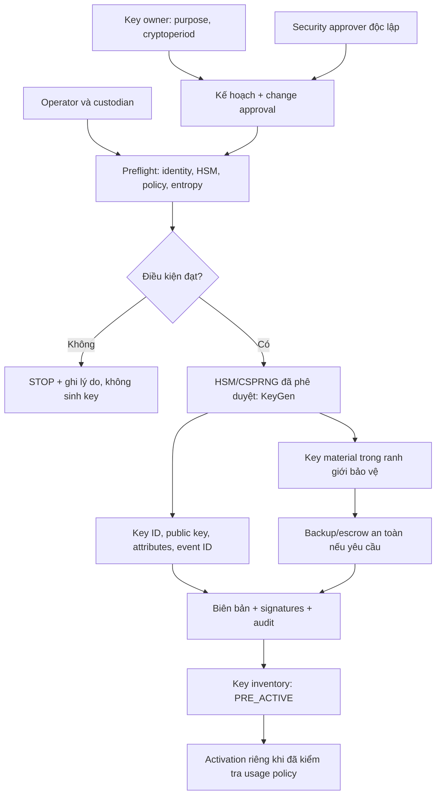
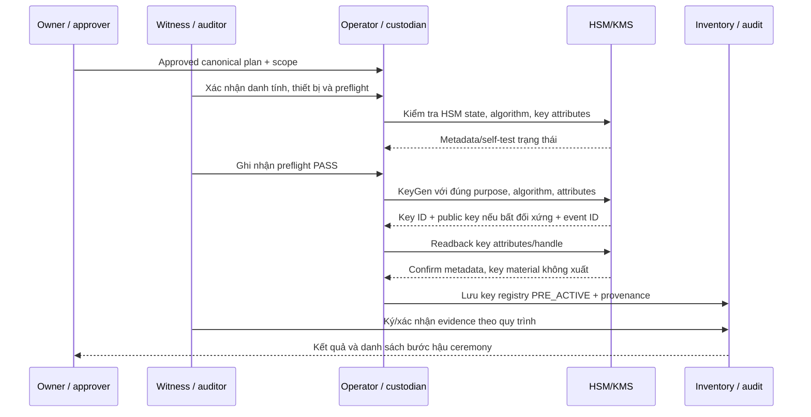
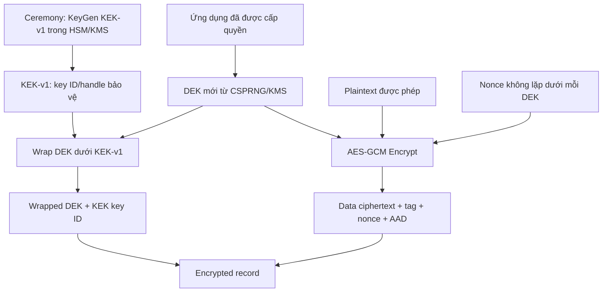
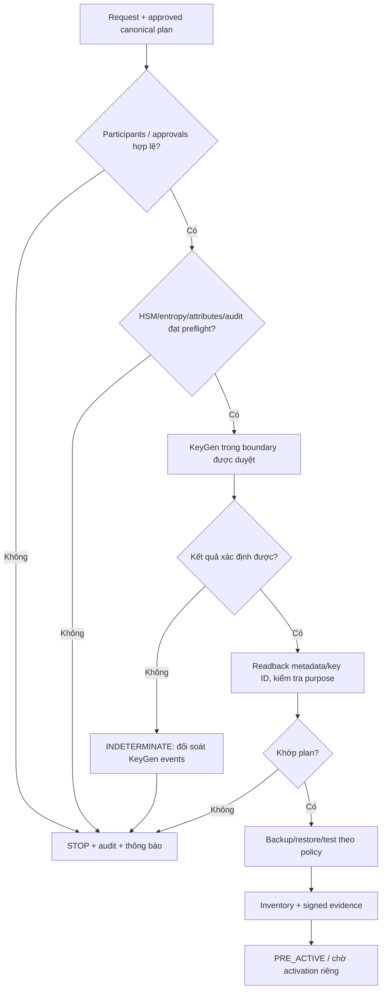
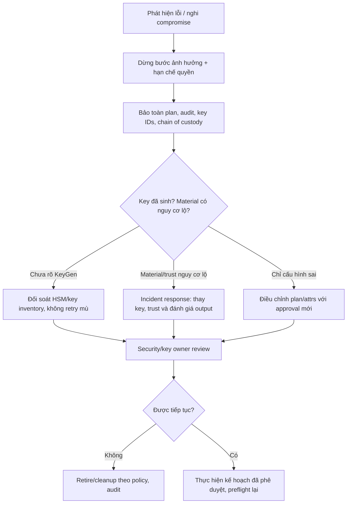

# Key generation ceremony: nghi thức tạo khóa mật mã an toàn và có thể kiểm toán

> **Chương:** Key generation  
> **Module:** SECURITY_KEY_MANAGEMENT_FUNDAMENTALS

Một tổ chức có thể sinh khóa AES bằng vài dòng code hoặc nhấn **Create key** trong dịch vụ KMS. Nhưng khi khóa đóng vai trò **root of trust**, bảo vệ hàng triệu data-encryption key (DEK), ký chứng thư CA, ký phát hành phần mềm hoặc quản lý bí mật cấp cao, câu hỏi không chỉ là *“đã tạo ra bytes ngẫu nhiên chưa?”*. Tổ chức còn phải chứng minh: **ai phê duyệt, ai tham gia, thiết bị nào tạo khóa, phương pháp tạo có đáng tin không, ai có thể sử dụng hay khôi phục, vật liệu khóa có rời môi trường được bảo vệ không, và bằng chứng nào tồn tại khi kiểm toán nhiều năm sau?**

Đó là mục tiêu của **key generation ceremony — nghi thức tạo khóa mật mã**: một **quy trình kỹ thuật và tổ chức được chuẩn bị, phê duyệt, thực hiện dưới kiểm soát và ghi nhận bằng chứng** để tạo một khóa hoặc một tập khóa quan trọng với những bảo đảm xác định về nguồn sinh, quyền kiểm soát, tính bảo mật, trách nhiệm và khả năng khôi phục.

Một ceremony không tự làm thuật toán yếu trở nên mạnh. Nếu nguồn entropy kém, thiết bị bị chiếm hoặc quyền sau khi tạo khóa quá rộng, sự hiện diện của hai người chứng kiến không cứu được khóa. Ngược lại, các khóa tạm thời hoặc DEK per-object thường nên được sinh **tự động bằng CSPRNG/KMS/HSM** chứ không cần nghi thức thủ công cho từng khóa. **Mức độ ceremony phải tương xứng với hậu quả khi khóa bị lộ, mất hoặc sử dụng sai.**

Trong phạm vi **SECURITY_KEY_MANAGEMENT_FUNDAMENTALS**, bài học kết nối nghi thức tạo khóa với vòng đời **tạo → cấp phát → lưu trữ → sử dụng → xoay vòng → thu hồi → hủy**, mật mã đối xứng, bất đối xứng, chữ ký số, KMS/HSM, **envelope encryption**, kiểm soát truy cập và kiểm toán.

Sau bài này, bạn sẽ có thể:

- Phân biệt **KeyGen tự động**, **key ceremony**, **key import/restore**, **backup** và **key activation**.
- Lập **threat model, kế hoạch, RACI và danh sách điều kiện dừng** trước khi tạo một khóa quan trọng.
- Hiểu đúng **least privilege, separation of duties, dual control, split knowledge và M-of-N**, không xem các khái niệm là đồng nghĩa.
- Tổ chức kiểm soát **HSM/KMS, entropy/CSPRNG, key provenance, tamper evidence, key attributes, chain of custody và audit**.
- Diễn giải khác biệt giữa ceremony tạo **CA signing key**, **KEK/master wrapping key**, **private signing key** và **recipient KEM key**.
- Thiết kế **backup/restore drill, activation, rotation, destruction** có xem xét dữ liệu phụ thuộc và secret lifetime.
- Xử lý các tình huống thất bại, bất đồng bằng chứng, nghi compromise và thay khóa theo runbook.
- Đọc ví dụ Java 17 minh họa **điều kiện cho phép thực hiện ceremony**, biết rõ những phần không thể thay thế HSM và quy trình của tổ chức.

## 1. Key generation ceremony là gì?

Key generation ceremony là **một chuỗi hoạt động có kiểm soát** nhằm sinh key material mới trong hoàn cảnh cần bảo đảm cao hơn một lời gọi KeyGen thông thường. Một ceremony có thể bao gồm:

1. Quyết định **purpose, thuật toán, cryptoperiod và phạm vi rủi ro**.
2. Xác nhận thẩm quyền và **người tham gia độc lập**.
3. Chuẩn bị **thiết bị, firmware, cấu hình và nơi diễn ra**.
4. Kiểm tra phương pháp **ngẫu nhiên/entropy** và quyền thao tác.
5. Sinh key bằng **CSPRNG/HSM** hoặc key generation process đã được đánh giá.
6. Xác nhận **key ID, key attributes, algorithm, public key/fingerprint** và kết quả.
7. Bảo vệ/backup key theo policy, không phát tán raw secret.
8. Ghi **biên bản, logs, signatures/approvals và chain of custody**.
9. Bàn giao key ở **PRE_ACTIVE** hoặc trạng thái được phê duyệt; kích hoạt để sử dụng là quyết định riêng.

Điểm quan trọng: nghi thức là **quy trình** bao quanh phép toán mật mã. **KeyGen** là thao tác sinh key material; một ceremony có thể chỉ có một lần KeyGen, nhưng cần nhiều bước trước và sau để chứng minh sự kiện ấy hợp lệ.

### 1.1. Ceremony khác KeyGen API thế nào?

| Khía cạnh | KeyGen thông thường | Key generation ceremony |
|---|---|---|
| Mục tiêu chính | Sinh khóa đúng thuật toán từ nguồn ngẫu nhiên phù hợp | Sinh khóa **và có bằng chứng** về thẩm quyền, điều kiện, người tham gia, thiết bị và kiểm soát |
| Người tham gia | Thường chỉ workload/automation | Có thể có operator, key custodian, security approver, witness, auditor |
| Bằng chứng | Provider response và audit event | Runbook, approvals, event IDs, attestation/metadata, witness signatures, reconciliation |
| Phạm vi | DEK per-object, session keys, service keys theo automation | Root CA, root KEK/HSM domain, signing key ảnh hưởng lớn, key có yêu cầu tuân thủ đặc biệt |
| Quyền và bảo quản | KMS/HSM policies và IAM | Thường thêm SoD, dual control, custody, khôi phục có ngưỡng |
| Trạng thái đầu ra | Tùy API/provider | Key material + metadata/record được bàn giao ở trạng thái định nghĩa rõ, có thể **chưa active** |

Không thể suy ra “khóa được tạo trong ceremony thì chắc chắn non-exportable, không bị lộ và đã đạt chứng nhận”. Những thuộc tính ấy chỉ được chấp nhận khi **thiết bị, chính sách, thao tác và bằng chứng** hỗ trợ đúng tuyên bố.

### 1.2. Hai loại ceremony thường gặp

**Ceremony sinh khóa gốc/độc lập:** một HSM tạo root CA private key, root wrapping key, signing key hoặc key material quan trọng mới. Trọng tâm là **nguồn sinh mới**, thuộc tính khóa và custody.

**Ceremony triển khai/di chuyển/khôi phục khóa:** nhập key đã tồn tại, restore backup hoặc phân phối key material được bảo vệ. Quy trình có thể có mức kiểm soát tương tự nhưng **không được gọi đó là KeyGen mới** nếu chỉ chuyển cùng bytes sang môi trường khác. Việc tách loại ceremony giúp inventory không reset sai tuổi key material.

## 2. Khi nào cần ceremony?

Đừng tổ chức một nghi thức nhiều người cho mọi session key TLS. Quyết định nên dựa trên **mô hình đe dọa và tác động thực tế**.

| Loại khóa | Có thể cần ceremony mức cao? | Lý do |
|---|---|---|
| **Offline root CA signing key** | Thường đáng cân nhắc rất kỹ | Sai sót/lộ khóa có thể ảnh hưởng toàn bộ chuỗi trust PKI |
| **HSM root/master wrapping key, security-domain initialization** | Thường theo hướng dẫn HSM và policy | Bảo vệ nhiều key khác; cấu hình ban đầu có thể quyết định ranh giới an ninh |
| **Code signing/release signing key có tác động lớn** | Tùy threat model và governance | Chữ ký giả có thể được hệ sinh thái tin cậy |
| **Private key cấp cao cho ký chứng từ/tài chính** | Tùy chính sách, yêu cầu hợp đồng/tuân thủ | Rủi ro giả mạo giao dịch và tranh chấp trách nhiệm |
| **KEK bảo vệ nhiều DEK hoặc nhiều tenant** | Có thể cần quy trình chặt hơn | Lộ/mất key có phạm vi ảnh hưởng lớn |
| **Imported key/BYOK từ hệ thống cũ** | Có thể cần import ceremony | Phải chứng minh nguồn gốc, custody và không lộ raw key |
| **AES DEK mới cho từng object** | Thường **không cần ceremony thủ công** | Nên KeyGen tự động đúng CSPRNG/KMS, metadata và policy |
| **Ephemeral DH/TLS traffic keys** | Thường **không** | Tạo/dẫn xuất tự động theo giao thức, lifetime ngắn |
| **KEM recipient key dài hạn cho kho dữ liệu quan trọng** | Có thể cần | Private key bị lộ có thể ảnh hưởng encapsulation/ciphertext cũ |

**Không có một ngưỡng duy nhất áp dụng cho mọi tổ chức.** Các lĩnh vực như PKI, tài chính/thanh toán, bảo vệ dữ liệu lớn hoặc yêu cầu tuân thủ có thể có quy trình/chuẩn riêng. Cần đối chiếu chính xác **phạm vi và phiên bản tiêu chuẩn áp dụng**, thay vì khẳng định mọi HSM key bắt buộc nghi thức giống nhau.

### 2.1. Các câu hỏi chọn mức bảo đảm

- Nếu khóa bị **lộ**, ai có thể Sign/Decrypt/Unwrap hoặc giả mạo danh tính?
- Nếu khóa bị **mất/hủy**, dữ liệu nào sẽ không thể khôi phục?
- Có bao nhiêu **DEK/ciphertext/certificate/token** phụ thuộc khóa?
- Khóa có cần **non-exportable**, dual control, backup dưới HSM hoặc nhiều custodian?
- Có thể tạo tự động với **độ tin cậy và audit tương đương** không?
- Cần bằng chứng nào cho kiểm toán, bên thứ ba hoặc điều tra sau nhiều năm?

Một ceremony tốt xác định **mục tiêu kiểm soát cụ thể**, không chạy theo hình thức “đủ người chứng kiến” nhưng thiếu ranh giới bí mật.

## 3. Đầu ra của ceremony: khóa và bằng chứng

Một nghi thức thành công thường tạo ra **hai nhóm kết quả**:

**Kết quả mật mã:**

- Key material hoặc key pair được tạo **trong ranh giới được phê duyệt**.
- Key ID/handle/material version rõ ràng; thuật toán, key size/parameter set, purpose và export policy phù hợp.
- Public key/certificate signing request/fingerprint khi là cặp bất đối xứng.
- Trạng thái key sau tạo, ví dụ **PRE_ACTIVE**; quyền sử dụng mới có thể chưa cấp.
- Backup/wrapped key record hoặc hướng khôi phục, nếu policy yêu cầu.

**Kết quả kiểm soát và audit:**

- Approved plan/runbook version và danh tính người duyệt.
- Danh sách người tham gia, vai trò độc lập và phạm vi trách nhiệm.
- Thiết bị/partition ID, cấu hình, attestation hoặc bằng chứng trạng thái phù hợp.
- Timestamps, event IDs, operation IDs, trạng thái trước/sau và kết quả của mỗi bước.
- Biên bản chênh lệch, dừng/khởi động lại, exception và phê duyệt bổ sung.
- Kế hoạch activation, rotation, restore và hủy theo dependency inventory.

**Không có yêu cầu phải ghi raw key để chứng minh KeyGen đã diễn ra.** Trên thực tế, việc đưa secret vào biên bản hoặc ảnh chụp màn hình có thể phá hỏng toàn bộ mục tiêu bảo mật.

### 3.1. Sơ đồ các ranh giới tin cậy



Điều cần chú ý là **đường key material khác đường audit metadata**. Operator thường chỉ cần quan sát key ID và thuộc tính, không cần raw bytes. Việc backup secret, nếu có, phải diễn ra **bên trong đường được thiết kế riêng**, tránh chảy qua log, clipboard hoặc file tạm.

## 4. Threat model: ceremony đang chống những rủi ro nào?

Nếu không có threat model, ceremony có thể tập trung vào bố trí phòng nhưng bỏ qua quyền root trong HSM hoặc nguồn key bị thay thế.

| Mối đe dọa | Hậu quả | Kiểm soát cần thiết |
|---|---|---|
| **Insider tự tạo/xuất khóa trái phép** | Có bản sao secret ngoài hệ thống | Least privilege, SoD, dual control, non-exportable khi phù hợp |
| **HSM sai thiết bị/partition** | Key được sinh vào nơi không được quản lý hoặc sai tenant | Xác minh device ID, partition, firmware/config từ nguồn tin cậy |
| **Nguồn entropy yếu hoặc RNG bị lỗi** | Key có thể đoán được hoặc tương quan | CSPRNG/DRBG đã được đánh giá, health tests/bằng chứng theo nhà cung cấp |
| **Firmware hoặc key attributes sai** | Key export được hoặc dùng sai purpose | Change control, verified state, key usage attributes |
| **Thay tráo public key/CSR** | Chứng thư/kết quả trust hướng đến key attacker | Ràng buộc key ID, public key fingerprint, nguồn công bố được xác thực |
| **Ghi secret vào màn hình/log/ảnh/video** | Lộ raw material hoặc shares | Cấm secret capture, audit metadata, kiểm soát camera/chứng kiến |
| **Một người kiểm soát tất cả key shares** | Mất mục tiêu split knowledge/M-of-N | Custody độc lập, kiểm tra ngưỡng và đường recovery |
| **Backup không thể restore** | Mất dữ liệu khi HSM hỏng | Restore drill với bản ghi thử và policy quyền |
| **Key được dùng trước activation** | Ký/mã hóa trái phê duyệt | PRE_ACTIVE, IAM/grants kiểm thử deny và monitored cutover |
| **Ceremony record bị sửa/xóa** | Không chứng minh được ai làm gì | Signed/append-only audit, nhiều nguồn log và custody |
| **Rollback/restore về trạng thái nonce cũ** | Trùng (key, nonce) với AEAD | Quản lý nonce/counter sau restore, key rotation theo trường hợp |
| **Hủy key trước migration** | Không mở được DEK/dữ liệu lịch sử | Dependency inventory, retention và dual approval destroy |

### 4.1. Những gì ceremony không tự bảo đảm

- Không tự chứng minh implementation hoàn toàn **constant-time** hay không có side channel.
- Không làm một thuật toán lạc hậu trở nên an toàn chỉ vì tạo trên HSM.
- Không tự tạo **forward secrecy** cho static private key.
- Không ngăn ứng dụng có quyền Sign tạo chữ ký gian lận nếu thiếu business approval.
- Không sửa nguy cơ **AES-GCM nonce reuse** sau khi DEK bắt đầu dùng.
- Không thu hồi được byte khóa đã bị export trước khi ceremony.

Ceremony nên gắn với **key usage policy, IAM, cryptographic protocol, key inventory và incident response**, thay vì đứng tách rời khỏi hệ thống.

## 5. Vai trò và trách nhiệm trong ceremony

Một người có thể tham gia nhiều công việc, nhưng **các quyết định nhạy cảm phải có ranh giới thẩm quyền rõ ràng**.

| Vai trò | Trách nhiệm điển hình | Điều không tự mặc định |
|---|---|---|
| **Key owner / system owner** | Xác định purpose, cryptoperiod, nhu cầu khôi phục và dữ liệu phụ thuộc | Quyền truy cập/export private key |
| **Security approver / ceremony authority** | Phê duyệt thiết kế, mức bảo đảm, ngoại lệ, policy | Quyền tự chạy phép Sign/Decrypt nghiệp vụ |
| **Ceremony operator** | Chuẩn bị, thực thi runbook, đối chiếu trạng thái và báo cáo | Tự phê duyệt/export/destroy bất cứ key nào |
| **HSM security officer / custodian** | Kiểm soát partition, key shares, recovery access theo chính sách | Đọc mọi dữ liệu khách hàng |
| **Independent witness / auditor** | Quan sát đúng trình tự, ghi chứng cứ và bất thường | Có key shares hoặc quyền admin không cần thiết |
| **Application/PKI owner** | Xác minh public-key trust, interoperability và consumption | Thay đổi thuộc tính HSM ngoài phê duyệt |
| **Incident responder** | Containment và xử lý nghi compromise theo runbook | Được hủy key vô điều kiện |

### 5.1. RACI minh họa

R = Responsible (thực hiện), A = Accountable (chịu trách nhiệm cuối), C = Consulted (tham vấn), I = Informed (được thông báo).

| Hoạt động | Key owner | Security authority | Operator | Custodian | Witness |
|---|---|---|---|---|---|
| Chọn purpose/cryptoperiod | **A** | C | C | I | I |
| Phê duyệt key ceremony plan | C | **A** | R soạn và trình | C | I |
| Chuẩn bị HSM/partition | I | A cho policy | **R** | **R** custody | C |
| Thực hiện KeyGen đã duyệt | A về mục tiêu | C | **R** | R theo HSM | **I/quan sát** |
| Backup/escrow nếu yêu cầu | A | C | R điều phối | **R** custody | I |
| Xác nhận biên bản và evidence | I | A về kiểm soát | R | C | **R** xác nhận quan sát |
| Kích hoạt key cho production | **A** | C | **R** theo plan riêng | I | I |

Bảng này chỉ là **mẫu tổ chức**. Không nhất thiết mọi doanh nghiệp có đủ các chức danh; điểm quan trọng là có **một đầu mối A rõ ràng**, sự độc lập được yêu cầu và bằng chứng đúng quyền thực tế.

### 5.2. Tách người đề nghị, phê duyệt, thực thi và chứng kiến

Nếu cùng một người:

1. Tạo request key có quyền `EXPORT`.
2. Tự phê duyệt.
3. Tự thực thi.
4. Tự sửa log.

thì về cơ bản không có kiểm soát độc lập. Thậm chí hai tài khoản thuộc **cùng một con người** cũng không đạt mục tiêu SoD khi policy yêu cầu hai danh tính độc lập.

Dual control có thể được **cưỡng chế kỹ thuật** bằng nhiều role/thiết bị, hoặc bằng workflow có approval/two-person execution; cần đánh giá mức độ bảo đảm của giải pháp cụ thể.

## 6. Dual control, split knowledge và M-of-N: không phải một khái niệm

Ba thuật ngữ thường được dùng lẫn nhau nhưng bảo vệ các thuộc tính khác nhau.

| Cơ chế | Ý nghĩa | Không được suy ra |
|---|---|---|
| **Dual control** | Một thao tác nhạy cảm cần ít nhất hai chủ thể độc lập hoặc hai kiểm soát phối hợp | Dữ liệu secret đã được chia thành hai phần |
| **Four-eyes / two-person approval** | Hai người rà soát/phê duyệt độc lập trước thao tác | Hai approvals tự ngăn được việc một người đã có full admin/root credential |
| **Split knowledge** | Không một người nắm toàn bộ bí mật khi quy trình yêu cầu phân chia | Mọi cách “chia chuỗi thành hai nửa” là an toàn/đúng chuẩn |
| **M-of-N / threshold** | Cần tối thiểu \(M\) trong \(N\) thành phần/participants để khôi phục hoặc cho phép một thao tác theo scheme | Hai người cùng biết full PIN là M-of-N |
| **Separation of duties** | Tách công việc/quyền gây xung đột lợi ích | Một policy document tự cưỡng chế quyền trên HSM |

### 6.1. Ví dụ threshold 3-of-5

Năm key custodians được cấp **năm phần bí mật/khả năng khôi phục độc lập** theo scheme đã được đánh giá. Quy trình restore cần ít nhất **ba** người tham gia, không một hoặc hai người nào có đủ thông tin để khôi phục theo giả định của cơ chế. Các phần phải được phân phối **an toàn, có chain of custody và tách môi trường**.

```text
Phần khôi phục: S1, S2, S3, S4, S5
Chính sách: cần ít nhất 3/5 phần theo scheme đã được thiết kế.

S1 + S2                => Không đủ
S1 + S3 + S5           => Đủ ngưỡng nếu các phần hợp lệ
Một người chụp đủ S1-S5 => Mục tiêu split custody đã thất bại
```

Đây là **mô tả khái niệm**, không phải hướng dẫn tự chia plaintext key bằng tay. Các sản phẩm HSM có thể dùng **smartcards/tokens, quorum authorization, recovery key shares, threshold cryptography hoặc cơ chế vendor-specific**; phải dùng giao thức và khả năng được đánh giá của thiết bị, không tự sáng tạo phép toán chia/ghép secret.

### 6.2. Approval quorum khác cryptographic quorum

Một workflow yêu cầu 2/3 phê duyệt ở ticketing chỉ xác nhận **quyết định**. Một HSM yêu cầu 2/3 card để mở một phân vùng có **cưỡng chế phần cứng** về hoạt động đó. Chúng có thể bổ trợ nhau nhưng **không tương đương**.

Điều này cũng áp dụng cho key backup: hai bản sao của cùng full private key ở hai két sắt không phải secret sharing.

## 7. Chuẩn bị ceremony: kế hoạch, phạm vi và điều kiện dừng

Một key ceremony cần **plan đã được phê duyệt trước**. Plan nên đủ chi tiết để operator và người chứng kiến biết *đang làm gì, ở đâu, điều kiện nào bắt buộc và khi nào phải dừng*.

### 7.1. Các thành phần tối thiểu của kế hoạch

| Nhóm | Nội dung xác định |
|---|---|
| **Purpose & scope** | Root CA, KEK, code-signing key, recipient KEM key; môi trường/tenant/region |
| **Cryptographic spec** | Thuật toán, key size/curve/parameter set, key usage, intended cryptoperiod |
| **Device & boundary** | HSM/partition ID, phiên bản, trạng thái, key generation path, exportability |
| **Participants** | Operator, custodian, approver, witness; danh tính/điều kiện độc lập |
| **Physical/logical security** | Phòng, quyền truy cập, remote session, máy quản trị được phép, camera/recording policy |
| **Randomness** | Nguồn RNG/DRBG của thiết bị, health/entropy evidence phù hợp |
| **Key attributes** | Purpose, allowed operations, non-exportability, sensitivity, backup/restore policy |
| **Artifacts** | Key ID, public key, fingerprint/CSR, backup handle, signed audit record |
| **Start/stop criteria** | Khi nào được bắt đầu; bất thường nào bắt buộc dừng |
| **Recovery** | Xử lý thất bại, key bị tạo nửa chừng, cleanup, rollback hạn chế |
| **Post-ceremony** | Inventory, activation, owner handoff, cryptoperiod, review |

### 7.2. Điều kiện dừng (stop conditions)

Các điều kiện cần cân nhắc:

- Không xác minh được **thiết bị/partition** hoặc trạng thái cấu hình phù hợp.
- Thiếu người tham gia độc lập theo yêu cầu, người chứng kiến không thể xác nhận bước quan trọng.
- Sai **algorithm, key size, usage attributes**, exportability hoặc mục đích.
- Nguồn RNG/DRBG health check báo lỗi hoặc HSM báo **tamper/security alarm**.
- Có dấu hiệu log/screenshare/clipboard sẽ làm lộ secret hoặc key share.
- Phê duyệt không còn hiệu lực, plan bị sửa sau khi ký duyệt.
- KeyGen hoặc backup không thể khẳng định kết quả/idempotency; không rõ đã tạo bao nhiêu key.
- Xuất hiện lệnh không có trong runbook cần quyền đặc biệt hoặc bỏ qua sự độc lập.

Khi dừng, không cố “thử thêm vài lệnh” bằng tài khoản admin chung. Phải giữ **bằng chứng hiện trạng**, đánh giá key object nào đã hình thành và xin phê duyệt mới trước khi tiếp tục. Nếu key đã sinh nhưng không được chấp nhận, phải có kế hoạch xử lý **bỏ key, retire hoặc hủy theo chính sách**, không để key orphan active ngoài inventory.

### 7.3. Kiểm tra tính toàn vẹn của plan

Một approval lý tưởng phải gắn với **canonical plan version/digest**, key purpose, algorithm, environment, HSM boundary và điều kiện expected state. Nếu operator đổi từ `nonExportable=true` sang `false` sau phê duyệt, **approval cũ không còn áp dụng** cho plan mới.

Đừng tin chuỗi `approved=true` từ request do operator tự gửi. Cần có **workflow identity, role kiểm chứng và audit** từ hệ thống được bảo vệ.

## 8. Môi trường vật lý, thiết bị và chain of custody

Một nghi thức có thể thực hiện tại **phòng bảo mật**, trong **HSM cluster** hoặc qua một **remote ceremony** với điều kiện bảo đảm và chứng cứ khác nhau. Bảo vệ vật lý quan trọng khi key shares/token/thiết bị có thể bị lấy hoặc bị ghi lại.

### 8.1. Trước khi mở phiên

- Kiểm tra danh tính người tham gia theo danh sách được phê duyệt; ghi **thời gian vào/ra** và vai trò.
- Kiểm tra HSM serial/asset ID, partition/slot ID, trạng thái tamper, phần mềm quản trị và cấu hình được cho phép.
- Sử dụng **admin workstation** được quản lý, tài khoản cá nhân hoặc kỹ thuật định danh được, không dùng shared root vô danh.
- Kiểm tra chính sách **ghi hình, màn hình, điện thoại, thiết bị USB, clipboard, file tạm**; chỉ ghi evidence không bí mật.
- Bảo đảm audit KMS/HSM và kho evidence **sẵn sàng, bảo vệ khỏi sửa/xóa** theo chính sách.
- Nếu có key shares/card, xác nhận **mã nhận dạng, niêm phong, người giữ và biên bản giao nhận** mà không hiển thị secret.

Không nên tự khẳng định mọi buổi ceremony bắt buộc dùng phòng kín không mạng. Một số mô hình cloud HSM hoặc dịch vụ KMS quản lý cần quy trình online dựa trên IAM, attestation/metadata và audits; phải chọn biện pháp bảo đảm phù hợp **threat model và khả năng của nhà cung cấp**.

### 8.2. Chain of custody

**Chain of custody** là chuỗi bằng chứng cho biết một thiết bị, key share, smartcard, backup token hoặc vật mang khóa được **ai giữ, chuyển cho ai, lúc nào, còn niêm phong hay không**.

Ví dụ cho một recovery token:

```text
Token ID: recovery-card-04
Custodian before: custodian-B
Transfer approved by: security-authority
Transferred at (UTC): 2026-11-28T08:15:00Z
Custodian after: custodian-D
Seal/device status: verified
Evidence reference: ceremony-kg-2026-014/transfer-04
```

**Không ghi PIN của smartcard, plaintext key share hoặc token secret** trong biên bản. Mã card/token là metadata, không phải nội dung key.

### 8.3. Remote ceremony và cloud KMS

Nếu key được tạo trong cloud KMS, operator có thể không trực tiếp kiểm soát HSM vật lý. Bằng chứng thay thế có thể gồm:

- Tài khoản/project, region, key ID và key spec từ API provider.
- Cloud audit events và tổ chức xác thực actor/phê duyệt.
- Chính sách key usage, non-exportability theo tính năng được công bố và xác nhận.
- Loại bảo vệ khóa (provider-managed/service-managed, HSM-backed nếu có).
- Giới hạn về khả năng kiểm chứng RNG/firmware/physical custody của provider.

**Không ghi trong biên bản rằng mình đã tận mắt chứng kiến entropy generation trong HSM cloud** nếu thực tế chỉ nhìn thấy API response. Chứng cứ phải phân biệt **provider assertion** và điều operator trực tiếp quan sát được.

## 9. HSM preflight: chuẩn bị ranh giới bảo vệ khóa

**HSM (Hardware Security Module)** hỗ trợ thực hiện các phép toán mật mã và quản lý vật liệu khóa trong ranh giới được thiết kế. Nhưng một HSM có thể có nhiều partition, role, key attributes và khả năng khác nhau.

### 9.1. Những điều cần xác nhận

1. **Đúng thiết bị/partition:** asset ID, security domain và môi trường tương ứng với plan.
2. **Trạng thái:** health và tamper indicators không bất thường; firmware/config/patch level phù hợp.
3. **Nguồn key generation:** thuật toán và CSPRNG/DRBG có trong mô hình triển khai đã phê duyệt.
4. **Role:** operator/key custodian chỉ có quyền cần thiết; quyền export/backdoor recovery bị giới hạn.
5. **Key attributes:** `sensitive`, `extractable`, `sign`, `decrypt`, `derive` hoặc tương đương theo API.
6. **Persistent storage:** khả năng giữ key handle, replica/backup, failure modes và policy deletion.
7. **Audit:** yêu cầu KeyGen/import/backup/change được ghi lại cùng identity và result.
8. **Key naming:** tránh collision, gắn key ID/version ổn định, không phụ thuộc timestamp làm ID duy nhất.

Tên thuộc tính như `extractable` là **ví dụ theo một số giao diện kiểu PKCS#11**; không áp dụng nguyên văn cho mọi KMS/HSM. Điều cần đạt là **khả năng thực tế được cưỡng chế** sau tạo.

### 9.2. Non-exportable là lựa chọn thiết kế, không phải nhãn trang trí

Nếu một key phải non-exportable, thuộc tính phải được áp dụng khi tạo key và kiểm tra bằng interface được hỗ trợ. Không thể lấy một AES key đã sinh trong ứng dụng, ghi nó vào file, sau đó import vào HSM rồi tuyên bố rằng **nó chưa từng rời HSM**.

Non-exportable không đồng nghĩa **non-abusable**: principal được quyền `Sign` hoặc `Decrypt` có thể lạm dụng HSM mà không xuất bytes. Phải thiết kế quyền usage và phê duyệt nội dung riêng.

### 9.3. KMS key creation khác HSM ceremony tự quản

Khi dùng KMS cloud:

- Provider có thể tự sinh material theo key spec và tự quản backup/rotation tùy dịch vụ.
- API create có thể sinh **key object trước khi material import** đối với mô hình imported key.
- Rotation tự động dưới một logical key ID có thể thay material mà không đổi object creation timestamp.
- Không phải provider nào cũng cho xuất key, lấy RNG attestation ở mức chi tiết hoặc truy cập HSM partition.

Operator nên ghi rõ **mức độ kiểm chứng mà provider cho phép**, không cố mô phỏng nghi thức vật lý trên một API không cung cấp thông tin đó.

## 10. Entropy, CSPRNG, DRBG và bằng chứng về randomness

Sức mạnh của khóa không chỉ phụ thuộc key size; key phải được **sinh từ nguồn ngẫu nhiên mật mã thích hợp**.

### 10.1. Vì sao không dùng thời gian, PID hoặc `Random`?

Ví dụ chống mẫu:

```java
// KHÔNG DÙNG ĐỂ SINH KHÓA MẬT MÃ!
long predictable = System.currentTimeMillis();
java.util.Random weak = new java.util.Random(predictable);
byte[] fakeKey = new byte[32];
weak.nextBytes(fakeKey);
```

Giá trị seed dự đoán được làm giảm không gian tìm kiếm của attacker; độ dài 32 byte của mảng **không tạo ra 256 bit entropy**. Khóa AES-256 chỉ có mức chống đoán tương ứng khi key material thực sự được sinh đúng cách.

### 10.2. Nguồn sinh phù hợp

- **HSM KeyGen:** để thiết bị sinh vật liệu bằng RNG/DRBG theo khả năng/đánh giá được phê duyệt; thường là lựa chọn hợp lý cho root/master key non-exportable.
- **KMS managed key generation:** dùng API tạo key/data key của provider, hiểu rõ key origin, exportability và semantics.
- **Java SecureRandom/CSPRNG:** phù hợp cho một số secret ứng dụng khi kiến trúc cho phép raw key tồn tại trong memory; **không thay HSM ceremony** cho key bắt buộc non-exportable.
- **External/imported entropy:** chỉ khi kế hoạch và HSM/API hỗ trợ; cần kiểm soát provenance, tính toàn vẹn và custody của vật liệu.

**CSPRNG** là cryptographically secure pseudorandom number generator; **DRBG** là deterministic random bit generator. Cả hai phụ thuộc entropy/seed ban đầu và cơ chế reseed/health theo thiết kế. Một DRBG có thể sinh lượng lớn output an toàn dưới giả định nhưng không tự tạo entropy mới ở mỗi byte.

### 10.3. Ceremony cần chứng minh gì về RNG?

Không cần và không nên ghi **seed hoặc random internal state** để “chứng minh random”.

Bằng chứng phù hợp có thể gồm:

- Thông tin thiết bị/provider được chọn, key generation mode và cryptographic module status.
- Tình trạng **self-test/RNG health** do thiết bị cung cấp.
- Các chứng nhận/đánh giá liên quan của model/firmware khi policy yêu cầu.
- KeyGen event ID, key spec/algorithm và kết quả đã được xác minh.
- Quy trình xử lý khi RNG lỗi, thiết bị tamper hoặc nguồn entropy unavailable.

Một “test randomness” tự viết chạy trên 100 byte đầu ra **không chứng minh một HSM RNG an toàn**. Cần đánh giá kiến trúc nguồn entropy/DRBG và tài liệu đáng tin của vendor/chuyên gia; không thay kiểm chứng bằng một histogram đẹp.

### 10.4. Phân biệt seed và key material

**Seed** có thể là đầu vào bí mật để một DRBG/KDF sinh key material. Nếu seed bị lộ, các key được sinh hoặc dẫn xuất từ đó có thể có nguy cơ tùy thiết kế. Vì vậy:

- Không export/log seed để tăng auditability.
- Không tái sử dụng seed tùy tiện giữa môi trường hoặc nghi thức.
- Không coi tăng key size lên 256 bit sẽ bù được seed có entropy thấp.
- Nếu có nhiều bên đóng góp entropy, phải dùng **combiner/construction đã được đánh giá**; không tự “trộn” bằng nối chuỗi và băm rồi khẳng định chống insider.

## 11. Thực thi KeyGen: trình tự chung

Trong ceremony thực sự, lệnh KeyGen thường chỉ được chạy **sau khi các điều kiện đã được ghi nhận đạt**.



### 11.1. Từng bước cần làm rõ

**Bước 1 — Confirm scope.** Operator đọc lại key type, thuật toán, purpose, environment và state dự kiến. Nếu một người đề nghị tạo RSA signing key nhưng plan đã duyệt là AES KEK thì **dừng**, không tự đổi.

**Bước 2 — Verify boundary.** Đúng HSM/partition/tenant; trạng thái và role đạt yêu cầu. Kiểm tra policy non-exportable hoặc backup/restore profile theo thiết kế.

**Bước 3 — Generate.** Gọi phép KeyGen phù hợp. Không in raw private/symmetric key bytes. Nếu API sinh key material bên ngoài HSM, phải ghi nhận **thay đổi mức bảo đảm** và xin phê duyệt tương ứng.

**Bước 4 — Readback.** Đọc **key handle, algorithm, key usage attributes, exportability, created/generated timestamp và event ID** theo khả năng provider. Với key pair, có thể lấy **public key** và fingerprint để liên kết chứng thư/CSR.

**Bước 5 — Register.** Ghi key ID/version và provenance vào inventory; đánh dấu trạng thái sử dụng **PRE_ACTIVE** trừ khi đã có plan kích hoạt được phê duyệt riêng.

**Bước 6 — Protect/backup.** Nếu policy yêu cầu key backup/escrow, dùng cơ chế bảo vệ key của HSM/provider. Không copy secret sang môi trường ngoài ranh giới chỉ vì “cần backup”.

**Bước 7 — Sign off.** Operator và witness xác nhận những gì họ thực sự quan sát được, ghi exception nếu có. Bàn giao owner và activation controller để triển khai ở bước khác.

### 11.2. Nếu KeyGen trả timeout thì làm gì?

**Không tự gọi lại ngay nhiều lần với cùng định danh** trước khi xác định thao tác đầu đã tạo key hay chưa. Có thể KeyGen đã thành công trong HSM nhưng client mất phản hồi; retry không idempotent có thể sinh thêm key mồ côi.

Cần:

1. Truy vấn key registry/HSM audit bằng **operation ID, key label, request ID** nếu khả năng thiết bị hỗ trợ.
2. Xác định đã có object nào được sinh; không tạo collision/hợp thức hóa vật liệu chưa kiểm chứng.
3. Nếu không thể kết luận, ghi **INDETERMINATE** và tạm dừng để đối soát.
4. Khi thực sự cần thử lại, dùng plan/correlation mới hoặc quy tắc idempotency được thiết kế; audit đầy đủ.

### 11.3. Không sử dụng key khi còn PRE_ACTIVE

KeyGen hoàn tất **không đồng nghĩa** mọi workload được phép bắt đầu `Encrypt` hoặc `Sign`. Key usage phải chờ kiểm tra IAM, purpose, trusted public-key distribution và activation.

Nếu provider key đã Enabled nhưng registry đang PRE_ACTIVE, một workload có grant trực tiếp **có thể vẫn gọi KMS thành công**. Cần bảo đảm trạng thái ứng dụng và **effective IAM/HSM permissions** không tạo lối vòng.

## 12. Public key, fingerprint và certificate sau KeyGen

Với cặp khóa bất đối xứng, private key phải nằm trong ranh giới bảo vệ theo plan, còn public key có thể được công bố. Nhưng **public key không tự mang danh tính**.

### 12.1. Những điều cần xác minh

- Public key được lấy trực tiếp từ key object vừa tạo hoặc nguồn provider có bảo đảm phù hợp.
- **Fingerprint** được tính trên encoding được định nghĩa rõ (ví dụ DER SubjectPublicKeyInfo theo giao thức) và gắn với đúng key ID/version.
- Algorithm/curve/key length/parameter set khớp plan.
- Nếu tạo **CSR**, xác minh CSR dùng đúng public key và chữ ký/proof-of-possession phù hợp với quy trình.
- Certificate issuance/trust publication/activation là **các bước riêng** có thẩm quyền khác nhau.
- Những verifier/recipient cần sử dụng key phải nhận public key qua **nguồn xác thực** (PKI, key registry, trust store, pinning…).

**Không lấy fingerprint của một public key từ email rồi mặc nhiên gắn với private key trong HSM** nếu không có bằng chứng đúng mapping.

### 12.2. Root CA và signing key khác KEM key

| Khóa | Phép toán mục tiêu | Điều cần kiểm tra sau KeyGen |
|---|---|---|
| **Root CA signing key** | Ký chứng thư CA theo policy | Key type/signing scheme, CA controls, CSR/certificate/trust-anchor plan |
| **Code signing key** | Ký artifact/release theo approval | Purpose, release provenance, verifier trust và signing endpoint |
| **KEM recipient key** | Recipient Decaps; sender Encaps bằng public key | KEM parameter set, public key authenticity, private key access, long-term exposure |
| **ECDH/X25519 key** | Key agreement theo giao thức | Curve/key usage, ephemeral/static lifecycle và protocol authentication |

**ML-KEM** là cơ chế đóng gói khóa hậu lượng tử, không phải chữ ký số **ML-DSA**. Một ceremony cho ML-KEM recipient private key cần định nghĩa đúng **FIPS 203 parameter set, thuật toán/encoding và thư viện/HSM hỗ trợ**; không đổi tên X25519 key thành ML-KEM.

## 13. Mẫu ceremony A: sinh offline root CA signing key

**Root CA private key** có thể là gốc tin cậy của một hệ thống PKI. Rủi ro lớn là một chữ ký do private key bị lộ có thể khiến kẻ tấn công phát hành chứng thư được hệ sinh thái tin, tùy trust store/chính sách. Vì vậy root CA thường được xem xét sử dụng **offline HSM, tách nhiệm vụ, chứng kiến, bảo vệ vật lý và quyền ký hạn chế**.

Đây là **kịch bản minh họa**, không phải profile bắt buộc cho mọi CA hoặc chỉ dẫn vận hành một HSM cụ thể.

### 13.1. Chuẩn bị

1. **CA owner** xác định policy phát hành, cryptoperiod, thuật toán ký được duyệt, cơ chế chứng thư gốc và yêu cầu audit.
2. **Security authority** duyệt HSM boundary, custodian/quorum, thời hạn, môi trường offline hoặc mức cách ly tương đương.
3. **Operator** kiểm tra thiết bị, role, firmware/config, audit và phương thức giữ key handle.
4. **Witness** xác minh danh sách participant và điểm dừng trước KeyGen.
5. Nhóm có trách nhiệm xác nhận quy trình **backup/restore** và kế hoạch xử lý nếu root key bị compromise.

### 13.2. Thực thi

```text
Ceremony plan ID: root-ca-gen-2026-01
Expected key purpose: CA_CERTIFICATE_SIGNING
Expected key boundary: offline CA HSM partition
Export policy: non-exportable (nếu HSM/cơ chế recovery hỗ trợ)

1) Xác thực HSM/partition và trạng thái thiết bị.
2) Kiểm tra role và quorum theo plan.
3) Gọi HSM KeyPairGenerate với algorithm được phê duyệt.
4) Lưu key handle/key ID, kiểm tra key usage attributes.
5) Trích xuất public key được phép và fingerprint.
6) Tạo CSR/chứng thư theo quy trình CA riêng biệt.
7) Ghi audit, key inventory và biên bản ký xác nhận.
8) Trả HSM offline hoặc chế độ vận hành đã định.
```

**Không xuất private key để đối chiếu fingerprint.** Public key có thể được đọc; chứng cứ liên kết private key với public key thường đến từ HSM KeyGen event/handle, test signature hoặc proof-of-possession theo quy trình.

### 13.3. Lưu ý về root certificate và key lifetime

- **Key generation time**, **certificate issuance time**, **certificate notBefore/notAfter** và **activation time** không đồng nghĩa.
- Root certificate có thể được tự ký theo chính sách PKI, nhưng hành động tạo certificate không chứng minh vật liệu khóa vừa sinh.
- Public root certificate cần được đưa vào trust store đúng kênh, đúng policy; không tự tin chứng thư chỉ vì nó tự ký hợp lệ.
- Việc chứng thư hết hạn hoặc bị thay thế không tự yêu cầu **hủy ngay private key** khi còn trách nhiệm legacy signature verification, rollback hoặc phục hồi theo chính sách. Tuy nhiên giữ private key quá lâu cũng mở rộng blast radius; phải có quyết định retention.
- Nếu root key bị compromise, không chỉ rotate key object: cần **PKI incident response**, đánh giá chain, certificate đã phát hành, trust anchors và cách thông báo/revocation.

### 13.4. Kế hoạch audit cho offline key

Một offline root key có ít key usage events nhưng **mỗi lần sử dụng đều có tác động cao**. Có thể cần ceremony riêng cho những lần ký subordinate CA/CRL theo policy. Nhật ký phải ghi **operation ID, approval, identity, target certificate profile và fingerprint/digest không bí mật**, không in private key hoặc passphrase.

## 14. Mẫu ceremony B: sinh KEK/master wrapping key

**KEK (key-encryption key)** dùng để bảo vệ DEK. Một KEK root có thể bảo vệ nhiều nhánh key hierarchy; mất khả năng sử dụng nó có thể khiến dữ liệu lưu trữ không thể giải mã, còn lộ key/quyền Unwrap có thể ảnh hưởng diện rộng.

### 14.1. Phạm vi bảo vệ

Một thiết kế **envelope encryption** điển hình:



Ceremony có thể tạo **KEK cấp cao** dưới quyền custodian. DEK per-object sinh tự động theo chính sách; không cần triệu tập bốn người mỗi khi mã hóa một object.

### 14.2. Điều kiện KeyGen KEK

- Key spec đối xứng/wrapping và **key usage attributes** đúng scheme/provider.
- KEK **non-exportable** hoặc chỉ được backup/wrap qua cơ chế được phê duyệt.
- Bản key ID/handle được đăng ký trong inventory, có owner, cryptoperiod và policy.
- Workload **Wrap** và workload **Unwrap** được giới hạn quyền riêng khi thiết kế cho phép.
- Mô hình retention quy định dữ liệu cũ cần KEK nào để **unwrap DEK lịch sử**.
- Có kế hoạch **migrate/rewrap**, backup và restore để không tạo điểm mất dữ liệu vĩnh viễn.

### 14.3. Tại sao backup và khả năng khôi phục quan trọng?

Giả sử KEK-v1 trong HSM bị hủy, nhưng 100 triệu encrypted records còn `wrappedDekKeyId=KEK-v1`. Nếu không còn vật liệu KEK hoặc đường khôi phục được phép, có thể không mở được DEK để giải mã dữ liệu.

Ngược lại, tạo nhiều plaintext backup KEK cũng nguy hiểm. Ceremony cần giải quyết **tính sẵn sàng và tính bí mật đồng thời**, chẳng hạn bằng backup/wrapping/recovery domain HSM được đánh giá, IAM/quorum và restore drill.

### 14.4. Key version sau rotation

Khi KEK-v2 được tạo sau này:

```text
KEK-v1:
  generatedAt: t1
  new-wrap use: RETIRED sau cutover
  legacy-unwrap: còn cần cho wrapped DEK chưa migrate

KEK-v2:
  generatedAt: t2
  new-wrap use: ACTIVE sau approval

Rewrap DEK từ v1 sang v2:
  thay wrapped DEK, KEK metadata;
  không tự thay plaintext DEK hoặc ciphertext dữ liệu.
```

**Không đặt creation time của KEK-v2 là creation time mới của DEK-v1**. Ceremony KeyGen và migration là hai sự kiện khác nhau.

## 15. Mẫu ceremony C: key ký phát hành phần mềm hoặc chứng từ

Một code-signing key có thể cho phép phát hành artifact được hệ thống phân phối tin cậy; một invoice-signing key có thể tạo chữ ký hợp lệ trên chứng từ.

### 15.1. Khác biệt so với root CA và KEK

| Thuộc tính | Key ký số | KEK |
|---|---|---|
| Material | Private/public key pair | Thường là symmetric key |
| Phép toán chính | `Sign`, bên khác `Verify` | `Wrap/Unwrap` hoặc tương đương |
| Rủi ro lạm dụng | Tạo chữ ký giả cho nội dung không được phê duyệt | Mở DEK và gián tiếp đọc dữ liệu |
| Bằng chứng liên kết | Public key fingerprint, trust/CA/JWKS, proof-of-possession | Key ID, wrapped-key scheme, dependency inventory |
| Sau rotation | Verifier vẫn có thể cần public key cũ | Dữ liệu cũ vẫn có thể cần KEK cũ để Unwrap |

### 15.2. Trước khi bàn giao key ký cho signer

Ceremony tạo private key trong HSM không đủ để bảo đảm signer an toàn:

- Hệ thống phát hành phải chỉ ký **artifact, release manifest hoặc invoice canonicalized bytes** đã được phê duyệt.
- Approval phải ràng buộc **digest và danh tính artifact**; không cho caller gửi digest tùy ý rồi yêu cầu Sign.
- Public key/certificate được công bố đến verifier qua **nguồn tin cậy**.
- Key ID, algorithm và certificate KU/EKU phù hợp mục đích.
- Signer IAM chỉ có `Sign` trên key cần thiết, không có `Export/Destroy`.
- Audit ghi requester, digest tham chiếu khi phù hợp, approval, key ID và result; không log private key.

Một HSM key **non-exportable** vẫn có thể bị lạm dụng như **signing oracle** nếu signing endpoint bị chiếm quyền. Đây là rủi ro sau ceremony, cần key usage policy tiếp tục cưỡng chế.

### 15.3. Không dùng chung một private key cho nhiều trust domain

Tách **code signing**, **JWT signing**, **invoice signing**, **CA signing** theo purpose. Một key có thể hỗ trợ thuật toán ký ở cấp primitive nhưng chưa được phép dùng cho mọi nghiệp vụ. Tái sử dụng làm tăng hậu quả khi key bị compromise và làm khó rotation/trust management.

## 16. Backup, recovery key shares và restore drill

Trong ceremony có thể cần **chuẩn bị khả năng khôi phục**; nhưng cần hiểu chính xác vật liệu được backup là gì:

- Key object metadata và policy/config.
- Key material ở dạng **wrapped/backup blob** được HSM/KMS hỗ trợ.
- Các phần key-recovery theo scheme M-of-N có kiểm soát.
- Public key/certificate/CSR và key inventory, không phải secret.
- Những wrapped DEK và bản mã dữ liệu phụ thuộc key.

### 16.1. Backup thành công chưa chắc restore thành công

Một file backup có tồn tại không chứng minh có thể giải mã lại dữ liệu. Nghi thức cần quy định **restore drill** vào môi trường thử được bảo vệ:

1. Xác minh backup provenance và chính sách cho phép restore.
2. Khôi phục đúng material hoặc key handle/mapping tùy provider/HSM.
3. Kiểm tra key algorithm, attributes và khả năng sử dụng đúng scope.
4. Thử unwrap một **DEK kiểm thử** và giải mã **ciphertext kiểm thử** với nonce/AAD/tag đã lưu.
5. Kiểm tra private signing key có thể tạo chữ ký test rồi Verify bằng public key tương ứng, nếu phù hợp.
6. Xác minh quyền không được phép vẫn bị từ chối.
7. Thu hồi quyền tạm thời, xóa dữ liệu thử theo chính sách và ghi evidence.

Không thực hiện restore test bằng **plaintext production không có authorization**. Việc import secret sang một HSM khác cũng có thể thay đổi security boundary; phải được phê duyệt.

### 16.2. M-of-N và tính độc lập thực tế

Người giữ key shares có thể dùng **smartcard/tokens và PIN riêng**, kho lưu trữ vật lý cách biệt hoặc cơ chế tương đương tùy HSM.

Các lỗi cần tránh:

- Năm card do một người giữ trong cùng két → có thể mất independence dù scheme ghi 3-of-5.
- Các shares được chụp ảnh trong buổi ceremony → quorum cryptographic bị vượt qua ngoài dự kiến.
- Backup blob không có metadata phiên bản/provider → restore không chọn đúng key.
- Recovery keys được bảo vệ bằng một password chung gửi qua chat → split knowledge chỉ còn hình thức.
- Không biết backup có chứa **cùng material cũ** → reset nhầm tuổi khóa khi restore.

### 16.3. Hủy key shares và bản backup

Khi retire/destroy key, phải kiểm tra **mọi bản sao và phương tiện khôi phục**. Xóa key object trong một HSM partition không chắc đã loại bỏ backup blob, replicated material hoặc card shares.

Ngược lại, **hủy recovery tokens quá sớm** có thể làm mất khả năng restore trong khi dữ liệu vẫn phải giữ. Quy trình destruction cần inventory đầy đủ và approval đúng thẩm quyền.

## 17. Activation, cryptoperiod và rotation sau ceremony

Ceremony được coi hoàn thành ở phạm vi **KeyGen + custody/evidence**; kích hoạt khóa cho Encrypt/Sign/Unwrap trong production có thể là **một change riêng**.

### 17.1. Phân biệt các mốc thời gian

| Timestamp | Ý nghĩa | Không được nhầm với |
|---|---|---|
| `keyObjectCreatedAt` | Provider tạo object quản lý key | Luôn là lúc material sinh |
| `materialGeneratedAt` | HSM/CSPRNG sinh material theo nguồn có bằng chứng | Ngày import/restore |
| `inventoryRegisteredAt` | Inventory lần đầu ghi key | Bằng chứng KeyGen vừa xảy ra |
| `ceremonyCompletedAt` | Các bước ceremony và sign-off hoàn tất | Ngày key được dùng production |
| `activatedAt` | Key được phép dùng theo purpose/policy | Thời điểm tạo material |
| `firstObservedUseAt` | Lần sử dụng đầu tiên có log chứng cứ | Lần sử dụng đầu tiên tuyệt đối khi audit thiếu |
| `stopNewUseAt` | Ngừng tạo ciphertext/chữ ký/MAC mới | Ngày hủy key |
| `destroyedAt` | Ghi nhận material đã hủy theo provider/procedure | Ngày thu hồi một IAM grant |

### 17.2. Cryptoperiod không bắt đầu giống nhau cho mọi policy

Nếu policy quản lý **tuổi vật liệu**, có thể tính từ `materialGeneratedAt`. Nếu policy quản lý **thời gian dùng cho originator operations**, có thể dựa vào `activatedAt` và `stopNewUseAt`.

**Originator-use period**: khoảng cho phép tạo ciphertext/chữ ký/MAC mới.

**Recipient-use period**: khoảng cần xử lý/giải mã/xác minh output lịch sử.

Không được ghi “key hết hạn” rồi tự disable mọi phép toán khi dữ liệu còn retention mà chưa đánh giá. Provider key ở trạng thái Disabled có thể chặn cả legacy Decrypt.

### 17.3. Quản lý version và rollback

Một ceremony tạo key-v2 không tự chuyển alias khỏi key-v1. Kế hoạch cutover nên có:

- Active pointer/epoch được cập nhật có điều kiện và audit.
- Các writer mới phải ghi **key ID/version thực tế** của ciphertext.
- Các verifier đã tin public key/certificate mới khi chuyển key ký.
- Legacy decrypt/verify duy trì theo policy.
- Khi rollback, không đưa key đã compromise trở lại new-use.

**Rollback alias không đảo ciphertext đã tạo.** Nếu output đã được mã hóa bằng v2, nó vẫn cần v2 để giải mã cho tới khi được migrate.

## 18. Runbook ceremony từ chuẩn bị đến bàn giao

Runbook phải đủ cụ thể để mỗi người biết **điểm bắt đầu, hành động, kết quả kỳ vọng, điều kiện dừng và bằng chứng**, không chỉ một câu “tạo HSM root key”.

### Phase A — Request và approval

1. **Key owner** tạo yêu cầu với mục đích, threat model, phân loại dữ liệu, thuật toán/parameter set, lifetime và phạm vi ảnh hưởng.
2. **Security authority** duyệt thiết kế, các yêu cầu HSM/KMS, custody, quorum và điều kiện export/backup.
3. **Ceremony manager** chốt plan version/digest, cửa sổ thời gian, danh sách người tham gia, địa điểm hoặc remote setup được phép.
4. Các approvers xác nhận **đúng plan**, không tự duyệt thay operator nếu policy quy định SoD.
5. Xác định **expected device state/key inventory state**, stop conditions, recovery và emergency contacts.

### Phase B — Environment preflight

6. Kiểm tra danh tính operator/custodians/witness, quyền đã cấp và sự độc lập.
7. Xác minh HSM/partition/slot, firmware/config, tamper/health state, nguồn RNG theo evidence được phê duyệt.
8. Kiểm tra key type/usage/exportability, KeyGen API/scheme và policy cần áp dụng ngay khi tạo.
9. Xác minh audit sink, log integrity, request IDs, time synchronization và danh mục evidence.
10. Nếu có cards/tokens/shares, kiểm tra chain of custody và ngưỡng có đủ người tham gia.
11. Người chứng kiến ghi **PRE-FLIGHT PASS** hoặc **STOP** có lý do.

### Phase C — Execute KeyGen

12. Operator nhắc lại key spec, target partition và hành động đang chuẩn bị; kiểm tra plan chưa thay đổi.
13. Nếu preflight đạt, gọi **KeyGen đúng scheme** theo hướng dẫn thiết bị/thư viện được đánh giá.
14. Ghi **operation ID/key handle**, tránh in private/symmetric key, seed hoặc shares.
15. **Readback** metadata: algorithm, size/curve, key usage, sensitivity, exportability, key version và trạng thái.
16. Với khóa bất đối xứng, nhận public key/fingerprint từ nguồn đáng tin và ràng buộc với handle.
17. Nếu kết quả không xác định, **tạm dừng và đối soát**; không tự retry KeyGen mà không biết lần trước có thành công không.

### Phase D — Protect và validate

18. Thực hiện backup/escrow theo quy tắc HSM/provider; nếu không thể backup, ghi nhận rõ chính sách recovery được chấp nhận.
19. Kiểm thử khả năng dùng **khóa thử hoặc test operation có kiểm soát** theo purpose. Không lấy production plaintext để chứng minh.
20. Xác nhận key không có grant trái phép và chưa được chọn dùng production khi vẫn PRE_ACTIVE.
21. Đăng ký key/material version, provenance, creation time, provider handle và owner vào inventory.
22. Kiểm tra fingerprint/CSR/trust publication plan cho key pair; kiểm tra DEK/KEK scheme nếu là key wrapping.

### Phase E — Sign-off và handoff

23. Operator ghi kết quả, deviations, event IDs, các quyền đã thu hồi và trạng thái key chính xác.
24. Witness/auditor xác nhận những bước mình thực sự chứng kiến; participants ký xác nhận theo quy trình.
25. Key owner nhận key inventory record, cryptoperiod, activation plan và recovery/rotation plan.
26. Bảo quản evidence theo retention và access policy; đóng phiên đặc quyền/tạm thời.
27. Nếu còn các bước khác (CSR issuance, certificate publication, alias cutover), **không ghi ceremony hoàn thành đồng nghĩa activation hoàn thành**.

### 18.1. Decision gates



**Không đặt việc xóa/hủy key vừa tạo làm bước tự động trong mọi nhánh STOP**. Nếu key có thể đã sinh, phải điều tra xem key thuộc ai, trạng thái nào và cách xử lý orphaned material theo quyền/phê duyệt.

## 19. Biểu mẫu ceremony plan, không chứa secret

Ví dụ YAML **mang tính thiết kế**, không phải cú pháp của một HSM hay KMS cụ thể:

```yaml
schemaVersion: 1
planId: "root-kek-generation-2026-014"
planVersion: "3"
planDigest: "<digest-of-canonical-approved-plan>"
environment: "production"
keyOwner: "security-key-management"
purpose: "root-key-wrapping"

keySpec:
  keyClass: "SYMMETRIC"
  algorithm: "AES"
  sizeBits: 256
  usage: ["WRAP_KEY", "UNWRAP_KEY"]
  storageBoundary: "approved-hsm-partition"
  exportPolicy: "NON_EXPORTABLE_EXCEPT_APPROVED_BACKUP_MECHANISM"
  lifecycleAfterCeremony: "PRE_ACTIVE"

device:
  expectedDeviceId: "hsm-device-07"
  expectedPartitionId: "key-root-prod"
  requireTamperFree: true
  requireHealthyRngStatus: true
  requireVerifiedConfig: true

governance:
  minIndependentApprovers: 2
  requireIndependentWitness: true
  prohibitOperatorSelfApproval: true
  approvalExpiresAt: "2026-11-28T14:00:00Z"
  participantsSource: "trusted-identity-and-ceremony-roster"
  requireChainOfCustody: true

preflight:
  keyInventoryNoCollision: true
  auditSinkReady: true
  documentedStopConditions: true
  recoveryPlanApproved: true

evidence:
  recordKeyHandle: true
  recordKeyAttributes: true
  recordProviderEventId: true
  recordRawSecret: false
  recordKeyShares: false
  requireReadback: true
  requireWitnessSignoff: true

postCeremony:
  registerKeyInventory: true
  activateAutomatically: false
  backupPolicy: "approved-hsm-recovery-procedure"
  nextChange: "separately-approved-activation"
```

### 19.1. Cảnh báo với trường cấu hình

Một file có `requireHealthyRngStatus: true` không tự chứng minh RNG đã khỏe. Hệ thống phải lấy **thiết bị/nguồn được tin** và đối chiếu trạng thái. Tương tự, `minIndependentApprovers: 2` chỉ có giá trị nếu approval được **xác thực theo danh tính thật** và liên kết với đúng plan.

Trường `exportPolicy` phải chuyển thành key attributes và kiểm chứng được: không thể biến một key đã bị export trước đây thành “chưa từng rời HSM” bằng việc sửa YAML.

### 19.2. Trường riêng cho từng loại key

Nếu là **root CA**, plan cần thêm certificate profile, trusted public-key distribution và offline signing policy.

Nếu là **KEM key**, plan cần algorithm/parameter set, public key authentication và quyền Decapsulate.

Nếu là **KEK**, plan cần scheme Wrap/Unwrap, DEK inventory, backup/restore và migration.

Nếu là **code signing**, plan cần approved artifact/manifest policy, supply-chain provenance, verifier trust và key separation.

Không nên tái sử dụng một profile AES wrapping key để tạo ECDSA private signing key chỉ vì hai thao tác đều được gọi “KeyGen”.

## 20. Biên bản ceremony và chứng cứ không làm lộ secret

Một audit record có thể thể hiện:

```json
{
  "eventType": "KEY_GENERATION_CEREMONY_COMPLETED",
  "planId": "root-kek-generation-2026-014",
  "planDigestRef": "approved-plan-sha256-ref",
  "ceremonyId": "ceremony-kg-2026-014",
  "startedAt": "2026-11-28T09:00:00Z",
  "completedAt": "2026-11-28T09:18:00Z",
  "operatorIdentity": "key-operator-prod",
  "witnessIdentities": ["auditor-a"],
  "approvalRefs": ["approval-541", "approval-542"],
  "hsmDeviceId": "hsm-device-07",
  "partitionId": "key-root-prod",
  "keyId": "root-kek-v3",
  "keyAlgorithm": "AES-256",
  "keyPurpose": "WRAP_UNWRAP",
  "keyMaterialOrigin": "GENERATED_IN_HSM",
  "lifecycleState": "PRE_ACTIVE",
  "exportPolicyVerified": true,
  "readbackResult": "PASS",
  "backupPlanStatus": "RECOVERY_EVIDENCE_RECORDED",
  "providerOperationId": "hsm-event-1789",
  "result": "SUCCESS",
  "secretMaterialLogged": false
}
```

**Đây là mẫu JSON**, các chuỗi định danh/thời gian là ví dụ. Không nên chỉ tin cờ `secretMaterialLogged: false` nếu máy quản trị vẫn có terminal/session recorder chứa raw shares. Bảo đảm thực tế cần đến từ **kiểm soát output, DLP, role, môi trường và audit review**.

### 20.1. Phân loại bằng chứng

| Loại | Ví dụ | Có nên lưu? |
|---|---|---|
| **Public/non-secret** | Public key, key ID, algorithm, version | Có theo quy tắc kiểm kê |
| **Restricted metadata** | Participant identity, HSM serial, device/tenant mapping, operation IDs | Có nhưng giới hạn quyền, retention |
| **Sensitive governance** | Signed approvals, custodian handover, recovery locations | Có với quyền truy cập rất hẹp |
| **Secret material** | Raw private key, AES KEK, RNG seed, HSM PIN, key shares | **Không** đưa vào biên bản/audit thông thường |

Một certificate/public key có thể công khai, nhưng thông tin custody, vị trí HSM hoặc recovery procedure có thể vẫn là **thông tin an ninh nhạy cảm**.

### 20.2. Sign-off không xóa các ngoại lệ

Nếu một bước không diễn ra đúng plan, cần ghi **deviation** rõ: bước nào, lý do, ai phê duyệt ngoại lệ và tác động tới mức bảo đảm.

Không sửa biên bản để làm như các preflight đã PASS nếu thực tế có lỗi. Một nghi thức **COMPLETED_WITH_EXCEPTION** cần được phân biệt với **COMPLETED** theo chuẩn tổ chức; nếu ngoại lệ làm mất điều kiện bắt buộc, phải báo **STOP/FAILED**, không đánh dấu thành công.

## 21. Java 17: minh họa kiểm tra quyền trước khi cho phép KeyGen

Ví dụ dưới đây sử dụng **Java 17 records, `Instant`, `Clock` và một lớp HSM giả lập** để minh họa **luồng kiểm soát của ceremony**. Chương trình không thực hiện sinh khóa AES/RSA thật và không kết nối HSM; **không dùng làm mã vận hành production**.

Mục tiêu kỹ thuật:

- Chỉ chấp nhận **plan được định nghĩa trước**, đúng purpose/algorithm/device/partition.
- Không cho **operator tự phê duyệt**; yêu cầu **hai approvers độc lập** và witness không phải operator.
- Approval phải khớp **plan digest** và chưa hết hạn.
- Các preflight về HSM, RNG, key attributes, audit và custody phải đạt trước khi gọi KeyGen port.
- Kết quả HSM được kiểm tra **key handle/algorithm/attributes**, không xuất raw key material.
- Mọi triển khai thật cần thêm **identity validation, durable audit, idempotency, device attestation, transaction và policy enforcement**.

```java
import java.time.Clock;
import java.time.Instant;
import java.time.ZoneOffset;
import java.util.List;
import java.util.Objects;

public final class KeyCeremonyGateDemo {
    record Plan(
            String planId,
            String approvedDigest,
            String operatorIdentity,
            String expectedDeviceId,
            String expectedPartition,
            String purpose,
            String algorithm,
            Instant validUntil) {}

    // Approval trong demo là dữ liệu ĐÃ ĐƯỢC XÁC THỰC
    // bởi hệ thống workflow tin cậy; caller không được tự tạo.
    record Approval(
            String approverId,
            String planId,
            String approvedDigest,
            Instant validUntil) {}

    record PreflightEvidence(
            String deviceId,
            String partitionId,
            boolean deviceHealthOk,
            boolean rngHealthOk,
            boolean keyPolicyOk,
            boolean auditReady,
            boolean custodyVerified) {}

    record KeyReference(
            String keyId,
            String algorithm,
            String purpose,
            boolean extractable) {}

    // HSM port thật phải tự xử lý quyền, KeyGen API,
    // attributes, lỗi và idempotency theo provider.
    interface KeyGeneratorPort {
        KeyReference generateNonExportableKey(Plan plan);
    }

    // FAKE: không tạo raw key, không mô phỏng bảo đảm HSM.
    static final class FakeHsmPort implements KeyGeneratorPort {
        @Override
        public KeyReference generateNonExportableKey(Plan plan) {
            return new KeyReference(
                    "demo-key-reference-001",
                    plan.algorithm(), plan.purpose(), false
            );
        }
    }

    static KeyReference perform(
            Plan plan,
            List<Approval> approvals,
            String independentWitnessId,
            PreflightEvidence evidence,
            KeyGeneratorPort hsm,
            Clock clock) {

        Objects.requireNonNull(plan);
        Objects.requireNonNull(approvals);
        Objects.requireNonNull(evidence);
        Objects.requireNonNull(hsm);
        Objects.requireNonNull(clock);

        Instant now = clock.instant();
        if (plan.operatorIdentity().isBlank()
                || plan.approvedDigest().isBlank()
                || !now.isBefore(plan.validUntil())) {
            throw new SecurityException("Invalid or expired plan");
        }
        if (!"ROOT_KEY_WRAPPING".equals(plan.purpose())
                || !"AES-256".equals(plan.algorithm())) {
            throw new SecurityException("Key purpose/spec not approved");
        }
        if (independentWitnessId == null
                || independentWitnessId.isBlank()
                || independentWitnessId.equals(
                        plan.operatorIdentity())) {
            throw new SecurityException("Independent witness required");
        }

        long independentApprovals = approvals.stream()
                .filter(a -> a.planId().equals(plan.planId()))
                .filter(a -> a.approvedDigest()
                        .equals(plan.approvedDigest()))
                .filter(a -> now.isBefore(a.validUntil()))
                .map(Approval::approverId)
                .filter(id -> !id.equals(plan.operatorIdentity()))
                .distinct()
                .count();
        if (independentApprovals < 2) {
            throw new SecurityException(
                    "Two independent approvals required");
        }

        if (!evidence.deviceId().equals(
                    plan.expectedDeviceId())
                || !evidence.partitionId().equals(
                    plan.expectedPartition())
                || !evidence.deviceHealthOk()
                || !evidence.rngHealthOk()
                || !evidence.keyPolicyOk()
                || !evidence.auditReady()
                || !evidence.custodyVerified()) {
            throw new SecurityException(
                    "Preflight did not pass");
        }

        // Không gọi HSM trước khi gate PASS.
        KeyReference created = hsm.generateNonExportableKey(plan);
        if (created == null || created.keyId() == null
                || created.keyId().isBlank()
                || !created.algorithm().equals(plan.algorithm())
                || !created.purpose().equals(plan.purpose())
                || created.extractable()) {
            throw new IllegalStateException(
                    "Readback conflicts with approved plan");
        }

        // Production: phải lưu audit và registry PRE_ACTIVE,
        // xử lý trạng thái KeyGen thành công nhưng ghi audit lỗi.
        return created;
    }

    public static void main(String[] args) {
        Clock clock = Clock.fixed(
                Instant.parse("2026-11-28T09:00:00Z"),
                ZoneOffset.UTC);

        Plan plan = new Plan(
                "ceremony-2026-014",
                "approved-plan-digest-ref",
                "operator-01",
                "hsm-07", "partition-root-prod",
                "ROOT_KEY_WRAPPING", "AES-256",
                Instant.parse("2026-11-28T14:00:00Z"));

        List<Approval> approvals = List.of(
                new Approval("security-approver-01",
                        plan.planId(), plan.approvedDigest(),
                        Instant.parse("2026-11-28T12:00:00Z")),
                new Approval("key-owner-02",
                        plan.planId(), plan.approvedDigest(),
                        Instant.parse("2026-11-28T12:00:00Z")));

        PreflightEvidence evidence = new PreflightEvidence(
                "hsm-07", "partition-root-prod",
                true, true, true, true, true);

        KeyReference reference = perform(
                plan, approvals, "witness-03",
                evidence, new FakeHsmPort(), clock);

        System.out.println("Key reference: " + reference.keyId());
        System.out.println("Algorithm: " + reference.algorithm());
        System.out.println("Extractable: " + reference.extractable());
        // Không có raw secret nào để in.
    }
}
```

### 21.1. Vì sao demo không phải một ceremony thật?

| Thành phần trong demo | Yêu cầu ngoài thực tế |
|---|---|
| `Approval` records | Workflow đã xác thực danh tính, quyền, trạng thái revoke và canonical plan digest |
| `independentWitnessId` dạng string | Xác minh nhân thân độc lập và bằng chứng witness đã quan sát thực |
| `PreflightEvidence(true,...)` | Đối chiếu trạng thái HSM/audit/entropy/firmware từ nguồn tin cậy |
| `FakeHsmPort` | Provider/HSM implementation thật với KeyGen và bảo vệ material |
| `KeyReference.extractable()` | HSM cưỡng chế và cung cấp metadata đáng tin về key attributes |
| Return từ `perform` | Workflow trạng thái bền vững, audit không thể sửa, inventory và xử lý lỗi phân tán |

Không một boolean nào trong app có thể buộc HSM vật lý trở thành non-exportable nếu key object được tạo sai. Tính đúng của **approval semantics, quorum và KeyGen device boundary** phải được bảo đảm từ hệ thống bên ngoài, không chỉ từ mã này.

### 21.2. Java SecureRandom khác HSM KeyGen như thế nào?

Để phân biệt, một ví dụ Java 17 sinh AES key trong bộ nhớ ứng dụng:

```java
import java.security.SecureRandom;
import javax.crypto.KeyGenerator;
import javax.crypto.SecretKey;

public final class LocalAesKeyGenExample {
    public static void main(String[] args) throws Exception {
        KeyGenerator generator = KeyGenerator.getInstance("AES");
        generator.init(256, new SecureRandom());
        SecretKey key = generator.generateKey();

        // Không in getEncoded(), không lưu raw key trong log.
        System.out.println("Algorithm: " + key.getAlgorithm());
        // Ví dụ này KHÔNG thực hiện HSM ceremony,
        // KHÔNG bảo đảm key non-exportable,
        // KHÔNG phải phương án cho root KEK production.
    }
}
```

Đây là **local KeyGen bằng JCA**, không phải API tạo key trong HSM. Ngay cả khi dùng `SecureRandom`, byte secret có thể hiện diện trong heap/provider và đòi hỏi kiểm soát memory/log/dump. Khi yêu cầu non-exportable HSM key, phải dùng phương thức HSM/KMS được duyệt, không sinh trước trong ứng dụng rồi gắn nhãn “đã tạo an toàn trong HSM”.

## 22. Sự cố trong ceremony: dừng, cô lập và xử lý chứng cứ

Không phải sự cố nào cũng đồng nghĩa key material đã bị lộ. Nhưng khi **mức bảo đảm không chứng minh được**, nghi thức không nên tiếp tục như bình thường.

### 22.1. Tình huống A — HSM health/RNG check không đạt

**Dấu hiệu:** thiết bị báo failure hoặc operator không lấy được trạng thái đủ tin cậy theo plan.

**Hành động:**

1. Không thực hiện KeyGen mới hoặc kích hoạt key chưa được chứng minh.
2. Giữ event IDs, tình trạng thiết bị và danh tính participant, nhưng **không lấy seed/secret** để “debug”.
3. Mời người có thẩm quyền vận hành HSM/vendor/security đánh giá theo procedure.
4. Chỉ tiếp tục khi preflight đạt hoặc có **plan mới được phê duyệt**; không tắt health check để cố tạo key.

### 22.2. Tình huống B — KeyGen timeout nhưng không rõ trạng thái

**Dấu hiệu:** client timeout sau khi gửi request tới HSM.

**Hành động:** giữ operation ID, đối soát inventory/key handles/provider audit, đánh dấu **INDETERMINATE** nếu chưa xác định. Không lặp lại trên cùng label với giả định lần trước thất bại; có thể đã tồn tại một key chưa được inventory ghi nhận.

### 22.3. Tình huống C — Xuất hiện ảnh/video chứa key share

**Dấu hiệu:** smartcard PIN, key share hoặc raw key xuất hiện trên màn hình bị quay, file tạm hoặc clipboard.

**Hành động:** chặn phân phối file/thiết bị, bảo toàn chứng cứ theo incident process, đánh giá **secret thực sự bị lộ**. Khi compromise có khả năng, phải xét thay key/recovery shares, trust và phạm vi dữ liệu đã ảnh hưởng. **Xóa ảnh không thu hồi được những bản sao đã rời phạm vi kiểm soát.**

### 22.4. Tình huống D — Key được tạo với sai exportability/purpose

**Dấu hiệu:** readback cho thấy key có `extractable=true` dù plan yêu cầu non-exportable, hoặc key type không khớp.

**Hành động:** không active key, không tự sửa biên bản; ghi deviation và đánh giá key object đã tạo. Tùy thuộc tính HSM, có thể cần **tạo key mới** với đúng thuộc tính và retire/destroy key lỗi theo approval.

### 22.5. Tình huống E — Approval bị đổi hoặc thiếu người độc lập

Nếu operator tự dùng một tài khoản phụ để tạo approval thứ hai, hoặc plan bị sửa sau khi phê duyệt, ceremony đã mất kiểm soát SoD. Dừng thực hiện, rà soát identity/workflow và cập nhật quyền. Không coi việc có “hai dòng approval” là bằng chứng hai người độc lập.

### 22.6. Tình huống F — Sau ceremony có dấu hiệu lạm dụng key

Một signing key tạo đúng trong HSM có thể bị dùng để Sign tài liệu gian lận khi service endpoint thiếu object/business authorization. Phải:

- Rút quyền Sign/phiên bị chiếm, cô lập workload.
- Thu thập key ID, action, thời gian, signing request IDs và approval history.
- Đánh giá chữ ký đã phát hành và khả năng thay trust/key.
- Sửa policy gate và negative tests, không chỉ chạy lại ceremony.

**Ceremony bảo đảm tốt hơn cho việc tạo và custody; usage policy vẫn phải bảo vệ giai đoạn vận hành.**

### 22.7. Luồng phản ứng tổng quát



## 23. Case study: root KEK ceremony và rủi ro khi restore

Một doanh nghiệp lưu nhiều năm dữ liệu khách hàng bằng envelope encryption. Một **root KEK** trong HSM bảo vệ các KEK nhánh, các KEK nhánh bảo vệ hàng triệu DEK. Đội bảo mật tổ chức ceremony sinh root KEK mới.

### 23.1. Thiết kế ban đầu

- Key owner phê duyệt purpose **root wrapping**, cryptoperiod và dữ liệu phụ thuộc.
- Security authority chọn HSM partition, quorum custodian và policy non-exportable.
- Operator thực hiện KeyGen, chỉ nhận key handle, kiểm tra attributes.
- Witness xác nhận preflight, KeyGen event và sign-off.
- Backup/recovery policy dùng cơ chế được thiết kế của HSM, không ghi raw KEK vào tài liệu.
- Root KEK mới vẫn **PRE_ACTIVE** cho đến khi kế hoạch migration/activation được chấp thuận.

### 23.2. Sự cố tiềm ẩn

Kế hoạch backup ghi “đã lưu recovery blob”, nhưng chưa từng **thử restore** trong môi trường có kiểm soát. Sau hai năm, một HSM bị mất. Recovery blob không thể dùng do thiếu một security-domain key hoặc một custodian card đã bị hủy. Root KEK không thể khôi phục, dù biên bản ceremony trước đó ghi “backup completed”.

### 23.3. Bài học và cách khắc phục

Một ceremony thành công không nên chỉ có **backup file exists** mà cần **restore assurance**:

1. Ghi **format/provider/version** và phụ thuộc của cơ chế recovery.
2. Bảo vệ custodians, shares và chain of custody; có kế hoạch thay người/thu hồi card.
3. Kiểm tra **restore drill** theo chu kỳ bằng dữ liệu thử, đúng quyền và không đưa raw key ra ngoài.
4. Giữ key/version mapping và kiểm tra **unwrap/decrypt một DEK test** qua đường khôi phục.
5. Khi thay HSM/firmware, đánh giá tính tương thích của recovery artifacts.
6. Trước destroy root KEK cũ, xác minh không còn KEK nhánh/DEK/backup phụ thuộc.

Đây là cân bằng giữa **confidentiality** và **availability**: không thể giải quyết nguy cơ mất key bằng cách lưu raw root KEK khắp nơi, và cũng không thể giải quyết nguy cơ lộ key bằng cách hủy mọi khả năng khôi phục khi dữ liệu vẫn phải giữ.

## 24. Anti-pattern: những ceremony tạo cảm giác an toàn giả

| Anti-pattern | Vì sao nguy hiểm | Thực hành phù hợp |
|---|---|---|
| Gọi KeyGen API một lần rồi đặt tên “ceremony” | Không có bằng chứng thẩm quyền, nhân sự, thiết bị và custody | Approved plan, preflight, readback, evidence và sign-off |
| Có hai người trong phòng nhưng một người giữ toàn bộ admin PIN/shares | Dual control/split knowledge có thể bị vô hiệu | Phân tách quyền thật và quorum được cưỡng chế |
| Hai tài khoản phê duyệt thuộc cùng người | Không có sự độc lập | Danh tính/role từ identity provider đáng tin, SoD |
| Tự chia private key thành hai đoạn text | Không phải secret sharing được đánh giá | HSM-supported recovery/threshold scheme |
| Chụp hình private key hoặc key shares làm biên bản | Biên bản trở thành nguồn lộ secret | Lưu key ID, attributes, public fingerprint, event IDs |
| Sinh root KEK bằng `Random`/time/PID | Key có thể đoán được | CSPRNG/HSM KeyGen theo policy |
| Khẳng định một histogram đẹp chứng minh entropy tốt | Test sơ sài không chứng minh RNG | Dựa vào RNG architecture/health/đánh giá phù hợp |
| Key bắt buộc non-exportable nhưng sinh ở application rồi import | Secret đã tồn tại ngoài HSM | Sinh ngay trong ranh giới HSM theo plan |
| Xem HSM non-exportable là đủ chống signing oracle | Principal vẫn có thể gọi Sign trái phép | Usage policy, business approval, IAM và audit |
| Không xác minh device/partition ID | Key sinh vào sai tenant/HSM | Preflight device identity và expected state |
| Không có điều kiện dừng | Operator cố tiếp tục khi thiết bị báo tamper hoặc plan sai | STOP/INDETERMINATE branches và phê duyệt mới |
| Retry KeyGen ngay sau timeout | Có thể tạo nhiều key orphan | Đối soát event/handle và idempotency plan |
| Tạo chứng thư rồi suy ra key material vừa sinh | Certificate issuance khác KeyGen | Tách KeyGen, CSR/certificate, activation timestamps |
| Dùng public key từ email không xác thực để ghép vào HSM key | Có thể ràng buộc sai private/public key | Fingerprint và evidence từ key handle/provider |
| Biên bản ghi “mọi thứ PASS” dù bỏ preflight | Không có audit trung thực | Deviations, witnesses và signed evidence |
| Backup blob tồn tại là đủ | Có thể không restore được khi DR | Restore drill và dependency inventory |
| Đặt raw KEK vào CI/CD secret để dễ deploy | Bề mặt lộ key lớn | Key handle, HSM/KMS, protected operations |
| Xóa key cũ ngay sau sinh key mới | Dữ liệu cũ có thể còn cần Decrypt/Unwrap | Migrate/rewrap/reencrypt, retention và kiểm chứng |
| Rotate KEK rồi coi DEK đã đổi | DEK và data ciphertext không tự thay | Phân biệt key hierarchy và migration type |
| Kích hoạt key ngay khi KeyGen trả success | IAM/trust/consumer có thể chưa sẵn sàng | PRE_ACTIVE + activation plan riêng |
| Dùng cùng private key cho CA, JWT và code signing | Compromise lan nhiều trust domain | Key separation theo purpose |
| Giữ đặc quyền ceremony vô thời hạn | Admin credential dễ bị lạm dụng sau sự kiện | JIT, timebound grants, revoke và audit |
| Không lập key inventory/material version | Không biết key nào phụ thuộc vào dữ liệu nào | Provenance, key ID, owner, cryptoperiod và dependency graph |
| Không xét snapshot/retry nonce sau DR | Có thể tái dùng (key,nonce) với AES-GCM | Restore-safe nonce/key strategy |
| Không kiểm tra real KMS/HSM grants sau sign-off | Có thể bypass PRE_ACTIVE hoặc export ngoài ý định | Effective permissions + negative tests |

## 25. Checklist ceremony sẵn sàng dùng

**A. Kế hoạch và governance**

- [ ] Đã xác định **purpose, key type, algorithm/parameter set, cryptoperiod, owner, môi trường và blast radius**.
- [ ] Có approved plan version/digest, thời hạn và người duyệt có thẩm quyền.
- [ ] Danh tính operator, custodian, witness độc lập đã được xác minh.
- [ ] Có SoD, dual control hoặc M-of-N đúng mức rủi ro, không chỉ hai tài khoản của cùng người.
- [ ] Có threat model và danh sách điều kiện dừng, cùng xử lý nhánh KeyGen kết quả không xác định.
- [ ] Ceremony có cần theo yêu cầu hợp đồng/PKI/tuân thủ cụ thể không? Đã kiểm tra tiêu chuẩn và phạm vi áp dụng?

**B. Thiết bị, nguồn ngẫu nhiên và custody**

- [ ] Đúng HSM/device/partition/security domain, firmware/config và trạng thái tamper/health đạt yêu cầu.
- [ ] RNG/CSPRNG/DRBG theo phương thức được phê duyệt; có evidence phù hợp mà không log seed.
- [ ] Key export/sensitive/usage attributes được áp dụng đúng khi tạo và có thể readback.
- [ ] Không có đường backup/export ngoài thiết kế; root secrets không được in màn hình hoặc ghi log.
- [ ] Smartcard/shares/tokens được kiểm kê, niêm phong và chain of custody rõ.
- [ ] Remote/cloud KMS ceremony ghi rõ **điều provider khẳng định** và **điều operator trực tiếp chứng kiến**.

**C. KeyGen và readback**

- [ ] KeyGen chỉ diễn ra sau preflight PASS và approval hợp lệ.
- [ ] Đã ghi operation/request ID, key ID/handle, algorithm, material origin, key attributes và timestamps.
- [ ] Không lấy raw private/symmetric key chỉ để chứng minh tạo khóa.
- [ ] Public key/fingerprint/CSR liên kết đúng với key handle khi là key pair.
- [ ] KeyGen timeout/partial result đã được đối soát trước retry.
- [ ] Key ở trạng thái **PRE_ACTIVE** hoặc trạng thái usage được phê duyệt, không tự dùng production.

**D. Backup, khôi phục và vòng đời**

- [ ] Backup/escrow (nếu cần) theo provider/HSM scheme được phê duyệt, không làm lộ raw secret.
- [ ] Có restore drill với dữ liệu thử và kiểm tra đúng key/algorithm/attributes.
- [ ] Có kế hoạch custodian turnover, DR region/backup compatibility và quota/availability.
- [ ] Key inventory đã có owner, key ID/version, key generation time, provenance, policy và phụ thuộc.
- [ ] Activation, cryptoperiod, key usage, trust publication và rotation có kế hoạch riêng.
- [ ] Hủy/retire key cũ chỉ sau khi kiểm tra ciphertext, wrapped DEK, certificate và backup phụ thuộc.

**E. Audit và sign-off**

- [ ] Biên bản ghi role/identity, plan ID/digest, device ID, key handle, timestamps và kết quả.
- [ ] Logs/evidence được bảo vệ khỏi sửa/xóa tùy tiện, có quyền truy cập và retention.
- [ ] Không ghi raw DEK/KEK/private key, seed, HSM PIN hoặc key shares.
- [ ] Witness xác nhận những bước thực tế đã quan sát; deviation/exception được nêu trung thực.
- [ ] Quyền tạm thời đã được thu hồi; key được bàn giao cho owner/activation controller.
- [ ] Mục nào chưa hoàn tất được báo **PENDING** thay vì gọi toàn bộ vòng đời là COMPLETED.

## 26. Câu hỏi tự kiểm tra

**1. Key generation ceremony có khác một lời gọi `KeyGenerator.generateKey()` không?**  
Có. KeyGen tạo vật liệu; ceremony bổ sung **ủy quyền, ranh giới thiết bị, custody, kiểm tra, nhân sự độc lập và bằng chứng** cho trường hợp cần mức bảo đảm cao.

**2. Có cần ceremony thủ công cho mỗi session key TLS hoặc DEK per-object không?**  
Không thông thường. Nên sinh/dẫn xuất bằng **CSPRNG/KMS hoặc giao thức chuẩn** với policy và audit thích hợp. Ceremony thủ công dành cho key có tác động và yêu cầu bảo đảm cao hơn.

**3. Vì sao HSM key non-exportable chưa đủ?**  
Vì principal vẫn có thể lạm dụng phép **Sign, Decrypt hoặc Unwrap** nếu được cấp quyền quá rộng. Non-exportable bảo vệ vật liệu khỏi một loại export, không thay business authorization.

**4. Hai người cùng giữ một bản full master key có nghĩa đã split knowledge chưa?**  
Không. Mỗi người đã có full secret; cần cơ chế phân chia thực sự hoặc một quorum được HSM cưỡng chế theo thiết kế.

**5. Approval 2/3 trên ticketing có đồng nghĩa M-of-N cryptographic secret sharing không?**  
Không. Approval kiểm soát quyết định; cryptographic threshold kiểm soát khả năng sử dụng/khôi phục key material theo scheme.

**6. Có nên ghi HSM PIN hoặc key share vào biên bản để audit dễ hơn không?**  
Không. Audit cần metadata và chứng cứ về hành động, không cần raw secrets. Biên bản chứa secret sẽ trở thành một nơi cần bảo vệ như kho key và có thể phá mục tiêu ceremony.

**7. Một HSM KeyGen bị timeout, operator có nên gọi lại cùng lệnh ngay không?**  
Không mặc định. Key có thể đã được tạo. Cần **đối soát key handles/audit/operation ID**, đánh dấu INDETERMINATE nếu chưa rõ để tránh orphan key.

**8. Khi tạo private signing key, có thể công khai public key không?**  
Có, nếu đúng use case và policy; nhưng phải **xác thực nguồn và ràng buộc** public key/fingerprint với private key HSM theo bằng chứng. Public key công khai không tự chứng minh danh tính issuer.

**9. Chứng thư CA có `notBefore` hôm nay, vậy private key chắc vừa KeyGen hôm nay?**  
Không. Key material generation time và certificate validity/issuance là hai sự kiện khác nhau. Có thể tái sử dụng key cũ khi cấp chứng thư mới nếu chính sách cho phép.

**10. Tại sao không tạo root KEK bằng seed từ thời gian rồi dùng AES-256?**  
Vì thời gian có thể đoán được, không cung cấp đủ entropy. **Độ dài AES key không bù được nguồn sinh yếu**.

**11. Một HSM đáp ứng API KeyGen có bảo đảm RNG luôn khỏe không?**  
Không được kết luận chỉ từ API success. Cần health/operational evidence và đánh giá phương pháp sinh key phù hợp môi trường.

**12. Key ceremony thành công có nghĩa khóa đã Active trong production?**  
Không. Key có thể là **PRE_ACTIVE**, chờ IAM grants, trust distribution, policy review và controlled cutover.

**13. Backup blob tồn tại có chứng minh key có thể restore không?**  
Không. Có thể thiếu key shares, security-domain material, quyền hoặc tương thích provider. Cần **restore drill** với dữ liệu thử.

**14. Khi rotate KEK, DEK cũ có được sinh lại tự động không?**  
Không. **Rewrap DEK** có thể đổi lớp bảo vệ mà không đổi raw DEK; muốn đổi DEK phải tạo material mới và xử lý reencrypt theo thiết kế.

**15. Có nên hủy root KEK cũ ngay khi đã có root KEK mới không?**  
Không nếu còn KEK nhánh/DEK/ciphertext/backup phụ thuộc. Cần kiểm kê, migration, retention và kiểm tra khôi phục trước khi hủy.

**16. Trong cloud KMS, operator có thể chứng minh mình đã quan sát physical entropy source của HSM không?**  
Thường không nếu chỉ tương tác qua API. Phải trình bày đúng **provider assertions, metadata và giới hạn quan sát**, không bịa chứng cứ trực tiếp.

**17. Nếu một key share bị quay phim, chỉ xóa video là đủ an toàn chưa?**  
Không. Có thể có bản sao; phải đánh giá phạm vi compromise và xử lý shares/key theo incident response.

**18. Mục tiêu key ceremony có liên quan đến operator responsibility không?**  
Có. Operator **thực thi** theo plan và ghi bằng chứng, còn key owner/security authority **quyết định/thẩm định** purpose, rủi ro và quyền; witness/custodian bổ sung kiểm soát độc lập.

**19. Mất key-generation time gốc khi import có thể ghi materialGeneratedAt=importedAt không?**  
Không. Chỉ có thể ghi import time chắc chắn; generation time phải là **UNKNOWN** nếu thiếu bằng chứng.

**20. Tại sao không đủ nếu chỉ đọc “KeyGen succeeded” trong log?**  
Vì chưa xác minh key attributes, device/partition, usage permissions, backup/recovery, inventory, chứng cứ approvals và khả năng hoạt động end-to-end theo purpose.

## 27. Thuật ngữ nhanh và kết luận

| Thuật ngữ | Ý nghĩa |
|---|---|
| **Key generation ceremony** | Quy trình tạo khóa có kiểm soát về người, thiết bị, quyền, chứng cứ và hậu kiểm |
| **KeyGen** | Phép sinh key material/key pair theo một thuật toán |
| **Entropy source** | Nguồn vật lý/hệ thống cung cấp độ bất định để khởi tạo RNG/DRBG |
| **CSPRNG / DRBG** | Bộ sinh ngẫu nhiên mật mã / bộ sinh bit giả ngẫu nhiên tất định |
| **HSM/KMS** | Thiết bị/dịch vụ bảo vệ và thực hiện phép toán quản lý khóa theo khả năng |
| **Key custodian** | Người/cơ chế giữ phần thông tin hoặc quyền khôi phục khóa |
| **Dual control / SoD** | Kiểm soát cần nhiều bên; tách nhiệm vụ để giảm xung đột/quyền quá rộng |
| **Split knowledge / M-of-N** | Phân chia bí mật/quyền khôi phục theo thiết kế; có ngưỡng tối thiểu |
| **Chain of custody** | Bằng chứng ai giữ/chuyển thiết bị, tokens, shares và tình trạng |
| **Non-exportable** | Thuộc tính hạn chế export key material theo API/thiết kế; không loại bỏ nguy cơ lạm dụng quyền |
| **Key provenance** | Nguồn gốc/vết lịch sử KeyGen, import, restore hoặc replication |
| **Key inventory** | Danh mục key ID/version, owner, algorithm, lifecycle, phụ thuộc và evidence |
| **PRE_ACTIVE** | Key đã tạo/nhập nhưng chưa được phép new-use theo policy |
| **Originator-use period** | Giai đoạn key được phép tạo ciphertext/chữ ký/MAC mới |
| **Recipient-use period** | Giai đoạn key còn cần để Decrypt/Verify output lịch sử |
| **KEK/DEK** | Khóa bọc/bảo vệ DEK và khóa mã hóa dữ liệu thực tế |
| **Rewrap / reencrypt** | Đổi lớp bọc DEK / đổi khóa và ciphertext dữ liệu |
| **Readback** | Đọc lại key attributes, key handle, state và evidence sau thao tác |
| **INDETERMINATE** | Không thể xác định KeyGen thành công hay chưa; phải đối soát |
| **Restore drill** | Thử nghiệm có kiểm soát để chứng minh khôi phục key và dữ liệu |

**Key generation ceremony là một cơ chế quản trị có yếu tố mật mã, không phải nghi lễ hành chính.** Mục tiêu không chỉ tạo key đủ mạnh, mà còn tạo ra **bằng chứng đáng tin rằng key được sinh đúng nơi, đúng người, đúng thuật toán và đúng quyền**, không bị lộ do quy trình, có khả năng khôi phục khi chính sách yêu cầu và có lịch sử kiểm toán rõ.

Một luồng tốt là **threat model → approved plan → độc lập vai trò/quorum → HSM/entropy preflight → KeyGen → readback attributes → custody/backup/restore assurance → inventory/sign-off → activation riêng → quản lý cryptoperiod và rotation**. Mỗi bước cần có **điều kiện dừng, actor chịu trách nhiệm, nguồn chứng cứ và cách xử lý bất thường**.

Trong **SECURITY_KEY_MANAGEMENT_FUNDAMENTALS**, nghi thức tạo khóa chỉ là điểm khởi đầu của vòng đời. Sau KeyGen, hệ thống vẫn phải bảo vệ **quyền Encrypt/Decrypt/Wrap/Unwrap/Sign/Decapsulate**, quản lý DEK/KEK, nguồn tin cậy của public key, nonce/AEAD, usage policy, audit và khả năng đọc dữ liệu lịch sử. Một ceremony được xem là có giá trị khi **mức bảo đảm được mô tả chính xác, bằng chứng có thể kiểm chứng và vật liệu khóa vẫn được kiểm soát an toàn từ lúc sinh đến khi hủy**.
