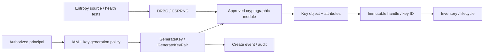
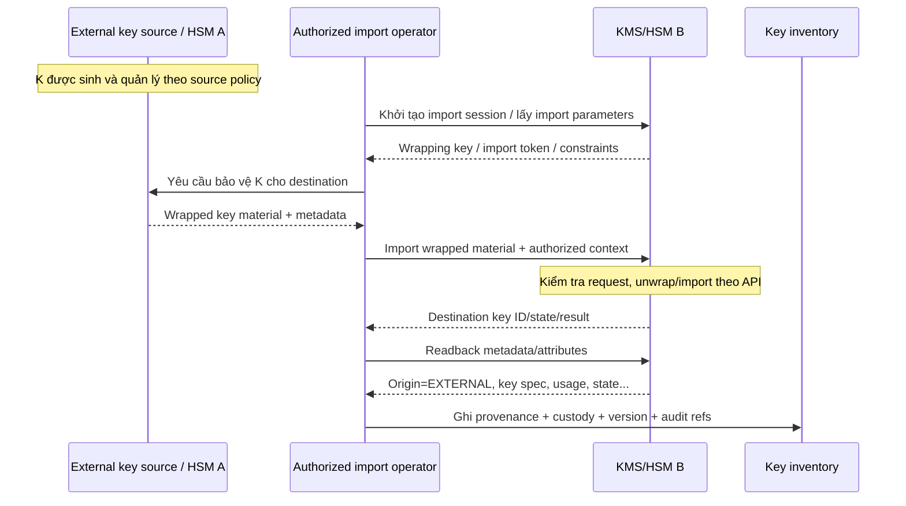
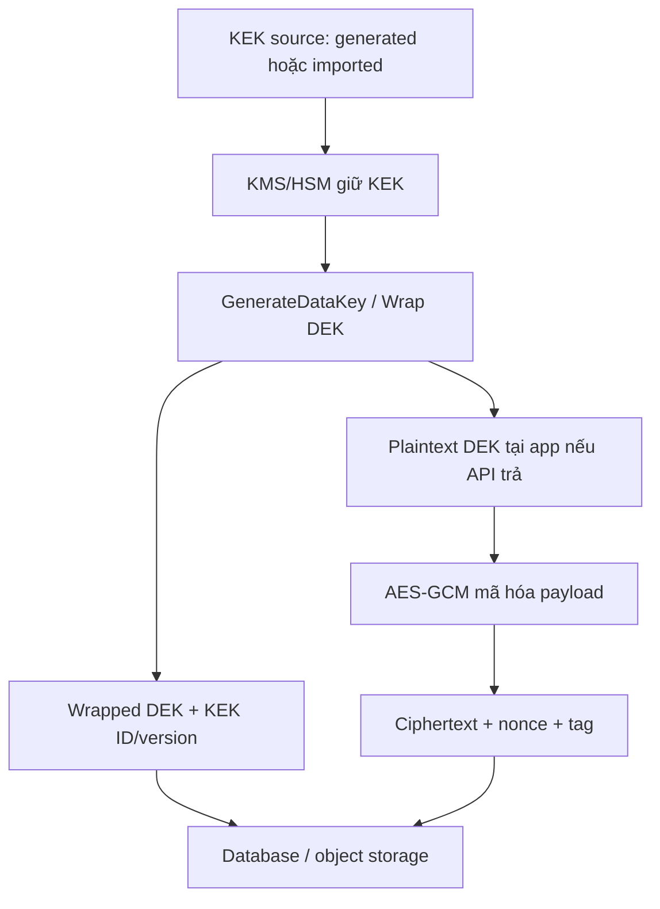
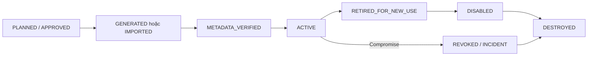
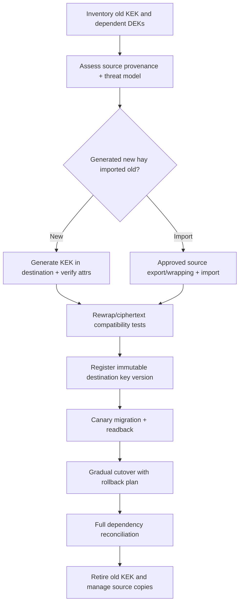

# Generated key và imported key: Nguồn gốc, ranh giới tin cậy và quản lý khóa an toàn

> **Chương:** Key generation  
> **Bài học:** Generated key và imported key  
> **Module:** `SECURITY_KEY_MANAGEMENT_FUNDAMENTALS` — hiểu vòng đời khóa mật mã từ tạo, cấp phát, lưu trữ, sử dụng, xoay vòng đến thu hồi và hủy; kết nối mật mã đối xứng, bất đối xứng, chữ ký số, KMS/HSM, envelope encryption, IAM và kiểm toán để xây dựng hệ thống bảo vệ khóa an toàn.

## 1. Bài toán thực tế: Hai khóa AES-256, hai lịch sử bảo mật

Một doanh nghiệp cần tạo KEK để bọc Data Encryption Key (DEK) cho dữ liệu thanh toán. Đội vận hành có hai cách:

**Phương án A — Generated key:**

```text
Provisioning Service
  └─ CreateKey(AES-256, purpose=WRAP, non-exportable)
       └─ KMS/HSM sinh key bên trong cryptographic module
            ├─ lưu key object theo policy
            ├─ trả immutable key ID/handle + metadata
            └─ các service gọi Wrap/Unwrap hoặc API KMS được phép
```

**Phương án B — Imported key:**

```text
Tổ chức tự tạo AES-256 KEK ở hệ thống nguồn
  ├─ key bytes từng tồn tại tại source system
  ├─ bọc để vận chuyển tới KMS/HSM đích
  └─ ImportKeyMaterial vào một key object đích
       ├─ KMS/HSM lưu imported material theo policy
       ├─ key handle/ID và metadata phục vụ sử dụng
       └─ source copy/backup/escrow cần quản lý riêng
```

Cả hai key có thể có:

```text
algorithm = AES
keyLengthBits = 256
purpose = KEY_WRAP
destination = HSM/KMS
```

Nhưng **không có cùng lịch sử tạo, tiếp xúc với plaintext key material, trách nhiệm quản lý, khả năng rotation và rủi ro compromise**.

Đây là trọng tâm của bài:

> **Generated key** và **imported key** mô tả *nguồn gốc của vật liệu khóa so với một ranh giới được chọn*. Kích thước, thuật toán hoặc trạng thái non-exportable tại thời điểm hiện tại không đủ để suy ra nguồn gốc hay lịch sử lộ diện của khóa.

### Mục tiêu học tập

Sau bài này, bạn có thể:

1. Định nghĩa generated/imported key **tương đối với cryptographic boundary**.
2. Phân biệt generation, import, derive, unwrap, restore và key transport.
3. So sánh security properties, provenance, custody và blast radius của hai cách.
4. Giải thích quy trình import key material an toàn vào KMS/HSM, BYOK và giới hạn của import wrapping.
5. Hiểu non-exportability, sensitive attributes, module origin và những thông tin không thể suy ra từ metadata.
6. Sử dụng Java 17 để phân biệt key được sinh bằng JCA với key object dựng từ bytes bên ngoài, không xuất/lưu bí mật.
7. Xây dựng inventory, IAM, lifecycle, rotation, backup/DR và audit cho từng key origin.
8. Đề xuất negative tests, kiểm soát sự cố và chiến lược migration phù hợp.

---

## 2. Định nghĩa chính xác: Generated và imported *ở đâu*?

### 2.1. Ranh giới làm mốc đánh giá

Một cryptographic module là phần cứng, phần mềm hoặc firmware thực thi chức năng mật mã trong một boundary đã xác định. Khi nói:

- **Generated inside module:** vật liệu khóa được tạo bởi cơ chế sinh khóa của module đang xét.
- **Imported into module:** vật liệu khóa đã được tạo hoặc tồn tại ở bên ngoài module đang xét, sau đó được đưa vào thông qua giao diện import được hỗ trợ.

Ví dụ:

```text
HSM-A: GenerateKey(K) -> K sinh trong HSM-A
HSM-B: ImportKey(K)   -> K là imported key đối với HSM-B
```

Cùng vật liệu `K` có thể là **generated** đối với HSM-A và **imported** đối với HSM-B. Vì vậy `origin` phải có ngữ cảnh rõ:

```text
originRelativeTo = hsm-b/partition-7
originType       = IMPORTED
sourceSystem     = hsm-a/approved-transfer-workflow
```

Không nên lưu một flag chung `generated=true` mà không biết **bởi module nào**.

### 2.2. Những cách sử dụng từ “generated” dễ gây nhầm

Đối với ứng dụng Java:

```text
KeyGenerator.getInstance("AES").generateKey()
```

có thể là **generated key** ở **software provider trong JVM**. Nó không mặc nhiên là **HSM-generated key**.

Đối với Cloud KMS:

```text
CreateKey(origin=KMS/provider-generated)
```

mang nghĩa vật liệu được sinh theo mô hình của nhà cung cấp; phải đọc API/metadata và security boundary của dịch vụ cụ thể.

Đối với HSM:

```text
C_GenerateKey(...)
```

có thể sinh key object trong token/module theo PKCS#11 và thuộc tính đã cấu hình.

Mỗi câu có thể đúng trong **ngữ cảnh riêng**. Người viết kiểm kê phải ghi rõ nguồn và mức bằng chứng, không chỉ một nhãn “generated”.

### 2.3. Định nghĩa imported key

**Imported key** có thể là symmetric key, private key, public key hoặc vật liệu seed theo những luồng và API được nhà cung cấp hỗ trợ. Import không có nghĩa key yếu; nó có nghĩa **khâu tạo và bảo vệ trước khi nhập nằm ngoài ranh giới của đích**.

Ví dụ:

- BYOK: khách hàng sinh KEK bằng nguồn được phê duyệt rồi nhập vào Cloud KMS.
- Chuyển key từ HSM cũ sang HSM mới bằng cơ chế wrapping được kiểm soát.
- Nhập khóa HMAC do đối tác cấp theo quy trình bảo mật.
- Nhập signing private key lịch sử để phục vụ legacy verification/transition (nếu policy cho phép).
- Khôi phục key material qua quy trình backup/recovery được module hỗ trợ.

Mỗi loại có profile quyền hạn, độ tin cậy và quy trình khôi phục khác nhau.

### 2.4. Public key import không giống secret/private key import

Một **public key** thường được thiết kế để phân phối. Việc `KeyFactory` đọc public key bytes từ file, chứng thư hay registry **không làm lộ bí mật khóa**, nhưng cần kiểm tra **độ tin cậy của danh tính và key binding**.

Ngược lại, **secret key** và **private key** đòi bảo vệ confidentiality trong toàn bộ chuỗi tạo, vận chuyển và import. Không nên dùng cùng quy trình kiểm soát với public key.

---

## 3. Những thao tác thường bị gom nhầm thành “sinh khóa”

| Thao tác | Kết quả | Điểm phân biệt |
|---|---|---|
| **Generate** | Vật liệu khóa mới do bộ sinh khóa tạo ra. | Phụ thuộc RNG/DRBG, policy, module boundary. |
| **Import** | Đưa vật liệu đã tồn tại vào key object/module. | Rủi ro từ source, transport, bản sao trước import. |
| **Derive** | Sinh vật liệu mới tính từ input keying material bằng KDF. | Entropy và context của input; không đơn thuần random keygen. |
| **Unwrap** | Giải bọc để khôi phục khóa đã được wrap. | Thường là khôi phục key cũ, không tạo entropy mới. |
| **Restore** | Khôi phục vật liệu/trạng thái từ backup/replica. | Có thể kéo theo key version, state và rủi ro rollback. |
| **Key agreement** | Các bên góp vật liệu, tính shared secret theo giao thức. | Cần peer authentication, transcript, freshness và KDF. |
| **Key transport** | Một bên sinh key rồi chuyển có bảo vệ cho bên khác. | Recipient key trust, provenance, replay policy. |
| **Rotate/rekey** | Thay vật liệu khóa hoặc cách dùng theo lifecycle. | Có thể generate/import mới, hoặc chỉ chuyển wrapping alias. |

**Ví dụ quan trọng:** `Unwrap(KEK, wrappedDEK)` khôi phục cùng DEK cũ. Không thể gọi nó là “sinh DEK mới”, vì việc đó có thể che lấp một DEK đã bị lộ.

### 3.1. Import và derive từ material nhập khẩu

Giả sử nhập một root secret rồi dẫn xuất các khóa:

```text
importedRootSecret
  └─ HKDF-Extract/Expand
       ├─ keyA cho encryption
       ├─ keyB cho MAC
       └─ keyC cho session context
```

Các key dẫn xuất có thể được module tạo thành objects theo cơ chế derive, nhưng **provenance vẫn phụ thuộc vào root secret nhập khẩu**. Không được ghi “generated from secure RNG” nếu thực tế chỉ là derived từ secret bên ngoài.

### 3.2. Migration và key generation không đồng nghĩa

Chuyển từ KEK-v3 sang KEK-v4 có thể bao gồm:

- Sinh KEK-v4 bên trong KMS.
- Nhập KEK-v4 được sinh bởi HSM khác.
- Chuyển alias trỏ từ v3 sang v4.
- Rewrap DEK bằng KEK-v4.
- Re-encrypt dữ liệu nếu DEK cũng bị thay.

Mỗi hành động có bằng chứng và rủi ro khác. **Đổi key alias không sinh vật liệu mới**.

---

## 4. Bảng so sánh generated key và imported key

| Tiêu chí | Generated key tại module đích | Imported key vào module đích |
|---|---|---|
| **Nguồn key material** | Sinh bởi keygen/DRBG của module đích. | Tồn tại ở nguồn khác trước khi nhập. |
| **Phụ thuộc entropy** | Entropy/DRBG tại module đích và thuật toán keygen. | Entropy/DRBG/quy trình tại source; import không làm tăng entropy của key cũ. |
| **Plaintext trước lúc key tồn tại ở đích** | Có thể chưa từng tồn tại ngoài module đích nếu mô hình non-exportable đúng. | Đã tồn tại ngoài boundary đích, có thể ở source hoặc vùng truyền. |
| **Transport key material tới đích** | Không cần vận chuyển raw material từ ngoài vào. | Cần import mechanism, wrapping/transport và xác thực context phù hợp. |
| **Non-exportability tại đích** | Có thể được áp dụng từ khi tạo. | Có thể được áp dụng **sau import**, không xóa lịch sử bên ngoài. |
| **Provenance evidence** | Provider generation metadata, audit, attestation nếu có. | Bằng chứng source generation, custody, transport, import result, kiểm soát bản sao. |
| **Nguồn chịu trách nhiệm chính** | Provider/module + người vận hành dùng đúng policy. | Source owner + import operator + provider/module đích. |
| **Rotation** | Có thể có tính năng tự động/provider-managed tùy key type. | Có thể cần import bản mới, rebind, rewrap thủ công hoặc workflow riêng. |
| **Expiry/reimport** | Theo lifecycle của key type/provider. | Một số provider có chế độ imported material expiry/disable; phụ thuộc API. |
| **Backup/DR** | Theo module replication/backup hoặc provider policy. | Cần biết source/escrow, quyền reimport, key identity và phục hồi. |
| **Trường hợp phù hợp** | Mặc định tốt cho KEK/signing keys cần non-exportable. | BYOK, migration, giữ quyền kiểm soát nguồn key và interoperability. |
| **Rủi ro điển hình** | Lỗi module RNG, IAM lạm dụng key operation, lock-in/DR. | Lộ source copy, weak keygen, wrapping sai, metadata/provenance giả, nhiều bản sao. |

Bảng **không khẳng định imported key luôn yếu hơn**. Một imported key có thể được sinh từ HSM nguồn đã kiểm soát tốt và chuyển qua cơ chế an toàn. Nhưng nó **có nhiều ranh giới và nhiều trách nhiệm cần chứng minh hơn**.

### 4.1. Security strength không suy ra từ origin

Một generated AES-128 và một imported AES-256 có độ dài khác nhau. Nhưng an toàn tổng thể còn liên quan:

```text
algorithm + key length + entropy + module implementation
+ protection of key material + key usage + IAM + lifecycle
```

`origin=GENERATED` không biến DES hoặc RSA-1024 thành thuật toán mạnh. `origin=IMPORTED` không làm một AES-256 CSPRNG-generated trở thành yếu tự động.

### 4.2. “Key nằm trong HSM” không có nghĩa “chỉ có một bản sao”

Một imported key có thể có:

- Bản gốc ở HSM nguồn.
- Bản backup/escrow theo policy.
- Bản được wrap dùng trong quá trình chuyển.
- Bản ở HSM đích.
- Bản ở staging memory/process nếu import procedure không bảo vệ đúng.
- Bản trong recovery site.

Phải đánh giá và quản lý **toàn bộ các bản sao còn tồn tại**, đặc biệt khi revoke/rotate/destroy.

---

## 5. Generated key: Luồng tạo trong cryptographic module

### 5.1. Đường tạo khóa khái niệm



Sơ đồ không cam kết mọi thành phần nằm trong một boundary. Một số nguồn entropy, provider wrappers hoặc logging có thể ở bên ngoài theo thiết kế module.

### 5.2. Các điều kiện phải kiểm tra trước GenerateKey

- **Key class/purpose:** AES DEK, KEK, HMAC key, private signing key, key agreement.
- **Algorithm/parameter:** AES-128/256, RSA-3072, Ed25519, X25519, ML-KEM hoặc nhóm được policy cho phép.
- **Key usage:** Encrypt, Decrypt, Wrap, Unwrap, Sign, Verify, Derive theo mục đích.
- **Export policy:** key có cần non-exportable hay không?
- **Lifetime:** persistent token object, session key, ephemeral key.
- **Owner/scope:** workload, môi trường, tenant/account/region.
- **Principal/approval:** ai được phép tạo và ai được phép dùng sau đó?
- **Audit/registry:** ID, version, source, cryptoperiod và data dependencies.
- **Module assurance:** provider/firmware/configuration, approved modes và DRBG readiness theo yêu cầu.

### 5.3. Entropy source, seed và DRBG

Một generated key mạnh phải xuất phát từ keygen algorithm và nguồn randomness phù hợp:

```text
entropy source -> conditioning / seed
              -> DRBG instantiate/reseed
              -> bitstring khó đoán
              -> key-generation algorithm / validated parameter checks
              -> key object
```

DRBG được seed đúng có thể sinh nhiều khóa giữa các lần reseed theo thiết kế. Không nhất thiết phải lấy entropy vật lý mới cho mỗi byte, nhưng phải quản lý state/health/reseed hợp lệ.

**Không dùng** timestamp, process ID hoặc `java.util.Random` làm bí mật đầu vào cho keygen. Cũng không coi việc hash một seed yếu bằng SHA-256 là tạo thêm entropy.

### 5.4. Public/private key pair

Với private signing key:

```text
HSM GenerateKeyPair:
    private key object -> SIGN only, NON_EXPORTABLE theo policy
    public key        -> có thể lấy để đăng ký PKI/trust registry
```

`public key` có thể công khai nhưng cần ràng buộc với identity được tin cậy. Một cặp khóa mới không tự chứng minh người ký có quyền ký hóa đơn hoặc JWT.

### 5.5. Ưu điểm của keygen tại module

- Có thể loại bỏ nhu cầu đưa raw private/secret key qua host/app khi key được giữ non-exportable.
- Tập trung hóa quyền tạo và sử dụng theo policy.
- Có cơ chế key attributes, audit và bảo vệ vật liệu theo module.
- Giảm số điểm cần giữ plaintext long-term key.
- Có thể hỗ trợ backup/replication có kiểm soát và hardware-backed root of trust tùy module.

**Nhưng không bảo đảm**:

- Mọi phép ký đều được phép về nghiệp vụ.
- CSPRNG của ứng dụng sinh nonce AES-GCM đúng.
- Các session keys bên ngoài module được bảo vệ.
- Không tồn tại lỗi provider/IAM/firmware.
- Backup/DR và rotation tự động đúng cho mọi key type.

---

## 6. Imported key: Luồng đưa vật liệu đã tồn tại vào module

### 6.1. Ranh giới từ source tới destination



Sơ đồ là **workflow khái niệm**. Một KMS có thể yêu cầu tạo key object với `origin=EXTERNAL` trước; nhà cung cấp khác có cơ chế import đặc thù hoặc không hỗ trợ import từng loại key. Không tự giả định một bộ API chung cho tất cả HSM/KMS.

### 6.2. Các giai đoạn import

**Giai đoạn 1 — Chuẩn bị:**

1. Xác nhận use case: BYOK, migration, recovery hay interoperability.
2. Xác minh source key đã được sinh bằng algorithm/entropy đáp ứng policy.
3. Xác minh chủ sở hữu và quyền export/transport ở source.
4. Phân loại key: symmetric, private, public, key pair, seed, wrapped blob.
5. Xác định key spec và usage phù hợp với destination.
6. Chuẩn bị phê duyệt, separation of duties và audit nếu rủi ro cao.

**Giai đoạn 2 — Thiết lập import session:**

1. Chỉ dùng API và transport/wrapping mechanism nhà cung cấp hỗ trợ.
2. Nhận wrapping public key hoặc import parameters từ destination qua kênh đã xác thực.
3. Kiểm tra thông tin import **gắn với đúng destination key, tenant, region, account, operation và thời hạn**.
4. Kiểm tra token/wrapping context không hết hạn hoặc bị sử dụng sai phạm vi.
5. Tránh đưa raw key qua log, shell arguments, debug trace hoặc CI artifact.

**Giai đoạn 3 — Bảo vệ vật liệu trong lúc chuyển:**

1. Dùng cơ chế wrapping/transport phù hợp, có authentication/context binding.
2. Ưu tiên source HSM tạo wrapped export trực tiếp nếu hỗ trợ.
3. Giới hạn thời gian tồn tại của plaintext trung gian.
4. Tránh gửi raw key qua chat, email, ticket, file repo hay plaintext config.
5. Kiểm tra chính xác key byte length, định dạng và algorithm.

**Giai đoạn 4 — Import:**

1. Principal được cấp quyền ImportKeyMaterial/Unwrap/Import theo phạm vi.
2. Destination xác minh token, key object, wrapping mechanism và state.
3. Import vào **đúng immutable key ID**, không nhờ alias do client tùy ý chọn.
4. Đặt attributes: permitted usage, extractability, persistence và lifecycle.
5. Không activate key nếu metadata hoặc kiểm tra chức năng không đạt.

**Giai đoạn 5 — Đối soát:**

1. Readback destination key state/metadata.
2. Chạy crypto operation test trên dữ liệu mẫu.
3. Ghi provenance chain và source/destination references.
4. Audit ai phê duyệt, ai thực hiện, khi nào, kết quả và key version.
5. Quản lý source copy/backup/escrow theo quy định; hủy hoặc giữ có phê duyệt.

### 6.3. Tại sao “có TLS khi upload” chưa đủ?

TLS bảo vệ đường truyền ở phạm vi phù hợp, nhưng:

- Raw key có thể tồn tại tại client process, proxy, log hoặc crash dump.
- Sai destination identity/tenant làm key tới nhầm nơi.
- File key bị commit vào repo trước khi upload.
- Operator có quyền export source nhưng không có quyền import đúng scope.
- Key import request có thể bị phát lại nếu API không bind token/context/expiry.
- Source key có thể vốn đã bị lộ hoặc dùng thuật toán yếu.

Vì thế một import an toàn cần cả **wrapping/transport đã thiết kế**, **xác thực destination**, **authorization**, **provenance**, **audit** và **key lifecycle**.

### 6.4. Imported key có được phép non-exportable?

**Có thể**, nếu module và key class hỗ trợ. Ví dụ, sau import một private key object có thể được cấu hình không extractable để ngăn việc xuất raw key qua API bình thường.

Tuy nhiên:

> **Non-exportable tại destination không xóa đi sự kiện key đã tồn tại bên ngoài destination trước import.**

Nếu source vẫn giữ cùng raw key hoặc bản backup, rủi ro từ source vẫn còn. Cần nhìn vào chuỗi custody đầy đủ.

---

## 7. BYOK, HYOK, external key và ngữ nghĩa “quyền kiểm soát”

### 7.1. BYOK là gì?

**Bring Your Own Key (BYOK)** thường chỉ mô hình khách hàng tạo hoặc sở hữu key material ở nguồn riêng rồi import vào dịch vụ quản lý khóa. Thuật ngữ và mức quyền kiểm soát cụ thể **phụ thuộc provider và hợp đồng**.

BYOK có thể giúp:

- Chủ động nguồn tạo khóa và quy trình custody.
- Áp dụng phê duyệt nội bộ, HSM nguồn và escrow theo chính sách.
- Tương thích dữ liệu/khóa trong migration hoặc hệ thống lai.
- Xác định rõ trách nhiệm import, expiry và reimport.

Nhưng BYOK **không tự bảo đảm** khách hàng luôn giữ khóa ngoài nhà cung cấp, cũng không tự có quyền kiểm soát mọi thao tác use/decrypt bên trong dịch vụ.

### 7.2. HYOK/External Key Manager là mô hình khác

Một số kiến trúc dùng **Hold Your Own Key (HYOK)** hoặc external key management, nơi key material ở hệ ngoài dịch vụ chính và dịch vụ phải tương tác với hệ giữ khóa theo một mô hình cụ thể.

Điều này khác với **import key material vào KMS**. Khả năng từ chối truy cập, latency, resilience, logging, trust boundary và quyền khôi phục cũng khác.

| Mô hình | Khóa ở đâu? | Điều phải kiểm tra |
|---|---|---|
| Provider-generated KMS key | Theo kiến trúc nhà cung cấp. | Module/source, IAM, audit, rotation. |
| Customer-imported BYOK | Key material được import vào hệ đích. | Source copies, import workflow, destination semantics. |
| External-key/HYOK | Material hoặc phần quan trọng của operation nằm ngoài dịch vụ chính theo kiến trúc. | Availability, external attestation, failover, data recovery. |
| Application-generated DEK | Trong app/provider phần mềm khi sinh. | Entropy, memory, wrapping, logging, cryptoperiod. |

**Không gắn nhãn một hệ là BYOK/HYOK chỉ từ tên KMS resource.** Phải xem data flow và API semantics thực tế.

### 7.3. Trách nhiệm chia sẻ

Với BYOK, provider có thể bảo vệ imported material **sau khi import**, còn khách hàng chịu trách nhiệm:

- Source key generation.
- Secure transport/import.
- Quản lý bản sao ngoài destination.
- Quản lý expirations/reimports nếu provider có cơ chế.
- Rotation và provenance.
- Key availability khi backup/DR.

Trách nhiệm cụ thể phải được đọc từ tài liệu/provider agreement; không nên bịa một mô hình chung cho mọi dịch vụ.

---

## 8. PKCS#11: Key attributes và bằng chứng về nguồn gốc

### 8.1. Các thuộc tính dễ gặp

Trong môi trường HSM dùng PKCS#11, key objects có thể có các thuộc tính sau:

| Thuộc tính | Ý nghĩa khái niệm | Điều **không** nên suy ra |
|---|---|---|
| `CKA_CLASS` | Loại object như secret/private/public key. | Không tự xác thực chủ sở hữu nghiệp vụ. |
| `CKA_KEY_TYPE` | Loại thuật toán khóa. | Không tự bảo đảm algorithm được policy cho phép. |
| `CKA_LOCAL` | Trạng thái key được sinh cục bộ theo semantics của PKCS#11 token. | Không đủ một mình chứng minh toàn bộ quá trình custody và attestation. |
| `CKA_SENSITIVE` | Hạn chế tiết lộ giá trị key theo cơ chế API. | Không mặc nhiên đồng nghĩa không được wrap/export. |
| `CKA_EXTRACTABLE` | Khả năng export/wrap key theo cơ chế được hỗ trợ. | Không biết key đã từng lộ trước import hay không. |
| `CKA_ALWAYS_SENSITIVE` | Thuộc tính trạng thái lịch sử sensitive theo chuẩn. | Không phải bản audit bên ngoài HSM. |
| `CKA_NEVER_EXTRACTABLE` | Thuộc tính trạng thái lịch sử non-extractable theo chuẩn. | Không chứng minh imported material chưa từng ở ngoài module. |
| `CKA_TOKEN` | Object có liên hệ persistence trên token theo API. | Không tự cho biết backup/DR an toàn. |
| `CKA_SIGN`, `CKA_VERIFY` | Key có khả năng phục vụ ký/xác minh. | Không thay thế principal authorization. |
| `CKA_ENCRYPT`, `CKA_DECRYPT` | Key có khả năng encrypt/decrypt. | Không xác định tenant hoặc dữ liệu được phép. |
| `CKA_WRAP`, `CKA_UNWRAP` | Khả năng bọc/giải bọc key material. | Wrap mechanism sai có thể làm lộ key. |
| `CKA_DERIVE` | Có thể dùng key trong derivation operation. | Không bảo đảm KDF context đúng. |
| `CKA_ID`, `CKA_LABEL` | Tham chiếu/nhãn cho key. | Không phải secret hoặc bằng chứng về quyền. |

**PKCS#11 attributes mang ngữ nghĩa cụ thể theo chuẩn**, nhưng cách module hỗ trợ những object class, key origin và cơ chế có thể khác. Luôn kiểm tra provider documentation và thực tế readback.

### 8.2. `CKA_LOCAL` giúp gì?

Một key có thể được đánh dấu là **locally generated** theo cơ chế token. Đây là tín hiệu provenance hữu ích hơn một `label="hsm-generated"` do ứng dụng tự ghi.

Nhưng:

- Module phải thực sự là module đã được phê duyệt.
- Key object phải được xác minh trong đúng token/partition.
- Metadata có thể khác tùy cơ chế create/import/unwrap/derive.
- `CKA_LOCAL` không cho biết ai phê duyệt create operation hoặc source entropy đã được đánh giá theo compliance yêu cầu nào.
- Không thay thế audit event, inventory, key creation authorization.

### 8.3. Imported key non-extractable có thể có trạng thái lịch sử ra sao?

Một key nhập khẩu có thể được tạo với policy hạn chế extract trong HSM đích. Thuộc tính phản ánh **trạng thái của object ở đích** theo cơ chế; không thể kết luận chưa từng có raw key ở host hoặc HSM nguồn.

Đây là lý do inventory cần ít nhất hai loại dữ liệu:

```text
currentProtection:
  sensitive: true
  extractable: false

provenance:
  originAtDestination: IMPORTED
  sourceSystem: approved-external-source
  importEventRef: verified-event-...
  sourceCustodyStatus: reviewed
```

Cả hai cùng quan trọng.

### 8.4. Non-exportability không ngăn signing oracle

Một private key HSM không export được vẫn có thể bị lạm dụng nếu workload có quyền `Sign` cho attacker chọn message. Điều kiện an toàn bao gồm:

- Authenticated caller identity.
- Key usage scope và tenant boundary.
- Phê duyệt giao dịch/thông điệp cần ký khi thích hợp.
- Domain separation và đúng protocol.
- Audit correlation.
- Rate limiting và incident response.

**Key protection** và **authorized key use** là hai mục tiêu riêng.

---

## 9. KMS APIs và các mô hình import phụ thuộc provider

### 9.1. Không tự chuẩn hóa API tên `ImportKeyMaterial`

Một số dịch vụ cung cấp workflow:

```text
Create key with external origin
GetParametersForImport
Wrap source key under import wrapping key
ImportKeyMaterial with token/parameters
DescribeKey
```

Đây là **mẫu khái niệm**, không phải API áp dụng nguyên xi mọi nhà cung cấp. Một hệ khác có thể dùng import vault, HSM session, key container hoặc API riêng.

Khi xây tích hợp phải xác minh:

1. Key type nào hỗ trợ import?
2. Origin `EXTERNAL` có cần được khai báo từ lúc tạo key object không?
3. Wrapping algorithm/transport key nào được cho phép?
4. Import token có expiry và binding gì?
5. Kích thước key material và parameter set nào hợp lệ?
6. Có expiration policy cho imported material không?
7. Khi imported material bị xóa/hết hạn, key resource ở trạng thái gì?
8. Có thể reimport **đúng cùng material** hay key mới?
9. Có hỗ trợ automatic rotation cho key imported không?
10. Có thể tạo nhiều versions hoặc phải tạo key resource mới?
11. Có thể backup/replicate theo region/project không?
12. Có audit và evidence để chứng minh source/destination linkage không?

### 9.2. Không suy ra khả năng từ nhãn `KMS`

Có provider chỉ hỗ trợ import đối với một số symmetric customer-managed key; provider khác hỗ trợ thêm asymmetric key hoặc key versions với điều kiện riêng. **Không xây workflow dựa vào giả định mọi KMS cho phép import signing private key**.

Ngay cả cùng provider, tính năng có thể thay đổi theo loại key, mode, region và phiên bản API; integration phải kiểm chứng theo tài liệu và thử nghiệm được phép.

### 9.3. Imported material expiration là rủi ro availability

Một số dịch vụ cho phép imported key material có expiration/timeout, hoặc yêu cầu key material được nhập lại. Khi material không sẵn sàng:

- Encrypt/decrypt hoặc unwrap có thể thất bại.
- Ciphertext cũ có thể không đọc được nếu source material không thể reimport.
- Ứng dụng không nên âm thầm chuyển sang key khác để mở dữ liệu cũ.
- DR phải có nguồn material được giữ an toàn và thủ tục restore đã diễn tập.
- Cần theo dõi deadline, region, ACL và trạng thái key.

Không khẳng định mọi imported key tự hết hạn; **đây là hành vi tùy provider và cấu hình**.

### 9.4. Alias không phải key material

Một alias:

```text
alias/orders-kek-current
```

có thể được trỏ sang một key resource khác. Việc đổi alias không làm key imported được sinh lại, không thay seed, không xóa source copy và không rewrap những DEK bên ngoài KMS.

Trong encrypted data record nên giữ **immutable key reference/version** thực sự dùng, nếu format/provider chưa tự đảm bảo khả năng resolve chính xác.

---

## 10. Key provenance: Chuỗi bằng chứng từ nguồn tới đích

### 10.1. Chỉ có `origin=EXTERNAL` là chưa đủ

Để đánh giá an toàn, cần biết:

- Source key được sinh ở đâu, bằng thuật toán gì?
- Nguồn RNG/entropy là gì? Có được policy phê duyệt?
- Ai phê duyệt và vận hành generation?
- Key có bao nhiêu bản sao? Bản nào còn tồn tại?
- Key được wrap/transport với thuật toán và destination nào?
- Có kiểm tra authenticity/integrity và chống replay token không?
- Khi nhập, provider báo state/attributes/algorithm gì?
- Có test key operation đúng không?
- Key có được dùng ở hệ khác trước hoặc sau import không?
- Khi revoke/destroy, ai chịu trách nhiệm xóa bản sao source/backup?

Một record “EXTERNAL” là **điểm bắt đầu phân tích**, không phải bằng chứng đầy đủ.

### 10.2. Mẫu provenance record

```json
{
  "logicalName": "k1/prod/shared/orders/wrap/order-deks",
  "destinationKeyId": "kms-immutable-id-084",
  "destinationKeyVersion": "v2",
  "algorithm": "AES",
  "keyLengthBits": 256,
  "purpose": "KEY_WRAP",
  "originAtDestination": "IMPORTED",
  "sourceType": "APPROVED_EXTERNAL_HSM",
  "sourceReference": "source-key-handle-114",
  "sourceGenerationEvidenceRef": "audit-source-event-2026-019",
  "transferEvidenceRef": "audit-transport-event-2026-222",
  "importEvidenceRef": "audit-import-event-2026-510",
  "exportPolicyAtDestination": "NON_EXPORTABLE",
  "sourceCopiesDisposition": "RETAINED_UNDER_APPROVED_ESCROW",
  "owner": "orders-security",
  "environment": "prod",
  "lifecycleState": "ACTIVE",
  "createdAt": "2026-11-28T00:00:00Z",
  "policyVersion": "crypto-policy-example-v1",
  "lastVerifiedAt": "2026-11-28T00:05:00Z"
}
```

Đây là **dữ liệu minh họa**; không chứa actual key material hoặc thông tin có thật của tổ chức.

### 10.3. Bằng chứng có thể thiếu

Một key được import từ HSM cũ nhưng audit gốc đã hết thời hạn lưu. Khi đó:

```text
originAtDestination = IMPORTED
sourceEvidence = INCOMPLETE
complianceState = UNKNOWN / REVIEW_REQUIRED
```

Không tự suy diễn đã có keygen an toàn chỉ vì key hiện tại có độ dài 256 bit hoặc đang nằm trong HSM.

### 10.4. Tính xác thực của provenance

Một record tự khai:

```json
{"origin": "GENERATED_IN_HSM"}
```

có thể do bất kỳ app nào ghi. Khi cần độ tin cậy cao:

- Đối chiếu key attributes từ provider đã được xác thực.
- Lưu audit event/correlation IDs.
- Xác minh bằng chứng attestation nếu module hỗ trợ và policy yêu cầu.
- Bảo vệ inventory/evidence khỏi bị sửa/xóa tùy tiện.
- Có người review khi source hoặc destination không đối soát được.

**Attestation chỉ có giá trị trong phạm vi nó thực sự chứng minh**, với challenge, chain và cấu hình được xác minh. Không tự coi mọi `origin` metadata là attestation.

---

## 11. Security strength, entropy và key length của imported material

### 11.1. Imported AES-256 chưa chắc có 256 bit entropy

Ví dụ nguồn tạo:

```text
timestamp || incrementalCounter -> SHA-256 -> 32-byte AES key
```

Dù output dài 256 bit, không có nghĩa attacker phải thử \(2^{256}\) khả năng. Nếu input dễ đoán, entropy thực tế nhỏ.

Import vào HSM không làm key trở nên khó đoán hơn. Key có thể được bọc an toàn và non-extractable tại đích nhưng **bí mật có thể đã bị suy ra từ quá trình tạo**.

### 11.2. RSA/ECC/PQC đều phải kiểm chứng parameter set

| Loại | Kiểm tra khi generated | Kiểm tra thêm khi imported |
|---|---|---|
| **AES** | Key size, CSPRNG, purpose, export policy. | Vật liệu source, chiều dài bytes, entropy/provenance và source copies. |
| **HMAC** | Secret key size/quality, `GenerateMac` usage. | Secret shared với những bên nào, nơi cấp phát và kế hoạch rotation. |
| **RSA** | Modulus size, algorithm, public exponent, approved generation. | Private/public consistency, provenance, padding/usage, source export. |
| **EC/X25519** | Named curve/group, keygen and usage. | Parameter validation, nguồn và key binding. |
| **Ed25519** | Key pair generation theo parameter set. | Private key encoding/seed handling, source retention, usage. |
| **ML-KEM/ML-DSA** | Approved parameter set/algorithm, provider mode. | Material format, security category, compatibility, provenance; không đo sức mạnh chỉ bằng byte count. |

Với key đã imported, **không tin các trường kích thước, tên thuật toán do operator tự nhập mà bỏ qua provider readback**. Trường hợp không xác minh được phải báo `UNKNOWN` hoặc policy reject.

### 11.3. Đánh giá historical exposure

Đối với key quan trọng, có thể cần các câu hỏi:

1. Source có từng export key ở dạng rõ để debug không?
2. Có từng commit key vào Git/CI artifact không?
3. Có database dump/backup chứa key material chưa mã hóa không?
4. Có admin nào còn quyền trích xuất source key không?
5. Có HSM cluster khác giữ cùng private key không?
6. Key được dùng ở một hệ khác với mục đích khác không?

Nếu có lộ plaintext key trong quá khứ, việc import và đổi attributes **không thể “xóa” việc lộ đó**. Cần xem xét key replacement và re-encryption/re-issuance.

---

## 12. Java 17: Phân biệt generate và import ở phần mềm

Ví dụ sau chỉ minh họa **semantics của JCA/JCE trong JVM**. Nó **không kết nối KMS/HSM** và **không thực hiện một KMS import thực tế**.

Mục tiêu:

1. `KeyGenerator` tạo secret key mới bằng provider được chọn.
2. `SecretKeySpec` tạo một key object từ **bytes đã tồn tại**: đó là “import” theo nghĩa software key representation, **không phải `GenerateKey`**.
3. `KeyFactory.generatePublic` đọc public key material được mã hóa bằng chuẩn công khai.
4. Không log/serialize raw secret/private key.
5. Dọn byte array trung gian theo khả năng best effort, thừa nhận copy còn ở `SecretKeySpec`/provider.

```java
import java.security.GeneralSecurityException;
import java.security.KeyPair;
import java.security.KeyPairGenerator;
import java.security.KeyFactory;
import java.security.SecureRandom;
import java.security.Signature;
import java.security.PublicKey;
import java.security.spec.X509EncodedKeySpec;
import java.util.Arrays;

import javax.crypto.KeyGenerator;
import javax.crypto.SecretKey;
import javax.crypto.spec.SecretKeySpec;

public final class GeneratedVsImportedKeyDemo {
    private static final SecureRandom RNG = new SecureRandom();

    private GeneratedVsImportedKeyDemo() {}

    public static void main(String[] args)
            throws GeneralSecurityException {

        // A. Tạo AES key mới bằng JCA provider (có thể là software).
        KeyGenerator aesGenerator = KeyGenerator.getInstance("AES");
        aesGenerator.init(256, RNG);
        SecretKey generatedAesKey = aesGenerator.generateKey();

        System.out.println("Generated AES algorithm: "
                + generatedAesKey.getAlgorithm());
        System.out.println("Generated AES requested bits: 256");

        // B. Minh họa bytes đã tồn tại ở nguồn khác.
        // Trong ví dụ chỉ sinh dữ liệu test tại chỗ. Không phải
        // một BYOK/KMS/HSM import thực sự.
        byte[] externalMaterialForDemo = new byte[32];
        RNG.nextBytes(externalMaterialForDemo);

        SecretKey importedSoftwareKey;
        try {
            // Constructor nhận bytes đã tồn tại; không keygen mới.
            importedSoftwareKey =
                    new SecretKeySpec(externalMaterialForDemo, "AES");
        } finally {
            // Xóa bản sao đầu vào theo best effort; SecretKeySpec vẫn
            // giữ key material ở bên trong JVM.
            Arrays.fill(externalMaterialForDemo, (byte) 0);
        }

        System.out.println("Imported software AES algorithm: "
                + importedSoftwareKey.getAlgorithm());
        System.out.println("Imported software material length: 256 bits");

        // C. Public key import an toàn về tính bí mật,
        // nhưng CHƯA chứng minh public key thuộc danh tính nào.
        KeyPairGenerator ed = KeyPairGenerator.getInstance("Ed25519");
        KeyPair identity = ed.generateKeyPair();

        byte[] encodedPublic = identity.getPublic().getEncoded();
        PublicKey restoredPublic =
                KeyFactory.getInstance("Ed25519")
                        .generatePublic(new X509EncodedKeySpec(encodedPublic));

        byte[] message = "approved-test-message"
                .getBytes(java.nio.charset.StandardCharsets.UTF_8);
        Signature signer = Signature.getInstance("Ed25519");
        signer.initSign(identity.getPrivate());
        signer.update(message);
        byte[] signature = signer.sign();

        Signature verifier = Signature.getInstance("Ed25519");
        verifier.initVerify(restoredPublic);
        verifier.update(message);
        System.out.println("Imported PUBLIC key verifies signature: "
                + verifier.verify(signature));

        // Không dùng getEncoded() để in AES hoặc private key bytes.
        // Dữ liệu demo này không chứng minh HSM non-exportability.
    }
}
```

### 12.1. Kết quả kỳ vọng

```text
Generated AES algorithm: AES
Generated AES requested bits: 256
Imported software AES algorithm: AES
Imported software material length: 256 bits
Imported PUBLIC key verifies signature: true
```

Kết quả là **dự kiến theo logic JCA trên runtime/provider hỗ trợ**, không phải tuyên bố chương trình đã được biên dịch hoặc chạy thử ở production.

### 12.2. Những điều code chứng minh

- `KeyGenerator.generateKey()` yêu cầu provider sinh secret key mới.
- `new SecretKeySpec(existingBytes, "AES")` tạo software representation cho key material đã có.
- `KeyFactory.generatePublic` là thao tác dựng đối tượng public key từ encoding.
- Public key được dựng lại có thể verify chữ ký tương ứng.

### 12.3. Những điều code **không** chứng minh

- `KeyGenerator` đã chạy trong HSM.
- `SecretKeySpec` đã nhập vật liệu vào cryptographic module an toàn.
- Imported key source được approved hoặc thuộc một tenant cụ thể.
- Raw key chưa từng bị sao chép/coredump.
- Private key đã được tạo non-exportable.
- Public key đã thuộc về một identity được tin cậy.
- KMS/HSM import workflow, grant, audit, backup và rotation đang đúng.

**Cẩn trọng:** `SecretKeySpec` là software key object giữ material trong JVM. Dùng nó khi thiết kế cho phép plaintext key trong process; không dùng để tuyên bố một khóa “HSM-backed non-exportable”.

### 12.4. `Arrays.fill()` không bảo đảm zeroization hoàn hảo

`Arrays.fill(externalMaterialForDemo, (byte)0)` chỉ xóa **một mảng byte đang nắm tham chiếu**. Một `SecretKeySpec`, provider, JIT, GC hoặc crash dump có thể giữ bản sao khác.

Nếu yêu cầu non-exportability nghiêm ngặt, không dựng raw `SecretKeySpec` từ secret/private key rồi hy vọng GC xóa; cần dùng provider/key handle hoặc API KMS/HSM phù hợp.

---

## 13. Java 17: Mô hình policy admission theo key origin

Một service provisioning cần biết lúc nào được phép **generate tại module đích**, lúc nào được phép **import** và ai được phê duyệt. Đoạn code sau diễn đạt một policy **mang tính giáo dục**, với request từ nguồn đã xác thực và metadata được readback từ provider.

Đây **không phải crypto library/KMS client**; nó minh họa logic kiểm tra trước bước thao tác nguy hiểm.

```java
import java.util.Objects;
import java.util.Set;

public final class KeyOriginPolicyDemo {

    enum Origin {
        DESTINATION_GENERATED,
        EXTERNAL_IMPORTED
    }

    enum Purpose {
        DATA_ENCRYPTION, KEY_WRAP, DIGITAL_SIGNATURE, MESSAGE_AUTH
    }

    enum Environment {
        DEV, STG, PROD
    }

    record Principal(
            String workloadId,
            String tenantId,
            Environment environment,
            Set<Purpose> allowedPurposes,
            boolean importApproved) {
        Principal {
            Objects.requireNonNull(workloadId);
            Objects.requireNonNull(tenantId);
            Objects.requireNonNull(environment);
            allowedPurposes = Set.copyOf(allowedPurposes);
        }
    }

    record KeyRequest(
            String tenantId,
            Environment environment,
            Origin origin,
            Purpose purpose,
            String algorithm,
            int keyBits,
            boolean nonExportableAtDestination,
            String sourceEvidenceRef) {}

    record Decision(boolean permitted, String code) {
        static Decision permit() { return new Decision(true, "ALLOW"); }
        static Decision deny(String code) {
            return new Decision(false, code);
        }
    }

    static Decision evaluate(
            Principal principal,
            KeyRequest request,
            String authenticatedTenant,
            Environment deployedEnvironment) {

        if (principal == null || request == null
                || request.origin() == null
                || request.purpose() == null
                || request.algorithm() == null) {
            return Decision.deny("INVALID_REQUEST");
        }

        if (!principal.tenantId().equals(authenticatedTenant)
                || !request.tenantId().equals(authenticatedTenant)) {
            return Decision.deny("CROSS_TENANT");
        }

        if (principal.environment() != deployedEnvironment
                || request.environment() != deployedEnvironment) {
            return Decision.deny("CROSS_ENVIRONMENT");
        }

        if (!principal.allowedPurposes().contains(request.purpose())) {
            return Decision.deny("PURPOSE_NOT_GRANTED");
        }

        if (!algorithmAllowed(request)) {
            return Decision.deny("ALGORITHM_POLICY");
        }

        if (request.environment() == Environment.PROD
                && (request.purpose() == Purpose.KEY_WRAP
                    || request.purpose() == Purpose.DIGITAL_SIGNATURE)
                && !request.nonExportableAtDestination()) {
            return Decision.deny("NON_EXPORTABLE_REQUIRED");
        }

        if (request.origin() == Origin.EXTERNAL_IMPORTED) {
            if (!principal.importApproved()) {
                return Decision.deny("IMPORT_APPROVAL_REQUIRED");
            }
            if (request.sourceEvidenceRef() == null
                    || request.sourceEvidenceRef().isBlank()) {
                return Decision.deny("MISSING_SOURCE_PROVENANCE");
            }
        }

        return Decision.permit();
    }

    private static boolean algorithmAllowed(KeyRequest request) {
        return switch (request.purpose()) {
            case DATA_ENCRYPTION, KEY_WRAP ->
                    request.algorithm().equals("AES")
                    && (request.keyBits() == 128
                        || request.keyBits() == 256);
            case DIGITAL_SIGNATURE ->
                    request.algorithm().equals("RSA-PSS")
                    && request.keyBits() >= 3072;
            case MESSAGE_AUTH ->
                    request.algorithm().equals("HmacSHA256")
                    && request.keyBits() >= 256;
        };
    }

    public static void main(String[] args) {
        Principal service = new Principal(
                "orders-key-admin", "tenant-a", Environment.PROD,
                Set.of(Purpose.KEY_WRAP), false);

        KeyRequest generated = new KeyRequest(
                "tenant-a", Environment.PROD,
                Origin.DESTINATION_GENERATED,
                Purpose.KEY_WRAP, "AES", 256, true, null);

        KeyRequest importedWithoutApproval = new KeyRequest(
                "tenant-a", Environment.PROD,
                Origin.EXTERNAL_IMPORTED,
                Purpose.KEY_WRAP, "AES", 256, true,
                "source-audit-001");

        KeyRequest importedWithoutProvenance = new KeyRequest(
                "tenant-a", Environment.PROD,
                Origin.EXTERNAL_IMPORTED,
                Purpose.KEY_WRAP, "AES", 256, true, null);

        System.out.println(evaluate(
                service, generated, "tenant-a", Environment.PROD).code());
        System.out.println(evaluate(
                service, importedWithoutApproval,
                "tenant-a", Environment.PROD).code());

        Principal approvedAdmin = new Principal(
                "orders-key-importer", "tenant-a", Environment.PROD,
                Set.of(Purpose.KEY_WRAP), true);

        System.out.println(evaluate(
                approvedAdmin, importedWithoutProvenance,
                "tenant-a", Environment.PROD).code());
    }
}
```

### 13.1. Kết quả dự kiến

```text
ALLOW
IMPORT_APPROVAL_REQUIRED
MISSING_SOURCE_PROVENANCE
```

### 13.2. Vì sao policy guard chỉ là một lớp?

Một request được `ALLOW` trong code **không đảm bảo** key đã được tạo/nhập đúng:

- KMS/HSM phải độc lập kiểm tra principal và API permissions.
- Import parameters/transport phải ràng buộc destination/context.
- Metadata readback phải khớp request và origin thật.
- Non-exportable chỉ đáng tin nếu provider/module thực thi.
- Inventory phải ghi trạng thái/source và version.
- Đường bypass qua direct KMS API cần được IAM chặn.

**Không để caller tự khai `sourceEvidenceRef="approved"` rồi coi đó là bằng chứng.** `sourceEvidenceRef` phải trỏ tới bản ghi đã được xác minh và cấp quyền đọc phù hợp.

### 13.3. Hạn chế của policy ví dụ

- Tập algorithm và ngưỡng key size chỉ minh họa; production cần chuẩn hiện hành, purpose/mode và cryptoperiod riêng.
- Không kiểm tra ASN.1/PKCS#8/PKCS#12 hoặc key parameters.
- Không có API KMS/HSM, exception, multi-party approval hay retry.
- Không kiểm tra key state, source copies, expiration hay audit.
- Không có logic verify non-exportability và provenance cryptographic attestation.
- Không nêu `ML-KEM`/`Ed25519` trong allowlist: policy thật phải được mở rộng theo nhu cầu.
- Không nên dùng đoạn code thay quy trình import provider đã được kiểm định.

---

## 14. Generated và imported key trong envelope encryption

### 14.1. Kiến trúc KEK/DEK



Ở đây, **KEK** có thể là generated hoặc imported. **DEK** thường được sinh riêng và có thể xuất plaintext tới ứng dụng theo API `GenerateDataKey`. Vì vậy cần hai bản ghi origin/flow riêng:

```text
KEK.originAtKms = IMPORTED hoặc GENERATED
DEK.originAtService = KMS_GENERATED hoặc APPLICATION_GENERATED
DEK.plaintextExposure = APPLICATION_MEMORY
DEK.wrappedBy = immutable KEK key/version
```

### 14.2. Imported KEK không nhất thiết làm DEK thành imported

Giả sử KMS giữ imported KEK, sau đó tạo DEK mới:

```text
Imported KEK (từ HSM của khách hàng)
  └─ KMS GenerateDataKey -> new DEK
```

DEK **không tự trở thành imported key** chỉ vì nó được bọc bởi imported KEK. Nó có provenance riêng.

### 14.3. Rotation khi KEK imported bị lộ ở source

Nếu source HSM có khả năng đã lộ raw KEK, attacker sở hữu một trong những bản KEK có thể giải bọc wrapped DEK tương ứng (nếu có bản dữ liệu). **Việc destination HSM cấm export** không loại bỏ rủi ro đó.

Ứng cứu có thể cần:

- Xác định mọi wrapped DEK phụ thuộc KEK lộ.
- Sinh/import KEK mới **từ nguồn chưa bị ảnh hưởng**.
- Rewrap DEK nếu DEK chưa lộ và mô hình cho phép.
- Xem ciphertext/wrapped DEK đã bị attacker sao chép hay chưa.
- Nếu attacker có cả wrapped DEK, có thể phải coi DEK đã bị lộ, tạo DEK mới và re-encrypt dữ liệu.
- Rà backup/snapshot và source copies.

### 14.4. Imported DEK đã bị lộ không được chữa bằng rewrap

**Rewrap** chỉ thay key bảo vệ một DEK. Nếu raw DEK vốn đã lộ hoặc entropy quá thấp, cùng DEK tiếp tục mã hóa dữ liệu là không an toàn. Phải sinh **DEK mới** và re-encrypt dữ liệu trong phạm vi bị ảnh hưởng.

### 14.5. AAD, nonce và replay độc lập với key origin

Generated AES-256 DEK vẫn có thể bị hỏng bảo mật nếu app tái dùng AES-GCM nonce dưới cùng key hoặc không kiểm tra AAD. Imported AES-256 DEK đúng entropy cũng vậy.

Cần quản lý:

- Nonce uniqueness theo DEK.
- Authentication tag verification.
- Tenant/object binding bằng AAD lấy từ trusted context.
- Ciphertext version và immutable KEK key reference.
- Anti-replay/rollback ở storage hoặc tầng nghiệp vụ khi yêu cầu.

**Key origin đúng không thay thế sử dụng key đúng.**

---

## 15. Signing keys: Generated vs imported và tính tin cậy chữ ký

### 15.1. Private key sinh tại HSM

Một ký số service có thể sử dụng:

```text
HSM GenerateKeyPair(Ed25519 hoặc RSA-PSS)
  -> privateKeyObject (non-exportable)
  -> publicKey
  -> PKI/trust registry binding
  -> authorized Sign operations
```

Nếu key không rời HSM, tổ chức giảm nguy cơ bản sao raw private key bên ngoài. Tuy nhiên, vẫn cần kiểm soát **ai yêu cầu ký cái gì**.

### 15.2. Private key nhập từ legacy system

Trong migration, một private signing key cũ có thể được chuyển vào HSM mới để tiếp tục sử dụng hoặc verify tài liệu lịch sử.

Rủi ro:

- Source có thể giữ private key bản gốc.
- Private key có thể từng ở file PKCS#8/PKCS#12 hoặc crash dump.
- Key có thể đã được chia sẻ giữa nhiều hệ thống.
- Thuộc tính non-exportable tại HSM mới không hồi tố lịch sử.
- Có thể không có bằng chứng key generation ban đầu.

**Biện pháp:** phân loại imported key rõ, hạn chế key usage, chuyển sang keypair mới generated tại HSM nếu yêu cầu, giữ public key/cert lịch sử để verify theo retention.

### 15.3. Tại sao public key trust không đến từ key import?

Nếu attacker nhập public key của họ vào một registry không kiểm soát rồi tự ký dữ liệu, signature vẫn toán học hợp lệ dưới key đó. Nhưng nó **không chứng minh** attacker là `payment-service`.

Phải xác thực:

```text
identity / issuer / tenant
    -> trusted public key / certificate
    -> allowed signature algorithm / key usage
    -> transcript/message to verify
```

`kid` hay key label do message tự khai chỉ là selector, không phải authority.

### 15.4. Rotation ký số và bằng chứng lịch sử

Key mới generated trong HSM:

1. Đăng ký public key/chứng thư mới.
2. Chuyển hành động `Sign` mới sang version mới.
3. Tiếp tục `Verify` với public key cũ trong retention window nếu phù hợp.
4. Thu hồi old signing privileges theo policy.
5. Bảo vệ audit, timestamps và chứng cứ phê duyệt.
6. Khi compromise old private key, đánh giá ảnh hưởng tới chữ ký cũ theo thời điểm và tình trạng tin cậy.

**Không xóa public key cũ** nếu còn cần xác minh chứng cứ lịch sử, nhưng cũng không giữ quyền ký mới bằng old private key vô hạn.

---

## 16. Lifecycle: Rotation, reimport, expiration và disable

### 16.1. State machine tổng quát



Tên trạng thái mang tính khái niệm; mỗi KMS/HSM có lifecycle semantics riêng. Đối với imported material, **key resource** và **material availability** có thể là hai trạng thái khác nhau.

### 16.2. Generated key rotation

Đối với key provider-generated, một hệ có thể hỗ trợ automatic rotation hoặc managed versions theo policy:

- Key material mới được tạo trong module/provider.
- Alias/active version có thể cập nhật.
- Dữ liệu cũ/KEK dependencies được giữ/migrate theo cơ chế.
- Audit ghi version events và phạm vi ảnh hưởng.

**Không suy ra automatic rotation có nghĩa mọi DEK đã được rewrapped hoặc data re-encrypted.** Chế độ rotation của KMS và dữ liệu bên ngoài KMS là hai tầng.

### 16.3. Imported key rotation

Với imported key, tùy provider:

1. Source tạo vật liệu key mới.
2. Source lưu evidence và source copy policy.
3. Lặp import workflow với wrapping/token phù hợp.
4. Tạo mới key version/resource theo khả năng provider.
5. Xác minh destination key attributes/state.
6. Di chuyển workload/alias và dữ liệu phụ thuộc.
7. Thu hồi old material/permissions khi điều kiện cho phép.
8. Kiểm tra backup/DR và nguồn giữ material cũ.

Một số provider không hỗ trợ automatic rotation cho key material nhập khẩu. **Không dựa vào giả định tính năng chung**; phải kiểm tra API và key type cụ thể.

### 16.4. Reimport cùng key material

Một số workflow cho phép nhập lại **cùng** raw material vào cùng logical key resource hoặc key object. Đây là **khôi phục material availability**, không tạo khóa mới, không thay entropy, không tăng security strength.

Nếu nhập material mới với cùng tên/ID mà không thay version semantics có thể phá khả năng decrypt/verify dữ liệu cũ. Phải tuân theo cơ chế versioning và quy tắc key identity của provider.

### 16.5. Key material expiration

Nếu imported material hết hạn hoặc bị xóa tại đích:

- Một số thao tác có thể không còn thực hiện được.
- Ciphertext có thể tạm không decrypt/unwrap được.
- Việc reimport phải bảo đảm **đúng material** cho dữ liệu lịch sử nếu thiết kế/provider yêu cầu.
- Nguồn giữ key cần có availability và custody phù hợp.
- Audit và monitor trước deadline.

Không coi expiration như bảo đảm xóa mọi source copy. Phải tách `destinationMaterialStatus` với `sourceCustodyStatus`.

### 16.6. Disable/delete và nguyên tắc không mất dữ liệu

Trước khi xóa generated hay imported KEK:

```text
Có wrapped DEK nào còn phụ thuộc?
Backup và DR còn cần key?
Chữ ký lịch sử còn cần verify?
Material/source còn sẵn để khôi phục theo policy?
Có legal/retention hold?
Có phê duyệt của owner và key custodian?
```

Một key bị xóa sai có thể khiến dữ liệu mã hóa **không thể khôi phục**, dù key có source origin tốt và data ciphertext còn nguyên.

---

## 17. Key inventory: Không chỉ lưu flag origin

### 17.1. Schema tối thiểu

| Trường | Ý nghĩa |
|---|---|
| `logicalName` | Tên ổn định phục vụ mục đích. |
| `immutableKeyId` / `materialVersion` | Định danh vật liệu và key version thực tế. |
| `originAtDestination` | GENERATED / IMPORTED / DERIVED / RESTORED theo taxonomy. |
| `originReferenceBoundary` | Module/provider đích làm mốc. |
| `sourceModuleRef` | Nguồn bên ngoài khi imported. |
| `sourceGenerationEvidenceRef` | Evidence tạo khóa tại nguồn. |
| `importTransportEvidenceRef` | Evidence wrapping/import/session khi áp dụng. |
| `sourceCopyDisposition` | Nơi còn giữ source/backup/escrow và trạng thái. |
| `algorithm`, `parameterSet` | Thuật toán và nhóm cụ thể. |
| `keyLengthKind`, `keyLengthBits` | Độ dài có nghĩa tương ứng với loại key. |
| `keyPurpose`, `allowedOperations` | ENCRYPT, WRAP, SIGN, MAC, DERIVE... |
| `exportPolicy`, `sensitiveAttributes` | Trạng thái bảo vệ tại đích. |
| `providerRef`, `providerVersion` | Nguồn xác minh metadata, key object locator. |
| `tenant`, `environment`, `owner` | Ranh giới sử dụng và trách nhiệm. |
| `createdAt`, `importedAt`, `activatedAt` | Các thời điểm khác nhau. |
| `materialExpiresAt`, `rotateBy` | Expiration và cryptoperiod riêng. |
| `auditRef`, `policyVersion`, `lastVerifiedAt` | Bằng chứng và khả năng đối soát. |
| `lifecycleState`, `materialAvailability` | Key state và sẵn sàng của vật liệu. |

### 17.2. Key origin là một quan hệ

Một material có thể đi qua:

```text
HSM-A (generated)
   -> HSM-B (imported)
        -> backup module C (restored)
```

Inventory chỉ có một cột `origin=generated` sẽ mất thông tin. Mô hình tốt hơn là một **provenance graph**:

```text
source key object -> transfer event -> destination key object
                       |                 |
                    approval          current attributes
```

Mỗi node có `keyId`, `moduleRef`, event IDs và owner. Không cần lưu raw key để mô tả chuỗi này.

### 17.3. Alias khác immutable key ID

Sau rotation:

```text
alias/orders-kek-active -> destinationKey-v4

ciphertext cũ -> wrappedDEK under destinationKey-v2
ciphertext mới -> wrappedDEK under destinationKey-v4
```

Nếu chỉ lưu alias hiện tại, hệ thống có thể mất reference để unwrap bản cũ. Quy tắc: giữ **immutable key ID/version** trong metadata ciphertext hoặc format/provider đủ khả năng nhận dạng đúng vật liệu lịch sử.

### 17.4. Không dùng source object label làm bảo đảm danh tính

Một label `created-in-hsm=true` có thể do operator tự đặt. Xác minh origin cần provider attributes và audit. Tương tự, một URI source là locator, **không phải chứng minh source đã sinh key theo chính sách**.

---

## 18. IAM và phân tách trách nhiệm khi import

### 18.1. Các vai trò và quyền

| Vai trò | Quyền có thể cần | Không nên cấp mặc định |
|---|---|---|
| **Key Generator** | GenerateKey theo spec trong scope. | Export/delete key ngoài scope, Decrypt dữ liệu nghiệp vụ. |
| **Import Operator** | Lấy import parameters, gọi import cho key đã duyệt. | Sign/Decrypt mọi key, thay IAM không phê duyệt. |
| **Source Key Custodian** | Kiểm soát source key, wrapped export theo policy. | Toàn quyền destination KMS resource tùy ý. |
| **Destination KMS Admin** | Quản lý key state/metadata/rotation. | Tự ý lấy source raw material. |
| **Service Workload** | Sign/Wrap/Decrypt đúng key ID, tenant, purpose. | Import material hoặc CreateKey hàng loạt. |
| **Auditor** | Đọc metadata, evidence, events. | Import, export, decrypt, chỉnh sửa audit. |
| **Recovery Operator** | Khôi phục theo runbook và thời hạn được duyệt. | Bypass mọi phê duyệt, lưu bản sao cá nhân. |

### 18.2. Dual control cho key import nhạy cảm

Một số chương trình yêu cầu **hai người độc lập** hoặc quorum khi:

- Export/wrap một long-term key từ HSM nguồn.
- Import KEK có blast radius lớn.
- Thay root/signing key.
- Kích hoạt key backup/escrow.
- Thay policies cho phép extract hoặc delete.

Tách người quản lý source và destination làm giảm nguy cơ một người lạm dụng toàn bộ chuỗi. Approval phải gắn với key ID, source/destination, thời hạn và thao tác cụ thể.

### 18.3. Chống confused deputy

Sai:

```text
Client gửi:
    sourceKeyRef = "hsm-source/tenant-b"
    destinationKeyRef = "kms-dest/tenant-b"
Backend có quyền rộng tự import.
```

Một backend có quyền quản trị mạnh phải không dùng key refs do client tự khai mà bỏ qua **authenticated tenant, authorized operation, registry mapping, approval**.

Luồng an toàn:

```text
Authenticated principal
  -> tenant/resource authorization
  -> approved source/destination mapping
  -> destination import session bound to request
  -> audit provenance and result
```

### 18.4. Separation of key usage

Imported HMAC key có thể được dùng xác thực webhook; imported private signing key dùng ký số; imported KEK dùng wrap. Không cho một key phục vụ nhiều purpose không tương thích chỉ vì cùng bytes đủ dài.

**Key usage attributes ở HSM** và **IAM của caller** phải cùng hạn chế, không chỉ một nhãn naming.

---

## 19. Backup, DR và escrow: Điểm khác biệt quan trọng

### 19.1. Generated non-exportable key

Với HSM-generated key non-exportable, backup có thể thông qua cơ chế replication/backup đặc thù của module được nhà cung cấp/phê duyệt, hoặc không có tùy thiết kế. Cần hỏi:

- Backup dạng protected blob hay replica nội bộ?
- Có giữ nguyên key ID/version và attributes không?
- Recovery yêu cầu quorum nào?
- Nếu toàn bộ module mất, có còn đường restore không?
- Bản restore có đảm bảo không mở lại key đã revoke không?
- Đã diễn tập decrypt/verify dữ liệu test lịch sử chưa?

**Non-exportable không có nghĩa mặc định là không thể backup**; nó cũng không bảo đảm mọi backup đều an toàn.

### 19.2. Imported key và source copy

Imported key có thể còn source copy để reimport khi destination unavailable. Điều này là **lợi ích availability** nhưng cũng là **rủi ro confidentiality**.

Cần quyết định:

- Source copy có được giữ không?
- Lưu trong HSM, escrow hoặc backup nào?
- Ai có quyền phục hồi?
- Bản sao được phép dùng ở region nào?
- Khi revoke material tại destination, các bản sao khác bị xử lý ra sao?
- Chứng minh xóa source copies bằng gì?

Không có đáp án chung “phải xóa mọi source copy ngay” cho mọi tổ chức. Một số hệ phải giữ bản escrow có kiểm soát để DR, nhưng phải ghi rõ và đánh giá blast radius.

### 19.3. Rủi ro key deletion

Nếu destination xóa imported key material nhưng source copy không còn, wrapped DEK/ciphertext lịch sử có thể **không thể đọc được**. Ngược lại, source copy tồn tại trái policy sau khi revoke có thể tiếp tục đe dọa dữ liệu cũ.

Cần cân bằng **confidentiality, availability và retention**, với bằng chứng và approval.

### 19.4. Reimport không tự là key rotation

Nếu DR dùng cùng raw KEK và import lại:

```text
KEK_old -> import same bytes -> key object restored
```

Đây là khôi phục, không thay bí mật. Không tuyên bố “đã rotate key” chỉ vì destination key handle mới xuất hiện.

### 19.5. Restore không được rollback authorization

Một bản backup có thể chứa IAM grants hoặc alias mappings cũ. Nếu restore khôi phục quyền đã thu hồi hoặc active alias trỏ sang key compromised, hệ thống có thể bị lạm dụng.

Sau restore:

1. Đối soát current policy và deny lists.
2. Xác minh key resource version/issuer identity.
3. Kiểm tra imported material state/expiry.
4. Chạy decrypt/verify dữ liệu test và audit.
5. Chặn các quyền đã bị revoke trước sự cố.

---

## 20. Incident response: Khi imported source key bị compromise

### 20.1. Tình huống

`HSM-A` sinh KEK, doanh nghiệp import key đó sang `KMS-B` để bảo vệ DEK hóa đơn. Sau đó phát hiện một bản plaintext KEK đã xuất hiện trong backup không được mã hóa ở source system.

Mặc dù destination `KMS-B` đánh dấu `non-exportable`, attacker có thể đã lấy raw KEK từ bản backup nguồn.

### 20.2. Phân tích blast radius

Cần xác định:

- Key có versions/IDs nào ở source và destination?
- Những wrapped DEK nào đang được bọc dưới KEK này?
- Có backup/snapshot chứa wrapped DEKs hoặc ciphertext không?
- Attacker có thể truy cập những bản sao đó không?
- Có KMS/HSM khác import cùng material?
- Có traffic key hoặc HMAC/signing material bị reuse không?
- Có logs hoặc audit chỉ ra hành vi bất thường không?

**Không chỉ nhìn vào destination HSM audit** vì nguồn lộ có thể ngoài boundary đó.

### 20.3. Hành động ứng cứu

1. Cô lập source backup và chặn phát tán mới.
2. Thu hồi quyền export/import và privileged credentials liên quan.
3. Đặt key bị nghi compromise vào trạng thái hạn chế theo runbook.
4. Sinh/import KEK thay thế **từ nguồn độc lập chưa bị ảnh hưởng**.
5. Lập kế hoạch rewrap tất cả DEKs còn an toàn; đánh giá có cần **DEK rotation/re-encryption** hay không nếu wrapped DEKs có thể bị attacker lấy.
6. Kiểm tra data dependencies, backups, legal retention và DR.
7. Đánh giá các thao tác Sign/MAC nếu có key khác bị dùng sai mục đích.
8. Bảo toàn audit/provenance evidence không chứa raw secret.
9. Cập nhật threat model, import policy và kiểm thử phòng ngừa.
10. Chỉ hủy old key khi không còn dependency và đã phê duyệt.

### 20.4. Nếu generated module key có dấu hiệu bị lộ?

Có thể là:

- Module/firmware vulnerability.
- Quản trị viên thay usage/export policy sai.
- Phần mềm thao tác raw key ngoài boundary mà không biết.
- Credential `Sign`/`Decrypt` bị chiếm và bị lạm dụng.
- Backup/restore sai policy.

Không được suy diễn **private key bytes đã bị trích xuất** chỉ từ việc tăng số lần Sign; cần điều tra phân biệt **key extraction** và **unauthorized use**. Tuy nhiên cả hai đều có thể đòi rotate/revoke tùy mức rủi ro.

---

## 21. Testing: Kiểm chứng generated/imported đúng như khai báo

### 21.1. Ma trận negative và functional tests

| Test | Input/tình huống | Kỳ vọng |
|---|---|---|
| `T-GEN-01` | Workload không quyền gọi GenerateKey | DENIED + audit |
| `T-GEN-02` | Sinh signing key ngoài provider khi HSM down | Không fallback trái policy |
| `T-GEN-03` | Cố tạo RSA parameter dưới policy | REJECT |
| `T-IMPORT-01` | Import chưa có approved source evidence | REJECT |
| `T-IMPORT-02` | Import token/wrapping context hết hạn/sai destination | REJECT |
| `T-IMPORT-03` | Key spec/length không khớp destination object | REJECT |
| `T-IMPORT-04` | Thử import key tenant B qua backend của tenant A | DENIED |
| `T-IMPORT-05` | Nguồn không rõ entropy/provenance | UNKNOWN hoặc REJECT theo policy |
| `T-ATTR-01` | Non-exportable key được yêu cầu export ở test module | Provider DENY |
| `T-ATTR-02` | Key có usage SIGN nhưng app gọi DECRYPT | DENIED |
| `T-META-01` | HSM metadata báo IMPORTED, registry ghi GENERATED | DRIFT alert |
| `T-META-02` | Import thành công nhưng registry timeout | Reconcile, không tạo trùng mù |
| `T-ROTATE-01` | Alias đổi key version nhưng wrapped DEK cũ chưa migrate | Dependency alert |
| `T-REIMPORT-01` | Imported material hết hạn và được reimport theo policy | Dữ liệu lịch sử test có thể decrypt trở lại |
| `T-DR-01` | Restore HSM/KMS/registry test | Đúng key references, authorization và data recovery |
| `T-LOG-01` | Error path trong import | Không có raw key trong log/artifact |
| `T-INC-01` | Source key bị đánh dấu compromise | Block new use, mở incident workflow |

### 21.2. Test không được làm lộ production keys

Không thực hiện “thử export private key production để xem có bị chặn không” khi có nguy cơ nó thành công. Test thuộc tính phải dùng:

- Read-only provider metadata.
- Controlled test key/token.
- Negative export attempt theo quy trình đã phê duyệt.
- Audit chứng minh request tới đúng layer.
- Không lưu raw material trong kết quả test.

### 21.3. Evidence collection

Mỗi test nên lưu:

```text
requirementId
controlId
testId/version
sourceKeyRef (nếu imported)
destinationKeyId/version
moduleRef/providerVersion
principal/tenant/environment
operation
expectedResult/actualResult
timestamp
auditCorrelationId
artifactRef
PASS/FAIL/UNKNOWN
```

Bằng chứng phải được bảo vệ integrity và retention phù hợp. Một key được tạo với flag `non-exportable` trong database **không đủ** nếu chưa xác minh provider enforcement.

### 21.4. Tính hiệu lực control

**Design effectiveness:** workflow được thiết kế để chặn import không có source proof.

**Operating effectiveness:** trong kỳ, mọi imported keys production thực sự có:

- Approval đúng.
- Source evidence.
- Destination metadata readback.
- Kết quả import test.
- Inventory mapping và audit.
- Không có bypass qua privileged direct import.

Không coi việc “có runbook BYOK” là chứng minh mọi lần import đã an toàn.

---

## 22. Case study: Đưa KEK từ HSM on-premise sang Cloud KMS

### 22.1. Bối cảnh

Một tổ chức có HSM on-premise sinh và giữ KEK-AES-256 dùng bọc DEKs của `Billing Service`. Sau khi chuyển hệ thống lên cloud, họ cân nhắc hai hướng:

**Hướng 1 — Generated tại KMS mới:**

- Tạo KEK mới hoàn toàn trong Cloud KMS.
- Rewrap các DEK từ KEK cũ sang KEK mới qua workflow.
- Hạn chế phụ thuộc lâu dài vào source key gốc.
- Có thể cần process tạm thời được phép unwrap từ source và wrap ở destination.

**Hướng 2 — Imported vào KMS mới:**

- Giữ nguyên KEK material cũ.
- Export/wrap từ HSM nguồn theo cơ chế cho phép.
- Import vào KMS đích.
- Kiểm tra ciphertext/wrapped DEK compatibility và key attributes.

### 22.2. Ma trận quyết định

| Tiêu chí | KMS-generated KEK mới | Import KEK cũ |
|---|---|---|
| Giữ nguyên raw material cũ | Không | Có |
| Phụ thuộc source copies | Có thể giảm sau migration | Vẫn có lịch sử và có thể cần source escrow |
| Migration wrapped DEKs | Thường phải rewrap có kiểm chứng | Có thể thuận lợi hơn hoặc vẫn phải rewrap tùy format/wrapping protocol |
| Security provenance | Keygen ở destination | Source provenance + import chain |
| Khả năng phục hồi source key | Phụ thuộc key history/migration | Có thể cần source escrow/reimport |
| Provider feature dependency | Module keygen/rotation | External-origin import APIs, wrapping, expiry |
| Compromise tại source trước đây | KEK mới có thể giảm ảnh hưởng về sau | KEK cũ vẫn chịu rủi ro lộ trong quá khứ |
| Thời gian/công sức | Có thể tốn migration | Có thể tốn key custody/import controls |

**Không chọn chỉ dựa vào khả năng tránh rewrap.** Một imported key có thể có lịch sử source exposure không chấp nhận được; một generated key mới có thể yêu cầu di chuyển dữ liệu và backup cẩn thận.

### 22.3. Luồng migration đề xuất



**Điểm kiểm soát:** không gửi raw KEK vào automation logs, shell history hay SCM. Nếu source HSM không cho export theo chính sách, cần chọn phương án new KEK/re-encryption phù hợp, **không vô hiệu hóa chính sách chỉ để migrate nhanh**.

### 22.4. Minh họa metadata của hai phương án

```yaml
# Key generated tại destination:
destination:
  keyId: kms-key-new-v1
  origin: DESTINATION_GENERATED
  purpose: KEY_WRAP
  exportPolicy: NON_EXPORTABLE
  sourceKeyRef: null

# Key imported tại destination:
destination:
  keyId: kms-imported-key-v1
  origin: EXTERNAL_IMPORTED
  purpose: KEY_WRAP
  exportPolicy: NON_EXPORTABLE
  sourceKeyRef: hsm-onprem-key-v7
  importEvidenceRef: audit-import-002
  sourceCopyDisposition: CONTROLLED_ESCROW
```

Cấu trúc là ví dụ khái niệm, **không phải key-management API schema của cloud cụ thể**.

### 22.5. Kiểm thử bắt buộc trước cutover

1. Chọn mẫu dữ liệu từ mỗi key version/backup quan trọng.
2. Kiểm tra unwrap bằng old KEK và rewrap/new key compatibility.
3. Xác minh ciphertext integrity, algorithm và AAD.
4. Kiểm tra workload chỉ có quyền dùng key của đúng tenant.
5. Kiểm tra mọi required key operations được hỗ trợ bởi destination.
6. Tạo thử import token sai/expiry/cross-tenant trong test environment.
7. Reconcile mọi DEK dependencies và source copies.
8. Diễn tập disaster recovery và khả năng key material reimport nếu cần.
9. Xác minh audit, alert và approval chain.
10. Chỉ disable old key khi không còn dependency chưa xử lý.

### 22.6. Kết quả kỳ vọng

Một migration tốt cần có:

- Immutable key ID/version và provenance chain.
- Các DEK được bảo vệ và có thể phục hồi.
- Không có secret raw trong log/artifact.
- IAM least privilege và tenant isolation.
- Audit import/create/rewrap/cutover rõ ràng.
- Chính sách xử lý source key copies và expiration.
- Kế hoạch rollback không làm khôi phục grants hoặc compromised keys.

---

## 23. Những sai lầm phổ biến

| Sai lầm | Vì sao nguy hiểm | Hướng xử lý |
|---|---|---|
| Coi mọi key trong KMS là KMS-generated | Bỏ sót imported/BYOK material | Ghi origin theo module và readback provider |
| Coi imported key luôn yếu | Đánh giá sai nguồn HSM mạnh | Đánh giá provenance/entropy và chain of custody |
| Coi imported non-exportable chưa từng ở ngoài | Sai lịch sử lộ key | Quản lý source copies và transport |
| Đánh giá key theo size duy nhất | AES/RSA/ECC strength và entropy khác nhau | Algorithm + param + entropy + purpose |
| Hash timestamp thành AES-256 rồi import | Seed dễ đoán | CSPRNG/DRBG approved tại source |
| Dùng `SecretKeySpec` rồi gọi đó là HSM import | Key vẫn ở JVM | Provider-specific secure import |
| In `getEncoded()` để đối chiếu key | Lộ raw secret | Key IDs, metadata, controlled fingerprints |
| Dùng Key ID do client tự chọn | Confused deputy, cross-tenant | Trusted registry/authorization |
| Bỏ qua import token/wrapping binding | Sai đích hoặc replay | Kiểm tra token, expiry, destination |
| Gửi raw private key qua email/ticket | Copy ngoài kiểm soát | Secure transport/wrapping workflow |
| Nhập private key cũ rồi tự tin non-repudiation | Key có thể đã dùng/lộ ở source | Custody, signer authz, PKI, audit |
| Xem sensitive đồng nghĩa never-extractable | Nhầm PKCS#11 semantics | Verify attributes độc lập |
| Coi non-exportable ngăn mọi lạm dụng | Signing/decrypt oracle vẫn tồn tại | IAM, operation authorization, rate limit |
| Dùng chung imported KEK cho mọi tenant | Blast radius và boundary lớn | Key separation theo tenant/purpose |
| Không có source evidence | Không chứng minh keygen an toàn | Provenance chain, UNKNOWN/review |
| Rotate alias rồi cho là đổi key material | Key cũ có thể vẫn được dùng | Immutable key versions và rotation events |
| Reimport cùng material rồi báo rotated | Secret không đổi | Phân biệt restore và rekey |
| Rewrap DEK đã lộ | DEK vẫn compromised | Sinh DEK mới và re-encrypt |
| Source copies được giữ vô thời hạn không kiểm soát | Khó revoke/destroy | Custody/escrow policy, retention |
| Imported material hết hạn không được giám sát | Mất khả năng decrypt | Deadline alerts/reimport/DR drills |
| Xóa KEK trước khi dọn dependency | Mất dữ liệu lịch sử | Deletion gate và migration check |
| HSM down thì tự tạo software key | Phá non-exportability policy | Fail closed hoặc degraded mode phê duyệt |
| Chỉ test happy path ImportKey | Thiếu bảo đảm authorization | Negative tests, failure/partial states |
| Không đối soát sau timeout | Orphaned keys/duplicated material | Idempotency and reconciliation |
| Coi FIPS logo là chứng nhận toàn pipeline BYOK | Sai phạm vi boundary và approved mode | Module/version/security policy và end-to-end controls |

---

## 24. Checklist production: Generated key và imported key

### Chọn nguồn và ranh giới

- [ ] Xác định cryptographic boundary đích và key purpose.
- [ ] Phân biệt module-generated, application-generated, imported, derived và restored.
- [ ] Ưu tiên sinh key tại module khi key phải non-exportable, nếu phù hợp khả năng/provider.
- [ ] Với imported key, có yêu cầu business/security rõ ràng cho BYOK/migration.
- [ ] Thu thập source generation/entropy evidence và source owner.
- [ ] Đánh giá toàn bộ nơi raw key từng tồn tại và các bản sao còn lưu.
- [ ] Không coi `origin` label tự khai là chứng cứ.

### Key generation và import

- [ ] Algorithm, parameter set, size và purpose được crypto policy cho phép.
- [ ] GenerateKey dùng DRBG/CSPRNG/entropy source được đánh giá.
- [ ] Import dùng transport/wrapping mechanism được provider hỗ trợ.
- [ ] Import parameters/token được xác thực, ràng buộc destination và expiry.
- [ ] Key usage/exportability/persistence được kiểm soát tại đích.
- [ ] Import được phê duyệt, phân tách trách nhiệm khi cần.
- [ ] Không raw key trong code, config, log, shell history, CI artifact.
- [ ] Metadata provider readback và key operation test trên dữ liệu an toàn.
- [ ] Provisioning có idempotency/reconciliation khi API timeout.

### IAM và key protection

- [ ] Principal xác thực được gắn đúng tenant, account, region và key ID.
- [ ] Chỉ cấp Sign/Decrypt/Wrap/Import/Generate cho workload cần thiết.
- [ ] Không lấy key handle trực tiếp từ request thiếu authorization.
- [ ] Non-exportable được thực thi bằng module attributes, không chỉ database flag.
- [ ] Logging có actor, operation, key ID/version, result và audit correlation.
- [ ] Phát hiện bất thường về grants, exports, imported states và key usage.
- [ ] Public key import có PKI/trust registry binding.

### Vòng đời và phục hồi

- [ ] Inventory lưu origin relative to destination, provenance, source/destination mapping.
- [ ] Imported material expiry/reimport policy được kiểm tra theo provider.
- [ ] Quản lý source copy/escrow/backup theo retention rõ ràng.
- [ ] Rotation phân biệt alias cutover, rewrap và DEK re-encryption.
- [ ] Không coi reimport cùng bytes là rotation.
- [ ] Có key version references cho ciphertext/chữ ký lịch sử.
- [ ] Kiểm tra dependencies trước disable/destroy.
- [ ] Diễn tập DR decrypt/verify và không rollback IAM/alias trái phép.
- [ ] Có runbook khi source key bị compromise hoặc destination mất vật liệu.

### Kiểm thử và audit

- [ ] Có negative tests cross-tenant, wrong key spec, expired token và export-deny.
- [ ] Có test không fallback HSM→software khi policy cấm.
- [ ] Có kiểm tra API readback key attributes và nguồn thực.
- [ ] Có alert cho metadata drift/unknown key origin và vật liệu sắp hết hạn.
- [ ] Có test source copy disposition và audit đầy đủ.
- [ ] Không tự báo PASS khi evidence source không có hoặc KMS metadata không truy vấn được.
- [ ] Có owner, exception expiry và remediation plan.

---

## 25. Câu hỏi tự kiểm tra

**Câu 1.** Cùng một AES-256 key được sinh trong HSM-A rồi nhập vào HSM-B. Ghi `origin` cho HSM-B thế nào?

**Gợi ý:** `IMPORTED` relative to HSM-B, kèm `source=HSM-A` và evidence keygen tại HSM-A. Không ghi đơn giản `GENERATED` mà bỏ qua boundary đích.

**Câu 2.** Một imported private key được đặt non-exportable tại HSM đích. Có thể khẳng định key chưa từng tồn tại trong host RAM không?

**Gợi ý:** không. Nó có thể đã có bản sao ở source/host trước import.

**Câu 3.** BYOK luôn có nghĩa key không được đưa vào cloud provider phải không?

**Gợi ý:** không. BYOK thường là key material được **import vào hệ quản lý đích**; external-key/HYOK là mô hình khác tùy provider.

**Câu 4.** Một key 32 byte lấy từ `SHA256("password123")` rồi import vào KMS có bảo đảm 256 bit entropy không?

**Gợi ý:** không. Độ khó đoán phụ thuộc secret nguồn; hash không tăng entropy của password yếu.

**Câu 5.** Vì sao import token/wrapping parameters cần bind destination key?

**Gợi ý:** tránh nhập nhầm đích, sai tenant/region hoặc sử dụng lại thông tin import không phù hợp. Mức binding tùy API.

**Câu 6.** Tại sao `SecretKeySpec(byte[], "AES")` trong Java không phải HSM import?

**Gợi ý:** nó dựng software key object từ bytes; không chuyển key tới HSM theo protocol/provider.

**Câu 7.** `CKA_LOCAL` có thể giúp phân biệt gì?

**Gợi ý:** tình trạng key được sinh tại token theo semantics PKCS#11, nhưng cần module evidence và policy kiểm chứng.

**Câu 8.** HSM key non-exportable vẫn có thể bị lạm dụng thế nào?

**Gợi ý:** attacker có thể chiếm quyền `Sign/Decrypt` của workload và sử dụng key qua API mà không lấy raw key.

**Câu 9.** Import KEK đã tồn tại vào KMS có làm DEK do KMS sinh sau đó thành imported key không?

**Gợi ý:** không. Mỗi key có provenance riêng; KEK và DEK là các vật liệu khác nhau.

**Câu 10.** Reimport đúng cùng key bytes sau expiration có phải rotation không?

**Gợi ý:** không. Đó là khôi phục material, không thay bí mật.

**Câu 11.** Nếu imported KEK bị lộ ở source, việc destination cấm export có giải quyết được rủi ro không?

**Gợi ý:** không. Attacker có thể có raw material từ source; phải đánh giá wrapped DEKs, ciphertext và khả năng re-encrypt.

**Câu 12.** Cần lưu gì trong inventory để xác minh origin?

**Gợi ý:** source/destination module refs, provenance chain, import events, key ID/version, algorithm, attributes, source copy disposition và audit evidence.

**Câu 13.** Private signing key imported có cần gắn public key vào PKI/trust registry không?

**Gợi ý:** có. Chữ ký hợp lệ dưới key tùy ý không tự chứng minh issuer/identity.

**Câu 14.** Nếu KMS tạo key thành công nhưng API timeout, retry ngay có thể gây lỗi gì?

**Gợi ý:** sinh thêm orphaned/duplicate resources; cần idempotency và reconciliation.

**Câu 15.** Vì sao automatic rotation của KMS không có nghĩa mọi DEK ngoài KMS đã rewrapped?

**Gợi ý:** KEK version và wrapped DEK bên ngoài là các vật liệu/records khác nhau; phụ thuộc API và workflow migration.

**Câu 16.** Khi nào nên ưu tiên generated key mới thay vì import key cũ?

**Gợi ý:** khi cần loại bỏ lịch sử source exposure, giảm custody/escrow, đáp ứng non-exportability hoặc crypto-policy mới; vẫn phải thiết kế migration và dependencies.

---

## 26. Tổng kết

**Generated key** là vật liệu mới do cơ chế key generation tạo trong boundary được xét; **imported key** là vật liệu đã tồn tại ở bên ngoài rồi được đưa vào boundary đích. Điều cốt lõi không nằm ở tên trường `origin`, mà ở **provenance và toàn bộ đường đi của bí mật**.

Một generated non-exportable key có thể giảm rủi ro lộ vật liệu vì private/secret key không cần rời cryptographic module. Một imported key có thể vẫn mạnh và cần thiết cho BYOK/migration, nhưng cần kiểm soát **nguồn sinh, bản sao nguồn, wrapping/transport, phê duyệt, key attributes, reimport, expiration và dữ liệu phụ thuộc**.

Điểm cần nhớ:

1. **Origin luôn tương đối với một module/boundary**; HSM-A generated có thể là HSM-B imported.
2. **Non-exportability tại đích không xóa lịch sử material bên ngoài**.
3. **Key length và algorithm không đủ chứng minh nguồn entropy**.
4. **Import không đồng nghĩa generate/derive/unwrap**, và **reimport không đồng nghĩa rotation**.
5. **KMS/HSM IAM, tenant authorization, key usage và audit** vẫn cần thiết dù key không export được.
6. **Key inventory phải chứa provenance chain và immutable key ID/version**, không chỉ alias.
7. **Rotate KEK, rewrap DEK và re-encrypt dữ liệu là những tác vụ khác nhau**.
8. **Backup/DR và source copies quyết định khả năng khôi phục và blast radius**.
9. **Đưa plaintext DEK tới Java theo API được phép là một boundary khác** với ký hoàn toàn trong HSM.
10. **Chỉ khi có source evidence, kiểm thử và vận hành hiệu quả** mới có thể nói giải pháp key management thực sự đáp ứng policy.

### Tài liệu nền

- **NIST SP 800-57 Part 1**, *Recommendation for Key Management* — phân loại mục đích, vòng đời, key transport và bảo vệ keying material.
- **NIST SP 800-133 Rev. 2**, *Recommendation for Cryptographic Key Generation* — nguyên tắc sinh khóa và bảo vệ key source.
- **NIST SP 800-130**, *A Framework for Designing Key Management Systems* — thiết kế key management lifecycle, modules và policies.
- **NIST SP 800-90A**, *Recommendation for Random Number Generation Using Deterministic Random Bit Generators* — DRBG.
- **NIST SP 800-90B**, *Recommendation for the Entropy Sources Used for Random Bit Generation* — entropy source và health tests.
- **NIST SP 800-38F**, *Recommendation for Block Cipher Modes of Operation: Methods for Key Wrapping* — AES key wrapping.
- **RFC 3394** và **RFC 5649** — AES Key Wrap và AES Key Wrap with Padding.
- **FIPS 140-3**, *Security Requirements for Cryptographic Modules* — security boundary và kiểm định module.
- **PKCS #11 (Cryptoki) specification** — `C_GenerateKey`, `C_CreateObject`, `C_UnwrapKey`, key objects và attributes.
- **Java SE 17 JCA/JCE documentation** — KeyGenerator, KeyFactory, SecretKeySpec và provider behavior.
- **OWASP Key Management Cheat Sheet** — source, custody, import, usage, IAM, rotation và audit.
- **OWASP Cryptographic Storage Cheat Sheet** — DEK/KEK, envelope encryption và AEAD.
