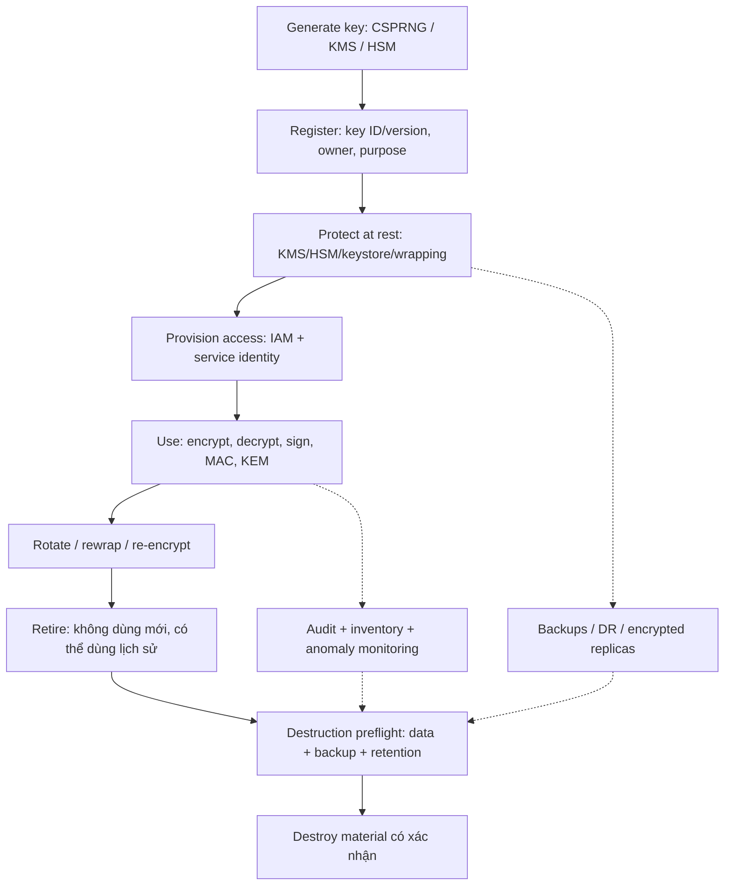
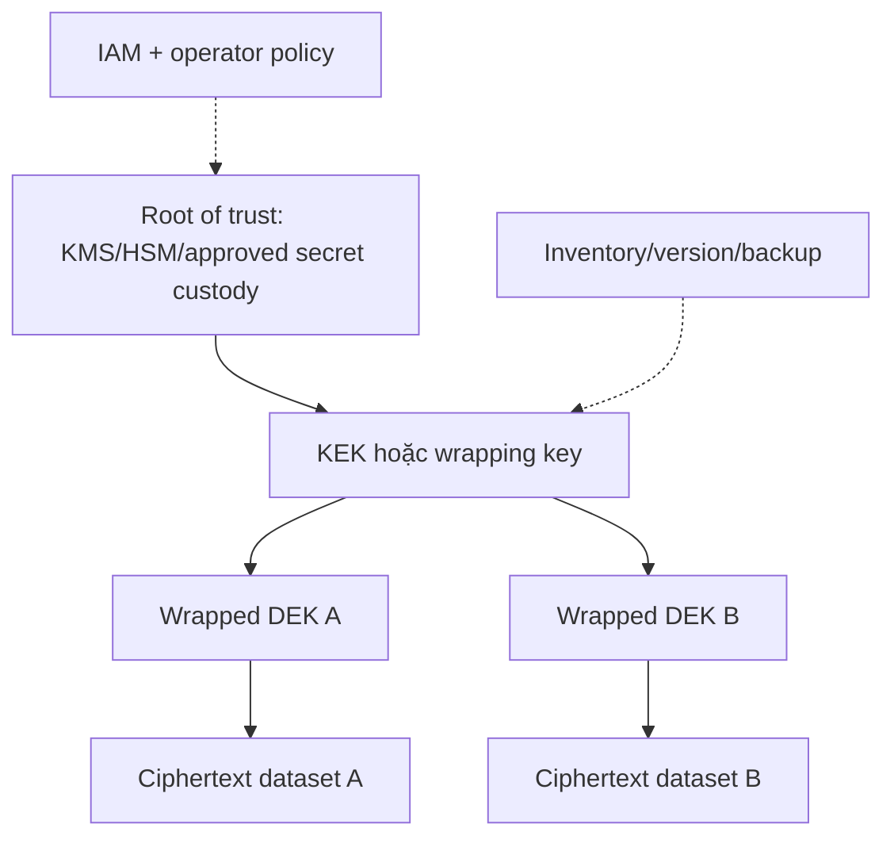
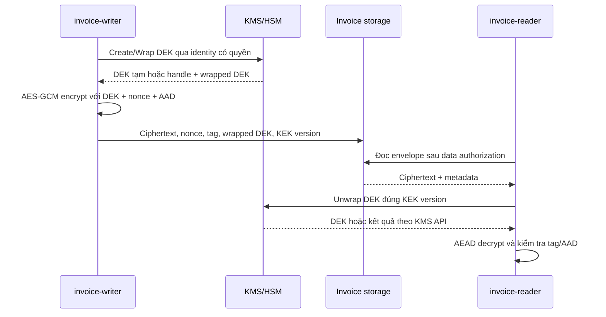
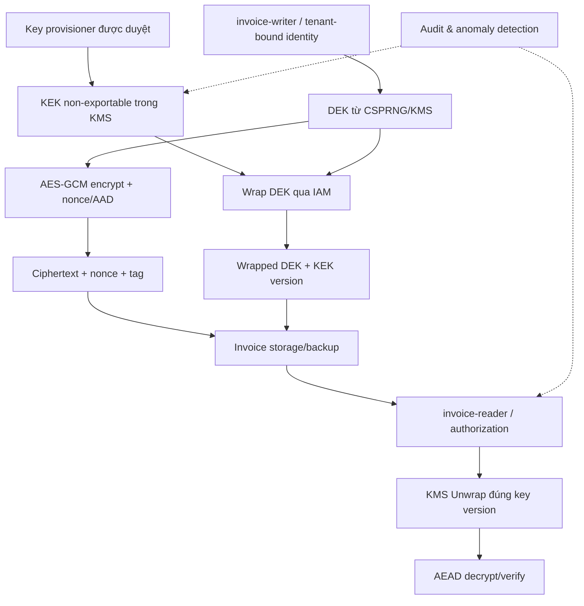

# Bảo vệ key khi lưu trữ

## 1. Vì sao bảo vệ key khi lưu trữ là nền tảng của quản lý khóa?

**Bảo vệ key khi lưu trữ (key protection at rest)** là tập hợp biện pháp **kỹ thuật, mật mã và tổ chức** nhằm ngăn vật liệu khóa bí mật bị đọc, sao chép, sửa đổi, thay thế, sử dụng trái phép hoặc mất khả năng khôi phục trong thời gian tồn tại trên thiết bị, hệ thống quản lý khóa, bản sao lưu hay phương tiện lưu trữ khác.

Một thuật toán mạnh như **AES-256-GCM, Ed25519 hoặc RSA-PSS** vẫn có thể mất ý nghĩa nếu **DEK/KEK/private key** được ghi vào Git, tệp cấu hình dạng rõ, log, snapshot hoặc một vùng lưu trữ mà nhiều người cùng đọc được. Kẻ tấn công không cần phá thuật toán nếu có thể lấy đúng key.

Ví dụ: hệ thống hóa đơn mã hóa mỗi bản ghi bằng AES-GCM và bọc DEK dưới KEK. Nếu KEK được lưu dạng Base64 trong file cấu hình, người đọc được file đó có thể có năng lực mở bọc toàn bộ DEK liên quan. **Base64 chỉ là encoding, không phải encryption.** Ngược lại, lưu KEK ở KMS/HSM giúp giảm bề mặt lộ vật liệu, nhưng nếu service account có quyền `Decrypt`/`Unwrap` quá rộng, đối thủ chiếm service vẫn có thể lạm dụng **khả năng sử dụng** khóa.

Bài thuộc chương **Key storage** của module `SECURITY_KEY_MANAGEMENT_FUNDAMENTALS`. Module bao trùm vòng đời khóa từ **tạo, cấp phát, lưu trữ, sử dụng, xoay vòng đến thu hồi và hủy**, kết hợp mật mã đối xứng, bất đối xứng, chữ ký số, **KMS/HSM**, envelope encryption, IAM và kiểm toán. Lưu trữ khóa an toàn không tách rời các giai đoạn đó: từ lúc sinh key phải quyết định nó **được phép lưu ở đâu, có thể export không, ai được dùng, backup ra sao và hủy ở phạm vi nào**.

### Mục tiêu học tập

Sau bài, bạn có thể:

1. Phân biệt **mã hóa dữ liệu at rest** với **bảo vệ key material at rest**, và xác định điểm tạo thành vòng lặp phụ thuộc khóa.
2. Giải thích **key custody, trust boundary, root of trust, key hierarchy, non-exportability**.
3. So sánh **KMS, HSM, secret manager, encrypted keystore, OS key store, file và disk encryption** theo threat model.
4. Thiết kế **DEK–KEK envelope encryption**, key wrapping, phân tách khóa và quản lý key version.
5. Bảo vệ **symmetric key, private signing key, HMAC key, private decapsulation key, root key** với yêu cầu khác nhau.
6. Áp dụng **IAM/least privilege, dual control, tenant isolation, key inventory, audit và monitor**.
7. Sử dụng ví dụ **Java 17 PKCS12 keystore** để minh họa lưu/truy xuất một AES key có password, đồng thời hiểu giới hạn của keystore so với KMS/HSM.
8. Lập kế hoạch **backup/restore, rotation, revoke, destruction và ứng cứu key compromise**.
9. Thực hiện checklist và ma trận kiểm thử cho môi trường production.

## 2. Phải bảo vệ khóa trước những mối đe dọa nào?

“Khóa được mã hóa trên ổ đĩa” chưa phải một kết luận hoàn chỉnh. Cần xem **ai có thể lấy ciphertext của key, ai có thể mở khóa nó, ai có thể gọi phép toán mật mã và hệ thống khôi phục hoạt động ra sao**.

| Mối đe dọa | Ví dụ cụ thể | Kiểm soát cần xét |
| --- | --- | --- |
| **Đọc vật liệu khóa** | File `private.pem`, raw DEK trong database, keystore password bị lộ | Key wrapping/encrypted keystore, KMS/HSM, file ACL, không export |
| **Lạm dụng quyền dùng khóa** | Service account bị chiếm gọi KMS `Decrypt` hoặc HSM `Sign` | IAM tối thiểu, identity isolation, data authorization, audit |
| **Sửa/đánh tráo khóa** | Thay public key, thay key ID, metadata hoặc wrapped DEK | Integrity/authenticity, trusted registry, version binding, AEAD/AAD |
| **Lộ qua vận hành** | Secret trong CI/CD log, crash dump, telemetry, backup | Secret hygiene, memory dump controls, redaction, scanning |
| **Lộ qua nhà cung cấp/insider** | Admin có quyền rộng trên HSM/KMS hoặc secret store | Dual control, split knowledge, privileged access, audit |
| **Mất vật liệu khóa** | Hủy KEK khi backup còn wrapped DEK cũ | Backup/restore strategy, version retention, pre-destruction checks |
| **Phá hoại tính sẵn sàng** | IAM grant bị thu hồi nhầm, vùng KMS mất dịch vụ | HA/DR, key availability, quyền break-glass có kiểm soát |
| **Clone/snapshot không kiểm soát** | VM image có local keystore, raw key trong memory snapshot | Không bake secret vào image, quản lý snapshot/copies |
| **Mã hóa sai hoặc thiếu ngữ cảnh** | GCM nonce reuse, wrapping không ràng buộc tenant | Approved AEAD/wrapping suite, nonce policy, AAD/context |
| **Xóa giả** | Xóa alias nhưng material hoặc bản export còn | Provider destruction evidence, copy inventory, media sanitization |

### 2.1. Ba thuộc tính an toàn phải xét đồng thời

- **Confidentiality:** chỉ chủ thể được phép mới tiếp cận vật liệu hoặc năng lực mật mã.
- **Integrity/authenticity:** key, metadata và public-key mapping không bị thay trái phép; hệ thống không âm thầm dùng khóa giả.
- **Availability/recoverability:** dữ liệu phải giữ vẫn có đường decrypt/verify phù hợp; hệ thống không mất khả năng phục hồi sau rotation, disaster hoặc một thao tác destroy nhầm.

Nếu tăng bảo mật bằng cách xóa toàn bộ backup key nhưng tổ chức vẫn phải khôi phục archive, bạn có thể đạt một phần mục tiêu confidentiality nhưng **vi phạm availability**. Ngược lại, giữ hàng chục bản sao plaintext KEK để “chắc chắn restore được” gây rủi ro confidentiality. Chính sách phải cân bằng theo phân loại dữ liệu và nghĩa vụ lưu giữ.

### 2.2. Phân biệt key material và khả năng sử dụng khóa

KMS/HSM có thể giữ private key **non-exportable**, nghĩa là application không thể lấy bytes trực tiếp qua API được hỗ trợ. Nhưng application có quyền `Sign` vẫn có thể yêu cầu module tạo chữ ký.

Do đó có hai mặt trận:

1. **Chống xuất bí mật:** bảo vệ các bytes và key backup/replicas.
2. **Chống lạm dụng capability:** hạn chế **Encrypt, Decrypt, Wrap, Unwrap, Sign, GenerateMac, Decapsulate**, và kiểm soát dữ liệu/ngữ cảnh mà caller được phép xử lý.

**Không được tuyên bố “khóa không thể bị lợi dụng” chỉ vì non-exportable.**

## 3. Key storage nằm trong vòng đời khóa như thế nào?

Key storage là một giai đoạn nhưng cũng là **thuộc tính xuyên suốt** vòng đời.



Các quyết định khi tạo key cần trả lời:

- Key dùng **mục đích gì**: DEK, KEK, HMAC, signing, KEM, root CA?
- Key được sinh **ở đâu**: application CSPRNG, KMS, HSM hay BYOK?
- Key có **được export** hay chỉ dùng qua handle/API?
- **Cryptoperiod** bao lâu? Version nào còn cho new use, version nào chỉ phục vụ dữ liệu cũ?
- Những **consumer, tenant, dữ liệu và backup** nào phụ thuộc vật liệu?
- Có thể **hủy không thể phục hồi** khi hết retention không?

Nếu metadata này chưa được tạo, sau vài năm tổ chức có thể không biết một khóa trong file hệ thống còn bảo vệ dữ liệu gì và ai có quyền xóa nó.

## 4. Mã hóa dữ liệu at rest khác bảo vệ key at rest

Một file database mã hóa trên ổ đĩa thường phải được giải mã khi service hoạt động. Khi máy đã boot và volume được mount, người có quyền đọc ở tầng application/OS phù hợp **có thể truy cập dữ liệu đã được hệ điều hành giải mã**, tùy mô hình bảo vệ.

| Lớp | Bảo vệ chính | Không tự bảo vệ khỏi |
| --- | --- | --- |
| **Full-disk/volume encryption** | Ổ đĩa bị tháo, mất thiết bị, snapshot block-level khi không có khóa truy cập | Process có quyền đọc file sau khi volume được mount; người giữ unlock capability |
| **Database transparent encryption (TDE)** | Storage files, một số backup theo cơ chế DB | Truy vấn DB hợp lệ nhưng trái phép, tài khoản có quyền đọc plaintext |
| **Application-level AEAD** | Trường/record/object ciphertext dù ở database | Service hoặc key-using API bị chiếm và được phép decrypt |
| **Encrypted keystore** | File key material được mã hóa và/hoặc bảo vệ toàn vẹn theo provider | Password bị lộ, admin có quyền đọc/mở store, key được load ra memory |
| **KMS/HSM key storage** | Master/private key material trong vùng quản lý, có kiểm soát key operations | Principal có quyền Decrypt/Sign quá rộng; plaintext do service tự xuất |
| **End-to-end encryption đúng nghĩa** | Có thể giới hạn server/provider xem plaintext tùy giao thức | Endpoint/khóa người dùng bị chiếm hoặc cơ chế recovery không an toàn |

**Các lớp này bổ trợ nhau, không thay thế nhau.** Nếu lưu raw KEK trong database đã được TDE bảo vệ, database admin có quyền truy vấn bảng secret có thể vẫn đọc raw KEK. Cần **tách quyền dữ liệu và quyền key material**, thường qua KMS/HSM hoặc keystore được quản trị riêng.

### 4.1. Vấn đề “chìa khóa của chiếc hộp chứa chìa khóa”

Nếu raw DEK được mã hóa bằng KEK, câu hỏi kế tiếp là **KEK lưu ở đâu?** Nếu KEK lại được mã hóa bằng một khóa khác, tạo thành **key hierarchy**. Chuỗi phải kết thúc ở một **root of trust** được bảo vệ độc lập, ví dụ HSM/KMS root key, cơ chế phần cứng được duyệt hoặc password/credential có quy trình bảo vệ thích hợp.



**Không giải quyết bài toán bằng cách lưu khóa giải mã file trong chính file đó**, hoặc để password keystore ở cùng Git repository mà người có file cũng luôn đọc được.

### 4.2. Phân tách trust boundary

Một thiết kế tốt có thể đặt:

- **Data plane:** database/object storage chỉ lưu ciphertext, metadata, wrapped DEK.
- **Key plane:** KMS/HSM giữ KEK, private signing key hoặc root key.
- **Identity/control plane:** IAM, policy, approval quyết định service nào có quyền.
- **Audit plane:** log độc lập ghi key operation, actor, kết quả, nhưng không ghi secret.

Khi tách các lớp, người đọc trộm database backup **không mặc nhiên** có khả năng gọi KMS; người có quyền xem KMS metadata **không mặc nhiên** được đọc ciphertext nghiệp vụ. Tuy nhiên, một service thật sự có quyền cả hai vẫn cần kiểm soát mạnh và giám sát.

## 5. So sánh các lựa chọn lưu trữ khóa

| Cơ chế | Khi nào phù hợp | Ưu điểm | Hạn chế/rủi ro |
| --- | --- | --- | --- |
| **Cloud KMS managed key** | KEK, master key, signing key theo khả năng provider | Key policy, IAM, audit, rotation, API tập trung | Chi phí/latency, service availability, permissions, replicas, provider contract |
| **HSM / HSM cluster** | Root, CA, signing, KEK có yêu cầu custody cao | Hardware isolation, non-exportable object, dual control theo sản phẩm | Vận hành, HA/backup, integration, privilege/availability |
| **OS keystore/TPM/secure enclave** | App/device-bound key theo platform hỗ trợ | Có thể ràng buộc thiết bị/hệ điều hành và quyền truy cập | Khả năng export/backup và migration phụ thuộc nền tảng |
| **Encrypted file keystore (PKCS12...)** | Ứng dụng, dev/test, một số workload cần file key | Portability và JCA integration | Password/ACL, process memory, snapshots, phân phối thủ công |
| **Secret manager** | Secret/config/credential cần phân phối và rotation | Versioning, IAM, audit và injection | Secret thường được phát lại dạng rõ cho ứng dụng; không đồng nghĩa HSM |
| **Encrypted database/blob** | Lưu wrapped keys, DEK packages, ciphertext metadata | Dễ tích hợp backup và ứng dụng | Phải đặt wrapping/root key ở trust boundary riêng |
| **Plain file/config/env variable** | Chỉ với dữ liệu không bí mật | Đơn giản | **Không phù hợp để lưu raw key production** nếu không có kiểm soát bù đủ mạnh; env vars dễ lộ qua debug/process |
| **Hardcode key trong binary/source** | Không phù hợp với secret key production | Không có ưu điểm an toàn | Reverse engineering, Git history, không rotate đúng cách |

Không có câu trả lời “mọi khóa bắt buộc ở HSM” cho mọi ứng dụng. Phải chọn theo **threat model, độ nhạy của khóa, chi phí, latency, yêu cầu truy cập, regulatory/compliance và khả năng phục hồi**.

### 5.1. Khi nào ưu tiên KMS/HSM?

Đặc biệt nên xem xét khi:

- Private key ký token, firmware, chứng chỉ hoặc giao dịch có giá trị cao.
- KEK có **blast radius lớn** do bọc nhiều DEK.
- Có yêu cầu **non-exportable** hoặc quản trị key custody tập trung.
- Cần dual control, audit và kiểm soát quyền dùng khóa theo operation.
- Phải hỗ trợ rotation/version, business continuity, disaster recovery hoặc chứng nhận module theo chính sách.

### 5.2. Secret manager không phải phép thuật che giấu secret

Secret manager có thể mã hóa secret at rest, nhưng khi application truy xuất, **raw secret vẫn có thể được giải mã và đưa vào memory**. Sau đó cần bảo vệ process, CI/CD, telemetry, crash dumps, injection mechanism, service identity và secret lifetime.

Nếu một secret manager dùng KMS phía sau, **KMS bảo vệ storage key của secret manager** không có nghĩa user/application không thể lấy plaintext secret qua API secret manager. Phải kiểm tra **authorization của cả hai tầng**.

### 5.3. Mã hóa ổ đĩa chỉ là một phần của thiết kế

Full-disk encryption rất có ích cho **device theft, media disposal, detached disk**, nhưng không ngăn ứng dụng có quyền đọc file key đã giải mã sau khi boot. Với server production, nên dùng **file ACL + encrypted keystore/KMS/HSM + IAM + backup controls**, không dừng ở lời tuyên bố “ổ đĩa đã mã hóa”.

## 6. Envelope encryption: lưu dữ liệu và lưu khóa tách nhau

**Envelope encryption** là mô hình thường gặp để giảm phạm vi lộ master key và giúp quản lý rotation:

- **DEK (Data Encryption Key)**: mã hóa dữ liệu bằng một AEAD suite, ví dụ AES-GCM.
- **KEK (Key Encryption Key)**: wrap hoặc bảo vệ DEK; thường ở KMS/HSM.
- **Wrapped DEK**: bản mã của DEK, có thể lưu cạnh ciphertext nghiệp vụ.
- **Key reference/version**: tham chiếu giúp KMS tìm đúng vật liệu KEK để unwrap.
- **Nonce/tag/AAD/schema**: metadata cần thiết để giải mã và xác thực đúng object.



**Không phải KMS nào cũng dùng API có tên `Wrap`/`Unwrap`.** Một số dùng Encrypt/Decrypt hoặc GenerateDataKey/Decrypt; cần mô tả operation theo API thật của provider và ánh xạ sang mục đích nghiệp vụ.

### 6.1. Tại sao DEK có thể lưu dạng wrapped cạnh ciphertext?

Nếu kho dữ liệu chỉ chứa **wrapped DEK** mà **không chứa KEK dạng rõ** và không có quyền KMS, việc lấy cắp storage snapshot chưa đủ để tự giải mã. Nhưng nếu cùng bản backup chứa cả **plaintext DEK/KEK**, lợi ích tách trust boundary có thể biến mất.

Một mẫu envelope (chỉ để minh họa):

```json
{
  "formatVersion": 2,
  "algorithm": "AES-256-GCM",
  "keyReference": "billing/prod/invoice-kek",
  "keyVersion": "v5",
  "wrappedDek": "<base64url-wrapped-dek>",
  "nonce": "<base64url-96bit-nonce>",
  "ciphertextAndTag": "<base64url-ciphertext-tag>",
  "aadSchemaVersion": 1,
  "tenant": "tenant-01",
  "objectId": "invoice-0042"
}
```

Trong một format thực tế, các trường xác định ngữ cảnh như **key ID/version, tenant, object ID và format version** cần được ràng buộc theo thiết kế bằng **AAD và/hoặc authentication của wrapping scheme**. Không tin metadata do client sửa để lựa chọn khóa hay tenant trái quyền.

### 6.2. AEAD không đồng nghĩa key wrapping

AES-GCM có thể bảo vệ một DEK nếu giao thức định nghĩa nonce/AAD/tag và sử dụng key/nonce đúng cách. Tuy vậy, có các cơ chế **key wrapping** như **AES-KW/AES-KWP** hoặc suite riêng của provider; việc lựa chọn phải theo chính sách và contract. Không tự nối `encrypt(DEK)` rồi bỏ qua yêu cầu integrity/metadata binding.

### 6.3. Key granularity quyết định blast radius

| Phạm vi DEK | Lợi ích | Đánh đổi |
| --- | --- | --- |
| **Mỗi object/record** | Có thể khoanh vùng khi lộ DEK; hỗ trợ crypto-erasure chi tiết | Quản trị wrapped DEKs và thao tác nhiều hơn |
| **Mỗi batch/partition** | Tối ưu cân bằng số lượng keys và hiệu năng | Lộ DEK ảnh hưởng cả nhóm |
| **Mỗi tenant** | Dễ phân quyền và phân vùng dữ liệu | Lộ DEK ảnh hưởng mọi bản ghi cùng tenant nếu reuse lâu |
| **Một DEK cho toàn ứng dụng** | Đơn giản ban đầu | Blast radius rất rộng, nonce management phức tạp |

Không có granularity bắt buộc chung. Cần thiết kế theo **tần suất mã hóa, khả năng rotation, retention, chi phí KMS, key volume và threat model**.

### 6.4. Nonce AES-GCM không phải secret nhưng không được lặp

Với AES-GCM, **nonce/IV thường được lưu công khai cạnh ciphertext**, nhưng phải tránh **reuse dưới cùng key**. Random nonce 96 bit có rủi ro va chạm xác suất; hệ thống tải lớn cần usage bounds, uniqueness strategy, monitoring và rotation phù hợp.

Bảo vệ key tốt không chữa được việc AES-GCM nonce bị lặp; lúc đó có thể ảnh hưởng cả confidentiality và authenticity.

## 7. Lưu symmetric DEK/KEK, HMAC và derived keys

### 7.1. Symmetric DEK

DEK phải:

- Được sinh bằng **CSPRNG/KeyGenerator/KMS** được phê duyệt.
- Đúng độ dài/thuật toán, có **key ID hoặc envelope reference** để định tuyến.
- Được giữ ở **memory ngắn nhất hợp lý** nếu ứng dụng cần mã hóa cục bộ.
- Không in/log/đưa vào exception, metrics, tracing, Git hoặc thư viện analytics.
- Được **wrap bằng KEK** hoặc giữ dưới KMS/HSM handle theo kiến trúc.
- Có kế hoạch backup/restore hợp lý đối với **wrapped material** và KEK version.
- Được hủy/rotate khi hết cryptoperiod hoặc có sự cố theo policy.

### 7.2. KEK và root/master key

KEK bảo vệ nhiều DEK nên rủi ro lan rộng. Nếu lưu KEK dạng rõ bên cạnh wrapped DEK, envelope encryption gần như mất ưu điểm phân tách custody.

Đối với KEK:

- Ưu tiên vùng quản lý KMS/HSM đủ phù hợp, hạn chế export.
- Giới hạn **Wrap/Unwrap/Decrypt** theo principal, operation, purpose và tenant.
- Đặt owner, version, rotation policy, backup/replication, logging.
- Tránh dùng cùng KEK cho mục đích không liên quan khi policy yêu cầu cách ly.
- Kiểm soát **alias/current pointer** và ciphertext references tới version cũ.
- Đánh giá imported/external copies khi cần destroy hoặc claim crypto-erasure.

### 7.3. HMAC/MAC secret

HMAC sử dụng **shared secret**; ai có raw bytes secret có thể tạo tag, không chỉ verify. Nếu muốn tách `GenerateMac` và `VerifyMac`, phải có provider/API thực thi quyền đó, **không chỉ đặt tên role**.

HMAC key lưu trong secret manager vẫn có thể được xuất tới nhiều service. Inventory phải biết **đúng consumer, loại truy cập và vòng đời**. Không coi HMAC như chữ ký số có public verification key.

### 7.4. Derived keys

Có thể dẫn xuất nhiều subkeys từ master secret có entropy cao bằng **HKDF hoặc KDF được phê duyệt** với **domain separation** phù hợp:

```text
Master secret (được bảo vệ chặt)
        |
       HKDF
        |
        +-- info = "invoice/encrypt/v1" -> encryption subkey
        +-- info = "invoice/mac/v1"     -> MAC subkey
        +-- info = "invoice/wrap/v1"    -> wrapping subkey
```

**KDF không tạo entropy mới từ password yếu**. Việc lưu master secret cần bảo vệ cao vì compromise có thể ảnh hưởng nhiều derived keys. Nếu thực hiện derivation bên ngoài HSM, phải xét secret input có xuất vào process không.

## 8. Lưu private signing key, public key và private KEM key

### 8.1. Private signing key

Với **Ed25519, ECDSA, RSA-PSS**, private key dùng **Sign** và phải được bảo vệ chặt. HSM/KMS non-exportable phù hợp khi cần quản trị usage tập trung. Public verification key có thể được công bố, nhưng **tính xác thực của public-key mapping** phải được bảo vệ.

Kiểm soát quan trọng:

- Chỉ signer/issuer có quyền `Sign` theo mục đích đã phê duyệt.
- Không export private key cho verifier, CI worker hay dashboard vì tiện tích hợp.
- Public key/JWKS/certificate phải được lấy từ **trusted issuer/PKI/registry**.
- Thay private key cần kế hoạch **verifier rollout, trust cache, cryptoperiod và revocation**.
- Chữ ký lịch sử có thể tiếp tục được xác minh bằng public key phù hợp sau khi hủy private key.
- Nếu private key bị đánh cắp, hủy bản trong KMS **không thu hồi được bản sao** của đối thủ.

### 8.2. X.509/PKI và chứng chỉ

Một chứng chỉ X.509 chứa public key, định danh và chữ ký của CA; **chứng chỉ không phải nơi lưu private key**. Khi bảo vệ TLS/server signing keys, có thể dùng PEM/PKCS12/HSM phù hợp nhưng cần bảo vệ private key riêng biệt và kiểm soát renewal, backup, deployment.

Không nhầm:

- `cert.pem`: thường có public certificate.
- `private-key.pem`: chứa private key và phải được bảo vệ.
- `keystore.p12`: container có thể chứa private key/certificate và được bảo vệ theo provider/password.
- `truststore`: chứa trust anchors/public certificates, **không nên chứa private keys** nếu chỉ để verify.

### 8.3. Private KEM/decapsulation key

Với **ML-KEM** hoặc DHKEM theo giao thức phù hợp, bên gửi dùng public encapsulation key; bên nhận phải bảo vệ **private decapsulation key**. Nếu một private KEM key tĩnh được dùng lâu, compromise có thể ảnh hưởng đến bản ghi lịch sử theo giao thức và dữ liệu đã thu thập.

Do đó:

- Không phát private key cho nhiều service chỉ vì đều cần public key.
- Ghi rõ **decapsulation principal**, algorithm/parameter set, key ID/version, storage origin.
- Liên kết **encapsulation ciphertext/DEK envelopes** còn phụ thuộc key version.
- Không hủy version khi còn archive bắt buộc đọc.
- Không coi chuyển sang KEM mới là chỉ sửa field algorithm trong database.

### 8.4. Root CA, firmware signing và khóa nền tảng

Root keys có độ nhạy cao có thể cần:

- Lưu offline hoặc trong HSM, dual control, multi-party ceremony tùy risk policy.
- Backup/escrow được bảo vệ, quy trình kiểm kê bản sao và phục hồi.
- Tách root và intermediate/operational keys.
- Kiểm tra tính toàn vẹn firmware/package/signing manifests.
- Retention của trust anchors, certificates, historical signatures.
- Quy trình khẩn cấp khi signing capability bị lạm dụng.

Không dùng chung một root private key trong mọi build agent; build system có thể yêu cầu **HSM-backed signing service** với kiểm soát nội dung ký và audit.

## 9. File keystore và Java: ưu điểm, giới hạn, trách nhiệm

**Java KeyStore (JKS/PKCS12/provider-specific keystore)** cung cấp API để lưu khóa/certificates dưới một dạng store. Java 17 thường hỗ trợ `PKCS12`, nhưng mức hỗ trợ từng **entry type**, thuật toán bảo vệ và hardware-backed handles có thể tùy provider.

**Đừng đồng nhất password-protected keystore với HSM**:

- File keystore có thể được sao chép; người có file và password có thể mở.
- Khi một key được load thành `SecretKey`/`PrivateKey` trong process, khả năng sử dụng/xuất của key tùy provider và implementation.
- Password yếu làm tăng nguy cơ tấn công đoán offline đối với file bị đánh cắp.
- File permission, ACL, disk encryption, backup và host security vẫn quan trọng.
- Nếu cần non-exportable hardware key, sử dụng **KMS/HSM/PKCS#11/provider integration** được phê duyệt thay vì lưu private bytes trong file thông thường.

### 9.1. Password của keystore phải đặt ở đâu?

Không hardcode password trong source hoặc test fixtures bị dùng lại production. Tránh truyền password trong command-line args (có thể bị process monitoring/log ghi nhận). Cân nhắc:

- Đọc từ **console bảo mật** hoặc hệ thống secret delivery được kiểm soát.
- Dùng **workload identity** để đọc password từ secret manager khi kiến trúc cần.
- Giới hạn thời gian tồn tại trong memory; ưu tiên `char[]` thay vì `String` khi API cho phép.
- Không dùng cùng password trong các môi trường/tenant ngoài policy.
- Có chính sách rotation, recovery, break-glass và khả năng truy xuất khi restart.
- Không log password hoặc xuất nó vào shell history.

**Một câu hỏi căn bản:** nếu password keystore được lưu dạng rõ trong cùng thư mục và có cùng quyền như file keystore, lớp password không tách được trust boundary.

### 9.2. File permission và backup

- Hạn chế **read/write permission** của keystore theo service identity; không dựa vào password một mình.
- Trên Linux có thể dùng POSIX permissions/ownership; trên Windows cần cấu hình **NTFS ACL**. Container/volume/mounted secrets cần cấu hình riêng.
- Không để keystore trong repository, docker image hoặc artifact mà nhiều người tải được.
- Chỉ backup qua đường bảo vệ được duyệt, quản lý bản sao và retention.
- Tránh dùng shared local folder cho keys của nhiều service/tenant nếu không có cách ly.

## 10. Java 17: ví dụ lưu AES key trong PKCS12 keystore

Ví dụ sau là **demo học thuật có thể chạy trên Java 17** với provider hỗ trợ `PKCS12 SecretKeyEntry`. Nó tạo **AES-256 SecretKey** qua `KeyGenerator`, ghi một file keystore mới và mở lại để kiểm tra entry.

**Phạm vi:** demo chỉ chứng minh việc **lưu/truy xuất có password** qua Java KeyStore; không phải thiết kế production tự động thay KMS/HSM. Nó cố ý **không in raw key bytes** và dùng `CREATE_NEW` để tránh ghi đè một file keystore đang tồn tại.

```java
import java.io.Console;
import java.io.InputStream;
import java.io.OutputStream;
import java.nio.file.Files;
import java.nio.file.Path;
import java.nio.file.StandardOpenOption;
import java.security.KeyStore;
import java.security.SecureRandom;
import java.util.Arrays;
import javax.crypto.KeyGenerator;
import javax.crypto.SecretKey;

public final class KeyStoragePkcs12Demo {
    private static final String ENTRY_ALIAS = "invoice-dek-v1";

    public static void main(String[] args) throws Exception {
        Console console = System.console();
        if (console == null) {
            throw new IllegalStateException(
                "Run in an interactive terminal with System.console(); "
                + "do not hardcode or log the keystore password."
            );
        }

        char[] password = console.readPassword(
            "New PKCS12 keystore password: "
        );
        if (password == null || password.length == 0) {
            throw new SecurityException("Password is required");
        }

        Path file = Path.of("demo-key-storage.p12");
        try {
            // Generate a key using an approved JCA provider/CSPRNG.
            KeyGenerator generator = KeyGenerator.getInstance("AES");
            generator.init(256, new SecureRandom());
            SecretKey dataKey = generator.generateKey();

            KeyStore store = KeyStore.getInstance("PKCS12");
            store.load(null, password);

            // Provider must support SecretKeyEntry for PKCS12.
            KeyStore.PasswordProtection protection =
                    new KeyStore.PasswordProtection(password);
            try {
                store.setEntry(
                    ENTRY_ALIAS,
                    new KeyStore.SecretKeyEntry(dataKey),
                    protection
                );
                // CREATE_NEW prevents overwriting an existing keystore.
                // DEMO ONLY: place in a pre-protected directory. In
                // production configure POSIX permissions / Windows ACL
                // and secure backing storage BEFORE storing secret.
                try (OutputStream out = Files.newOutputStream(
                        file,
                        StandardOpenOption.CREATE_NEW,
                        StandardOpenOption.WRITE)) {
                    store.store(out, password);
                }

                // Re-open and validate metadata, never print key bytes.
                KeyStore reopened = KeyStore.getInstance("PKCS12");
                try (InputStream in = Files.newInputStream(file)) {
                    reopened.load(in, password);
                }

                KeyStore.Entry entry = reopened.getEntry(
                    ENTRY_ALIAS, protection
                );
                if (!(entry instanceof KeyStore.SecretKeyEntry sk)) {
                    throw new SecurityException(
                        "Stored entry is not a secret key"
                    );
                }

                System.out.println(
                    "Alias exists: " + reopened.containsAlias(ENTRY_ALIAS)
                );
                System.out.println(
                    "Key algorithm: " + sk.getSecretKey().getAlgorithm()
                );
                // Never call getEncoded() for logging.
            } finally {
                protection.destroy();
            }
        } finally {
            Arrays.fill(password, '\0');
        }
    }
}
```

Chạy từ **terminal tương tác** có `System.console()`, không chạy trong IDE console không hỗ trợ:

```bash
javac KeyStoragePkcs12Demo.java
java KeyStoragePkcs12Demo
```

Với provider tương thích, chương trình có thể in:

```text
New PKCS12 keystore password: [input hidden by terminal]
Alias exists: true
Key algorithm: AES
```

Chạy lại trong cùng thư mục sẽ thất bại vì file `demo-key-storage.p12` đã tồn tại. Đây là chủ ý để tránh ghi đè. **Không xóa/ghi đè file production keystore để thử demo.**

### 10.1. Vì sao ví dụ còn nhiều giới hạn?

1. **File ACL:** `CREATE_NEW` tránh overwrite nhưng **không bảo đảm file chỉ service được phép đọc**; file tạo theo quyền mặc định/ACL của thư mục. Trong production phải tạo ở vùng đã cấu hình permission chặt **trước khi ghi secret**.
2. **Password strength:** ví dụ chỉ kiểm tra password không rỗng, chưa có chính sách entropy, rate-limit, lifecycle hoặc secret-manager integration. File có thể bị sao chép rồi thử password ngoại tuyến.
3. **Provider support:** không phải mọi JCA/PKCS12 provider hỗ trợ cùng `SecretKeyEntry` và thuật toán mã hóa entry; phải kiểm chứng provider cụ thể.
4. **Key material trong memory:** `dataKey` vẫn tồn tại trong JVM theo provider; `PasswordProtection.destroy()` không xóa mọi bản sao của key trong process.
5. **At-rest encryption:** PKCS12 được thiết kế bảo vệ keystore, nhưng **cipher/PBE/MAC algorithms, parameters và implementation phụ thuộc provider**; cần review trước production.
6. **Không phải HSM:** file có thể copy, key có thể được load vào application; không được tự tuyên bố non-exportable.
7. **Không có rotation/version store:** demo chỉ có một alias, chưa có key metadata, phiên bản, backup và policy chuyển key.
8. **Không có IAM/KMS:** quyền người dùng ở đây là OS/keystore; không có audit `Unwrap` từng tenant như KMS.
9. **Không có structured audit:** không in secret, nhưng production cần log sự kiện quản trị ở nguồn được bảo vệ.
10. **Không có restore drill:** phải chứng minh backup keystore và password/key reference có thể phục hồi theo policy.

**Nếu yêu cầu thực sự là private signing key production non-exportable hoặc KEK quy mô lớn**, hãy thiết kế với KMS/HSM thay vì biến demo thành một dịch vụ lưu secret ad hoc.

### 10.2. Nếu muốn dùng HSM trong Java

Thông thường sử dụng **JCA provider kết nối PKCS#11/HSM** hoặc SDK của vendor, để `KeyStore`/`Signature`/`Cipher` vận hành với key handle theo capability của module. Nhưng **provider config, login, key generation mechanism và authorization khác nhau theo sản phẩm**.

Không đưa một đoạn code `SecretKeySpec(rawKeyBytes, "AES")` vào ứng dụng rồi ghi rằng đó là HSM-backed key. Muốn khẳng định non-exportable phải xem **key attributes, provider/slot, HSM policy và evidence**.

## 11. Pseudocode tích hợp KMS/HSM thay cho lưu raw KEK

Một ứng dụng thường chỉ nên giữ **key reference**, không giữ raw KEK production:

```text
function encryptInvoice(invoice, principal, tenant):
    authorizeBusinessWrite(principal, tenant, invoice.id)

    keyRef = trustedKeyRegistry.currentKekFor(tenant)
    material = kms.generateDataKey(
        keyRef, approvedEncryptionContext(tenant, invoice.id)
    )

    // Provider contract quyết định trả plaintext DEK hay key handle.
    dek = material.plaintextDekOrKeyHandle
    wrappedDek = material.encryptedDek

    nonce = newNonceUnderApprovedAeadPolicy(dek)
    ciphertext = aeadEncrypt(dek, invoice, nonce,
                             canonicalAad(tenant, invoice.id, keyRef))

    securelyDisposeTemporaryDekWhenSupported(dek)
    storeEnvelope(ciphertext, wrappedDek, nonce,
                  keyRef.id, keyRef.version, aadVersion)
```

```text
function decryptInvoice(envelope, principal, tenant):
    authorizeBusinessRead(principal, tenant, envelope.objectId)

    keyRef = trustedKeyRegistry.resolveExactVersion(
        envelope.keyId, envelope.keyVersion
    )
    requireKeyAllowedForLegacyDecrypt(keyRef, principal, tenant)

    dek = kms.unwrapDataKey(
        keyRef, envelope.wrappedDek,
        approvedEncryptionContext(tenant, envelope.objectId)
    )
    plaintext = aeadDecryptAndVerify(
        dek, envelope.ciphertextAndTag, envelope.nonce,
        canonicalAad(tenant, envelope.objectId, keyRef)
    )

    securelyDisposeTemporaryDekWhenSupported(dek)
    return plaintext
```

Đây là **pseudocode kiến trúc**, không phải API KMS thống nhất. Không phải mọi provider có `generateDataKey` hay `unwrapDataKey` theo tên/đầu ra này. Thiết kế thật phải xác minh **AAD/encryption context, usage authorization, exact key/version, error handling và capability của provider**.

### 11.1. Làm sao tránh confused deputy?

Nếu một crypto broker có quyền mở bọc nhiều DEK, ứng dụng gọi broker phải được **xác thực mạnh** và **ràng buộc với object/tenant**. Không để client chỉ gửi `keyId` tự do rồi yêu cầu broker dùng quyền KMS để decrypt dữ liệu của người khác.

Encryption context/AAD giúp ràng buộc dữ liệu theo protocol, nhưng **không tự thay thế business authorization**. Cần kiểm tra user có quyền với invoice/object trước khi thực hiện thao tác giải mã và trước khi trả plaintext.

## 12. IAM, quản trị khóa và separation of duties

**Key storage bảo mật phụ thuộc quyền thực sự có thể sử dụng khóa.** Một số hệ thống chỉ chia role “admin” và “user” sẽ khó hạn chế nguy cơ key abuse.

| Vai trò | Nhiệm vụ được cấp theo policy | Quyền không nên mặc nhiên có |
| --- | --- | --- |
| **Key creator/provisioner** | Sinh khóa đúng algorithm, owner, environment | `Decrypt` tất cả dữ liệu; tự duyệt destroy |
| **Key administrator** | Quản lý alias, version, rotate, disable theo quy trình | Export private key; tự mở toàn bộ ciphertext |
| **Encryption writer** | `Encrypt`/`Wrap` đúng key và tenant | `Decrypt` toàn bộ archive; sửa key policy |
| **Decryption reader** | `Decrypt`/`Unwrap` trong data authorization | `Sign` bằng khóa issuer, quyền quản trị |
| **Signing issuer** | `Sign` đúng private key/purpose | Xuất private key hoặc đổi trust registry tùy ý |
| **Verifier** | Đọc public key/JWKS đáng tin | `Sign` hoặc raw private-key access |
| **Backup/DR operator** | Khôi phục trong runbook được duyệt, time-bound | Unwrap mọi tenant không kiểm toán |
| **Security auditor** | `List/Describe`/read metadata và audit evidence | `Decrypt`, `Sign`, `Destroy` hoặc đọc raw secrets |
| **Incident responder** | Cô lập access, rotate/revoke theo quyền khẩn cấp | Tự bỏ qua dual control/retention không có runbook |

### 12.1. Dual control và split knowledge

Với key nhạy cảm (root, KEK có phạm vi lớn, CA/firmware-signing), tổ chức có thể yêu cầu:

- **Dual approval/four-eyes:** người khác nhau tham gia phê duyệt thao tác nhạy cảm.
- **Separation of duties:** người yêu cầu, người phê duyệt và người thực thi không kiêm nhiệm ngoài policy.
- **Split knowledge/quorum:** trong một key ceremony hoặc recovery scheme được đánh giá, một cá nhân không thể một mình tái lập toàn bộ vật liệu.
- **Just-in-time access:** grant có thời hạn, được ghi audit và tự hết hạn khi hoàn tất.
- **Tamper-resistant audit:** log được quản lý khác quyền admin KMS.

**Không tự chia raw AES key thành vài đoạn rồi phát qua email như một cơ chế split knowledge tự chế.** Nếu cần quorum/secret sharing, dùng quy trình và primitive được phê duyệt, với kiểm chứng khôi phục và kiểm kê từng custody path.

### 12.2. Bảo vệ cả public key mapping

Với chữ ký số và KEM, public key không cần giữ bí mật nhưng **phải đúng nguồn tin cậy**. Một attacker thay JWKS, key registry hoặc certificate mapping có thể làm verifier tin chữ ký của họ hoặc client encapsulate cho public key giả.

IAM cần tách `Publish/Modify trusted public key` khỏi quyền đọc public key thông thường; cập nhật trust registry phải có approval, version, provenance và audit.

## 13. Key inventory: không thể bảo vệ thứ bạn không biết tồn tại

Một **key inventory** nên chứa **metadata**, không chứa raw secret:

```yaml
keyId: invoice-kek/prod
keyVersion: v5
owner: billing-security
environment: production
region: primary-region
classification: sensitive
keyType: symmetric
algorithmFamily: AES
keyPurpose: invoice-dek-wrapping
provider: managed-kms
providerResourceRef: provider://project/key/version
origin: provider-generated
exportability: non-exportable
state: ACTIVE_FOR_WRAP
allowedOperations:
  - Wrap
  - Unwrap
serviceConsumers:
  - invoice-writer
  - invoice-reader
  - backup-restore
createdAt: "2026-11-28T02:00:00Z"
policyRef: kms-key-policy-v4
dependencyInventoryRef: invoice-dek-dependencies-v5
backupEvidenceRef: dr-key-ring-review-2026-11
```

Ví dụ chỉ là **schema inventory học thuật**: không phải mọi KMS có version-level IAM hay API tên `Wrap`.

### 13.1. Phải truy vấn được key → services và key → data

Từ một key/version, cần biết:

- Những service/principal nào **có quyền** và **đã thực sự sử dụng**?
- Có bao nhiêu wrapped DEK, ciphertext, queue, archive, snapshot hoặc đối tác còn phụ thuộc?
- Key đang được phép **tạo ciphertext/signature mới** hay chỉ **read/verify legacy**?
- Thuật toán, key size, key origin và provider được kiểm chứng từ đâu?
- Có imported/exported copies hay key backup không?
- Khi disable/destroy, **blast radius** ở tenant và dữ liệu nào?

Nếu inventory không biết backup nào còn cần KEK v3, việc hủy v3 dựa vào `lastUsedAt` có thể làm bản khôi phục không thể đọc.

### 13.2. Declared, configured và observed khác nhau

- **Declared:** owner khai service cần dùng key.
- **Configured:** IAM/keystore policy có cho service quyền không.
- **Observed:** KMS/HSM/app audit thấy operation nào, lúc nào.

Một bản ghi `declared: Wrap only` nhưng IAM cho `Decrypt` và log có `Unwrap` phải trở thành finding cần điều tra, **không tự cập nhật khai báo để hợp thức hóa**.

## 14. Backup, escrow, disaster recovery và tính sẵn sàng của khóa

**Backup ciphertext không có khóa để giải mã tương ứng có thể là backup vô dụng.** Ngược lại, backup raw KEK quá rộng tạo đường exfiltration mới. Do đó key backup phải là **một phần của thiết kế key storage**, không phải tác vụ chụp ổ đĩa tự phát.

### 14.1. Những câu hỏi bắt buộc khi thiết kế backup key

1. **Dữ liệu nào phải khôi phục?** Backup thuộc retention/legal hold nào?
2. **Khóa nào cần để khôi phục?** DEK, wrapped DEK, KEK version, private decapsulation key, password pepper?
3. **Có export được không?** KMS/HSM có cơ chế backup/replica chính thức hay chỉ non-exportable local handle?
4. **Trust boundary backup** ở đâu? Storage backup và quyền KMS có bị cùng một principal kiểm soát không?
5. **Ai có quyền restore?** Có quorum, emergency access, authorization của data owner và audit không?
6. **Môi trường/region nào?** DR có access tới key/material phù hợp không?
7. **Key lifecycle**: backup cũ còn phụ thuộc version đã retired trong bao lâu?
8. **Destruction scope**: khi hủy key, các bản sao backup/import có được xử lý theo policy không?

### 14.2. Tránh backup chứa cả ciphertext lẫn plaintext key

Ví dụ sai:

```text
backup-2026-11/
  invoices.enc
  invoice-dek.txt       # RAW DEK
  kms-key-password.txt  # Password mở keystore
```

Nếu attacker lấy cả thư mục, có thể bỏ qua KEK/HSM để giải mã dữ liệu. Thiết kế tốt hơn chỉ lưu **encrypted/wrapped DEKs**, metadata và backup có encryption/ACL/retention, còn **KEK nằm ở vùng được quản lý riêng** cùng quy trình recovery tương ứng.

### 14.3. Restore drill không chỉ là “file backup tải xuống được”

Một bài restore test có giá trị cần:

1. Chọn backup còn trong retention và xác định đúng key versions.
2. Khôi phục ciphertext, wrapped DEKs và metadata.
3. Khôi phục/định tuyến các **key references** theo DR strategy được duyệt.
4. Unwrap DEK bằng KEK version phù hợp.
5. AES-GCM decrypt và kiểm tra AAD/tag; kiểm tra dữ liệu nghiệp vụ.
6. Đối chiếu số lượng bản ghi/tính toàn vẹn, log kết quả và người thực hiện.
7. Bảo vệ dữ liệu thử; không vô tình export production key sang staging.

Restore test thất bại có thể do **IAM/region/alias/format/version**, không chỉ do thiếu key bytes. Runbook cần phân loại lỗi mà không tiết lộ secret hoặc tạo oracle.

### 14.4. Escrow không đồng nghĩa sao chép khóa tự do

**Key escrow/recovery** là phương án giữ đường khôi phục được quản trị có kiểm soát. Nếu có, cần xác định:

- Mục đích pháp lý/nghiệp vụ, đối tượng key và retention.
- Ai giữ quyền recovery, ai phê duyệt, quy tắc quorum và logging.
- Material được backup dạng encrypted blob hay HSM-wrapped package theo provider.
- Cách thay hoặc hủy bản escrow khi hết nhu cầu.
- Ảnh hưởng lên lời tuyên bố **crypto-erasure**: nếu một bản recovery còn giải mã được dữ liệu, không thể nói mọi đường giải mã đã biến mất.

## 15. Rotation, rewrap, re-encrypt và đổi key storage

### 15.1. Rotation không tự làm ciphertext lịch sử chuyển khóa

Giả sử `invoice-kek:v3` bảo vệ wrapped DEK trong live DB và backup. Đội vận hành tạo `v4` rồi chuyển alias current sang v4. Từ đó:

- Writer mới có thể dùng v4 để wrap DEK mới.
- Reader vẫn có thể cần v3 để unwrap wrapped DEK cũ.
- Backup/DR vẫn có thể chứa wrapped DEK dưới v3.
- Key v3 không nên bị destroy trước khi phụ thuộc còn phải giữ được xử lý.

### 15.2. Rewrap DEK khác re-encrypt data

| Thao tác | Điều thay đổi | Khi phù hợp | Giới hạn |
| --- | --- | --- | --- |
| **Rotate KEK / alias** | Version dùng cho tác vụ mới | Chu kỳ rotation thông thường | Không tự chuyển wrapped DEK đã lưu |
| **Rewrap DEK** | Lớp bao bọc từ KEK cũ sang mới | DEK vẫn an toàn; muốn thoát KEK cũ | Không chữa DEK yếu/đã lộ |
| **Re-encrypt bằng DEK mới** | Key mã hóa trực tiếp và ciphertext/tag | DEK bị compromise, algorithm migration, policy yêu cầu | Tốn chi phí; cần dữ liệu gốc/đường decrypt hợp lệ |
| **Migrate KMS/HSM** | Root/key custody/provider, đôi khi key material/format | Đổi nền tảng hoặc trust boundary | Không thể đơn giản “copy” non-exportable key; cần plan hỗ trợ từ provider |
| **Revoke/Disable** | Quyền/trạng thái sử dụng | Cô lập sự cố hoặc retire | Thường không phá hủy vật liệu |
| **Destroy** | Vật liệu trong phạm vi quản lý | Kết thúc vòng đời/crypto-erasure đủ điều kiện | Có thể không phục hồi được dữ liệu |

### 15.3. Migrate từ file keystore sang KMS/HSM

Một kế hoạch an toàn có thể:

1. Inventory key ID, origin, algorithm, consumers và ciphertext dependencies.
2. Tạo **key mới trong KMS/HSM** theo policy; nếu cần giữ material cũ, kiểm tra **import/export capabilities** và đánh giá rủi ro.
3. Cấp IAM cho service qua workload identity, không dùng credential quản trị hardcoded.
4. Điều chỉnh application adapter/API: dùng handle/wrap/unwrap thay cho raw key file khi phù hợp.
5. Chuyển producer sang key mới, giữ consumer đọc dữ liệu cũ trong khoảng migration.
6. Rewrap/re-encrypt theo kiến trúc; xác minh **AAD, metadata format, version và restore**.
7. Thu hồi access tới file cũ, xử lý backup/copies, ghi audit và kế hoạch destroy.
8. Không xóa keystore cũ khi chưa chắc dữ liệu lịch sử đã có đường đọc hợp lệ khác.

**Không phải mọi private key đều có thể “import nguyên trạng” vào mọi HSM**. Với một số loại key hoặc khi policy yêu cầu non-exportability từ lúc sinh, có thể phải **tạo keypair mới và phân phối public key** tới verifier/consumer.

## 16. Destruction và cryptographic erasure của key đang lưu

**Destroy/zeroization** cố gắng loại bỏ vật liệu khóa trong phạm vi quản lý. **Cryptographic erasure (crypto-shredding)** là kết quả làm ciphertext trở nên không thể giải mã một cách khả thi do không còn secret/đường khôi phục cần thiết.

**Điều kiện crypto-erasure** thường gồm:

- Dữ liệu đã được mã hóa bằng thuật toán/sơ đồ an toàn và key có entropy đủ.
- Không còn DEK/KEK hoặc wrapped path khác có thể mở ra secret cần hủy.
- Các **bản export, cache, backup, replicas, escrow và đối tác** đã được đánh giá theo phạm vi.
- Không còn plaintext ở log, index, export hoặc những hệ thống ngoài phạm vi tuyên bố.
- Retention, legal hold và nhu cầu chứng cứ lịch sử đã được giải quyết.
- Có **authoritative provider evidence** rằng vật liệu trong vùng quản lý đã hủy, thay vì chỉ `Disabled` hoặc alias bị xóa.

### 16.1. Không nhầm trạng thái

| Trạng thái/hành động | Vật liệu bí mật có thể còn? | Ý nghĩa |
| --- | --- | --- |
| **Disabled** | Thường có | Provider chặn sử dụng; có thể bật lại tùy quyền |
| **Retired** | Thường có | Không dùng cho tác vụ mới, có thể đọc lịch sử |
| **Revoked** | Có thể còn | Thay đổi sự tin cậy/quyền; không đồng nghĩa xóa bytes |
| **Pending deletion** | Theo provider | Đang chờ destructive action; có nơi cho cancel |
| **Destroyed** | Không trong phạm vi đã xác nhận | Vật liệu không thể sử dụng lại bằng thao tác enable |
| **Deleted alias/file record** | Không biết | Xóa metadata không chứng minh zeroization toàn bộ bản sao |

### 16.2. Xóa file trên SSD chưa chắc là xóa vật liệu

Một thao tác xóa file thông thường có thể chỉ xóa directory entry, còn bytes ở snapshot, journal, bản cache, backup hoặc storage có wear leveling. Không dùng `rm`, Windows Delete hoặc ghi đè thủ công lên file rồi khẳng định key material không thể khôi phục.

Cần **media sanitization/cryptographic erasure** theo quy trình được phê duyệt cho thiết bị và storage class. Nếu key ở HSM/KMS, dùng destructive API đúng contract và xác nhận phạm vi bản sao do provider quản lý.

### 16.3. Java heap/memory không phải proof of destruction

`Arrays.fill(secretBytes, (byte) 0)` chỉ có thể giảm lifetime **mảng đó**; JVM/GC/JIT/native provider hoặc secret đã copy có thể còn bản khác. Không dùng nó làm bằng chứng Destroyed state; luôn bảo vệ process, heap dumps và key export.

## 17. Kiểm toán và giám sát key storage

Một hệ thống bảo vệ key cần chứng minh **cấu hình có đúng** và **thực tế có vận hành đúng không**.

### 17.1. Event audit cần có

```yaml
event: key.operation
eventTime: "2026-11-28T03:00:00Z"
principal: principal://prod/billing/invoice-reader
service: invoice-reader
keyRef: billing/prod/invoice-kek
keyVersion: v5
operation: Unwrap
policyVersion: key-access-v4
environment: production
region: primary-region
result: success
requestId: req-2026-0710
source: kms-management-audit
```

Schema minh họa, **không phải log chuẩn của một provider cụ thể**. Không log raw KEK/DEK, private key, plaintext, password, token hoặc seed. Key IDs, tenant IDs và service relationships cũng có thể nhạy cảm, nên cần access control và retention.

### 17.2. Giám sát tín hiệu nguy hiểm

| Dấu hiệu | Rủi ro | Phản ứng |
| --- | --- | --- |
| Service lạ có `Decrypt`/`Sign` grant | Lạm dụng capability | Kiểm tra approval, thu hồi/cô lập khi cần |
| Export key hoặc import key ngoài quy trình | Rò rỉ/copies không quản lý | Xem audit, custody, scope |
| Truy cập keystore file bởi principal không phù hợp | Exfiltration | Điều tra endpoint/ACL, rotate khi có căn cứ |
| Tắt logging hoặc retention bất thường | Che giấu key abuse | Khôi phục log, điều tra và tách quyền admin |
| Key retired vẫn `Encrypt` mới | Cutover chưa hoàn chỉnh | Chặn new use và xác định producer |
| Nhiều `Unwrap`/`Decrypt` bất thường | Có thể đọc dữ liệu hàng loạt | So sánh object access, principal, rate, incident |
| Restore thất bại với key version cũ | Nguy cơ không khôi phục được dữ liệu | Chặn destroy, kiểm tra key/version/backup |
| Secret xuất hiện trong Git/log/CI artifact | Raw material bị lộ | Ngăn lan truyền, thu hồi/rotate/re-encrypt theo đánh giá |
| Key không owner hoặc không có consumer | Orphan key / key sprawl | Reconcile inventory, review lifecycle |
| KMS/HSM unavailable hoặc permission drift | Mất availability | HA/DR, alert và kiểm tra policy |

### 17.3. Kiểm tra tính toàn vẹn và độ phủ của log

Một log append-only có thể không bị sửa sau khi ghi nhưng **vẫn thiếu sự kiện**. Cần đối chiếu KMS metrics, gateway requests, broker tracing, các vùng/accounts, ingestion gaps và provider behavior. Nếu key từng được export và dùng cục bộ, KMS audit **không thể quan sát mọi lần dùng raw key**.

Giữ quyền audit **tách khỏi key admin**; kiểm soát người có thể tắt log, đổi retention và xóa evidence. Việc quản lý log cũng cần chống lộ thông tin nhạy cảm của chính inventory.

## 18. Case study: bảo vệ KEK cho nền tảng hóa đơn đa tenant

### 18.1. Bối cảnh

`invoice-platform` lưu hóa đơn của nhiều tenant. Mỗi hóa đơn được mã hóa bằng DEK AES-256-GCM, và DEK được bọc bằng KEK của hệ thống. Có bốn service:

- `invoice-writer` tạo ciphertext và wrapped DEK.
- `invoice-reader` giải mã hóa đơn sau khi kiểm tra quyền nghiệp vụ.
- `monthly-exporter` chạy theo lịch, đọc hóa đơn được phép.
- `backup-restore` phục hồi snapshot khi có sự cố.

Ban đầu, KEK được lưu dưới dạng Base64 trong file `application-prod.yml`, còn cả ciphertext và file cấu hình cùng nằm trong một backup định kỳ.

### 18.2. Lỗi thiết kế

```yaml
# VÍ DỤ KHÔNG AN TOÀN - KHÔNG COPY VÀO PRODUCTION.
crypto:
  kekBase64: "REPLACE_WITH_RAW_KEY_BASE64_IF_THIS_WERE_UNSAFE"
  decryptAnyTenant: true
  rotate: false
```

Rủi ro:

- **Base64 không mã hóa** KEK; đọc cấu hình là đủ có vật liệu.
- Backup chứa **cả ciphertext và raw key** làm mất tách biệt custody.
- Một principal có quyền decrypt mọi tenant có blast radius lớn.
- Không có key version/rotation; khó xác định archive phụ thuộc.
- File cấu hình có thể nằm trong CI artifacts, image hoặc lịch sử Git.
- Không có bằng chứng về owner, approval, KMS usage hoặc key destruction.

### 18.3. Thiết kế cải thiện



Phương án kiểm soát:

1. Key provisioner tạo KEK ở KMS/HSM đúng algorithm, purpose, owner và môi trường.
2. Chỉ cấp quyền `Wrap` cho writer, `Unwrap` cho reader/exporter/DR theo scope thật.
3. Mỗi object/batch dùng DEK theo granularity/nonce policy; raw DEK tồn tại tối thiểu trong process.
4. Lưu envelope metadata gồm `kekId/version`, wrapped DEK, nonce/tag và AAD schema.
5. Tách key plane/identity plane khỏi database backup.
6. Đặt alert truy cập KMS bất thường, xem log theo principal và tenant.
7. Rotation: writer chuyển sang KEK v6; reader hỗ trợ v5/v6 cho dữ liệu còn retention.
8. Rewrap/migrate wrapped DEKs khi cần, kiểm thử restore snapshot lịch sử.
9. Trước destruction v5, phải có **dependency inventory, retention clearance, restore evidence và dual approval**.

### 18.4. Khi KEK v5 bị nghi lộ

Nếu KEK v5 đã từng có bản export vào file backup, xóa nó trong KMS **không xóa bản backup đó**. Đội ứng cứu cần:

- Cô lập các nguồn có thể đọc file, audit downloads và principal.
- Đánh giá ciphertext/wrapped DEK và đối tác nào có thể đã bị lấy.
- Tạo KEK sạch, hạn chế quyền, **rewrap DEK** khi phù hợp.
- Nếu DEK/raw plaintext có khả năng đã bị lộ, đánh giá **re-encrypt bằng DEK mới**; chỉ rewrap không làm lộ DEK trở nên bí mật lại.
- Xem xét backup/retention, hiện vật forensic, thông báo và hủy key cũ theo quyết định có kiểm chứng.

## 19. Case study: lưu private signing key cho JWT hoặc firmware

### 19.1. Tình huống

Một nhóm phát hành token hoặc ký gói firmware bằng private key Ed25519. Nếu private key được copy vào mọi container signer, mỗi container bị chiếm có thể gây nguy cơ xuất secret và ký giả.

Thiết kế tốt hơn có thể là:

1. Sinh private key trong KMS/HSM với **non-exportable** khi provider hỗ trợ.
2. Signer gọi `Sign` qua workload identity; không được đọc raw private bytes.
3. Public verification key/JWKS hoặc certificate được phân phối qua nguồn có xác thực.
4. Sign requests phải có **authorization theo nội dung/mục đích**, hạn mức và audit.
5. Không để verifier có quyền `Sign`; không cho signer tự sửa trust registry.
6. Khi rotation, phát public key mới trước cutover thích hợp, xử lý verifier caches và chữ ký lịch sử.
7. Khi compromise, đánh giá **API Sign abuse** khác với việc **private key export**; cập nhật trust/revocation theo giao thức khi cần.

**Hủy private key trong HSM không tự khiến JWT đã phát hành mất hiệu lực**, nếu verifier còn tin public key cũ và claims/token vẫn hợp lệ. Cần một quy trình **token/trust revocation** riêng.

## 20. Những hiểu nhầm phổ biến

| Hiểu nhầm | Sự thật |
| --- | --- |
| “Ổ đĩa đã mã hóa nên raw KEK trong config an toàn tuyệt đối.” | Ứng dụng/admin có quyền đọc sau khi mount vẫn có thể thấy KEK. |
| “Base64/hex là mã hóa key.” | Chỉ là encoding, bất kỳ ai đọc được có thể decode. |
| “Đưa key vào environment variable là không còn rủi ro.” | Env vars có thể lộ qua process, debug, crash dumps hoặc cấu hình. |
| “KMS có key non-exportable nên không ai lợi dụng được.” | Principal có quyền `Decrypt`/`Sign` vẫn có thể abuse API. |
| “Secret manager bảo đảm application không bao giờ nhận plaintext.” | Nhiều API trả secret dạng rõ cho ứng dụng. |
| “TDE của database bảo vệ key lưu cùng bảng dữ liệu.” | Người có quyền truy vấn bảng secret có thể đọc raw key. |
| “Key store password có thể đặt ngay cạnh file keystore.” | Có thể mất hoàn toàn lợi ích tách trust boundary. |
| “PKCS12 file luôn mạnh bằng HSM.” | File có thể copy; password, OS ACL, provider và memory là điểm yếu. |
| “Public key không bí mật nên được phép lấy từ URL bất kỳ.” | Public-key authenticity/trust là thuộc tính thiết yếu. |
| “HMAC verifier chỉ biết HMAC secret để verify, không thể tạo tag.” | Ai biết shared secret bytes thường có thể tạo MAC. |
| “Rotate alias là dữ liệu cũ tự được mã hóa lại.” | Wrapped DEK/ciphertext cũ vẫn tham chiếu key version cũ. |
| “Rewrap DEK đã lộ sẽ khôi phục confidentiality.” | Nếu đối thủ có DEK/ciphertext, rewrap không thu hồi bản copy. |
| “KMS Encrypt success nghĩa là user được phép xem dữ liệu.” | KMS policy không thay business authorization. |
| “Backup ciphertext là đủ, không cần key backup.” | Có thể không khôi phục được nếu KEK/version bị mất. |
| “Backup raw KEK cùng ciphertext tiện cho DR.” | Tạo một điểm mất cả data lẫn key. |
| “Xóa key alias/file là cryptographic erasure.” | Material/copies có thể vẫn tồn tại. |
| “`PermissionDenied` khi Decrypt chứng minh Destroyed.” | Có thể chỉ do IAM hoặc Disabled. |
| “`Arrays.fill` chứng minh key đã biến mất khỏi JVM.” | Có thể còn bản sao trong provider/native/GC/crash dumps. |
| “KMS hủy key làm kẻ tấn công mất bản đã export.” | Không thể thu hồi bytes đã bị đánh cắp. |
| “Audit log không sửa được là đã ghi đủ mọi key use.” | Log có thể thiếu các lần local use hoặc bị ingestion gap. |

## 21. Ma trận kiểm thử bảo vệ key khi lưu trữ

| Nhóm | Tình huống | Kỳ vọng |
| --- | --- | --- |
| **File permissions** | Principal ngoài service thử đọc keystore | Bị chặn bởi ACL/permissions. |
| **Password** | Sai password keystore | Load/entry retrieval thất bại, không lộ raw key. |
| **Provider compatibility** | PKCS12 provider không hỗ trợ SecretKeyEntry | Phát hiện trước deployment; không fallback sang plaintext. |
| **Key material logging** | Exception hoặc debug path cố in key bytes | Test/secret scanning phát hiện và chặn. |
| **Disk snapshot** | Backup chứa file keystore | File encrypted và password/custody được tách. |
| **Container image** | Image chứa private key/keystore password | Không phát hành image; loại secret và rotate nếu lộ. |
| **KMS IAM** | Writer có `Wrap` nhưng thử `Unwrap` | Từ chối theo provider/app policy. |
| **Tenant isolation** | Tenant A yêu cầu decrypt dữ liệu tenant B | Chặn trước KMS và kiểm tra context/AAD. |
| **Non-exportable key** | Caller thử export private key HSM | API không cho phép theo policy; audit hành vi. |
| **Capability abuse** | Kẻ tấn công dùng grant `Sign` trái phép | Detection, rate limit, incident runbook và trust review. |
| **Envelope integrity** | Sửa ciphertext/tag/AAD/key reference | AEAD/wrapping validation hoặc policy từ chối. |
| **Nonce uniqueness** | AES-GCM nonce lặp trong cùng key | Phát hiện/giới hạn theo usage policy; xử lý sự cố. |
| **Key version** | Ciphertext v3 được thử tự động bằng v4 | Không mù quáng fallback; định tuyến đúng version. |
| **Rotation** | Producer đã dùng v4 nhưng backup còn v3 | Giữ v3 decrypt-only theo retention, chặn destroy. |
| **DR restore** | Key provider ở region chính unavailable | Hành vi theo thiết kế DR, không export secret ad hoc. |
| **Imported copy** | Hủy key tại KMS nhưng BYOK gốc còn trong vault | Không tuyên bố đã hủy tất cả bản sao. |
| **Destruction** | Chỉ xóa alias, key material còn | Không đánh dấu Destroyed. |
| **Auditor** | Auditor yêu cầu raw DEK để kiểm tra | Từ chối; dùng metadata/test evidence an toàn. |
| **Shared principal** | Nhiều service dùng cùng KMS identity | Cảnh báo attribution/blast radius, ưu tiên tách danh tính. |
| **Audit coverage** | Có local key cache/use không hiện trong KMS log | Đánh giá log từ app/broker và nguồn khác. |

## 22. Checklist production để bảo vệ key khi lưu trữ

Trước khi đưa một hệ thống giữ khóa vào production, kiểm tra:

1. **Phân loại:** từng khóa là DEK, KEK, HMAC, private signing, KEM private key, root hay public verification key?
2. **Threat model:** đối thủ có thể là người đọc disk, DBA, cloud admin, compromised service, CI worker, insider hay đối tác?
3. **Nguồn sinh:** key được tạo bằng CSPRNG/KeyGenerator/KMS/HSM được phê duyệt với algorithm và size phù hợp?
4. **Trust boundary:** ciphertext/data plane có tách khỏi KEK/key plane và IAM/control plane không?
5. **Key wrapping:** DEK có được wrap bằng KEK với cơ chế integrity phù hợp, không lưu KEK dạng rõ cùng dữ liệu?
6. **At-rest layers:** disk/TDE/application encryption/keystore/KMS bảo vệ những rủi ro cụ thể nào; có nhầm lẫn năng lực không?
7. **Exportability:** private/root/KEK có cần non-exportable? Provider thực sự enforce được không?
8. **File keystore:** nếu dùng PKCS12/JKS, đã bảo vệ password, ACL, backups, provider algorithm và process memory?
9. **Secret manager:** chỉ principal được phép lấy secret; đã xét plaintext delivery và rotation?
10. **IAM:** service nào có Encrypt/Decrypt/Wrap/Unwrap/Sign/VerifyMac/Decapsulate; có least privilege theo tenant/resource?
11. **Business authorization:** KMS cho phép chưa đủ; đã kiểm object/tenant context trước khi decrypt?
12. **Key inventory:** có owner, purpose, algorithm, version, origin, location, consumers, dependencies và audit refs?
13. **Public-key trust:** JWKS/certificates/KEM public keys có được phân phối/xác minh từ nguồn tin cậy?
14. **Application memory:** có giảm lifetime raw DEK và tránh dumps/logs/telemetry chứa secret?
15. **Nonce/AAD:** với AES-GCM, nonce không lặp dưới cùng key, AAD ràng buộc ngữ cảnh và dữ liệu?
16. **Backup/DR:** có kiểm kê KEK/version/copies, bảo vệ escrow và restore test với dữ liệu còn retention?
17. **Rotation:** producer/consumer hỗ trợ current và legacy version đúng policy; có rewrap/re-encrypt plan?
18. **Root/key hierarchy:** có xử lý bài toán “ai bảo vệ KEK” bằng root of trust tách biệt không?
19. **Separation of duties:** key admin, approver, data owner, backup operator và auditor có xung đột quyền không?
20. **Incident response:** khi key bị export hoặc API bị lạm dụng, có thể xác định blast radius và revoke/rotate/re-encrypt/trust update?
21. **Destruction:** trước hủy đã có dependency inventory, retention/legal hold, restore evidence, approvals và provider final state?
22. **Audit:** log đủ actor, operation, key ID/version, time, policy, result mà không có secret; log có tính toàn vẹn và độ phủ?
23. **Operations:** đã kiểm tra provider outage, IAM drift, quotas, latency, secret delivery, deployment và multi-region failure?
24. **Negative tests:** đã thử sai password, wrong key/version, tenant mismatch, tampered ciphertext, bad IAM grant, unavailable KMS và restore failure?

**Ghi nhớ:** Bảo vệ key khi lưu trữ không đơn thuần là “mã hóa thêm một file”. Cốt lõi là **giữ vật liệu bí mật trong đúng trust boundary, sử dụng KMS/HSM hoặc keystore theo mức rủi ro, tách KEK khỏi dữ liệu, cấp quyền thao tác tối thiểu, kiểm soát mọi bản sao/backup và có bằng chứng vòng đời đầy đủ**. Một khóa non-exportable vẫn có thể bị lạm dụng qua API, một bản backup được mã hóa vẫn có thể không phục hồi được nếu mất KEK, và một thao tác Destroy không thể thu hồi những bản secret đã bị sao chép. Vì vậy, kiến trúc key storage an toàn phải đồng thời bảo đảm **bí mật, toàn vẹn, khả dụng và khả năng kiểm toán**, từ lúc sinh khóa cho tới khi vật liệu thật sự được hủy theo phạm vi xác nhận.
