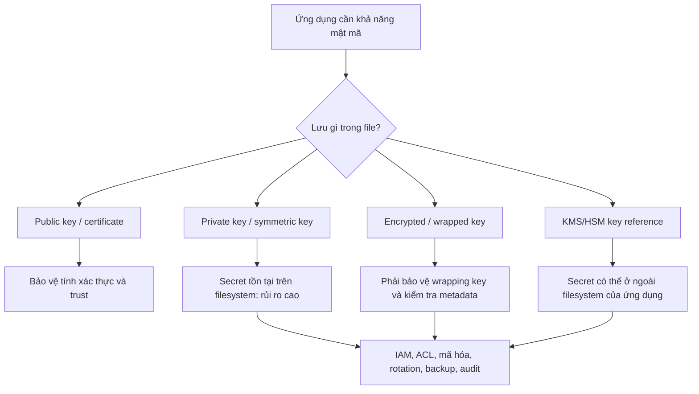
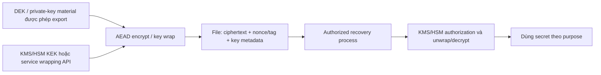
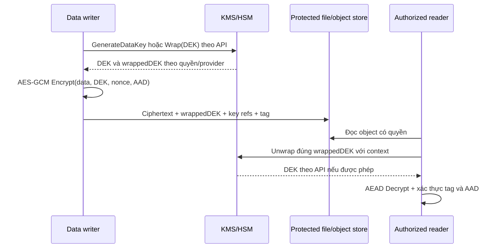
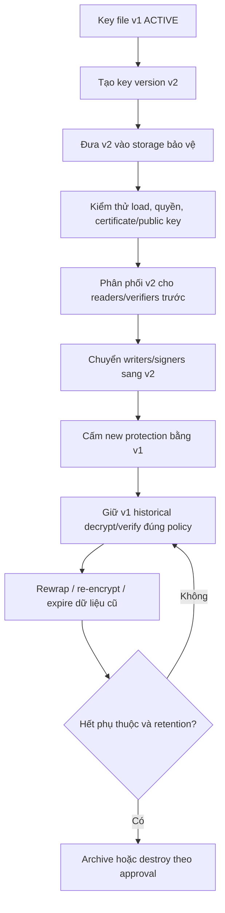

# File key storage — Lưu trữ khóa mật mã trong tệp an toàn

Trong chương **Key storage** của module **SECURITY_KEY_MANAGEMENT_FUNDAMENTALS**, **file key storage** là cách lưu vật liệu khóa, thông tin công khai hoặc một **keystore** dưới dạng tệp trên filesystem. Ví dụ quen thuộc gồm private key PEM của TLS, tệp `.p12`/`.pfx` dùng cho chứng chỉ và private key, Java `.jks` cũ, encrypted PKCS#8, một file chứa **wrapped DEK**, hoặc tệp cấu hình tham chiếu đến khóa trong KMS/HSM.

Điểm quan trọng là **lưu khóa vào tệp không tự đồng nghĩa lưu khóa an toàn**. Một file có quyền chỉ đọc cho ứng dụng vẫn có thể bị lấy qua backup, snapshot, quyền quản trị máy, container image hoặc tài khoản ứng dụng đã bị chiếm. Một PEM có dòng `BEGIN PRIVATE KEY` không mặc định được mã hóa; **Base64 là encoding, không phải encryption**. Một ổ đĩa có mã hóa toàn bộ cũng không ngăn tác nhân có quyền trên host đang mở khóa đĩa đọc nội dung tệp.

Bài học tập trung vào **chọn định dạng, bảo vệ khóa lúc lưu và lúc nạp, chống tráo/ghi đè tệp, quản lý mật khẩu và wrapping key, phân quyền hệ điều hành, Java keystore, Kubernetes/CI, backup, rotation và hủy an toàn**. Nội dung đặt file storage trong toàn bộ vòng đời khóa: **tạo, cấp phát, lưu trữ, sử dụng, xoay vòng, thu hồi và hủy**, kết nối mật mã đối xứng/bất đối xứng, chữ ký số, KMS/HSM, envelope encryption, IAM và audit.

## 1. Mục tiêu học tập

Sau bài học, bạn có thể:

- Phân biệt **public key**, **private key**, **symmetric key**, **wrapped DEK**, **keystore** và **key reference** khi chúng xuất hiện dưới dạng file.
- Giải thích ý nghĩa và giới hạn của **PEM, DER, PKCS#8, encrypted PKCS#8, PKCS#12, JKS, JCEKS, OpenSSH key format và JWK/JWKS**.
- Thiết kế mô hình **mã hóa khóa tại nơi lưu** bằng passphrase/PBE hoặc KEK trong KMS/HSM, có xác thực metadata và phân tách key hierarchy.
- Áp dụng nguyên tắc **least privilege** vào owner, group, ACL, file mode, directory, container volume, service account, backup và audit.
- Giải thích các nguy cơ về **symlink, race condition, ghi file không nguyên tử, cấu hình quá rộng, log lộ secret, mount secret và snapshot**.
- Dùng **Java 17 `KeyStore` kiểu PKCS12** đọc private key entry an toàn hơn và hiểu các giới hạn của keystore được nạp vào JVM.
- Đọc ví dụ **Java 17 AES-GCM bảo vệ DEK trước khi lưu file**, phân biệt một demo với một hệ thống lưu khóa production hoàn chỉnh.
- Xây runbook **rotation, recovery, compromise, retention và destruction** mà không làm mất khả năng giải mã dữ liệu lịch sử.

## 2. File key storage là gì và khi nào hợp lý?

Một file key storage có thể chứa **vật liệu khóa trực tiếp**, **vật liệu đã mã hóa**, **định danh khóa trong hệ thống khác** hoặc **chứng chỉ/public key**. Những lựa chọn này có bề mặt tấn công hoàn toàn khác nhau.



**Ví dụ hợp lý:**

- Một web server cần đọc **PKCS#12 keystore** chứa private key TLS và certificate chain. Hệ thống cấp quyền file riêng cho tài khoản service, keystore được bảo vệ bằng passphrase và vòng đời chứng chỉ được quản lý.
- Một công cụ ký ngoại tuyến chỉ chạy trong môi trường cách ly, cần **encrypted PKCS#8 private key** theo quy trình có người phê duyệt.
- Một ứng dụng lưu **wrapped DEK** cạnh ciphertext; KEK để unwrap nằm trong KMS, và metadata được xác thực theo giao thức.
- Một client cần **public verification key** được phân phối qua kênh đáng tin để xác minh chữ ký. Public key không phải bí mật nhưng vẫn cần bảo vệ **integrity và nguồn gốc**.

**Ví dụ không nên mặc định chấp nhận:**

- Đặt `private-key.pem` không mã hóa trong repository, Docker image hoặc thư mục static có thể tải qua web.
- Ghi AES key dạng `Base64` hoặc `hex` trong file cấu hình rồi gọi đó là “encrypted”.
- Lưu cả **wrapped DEK** và **KEK rõ** ngay cạnh nhau, cùng ACL và cùng backup, làm mất phần lớn lợi ích của wrapping.
- Export private signing key non-exportable khỏi HSM chỉ để “dễ backup bằng file”.
- Dùng một tệp private key chung cho production, staging và nhiều tenant chỉ vì thuận tiện triển khai.

### 2.1. Khi nào ưu tiên KMS/HSM thay vì file?

Với **root keys, CA signing keys, KEK có phạm vi ảnh hưởng lớn hoặc khóa ký nhạy cảm**, nên đánh giá phương án tạo và sử dụng khóa trong **KMS/HSM** để giảm việc xuất secret vào hệ điều hành và ứng dụng. Một tệp có thể chỉ chứa **key ID/handle**, còn phép `Sign`/`Unwrap` thực hiện ở bên ngoài process.

Tuy nhiên, **non-exportable không tự ngăn lạm dụng**: nếu ứng dụng bị chiếm nhưng còn quyền `Sign` ở HSM, attacker có thể yêu cầu ký qua API. Bảo vệ khóa cần đồng thời **secret confidentiality** và **authorization của thao tác**.

## 3. File đang giữ “khóa” gì?

Trước khi chọn định dạng, phải biết bản chất vật liệu.

| Dữ liệu lưu | Có bí mật không? | Ví dụ | Kiểm soát quan trọng |
| --- | --- | --- | --- |
| **Public key** | Không, theo định nghĩa. | Public key Ed25519 để verify. | Nguồn tin cậy, chống thay thế và key ID đúng. |
| **X.509 certificate/chain** | Thường không. | `tls.crt`, certificate chain. | Xác minh trust chain, hostname, validity, revocation theo policy. |
| **Private signing key** | **Có**. | RSA-PSS/ECDSA/Ed25519 private key. | Không xuất nếu không cần; hạn chế `Sign` và quyền đọc file. |
| **Recipient private key** | **Có**. | RSA-OAEP recipient private key. | Lộ khóa có thể ảnh hưởng ciphertext lịch sử. |
| **Symmetric DEK** | **Có**. | AES-256 DEK mã hóa hồ sơ. | File-at-rest protection, purpose, usage/nonce policy. |
| **Symmetric KEK** | **Có, thường rất nhạy cảm**. | KEK bọc nhiều DEK. | Tách khỏi wrapped DEK và giảm quyền. |
| **HMAC secret** | **Có**. | Key HMAC-SHA256 của webhook. | Giới hạn đối tác, lưu trữ, rotation, chống replay. |
| **Wrapped DEK** | Vật liệu đã được bảo vệ, nhưng vẫn nhạy cảm về ngữ cảnh. | DEK được mã hóa dưới KEK. | Ciphertext integrity, key reference, KEK lifecycle và IAM. |
| **Key handle/reference** | Thường không phải secret thô, nhưng là metadata nhạy cảm. | KMS key ARN/ID hoặc PKCS#11 URI. | Giữ tính toàn vẹn, không coi reference là quyền sử dụng. |
| **Password/pepper/seed** | Có thể cực kỳ nhạy cảm. | Passphrase keystore, pepper. | Không lưu plaintext cùng keystore, không log. |

**Một private key có thể bị lộ mà không có file nào mang tên “key”**: ứng dụng có thể chứa khóa ở `.env`, YAML, biến môi trường, database, dump bộ nhớ, backup hoặc artifact CI/CD. Đánh giá cần theo **đường đi của secret**, không chỉ theo extension.

## 4. Nhận diện định dạng: PEM, DER, PKCS#8 và PKCS#12

### 4.1. PEM và DER là định dạng biểu diễn, không phải chính sách bảo mật

**DER** là cách mã hóa nhị phân cho cấu trúc ASN.1; **PEM** thường là một lớp bọc dạng văn bản Base64 có header/footer. Chỉ riêng việc “định dạng PEM” **không nói lên file đã được mã hóa hay chưa**.

Ví dụ header phổ biến:

Các nhãn nhận dạng thường gặp trong phần đầu/cuối một khối PEM là:

| Nhãn PEM | Nội dung điển hình |
| --- | --- |
| `PUBLIC KEY` | Public key được biểu diễn theo SubjectPublicKeyInfo. |
| `PRIVATE KEY` | PKCS#8 private key không mã hóa. |
| `ENCRYPTED PRIVATE KEY` | Encrypted PKCS#8 private key; thuật toán bảo vệ vẫn cần được kiểm tra. |
| `RSA PRIVATE KEY` | Định dạng RSA private key kiểu PKCS#1 truyền thống. |
| `EC PRIVATE KEY` | Định dạng EC private key kiểu SEC1 truyền thống. |
| `CERTIFICATE` | Chứng chỉ X.509, không phải private key. |

Các nhãn là **thông tin nhận dạng cấu trúc**, không phải bằng chứng file đã được bảo vệ đúng hoặc nguồn key đáng tin.

Phân biệt:

- `BEGIN PUBLIC KEY` thường biểu diễn cấu trúc **SubjectPublicKeyInfo**.
- `BEGIN PRIVATE KEY` thường biểu diễn **PKCS#8 PrivateKeyInfo** không mã hóa.
- `BEGIN ENCRYPTED PRIVATE KEY` cho biết có cấu trúc **EncryptedPrivateKeyInfo**, nhưng mức bảo vệ thực tế còn phụ thuộc thuật toán PBE, KDF, độ mạnh mật khẩu và cách lưu passphrase.
- `BEGIN RSA PRIVATE KEY` có thể là **PKCS#1 RSA private key** kiểu truyền thống; `BEGIN EC PRIVATE KEY` thường là encoding EC kiểu SEC1. Chúng **không giống PKCS#8** dù cũng có header PEM.
- `BEGIN OPENSSH PRIVATE KEY` là một định dạng khác dành cho công cụ SSH; có thể có hoặc không có bảo vệ passphrase theo cấu hình.

**Không đổi tên extension hoặc thay header bằng thao tác chuỗi để “chuyển định dạng khóa”.** Việc chuyển phải hiểu đúng cấu trúc key, thuật toán, encryption layer và provider.

### 4.2. Bảng lựa chọn định dạng

| Định dạng | Nội dung thường gặp | Khả năng bảo vệ | Khi nào cân nhắc |
| --- | --- | --- | --- |
| **PEM public key/certificate** | Public key hoặc X.509 chain. | Không cần giữ bí mật; phải giữ tính xác thực. | Phân phối key verify, TLS chain. |
| **PEM PKCS#8 không mã hóa** | Private key rõ trong cấu trúc Base64. | Không có encryption bên trong file. | Chỉ khi có ranh giới bảo vệ mạnh và được phê duyệt. |
| **Encrypted PKCS#8** | Private key được mã hóa bằng PBE hay cơ chế phù hợp. | Phụ thuộc KDF, cipher, passphrase và implementation. | Lưu private key dạng file khi chính sách cho phép export. |
| **DER** | Encoding nhị phân certificate/key ASN.1. | DER tự nó **không** là encryption. | Giao thức hoặc API yêu cầu binary encoding. |
| **PKCS#12 (`.p12`/`.pfx`)** | Keystore chứa private key, certificate chain và có thể secret entry tùy provider. | Password-based protection/integrity theo thuật toán cấu hình. | TLS keystore, Java ecosystem, trao đổi private key/cert có kiểm soát. |
| **JKS** | Java KeyStore kiểu legacy. | Cơ chế cũ, không nên mặc định là lựa chọn tốt cho thiết kế mới. | Hệ thống Java cũ cần tương thích và migration. |
| **JCEKS** | Java keystore kiểu proprietary/legacy, hỗ trợ một số secret key entry. | Bảo vệ phụ thuộc provider; cần review chính sách hiện hành. | Tình huống legacy; không mặc định chọn cho hệ mới. |
| **OpenSSH private key** | Key SSH cá nhân. | Có thể mã hóa bằng passphrase, tùy định dạng/cấu hình. | SSH client/agent, quản trị máy. |
| **JWK/JWKS** | Khóa biểu diễn trong JSON; JWKS thường dùng public key. | JSON thuần không phải encryption. | Phân phối public verification keys; private JWK phải được bảo vệ riêng. |
| **PKCS#11 object handle** | Tham chiếu đối tượng khóa trong module. | Key có thể ở HSM, không có raw secret file trong app. | Khóa nhạy cảm cần ranh giới phần cứng. |

**PKCS#12 không tự đồng nghĩa “mạnh tuyệt đối”**: phải kiểm tra thuật toán bảo vệ được provider sử dụng, mật khẩu, phiên bản công cụ, quyền file và nơi secret được nạp. Một keystore có mật khẩu `changeit` hoặc passphrase nằm ngay cạnh file vẫn là rủi ro đáng kể.

### 4.3. Public JWK khác private JWK

Một **JWKS** dùng để công bố public verification keys thường chứa các thành phần **công khai**. Đưa trường private key như `d` vào endpoint công cộng là **sự cố nghiêm trọng**. Mặt khác, public JWK không được tin chỉ vì có đủ trường `kty`, `kid`, `n` hoặc `x`; verifier phải xác thực **issuer và nguồn key**, kiểm tra thuật toán được phép và chính sách trust.

## 5. Threat model: tấn công vào tệp khóa xảy ra thế nào?

| Kịch bản | Attacker có gì? | Hậu quả | Kiểm soát thích hợp |
| --- | --- | --- | --- |
| Đọc file qua quyền sai | Quyền read trên tệp chứa secret. | Lộ private key/DEK/HMAC. | ACL, owner/service account, encryption-at-rest của file. |
| Lấy backup/snapshot | Copy ổ đĩa/backup nhưng chưa có KEK bên ngoài. | Có thể thử brute force passphrase; lộ nếu secret plaintext. | Encrypted key file, KEK tách biệt, backup encryption. |
| Chiếm workload | Chạy code với quyền ứng dụng đang dùng khóa. | Có thể đọc file hoặc gọi `Sign/Decrypt` hợp lệ. | Runtime isolation, IAM ít quyền, authorization trước crypto, detection. |
| Chiếm root/admin host | Kiểm soát hệ điều hành đang chạy. | Có thể đọc file/ram/credential hoặc thay chương trình. | HSM/KMS giảm export, phân đoạn quyền, hardening; không coi chmod đủ. |
| Sửa file/metadata | Quyền ghi file, đổi key reference hoặc thay public key. | Tráo khóa, từ chối dịch vụ, giả danh hoặc cross-tenant lỗi. | Signed/AEAD metadata, trusted registry, trusted deployment. |
| Rollback file cũ | Thay file mới bằng phiên bản cũ hợp lệ. | Tái kích hoạt key đã thu hồi hoặc policy cũ. | Version monotonic, chống rollback ở nguồn tin cậy, audit. |
| Commit nhầm repo/image | Truy cập source repo, CI artifact hoặc image registry. | Secret bị nhân rộng khó thu hồi. | Secrets scanning, tách secret khỏi build, rotation khi lộ. |
| Symlink/path race | Có thể sửa directory/path hoặc thay symlink. | Service đọc/ghi nhầm file, overwrite/tráo key. | Directory tin cậy, kiểm soát symlink, atomic writes và path validation. |
| Log/debug leak | Đọc log, telemetry, crash dump. | Secret xuất hiện ngoài keystore. | Không in raw key, bảo vệ dump/log, giảm copies trong RAM. |
| Mất file hoặc KEK | Sự cố ổ đĩa, KMS, account hoặc HSM. | Không giải mã được dữ liệu/backup. | Replica/backup được duyệt, restore drill, dependency inventory. |

**Chmod `600` chỉ bảo vệ trong mô hình attacker không có quyền như owner/root và không có đường truy cập khác.** Nó không chống được toàn bộ các kịch bản. Cũng vậy, **full-disk encryption (FDE)** có ích khi ổ đĩa thất lạc hoặc máy tắt, nhưng khi volume đã mount và hệ điều hành đang chạy, tài khoản có quyền đọc vẫn lấy được plaintext file.

### 5.1. Phải bảo vệ cả confidentiality, integrity và availability

- **Confidentiality:** chỉ chủ thể được phép biết private/secret key hoặc sử dụng capability mật mã.
- **Integrity/authenticity:** không ai tráo private key/public key, thay `kid`/key ID, đổi quyền hoặc sửa các byte ciphertext mà hệ thống vẫn chấp nhận.
- **Availability/recoverability:** hệ thống có thể khôi phục khóa cần thiết để đọc dữ liệu lịch sử mà không phải mở rộng quyền vô hạn.
- **Accountability:** biết ai yêu cầu, cấp phát, đọc, xoay hoặc hủy key file; có log đủ tin cậy để điều tra.

Một file được mã hóa nhưng không có **kiểm soát chỉnh sửa/rollback và key provenance** vẫn có thể gây lỗi nghiêm trọng. AEAD bảo vệ tính toàn vẹn ciphertext và AAD, nhưng **không tự chống rollback** nếu attacker thay bằng một bản ciphertext cũ hợp lệ cùng context.

## 6. Bảo vệ file ở tầng hệ điều hành

### 6.1. Quyền file và directory trên Linux/Unix

Ví dụ mô hình service account:

```text
/etc/myservice/keys/
    owner: root
    group: myservice
    directory mode: 0750 hoặc chặt hơn theo threat model

/etc/myservice/keys/identity.p12
    owner: root
    group: myservice
    file mode: 0640 nếu group cần đọc, hoặc 0600 cho một owner riêng

Workload:
    chạy bằng danh tính tối thiểu
    chỉ có quyền đọc file cần thiết
    không được sửa file hoặc thư mục chứa key
```

Đây là **sơ đồ ví dụ**, không phải hướng dẫn áp dụng máy móc tất cả đường dẫn và mode. Thư mục chứa khóa phải có quyền kiểm soát **search/traverse**, đặc biệt quyền **ghi** directory có thể cho phép thay thế entry hoặc symlink ngay cả khi file không ghi được.

Có thể sử dụng `chown`, `chmod`, POSIX ACL, SELinux/AppArmor và systemd sandboxing theo môi trường. Một cấu hình mode `0400` có thể khiến service khó reload nếu owner sai; **chọn quyền theo principal thực tế**, không chỉ theo một con số “nhìn an toàn”.

### 6.2. Trên Windows

Windows sử dụng **NTFS ACL và access tokens**, không dựa trực tiếp vào mode POSIX. Đặt quyền cho tài khoản dịch vụ hoặc service SID cụ thể; tránh nhóm quá rộng như `Everyone` hay thư mục có kế thừa ACL không được kiểm soát. Có thể xét **DPAPI** hoặc cơ chế bảo vệ khóa được nền tảng hỗ trợ, nhưng khả năng khôi phục, roaming/service identity và threat model cần được kiểm tra.

Không giả định `Files.setPosixFilePermissions` hoạt động trên mọi filesystem Java chạy được. Một đoạn code mẫu POSIX phải có thiết kế riêng cho Windows ACL và cloud mounts.

### 6.3. Nguyên tắc path và thao tác file

- **Tránh world-readable** và tránh cho workload quyền ghi thư mục khóa khi nó chỉ cần đọc.
- Dùng **đường dẫn do ứng dụng/admin quản lý**; không ghép tên file từ input client mà chưa kiểm tra.
- Không theo symlink **không đáng tin** khi mở file secret; kiểm tra parent directory và khả năng thay thế giữa lúc kiểm tra và lúc đọc.
- Khi tạo file mới, đặt **permission ngay lúc tạo** nếu API/OS hỗ trợ; không tạo file public rồi mới chmod.
- Khi cập nhật, ghi **file mới tạm trong thư mục tin cậy**, flush khi cần, rồi **atomic rename/move** theo khả năng filesystem; xử lý lỗi/crash trước khi đổi pointer.
- Không ghi đè trực tiếp tệp key đang được nhiều process đọc; tránh file bị **partial write**.
- Bảo vệ **quyền ghi file** và registry/trust metadata: attacker không cần đọc private key nếu họ có thể tráo public key hoặc cấu hình dùng key.
- Không coi các mount/volume từ network FS hay file sync có đầy đủ thuộc tính POSIX atomicity; kiểm tra storage semantics cụ thể.

**Atomic move không tự bảo đảm truy cập an toàn** khi attacker có thể thay directory hoặc tạo symlink đích. Cần bảo vệ **cả path hierarchy** và quyền truy cập trong quá trình deploy.

## 7. Mã hóa khóa trước khi ghi file

Có ba tầng cần phân biệt:

1. **Filesystem/disk encryption:** bảo vệ dữ liệu trên media, đặc biệt lúc ổ đĩa không được mở khóa.
2. **File/keystore encryption:** private/secret key được mã hóa **ngay trong nội dung tệp**, có thể di chuyển cùng tệp mà vẫn cần secret khác để mở.
3. **KMS/HSM operation boundary:** secret có thể **không được export** vào file ứng dụng; ứng dụng gửi key reference và yêu cầu thao tác tới dịch vụ bảo vệ khóa.

Không có một tầng nào thay thế toàn bộ hai tầng còn lại trong mọi threat model.

### 7.1. Encryption dựa trên passphrase

Với **encrypted PKCS#8** hoặc **PKCS#12**, khóa được bảo vệ bằng mật khẩu/passphrase qua cơ chế PBE do định dạng và provider xác định. Một mô hình khái niệm:

```text
Passphrase
   |
   +-- Password-based KDF (salt, cost, algorithm)
              |
              v
      File-encryption key
              |
              v
      Encrypt private-key material + integrity protection
              |
              v
      Encrypted key file
```

Lưu ý:

- Passphrase phải có **độ khó đoán đủ cao**. Nếu file bị đánh cắp, attacker có thể thử đoán offline tùy cơ chế bảo vệ.
- KDF cần salt, cost phù hợp, thuật toán và mode đã được đánh giá. **Không tự xây encryption bằng SHA-256(passphrase) làm AES key**.
- Tham số được định dạng/provider hỗ trợ phải được kiểm tra thực tế; không khẳng định mọi PKCS#12 dùng cùng một KDF/cipher.
- Mật khẩu keystore **không nên đặt trong command line, source, Dockerfile, CI logs hoặc file cùng directory**.
- Biến môi trường chỉ là một cơ chế cấp phát tiện lợi, **không phải vault bảo mật tuyệt đối**; nó có thể bị lộ qua process access, debug, crash dump hoặc metadata cấu hình.
- Khi ứng dụng mở keystore, private/secret key có thể vào bộ nhớ process; encryption của file không bảo vệ khỏi mọi runtime compromise.

**Không dùng `changeit` hoặc mật khẩu mẫu như một bí mật production.** Nếu một keystore chỉ chứa public certificate, mục tiêu và cách kiểm soát khác với private key store.

### 7.2. Encryption bằng KEK trong KMS/HSM

Thay vì dựa vào mật khẩu con người, có thể bảo vệ một secret file bằng **KEK do KMS/HSM quản lý**:



Quy tắc:

- KEK phải được bảo vệ **riêng khỏi file đã mã hóa**, lý tưởng bằng KMS/HSM hoặc key hierarchy có mục đích rõ.
- File cần có **actual KEK key ID/version** để biết khóa nào mở ciphertext.
- Nên dùng **authenticated encryption** hoặc key wrapping mechanism phù hợp, không tự mã hóa bằng mode thiếu integrity rồi bỏ qua xác thực.
- **Nonce/IV không phải secret**, nhưng phải đáp ứng yêu cầu uniqueness hoặc quy tắc của scheme dưới cùng KEK.
- Metadata quyết định key type, purpose, tenant, version và wrapping key cần được **ràng buộc mật mã** bằng AAD/MAC/chữ ký theo giao thức.
- IAM tại KMS giới hạn ai được unwrap và khi nào; ứng dụng vẫn cần kiểm tra **quyền đọc đối tượng nghiệp vụ**.
- Không giả định một API `Decrypt` của KMS tự xác định tệp đang chứa dữ liệu của tenant nào nếu không có encryption context/policy tương ứng.

### 7.3. Wrapped key khác plaintext key và private key trong HSM

Một **wrapped DEK** trong file có thể được lưu cạnh ciphertext dữ liệu mà không đồng nghĩa plaintext DEK bị lộ. Tuy vậy, nếu attacker cũng có thể gọi KMS `Decrypt` cho mọi wrapped DEK hoặc lấy KEK, ranh giới bảo vệ suy yếu.

Với **private signing key non-exportable trong HSM**, thường không có file chứa raw private key: file chỉ lưu key handle/URI, cấu hình provider và có thể public key/certificate. Việc “backup private key” phải dùng **khả năng backup/replication được nhà cung cấp hỗ trợ**; không được ép xuất bản rõ để tương thích với file storage.

## 8. Archive envelope và ràng buộc metadata

Một cấu trúc tệp chứa encrypted key cần biết **cách giải mã, khóa nào được bọc và thuộc phạm vi nào**.

Ví dụ JSON **mang tính minh họa**, không phải định dạng production đã được chuẩn hóa:

```json
{
  "formatVersion": 1,
  "archiveRecordId": "arc-2026-0751",
  "originalKeyId": "billing/dek-v3",
  "keyType": "AES-256",
  "purpose": "decrypt-invoice-archive",
  "tenantId": "tenant-17",
  "encryptionScheme": "AES-256-GCM",
  "wrappingKekRef": "archive/kek-v4",
  "nonce": "<base64url-nonce>",
  "encryptedKeyAndTag": "<base64url-ciphertext-and-tag>",
  "policyVersion": 12,
  "retentionReviewAt": "2029-12-01T00:00:00Z"
}
```

**Chú ý:** một file JSON như trên **chưa an toàn chỉ vì có các trường**. Phải xác thực những trường quan trọng và chống đổi mục đích/tenant/key reference.

### 8.1. AAD giúp chống key substitution

Nếu dùng AES-GCM, có thể đưa metadata ổn định vào **AAD (Additional Authenticated Data)**:

```text
AAD = canonicalEncode(
  "key-file-v1",
  originalKeyId,
  tenantId,
  purpose,
  wrappingKekRef,
  formatVersion
)

EncryptedKeyAndTag = AES-GCM-Encrypt(KEK, nonce, rawKey, AAD)
```

Khi đọc, việc sửa `originalKeyId`, `tenantId` hoặc `purpose` làm authentication tag thất bại nếu chúng được ràng buộc trong AAD đúng cách. Nhưng cần thêm:

- **Trusted registry** để xác minh file thực sự thuộc object/key/version được yêu cầu.
- **Authorization** kiểm tra actor và tenant, không chỉ tag.
- **Rollback prevention** bằng version/counter hoặc bằng chứng mới nhất được lưu ở nguồn tin cậy; AEAD không phát hiện thay thế bằng một bản ghi **cũ nhưng hợp lệ**.
- **Giới hạn kích thước và version parsing** để tránh DoS, xử lý sai hoặc downgrade.
- **Lưu hành vi mã hóa theo scheme**: không dùng lại nonce với cùng KEK; tránh tự thiết kế serialization không rõ nghĩa.

## 9. Java 17: đọc PKCS#12 keystore chứa private key

**Java `KeyStore`** hỗ trợ thao tác keystore qua provider. Đối với hệ Java hiện đại, `PKCS12` thường là định dạng thích hợp để xem xét khi cần file keystore, đặc biệt trong TLS hoặc khi lưu private key cùng certificate chain.

Ví dụ sau **chỉ đọc** một `PrivateKeyEntry` đã tồn tại và in **thuật toán của public key**, không ghi private key, không in mật khẩu. Đường dẫn và alias phải đến từ cấu hình đáng tin; ứng dụng thực tế có thể nhận passphrase qua secret manager thay vì console.

```java
import java.io.Console;
import java.io.InputStream;
import java.nio.file.Files;
import java.nio.file.LinkOption;
import java.nio.file.Path;
import java.security.KeyStore;
import java.util.Arrays;

public final class ReadPkcs12KeyStore {

    static KeyStore.PrivateKeyEntry loadPrivateEntry(
            Path path, String alias, char[] password) throws Exception {
        if (!Files.isRegularFile(path, LinkOption.NOFOLLOW_LINKS)) {
            throw new SecurityException("Key store path is not a regular file");
        }

        KeyStore store = KeyStore.getInstance("PKCS12");
        try (InputStream in = Files.newInputStream(path)) {
            store.load(in, password);
        }

        KeyStore.ProtectionParameter protection =
                new KeyStore.PasswordProtection(password);
        KeyStore.Entry entry = store.getEntry(alias, protection);

        if (!(entry instanceof KeyStore.PrivateKeyEntry privateEntry)) {
            throw new SecurityException("Expected a private key entry");
        }
        if (privateEntry.getCertificate() == null) {
            throw new SecurityException("Missing certificate metadata");
        }
        return privateEntry;
    }

    public static void main(String[] args) throws Exception {
        // Chỉ dùng đường dẫn cố định/đã xác thực trong cấu hình.
        Path file = Path.of("secrets", "service-identity.p12");
        String alias = "service-tls";

        Console console = System.console();
        if (console == null) {
            throw new IllegalStateException(
                    "Console required for interactive demo");
        }
        char[] password = console.readPassword("Keystore password: ");
        if (password == null || password.length == 0) {
            throw new SecurityException("Missing password");
        }

        try {
            KeyStore.PrivateKeyEntry entry =
                    loadPrivateEntry(file, alias, password);
            System.out.println("Public key algorithm: " +
                    entry.getCertificate().getPublicKey().getAlgorithm());
            System.out.println("Certificate chain count: " +
                    entry.getCertificateChain().length);

            // Không gọi entry.getPrivateKey().getEncoded() để in/log.
            // Ứng dụng TLS dùng key qua provider/KeyManager theo policy.
        } finally {
            Arrays.fill(password, '\0');
        }
    }
}
```

### 9.1. Điều ví dụ minh họa

1. `KeyStore.getInstance("PKCS12")` chọn **keystore format**; nó không tự tạo private key hoặc xác minh tin cậy của certificate.
2. `store.load(...)` đọc cấu trúc từ file và áp dụng bảo vệ theo provider.
3. `getEntry(alias, PasswordProtection)` lấy đúng entry; trong thực tế **key entry password** có thể khác store password tùy định dạng/provider.
4. `PrivateKeyEntry` bao gồm private key và certificate chain; không được hiểu **có certificate** là certificate tự động đáng tin.
5. `System.console().readPassword` tránh hard-code password vào source hoặc argument; nó không thích hợp với mọi daemon, nên production cần **secret injection có kiểm soát**.
6. `Arrays.fill(password, '\0')` giảm thời gian tồn tại của mảng password do ứng dụng giữ, **không bảo đảm xóa mọi bản sao** trong provider/JVM/heap.
7. `Files.isRegularFile(..., NOFOLLOW_LINKS)` chỉ là **kiểm tra minh họa**; nếu attacker có quyền sửa directory, file có thể bị thay giữa lúc check và open (**TOCTOU**).
8. File PKCS#12 khi đã được load vẫn có thể khiến private key nằm trong RAM JVM; muốn giữ khóa **không thể xuất**, cần thiết kế tương ứng với HSM/provider.

### 9.2. `KeyStore` không thay thế certificate validation

Một ứng dụng TLS cần xác minh **certificate chain, hostname, validity, CA/trust anchors và các điều kiện PKI** theo giao thức. Chỉ vì entry trong `.p12` có certificate không nghĩa certificate được chấp nhận cho bất kỳ peer nào.

Nếu hệ thống dùng key pair để ký JWT, đừng nhầm **keystore chứa private key** với **JWKS công bố public keys**. Verifier phải tin issuer, thuật toán và nguồn khóa, không lấy public key tùy ý từ metadata token.

## 10. Java 17: minh họa bảo vệ DEK trước khi lưu thành file

Ví dụ dưới đây dùng **AES-GCM** để bảo vệ **một DEK AES-256 có thể xuất** dưới một **wrapping key/KEK** đã được cấp qua một ranh giới tin cậy. Sau khi ghi file, dữ liệu gồm **header phiên bản, key ID, KEK reference, nonce, encrypted key và authentication tag**.

**Phạm vi:** class tiện ích minh họa dùng trong ứng dụng demo/test; **KEK không được tạo/lưu trong tệp này** và phải được cung cấp từ nguồn an toàn (KMS/HSM hoặc dịch vụ unwrap được ủy quyền). Đây **không** phải một chuẩn định dạng key file, cũng không chứng minh việc quản lý nonce trên nhiều node hoặc hệ backup đã đúng. Ví dụ chỉ dành cho **một wrapped file mới**, không tự động ghi đè tệp cũ.

```java
import java.io.ByteArrayInputStream;
import java.io.ByteArrayOutputStream;
import java.io.DataInputStream;
import java.io.DataOutputStream;
import java.nio.file.Files;
import java.nio.file.Path;
import java.nio.file.StandardOpenOption;
import java.nio.charset.StandardCharsets;
import java.security.SecureRandom;
import java.util.Arrays;
import javax.crypto.Cipher;
import javax.crypto.SecretKey;
import javax.crypto.spec.GCMParameterSpec;
import javax.crypto.spec.SecretKeySpec;

public final class EncryptedDekFile {
    private static final int MAGIC = 0x4B465331;  // "KFS1"
    private static final SecureRandom RNG = new SecureRandom();
    private static final int NONCE_SIZE = 12;
    private static final int KEY_SIZE = 32;

    record Envelope(
            String originalKeyId, String wrappingKekRef,
            byte[] nonce, byte[] encryptedKeyAndTag) {}

    static byte[] aad(String keyId, String kekRef) throws Exception {
        ByteArrayOutputStream buffer = new ByteArrayOutputStream();
        try (DataOutputStream out = new DataOutputStream(buffer)) {
            writeText(out, "file-dek:v1");
            writeText(out, keyId);
            writeText(out, kekRef);
        }
        return buffer.toByteArray();
    }

    static void writeText(DataOutputStream out, String text)
            throws Exception {
        byte[] data = text.getBytes(StandardCharsets.UTF_8);
        if (data.length == 0 || data.length > 256) {
            throw new SecurityException("Invalid metadata size");
        }
        out.writeInt(data.length);
        out.write(data);
    }

    static String readText(DataInputStream in) throws Exception {
        int length = in.readInt();
        if (length <= 0 || length > 256) {
            throw new SecurityException("Invalid metadata size");
        }
        byte[] data = in.readNBytes(length);
        if (data.length != length) {
            throw new SecurityException("Truncated key file");
        }
        return new String(data, StandardCharsets.UTF_8);
    }

    static Envelope protectDek(
            SecretKey dek, SecretKey kek,
            String originalKeyId, String wrappingKekRef) throws Exception {
        byte[] rawDek = dek.getEncoded(); // Chỉ khi policy cho export DEK
        if (rawDek == null || rawDek.length != KEY_SIZE) {
            throw new SecurityException("Expected exportable AES-256 DEK");
        }
        try {
            byte[] nonce = new byte[NONCE_SIZE];
            RNG.nextBytes(nonce);
            Cipher cipher = Cipher.getInstance("AES/GCM/NoPadding");
            cipher.init(Cipher.ENCRYPT_MODE, kek,
                    new GCMParameterSpec(128, nonce));
            cipher.updateAAD(aad(originalKeyId, wrappingKekRef));
            return new Envelope(
                    originalKeyId, wrappingKekRef,
                    nonce, cipher.doFinal(rawDek));
        } finally {
            Arrays.fill(rawDek, (byte) 0);
        }
    }

    static void saveNewFile(Path path, Envelope e) throws Exception {
        // Parent directory và ACL phải được tạo/quản lý an toàn từ trước.
        // CREATE_NEW ngăn ghi đè path đích đã tồn tại;
        // chưa phải mẫu atomic publish/secure permissions đầy đủ.
        try (DataOutputStream out = new DataOutputStream(
                Files.newOutputStream(path,
                        StandardOpenOption.CREATE_NEW,
                        StandardOpenOption.WRITE))) {
            out.writeInt(MAGIC);
            writeText(out, e.originalKeyId());
            writeText(out, e.wrappingKekRef());
            out.write(e.nonce());
            out.writeInt(e.encryptedKeyAndTag().length);
            out.write(e.encryptedKeyAndTag());
        }
    }

    static Envelope load(Path path) throws Exception {
        // Giới hạn kích thước để tránh dữ liệu file tùy ý gây DoS.
        if (Files.size(path) > 8192) {
            throw new SecurityException("Unexpected key file size");
        }
        try (DataInputStream in = new DataInputStream(
                Files.newInputStream(path))) {
            if (in.readInt() != MAGIC) {
                throw new SecurityException("Unexpected key file format");
            }
            String keyId = readText(in);
            String kekRef = readText(in);
            byte[] nonce = in.readNBytes(NONCE_SIZE);
            if (nonce.length != NONCE_SIZE) {
                throw new SecurityException("Invalid nonce length");
            }
            int size = in.readInt();
            if (size < 16 || size > 1024) {
                throw new SecurityException("Invalid ciphertext size");
            }
            byte[] encrypted = in.readNBytes(size);
            if (encrypted.length != size || in.read() != -1) {
                throw new SecurityException("Truncated or trailing data");
            }
            return new Envelope(keyId, kekRef, nonce, encrypted);
        }
    }

    static SecretKey recoverDek(Envelope e, SecretKey kek)
            throws Exception {
        Cipher cipher = Cipher.getInstance("AES/GCM/NoPadding");
        cipher.init(Cipher.DECRYPT_MODE, kek,
                new GCMParameterSpec(128, e.nonce()));
        cipher.updateAAD(aad(e.originalKeyId(), e.wrappingKekRef()));
        byte[] raw = cipher.doFinal(e.encryptedKeyAndTag());
        try {
            if (raw.length != KEY_SIZE) {
                throw new SecurityException("Invalid DEK length");
            }
            return new SecretKeySpec(raw, "AES");
        } finally {
            Arrays.fill(raw, (byte) 0);
        }
    }
}
```

### 10.1. Cách dùng đúng vai trò

- **Writer/provisioning service:** có quyền tạo DEK mới và dùng **đúng KEK** để protect; chỉ lưu ciphertext+tag/metadata.
- **Reader/recovery service:** có quyền lấy KEK thông qua policy và giải mã **đúng DEK lịch sử** sau khi xác minh identity/tenant/object.
- **Key registry:** lưu actual key IDs, version, policy, origin, owner và dependency; không giữ plaintext DEK.
- **Security/KMS admin:** cấp quyền, rotate KEK, audit, xử lý compromise và destruction.

### 10.2. Những giới hạn khiến code chưa thể là file keystore production

1. **File permissions:** `CREATE_NEW` ngăn ghi đè đơn giản, nhưng code chưa đặt ACL ngay lúc tạo, chưa ghi qua temp file và atomic move. Phải tạo trong thư mục tin cậy với permission phù hợp **trước khi file xuất hiện**.
2. **KEK availability:** class nhận KEK đã giải mã trong JVM; trong hệ thật nên ưu tiên **KMS wrapping API** để tránh xuất KEK, hoặc dùng provider/HSM hỗ trợ hoạt động trong module.
3. **Nonce uniqueness:** mỗi lần wrap phải dùng nonce **không lặp dưới cùng KEK**. Sinh nonce ngẫu nhiên 96 bit là minh họa cho khối lượng hạn chế, không phải chứng minh an toàn vô hạn với tất cả file/nodes.
4. **AAD và identity:** key ID và KEK ref được gắn vào tag, nhưng code **không xác minh actor, tenant, purpose hoặc registry**. Attacker vẫn có thể thay toàn bộ file bằng một envelope cũ hợp lệ nếu không có cơ chế chống rollback.
5. **Race và symlink:** `Files.size` rồi `Files.newInputStream` có thể gặp TOCTOU nếu directory do attacker kiểm soát; cần bảo vệ path hierarchy và cách mở file.
6. **Memory handling:** `getEncoded()` sao chép DEK ra mảng byte; `SecretKeySpec` có thể giữ bản sao. `Arrays.fill` giảm một số bản sao nhưng **không thể bảo đảm zeroize toàn bộ JVM/provider**.
7. **Versioning:** magic `KFS1` chỉ nhận dạng format demo; trong production cần schema/version migrations, AAD canonicalization, giới hạn thuật toán và xử lý lỗi rõ.
8. **Atomic update:** muốn rotation, cần tạo file version mới, xác nhận và **atomic publish** theo filesystem, không overwrite file đang được reader dùng.
9. **Tamper tests:** phải kiểm tra file bị sửa một byte, thiếu dữ liệu, sai KEK, sai key ID và không có quyền; kết quả phải thất bại an toàn.
10. **Destruction:** xóa file không chắc xóa được mọi copy trên SSD/backup. Phải có kế hoạch xóa **key material cùng các bản sao** theo policy.

**Ví dụ không dùng `String` để giữ raw key**, không ghi seed hoặc secret ra log, nhưng vẫn yêu cầu quản trị bộ nhớ và quyền đặc biệt ở production.

## 11. Kiến trúc file storage kết hợp envelope encryption

Trong thiết kế phổ biến, dữ liệu được mã hóa bằng **DEK**, còn DEK được mã hóa/bọc bởi **KEK trong KMS/HSM**:



Tệp dữ liệu có thể chứa:

```json
{
  "schemaVersion": 2,
  "dataCipher": "AES-256-GCM",
  "dataKeyRef": "deks/invoice-273",
  "wrappingKekRef": "kms/billing-kek-v4",
  "wrappedDek": "<base64url>",
  "nonce": "<base64url>",
  "ciphertextAndTag": "<base64url>",
  "tenantId": "billing-tenant-17",
  "objectId": "invoice-273"
}
```

Schema này chỉ minh họa. **Metadata quan trọng cần được xác thực** bằng AAD hoặc cơ chế có bảo đảm tương đương. Tệp chứa `wrappingKekRef` không tự có quyền gọi KEK; ứng dụng vẫn cần IAM, tenant policy, purpose và audit.

### 11.1. Rewrap khác re-encrypt

**Rewrap:** đổi KEK bọc một DEK, thường không phải mã hóa lại toàn bộ payload.

```text
Trước: Data ciphertext = AEAD(DEK-v1, plaintext)
       WrappedDEK     = Wrap(KEK-v2, DEK-v1)

Sau:   Data ciphertext có thể giữ nguyên
       WrappedDEK     = Wrap(KEK-v3, DEK-v1)
```

**Re-encrypt:** tạo DEK mới và mã hóa lại dữ liệu với nonce/tag mới phù hợp.

Nếu **DEK-v1 đã lộ**, chỉ rewrap nó dưới KEK-v3 **không khôi phục tính bí mật** của ciphertext mà attacker có. Nếu **KEK-v2 lộ** và wrapped DEK cũ đã bị lấy, các DEK liên quan có thể bị ảnh hưởng. Cần xử lý **incident response**, không chỉ thay file/alias.

## 12. Container, Kubernetes, Docker và CI/CD

### 12.1. Docker image và container runtime

**Không bake secret vào image layer** rồi nghĩ rằng xóa ở layer sau đã xóa lịch sử. Image registry, cache build và artifact có thể vẫn giữ dữ liệu đó.

Chọn đường cấp secret ở thời điểm chạy:

- Runtime secret mount hoặc volume có chính sách quyền.
- Secret manager sidecar/agent nếu có và được cấu hình an toàn.
- KMS/HSM key reference và workload identity khi không cần xuất private key.
- Init step được ủy quyền để ghi keystore với owner/ACL đúng, tránh tồn tại raw secret ở layer build.

Container isolation **không tự là ranh giới bảo vệ khóa tuyệt đối**; host admin hoặc runtime đặc quyền có thể tiếp cận mount và memory. Không chạy workload với quyền rộng chỉ để đọc file secret.

### 12.2. Kubernetes Secrets

Kubernetes `Secret` là một **API resource**; các giá trị trong manifest thường biểu diễn bằng **Base64**, **không phải encryption**. Cần xem xét:

- Bật encryption at rest cho dữ liệu ở etcd theo cấu hình cluster và kiểm soát backup etcd.
- RBAC chỉ cho workload/namespace thực sự cần secret.
- Hạn chế khả năng tạo pod có mount secret khác; kiểm soát service account, admission policies.
- Mount secret dưới dạng file với permission thích hợp nếu phù hợp threat model; tránh đưa nguyên key vào command line hoặc log.
- Secret projection có thể được cập nhật bất đồng bộ; ứng dụng cần **reload/reopen** keystore một cách có kiểm soát.
- Các mount dựa trên `subPath` có thể **không nhận bản cập nhật Secret tự động**; không giả định rotation đã tới mọi pod.
- Secret vẫn có thể xuất hiện trong process memory, node memory, snapshot hoặc đường backup; cân nhắc external secrets/KMS/HSM khi cần.

Không mặc định một deployment mới đã nhận đủ khóa nếu còn **pod cũ, region cũ hoặc cached keystore**.

### 12.3. CI/CD và developer machines

- Không commit `.p12`/`.pem` chứa secret, `.env` có key hoặc raw private JWK vào source.
- Bật secret scanning, review PR và giới hạn truy cập artifact/cache/runner logs.
- Không truyền password qua command-line args nếu hệ điều hành/công cụ có thể ghi nhận.
- Tách secret production khỏi development; developer thường dùng **test key riêng**.
- Nếu private key bị commit rồi xóa commit sau, phải **coi như có khả năng bị lộ**; sửa lịch sử Git không bảo đảm mọi fork/cache đã xóa. Cần đánh giá và rotate/revoke theo mức ảnh hưởng.

## 13. Rotation: thay file khóa mà không phá ứng dụng

Một lần rotation cần tách **file vật lý**, **key version**, **đối tượng dữ liệu** và **trạng thái quyền**.



### 13.1. Dùng file version mới thay vì ghi đè

Ví dụ file keystore:

```text
service-identity-v3.p12
service-identity-v4.p12

Trusted deployment config:
    activeSigningKeyVersion = v4

File v3:
    không còn Sign mới
    chỉ giữ nếu có nhu cầu lịch sử được phép
```

Có thể dùng **atomic rename/symlink switch trong thư mục hoàn toàn do admin quản lý**, nhưng symlink trỏ ra đường dẫn attacker kiểm soát là nguy cơ. Trong nhiều thiết kế, **config version/key ID bất biến** dễ audit hơn một alias không ghi nhận mục tiêu cụ thể.

### 13.2. Không xóa key cũ ngay sau deploy v2

Với **DEK/KEK**:

- Ciphertext cũ cần DEK/KEK đúng phiên bản.
- Backup lạnh có thể còn wrapped DEK dưới KEK v1.
- Rewrap/migrate phải được kiểm thử bằng restore, không chỉ kiểm tra số file đã đổi.

Với **private signing key**:

- Ngừng dùng private key v1 để ký mới; public verification key/chứng chỉ có thể vẫn cần cho chữ ký cũ.
- JWT verifier có thể phải chấp nhận public key cũ trong cửa sổ token TTL, cache và clock skew đã được policy xác định.
- Không giữ private signing key vô thời hạn **chỉ vì còn cần verify chữ ký cũ**.

### 13.3. Trạng thái file không bằng trạng thái KMS

Xóa một file `key-ref.json` không tự hủy key material nằm trong KMS. Đổi alias không ngăn workload gọi trực tiếp old key ID nếu IAM còn cấp quyền. Ngược lại, disable KEK ở KMS có thể chặn cả historical `Unwrap` và làm dữ liệu cũ không đọc được. Cần **đồng bộ registry, IAM, KMS/HSM và file deployment**.

## 14. Backup và disaster recovery cho key files

**Một backup có ciphertext nhưng không có key cần thiết** có thể vô dụng. Nhưng backup raw key với quyền rộng lại tăng nguy cơ rò rỉ. Cần cân bằng confidentiality và recoverability.

### 14.1. Danh mục phụ thuộc

```text
Invoices encrypted with DEK-v7
    |
    +--> Wrapped DEK under KEK-v3
               |
               +--> KEK-v3 in KMS/HSM
               +--> KMS policy / role grant / backup recovery process

Older immutable backup:
    Wrapped DEKs under KEK-v2
    -> KEK-v2 vẫn cần cho restore hoặc phải có migration.
```

Nếu ứng dụng lưu một `.p12` chứa private key để giải mã dữ liệu lịch sử, backup `.p12` cũng cần passphrase và khả năng giải mã đúng provider. Giữ file nhưng **mất passphrase hoặc archival KEK** vẫn có thể dẫn tới mất dữ liệu.

### 14.2. Restore drill

Một lần thử khôi phục phải kiểm tra:

1. Lấy **đúng phiên bản key file hoặc wrapped key** từ backup với actor được cấp quyền.
2. Tải và kiểm tra checksum/integrity; xác minh metadata/key ID và nguồn đáng tin.
3. Có thể lấy wrapping key/passphrase bằng đường recovery được phê duyệt.
4. Mở keystore/decrypt wrapped DEK và **giải mã dữ liệu mẫu có authentication tag hợp lệ**.
5. Đọc sai tenant, sai key ref, sai passphrase, thiếu quyền hoặc sửa một byte phải **thất bại**.
6. Không cấp quyền `Sign`/`Encrypt` mới cho private/secret key đã deactivated chỉ vì đang restore.
7. Audit ghi ai làm, khi nào, kết quả và môi trường khôi phục, không ghi raw key.
8. Dọn secret tạm và thu hồi grant sau khi kết thúc.

**Không chỉ kiểm tra file backup tồn tại**. Một thử nghiệm khôi phục định kỳ có thể phát hiện việc thiếu KEK, keystore format không tương thích hoặc quyền KMS đã bị thu hồi.

### 14.3. Legal hold và file retention

File secret không nên giữ “mãi mãi cho chắc”. Nhưng ngày hết **protection cryptoperiod** không tự cho phép hủy file nếu ciphertext vẫn cần đọc. Cần kiểm kê backup, cold storage, tenant, disaster recovery, nghĩa vụ lưu trữ và **legal hold** trước khi xóa.

## 15. Xóa file, crypto-shredding và phạm vi hủy khóa

Xóa một file bằng API thông thường thường chỉ làm thay đổi metadata filesystem, **không bảo đảm mọi byte raw key đã bị ghi đè**. SSD wear leveling, snapshot, replica, backup, crash dump, hệ thống đồng bộ và các bản copy có thể giữ vật liệu lâu hơn.

Các hướng xử lý tùy hệ thống:

- **Không tạo raw key file ngay từ đầu** nếu KMS/HSM có thể cung cấp capability cần thiết.
- Nếu file chứa **wrapped/encrypted secret**, quản lý hủy KEK đúng phạm vi để làm mất khả năng giải mã, nhưng phải kiểm kê **tất cả bản sao KEK**, DEK, backup và cache.
- Dùng chức năng **secure deletion/crypto erase** được nền tảng hỗ trợ và được policy chấp nhận khi cần.
- Xóa bản sao và credential đã tạo ở CI, backup, object store và môi trường thử nghiệm theo nghĩa vụ áp dụng.
- Ghi **destruction evidence**: key ID/version, file/ref, hệ thống, người phê duyệt, actor, thời gian và kết quả.

**Crypto-shredding** là chiến lược làm dữ liệu không còn mở được bằng cách hủy vật liệu khóa. Nó chỉ đạt mục tiêu khi không còn đường giải mã khác hoặc bản sao key không kiểm soát. Không hứa “đã xóa vĩnh viễn” nếu file đã được sao chép hoặc secret từng bị lộ.

## 16. Quyền, audit và incident response

### 16.1. Phân quyền mẫu

| Principal | Nên được phép | Không nên mặc định |
| --- | --- | --- |
| **Provisioning service** | Ghi key file hoặc reference mới theo change đã phê duyệt. | Đọc mọi tenant key, tự hủy audit. |
| **Runtime reader/signer** | Đọc đúng keystore/DEK file, dùng key đúng purpose. | Ghi đè file, sửa policy, export key không cần. |
| **Key Owner** | Duyệt purpose, cryptoperiod, retention và dependencies. | Trực tiếp xuất private key chỉ vì là owner. |
| **KMS/HSM administrator** | Tạo/rotate KEK, cấu hình grant theo approval. | Tự giải mã dữ liệu nghiệp vụ khi không được cấp. |
| **Recovery operator** | Đọc/unwrap legacy key file theo approval, phạm vi hẹp và TTL. | Ký/mã hóa dữ liệu mới bằng key cũ. |
| **Auditor** | Đọc metadata, state, kiểm tra quyền và log. | Đọc raw private key, xóa log hoặc sửa key file. |

Một tài khoản có quyền **đọc file private key** có thể sử dụng khóa đó ngoài điểm kiểm soát KMS. Vì thế quyền đọc file secret phải được coi là một quyền **thực thi mật mã** nhạy cảm, không chỉ là quyền đọc tài nguyên.

### 16.2. Sự kiện cần ghi nhận

- `KEY_FILE_CREATED`, `KEY_FILE_DEPLOYED`, `KEY_FILE_ROTATED`, `KEY_FILE_RETIRED`.
- `KEYSTORE_LOADED` theo mức phù hợp, lỗi quyền/format/password hoặc metadata mismatch.
- `KEY_WRAP`/`KEY_UNWRAP` và mọi quyết định IAM quan trọng qua KMS.
- `KEY_POLICY_CHANGED`, thay alias/version, sửa ACL và quyền backup.
- `KEY_RESTORE_REQUESTED`/`KEY_RESTORE_COMPLETED`, approval, grant TTL, kết quả.
- `KEY_DESTRUCTION_SCHEDULED`/`KEY_DESTROYED` cùng dependency review.
- Đột biến đọc key file, thay inode/hash không nằm trong change window hoặc truy cập từ process không dự kiến.

Không log **private key, DEK plaintext, HMAC secret, keystore password, seed, credential hoặc token còn hiệu lực**. Logging file path/tenant/key ID cũng có thể nhạy cảm về metadata, nên kiểm soát quyền xem.

### 16.3. Khi phát hiện file key bị lộ

Một quy trình phản ứng:

1. **Khoanh vùng** file đã lộ ở đâu, ai có thể truy cập, backup/repository/image nào đã nhận bản sao.
2. **Thu hồi quyền truy cập** và bảo vệ bằng chứng; không chỉ xóa file tại vị trí đầu.
3. Xác định **loại key**, cách dùng, phiên bản, ciphertext/đối tượng được bảo vệ và mức độ lộ thực tế.
4. Với **private signing key**: tạo key pair mới, ngừng chấp nhận nguồn ký cũ theo trust policy; đánh giá chữ ký giả.
5. Với **DEK**: thay DEK và đánh giá **re-encrypt dữ liệu** nếu bí mật đã bị đe dọa; rewrap đơn độc không khôi phục bí mật.
6. Với **KEK**: đánh giá wrapped DEK và ciphertext bị ảnh hưởng; chỉ thay KEK không bảo đảm attacker không giữ DEK cũ.
7. Với **HMAC secret**: đổi shared secret, phối hợp đối tác, đánh giá giả mạo/replay.
8. Cập nhật key inventory, audit, incident references và nghĩa vụ thông báo phù hợp.
9. Xác minh mọi workload đã chuyển key; kiểm tra log không còn thao tác tạo bảo vệ mới bằng secret bị lộ.

**Xóa một commit hoặc đổi quyền file sau khi secret đã bị lấy không khiến secret cũ trở lại bí mật**. Phải xử lý như **compromise của key material**, không chỉ sự cố cấu hình filesystem.

## 17. Ma trận kiểm thử file key storage

| Kiểm thử | Kết quả mong muốn |
| --- | --- |
| File plaintext private key bị đặt ở thư mục public | Bị phát hiện/chặn bởi policy và deployment checks. |
| File PKCS12 đúng password và đúng alias | Load thành công với principal được phép. |
| Sai password/alias/entry type | Thất bại an toàn, không in secret trong log. |
| Actor không có quyền filesystem | Không thể đọc file hoặc load keystore. |
| Actor có quyền đọc nhưng không có quyền nghiệp vụ | Crypto operation bị chặn tại business/IAM gate. |
| File encrypted key bị sửa một byte | AEAD/tag hoặc integrity verification thất bại. |
| File bị tráo `tenantId`/`keyId` | Bị từ chối nhờ AAD/trusted registry/authorization. |
| File hợp lệ nhưng là version cũ đã bị thu hồi | Bị từ chối theo anti-rollback/trust policy. |
| File bị truncate giữa chừng | Không load/không publish; báo lỗi. |
| Symlink trỏ ra vùng không tin cậy | Bị chặn hoặc không được dùng nhờ path policy. |
| Tệp đang được rotation trong khi reader mở | Reader dùng một phiên bản nhất quán, không đọc nửa file. |
| Keystore mới đã deploy nhưng process vẫn cache v1 | Có cảnh báo và reload/restart đúng quy trình. |
| KMS unavailable khi cần unwrap | Fail closed, có kế hoạch DR/exception được duyệt, không tạo KEK yếu. |
| KEK cũ đã bị disable khi backup còn wrapped DEK | Restore drill phát hiện phụ thuộc trước khi production bị ảnh hưởng. |
| Private key lộ qua repository/CI artifact | Secret scanner/incident runbook phát hiện, thu hồi/rotate theo scope. |
| File bị xóa nhưng backup vẫn chứa raw key | Destruction evidence không được coi là hoàn tất khi còn bản sao chưa xử lý. |

Đừng chỉ thử happy path “ứng dụng mở file thành công”. Giá trị của kiểm thử nằm ở khả năng chứng minh **người không có quyền không lấy được secret**, dữ liệu bị tráo không được chấp nhận và hệ thống vẫn có thể khôi phục dữ liệu hợp lệ sau rotation.

## 18. Tình huống tổng hợp: Java service lưu chứng từ, ký JWT và gửi webhook

Một hệ thống Java có ba nhu cầu:

**A. Lưu chứng từ mã hóa**

- Dữ liệu được mã hóa bằng **AES-256-GCM DEK** theo key scope/nonce policy.
- DEK được bọc dưới KEK của KMS/HSM; file/object lưu **wrapped DEK, actual KEK reference, ciphertext, tag và metadata xác thực**.
- Service reader có quyền nghiệp vụ và KMS `Unwrap` hẹp; không cần lưu raw KEK trên filesystem.
- Rotation KEK dùng rewrap có kiểm soát; DEK lộ phải cân nhắc re-encrypt payload.

**B. Ký JWT**

- Private signing key có thể được lưu trong **PKCS12 keystore** nếu mô hình tin cậy cho phép; với yêu cầu cao hơn, dùng **HSM/KMS non-exportable**.
- Ứng dụng không log private key và không nạp file từ directory attacker kiểm soát.
- Public verification keys được phân phối qua JWKS/trust registry đáng tin; JWT verifier kiểm tra `alg`, `iss`, `aud`, `exp` và chính sách phiên.
- Hết cryptoperiod ký không đồng nghĩa hủy ngay public verification key dùng cho token cũ.

**C. HMAC webhook**

- HMAC secret riêng theo đối tác, không commit vào config/repository.
- Dùng secret manager/mount phù hợp, key ID/version và overlap giới hạn khi rotation.
- Timestamp/nonce/request ID phải được MAC bảo vệ; receiver thực thi chống replay.
- Nếu secret bị lộ, chỉ xóa file local không ngăn attacker tạo MAC giả.

### 18.1. Luồng trách nhiệm

```text
Security/Key Owner:
    Duyệt purpose, algorithm, retention, risk, rotation.

KMS/HSM administrator:
    Quản lý KEK/signing key trong provider, grants, audit, backup.

Provisioning pipeline:
    Chuyển encrypted key files hoặc key references qua kênh tin cậy,
    kiểm tra permissions, version và integrity.

Java workloads:
    Load đúng key file/handle, kiểm tra tenant và quyền nghiệp vụ,
    dùng cipher/signature đúng scheme, không log key.

Auditor:
    Kiểm tra quyền, thay đổi file/alias, recovery drills và key lifecycle.
```

**Nếu một pipeline có quyền deploy file đồng thời có quyền đọc secret, sửa key policy và xóa audit**, thiết kế phải xem lại **separation of duties**: một chỗ bị chiếm có thể làm lộ hoặc tráo toàn bộ hệ thống bảo vệ dữ liệu.

## 19. Các sai lầm thường gặp

| Sai lầm | Hậu quả | Cách khắc phục |
| --- | --- | --- |
| Coi PEM/Base64 là encryption. | Private key có thể được đọc trực tiếp. | Phân biệt encoding, PBE/wrapping và access control. |
| Lưu `BEGIN PRIVATE KEY` vào repository. | Secret lan sang clone, cache và artifact. | Ngăn commit, rotate khi lộ, quản trị secret riêng. |
| Dùng `changeit`/mật khẩu mẫu production. | Keystore dễ mở khi file bị đánh cắp. | Secret mạnh, kênh cấp phát và KDF/provider phù hợp. |
| Lưu passphrase ngay cạnh file được mã hóa. | Một quyền read lấy được cả file lẫn khóa mở. | Tách miền lưu secret/KEK, KMS/secret manager. |
| Chỉ dùng chmod mà bỏ qua root/host compromise. | Attacker đặc quyền vẫn đọc được key. | Threat model, HSM/KMS, sandbox và giám sát. |
| Dùng FDE rồi coi file secret an toàn khi máy chạy. | Process có quyền đọc plaintext vẫn có thể bị chiếm. | File-level encryption và operation IAM. |
| Không kiểm tra symlink/path hierarchy. | Attacker tráo hoặc điều hướng file. | Trusted directory, path policy và open an toàn. |
| Ghi đè file key đang chạy. | Partial write, app lỗi hoặc đọc key không nhất quán. | Versioned file và atomic publish/reload. |
| Chỉ mã hóa raw key nhưng không xác thực metadata. | Key substitution, cross-tenant confusion. | AEAD AAD, signed metadata, trusted registry. |
| Coi AEAD tag đủ chống rollback. | File cũ hợp lệ vẫn có thể bị replay. | Monotonic version và nguồn trạng thái đáng tin. |
| Dùng cùng KEK rõ lưu cạnh wrapped DEK. | Mất phần lớn lợi ích của envelope encryption. | KEK ở KMS/HSM hoặc miền bảo vệ khác. |
| Đưa private key vào Docker image. | Image layer/cache/registry giữ secret lâu. | Runtime injection, build không chứa secret. |
| Coi Kubernetes Secret Base64 là encryption. | Secret có thể lộ qua quyền API/etcd/backup. | Encryption at rest, RBAC, secret mount/KMS. |
| Rotation Secret nhưng app không reload. | Pod tiếp tục ký/mã hóa bằng key cũ. | Controlled reload và theo dõi version. |
| Dùng `subPath` rồi kỳ vọng luôn nhận secret update. | Cập nhật có thể không tới file mount. | Thiết kế projection/restart phù hợp. |
| Hủy KEK vì key file v2 đã deploy. | Backup cũ chứa wrapped DEK vẫn cần KEK v1. | Dependency inventory, rewrap, restore drill. |
| Giữ private signing key chỉ vì cần verify JWT cũ. | Tăng rủi ro ký giả lâu dài. | Giữ public key/trust evidence khi đủ. |
| Ghi raw private key vào log khi debug keystore. | Rò qua logging/monitoring. | Chỉ log key metadata và lỗi đã làm sạch. |
| Chỉ xóa file trên SSD rồi tuyên bố key biến mất. | Backup/snapshot/copy còn secret. | Secure/crypto erase theo policy và phạm vi bản sao. |
| Export HSM non-exportable key để “backup cho dễ”. | Mất ranh giới bảo vệ khóa; có thể không được API hỗ trợ. | Provider-supported HSM backup/replica hoặc migrate. |

## 20. Checklist thiết kế file key storage

1. **Phân loại vật liệu:** file chứa public certificate, plaintext secret, encrypted key, wrapped DEK hay chỉ key reference?
2. **Threat model:** đã xét attacker có quyền đọc file, snapshot, root, process, backup, CI hay quyền sửa config?
3. **Định dạng:** PEM/DER/PKCS#8/PKCS#12/OpenSSH/JWK phù hợp và người dùng hiểu encryption thật sự?
4. **Mức bảo vệ:** cần PBE, KEK/KMS/HSM, file encryption, disk encryption hay kết hợp?
5. **Key hierarchy:** wrapping KEK có được giữ riêng, có key ID/version, backup và rotation?
6. **ACL:** owner/group/ACL của file và **directory hierarchy** tối thiểu, bao gồm Windows/Linux/container?
7. **Write safety:** tạo file với quyền hạn chế ngay từ đầu, kiểm soát symlink, atomic publish và lỗi crash?
8. **Read safety:** path được tin, entry type/alias/format được xác thực, không nhận filename client tùy ý?
9. **Integrity:** file và metadata có AEAD/MAC/chữ ký phù hợp, chống key substitution và rollback?
10. **Secret injection:** passphrase/KEK không hard-code trong repo, Dockerfile, argv, log hay file cạnh nhau?
11. **Runtime security:** ai có quyền đọc file và ai có quyền dùng `Sign`/`Decrypt`? Có kiểm tra nghiệp vụ không?
12. **Tenant isolation:** key ID, owner, purpose, environment và tenant scope được enforce ở đâu?
13. **Crypto operations:** có AEAD tag/AAD, nonce strategy, signing algorithm và KDF phù hợp?
14. **Key inventory:** actual key ID/version, algorithm, origin, state, cryptoperiod và dependencies được ghi đầy đủ?
15. **Rotation:** có file version mới, reload/restart, key overlap và dừng dùng secret cũ tạo bảo vệ mới?
16. **Backup/DR:** có backup không lộ secret, KEK/passphrase recovery và restore drill đã thử?
17. **Audit:** ghi actor, action, key ID, policy version, approval và outcome; không log raw secret?
18. **Incident:** biết cách xác định phạm vi key file bị lộ và rotate/re-encrypt/revoke khi cần?
19. **Retention:** backup, snapshot, legal hold và dữ liệu lịch sử được kiểm tra trước khi destroy?
20. **Destruction:** có bằng chứng hủy vật liệu khóa trong tất cả các miền kiểm soát, không chỉ xóa một path?

## 21. Câu hỏi tự kiểm tra

1. Tại sao một file có header `BEGIN PRIVATE KEY` có thể lộ toàn bộ secret dù nội dung trông giống chuỗi Base64 khó đọc?
2. PEM và DER khác nhau thế nào? Chúng có tự mã hóa private key không?
3. Phân biệt `BEGIN PRIVATE KEY` và `BEGIN ENCRYPTED PRIVATE KEY`; định dạng encrypted có tự bảo đảm chống đoán mật khẩu offline không?
4. PKCS#12 có thể dùng để lưu những gì? Vì sao không nên mặc định xem JKS/JCEKS legacy là lựa chọn mới tốt nhất?
5. Vì sao chmod `0600` không đủ chống tài khoản ứng dụng bị chiếm hoặc root compromise?
6. ACL của **directory chứa key** ảnh hưởng thế nào nếu attacker có quyền ghi directory nhưng file secret là read-only?
7. Nếu attacker có thể tráo file public key đã tin, hệ thống chữ ký có thể bị ảnh hưởng thế nào dù private key không bị lộ?
8. AAD ràng buộc `tenantId`/`keyId` trong encrypted key file chống được nguy cơ gì, và vì sao vẫn cần chống rollback?
9. Một file có wrapped DEK nằm cạnh ciphertext là sai hay đúng? Vai trò của KEK ở KMS/HSM là gì?
10. Tại sao mã hóa toàn ổ đĩa không ngăn process có quyền đọc file khi máy đang chạy?
11. Java `KeyStore.getInstance("PKCS12")` khác `KeyStore.getEntry(...)` thế nào? Khi nào private key vẫn có thể xuất hiện trong JVM?
12. Trong ví dụ `EncryptedDekFile`, vì sao có `CREATE_NEW` mà vẫn chưa có bảo đảm atomic publish, permissions và chống symlink đầy đủ?
13. Kubernetes `Secret` có được bảo vệ chỉ nhờ Base64 không? Khi rotation secret, cần kiểm tra `subPath` và reload gì?
14. Vì sao không nên đặt raw private key trong Docker image hay command-line arguments?
15. Khi thay KEK v2 sang v3, trường hợp nào rewrap DEK có thể đủ và trường hợp nào phải đánh giá re-encrypt?
16. Tại sao hủy KEK ngay khi v3 bắt đầu dùng có thể khiến backup cũ không thể giải mã?
17. Nếu private signing key bị lộ qua file, khóa signer ở KMS có ngăn attacker ký ngoài hệ thống không?
18. Vì sao giữ public key để verify chữ ký lịch sử khác với giữ private key để ký mới?
19. Một `Files.delete(path)` có đủ chứng minh raw key đã biến mất khỏi SSD, snapshot và backup không?
20. Những bằng chứng nào cần lưu khi archive, restore, rotate và destroy key file mà vẫn không lộ secret?

**Ghi nhớ:** **File key storage chỉ an toàn khi tổ chức kiểm soát được cả bí mật, tính toàn vẹn, quyền sử dụng, bản sao và vòng đời của khóa**. PEM/DER là định dạng, không phải cơ chế bảo mật; PKCS#12 hoặc encrypted PKCS#8 cần mật khẩu/KDF đủ mạnh và quyền file phù hợp; khóa có phạm vi ảnh hưởng lớn thường nên được giữ trong KMS/HSM hoặc bảo vệ bằng KEK ở miền độc lập. Kết hợp **least privilege, mã hóa có xác thực, trusted metadata, atomic deployment, key inventory, rotation, restore drill, audit và destruction** để file không trở thành điểm rò rỉ hoặc điểm gây mất khả năng giải mã dữ liệu lịch sử.
