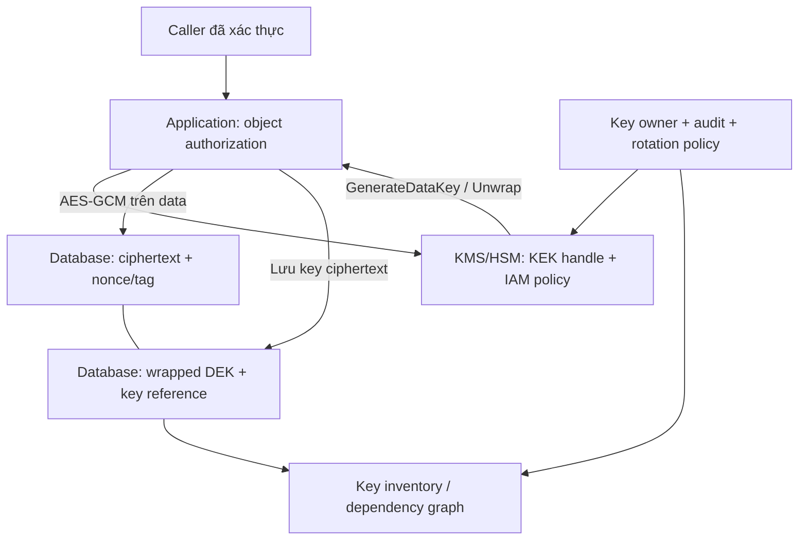
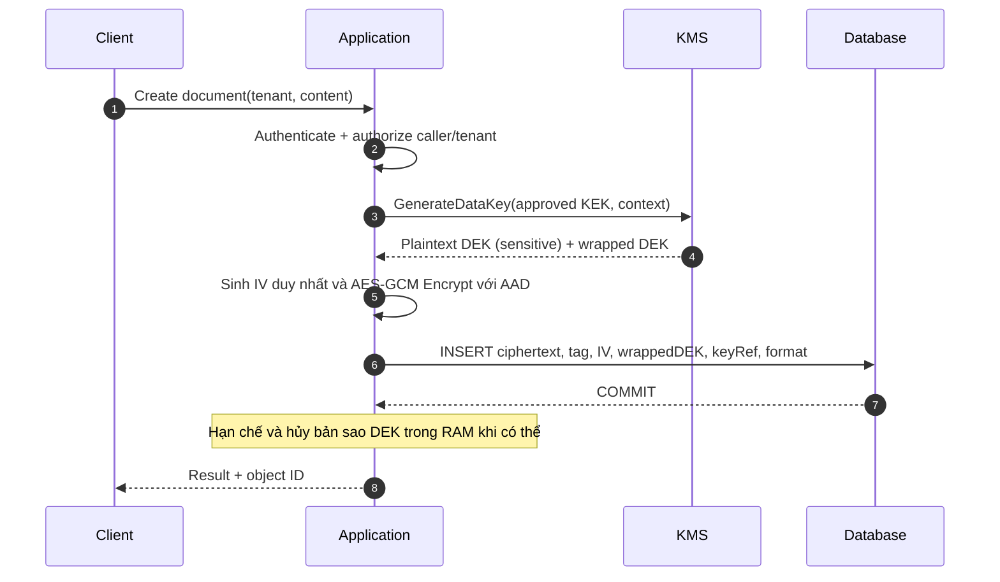
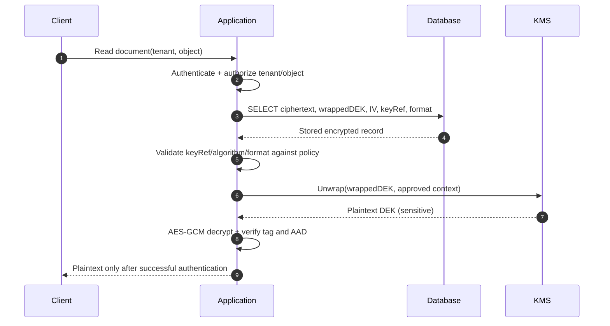
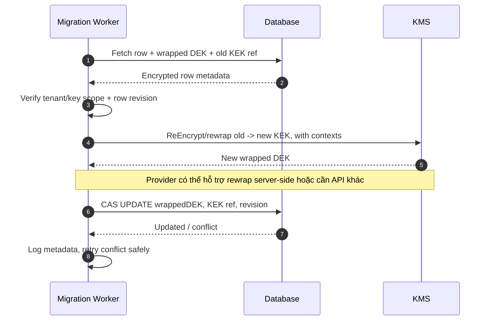
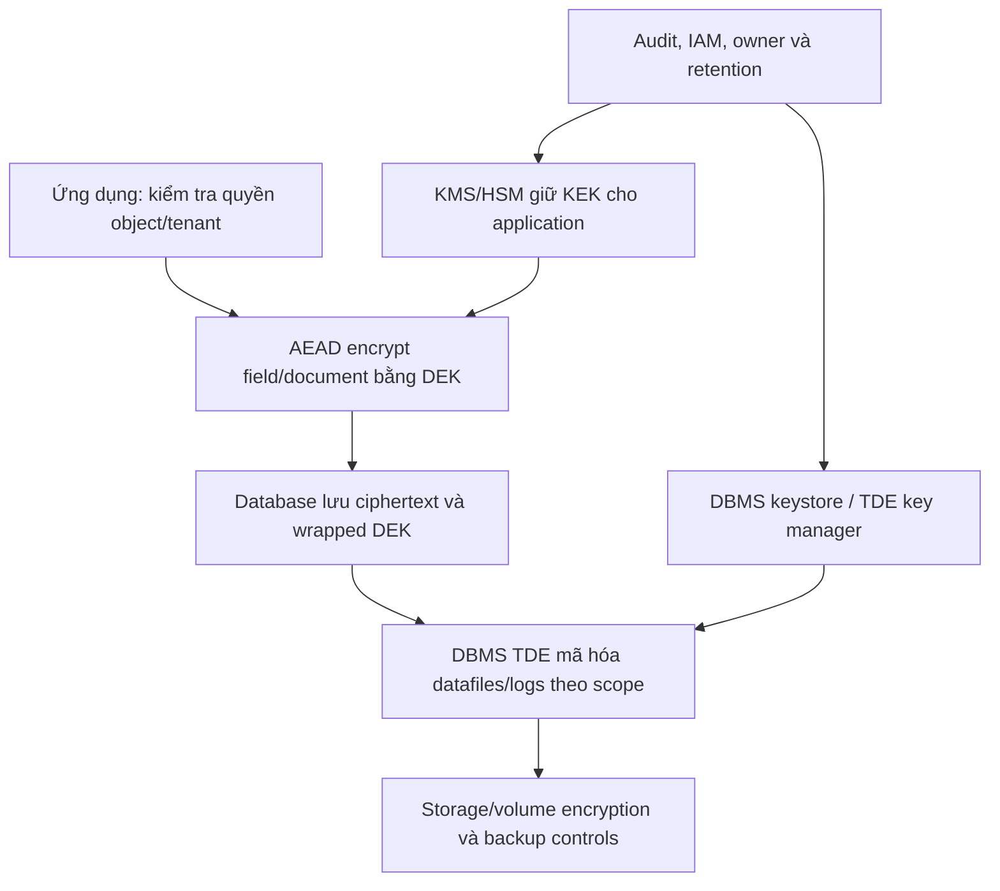
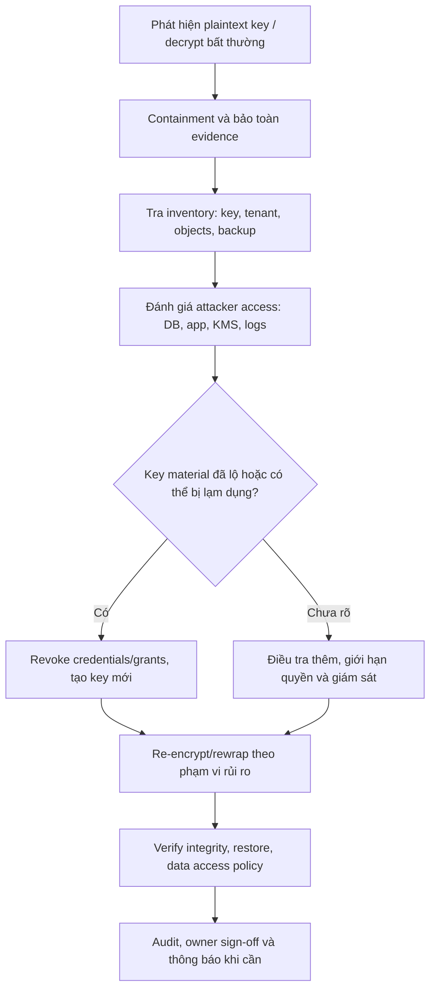

# Database key storage — Lưu trữ khóa mật mã liên quan cơ sở dữ liệu

> **Chương:** Key storage  
> **Module:** SECURITY_KEY_MANAGEMENT_FUNDAMENTALS — hiểu vòng đời khóa mật mã từ tạo, cấp phát, lưu trữ, sử dụng, xoay vòng đến thu hồi và hủy; kết nối mật mã đối xứng, bất đối xứng, chữ ký số, KMS/HSM, envelope encryption, kiểm soát truy cập và kiểm toán để thiết kế hệ thống bảo vệ khóa an toàn.

## 1. Mục tiêu học tập

Sau bài học, bạn có thể:

1. Phân biệt **lưu khóa trong database**, **lưu wrapped data key trong database** và **database encryption at rest** như TDE — ba khái niệm liên quan nhưng không tương đương.
2. Giải thích vì sao cất **plaintext DEK/KEK/private key** trong cùng cơ sở dữ liệu với ciphertext thường tạo ra một rủi ro nghiêm trọng.
3. Thiết kế kiến trúc **envelope encryption**: DEK mã hóa dữ liệu, KEK nằm ở KMS/HSM, database chỉ lưu ciphertext của dữ liệu cùng wrapped DEK và metadata.
4. Thiết lập mô hình **trust boundary**, quyền tối thiểu, tách nhiệm vụ DBA/app/KMS, xác thực và phân quyền theo tenant/object.
5. Thiết kế schema lưu `key ID/version`, algorithm, nonce/IV, AAD schema, wrapped DEK, encryption format, lifecycle metadata và provenance mà **không lưu khóa thô**.
6. Hiểu cách xử lý **transaction consistency, key rotation, rewrap/re-encrypt, backup/restore, replica, migration và cryptographic erasure**.
7. Đọc ví dụ **PostgreSQL SQL** và **Java 17/JCA** về lưu ciphertext và wrapped data key với các giới hạn bảo mật được nêu rõ.
8. Đánh giá **data leakage, compromised DBA, SQL injection, compromised application, log/backup leakage, metadata tampering, rollback và KMS outage**.
9. Xây dựng checklist, kiểm thử âm tính và runbook ứng phó khi phát hiện key material đã được lưu sai chỗ.

## 2. Database key storage là gì?

**Database key storage** có thể được hiểu theo nhiều nghĩa trong thực tế:

- **Lưu key material trực tiếp vào database:** một cột `aes_key` chứa plaintext khóa đối xứng hoặc một bản private key; cách này thường làm tăng rủi ro đáng kể.
- **Lưu key được bọc/mã hóa:** database giữ `wrapped_dek` mà **không có quyền truy cập tự do tới KEK** cần để giải bọc; đây là mô hình phổ biến của envelope encryption.
- **Lưu metadata về khóa:** key ID, alias, version, owner, purpose, status, reference tới KMS/HSM; không có raw secret.
- **Database-side encryption/TDE:** DBMS sử dụng một hệ thống key hierarchy để mã hóa files/pages/logs; không nhất thiết ứng dụng nhìn thấy data keys.

Cần xác định chính xác **khóa nào ở đâu**, **ai có thể sử dụng** và **mỗi lớp bảo vệ chống được đối thủ nào**.

### 2.1. Ví dụ ba phương án

| Phương án | Database lưu | KEK hoặc root of trust nằm ở đâu? | Đặc điểm |
| --- | --- | --- | --- |
| **A — Sai thường gặp** | Plaintext dữ liệu đã mã hóa **và** plaintext AES key ở bảng khác | Cùng DB, cùng đặc quyền | Lấy DB dump có thể lấy cả key và ciphertext |
| **B — Envelope encryption** | Data ciphertext, nonce/tag, **wrapped DEK**, key reference | KMS/HSM/keystore có ranh giới IAM tách biệt | DB dump riêng lẻ khó giải mã nếu KEK và runtime secrets chưa bị lộ |
| **C — TDE** | Tablespace/page/log đã được mã hóa ở tầng storage theo DBMS | TDE key hierarchy/keystore/KMS tùy sản phẩm | Bảo vệ file/volume/backup tương ứng, nhưng truy vấn DB hợp lệ vẫn có thể trả plaintext |

Một hệ thống có thể kết hợp **TDE + application-level envelope encryption**. Hai lớp bảo vệ giải quyết những rủi ro khác nhau, không nên ghi “đã bật TDE nên không cần kiểm soát truy cập dữ liệu”.

### 2.2. Đâu là “khóa lưu trong DB” được chấp nhận?

Một **wrapped DEK** là **ciphertext của key material**; nó vẫn là tài sản nhạy cảm về tính toàn vẹn, nguồn gốc, tính khả dụng và phụ thuộc vòng đời. Tuy nhiên, nó khác với **plaintext DEK**: người chỉ đọc database, không có quyền KEK hoặc đường unwrap hợp lệ, không thể tự nhiên biến wrapped DEK thành khóa AES sử dụng được.

**Không được suy ra** rằng “đã mã hóa key một lần” thì chắc chắn an toàn. Phải kiểm tra:

- Thuật toán key wrapping có **bảo vệ tính toàn vẹn** và được áp dụng đúng.
- **KEK** nằm ngoài phạm vi có thể bị đọc cùng database.
- Quyền `Decrypt/Unwrap` tại KMS chỉ cấp cho workload đã được xác thực và được ủy quyền.
- Wrapped key metadata không thể bị thay/sao chép tùy ý để vượt object/tenant authorization.
- Có vòng đời version, rotation, backup và khả năng phục hồi.

## 3. Phân biệt ba tầng mã hóa của database

### 3.1. Encryption at rest ở ổ đĩa hoặc cloud volume

Disk/volume encryption có thể bảo vệ thiết bị lưu trữ hoặc snapshot khi không có key tương ứng. Khi hệ thống đã mount volume và tiến trình DB có quyền đọc, câu truy vấn thường vẫn nhận plaintext.

**Không tự bảo vệ khỏi DBA có quyền SELECT**, một ứng dụng bị chiếm quyền SQL hoặc dữ liệu xuất ra API/log. Mỗi công nghệ có khả năng và trách nhiệm riêng theo provider.

### 3.2. Transparent Data Encryption (TDE)

**TDE** là cách DBMS mã hóa một phần hoặc toàn bộ tệp dữ liệu, log và những thành phần khác theo sản phẩm. Key hierarchy có thể sử dụng **database encryption key** được bọc bởi certificate/master key/keystore hoặc KMS.

TDE hữu ích để bảo vệ **physical database files và backups** theo phạm vi hỗ trợ, nhưng:

- DBMS giải mã khi phục vụ truy vấn hợp lệ.
- `SELECT sensitive_column FROM ...` có thể trả dữ liệu rõ cho principal được phép.
- SQL injection hoặc role quá rộng vẫn có thể truy cập plaintext.
- Key management cho TDE có thể do DBMS/provider vận hành; **không được giả định key nằm hoàn toàn trong HSM hoặc luôn non-exportable**.
- Khả năng bao phủ temporary files, replication logs, dumps, backups, caches và exports **phải kiểm tra theo sản phẩm**.

### 3.3. Application-level/field-level encryption

Ứng dụng mã hóa giá trị **trước khi gửi dữ liệu vào database**, nên database thường chỉ nhận ciphertext cho những trường đã chọn.

Với **envelope encryption**, app có thể:

1. Xin tạo data key từ KMS hoặc dùng key handle theo design.
2. Dùng DEK mã hóa trường/file bằng AEAD như AES-GCM.
3. Lưu ciphertext, nonce, tag, AAD schema, wrapped DEK và key reference.
4. Khi đọc, xác thực quyền object rồi gọi KMS unwrap, sau đó AEAD verify/decrypt.

Đây là phương án làm giảm khả năng DB-only attacker đọc plaintext, **nhưng app cần DEK/plaintext khi xử lý**, nên compromised application có thể vẫn làm lộ dữ liệu hoặc lạm dụng KMS.

### 3.4. So sánh threat coverage

| Đối thủ/tình huống | Disk encryption | TDE | App-level envelope encryption |
| --- | --- | --- | --- |
| Đĩa vật lý bị tháo/đánh cắp | Thường hữu ích khi key không đi cùng | Hữu ích cho file theo phạm vi | Dữ liệu đã mã hóa tại app |
| Database file/snapshot bị đánh cắp | Phụ thuộc snapshot/key handling | Thường hữu ích nếu backup được bảo vệ đúng | DB dump chứa ciphertext/wrapped DEK |
| DBA có quyền truy vấn plaintext | Thường **không** bảo vệ | Thường **không** bảo vệ | Có thể giảm khả năng đọc trường nhạy cảm nếu DBA không có DEK/KMS |
| SQL injection trong ứng dụng | Không giải quyết | Không giải quyết | Vẫn cần authorization; ciphertext có thể bị đọc/thay |
| App server và KMS credential bị chiếm | Không giải quyết | Không giải quyết | **Có thể bị giải mã** nếu attacker có quyền unwrap/đọc object |
| Key lộ qua logs hoặc memory dump | Không xử lý riêng | Phụ thuộc phạm vi hệ thống | Vẫn có nguy cơ nếu plaintext DEK tồn tại ở app |
| Backup restore | Cần key/volume controls | Cần đúng TDE key hierarchy | Cần wrapped DEK, KEK/key version, nonce/tag/AAD |

**Không có một tầng mã hóa nào thay thế được kiểm tra quyền truy cập, kiểm toán và incident response.**

## 4. Mô hình đe dọa trước khi chọn cách lưu khóa

Trước khi thiết kế một bảng `crypto_keys` hoặc chọn KMS, hãy trả lời:

1. **Tài sản:** plaintext data, DEK, KEK, signing key, credentials, metadata, audit evidence.
2. **Đối thủ:** người chỉ có DB dump, DBA nội bộ, SQL-injection attacker, compromised app, KMS admin, cloud operator, insider, attacker kiểm soát backup.
3. **Quyền đối thủ:** đọc bảng? thay cột? gọi KMS? đọc process memory? sửa IAM? kích hoạt restore? đọc audit?
4. **Ranh giới:** database, app runtime, KMS/HSM, IAM identity, network, CI/CD, secrets, backup và DR region.
5. **Đặc tính cần bảo vệ:** confidentiality, integrity, availability, separation of duties, tenant isolation, key provenance, revocation.
6. **Blast radius:** một row, một tenant, nhiều key versions hay master KEK chung?
7. **Khả năng phục hồi:** key loss và key deletion có khiến dữ liệu lịch sử không đọc được?
8. **Nghĩa vụ tuân thủ:** dữ liệu cá nhân/tài chính, retention/legal hold, HSM requirement, thuật toán và cryptoperiod.

### 4.1. Ba tình huống phải tách biệt

**Tình huống A — Chỉ bị lộ backup DB.** Nếu dữ liệu app-level là ciphertext và wrapped DEK, KEK tách ngoài DB và không lộ, attacker khó giải mã trong điều kiện primitive/key management đúng.

**Tình huống B — Attacker sửa dữ liệu trong DB.** Họ có thể thử thay ciphertext, metadata hoặc wrapped DEK; AEAD/wrapping giúp phát hiện một số thay đổi, nhưng **không tự ngăn replay nguyên bản blob cũ**, thay toàn bộ một row hay thao tác logic trên các metadata không được xác thực.

**Tình huống C — App runtime bị chiếm.** Kẻ tấn công có thể đọc plaintext trong request hoặc dùng quyền `KMS Decrypt` của app. **Envelope encryption không phải biện pháp toàn năng** trước full application compromise; cần workload identity, IAM scope, object authorization, monitoring, hạn chế dữ liệu và egress.

### 4.2. Đừng nhầm “khóa không export được” với “không sử dụng trái phép được”

Một KEK nằm trong HSM và non-exportable có thể vẫn bị attacker lạm dụng qua **API `Decrypt/Unwrap`** nếu workload đã bị chiếm và có quyền gọi API.

Biện pháp cần kết hợp: key policy, workload identity, access control ở lớp app, tenant/object check, KMS encryption context nếu thích hợp, audit, rate limiting, anomaly detection và khả năng thu hồi.

## 5. Tách DEK, KEK và root of trust

### 5.1. Kiến trúc khuyến nghị



Ở thiết kế này:

- **DEK** mã hóa row/object/field hoặc một nhóm dữ liệu được giới hạn.
- **KEK** nằm trong KMS/HSM và được dùng để bọc/giải bọc DEK.
- **Wrapped DEK** có thể lưu cùng ciphertext để phục vụ restore/migration.
- **Key reference** gắn với resource/version hoặc semantics của provider.
- **Key inventory** ghi owner, purpose, data dependencies, access policy, cryptoperiod và backup.
- **Ứng dụng** quyết định caller có quyền trên object/tenant trước khi sử dụng key.

### 5.2. Không nên lưu plaintext KEK ở một bảng khác

Một lỗi kiến trúc:

```text
TABLE customer_data:
  tenant_id | ciphertext | aes_key_id

TABLE secret_keys:
  aes_key_id | plaintext_aes_key
```

Nếu cùng một DB principal hoặc DB dump có thể đọc cả hai bảng, **tách bảng không tạo ra boundary mật mã có ý nghĩa**. SQL grants có thể làm tăng rào cản cho một số principals, nhưng vẫn phải phân tích DBA/admin, backups, snapshots và application SQL permissions.

### 5.3. KEK riêng không có nghĩa mọi DEK đều khác nhau

Một key hierarchy đúng có thể gồm một KEK bọc rất nhiều DEK. Tuy nhiên, nếu ứng dụng vô tình tạo lại cùng DEK cho mọi object, việc có nhiều wrapped DEK records không tạo ra sự độc lập thực sự.

Sinh DEK với **CSPRNG/KMS được phê duyệt**, theo scope được thiết kế, và kiểm soát nonce/usage limits.

### 5.4. Wrapped key có thể có nhiều recipient

Một DEK có thể được bọc bằng nhiều KEK/recipient public keys để phục vụ nhiều hệ thống. Khi đó database có **nhiều key envelopes**:

```text
DEK plaintext (chỉ khi đang xử lý)
  ├── wrapped under KEK-A (prod region)
  ├── wrapped under KEK-B (approved DR)
  └── wrapped for designated recipient C
```

Càng nhiều wrapper, càng nhiều đường phục hồi DEK cần quản trị. **Xóa một wrapper không khiến recipient đã biết DEK quên nó**, và cryptographic erasure cần kiểm tra **mọi bản sao/wrapping path hợp lệ**.

## 6. Những dạng khóa và secret có thể liên quan tới database

| Tài sản | Có nên lưu plaintext trong DB? | Cách lưu/quản lý gợi ý |
| --- | --- | --- |
| **DEK** | Không, trừ mô hình đặc biệt đã đánh giá và có boundary khác | Wrapped DEK + metadata; plaintext chỉ trong trusted runtime khi cần |
| **KEK/master key** | Thường **không** | KMS/HSM/key store có policy độc lập |
| **TDE key** | Theo DBMS/provider, tránh sao chép thủ công | DBMS keystore/KMS với governance và DR |
| **Private signing key** | Không lưu plaintext trong bảng nghiệp vụ | HSM/KMS/keystore phù hợp, chỉ giữ key ref |
| **Public key/certificate** | Có thể lưu nếu phù hợp; không phải secret | Fingerprint, trust anchor/identity validation và versioning |
| **HMAC key** | Không lưu rõ cạnh dữ liệu dùng MAC | KMS/HSM/secret manager phù hợp hoặc wrapped secret |
| **Password pepper** | Không lưu cùng password hash DB | Secret manager/KMS/HSM theo thiết kế |
| **Password salt** | Có thể lưu | Salt không phải secret, phải theo password KDF |
| **AES-GCM nonce/IV** | Có thể lưu | Phải bảo đảm uniqueness theo key, integrity của metadata |
| **Key ID, alias/version, algorithm** | Có thể lưu | Metadata có quyền sửa/kiểm toán; không tự coi mọi ID đáng tin |
| **Wrapped DEK** | Có thể lưu | Integrity-protected wrapping, gắn context và quyền |
| **PSK, recovery secret shares** | Tránh lưu plaintext trong DB nghiệp vụ | Secret store/secure provisioning, quorum khi phù hợp |

### 6.1. Key registry và encrypted data table khác nhau

Một **key registry** có thể quản lý tài sản ở cấp **logical key family / KMS KEK resource**, còn mỗi row mã hóa có **wrapped DEK** và các thông số riêng.

Ví dụ:

```text
crypto_key_registry
  key_ref -> kms resource + owner + purpose + lifecycle policy

encrypted_document
  tenant_id + doc_id + ciphertext + nonce + wrapped_dek
  + wrapping_key_ref + format_version + timestamps
```

**Registry không cần chứa raw KEK/DEK.** Không tạo một bảng `key_registry` dễ truy cập rồi chuyển mọi secret plaintext vào đó.

## 7. Luồng ghi dữ liệu bằng envelope encryption



Các bước bảo mật đáng chú ý:

1. **Xác thực người gọi** và xác định tenant/object từ nguồn tin cậy.
2. Chọn **KEK hợp lệ theo policy**, không nhận tùy ý `kekId` do client gửi.
3. Nếu API trả **plaintext DEK**, app chỉ giữ nó ngắn nhất có thể.
4. Mã hóa bằng **AEAD như AES-GCM** với nonce/IV đúng và AAD được canonical hóa.
5. Database lưu **ciphertext và key envelope** cùng metadata trong một transaction.
6. Nếu ghi DB thất bại, không log DEK; xử lý retry/idempotency để không tạo artifact mồ côi.
7. Chỉ trả kết quả nghiệp vụ khi trạng thái database đã được commit theo contract.

### 7.1. Không giả định KMS `GenerateDataKey` luôn trả cùng kiểu dữ liệu

Các provider có API khác nhau: `GenerateDataKey` có thể trả raw DEK + wrapped DEK, trong khi `CreateKey` thường tạo key resource/handle, còn `Encrypt` có thể bọc một secret bên ngoài. **Đọc API contract của provider trước khi thiết kế.**

Đặc biệt: nếu app nhận plaintext DEK, không thể tuyên bố “DEK chưa bao giờ rời KMS”.

### 7.2. Ai phải chọn AAD?

AAD nên lấy từ **metadata đã xác minh** (ví dụ tenant ID và object ID do server quản lý), với encoding có version và không mơ hồ.

Một ví dụ khái niệm:

```text
aad = canonicalEncode(
    protocol = "encrypted-document-v1",
    tenantId = authorizedTenantId,
    objectId = serverAssignedDocumentId,
    formatVersion = 1
)
```

Không dùng chuỗi nối tùy tiện `tenant + "|" + objectId` khi các trường có thể chứa ký tự phân cách và không có encoding chuẩn. Đối với giao thức sản phẩm thực, nên dùng **length prefix hoặc format chuẩn được canonical hóa**.

### 7.3. Context của KMS khác AAD của AES-GCM

Một KMS có thể hỗ trợ **encryption context/AAD cho ciphertext của wrapped DEK**. AES-GCM ở ứng dụng cũng có AAD riêng cho **data ciphertext**.

Hai lớp này liên quan nhưng không hoàn toàn giống nhau:

- Context của KMS phải được cung cấp lại đúng theo API để unwrap nếu provider yêu cầu.
- AAD của AES-GCM phải khớp đúng byte khi decrypt.
- Không coi encryption context là secret; provider có thể log context.
- Không dùng context do client tự khai làm bằng chứng authorization.
- Sự thay đổi format cần migration/compatibility theo version.

## 8. Luồng đọc và giải mã dữ liệu



### 8.1. Thứ tự quan trọng

**Không** gọi KMS `Decrypt` cho một ciphertext rồi mới hỏi caller có quyền đọc object hay không. Nếu có thể, xác thực/ủy quyền **trước** khi giải bọc để giảm lạm dụng KMS, side channel và chi phí.

Trong ứng dụng có nhiều lớp, quyền cuối vẫn cần kiểm tra tại điểm đọc dữ liệu, kể cả khi gateway đã xác thực session.

### 8.2. Cần kiểm tra gì khi đọc từ DB?

- Đúng **tenant/object** theo quyền đã xác thực.
- Metadata `format_version` và `algorithm` thuộc allowlist.
- `wrapping_key_ref` được phép cho domain/tenant này.
- Wrapped DEK và ciphertext có kích thước hợp lý; không tin blob không giới hạn từ DB.
- Nonce/IV và tag có độ dài phù hợp.
- KMS decrypt/unwrap được gọi theo **đúng context** và service identity.
- Nếu AEAD tag sai, **không trả plaintext một phần**, không fallback sang decrypt không xác thực.
- Audit lỗi hợp lý mà không log raw secret hoặc dữ liệu nhạy cảm.

### 8.3. Vì sao vẫn cần kiểm tra tính toàn vẹn metadata?

Một DB attacker có thể thay `algorithm` hoặc `key_ref` nếu các cột này không được kiểm soát. Nếu ứng dụng lấy chúng từ row rồi gọi thuật toán/key tùy ý, có thể xảy ra downgrade/confusion hoặc truy cập key ngoài ý muốn.

Hãy **allowlist** algorithm, version, key reference theo server-side policy; ràng buộc những metadata quan trọng vào **AAD/wrapping context** theo protocol và cân nhắc nguồn tin cậy bên ngoài DB cho những giá trị quyết định authorization.

## 9. SQL: schema lưu ciphertext và wrapped DEK

Ví dụ PostgreSQL dưới đây minh họa **một DEK cho mỗi document**. Các cột `bytea` chứa ciphertext/nonce/wrapped DEK, **không chứa plaintext key material**. Mô hình không yêu cầu một thư viện KMS hay sản phẩm DBMS cụ thể.

### 9.1. Key registry chỉ giữ metadata

```sql
-- PostgreSQL minh họa. Database này KHÔNG lưu raw DEK hoặc raw KEK.
CREATE TABLE crypto_key_registry (
    key_ref              TEXT PRIMARY KEY,
    key_kind             TEXT NOT NULL,
    purpose              TEXT NOT NULL,
    environment          TEXT NOT NULL,
    owner_team_id        TEXT NOT NULL,
    custodian_team_id    TEXT NOT NULL,
    kms_provider_ref     TEXT NOT NULL,
    lifecycle_state      TEXT NOT NULL,
    allow_new_encryption BOOLEAN NOT NULL,
    created_at           TIMESTAMPTZ NOT NULL,
    last_review_at       TIMESTAMPTZ,
    CHECK (key_kind IN ('KEK', 'PUBLIC_VERIFY', 'SIGNING_REF')),
    CHECK (lifecycle_state IN (
        'PENDING', 'ACTIVE', 'DECRYPT_ONLY',
        'DISABLED', 'PENDING_DELETION', 'DESTROYED'
    ))
);
```

**Lưu ý:** `key_ref` phải là định danh được cấp/chuẩn hóa bởi hệ thống và đối chiếu với canonical KMS key identity, không đơn giản tin giá trị trong request. Một row registry không làm cho `owner_team_id` tự hợp lệ; cần join directory/approval policy.

### 9.2. Bảng lưu trữ tài liệu mã hóa

```sql
CREATE TABLE encrypted_document (
    tenant_id        TEXT NOT NULL,
    document_id      UUID NOT NULL,
    crypto_format    SMALLINT NOT NULL,
    data_algorithm   TEXT NOT NULL,
    nonce            BYTEA NOT NULL,
    ciphertext_tag   BYTEA NOT NULL,
    wrapped_dek      BYTEA NOT NULL,
    wrapping_key_ref TEXT NOT NULL
                     REFERENCES crypto_key_registry(key_ref),
    aad_schema       TEXT NOT NULL,
    created_at       TIMESTAMPTZ NOT NULL DEFAULT CURRENT_TIMESTAMP,
    updated_at       TIMESTAMPTZ NOT NULL DEFAULT CURRENT_TIMESTAMP,
    PRIMARY KEY (tenant_id, document_id),
    CHECK (crypto_format = 1),
    CHECK (data_algorithm = 'AES-256-GCM'),
    CHECK (octet_length(nonce) = 12),
    CHECK (octet_length(ciphertext_tag) >= 16),
    CHECK (octet_length(wrapped_dek) > 0)
);
```

**Các `CHECK` chỉ kiểm tra cú pháp tối thiểu**, không xác minh AEAD tag hợp lệ, nonce duy nhất theo key, key reference đúng tenant hoặc identity của người gọi. Một row ciphertext có thể hợp lệ về SQL nhưng giải mã thất bại.

### 9.3. Một số đặc điểm quan trọng

- `PRIMARY KEY (tenant_id, document_id)` giúp định danh object rõ.
- `wrapped_dek` được giữ cùng record nên có thể khôi phục nếu có quyền KMS; nó vẫn cần bảo vệ integrity và access.
- `wrapping_key_ref` tham chiếu tới registry nhưng **không đồng nghĩa** version/material của KMS đã thực sự đúng.
- `nonce` 12 byte phù hợp profile AES-GCM đang dùng; **uniqueness phải được quản lý bởi encryption process**, không thể chỉ dựa vào `CHECK length`.
- `ciphertext_tag` là byte chứa ciphertext và authentication tag; không đính kèm plaintext.
- `aad_schema` cho biết cách tái tạo AAD; **không tin schema tuỳ ý** từ attacker. Chỉ cho các version đã phê duyệt.
- RLS/column grants có thể được cấu hình thêm, nhưng **không thay** application authorization và key IAM.

### 9.4. Vì sao không đặt raw DEK vào bảng?

Anti-pattern:

```sql
-- SAI: nếu DB dump lộ, attacker lấy cả ciphertext và plaintext DEK.
CREATE TABLE insecure_document (
    document_id UUID PRIMARY KEY,
    ciphertext BYTEA NOT NULL,
    dek_plaintext BYTEA NOT NULL
);
```

Một thiết kế lưu `dek_plaintext` **dưới một tên cột khó đoán hoặc base64** vẫn là lưu khóa rõ. Base64/hex chỉ thay cách biểu diễn, **không thêm bảo mật**.

### 9.5. Key version và wrapping ciphertext format

Một số provider mã hóa key reference/version ngay trong ciphertext blob; provider khác dùng các tham số bên ngoài hoặc key material version có semantics riêng.

Không tạo quy tắc rằng mọi KMS có `keyVersion=v1` độc lập hoặc cho phép lựa chọn bất kỳ key ID trên decrypt. Schema sản phẩm cần lưu **đúng thông tin mà provider yêu cầu để phục hồi**, cùng format/provenance để migration về sau.

## 10. Giao dịch nhất quán và những tình huống lỗi

### 10.1. Một record ciphertext phải đi cùng envelope của nó

Ghi riêng ciphertext và wrapped DEK trong hai transaction dễ tạo dữ liệu không thể decrypt nếu một bước thất bại. Thường nên dùng **một transaction database** ghi ciphertext, nonce, wrapped DEK, key reference và format metadata cùng nhau.

```text
KMS GenerateDataKey
    ↓
AES-GCM encrypt
    ↓
BEGIN TRANSACTION
    INSERT encrypted_document(
        ciphertext_tag, nonce, wrapped_dek, wrapping_key_ref, ...
    )
COMMIT
    ↓
Trả kết quả nghiệp vụ
```

**KMS và database không nằm trong một ACID transaction chung** theo mặc định. Nếu KMS tạo data key thành công nhưng DB insert thất bại, xử lý retry/idempotency rõ, đừng suy rằng rollback DB cũng “xóa” mọi vật liệu khóa đã sinh hoặc KMS audit event.

### 10.2. Các kiểu thất bại

| Bước lỗi | Hậu quả | Hướng xử lý |
| --- | --- | --- |
| KMS GenerateDataKey fail | Không có DEK được duyệt | Fail closed, không fallback seed/time |
| App encrypt fail | Không có ciphertext hợp lệ | Không ghi record giả; xóa buffer owned best-effort |
| DB insert fail | Ciphertext chưa lưu | Retry theo contract, tránh double create |
| DB commit không rõ kết quả | Có thể đã ghi nhưng client timeout | Dùng idempotency key và truy vấn trạng thái |
| KMS unwrap fail khi đọc | Không đọc được plaintext | Kiểm tra IAM/key state/context, không fallback plaintext key |
| Tag AEAD fail | Integrity/metadata/key mismatch | Từ chối dữ liệu và mở điều tra tùy mức độ |
| Key version bị disable | Dữ liệu cũ không mở được | Restore/rollover theo runbook, không tự cấp quyền rộng |
| Migration write partial | Một số row có envelope cũ/mới | Dùng versioned formats, atomic CAS và resume |

### 10.3. Không ghi plaintext ra “bảng staging tạm”

Một số pipeline giải mã dữ liệu ở app rồi viết plaintext vào `staging_table`, mới chạy job mã hóa lại. Nếu staging nằm trong cùng DB, redo/WAL, backups và replication có thể mang **plaintext** lâu hơn dự kiến.

Ưu tiên thiết kế **streaming/batch trong memory có giới hạn**, transaction boundaries và secure temporary storage khi cần. Nếu không thể tránh staging, phải xem nó như **dữ liệu nhạy cảm** với lifecycle, policy, encryption, retention và audit riêng.

## 11. Quyền truy cập: DBA, application và KMS không cùng một vai trò

Một hệ thống có thể có ít nhất các actor:

| Actor | Cần thực hiện | Không nên mặc định có |
| --- | --- | --- |
| **DBA** | Tuning, backup, replication, schema migration theo thẩm quyền | `KMS Decrypt` mọi DEK của khách hàng |
| **Application write service** | Tạo/cập nhật ciphertext và key envelope | Quyền thay master KEK, export HSM key |
| **Application read service** | Đọc object được cho phép và unwrap DEK tương ứng | Quyền cross-tenant hoặc toàn bộ KMS admin |
| **KMS administrator** | Quản lý key policy/rotation theo workflow | Quyền đọc mọi application plaintext |
| **Key owner** | Quyết định purpose, cryptoperiod, scope, grants | Quyền xem raw key chỉ vì là owner |
| **Security/SOC** | Audit, phát hiện abuse, phản ứng sự cố | Bản sao DEK/KEK plaintext |
| **Backup/DR service** | Khôi phục dữ liệu và key references có kiểm soát | Quyền thường trực đọc dữ liệu mọi tenant |
| **End user** | Đọc/sửa object thuộc quyền của mình | Chỉ định bất kỳ key reference/KMS context nào |

### 11.1. TDE không thay row-level authorization

Một user có thể dùng đúng SQL credential và vẫn không có quyền đọc tài liệu của tenant khác. TDE mã hóa pages, nhưng khi DB phục vụ truy vấn, plaintext sẽ đến client được phép theo quyền DB.

Cần có:

- Application-level object/tenant authorization.
- DB roles và **row-level security** nếu phù hợp, nhưng không coi đó là phương án duy nhất.
- Tách read/write/admin roles và production/non-production.
- Kiểm tra quyền KMS theo workload identity, key và context.
- Audit cả DB access và KMS `Decrypt/Unwrap` events.

### 11.2. Ngăn confused deputy

Giả sử ứng dụng có quyền `KMS Decrypt` trên nhiều KEK. Nếu client có thể gửi `keyRef="other-tenant-key"`, app có thể trở thành **confused deputy** và giải bọc hộ attacker.

Cần chọn key reference từ **server-side mapping và policy** dựa trên tenant/object đã xác thực, không tin key ID trong payload. Khi đọc record từ DB, đối chiếu key reference với allowlist được quản trị và identity/data owner, vì DB cũng có thể bị sửa.

### 11.3. Chỉ giới hạn KMS role chưa đủ

KMS có thể thấy workload identity của một service nhưng không tự biết **end-user** hay business object đang được truy cập. Một service `invoice-reader` được phép decrypt cho nhiều hóa đơn vẫn cần kiểm tra quyền **ở cấp user, tenant và object** trước mỗi request.

## 12. Toàn vẹn: từ ciphertext đến metadata và chống replay

### 12.1. AES-GCM bảo vệ gì?

AES-GCM tạo một **authentication tag** gắn với ciphertext và AAD dưới một khóa và nonce cụ thể. Nếu ciphertext, tag hoặc AAD bị thay **không phù hợp với key**, kiểm tra thường thất bại.

Nhưng các thuộc tính sau **không tự đạt**:

- Anti-replay toàn bộ ciphertext hợp lệ cũ.
- Chứng minh caller có quyền nghiệp vụ.
- Chứng minh giá trị `tenant_id` trong DB là đúng nếu cả ciphertext/AAD và row metadata bị thao túng có phối hợp.
- Ngăn DBA xóa record hoặc ngừng trả dữ liệu.
- Chứng minh timestamp/version trong DB chưa bị rollback.

### 12.2. Cut-and-paste và rollback

Giả sử attacker có quyền **ghi** vào database. Họ có thể:

1. Thay một ciphertext bằng byte ngẫu nhiên → tag AEAD fail.
2. Sao chép **toàn bộ blob ciphertext + wrapped DEK + metadata** của object A sang object B → nếu AAD không ràng buộc object identity, app có thể decrypt sai object.
3. Rollback toàn bộ row B về snapshot cũ từng hợp lệ → AEAD vẫn có thể xác minh đúng vì tag không tự chứa monotonic freshness.
4. Thay `keyRef`/algorithm/format để kích hoạt nhánh xử lý sai nếu app tin metadata từ DB.

Cần:

- Ràng buộc tenant/object/format đúng vào **data AAD** và **KMS encryption context** khi phù hợp.
- Đối chiếu key ref/algorithm với server-side policy, không chấp nhận arbitrary algorithms.
- Chống rollback bằng **version/revision có kiểm soát từ nguồn đáng tin hoặc cơ chế đồng thuận/trạng thái ngoài phạm vi attacker**, nếu threat model yêu cầu.
- Ghi audit cho thay đổi dữ liệu/key metadata và dùng integrity controls phù hợp.
- Phân quyền DB để giảm khả năng sửa/xóa row.

**Không tuyên bố AAD một mình ngăn mọi rollback** khi attacker có thể thay cả bản ghi và dữ liệu AAD liên quan.

### 12.3. Unique nonce không đủ chỉ nhờ `UNIQUE(nonce)` trong DB

Với mỗi DEK per document, có thể cùng nonce xuất hiện ở hai DEK độc lập mà không vi phạm yêu cầu uniqueness theo key. Ngược lại, nếu một DEK được chia sẻ trên nhiều rows, **cần đảm bảo nonce không lặp dưới chính DEK đó**, kể cả khi dữ liệu nằm ở nhiều shard/DB.

Một `UNIQUE(nonce)` toàn bảng vừa có thể quá chặt cho key độc lập, vừa không đủ nếu ciphertext được tạo ngoài DB hoặc sau restore/snapshot. Nonce management phải dựa vào **key scope, invocation counters, random IV limits và runtime coordination** theo chuẩn AEAD.

## 13. Khóa lưu ở KMS/HSM, dữ liệu lưu ở DB: giới hạn bảo mật

### 13.1. KMS làm được gì?

Tùy provider, KMS có thể:

- Sinh hoặc bảo vệ **KEK** bằng một security boundary chuyên dụng.
- Tạo/unwrap **DEK** theo key policy.
- Cung cấp audit, key disable, rotation hoặc key material versioning.
- Hạn chế quyền `Encrypt/Decrypt/GenerateDataKey/Sign/Unwrap` theo identity/context.
- Giúp tách vòng đời khóa khỏi lifecycle của database.

Điều này **không tự thay** quyền object/tenant ở ứng dụng, cũng không đảm bảo app không log plaintext DEK.

### 13.2. HSM và non-exportable KEK

Với HSM:

- Key handle có thể là non-exportable theo chính sách và capability.
- Một số thao tác chỉ thực hiện bên trong HSM.
- Việc sao lưu/restore/replication thường cần quy trình domain/quorum riêng.
- Một application được quyền `Unwrap/Decrypt` có thể vẫn nhận **plaintext DEK** nếu API cho phép, dù KEK không export.

**Không đồng nhất non-exportable KEK với việc plaintext dữ liệu không bao giờ đi vào app memory.**

### 13.3. Khi nào cần key mã hóa được lưu dưới dạng wrapped trong chính DB?

Các phương án có thể hợp lệ:

- Mỗi row/object có **wrapped DEK** và KEK do KMS quản lý.
- Một key family có wrapped DEK được lưu trong bảng key envelopes riêng, tham chiếu bởi data rows.
- Một bên nhận có **public encryption key đã xác thực**, DEK được bọc/chuyển bằng RSA-OAEP hoặc HPKE phù hợp.
- Database TDE sử dụng keystore/KMS theo thiết kế DBMS riêng.

Các phương án này cần trả lời rõ **ai có thể unwrap, metadata nào phải còn tồn tại, key nào được rotate, và backup nào phụ thuộc**.

### 13.4. Khi nào có thể dùng DB keystore trực tiếp?

Một số DBMS có hệ thống quản lý TDE master keys và keystore/HSM integration riêng. Điều này có thể phù hợp cho **database-at-rest key hierarchy**, nhưng phải kiểm tra kỹ:

- DBMS giữ dạng nào của key material?
- KEK/master key nằm trong DB, OS keystore, cloud KMS, HSM hay external key manager?
- Ai có quyền mở keystore/rotate key?
- Export/import backup và standby/replica yêu cầu gì?
- Key loss sẽ ảnh hưởng backup/log/datafiles ra sao?
- DBA nào có quyền xem plaintext qua truy vấn?

Không tự lấy ví dụ một DBMS rồi áp metadata/version semantics cho mọi sản phẩm khác.


## 14. Java 17: ví dụ lưu encrypted row và wrapped DEK

Ví dụ sau minh họa **ranh giới thiết kế** bằng Java/JCA: ứng dụng lấy DEK từ một **KMS gateway trừu tượng**, mã hóa AES-256-GCM, rồi lưu **ciphertext cùng wrapped DEK**. Không có mã KMS vendor-specific vì từng provider có API và semantics khác nhau.

Các interface `KmsGateway`, `DocumentStore` và `AccessPolicy` đại diện các thành phần cần triển khai riêng; ví dụ **không thể dùng nguyên trạng làm hệ thống production**. Mã giữ rõ vị trí kiểm tra quyền, xử lý lỗi và hạn chế sao chép plaintext DEK.

```java
import java.nio.ByteBuffer;
import java.nio.charset.StandardCharsets;
import java.security.GeneralSecurityException;
import java.security.SecureRandom;
import java.util.Arrays;
import java.util.Map;
import java.util.Objects;
import java.util.UUID;

import javax.crypto.Cipher;
import javax.crypto.spec.GCMParameterSpec;
import javax.crypto.spec.SecretKeySpec;

public final class EncryptedDocumentService {
    private static final SecureRandom RNG = new SecureRandom();
    private static final int NONCE_BYTES = 12;
    private static final int TAG_BITS = 128;
    private static final int FORMAT_VERSION = 1;

    public record Principal(String subject, String authenticatedTenant) {}

    // Gateway phải kiểm tra IAM/policy và gọi API provider thật.
    public interface KmsGateway {
        DataKey generateDataKey(
                String approvedKekRef, Map<String, String> context)
                throws Exception;

        byte[] unwrapDataKey(
                String approvedKekRef, byte[] wrappedDek,
                Map<String, String> context) throws Exception;
    }

    // Array trong DataKey là bí mật; caller sở hữu và phải cleanup
    // best-effort sau khi kết thúc tác vụ.
    public record DataKey(byte[] plaintextDek, byte[] wrappedDek) {}

    public record StoredDocument(
            String tenantId,
            UUID documentId,
            int formatVersion,
            String algorithm,
            byte[] nonce,
            byte[] ciphertextAndTag,
            byte[] wrappedDek,
            String kekRef
    ) {}

    public interface DocumentStore {
        void insertAtomically(StoredDocument record) throws Exception;
        StoredDocument find(String tenant, UUID id) throws Exception;
    }

    public interface AccessPolicy {
        // Mọi hàm phải dựa vào identity đã xác thực và policy thực.
        void requireCreate(Principal principal, UUID documentId);
        void requireRead(Principal principal, UUID documentId);

        // Lấy KEK từ registry tin cậy, KHÔNG từ input do client nhập.
        String approvedKekForNewWrite(String tenant);

        // Cho phép key lịch sử đúng tenant/object trong thời gian đọc.
        void requireApprovedHistoricalKek(
                String tenant, UUID documentId, String kekRef);
    }

    private final KmsGateway kms;
    private final DocumentStore store;
    private final AccessPolicy policy;

    public EncryptedDocumentService(
            KmsGateway kms, DocumentStore store, AccessPolicy policy) {
        this.kms = Objects.requireNonNull(kms);
        this.store = Objects.requireNonNull(store);
        this.policy = Objects.requireNonNull(policy);
    }

    public UUID write(Principal principal, byte[] plaintext)
            throws Exception {

        Objects.requireNonNull(principal);
        Objects.requireNonNull(plaintext);
        String tenant = principal.authenticatedTenant();
        UUID id = UUID.randomUUID();

        policy.requireCreate(principal, id);
        String kekRef = policy.approvedKekForNewWrite(tenant);
        Map<String, String> kmsContext = context(tenant, id);

        DataKey dataKey = kms.generateDataKey(kekRef, kmsContext);
        byte[] dek = Objects.requireNonNull(dataKey.plaintextDek());

        try {
            if (dek.length != 32) {
                throw new GeneralSecurityException(
                    "Expected a 256-bit data key");
            }

            // Mỗi document có DEK độc lập; mã hóa đúng một lần.
            byte[] nonce = new byte[NONCE_BYTES];
            RNG.nextBytes(nonce);

            Cipher cipher = Cipher.getInstance("AES/GCM/NoPadding");
            cipher.init(
                Cipher.ENCRYPT_MODE,
                new SecretKeySpec(dek, "AES"),
                new GCMParameterSpec(TAG_BITS, nonce)
            );
            cipher.updateAAD(aad(tenant, id, FORMAT_VERSION));
            byte[] ciphertext = cipher.doFinal(plaintext);

            // Không ghi plaintext DEK. Lưu các thành phần cùng transaction.
            StoredDocument record = new StoredDocument(
                tenant,
                id,
                FORMAT_VERSION,
                "AES-256-GCM",
                nonce,
                ciphertext,
                dataKey.wrappedDek(),
                kekRef
            );
            store.insertAtomically(record);
            return id;

        } finally {
            // Chỉ cleanup best-effort cho mảng này.
            // Provider/JVM/Cipher có thể tạo bản sao không zeroize được.
            Arrays.fill(dek, (byte) 0);
        }
    }

    public byte[] read(Principal principal, UUID id) throws Exception {
        Objects.requireNonNull(principal);
        Objects.requireNonNull(id);

        String tenant = principal.authenticatedTenant();
        policy.requireRead(principal, id);

        StoredDocument record = store.find(tenant, id);
        if (record == null) {
            throw new SecurityException("Document not found");
        }

        if (!tenant.equals(record.tenantId())
                || !id.equals(record.documentId())
                || record.formatVersion() != FORMAT_VERSION
                || !"AES-256-GCM".equals(record.algorithm())
                || record.nonce() == null
                || record.nonce().length != NONCE_BYTES
                || record.ciphertextAndTag() == null
                || record.ciphertextAndTag().length < TAG_BITS / 8) {
            throw new SecurityException("Invalid encrypted record");
        }

        // Không gọi KMS cho một key reference ngoài tenant policy.
        policy.requireApprovedHistoricalKek(
            tenant, id, record.kekRef());

        Map<String, String> kmsContext = context(tenant, id);
        byte[] dek = kms.unwrapDataKey(
            record.kekRef(), record.wrappedDek(), kmsContext);

        try {
            if (dek == null || dek.length != 32) {
                throw new GeneralSecurityException(
                    "Invalid unwrapped data key");
            }

            Cipher cipher = Cipher.getInstance("AES/GCM/NoPadding");
            cipher.init(
                Cipher.DECRYPT_MODE,
                new SecretKeySpec(dek, "AES"),
                new GCMParameterSpec(TAG_BITS, record.nonce())
            );
            cipher.updateAAD(aad(tenant, id, FORMAT_VERSION));

            // doFinal chỉ trả plaintext hợp lệ nếu AEAD tag đúng.
            return cipher.doFinal(record.ciphertextAndTag());

        } finally {
            if (dek != null) {
                Arrays.fill(dek, (byte) 0);
            }
        }
    }

    private static Map<String, String> context(String tenant, UUID id) {
        return Map.of(
            "purpose", "encrypted-document-v1",
            "tenant", tenant,
            "document", id.toString()
        );
    }

    // Binary encoding có length prefix và format version rõ ràng.
    private static byte[] aad(String tenant, UUID id, int version) {
        byte[] t = tenant.getBytes(StandardCharsets.UTF_8);
        ByteBuffer b = ByteBuffer.allocate(4 + t.length + 16 + 4);
        b.putInt(t.length);
        b.put(t);
        b.putLong(id.getMostSignificantBits());
        b.putLong(id.getLeastSignificantBits());
        b.putInt(version);
        return b.array();
    }
}
```

### 14.1. Những điểm đúng của ví dụ

- `write` tạo **document ID trước khi sinh DEK**, để có thể ràng buộc ID vào AAD và KMS context.
- `AccessPolicy` phải xác định **tenant từ danh tính đã xác thực**, không từ một tham số chưa kiểm chứng.
- `approvedKekForNewWrite` chọn KEK từ **registry/owner policy đáng tin**, không để client quyết định.
- `read` xác nhận tenant, ID, algorithm, format và historical key reference trước khi unwrap.
- Data ciphertext dùng **AES-256-GCM**, wrapped DEK do KMS cung cấp theo contract.
- Mỗi document trong ví dụ có DEK mới và **một lần mã hóa**, giảm độ phức tạp nonce reuse; vẫn phải đảm bảo RNG và retry semantics phù hợp.
- Bản ghi `StoredDocument` chứa ciphertext và wrapped DEK, **không chứa plaintext DEK**.
- Cleanup `dek` được thực hiện trong `finally` ngay cả khi mã hóa, DB hoặc KMS gặp lỗi.

### 14.2. Giới hạn an toàn phải biết

1. Các `record` ở ví dụ chứa `byte[]` nhưng **chưa defensive copy**; production nên clone dữ liệu mutable và xác định rõ ownership của buffer, tránh code khác thay metadata sau validation.
2. `SecretKeySpec` và `Cipher` có thể tạo bản sao key trong JVM/provider; `Arrays.fill` không chứng minh zeroization tuyệt đối. Nếu cần assurance cao, dùng key handle/HSM/API thích hợp.
3. Không có rate limit, timeout, circuit breaker, retry, key cache policy, audit logging, KMS error classification hoặc DB pooling.
4. `AccessPolicy` chưa có implementation. **Thiếu authorization thực = không an toàn**, dù phần AES-GCM đúng.
5. Không có giới hạn kích thước `wrappedDek`/`ciphertextAndTag` ở tất cả đường vào; production cần resource limits chống DoS.
6. `KmsGateway` phải xác minh provider key identity, key usage, cryptographic context và IAM; không được tin một `kekRef` từ DB mà không đối chiếu.
7. Ví dụ không có chiến lược chống **rollback dữ liệu hợp lệ cũ** hoặc xử lý optimistic concurrency.
8. `UUID.randomUUID()` phục vụ object ID, **không được dùng thay nguồn sinh DEK**.
9. Không có chiến lược **retention, cryptoperiod, backup/DR và rotation** — các phần sau giải quyết ở mức thiết kế.

### 14.3. Khóa riêng cho mỗi document hay key cache?

Có thể tối ưu bằng cách cache decrypted DEK trong memory một thời gian, nhưng điều này tăng **thời gian lộ khóa**, khó thu hồi quyền và nguy cơ key reuse/nonce management. Nếu hệ thống cần cache, phải có:

- Thời gian sống và số lần dùng được giới hạn.
- Phân vùng cache theo key/tenant/purpose.
- Cơ chế vô hiệu khi revoke/rotate.
- Không log và không ghi cache ra disk/swap ngoài policy.
- Đánh giá rủi ro khi app process bị compromise.

Một thiết kế **DEK mới cho mỗi object** thường giúp đơn giản hóa isolation, đổi lại cần thêm wrapped DEK/metadata và KMS interactions.

## 15. Quản lý key reference, version và khả năng tương thích

### 15.1. Key reference không phải secret nhưng quyết định khả năng decrypt

Khi dữ liệu được ghi lần đầu, metadata phải cho phép xác định:

- Nhà cung cấp KMS/HSM hoặc trust domain thích hợp.
- Key resource hoặc alias/version theo semantics provider.
- Wrapping mode, algorithm/profile được dùng cho DEK.
- KMS context/AAD, nếu API yêu cầu.
- Crypto format version cho data ciphertext.
- Key state và quyền decrypt cũ theo lifecycle.

Nếu **không biết key nào đã wrap DEK**, backup ciphertext có thể trở thành dữ liệu không thể phục hồi dù DB vẫn còn nguyên.

### 15.2. Alias có thể đổi đích

Một alias như `invoice-kek-current` thường phục vụ ghi mới, nhưng không nên làm nguồn duy nhất để decrypt file cũ. Sau rotation, alias có thể trỏ đến key khác, trong khi bản ghi cũ vẫn cần key material lịch sử.

Dùng **stable resource identity** hoặc ciphertext/key-version semantics được provider hỗ trợ. Không tự tạo version từ ngày giờ nếu provider không có cách lựa chọn version tương ứng.

### 15.3. Format version và migration

Một record mã hóa cần tách:

- `crypto_format`: cấu trúc serialization của toàn bộ envelope.
- `data_algorithm`: AES-GCM hoặc mode được allowlist.
- `nonce`/tag: thông số của data encryption.
- `wrapping_key_ref`: reference tới KEK.
- `wrapped_dek`: ciphertext của DEK.
- `aad_schema`: cách tái tạo byte AAD.
- `migration_revision`: số phiên bản phục vụ CAS/optimistic locking, nếu cần.

Một format version **không phải** key material version. Hai document cùng format v1 vẫn có thể dùng KEK versions khác nhau.

### 15.4. Không chấp nhận thuật toán từ dữ liệu chưa tin cậy

Đừng làm:

```java
// NGUY HIỂM nếu dbRow.algorithm() có thể bị sửa tùy ý:
Cipher c = Cipher.getInstance(dbRow.algorithm());
```

Hãy kiểm tra `algorithm` nằm trong **danh sách được phê duyệt**, gắn với format version đã xác thực và policy của tenant/dữ liệu. Không fallback từ AES-GCM sang AES-ECB/CBC không xác thực để “giải mã cho thành công”.

## 16. Rotation: thay KEK, rewrap DEK và re-encrypt dữ liệu

Một hệ thống phải phân biệt rõ **thay khóa bọc**, **thay khóa dữ liệu** và **thay trạng thái quyền**.

| Hoạt động | Thay đổi gì? | Ảnh hưởng database |
| --- | --- | --- |
| **Rotate KEK** | Dùng KEK mới cho hoạt động wrap mới | Row mới có `wrapping_key_ref` mới; row cũ vẫn cần mở bằng key cũ |
| **Rewrap DEK** | Cùng DEK được bọc bằng KEK mới | Thay `wrapped_dek` và `wrapping_key_ref` (có thể cả context/format) |
| **Rotate DEK + re-encrypt** | Sinh DEK mới, mã hóa lại plaintext data | Thay ciphertext/tag, nonce, wrapped DEK, format/key reference |
| **Revoke KMS grant** | Giảm quyền caller dùng key | Không tự sửa dữ liệu hay xóa các DEK đã xuất |
| **Disable old KEK** | Chặn API dùng key theo provider | Dữ liệu vẫn trong DB nhưng có thể không decrypt được |
| **Destroy key** | Loại bỏ khả năng dùng key theo policy | Có thể tạo mất dữ liệu vĩnh viễn nếu còn phụ thuộc |

### 16.1. Quy trình rewrap

Một luồng rewrap khái niệm:



Có provider cho phép **rewrap server-side** mà không trả plaintext DEK về app, provider khác yêu cầu unwrap rồi wrap lại. Cần chọn API và quyền đúng sản phẩm. Nếu app nhận plaintext DEK trong migration, phải áp dụng các biện pháp bảo vệ tương đương luồng mã hóa.

### 16.2. Rewrap không chữa được DEK đã bị lộ

Nếu attacker đã có plaintext DEK, việc bọc **cùng DEK** dưới KEK mới không làm nó trở nên bí mật lại. Cần đánh giá:

- DEK có bị lộ hay chỉ KEK có nguy cơ lộ?
- Attacker có các bản wrapped DEK cũ/ciphertext cũ không?
- DEK cũ đã được giải bọc trong khoảng thời gian nghi vấn?
- Có cần **DEK mới và re-encrypt** dữ liệu hay không?

Không thể mặc định rewrap là đủ sau sự cố KEK bị lộ, vì attacker **có thể đã sử dụng KEK để phục hồi DEK**.

### 16.3. Database migration cần optimistic concurrency

Nếu cùng lúc ứng dụng cập nhật document và worker rewrap, có nguy cơ:

- Worker ghi đè ciphertext mới bằng wrapped DEK của version cũ.
- Record mất tính đồng bộ giữa key ref và key envelope.
- Client đọc được metadata nửa cũ nửa mới.

Có thể bổ sung một revision:

```sql
ALTER TABLE encrypted_document
ADD COLUMN encryption_revision BIGINT NOT NULL DEFAULT 1;

-- Ý tưởng compare-and-swap:
UPDATE encrypted_document
SET wrapped_dek = :new_wrapped_dek,
    wrapping_key_ref = :new_key_ref,
    encryption_revision = encryption_revision + 1,
    updated_at = CURRENT_TIMESTAMP
WHERE tenant_id = :tenant_id
  AND document_id = :document_id
  AND encryption_revision = :expected_revision
RETURNING encryption_revision;
```

Kết quả **0 rows** nghĩa là record đã thay đổi hoặc không tìm thấy. Worker phải **đọc lại** và quyết định retry an toàn; không bỏ qua conflict. Ví dụ dùng placeholder `:...` cho SQL client, **không phải cú pháp chạy trực tiếp trong psql**.

### 16.4. Không hủy key v1 chỉ vì alias sang v2

Cần đối soát:

1. Tất cả active rows hiện tham chiếu version nào?
2. Backups/snapshots/WAL/archives còn wrapped DEK dưới key cũ?
3. DR region có thể dùng đúng KEK/key material cũ để restore?
4. Có keys được bọc cho recipient khác?
5. Đã thử giải mã dữ liệu lịch sử và các migration exceptions?
6. Chủ sở hữu dữ liệu/khóa đã phê duyệt retirement chưa?

Nếu còn dependency, trạng thái phù hợp có thể là **decrypt-only**, không phải hủy.

## 17. Backup, replica và disaster recovery

### 17.1. Restore database không đồng nghĩa restore khả năng giải mã

Một backup `encrypted_document` có thể chứa đủ:

```text
ciphertext
AES-GCM nonce / tag
wrapped DEK
wrapping_key_ref
crypto_format
tenant/object metadata
```

Nhưng nếu **KEK/private key dùng unwrap** đã mất, bị disable hoặc nằm trong KMS region không còn truy cập được, backup có thể **vô dụng** đối với yêu cầu khôi phục plaintext.

Cần diễn tập restore **cả database lẫn key availability, key policy, identity và thuật toán**.

### 17.2. Những câu hỏi DR bắt buộc

- KEK có hỗ trợ replication/backup ở vùng DR theo provider không?
- Một key cùng tên/alias trong region B có thật sự cùng key material hoặc khả năng unwrap tương thích?
- Backup ciphertext có lưu **đúng wrapping-key version/context** không?
- DR workload có IAM role và network path để gọi KMS/HSM không?
- Khi key bị disable/revoke trong sự cố, những quyền nào cần phục hồi có kiểm soát?
- Nếu không thể export/non-exportable, quy trình backup/restore HSM là gì?
- Có retention/legal hold đối với bản sao key cũ?
- Backup đã được thử với **các thế hệ key**, không chỉ key hiện tại?

### 17.3. Bảo vệ database backups

Ngay cả khi app-level dữ liệu đã mã hóa, backup vẫn có:

- Metadata tenant, object ID, key references và usage patterns.
- Dữ liệu không được app-level encrypt.
- Dữ liệu từ các bảng khác, indexes, full-text, audit và operational history.
- Khả năng **replay/rollback** nếu attacker thay snapshot DB.
- Wrapped DEK có thể hữu dụng nếu attacker về sau chiếm KMS.

Vì vậy backup cần **encryption, access controls, immutable/retention policy, integrity verification, audit và restore tests** theo yêu cầu. Không coi app-level encryption cho một trường là bảo vệ toàn bộ database backup.

### 17.4. Replica, WAL, CDC và data pipeline

Một DB có thể phát sinh:

- Read replicas.
- Write-ahead logs / redo logs.
- Change Data Capture events.
- ETL/analytics pipeline.
- Search index, cache, materialized view.
- Error logs hoặc dumps.

Nếu app gửi **ciphertext** vào DB, các thành phần này chủ yếu thấy ciphertext ở cột đó, nhưng metadata và những cột **không được mã hóa** vẫn có thể lộ. Nếu DB tự giải mã bằng TDE, replication/CDC/exports có thể có semantics khác theo sản phẩm.

Phải **vẽ đường đi của plaintext** và xác định điểm nào mã hóa/giải mã, không dựa vào nhãn “database encrypted”.

## 18. Tính toàn vẹn, tính mới và chống sửa key metadata

### 18.1. Bảo vệ schema và policy reference

Key metadata ảnh hưởng tới lựa chọn thuật toán, key version và quyết định unwrap. Những cột như `tenant_id`, `wrapping_key_ref`, `data_algorithm` và `crypto_format` phải:

- Được validate qua allowlist/policy.
- Chịu kiểm soát sửa dữ liệu và audit.
- Được gắn vào AAD/wrapping context khi phù hợp.
- Được kiểm chứng bằng **nguồn tin cậy** cho những trường quyết định authorization.

Một foreign key SQL tới registry giúp giảm orphan references nhưng **không chứng minh** registry chưa bị sửa trái phép hoặc đúng provider identity.

### 18.2. Metadata tampering và key substitution

Nếu attacker đổi `wrapping_key_ref` sang một key do họ điều khiển và có cách wrap DEK tương ứng, ứng dụng có thể bị lừa nếu chỉ dựa vào giá trị DB. Do đó:

1. App không cho tùy ý key ref ngoài **trusted tenant/key policy**.
2. KMS unwrap dùng đúng context và identity.
3. Dữ liệu có AEAD/AAD ràng buộc tenant/object/format.
4. Cần phê duyệt và audit cho việc thêm key vào trusted registry.
5. Không cho caller truyền key IDs tùy ý qua API để vượt scope.

### 18.3. Replay của ciphertext hợp lệ

AEAD không giải quyết toàn bộ replay. Nếu attacker restore row về **version cũ có tag hợp lệ**, ứng dụng có thể đọc lại nội dung cũ mà không phát hiện.

Nếu nghiệp vụ đòi **tính mới/monotonic** (chẳng hạn số dư, quyền truy cập, trạng thái giao dịch), cần nguồn version/counter **ngoài quyền chỉnh sửa của cùng attacker**, consistency protocol, transaction log đáng tin, hoặc cơ chế kiểm soát tương thích. Gắn `updated_at` vào AAD **không tự ngăn replay** nếu attacker thay cả giá trị cũ.

### 18.4. AAD không bí mật và có thể trở thành dữ liệu nhạy cảm

AAD không được AES-GCM mã hóa. Nếu AAD gồm bệnh án, số định danh hay email, bản thân metadata có thể lộ dù ciphertext không đọc được. Tốt hơn là chỉ dùng **định danh tối thiểu cần thiết** và đánh giá độ nhạy của chúng.

## 19. Multi-tenant key storage

### 19.1. Thiết kế per-tenant và shared KEK

| Mô hình | Lợi ích | Điều phải kiểm soát |
| --- | --- | --- |
| **Per-tenant KEK** | Có thể tách key policy/revocation theo tenant | Nhiều KMS keys, quotas, key inventory, cost |
| **Shared KEK + per-object DEK** | Giảm số KEK, quản trị tập trung | Blast radius và KMS grant rộng |
| **Per-tenant DEK** | Ít wrapped DEK hơn | Nonce reuse, usage limits, một DEK bảo vệ nhiều objects |
| **Customer-managed/BYOK** | Khách hàng có thể kiểm soát key availability | External dependency, contract, DR, support |
| **HYOK/external key manager** | Boundary và quyền kiểm soát đặc thù | Latency, availability, trust, integration |

Không có mô hình mặc định tốt nhất; cần theo **data classification, tenant isolation, KMS cost/limits, retention và incident blast radius**.

### 19.2. RLS/SQL filtering chưa đủ

Một câu lệnh:

```sql
SELECT *
FROM encrypted_document
WHERE tenant_id = :requested_tenant;
```

chỉ an toàn nếu `requested_tenant` đến từ **authenticated principal** và được ủy quyền. Nếu attacker tự chọn tenant ID, đây là lỗi truy cập cross-tenant, dù ciphertext vẫn đang mã hóa.

Ngoài ra, một ứng dụng có `KMS Decrypt` quyền rộng có thể vẫn bị lợi dụng ngay cả khi một query đã lọc tenant. Kiểm soát phải tồn tại ở **API object authorization và KMS scope**.

### 19.3. Encryption context không tự cách ly tenant

KMS encryption context có thể được yêu cầu để giải bọc cùng ciphertext. Tuy nhiên nếu caller có quyền decrypt rộng và có thể cung cấp bất kỳ context nào, context **không thay thế IAM authorization**.

Cần ràng buộc tenant/purpose với workload identity, trusted key policy và object authorization. Thông tin context có thể được ghi trong KMS audit logs, do đó không chứa plaintext dữ liệu nhạy cảm.

### 19.4. Kiểm tra cross-tenant trong migration/restore

Migration chạy với quyền mạnh có thể vô tình:

- Đọc wrapped DEK tenant A và ghi vào record tenant B.
- Sử dụng KEK sai account/region.
- Chuyển ciphertext nhưng không chuyển AAD/object ID tương thích.
- Giải mã trước khi kiểm tra quyền.
- Trả dữ liệu giữa các tenant qua cache/lỗi concurrency.

Các worker cần **scoped jobs, immutable migration input, idempotent operation, auditing và negative tests**, không chỉ một tài khoản admin có quyền mọi key.

## 20. Hiệu năng và chi phí mà không đánh đổi ranh giới khóa

### 20.1. Chi phí KMS/DEK per object

Mỗi write có thể gọi KMS tạo data key; mỗi read có thể gọi unwrap. Điều này tạo:

- Network latency.
- KMS throughput quotas/rate limits.
- Chi phí request và dữ liệu liên quan.
- Rủi ro outage làm đọc/ghi không khả dụng.
- Audit event volume.

**Tối ưu hóa không được bắt đầu bằng cách lưu plaintext DEK trong DB hoặc dùng key hardcoded**.

### 20.2. Những hướng tối ưu có thể cân nhắc

- **Batching** nếu API hỗ trợ và vẫn giữ đúng key scope.
- **Caching có giới hạn** của plaintext DEK trong memory tin cậy, kèm TTL/revocation/tenant isolation; phải đánh giá exposure.
- **Key hierarchy** với per-object/per-tenant policy để cân bằng số request.
- Tối ưu **connection pools**, retry backoff và key envelope metadata.
- Tách các workflow cần KMS tốc độ cao khỏi những workflow có thể xử lý bất đồng bộ.
- Ưu tiên **server-side rewrap** khi provider hỗ trợ để không đưa DEK plaintext ra ứng dụng migration.
- Giảm số lần decrypt một object nhưng **không** cache plaintext không kiểm soát.

### 20.3. Outage handling

Nếu KMS không khả dụng:

1. Phân biệt lỗi network, permission, key state, quota, context mismatch và provider outage.
2. Dùng retry có backoff/idempotency khi phù hợp.
3. Không chuyển sang raw key hardcoded, seed timestamp hoặc bỏ xác minh tag.
4. Có khả năng **fail closed** đối với tác vụ đòi khóa mới/unwrap.
5. Áp dụng DR/failover đã được test, có identity và key material thích hợp.
6. Audit và cảnh báo để incident team biết phạm vi dữ liệu bị ảnh hưởng.

Một KMS outage có thể ảnh hưởng **availability**; chấp nhận rủi ro đó phải được thảo luận khi thiết kế SLO/RTO/RPO, không che bằng một fallback không an toàn.

## 21. TDE kết hợp application encryption: nên dùng khi nào?

### 21.1. Phân lớp bảo vệ

Một kiến trúc có thể dùng:



Kết hợp này có thể hữu ích khi:

- Muốn bảo vệ **physical database files/snapshots** bằng TDE.
- Muốn giảm quyền xem plaintext của DBA đối với **trường rất nhạy cảm** bằng app-level encryption.
- Có hệ thống KMS/HSM, IAM và lifecycle quản trị riêng cho hai lớp.
- Đã đánh giá rằng dữ liệu ngoài các trường mã hóa (indexes, search, metadata) vẫn cần bảo vệ.

### 21.2. Không lạm dụng “mã hóa hai lần” làm bằng chứng an toàn

Hai lớp encryption chỉ có ích nếu có **threat boundary và quản trị khóa độc lập phù hợp**. Nếu cả key material và mọi quyền decrypt đều cùng bị attacker compromise, việc dữ liệu được mã hóa ở hai lớp có thể không bảo vệ nhiều hơn đáng kể.

Đặc biệt, **TDE và field encryption không thay row-level authorization**, không tự chống SQL injection và không đảm bảo plaintext không xuất hiện trong log hoặc application memory.

### 21.3. Khả năng tìm kiếm trên dữ liệu mã hóa

Field-level encryption làm khó:

- Indexing và range queries.
- Sort/filter theo nội dung plaintext.
- Full-text search.
- Aggregate trong SQL.
- Unique constraints dựa trên plaintext.

Không “giải quyết” bằng ECB hay deterministic encryption tự chế. Cần phân tích leakages của các phương án search/index/blind index/tokenization theo threat model. Một index có thể làm lộ **tần suất hoặc quan hệ bằng nhau**, dù ciphertext chính được bảo vệ.

## 22. Truy vết khóa, owner và key inventory

Một hệ thống cần quản trị cả **key đã lưu đúng chỗ** và **khả năng truy nguyên key**.

### 22.1. Những quan hệ cần theo dõi

```text
Data asset / tenant
    -> Encrypted record
        -> wrapped DEK
            -> KEK resource / version
                -> KMS/HSM provider + region
                -> owner + custodian + policy
                -> IAM grants / access reviews
                -> cryptoperiod / rotation / backup
```

Nếu KEK có thể bị hủy, trước tiên phải tìm **toàn bộ wrapped DEKs/ciphertext** còn dùng nó, bao gồm backups, snapshots và archive exports.

### 22.2. Một registry record cần gì?

| Trường | Ý nghĩa |
| --- | --- |
| `key_ref` / provider ID | Tham chiếu key đủ ổn định |
| `key_kind` / algorithm | DEK, KEK, private key, TDE key... |
| `owner_team_id` | Nhóm chịu trách nhiệm lifecycle |
| `custodian_team_id` | Nhóm vận hành key platform |
| `purpose` / usage allowlist | Phân biệt wrap, encrypt, sign, decrypt |
| `tenant_scope` / data class | Blast radius và quyền |
| `key_state` / cryptoperiod | Encrypt mới hay decrypt cũ |
| `kms_provider_ref` / region | Nơi key được bảo vệ |
| `dependencies` | Rows/objects/backup liên quan |
| `lastReviewAt` / audit ref | Bằng chứng governance |
| `recoveryRunbookRef` | Khả năng restore |
| `exceptionRef` | Ngoại lệ chính sách có hạn nếu có |

### 22.3. Ownerless key không được xóa ngay

Nếu có wrapped DEK trỏ tới một KEK không có owner, đó là **finding cần điều tra**, không phải lý do để xóa resource.

Cần:

1. Gắn temporary accountable owner và escalation.
2. Kiểm tra KMS policy/audit, app/tenant, backup và dependency.
3. Tìm owner nghiệp vụ thật; không tự suy từ `createdBy` hoặc caller gần nhất.
4. Đánh giá cryptoperiod/rotation và quyền dùng hiện tại.
5. Chỉ sau khi xác nhận dữ liệu và retention mới phê duyệt retire/destroy.

### 22.4. Đối soát database và KMS

Một query tìm các key references đang được dùng:

```sql
SELECT
    wrapping_key_ref,
    COUNT(*) AS encrypted_document_count
FROM encrypted_document
GROUP BY wrapping_key_ref
ORDER BY encrypted_document_count DESC;
```

Phải đối chiếu với **KMS/HSM inventory và backups**, không chỉ registry hiện tại. Key đã mất khỏi database có thể vẫn được dùng bởi backup cũ; key vẫn trong KMS chưa chắc còn ciphertext phụ thuộc.

## 23. Incident response khi phát hiện khóa được lưu sai chỗ

### 23.1. Tình huống: plaintext DEK nằm trong database

Một engineer phát hiện cột `dek_raw` có 32 byte trong bảng production. Không nên chỉ đổi tên cột hoặc chuyển sang Base64 rồi xem như đã xử lý.

Cần:

1. **Ngăn đường ghi thêm plaintext key** và giới hạn quyền đọc bảng/backup.
2. Xác định key nào, rows/tenants nào và đã tồn tại từ bao giờ.
3. Kiểm tra ai có quyền SELECT, backup, replica, export, logs và CI data dumps.
4. Đánh giá attacker có thể truy cập raw DEK + ciphertext hay không.
5. Tạo DEK mới bằng CSPRNG/KMS được duyệt, **re-encrypt dữ liệu bị ảnh hưởng** khi cần.
6. Bảo vệ DEK mới dưới KEK và policy thích hợp; lưu wrapped DEK cùng metadata.
7. Xử lý bản sao plaintext keys trong backups/snapshots và retention theo chính sách.
8. Rà soát app memory/logging/secret exposure và IAM.
9. Kiểm thử dữ liệu mới và cũ, restore, audit, incident notifications theo yêu cầu.
10. Không tuyên bố “đã an toàn lại” chỉ vì bảng hiện tại không còn cột `dek_raw`.

### 23.2. Tình huống: KEK hoặc KMS grants bị lộ/lạm dụng

Nếu KEK bị lộ hoặc attacker có quyền `KMS Decrypt` trên nhiều wrapped DEK:

- Xác định phạm vi key references và DEKs có thể đã được unwrap.
- Xem KMS audit, workload IAM, application data access và DB reads.
- Thu hồi/giới hạn grant, thay credential, xét khóa/ciphertext bị ảnh hưởng.
- Rotate KEK; đánh giá **có cần thay DEK và re-encrypt** hay không.
- Không coi rewrap DEK là chữa được mọi dữ liệu nếu attacker đã lấy plaintext DEK.
- Kiểm tra DR/backup, owner sign-off và các bản sao ngoài môi trường chính.

### 23.3. Tình huống: dữ liệu bị thay nhưng AEAD tag vẫn hợp lệ

Nếu ứng dụng đột nhiên đọc một phiên bản cũ **có tag GCM hợp lệ**, điều đó không loại trừ rollback/replay. Kiểm tra:

- Data revision/monotonic state được bảo vệ ở đâu.
- Có snapshot restore ngoài quy trình hoặc admin write trái phép?
- Ai có quyền sửa tenant/object ID, key reference, metadata.
- Audit/CDC/replication và transaction boundaries.
- Có cần cơ chế freshness/anti-replay mới cho nghiệp vụ không?

### 23.4. Sơ đồ xử lý



**Key storage là một bài toán cả confidentiality lẫn availability.** Xóa hoặc disable nhầm key trong khi incident có thể làm mất dữ liệu mà tổ chức vẫn có nghĩa vụ bảo quản.

## 24. Case study: database của InvoiceService giữ wrapped DEK

### 24.1. Bối cảnh

Một công ty SaaS lưu hóa đơn điện tử của nhiều tenant:

- **InvoiceAPI** tiếp nhận và xử lý hóa đơn.
- **PostgreSQL** lưu metadata và ciphertext.
- **KMS** giữ KEK phục vụ `GenerateDataKey/Decrypt`.
- **ArchiveWorker** đọc hóa đơn đã được cấp quyền theo object/tenant.
- **BackupService** tạo snapshot phục vụ retention.
- **SOC** theo dõi KMS decrypt, IAM changes và sự cố.

Hệ thống trước đây chỉ bật **TDE**. Một DBA có quyền SELECT vẫn đọc được trường `invoice_payload` dưới dạng rõ. Yêu cầu mới muốn giảm rủi ro khi chỉ **DB dump hoặc DBA account** bị compromise.

### 24.2. Phương án thiết kế

1. Bật TDE theo yêu cầu bảo vệ DB files/backup tương ứng.
2. Chọn **app-level AES-256-GCM** cho payload hóa đơn.
3. Sinh **DEK riêng cho mỗi hóa đơn** bằng KMS/CSPRNG được phê duyệt.
4. Bọc DEK dưới **KEK** của domain/tenant theo chính sách.
5. Lưu **ciphertext, nonce/tag, wrapped DEK, keyRef và crypto format** trong một row.
6. Bảo vệ KEK trong KMS, chỉ cấp grant cho những service có quyền.
7. Kiểm tra **end-user/object authorization** trước KMS unwrap.
8. Dùng tenant/document identity từ nguồn tin cậy cho data AAD và KMS context.
9. Theo dõi key versions, owner, migration và backup dependencies.
10. Kiểm thử DR/rotation và tình huống credential của app bị lộ.

### 24.3. Đánh giá theo đối thủ

| Đối thủ | Kết quả kỳ vọng | Điều còn cần |
| --- | --- | --- |
| Chỉ có DB dump | Đọc được ciphertext/wrapped DEK/metadata, **không tự nhiên có raw DEK** | KEK phải không lộ, wrapping/AEAD đúng |
| DBA query database | Payload ứng dụng mã hóa vẫn là ciphertext | DB grants, audit, không cấp DBA quyền KMS |
| Client tenant A | Không thể lấy plaintext tenant B | Authentication + object-level authorization + KMS scopes |
| App runtime bị chiếm | Có thể lạm dụng unwrap và đọc plaintext | Least privilege, monitoring, workload isolation |
| Backup operator | Có thể giữ encrypted backup, không nhất thiết decrypt | Backup ACL, KMS/DR policy, restore tests |
| DBA được phép ghi | Có thể sửa/xóa/rollback rows | AEAD + metadata trust, rollback controls, audit |

### 24.4. Một lỗi được phát hiện khi chạy migration

Ban đầu team muốn làm:

```text
UPDATE invoice_table
SET ciphertext = encrypt(payload, app_key)
WHERE encrypted = false;
```

Trong khi `app_key` được nạp từ một bảng khác cũng nằm trong PostgreSQL, và một batch job ghi plaintext payload vào staging. Đây là **thiết kế thiếu boundary** dù dùng AES-GCM.

Sau review, nhóm đổi sang:

- Sinh DEK và wrapped DEK qua KMS theo per-document scope.
- Không lưu raw DEK trong bảng.
- Chạy migration trong worker có IAM giới hạn và không ghi plaintext staging.
- Mỗi row cập nhật atomic cùng envelope metadata.
- Dùng revision/CAS để tránh overwrite khi có concurrent writers.
- Đối soát backups và key versions cũ.
- Kiểm thử negative cases: wrong tenant, wrong AAD, invalid tag, KMS unavailable.

### 24.5. Tình huống rotation KEK

Sau khi KEK v1 hết origination-usage period, KEK v2 trở thành key bọc cho dữ liệu mới. Các hóa đơn cũ còn dùng wrapped DEK dưới v1.

Nhóm lựa chọn **rewrap dần** theo policy, giữ v1 trong **decrypt-only** cho đến khi:

- Active rows được đối soát.
- Backups còn hiệu lực đã được xem xét/di chuyển hoặc được phép giữ dependency.
- Restore lịch sử thành công.
- Không có new wrap dưới v1.
- Owner và security phê duyệt retirement.

Không xóa KEK v1 chỉ vì alias đã trỏ sang v2.

### 24.6. Kết quả mong muốn

- Người chỉ có bản sao database không có raw DEK/KEK từ chính DB.
- Mọi data ciphertext có metadata đủ để decrypt/verify hợp lệ.
- Tenant/object authorization được kiểm chứng trước KMS.
- Rotation/DR có thể thực hiện mà không phá dữ liệu.
- Có truy vết key owner, grants, wrapped DEK dependencies và audit.
- Hệ thống có cơ chế chặn/fail closed khi key hoặc AEAD không hợp lệ.

**Kết luận của case:** việc đưa **wrapped DEK vào database** có thể phù hợp, nếu quyền dùng KEK và bảo vệ plaintext được thiết kế **ngoài ranh giới DB** và lifecycle được quản lý đầy đủ.

## 25. Checklist thiết kế Database key storage

| Câu hỏi | Tiêu chí đạt |
| --- | --- |
| **Threat model** | Nêu rõ DB dump, DBA, app compromise, KMS compromise và rollback |
| **Encryption layer** | Phân biệt disk, TDE và app-level encryption |
| **Key hierarchy** | DEK mã hóa dữ liệu; KEK bọc DEK theo policy |
| **Root of trust** | KEK/master nằm trong boundary được quản trị, không raw cạnh ciphertext |
| **Key generation** | DEK tạo bằng CSPRNG/KMS phù hợp |
| **Algorithm** | AEAD/wrapping scheme có integrity và được allowlist |
| **Nonce** | Unique per key, có usage limits/restart strategy |
| **DB schema** | Ciphertext/tag, nonce, wrapped DEK, key ref, format rõ |
| **No raw secret** | Không có plaintext DEK/KEK/private key trong bảng/log/CSV |
| **KMS access** | Quyền `GenerateDataKey/Decrypt/Unwrap` theo service/scope |
| **Object authorization** | Kiểm tra principal+tenant+object trước unwrap |
| **Key reference integrity** | Không tin arbitrary DB/client keyRef; có policy |
| **AAD/context** | Được canonical hóa, không đưa secret, ràng buộc object phù hợp |
| **Metadata versioning** | Có algorithm/crypto format/key semantics cho migration |
| **DB constraints** | Đủ chống row thiếu metadata, không nhầm với crypto validation |
| **Transaction atomicity** | Lưu ciphertext/envelope cùng lúc, xử lý partial failure |
| **Concurrency** | Có revision/CAS cho rewrap/re-encrypt |
| **Rotation** | Phân biệt rotate KEK, rewrap DEK, re-encrypt data |
| **Historical keys** | Giữ decrypt/verify cần thiết tới khi hết dependency |
| **Backup/DR** | Restore thử với DB + KMS/key versions + IAM |
| **Replica/CDC** | Kiểm kê đường plaintext/metadata qua hệ thống phụ |
| **Monitoring** | DB writes, KMS decrypt/grant changes, tag errors, unusual access |
| **Incident plan** | Có cách xử lý lộ DEK/KEK, nonce reuse, DB tampering, key loss |
| **Retention** | Không destroy khi còn backup/legal hold |
| **Governance** | Owner, custodian, cryptoperiod, access review, audit |

## 26. Kiểm thử âm tính quan trọng

| Test | Mô phỏng | Kết quả mong đợi |
| --- | --- | --- |
| Plaintext DEK leak | Scan schema/log/test artifacts | Không có raw key trong DB và log |
| DB dump only | Restore DB ở môi trường không có KMS permission | Không giải mã payload nhạy cảm |
| Wrong tenant | Principal tenant A đọc document B | Từ chối trước khi KMS unwrap |
| Unapproved KEK | Đổi `wrapping_key_ref` sang key không thuộc tenant | Fail closed |
| AEAD ciphertext tampering | Sửa byte ciphertext/tag | Không trả plaintext |
| AAD mismatch | Đổi trusted tenant/document ID | Tag verification fail |
| Nonce invalid length | 8 byte thay 12 byte trong format v1 | Reject invalid format |
| Algorithm downgrade | Đổi field thành `AES/ECB/NoPadding` | Reject unknown algorithm |
| KMS context mismatch | Dùng sai encryption context | KMS unwrap fail theo provider |
| KMS outage | Chặn KMS endpoint | Không fallback raw key hoặc weak RNG |
| Old KEK disabled | Thử đọc object còn phụ thuộc key đó | Runbook/alert, không xóa ciphertext |
| Partial migration | Crash sau khi rewrap nhưng trước update | Có idempotent retry và CAS |
| Concurrent write | App cập nhật row khi migration rewrap | Không mất ciphertext/key envelope mới |
| Valid rollback | Phát lại row ciphertext hợp lệ cũ | Freshness/control nghiệp vụ phát hiện nếu yêu cầu |
| SQL injection | Truy vấn bị điều khiển trong test | DB grants/app auth vẫn giới hạn; không lộ raw key |
| Lost KMS grant | Thu hồi role read service | Không unwrap trái phép; audit |
| Backup restore | Khôi phục snapshot dùng key version cũ | Giải mã thành công theo retention |
| Cross-region | DR region khác key material/quyền | Phát hiện mismatch, không dùng nhầm key |
| Key rotation | Alias chuyển v1→v2 | Dữ liệu cũ dùng đúng version |
| KMS audit anomaly | Burst `Decrypt` từ workload bất thường | Alert và incident path hoạt động |

### 26.1. Không coi test round-trip là đủ

Một bài test mã hóa rồi giải mã thành công chỉ chứng minh **đường happy path**. Nó không chứng minh:

- DEK có đủ entropy.
- Key không bị lưu plaintext nơi khác.
- Caller có được phân quyền đúng.
- Nonce sẽ không reuse sau một triệu request hoặc sau restore snapshot.
- Key cũ vẫn đọc được sau rotation/DR.
- DB admin không thể lạm dụng KMS qua ứng dụng.
- Data rollback không thể qua được những kiểm soát freshness cần thiết.

Cần kiểm thử ở **nhiều boundary và các trường hợp sai**, không chỉ gọi `encrypt` rồi `decrypt`.

## 27. Bài tập tự kiểm tra

**Câu 1.** Một ứng dụng lưu ciphertext ở bảng A và plaintext DEK ở bảng B trong cùng database. Có đạt envelope encryption không?

**Gợi ý:** Không. Tách bảng không có nghĩa tách trust boundary; DB dump/admin có thể đọc cả hai. Cần wrapped DEK và KEK được bảo vệ ngoài boundary DB.

**Câu 2.** TDE được bật, DBA có quyền SELECT cột chứa dữ liệu riêng tư. DBA có thể đọc plaintext không?

**Gợi ý:** Có thể, vì DBMS giải mã khi phục vụ truy vấn hợp lệ. TDE chủ yếu bảo vệ storage files/backup theo sản phẩm, không thay authorization hoặc app-level field encryption.

**Câu 3.** Wrapped DEK được lưu cạnh ciphertext trong DB có phải luôn không an toàn?

**Gợi ý:** Không. Đây là mô hình phổ biến nếu wrapping đúng, KEK ngoài DB, IAM hạn chế và metadata/backup được quản lý.

**Câu 4.** KMS `GenerateDataKey` trả raw DEK và wrapped DEK. Có thể nói plaintext DEK không rời KMS không?

**Gợi ý:** Không. DEK plaintext ở app memory; cần giới hạn exposure, không log và cleanup best-effort.

**Câu 5.** Vì sao app phải kiểm tra quyền tenant/object trước khi gọi KMS unwrap?

**Gợi ý:** Để tránh ứng dụng giải mã hộ caller trái phép, giảm bề mặt lạm dụng KMS và đáp ứng authorization nghiệp vụ.

**Câu 6.** Nếu wrapped DEK có context `tenant=A`, có thể để caller tùy ý truyền `tenant=A` dù họ thực thuộc tenant B không?

**Gợi ý:** Không. Context không tự xác thực identity. Tenant phải từ principal được xác thực và policy của object.

**Câu 7.** AES-GCM tag hợp lệ có chứng minh bản ghi chưa bị rollback về tháng trước không?

**Gợi ý:** Không. Blob cũ có thể vẫn có tag đúng; cần freshness/monotonic revision từ nguồn ngoài quyền attacker nếu nghiệp vụ đòi chống rollback.

**Câu 8.** Vì sao `CHECK(octet_length(nonce)=12)` chưa đảm bảo AES-GCM an toàn?

**Gợi ý:** Nó kiểm tra độ dài chứ không kiểm tra uniqueness theo key hoặc usage limits.

**Câu 9.** Nếu hai documents dùng DEK khác nhau mà có nonce bằng nhau, có nhất thiết vi phạm quy tắc GCM không?

**Gợi ý:** GCM yêu cầu nonce uniqueness **dưới cùng key**; vẫn cần bảo đảm key thực sự khác và generation đúng.

**Câu 10.** Một app đọc `wrapping_key_ref` từ row và gọi KMS mà không so allowlist. Rủi ro gì?

**Gợi ý:** Key substitution/confused deputy: attacker sửa row hoặc client input để app unwrap bằng key ngoài scope; cần trusted policy và identity checks.

**Câu 11.** Rotation KEK v1→v2 có yêu cầu re-encrypt mọi ciphertext bằng DEK mới không?

**Gợi ý:** Không bắt buộc. Có thể rewrap các DEK nếu DEK an toàn và threat model cho phép. Nếu DEK đã lộ, rewrap không đủ.

**Câu 12.** Vì sao backup vẫn cần KEK/key version cũ sau khi alias trỏ key mới?

**Gợi ý:** Backup/ciphertext lịch sử có thể chứa wrapped DEK dưới key cũ; phải bảo toàn khả năng unwrap hoặc migration được kiểm chứng.

**Câu 13.** Nếu attacker chỉ có database dump và KEK không lộ, có thể khẳng định toàn bộ thông tin doanh nghiệp đã bảo mật không?

**Gợi ý:** Không. Một số cột/metadata/indices/other tables/backup có thể không được app-level encrypt; cần review TDE, backup, access và data classification.

**Câu 14.** Non-exportable KEK trong HSM có ngăn workload có `Decrypt` bị lạm dụng không?

**Gợi ý:** Không. Workload vẫn có thể dùng HSM/KMS API để unwrap DEK theo quyền; cần IAM và object authorization.

**Câu 15.** Một migration worker cập nhật `wrapped_dek` mà không cập nhật `wrapping_key_ref` cùng transaction. Rủi ro gì?

**Gợi ý:** Metadata và wrapped key bị lệch, gây không decrypt được. Cần atomic update và concurrency control.

**Câu 16.** Tại sao `UPDATE...WHERE encryption_revision=:expected` có ích khi rewrap?

**Gợi ý:** Compare-and-swap ngăn ghi đè phiên bản đã thay do concurrent write/migration, cần xử lý khi 0 row được cập nhật.

**Câu 17.** Có thể xóa key v1 chỉ vì KMS `lastUsedAt` báo không được dùng gần đây không?

**Gợi ý:** Không. Backup/archived data có thể dùng v1 sau thời gian dài; cần dependency/retention/restore tests.

**Câu 18.** Một ứng dụng dùng một master key mã hóa mọi row và lưu master key trong environment variable của tất cả replicas. Hãy chỉ ra hai rủi ro.

**Gợi ý:** Blast radius lớn, sao chép key rộng qua runtime/deployments, khó thu hồi và có nguy cơ lộ qua dump/config. Nên tách DEK/KEK và quản trị root key trong KMS/HSM.

**Câu 19.** TDE có thể bổ sung gì khi đã dùng envelope encryption?

**Gợi ý:** Bảo vệ physical files/logs/backup theo DBMS và nhiều cột không app-level encrypt; phải quản lý TDE key riêng.

**Câu 20.** Vì sao DB dump có ciphertext và wrapped DEK vẫn cần hạn chế truy cập?

**Gợi ý:** Metadata nhạy cảm, replay/tampering, khả năng sau này lộ KEK và dữ liệu chưa mã hóa; wrapped DEK cũng là tài sản cần bảo vệ.

**Câu 21.** Một DBMS replica ở region B có alias cùng tên với region A. Có thể coi backup đọc được bằng key đó không?

**Gợi ý:** Không. Alias trùng không chứng minh cùng key material hay quyền unwrap tương thích; phải kiểm thử DR thực tế.

**Câu 22.** Nếu một DBA sao chép đầy đủ row A sang row B, AES-GCM có tự phát hiện không?

**Gợi ý:** Nếu AAD không gắn đúng object ID, có thể không. Nếu ràng buộc object identity đáng tin và được tái tạo đúng, tag có thể fail; tuy nhiên rollback cùng row vẫn là vấn đề riêng.

**Câu 23.** Một developer muốn lưu khóa AES dưới dạng Base64 trong bảng `secret_keys`. Base64 có làm nó an toàn hơn không?

**Gợi ý:** Không. Base64 là encoding có thể đảo ngược; raw key vẫn bị lộ cho người đọc bảng.

**Câu 24.** KMS outage khiến read path không decrypt được. Có nên fallback sang KEK hardcoded trong ứng dụng không?

**Gợi ý:** Không. Fail closed hoặc DR được thiết kế và kiểm thử; fallback phá trust boundary của envelope encryption.

**Câu 25.** Khi phát hiện plaintext DEK trong một backup SQL dump cũ, chỉ xóa cột hiện tại có đủ không?

**Gợi ý:** Không. Phải điều tra quyền truy cập bản dump/log/replica, đánh giá dữ liệu có nguy cơ, tạo DEK mới và re-encrypt khi cần, xử lý retention và audit.

**Câu 26.** Nếu app cần tìm kiếm theo giá trị plaintext của một cột mã hóa, có thể chuyển sang AES-ECB để index dễ hơn không?

**Gợi ý:** Không. ECB làm lộ cấu trúc/pattern và không có authenticated encryption. Cần thiết kế tìm kiếm có phân tích leakage/threat model phù hợp.

**Câu 27.** Một key owner có cần được cấp `KMS Decrypt` mọi customer rows để quản trị key không?

**Gợi ý:** Không. Accountability khác quyền sử dụng key; tách owner/custodian/workload và áp least privilege.

**Câu 28.** Trong một lần incident, bạn thấy AEAD tag hợp lệ nhưng giá trị nghiệp vụ bị đổi về bản cũ. Bước đầu cần điều tra gì?

**Gợi ý:** Kiểm tra khả năng rollback, phiên bản dữ liệu/trạng thái ngoài DB, audit/CDC, quyền sửa và integrity/freshness model. AEAD tag hợp lệ không phủ định replay.

## 28. Ghi nhớ

1. **Database key storage không đồng nghĩa TDE.** Phải phân biệt raw key trong DB, wrapped DEK trong DB và key hierarchy của DBMS/storage.
2. **Đừng giữ plaintext DEK/KEK cạnh ciphertext nếu cùng attacker có thể lấy cả hai.** Tách root of trust và quyền unwrap qua KMS/HSM/keystore phù hợp.
3. **Envelope encryption là một kiến trúc hữu ích:** DEK mã hóa data, KEK bảo vệ DEK; database lưu ciphertext + nonce/tag + wrapped DEK + key reference + format metadata.
4. **TDE bảo vệ datafiles/backup theo phạm vi DBMS, không tự chặn DBA hoặc truy vấn có quyền đọc plaintext.** App-level encryption có thể bổ sung bảo vệ các trường nhạy cảm.
5. **KMS non-exportable KEK không ngăn lạm dụng API.** Cần least privilege, workload identity, tenant/object authorization, KMS context và audit.
6. **AES-GCM bảo vệ ciphertext/AAD nhưng không tự ngăn rollback/replay blob cũ.** Metadata và freshness có rủi ro riêng; authorization không đến từ DB row do attacker kiểm soát.
7. **Tính nhất quán của envelope rất quan trọng.** Lưu ciphertext, wrapped DEK, key ref và nonce cùng transaction; dùng revision/CAS khi rewrap hoặc re-encrypt concurrent.
8. **Rotation KEK, rewrap DEK và re-encrypt dữ liệu là các thao tác khác nhau.** Rewrap không chữa được DEK đã lộ; destroy key cũ có thể phá backups/retention.
9. **Backup/DR phải khôi phục cả dữ liệu và khả năng dùng key đúng phiên bản, IAM, algorithm/context**, không chỉ restore SQL dump.
10. **Key storage an toàn là kiểm soát toàn vòng đời:** owner, inventory, access, cryptoperiod, monitoring, incident response, retirement và cryptographic erasure.

### Tài liệu tham khảo

- **NIST SP 800-57 Part 1 — Recommendation for Key Management: General:** key usage, lifecycle, cryptoperiod, backup, compromise và destruction.
- **NIST SP 800-57 Part 2 — Best Practices for Key Management Organizations:** quản trị trách nhiệm/role, policy, inventory và thực thi key management.
- **NIST SP 800-38D — Galois/Counter Mode (GCM):** yêu cầu IV/nonce, authentication tag, giới hạn AES-GCM.
- **FIPS 197 — Advanced Encryption Standard (AES):** AES-128/192/256 và thuật toán AES.
- **RFC 3394 / RFC 5649 — AES Key Wrap / Key Wrap with Padding:** cơ chế bọc/giải bọc khóa theo profile.
- **NIST SP 800-130 — A Framework for Designing Cryptographic Key Management Systems:** CKMS, key storage và trách nhiệm thiết kế.
- **NIST SP 800-133 — Recommendation for Cryptographic Key Generation:** các nguyên tắc sinh khóa mật mã.
- **OWASP Cryptographic Storage Cheat Sheet:** lựa chọn mã hóa, key handling, encryption at rest và DEK/KEK.
- **OWASP Key Management Cheat Sheet:** key generation, distribution, storage, rotation, revocation và destruction.
- **OWASP Database Security Cheat Sheet:** quyền DB, hardening, account isolation và audit.
- **Java Platform SE JCA/JCE Reference Guides:** `Cipher`, `SecretKeySpec`, `SecureRandom` và `GCMParameterSpec`.
- **Tài liệu của DBMS và KMS/HSM provider được triển khai:** TDE scope, key hierarchy, key versioning, backup, replica, audit, latency và IAM semantics.

**Lưu ý:** code Java, schema SQL, key references, API KMS trừu tượng và mô hình trong bài có mục đích học tập, không phải bộ thư viện production có thể sao chép nguyên trạng. Triển khai thực cần xác minh theo **DBMS, KMS/HSM provider, chính sách mật mã, data classification, threat model và quyền truy cập thực tế**. Vòng QA chuyên môn và kiểm thử sản phẩm sẽ thực hiện ở giai đoạn tiếp theo.

