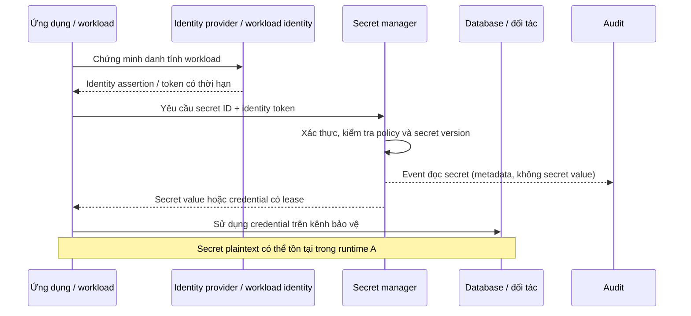
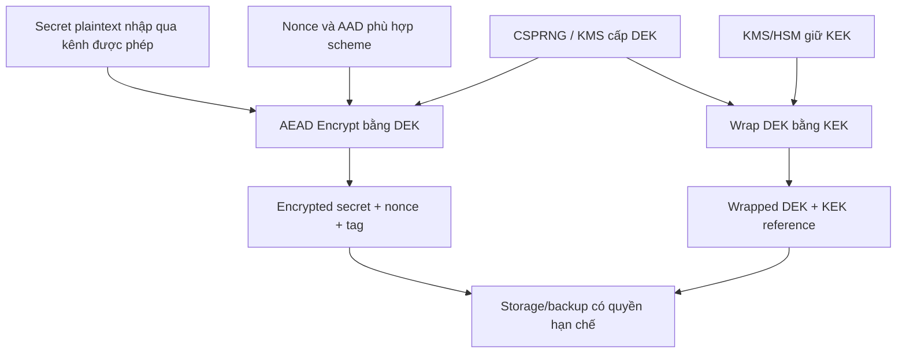
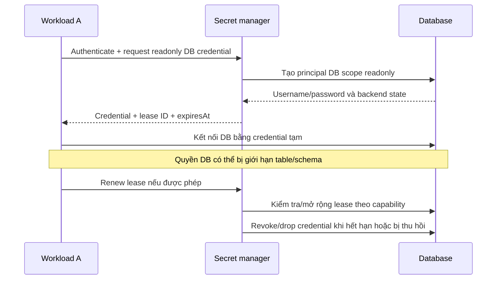
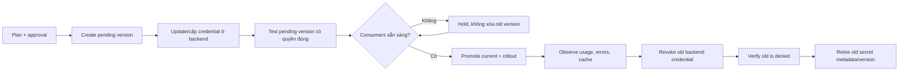
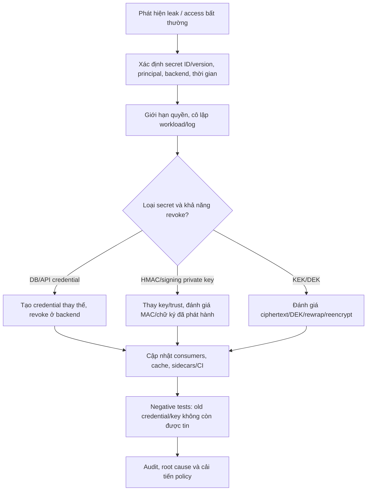

# Secret manager trong Key storage: lưu trữ, cấp phát và kiểm soát bí mật an toàn

> **Chương:** Key storage  
> **Module:** SECURITY_KEY_MANAGEMENT_FUNDAMENTALS

Một ứng dụng thanh toán cần truy cập cơ sở dữ liệu, ký webhook, gọi API của đối tác và giải mã một số dữ liệu. Nếu đội phát triển đặt mật khẩu database, API token và private key vào file `application.yml`, biến môi trường không được bảo vệ hoặc repository, những bí mật ấy có thể bị lộ qua source control, container image, log và quyền đọc cấu hình. Dù dữ liệu đã mã hóa bằng thuật toán mạnh, hệ thống vẫn có thể bị xâm nhập qua **cách lưu và phân phối bí mật**.

**Secret manager** là hệ thống quản lý các **secret** — giá trị cần giữ bí mật để xác thực, cấp quyền hoặc hỗ trợ phép toán bảo mật — theo những kiểm soát như lưu trữ được bảo vệ, danh tính workload, chính sách truy cập, versioning, rotation, thời hạn, audit và thu hồi. Tùy sản phẩm, nó có thể quản lý cả **static secrets**, **dynamic credentials**, chứng chỉ cấp ngắn hạn hoặc tích hợp với KMS/HSM để bảo vệ khóa mã hóa dữ liệu.

Một secret manager **không tự làm bí mật an toàn sau khi nó được trả về cho ứng dụng**. Workload có quyền đọc plaintext secret vẫn có thể làm lộ nó qua memory dump, log hoặc mã độc. Vì vậy phải thiết kế ranh giới tin cậy từ **khởi tạo → lưu → cấp phát → sử dụng → xoay vòng → thu hồi → hủy**, chứ không chỉ cài một “vault”.

Trong phạm vi **SECURITY_KEY_MANAGEMENT_FUNDAMENTALS**, bài học liên hệ secret manager với **quản lý vòng đời khóa mật mã**, mật mã đối xứng/bất đối xứng, chữ ký số, KMS/HSM, envelope encryption, IAM và kiểm toán. Trọng tâm là hiểu **nên lưu loại secret nào ở đâu, ai được đọc hoặc sử dụng, bằng chứng bảo vệ là gì, và khi nào cần chuyển sang non-exportable KMS/HSM key**.

Sau bài học, bạn có thể:

- Phân biệt **secret, credential, cryptographic key, certificate, key reference và cấu hình không bí mật**.
- Giải thích vai trò của **secret manager so với KMS/HSM, application configuration và keystore**.
- Thiết kế đường cấp phát secret dựa trên **workload identity**, least privilege, authentication, encryption in transit/at rest và audit.
- Phân biệt **static secret**, **dynamic credential**, **lease/TTL**, versioning, rotation và revocation.
- Phân tích **bootstrap problem**, caching, secret injection, lỗi deploy/restore và tình huống nhiều node.
- Hiểu ranh giới **DEK/KEK và envelope encryption**, đặc biệt nguy cơ đưa raw private key hoặc KEK ra khỏi HSM.
- Áp dụng mô hình Java 17 minh họa việc sử dụng một secret tạm thời mà không ghi nội dung ra log.
- Lập runbook, checklist, ma trận kiểm thử và quy trình xử lý nghi rò rỉ secret.

## 1. Secret manager là gì?

**Secret** là thông tin mà việc tiết lộ có thể trao cho người khác khả năng xác thực, giả mạo hoặc truy cập tài nguyên. Các secret thường gặp:

- Database password, username/password cho dịch vụ bên ngoài.
- API token, bearer token, refresh token, client secret của OAuth.
- Webhook signing secret hoặc HMAC key.
- Private key ở định dạng PEM/PKCS#8 **nếu kiến trúc cho phép ứng dụng giữ material**.
- SSH private key, TLS private key hoặc certificate/key bundle trong một số mô hình triển khai.
- Encryption key material **nếu bắt buộc phải lưu/export được** theo một thiết kế đã được phê duyệt.
- Bootstrap/recovery credential, password pepper và một số signing credentials.

**Không phải mọi chuỗi cấu hình là secret**. Hostname, public certificate, public key, key ID/ARN, schema name và số cổng thường không cần bí mật hóa chỉ vì xuất hiện cạnh mật khẩu. Tuy nhiên một số metadata (tenant mapping, địa chỉ HSM, cấu trúc hạ tầng) vẫn có thể cần **kiểm soát quyền đọc** vì lý do an ninh.

### 1.1. Chức năng chính

Một secret manager có thể cung cấp các khả năng sau, tùy nhà cung cấp:

| Chức năng | Mục tiêu |
|---|---|
| **Secure storage** | Bảo vệ secret at rest; không lưu plaintext trong repository hoặc image |
| **Authentication** | Chỉ nhận yêu cầu từ workload/user đã được xác thực |
| **Authorization** | Ràng buộc secret path/ID, operation, environment, tenant, role |
| **Retrieval / delivery** | Cấp secret qua API, sidecar, agent hoặc volume/file injection được bảo vệ |
| **Versioning** | Quản lý các giá trị trước/sau rotation và rollout có kiểm soát |
| **Rotation** | Tạo/cập nhật secret và consumer theo chuỗi hành động hợp lệ |
| **Dynamic issuance** | Cấp credential ngắn hạn nếu backend có khả năng |
| **Lease / TTL / revoke** | Giới hạn hiệu lực credential và hỗ trợ thu hồi trong phạm vi backend |
| **Audit & monitoring** | Ghi ai truy cập, lúc nào, secret ID/version nào, kết quả gì |
| **Replication / recovery** | Duy trì tính sẵn sàng theo mô hình dịch vụ và yêu cầu DR |

Không nên giả định **bất kỳ sản phẩm nào** có đủ mọi chức năng này. Một secret store chỉ hỗ trợ key/value và một service cấp database credentials động có độ phức tạp và bảo đảm rất khác nhau.

### 1.2. Luồng lấy secret cơ bản



Đường dữ liệu quan trọng: Secret manager có thể bảo vệ secret trên server và trong TLS, nhưng khi đã **trả secret value**, trách nhiệm giữ bí mật chuyển thêm sang **ứng dụng, bộ nhớ, host, container, logs và backend đích**.

## 2. Secret manager khác KMS/HSM như thế nào?

Thuật ngữ dễ bị nhầm vì cả hai đều “quản lý khóa” hoặc “lưu bí mật”. Tuy nhiên, chức năng trọng tâm khác nhau:

| Tiêu chí | Secret manager | KMS | HSM |
|---|---|---|---|
| **Mục tiêu điển hình** | Lưu, cấp phát, xoay vòng secret và credential | Quản lý khóa và cung cấp phép toán mật mã theo API | Bảo vệ key material và thực hiện phép toán trong ranh giới phần cứng |
| **Đối tượng** | Password, token, API key, certificate bundle, secret bytes | KEK, signing key, key reference, data key API | Root/master key, KEK, private signing key, HSM objects |
| **Có thể trả plaintext secret?** | Thường **có**, cho principal được phép | Tùy API: có thể trả data key plaintext, nhưng thường không export managed KEK/private key | Tùy attributes/API: key non-extractable không trả raw bytes |
| **Phép toán trực tiếp** | Chủ yếu đọc/ghi/quản lý lifecycle secret; có thể tích hợp crypto | Encrypt/Decrypt, Wrap/Unwrap, Sign/MAC hoặc GenerateDataKey tùy provider | KeyGen, Sign, Decrypt, Wrap, Derive... theo cơ chế HSM |
| **Rủi ro khi runtime bị chiếm** | Bí mật mà runtime đọc được có thể bị sao chép | Runtime có thể lạm dụng API được cấp dù không lấy raw key | Non-exportable key vẫn có thể bị dùng làm oracle nếu quyền rộng |
| **Rotation** | Giá trị secret và consumer/backend credential | Key version/material, key hierarchy theo tính năng | Material/attributes và nghi thức vận hành |
| **Audit** | Secret read/write/lease/rotation | Key usage/policy changes | Key access/cryptographic operation theo module |

**KMS có thể là nền tảng mã hóa dữ liệu cho secret manager**, nhưng một cái không phải **bản sao chức năng** của cái kia. Một thiết kế thường kết hợp cả hai:

1. Secret manager giữ database password hoặc client secret đã được mã hóa at rest.
2. KMS/HSM giữ **KEK** được dùng để mã hóa/wrap dữ liệu bảo vệ secret.
3. Ứng dụng được xác thực đọc đúng secret qua IAM/policy, nhưng **không được quyền quản trị KEK**.

### 2.1. Secret value khác key handle

Ví dụ:

```text
secretId = "prod/orders/db-password"
  -> Secret manager có thể trả password plaintext cho orders-service.

keyId = "kms://prod/orders/kek-v4"
  -> Ứng dụng gọi KMS để Encrypt/Decrypt/GenerateDataKey.
  -> Key ID không phải KEK plaintext.

signingKeyId = "hsm://prod/signing/invoice-v3"
  -> Signing service gửi message/digest đã được phê duyệt tới Sign API.
  -> Private signing key có thể ở lại HSM và không được export.
```

Nếu ứng dụng chỉ cần **ký thông điệp**, ưu tiên xem liệu có thể gọi **KMS/HSM Sign API** bằng key handle thay vì đọc private key PEM qua secret manager. Nếu ứng dụng cần gọi database bằng password, secret manager là mô hình phù hợp hơn KMS key API thuần túy.

### 2.2. “Đã mã hóa trong secret manager” chưa đủ

Ngay cả khi một secret được mã hóa bằng AES-256-GCM trong kho lưu trữ, hệ thống vẫn phải chống:

- IAM principal không đúng tenant nhưng được đọc secret.
- Workload có quyền đọc mọi secret trong production.
- API token bí mật bị log hoặc nằm trong core dump.
- Secret cũ không được revoke sau rotation.
- Secret được đưa vào container image hoặc git trước khi chuyển sang vault.
- Admin hoặc backup có quyền quá rộng với dữ liệu đã giải mã.

**Mã hóa at rest** bảo vệ một phần threat model, không thay cho **authentication, authorization, lifecycle, audit và endpoint security**.

## 3. Phân loại secret để chọn nơi lưu đúng

| Loại | Ví dụ | Lựa chọn thường phù hợp | Cần chú ý |
|---|---|---|---|
| **Static credential** | Password đối tác, API key không hỗ trợ short-lived | Secret manager có version/rotation | Phải rotate tại backend đích chứ không chỉ đổi giá trị trong vault |
| **Dynamic credential** | Database account có TTL, cloud role session | Secret manager/identity broker tích hợp backend | TTL/lease/revoke semantics và độ sẵn sàng của backend |
| **OAuth client secret / refresh token** | App authentication | Secret manager nếu cần export cho runtime | Hạn quyền client, refresh/rotation và scope |
| **HMAC signing secret** | Webhook MAC | Secret manager hoặc HSM/KMS MAC API | Bên có raw key có thể tạo MAC |
| **Non-exportable signing key** | Root CA, invoice-signing private key | KMS/HSM key object | Không sao chép raw PEM chỉ để tiện deploy |
| **KEK/root wrapping key** | Khóa bảo vệ DEK khác | KMS/HSM theo key policy | Không gửi KEK plaintext cho mọi service |
| **DEK per-object** | Khóa AES cho dữ liệu đơn hàng | KMS GenerateDataKey/đường KeyGen phù hợp, lưu wrapped DEK với record | Không nhất thiết tạo secret-manager entry cho từng DEK |
| **TLS certificate + private key** | HTTPS server identity | Certificate manager/HSM hoặc secret manager theo kiến trúc | Certificate công khai, private key bí mật; expiry/trust |
| **Password pepper** | Bí mật dùng với password verifier | Secret manager hoặc HSM/HMAC service | Phải có phiên bản và kế hoạch verify/migration |
| **Password salt** | Salt riêng mỗi password verifier | Lưu với verifier | Salt thường không phải secret |
| **Public key/JWKS** | Verification key | Trust registry/PKI/config có xác thực | Không cần giữ bí mật, nhưng cần bảo vệ **tính xác thực** |

### 3.1. Những giá trị không nên đưa vào secret manager một cách máy móc

Secret manager không phải là nơi thay thế **mọi config**. Số lượng request quá lớn nếu tải hostname/feature flag như secret có thể tăng độ phức tạp và latency mà không giảm rủi ro. Phân loại dữ liệu trước khi chọn nơi lưu.

Tuy nhiên, một “public config” như đường dẫn endpoint nội bộ vẫn có thể là **sensitive metadata**; quyết định mức bảo vệ cần theo threat model, không chỉ theo câu hỏi có phải password hay không.

### 3.2. Dynamic credentials là secret tạm thời, không chỉ một chuỗi ngắn

Khi secret manager có thể cấp một database account với TTL, nó phải điều phối **tạo credential trong database thật, lưu lease metadata, cấp credential cho app và revoke/expire theo backend**. Chỉ gắn một trường `expiresAt` trong JSON **không khiến database password hết hiệu lực** nếu backend vẫn chấp nhận nó.

## 4. Threat model cho hệ thống quản lý secret

Không có một “vault” nào đủ để loại bỏ mọi rủi ro. Trước triển khai, cần hiểu attacker có thể kiểm soát những gì.

| Mối đe dọa | Đường tấn công | Kiểm soát ưu tiên |
|---|---|---|
| **Lộ qua source/repository** | Commit `.env`, YAML chứa password | Secret scan, history remediation, không đưa secret vào code |
| **Lộ qua CI/CD** | Pipeline in biến môi trường, artifacts hoặc logs | Runtime identity, scope theo job, redaction, ephemeral runners |
| **Workload identity bị chiếm** | Pod có token được đọc secret của pod khác | Identity binding, least privilege, audience/TTL, network policy |
| **Kẻ có quyền đọc backup** | Snapshot chứa encrypted secrets + KEK hoặc plaintext dump | Encrypt/segregate backup, IAM, key separation, restore policy |
| **Secret value được log** | Debug in HTTP headers/JDBC URI/token | Redact, cấm logging secret, kiểm thử và giám sát log |
| **Secret bị lộ trong memory** | Core dump, heap dump, /proc, debugger, malware | Runtime hardening, minimum lifetime, dump policy, giảm số process có secret |
| **IAM wildcard quá rộng** | `ReadSecret` trên mọi secret prod | Path/key-level grants, tenant/environment separation, periodic review |
| **Không thu hồi secret cũ** | Rotate vault nhưng backend còn nhận credential cũ | Coordinated rotation với target/backend, revoke và kiểm tra |
| **Lỗi replication/restore** | Bản sao cũ ghi đè version mới | Version/epoch, source of truth, reconciliation |
| **Service không sẵn sàng** | Secret manager outage làm ứng dụng restart thất bại | Availability/DR, cache được kiểm soát và failover design |
| **Insider có quyền admin vault** | Đọc/xuất mọi secret hoặc sửa policy | Separation of duties, JIT admin, audit độc lập |
| **Cấu hình trust sai** | Ứng dụng gửi token tới endpoint giả | TLS validation, issuer/audience/pinning khi phù hợp |

### 4.1. Secret manager có thể trở thành điểm tập trung rủi ro

Lợi ích của tập trung quản lý là **dễ rotation, audit và đặt policy**. Nhưng nếu một tài khoản quản trị được đọc tất cả secrets, một credential quản trị bị chiếm có thể tạo **blast radius rất lớn**. Vì vậy cần:

- Tách vault/namespace theo environment hoặc security domain khi phù hợp.
- Phân quyền theo secret ID/prefix/path, principal, purpose và thời gian.
- Giới hạn quyền quản lý chính sách tách khỏi quyền đọc secret value.
- Có audit không phụ thuộc hoàn toàn vào người có quyền sửa vault.
- Bảo vệ API, token, backup và key hierarchy của chính secret manager.

### 4.2. Bảo mật và tính sẵn sàng có thể xung đột

Nếu ứng dụng **không chạy được khi vault bị mất kết nối**, tổ chức cần giải pháp DR/availability. Nếu ứng dụng **cache secret rất lâu để chịu lỗi mạng**, nguy cơ stale/revoked secret và memory exposure tăng. Thiết kế phải xác định mức availability cần đạt và những điều kiện nào được phép dùng **cached credential**, thay vì mặc định cache vô hạn hoặc fail-open.

## 5. Bảo vệ dữ liệu secret ở trạng thái lưu trữ và truyền tải

Secret manager nên bảo vệ secret **at rest**, **in transit** và **trong vòng đời phiên truy cập**. Ba lớp này là những mối quan tâm riêng biệt:

### 5.1. At rest: encrypted storage

Một kiến trúc khái niệm có thể dùng envelope encryption:



**DEK** mã hóa secret value, còn **KEK** được KMS/HSM bảo vệ dùng để wrap DEK. Đây là **mô hình tham chiếu**, không khẳng định mọi secret manager dùng đúng AES-GCM hay cùng mô hình key hierarchy. Một số hệ thống có nhiều lớp encryption/seal key khác nhau.

Điểm cần nhớ: nếu attacker có **cả ciphertext và quyền/khả năng Unwrap/Decrypt**, encrypt at rest không còn ngăn attacker lấy plaintext. Phải bảo vệ **IAM, KMS key policy, audit và vị trí lưu backup** cùng lúc.

### 5.2. In transit: TLS và endpoint trust

- Dùng TLS với kiểm tra hostname, certificate chain và trust anchor theo thiết kế.
- Xác minh chính xác **endpoint của secret manager**, không vô hiệu hóa certificate verification để khắc phục lỗi.
- Bảo vệ token/credential dùng để gọi secret manager, không đặt trên URL query string hoặc log HTTP headers.
- Với mTLS hoặc workload identity, bảo vệ private key và identity binding của client.
- Không mặc định một tunnel TLS bảo vệ secret sau khi response vào bộ nhớ ứng dụng.

### 5.3. At use: plaintext trong workload

Khi secret đã được đọc:

- Giữ secret trong process cần thiết, hạn chế chia sẻ qua IPC hoặc gửi sang các service khác.
- Tránh truyền vào **command-line arguments**; argv/process inspection và logs có thể tiết lộ.
- Không ghi vào stdout, metrics labels, exception messages, tracing spans hoặc error reporting.
- Hạn chế memory/core dumps, quyền debugger và quyền quản trị node.
- Đóng kết nối/lease khi hết sử dụng; xóa buffer byte/char khi có thể nhưng **không tuyên bố xóa sạch mọi bản sao trên heap**.

Đối với Java, `String` là bất biến và không thể chủ động zeroize toàn bộ bản sao; dùng `char[]` hoặc `byte[]` giúp chủ động xóa một số buffer nhưng thư viện/network stack vẫn có thể tạo bản sao. **Memory clearing là giảm rủi ro, không phải bằng chứng không thể khôi phục secret.**

## 6. Bootstrap problem: lấy quyền đọc secret đầu tiên bằng cách nào?

Muốn ứng dụng lấy secret từ vault, ứng dụng phải **xác thực với vault**. Nếu phải lưu “mật khẩu vault” cứng trong file để đọc các mật khẩu khác, ta chỉ chuyển secret ban đầu từ nơi này sang nơi khác.

### 6.1. Ưu tiên workload identity

Một thiết kế thường dùng danh tính do môi trường chạy cấp:

- IAM role/service identity gắn với instance/container/serverless runtime.
- Kubernetes service account identity với token có **issuer/audience/TTL** phù hợp và được secret manager xác thực.
- mTLS client identity hoặc workload identity federation theo trust domain.
- Short-lived identity assertion từ platform/CI được đổi thành quyền đọc secret trong thời gian ngắn.

```text
Workload runtime
  -> được nền tảng gắn danh tính workload A (không hardcode password vault)
  -> xác thực với secret manager
  -> policy: workload A chỉ đọc secret prod/orders/db-credential
  -> nhận credential ngắn hạn / version cần dùng
  -> kết nối database theo quyền của credential
```

**Workload identity không miễn nhiễm khi runtime bị chiếm.** Attacker điều khiển workload A có thể sử dụng danh tính A trong phạm vi hiệu lực. Đây là lý do phải giảm số secret principal có thể đọc và giới hạn quyền của credential đích.

### 6.2. Tránh vòng lặp bootstrap

Nếu secret manager phụ thuộc KMS để unseal dữ liệu và KMS lại yêu cầu credential được lưu **trong cùng secret manager**, có thể tạo **circular dependency**. Cần xác định rõ root of trust ban đầu: platform identity, HSM/KMS grants, unseal/recovery procedure hoặc credential tách biệt theo thiết kế.

Phải tính tới khôi phục khi toàn bộ hệ thống mất điện/không còn phiên đăng nhập; **break-glass** cần được quản lý riêng với quyền, kiểm toán và thẩm quyền phù hợp.

## 7. Authentication, authorization và separation of duties

Một workload cần **hai lớp quyền** thường khác nhau:

1. Quyền **đọc secret từ secret manager**.
2. Quyền mà **secret đó cấp trên backend đích** — database, API đối tác hoặc hệ thống khác.

Nếu service A đọc một password có quyền `SUPERUSER` trong database, quyền đọc vault đã gián tiếp cho A rất nhiều quyền database. Least privilege phải áp dụng **cả hai đầu**.

### 7.1. Chính sách truy cập theo principal, path và action

Một quy tắc ở mức khái niệm:

```text
Principal: service-account/orders-reader-prod
Secret path: prod/orders/db/readonly
Allowed operations: read-current-version
Denied operations: update, delete, read-other-tenants, list-all-prod
Conditions:
  workload environment = production
  trusted identity audience = secret-manager
  secret purpose = orders-read
  lease/identity token not expired
```

Đây là **policy khái niệm**, không phải cú pháp chung của một sản phẩm. Cần kiểm tra cách provider xử lý resource policies, identity policies, path permissions, explicit deny và audit.

Một hành vi có vẻ vô hại như `ListSecrets` trên toàn production cũng có thể tiết lộ **metadata tên dịch vụ, khách hàng và tích hợp**. Không cấp quyền list rộng nếu chỉ cần đọc một secret ID.

### 7.2. Ranh giới giữa vai trò quản trị và sử dụng

| Vai trò | Quyền điển hình | Không nên mặc định |
|---|---|---|
| **Secret owner** | Xác định purpose, backend, rotation, consumer và retention | Đọc tất cả secret của tổ chức |
| **Secret administrator** | Thiết lập namespace, policy, backend và lifecycle theo phê duyệt | Truy xuất mọi plaintext secrets chỉ vì là admin |
| **Rotation controller** | Tạo/update version, phối hợp với backend được chỉ định | Cấp quyền wildcard cho mọi workload |
| **Application workload** | Đọc secret cần thiết cho đúng purpose | Update/delete secret hoặc mở quyền cho chính mình |
| **Security approver** | Duyệt quyền rủi ro cao, exception, policy | Tự có quyền dùng API token hay private key |
| **Auditor** | Đọc metadata và logs đã bảo vệ | Đọc raw secret để chứng minh audit |
| **Incident responder** | Revoke/contain theo quyền và runbook khẩn cấp | Export toàn bộ secrets để kiểm kê |

Tính tách biệt phụ thuộc **effective permissions**, không chỉ chức danh. Có sản phẩm cho phép quản trị viên đặc quyền đọc secret; nếu vậy phải thừa nhận và giảm rủi ro bằng **JIT access, approvals, audit độc lập** và phân chia security domain.

### 7.3. Secrets theo môi trường, tenant và purpose

Không dùng cùng một API token cho **dev, staging và production** chỉ vì deployment dễ hơn. Nếu secret của dev lộ trong môi trường kiểm thử, attacker không nên truy cập production.

Với multi-tenant, cân nhắc **secret riêng cho mỗi tenant/partner** hoặc các phạm vi riêng theo threat model. Một secret chung bảo vệ nhiều khách hàng tạo blast radius lớn khi leak. Khi thật sự chia sẻ, phải đánh giá rõ backend permission, blast radius và cách revoke.

### 7.4. Không để ứng dụng dùng path do client tự chọn

API như:

```text
GET /secrets?path=prod/tenant-B/payment-token
```

sẽ nguy hiểm nếu API chỉ kiểm tra “caller đã đăng nhập”, sau đó gọi vault bằng service credential có quyền đọc tất cả secret. Backend phải **ràng buộc requester với tenant/resource/purpose**, và secret path được suy ra/đối chiếu từ dữ liệu phía server thay vì tin input tự khai.

## 8. Static secret: phân phối và thời hạn sử dụng

**Static secret** là một giá trị tồn tại tương đối lâu, ví dụ password của tài khoản tích hợp bên ngoài. Dù secret manager không tự cấp credential động được, vẫn nên quản lý:

- **Owner và purpose:** service nào đang cần secret, backend đích và quyền thực tế.
- **Version:** giá trị hiện hành và giá trị đang chuẩn bị khi rotation.
- **Access policy:** principal nào được đọc, ở môi trường nào.
- **Expiry/review:** thời hạn backend cho phép hoặc lịch kiểm tra/rotation.
- **Dependencies:** pods, jobs, partner, deployment nào còn dùng version cũ.
- **Revocation:** cách vô hiệu hóa credential tại **backend thực sự xác thực nó**.

### 8.1. Thay giá trị vault không tự thu hồi password cũ

Ví dụ operator tạo password mới `pwd-v2` rồi cập nhật secret manager; database vẫn nhận `pwd-v1` nếu chưa đổi password tại database. Nếu attacker có `pwd-v1`, việc app tải `pwd-v2` không ngăn attacker dùng `pwd-v1`.

Rotation đúng phải đồng bộ:

```text
Source of truth: secret manager records + target backend

1) Tạo credential v2 theo chính sách.
2) Làm backend đích chấp nhận v2 (nếu hỗ trợ).
3) Lưu version v2 an toàn, kiểm tra quyền kết nối.
4) Cập nhật consumer sang v2 và quan sát.
5) Vô hiệu hóa v1 ở backend, xác minh v1 không dùng được.
6) Retire/delete version v1 theo retention và audit.
```

**Thứ tự thao tác phụ thuộc khả năng backend**. Nếu backend chỉ có một password hiện hành, có thể phải dùng cơ chế đổi credential đồng bộ, dual users hoặc chấp nhận maintenance window. Không tuyên bố luôn zero downtime nếu backend không hỗ trợ overlap.

### 8.2. Password, token và key không có cùng semantics

Password database được thay tại database. API token có thể được revoke tại nhà cung cấp API. HMAC key phải được cả **producer và verifier** đồng bộ version. Private key đã bị sao chép **không thể được thu hồi bằng cách chỉ thay pointer trong vault**; phải thay key/trust và đánh giá output đã tạo.

## 9. Dynamic secrets và lease

**Dynamic secrets** là credential được cấp theo yêu cầu với quyền và thời hạn ngắn hơn credential tĩnh. Ví dụ secret manager có thể tạo một database username/password riêng cho workload và cấp một **lease** có TTL.



### 9.1. Lease là quyền có vòng đời, không chỉ TTL trong cache

Thông tin thường liên quan tới lease:

| Trường | Ý nghĩa |
|---|---|
| `leaseId` | Định danh cấp phát để renew/revoke/audit |
| `issuedAt` | Thời điểm cấp credential |
| `expiresAt` | Thời điểm hết hiệu lực đã công bố |
| `renewable` | Có cho renew và theo điều kiện nào |
| `principal/backendRole` | Workload và quyền thực tế của credential |
| `revocationStatus` | Đã yêu cầu/hoàn tất thu hồi ở backend hay chưa |

Với một số backend, **thu hồi không tức thời**; connection đã mở có thể tiếp tục hoạt động cho đến khi session bị đóng hoặc bị policy chặn. Vì vậy `lease expired` trong vault không tự chứng minh mọi kết nối backend đã bị ngắt. Runbook phải xác minh **effective revocation** theo tính năng của hệ thống đích.

### 9.2. TTL quá ngắn hoặc quá dài

TTL ngắn giảm thời gian secret bị lộ còn hữu ích, nhưng có thể tăng tần suất cấp phát và gây lỗi nếu vault/network có sự cố. TTL dài tăng độ sẵn sàng cache nhưng cũng mở rộng cửa sổ attacker dùng credential đã sao chép.

Chọn TTL dựa trên:

- Mức nhạy cảm và quyền của credential.
- Khả năng renew/revoke và kiểu kết nối của backend.
- Thời lượng job hoặc request.
- Độ tin cậy mạng/secret manager.
- Giới hạn cấp phát, cache và chi phí vận hành.

Không có TTL “chuẩn” cho mọi API token, DB password và mTLS certificate.

### 9.3. Dynamic credentials không có nghĩa dynamic key material

Một temporary database credential có thể được sinh ra bởi secret manager nhưng **không phải cryptographic DEK**. Một workload có quyền đọc credential đó có thể dùng nó để truy vấn dữ liệu; không nên coi việc cấp credentials là tương đương KeyGen KMS hay HSM key ceremony.

## 10. Rotation: thay secret mà không tạo khoảng hở

Rotation là quá trình **thay secret value hoặc credential/key version**, cập nhật các consumers và loại bỏ quyền của version cũ. Đây là một workflow phân tán, không chỉ một lần `PutSecretValue`.

### 10.1. Rotation thường gồm nhiều trạng thái



Thứ tự này chỉ là **một mô hình khái niệm**; backend có thể yêu cầu cập nhật secret store trước hoặc sau thay credential. Điều quan trọng là workflow phải **khôi phục được và không mất khả năng xác thực**.

### 10.2. Hai credentials chồng lấn để không downtime

Một cách giảm gián đoạn là dùng **hai principal database hoặc hai API tokens** cùng hiệu lực trong cửa sổ chuyển tiếp:

```text
Ban đầu:
  DB chấp nhận credential-v1
  app dùng secret version v1

Prepare:
  DB chấp nhận v1 và v2 (backend hỗ trợ)
  secret manager lưu v2 ở trạng thái pending

Cutover:
  app đổi sang v2; xác minh mọi instance đã dùng v2

Revoke:
  DB vô hiệu hóa v1; thử đăng nhập v1 phải thất bại
  vault retire version v1 và cleanup cache
```

Không kéo dài overlap vô hạn. Nếu backend không hỗ trợ hai credentials cùng lúc, cần dùng **kế hoạch khác** như dual DB users, transaction-safe change hoặc maintenance period.

### 10.3. Rotation secret có thể làm hỏng connection pool

Một Java service có connection pool chứa phiên đăng nhập database bằng password cũ. Khi secret version thay đổi, **những connection đang mở** có thể còn sống, trong khi mở connection mới với password cũ bắt đầu thất bại.

Runbook phải quy định:

- Đổi credential ở đâu và khi nào.
- Pool reload/reconfigure hoặc restart có kiểm soát ra sao.
- Session cũ có bị backend revoke ngay không.
- Kiểm tra cả **kết nối mới** lẫn request nghiệp vụ.
- Khi nào được xóa credential cũ sau thời gian overlap.

Nếu chỉ update vault rồi chờ application “tự biết” mà không hỗ trợ refresh, rotation có thể gây outage.

### 10.4. Key rotation khác secret rotation

**KMS KEK rotation** có thể thay vật liệu/phiên bản bọc DEK nhưng không đổi một API token trong secret manager. **Secret rotation** của password có thể cần thay ở database nhưng không làm ciphertext/KEK thay đổi. Hai quy trình có thể liên quan, nhưng phải tách dependency và chính sách.

## 11. Versioning, labels và rollback

Khi có nhiều bản secret:

```text
Secret ID: prod/orders/db/readonly
Version v14: OLD / revoked at backend
Version v15: CURRENT / được app sử dụng
Version v16: PENDING / đang kiểm thử
```

Nhãn `CURRENT`, `PENDING`, `PREVIOUS` hoặc `latest` phụ thuộc sản phẩm; **không phải nghĩa chung bắt buộc**. Nên thiết kế rõ:

- Version ID bất biến.
- Labels/aliases thay đổi chỉ theo workflow có kiểm soát.
- Backend credential tương ứng version nào.
- Consumer đang dùng version nào, theo môi trường/region/pod.
- Retention và cách xử lý version đã revoke.
- Hành động của app khi `CURRENT` đổi giữa request hoặc job.

### 11.1. Pinning version hay tự theo CURRENT?

| Chiến lược | Ưu điểm | Rủi ro |
|---|---|---|
| **Pin version** | Rollout có kiểm soát, tái lập được trạng thái | Có thể dùng secret cũ quá lâu nếu không cập nhật |
| **Follow CURRENT** | Dễ nhận version mới khi refresh | Cache/refresh race, secret đổi giữa jobs |
| **Fetch on each operation** | Giảm độ trễ đồng bộ version | Vault load/latency/availability và khả năng lộ do nhiều request |
| **Sidecar/agent refresh** | Tách mã ứng dụng khỏi vault API | Cần bảo vệ file/socket, refresh semantics, process reload |

**Một lựa chọn duy nhất không phù hợp mọi workload**. Job batch kéo dài có thể cần một lease không đổi trong suốt job; web service có thể dùng cache/refresh trước expiry.

### 11.2. Rollback chỉ an toàn nếu credential cũ còn an toàn

Rollback `CURRENT` từ v16 về v15 sẽ không hoạt động nếu backend đã revoke v15. Nếu v15 bị lộ, **không được bật lại** chỉ để giảm lỗi. Phương án an toàn có thể là **phát hành v17** hoặc khôi phục quyền theo quyết định incident response.

### 11.3. Event và concurrency

Khi hai pipeline cùng rotate:

```text
Expected currentVersion = v15
Create pendingVersion = v16
Promote if currentVersion == v15 (CAS/expected version)

Nếu currentVersion đã đổi sang v17:
  -> dừng/đối soát
  -> không ghi đè CURRENT bằng v16 theo plan cũ
```

Các provider có semantics thay label khác nhau; nếu không hỗ trợ CAS trực tiếp, cần một **registry/coordination layer** có quyền và transaction tương đương. “PUT thành công” không bảo đảm không có rotate cạnh tranh.

## 12. Caching, refresh, availability và fail-closed

Secret manager có thể là một **dependency trên đường khởi động và xử lý request**. Thiết kế tốt cân bằng độ sẵn sàng với thời gian secret tồn tại trong bộ nhớ.

### 12.1. Cache không phải nơi lưu secret vĩnh viễn

Một cache nên có:

- Giới hạn TTL dựa trên **secret version/lease expiry**.
- Chỉ cache đúng secret ID/tenant/principal và quyền cần thiết.
- Không lưu xuống disk/memory dump ngoài chính sách.
- Refresh trước expiry có jitter/backoff để tránh **thundering herd**.
- Cách invalidate khi nhận rotation/revocation signal.
- Xử lý đồng thời để một cache key không bị hai refresh làm lẫn tenant/version.

**Không lấy TTL cache dài hơn TTL credential rồi mặc định credential vẫn dùng được.** Việc cache lâu chỉ giữ bytes cũ, không gia hạn quyền của backend.

### 12.2. Nếu vault outage thì sao?

Cần phân biệt:

| Trường hợp | Hành vi có thể phù hợp |
|---|---|
| Workload đã có **credential hợp lệ** trong cache và chưa hết hạn | Tiếp tục sử dụng trong giới hạn đã phê duyệt, giám sát |
| Workload không có secret và cần khởi động | Fail closed; không dùng fallback secret trong source |
| Lease hết hạn nhưng backend chưa revoke vì lỗi mạng | Không tự coi credential được phép tiếp tục; theo policy và rủi ro |
| Secret value bị xác nhận compromise | Không dùng cache cũ dù vault đang unavailable |
| Hệ thống trọng yếu cần emergency access | Break-glass có identity/approval/audit và TTL, không phải hardcoded master password |

**Fail closed** không có nghĩa luôn xóa sạch mọi cached secret hợp lệ khi mất kết nối; tổ chức phải định nghĩa điều kiện sử dụng cache, đặc biệt đối với giao dịch quan trọng. Nhưng **không tự nới quyền** khi không xác minh được identity hoặc policy.

### 12.3. Khi secret đã bị revoke ở backend

Secret manager có thể không biết ngay backend đã thu hồi credential nếu mất sự kiện. Cần kiểm tra **backend authentication failure** và điều chỉnh cache, retry. Không retry vô hạn bằng credential đã hết hạn gây lockout/DoS. Một số backend có rate limit hoặc khóa tài khoản khi sai password liên tục.

### 12.4. Multi-region và disaster recovery

Nếu secret replicate sang region khác, cần quan tâm:

- Thứ tự version/rotation events và consistency guarantees.
- Secret/KEK material nào thực sự được replicate và **khả năng decrypt** ở DR.
- Quyền IAM trong region DR có tương đương nhưng không rộng hơn.
- DNS/endpoint failover có được xác thực TLS đúng không.
- Khi recovery từ snapshot, **secret version/lease state có bị quay ngược** không.
- Credential cũ trong backup có còn hiệu lực ở backend không.

**Khôi phục bản backup cũ không được âm thầm biến secret đã revoke thành CURRENT**, cũng không tái cấp lại quyền cho workload đã bị vô hiệu hóa.

## 13. Secret delivery patterns: API, sidecar, file hay environment?

Không có phương thức đưa secret vào ứng dụng nào hoàn toàn không có rủi ro.

| Cách cấp phát | Ưu điểm | Hạn chế / điều kiện bảo vệ |
|---|---|---|
| **Runtime API fetch** | Tự kiểm soát TTL, refresh và lease; audit cụ thể | Ứng dụng phải xử lý client auth, cache, lỗi và TLS |
| **Sidecar/agent qua IPC** | Tách SDK/provider, hỗ trợ refresh | Bảo vệ socket/process và quyền gọi sidecar |
| **Mounted file/volume** | Nhiều ứng dụng đọc file dễ dàng | File permissions, mount, atomically replace, reload, backup/log |
| **Environment variable** | Triển khai đơn giản, nhiều runtime hỗ trợ | Có thể bị lộ qua process metadata, dump, log, child processes; refresh thường khó |
| **Build-time injection** | App không cần fetch lúc runtime | Nguy cơ secret nằm trong artifact/container image; khó rotation |
| **Container/orchestrator native Secret** | Thuận với deployment | **Không đồng nghĩa** vault chuyên dụng hoặc mọi lớp encryption/access được bật |

### 13.1. Kubernetes Secret không tự là giải pháp end-to-end

Kubernetes `Secret` cung cấp một resource để đưa dữ liệu bí mật tới workloads, nhưng **base64 là encoding, không phải encryption**. Cần xét mã hóa dữ liệu lưu trong control plane/etcd, quyền RBAC, namespace/service account, cách mount/inject, node access và audit.

Một external secret controller có thể **đồng bộ** secret từ vault vào Kubernetes Secret; cách này giúp cập nhật có nguồn tập trung nhưng cũng tạo **bản sao** trong cluster. Nếu threat model yêu cầu không lưu secret trong control plane, hãy cân nhắc pattern khác theo khả năng nền tảng.

### 13.2. Khi chọn file mount

Nếu agent cập nhật file:

- Dùng quyền file/owner hạn chế, không đặt vào path public hoặc static assets.
- Dùng **atomic replacement** nếu muốn consumer không đọc file ghi dở.
- Xác định ứng dụng có cần **reload** hay chỉ đọc lúc startup.
- Không ghi nội dung file vào log khi debug.
- Kiểm tra backup/snapshot của host có sao chép secret không.

Một file mount đã đổi không đảm bảo connection pool hay thư viện HTTP đã cập nhật credential.

### 13.3. Khi chọn environment injection

Biến môi trường dễ dùng cho service cũ, nhưng có thể được **kế thừa bởi process con** và bị lộ qua log, crash report hoặc công cụ quản trị. Nó cũng không cung cấp secret auto-refresh trong một process nếu ứng dụng chỉ đọc lúc startup. Không coi biến môi trường là kênh an toàn tuyệt đối; nếu dùng, giới hạn host/process access, log và rotation interval.

## 14. Secret manager trong CI/CD và supply chain

Build/test/deploy pipeline thường cần secret để truy cập artifact registry, cloud API, test database, release signing service hoặc môi trường triển khai. CI/CD là nguồn rò rỉ phổ biến vì log có thể hiển thị câu lệnh, environment variables và artifacts.

### 14.1. Ưu tiên identity ngắn hạn thay cho static CI token

Ví dụ:

```text
CI job thuộc repository / branch / workflow được tin
  -> lấy identity assertion từ CI platform
  -> identity federation đổi thành role session ngắn hạn
  -> role chỉ có quyền đọc prod/deploy/partner-api-token nếu job cần
  -> không đưa master vault token vào repository secrets
```

Cần ràng buộc assertion với **issuer, audience, repository/project, workflow/ref/environment** và các điều kiện đáng tin do provider hỗ trợ; không cho bất kỳ fork/PR từ nguồn chưa tin tự nhận quyền production.

### 14.2. Những điều phải kiểm tra trong pipeline

- Không đưa secret value vào **build arguments, container layers hoặc artifact metadata**.
- Không in toàn bộ environment, HTTP headers hay YAML manifest chứa secret.
- Secret scope tách theo **dev/staging/prod**; build job không mặc định đọc prod.
- Quyền deploy khác quyền **sign release**, và private signing key nên được bảo vệ theo khả năng KMS/HSM.
- Ephemeral runners, job token TTL, rotation/revocation được quản lý.
- Pipeline chỉ lấy secret ở **thời điểm cần**, không sao chép sẵn vào codebase.
- Nếu log đã làm lộ credential, xử lý theo quy trình compromise; **xóa log không thay quyền đã bị sao chép**.

**Secret masking** trong CI chỉ là hỗ trợ giảm rủi ro. Một secret có thể bị biến đổi, base64-encode, chia đoạn, in qua stack trace hoặc gửi sang endpoint khác khiến masking không nhận ra. Không dựa riêng vào một tính năng redaction.

## 15. Secret manager cho certificate, HMAC và signing key

### 15.1. Certificate không giống private key

TLS certificate hoặc public certificate thường có thể phân phối công khai; **private key** tương ứng phải bí mật. Nếu ứng dụng cần TLS termination tại process và phải load private key, secret manager có thể cấp key bundle theo policy; nhưng cần:

- Bảo vệ đường đọc và memory/file sau khi load.
- Quản lý certificate chain, **SAN/hostname, KU/EKU, notBefore/notAfter**.
- Có cơ chế reload/restart khi thay key/certificate.
- Không lấy `certificate.notBefore` làm thời điểm sinh private key.
- Có plan khôi phục trust khi certificate bị revoke hoặc private key lộ.

Khi khả năng sản phẩm hỗ trợ, private key có thể ở **HSM/KMS/PKCS#11 provider** và chỉ thực hiện phép toán Sign, giảm số bản sao key plaintext trong workload.

### 15.2. HMAC/webhook secret

HMAC dùng shared secret để tạo và kiểm tra MAC:

- Bên có **raw HMAC key** có thể tự tạo MAC; “chỉ được verify” trong ứng dụng không bảo đảm cryptographic separation nếu key bytes đã bị cấp.
- Nên tách key theo **partner, tenant, purpose** và version.
- Rotate theo hai phía producer/verifier, có grace period giới hạn khi cần.
- HMAC không tự chống **replay**; giao thức cần timestamp/message ID/nonce hoặc cơ chế chống lặp tương ứng.
- Nếu KMS/HSM hỗ trợ **GenerateMac/VerifyMac** cho key non-exportable, cân nhắc dùng API theo permission thay vì phân phối raw key.

### 15.3. JWT signing và verification

Private JWT signing key có thể được giữ trong secret manager nếu workload cần raw PEM; nhưng HSM/KMS signing API có thể tốt hơn cho mục đích high assurance. Với verifier:

- Public key/JWKS phải đến từ **issuer/trust registry đã cấu hình**.
- Kiểm tra **issuer, audience, algorithm allowlist, token lifetime và purpose**.
- `kid` là chỉ báo chọn key, **không phải** bằng chứng public key do đúng issuer phát hành.
- Cần phân biệt rotation bình thường với compromise; khi private key lộ, grace period có thể không phù hợp.

Không dùng cùng private key cho **JWT, code signing và ký hóa đơn** chỉ vì tất cả dùng một thuật toán chữ ký.

### 15.4. Password pepper

Một **pepper** là secret tùy chọn bổ sung trong password hashing/verification. Nếu pepper lưu trong secret manager:

- Chỉ authentication service được đọc/dùng pepper đúng version.
- Không lưu pepper cùng password verifier database và không ghi vào log.
- Có phương án đổi pepper mà không khiến toàn bộ người dùng bị khóa ngoài.
- Nếu pepper lộ cùng database verifier, cần đánh giá nguy cơ offline guessing và kế hoạch xử lý.

**Salt** của password hash thường công khai và gắn với từng verifier, không phải một secret manager entry cần bảo mật như pepper.

## 16. Key material trong secret manager: khi nào hợp lý, khi nào phải tránh?

Không phải mọi cryptographic key đều cần hoặc nên được lưu dưới dạng **secret có thể đọc plaintext**.

### 16.1. Trường hợp secret manager có thể phù hợp

Một đối tác chỉ hỗ trợ HMAC secret hoặc PEM private key truyền qua API và workload buộc phải sử dụng local crypto library. Nếu kiến trúc không thể gọi KMS/HSM cho phép toán đó, secret manager có thể giảm rủi ro so với file hardcoded bằng cách:

- Bảo vệ at rest/in transit, IAM và audit.
- Cấp secret đúng workload và trong thời gian giới hạn.
- Versioning/rotation theo backend/partner.
- Giảm số máy, process và nhân sự được đọc raw material.

Nhưng đây là một **trade-off có chủ đích**, không chứng minh key non-exportable.

### 16.2. Trường hợp ưu tiên key handle và KMS/HSM

- Root CA/private signing key hoặc code-signing key cần **không export vật liệu**.
- KEK gốc hoặc master key bảo vệ nhiều DEK.
- API Sign/Decrypt/GenerateMac/Decapsulate có thể thực hiện trong ranh giới HSM theo yêu cầu bảo mật.
- Mô hình kiểm toán cần ràng buộc **mỗi phép toán sử dụng key** với principal/approval ở service.

Nếu đưa raw KEK vào secret manager rồi cấp cho mọi microservice, ta có thể làm mất lợi ích của **KMS key policy, key non-exportability và phép toán tập trung được kiểm toán**.

### 16.3. Secret manager có thể chứa wrapped DEK không?

Có thể lưu **wrapped key blob** như một secret hoặc metadata, nhưng không phải lúc nào đây là cách tốt nhất. Với envelope encryption per-record, wrapped DEK thường đi **cùng ciphertext record** và chỉ dùng key ID/version để KMS/HSM unwrap theo quyền. Việc tạo **một secret entry cho mỗi DEK của hàng tỷ object** có thể phức tạp mà không tăng bảo mật.

Ranh giới cần phân biệt:

```text
Data record:
  ciphertext + nonce + tag + wrappedDEK + kekKeyId + AAD metadata

KMS/HSM:
  KEK key object, cryptographic operations, IAM/grants

Secret manager:
  DB password, external API credentials, OAuth client secret,
  hoặc secret bytes cần phân phối theo một thiết kế cụ thể.
```

### 16.4. Rewrap và reencrypt

Đổi **KEK** có thể dẫn đến **rewrap DEK** mà không đổi data ciphertext. Đổi **DEK** cần mã hóa lại dữ liệu theo scheme (nonce/tag/AAD metadata phải hợp lệ). Không được nói “secret manager đã rotate encryption key” khi mới thay password đăng nhập vào KMS hoặc thay một alias chưa ảnh hưởng dữ liệu cũ.

## 17. Policy-as-code cho secret lifecycle

Một cấu hình có thể định nghĩa **ý định** quản lý secret:

```yaml
# Cấu hình minh họa, KHÔNG phải cú pháp của provider nào.
schemaVersion: 1
secretId: "production/orders/db/readonly"
ownerService: "orders-service"
purpose: "database-readonly"
environment: "production"
source: "DYNAMIC_DATABASE_CREDENTIAL"

access:
  principals:
    - "workload/orders-reader-prod"
  operations: ["READ_CREDENTIAL"]
  allowedTenants: ["orders-internal"]
  requireWorkloadIdentity: true
  denyWildcardAdminRead: true
  auditEveryRead: true

lease:
  requestedTtl: "PT15M"  # Ví dụ, phải khớp backend và risk policy.
  renewable: true
  maxTtl: "PT1H"
  revokeOnWorkloadTermination: true

delivery:
  method: "RUNTIME_API"
  tlsRequired: true
  allowEnvInjection: false
  cacheMaxTtl: "PT10M"
  preventSecretLogging: true

rotation:
  backendCapability: "DYNAMIC_ROLE_ISSUANCE"
  verifyRevocationAtBackend: true
  requireOwnerForException: true

audit:
  fields:
    - "secretId"
    - "versionOrLeaseId"
    - "callerIdentity"
    - "operation"
    - "result"
  includeSecretValue: false
```

**YAML không tự cưỡng chế quyền**. Từng trường phải được chuyển thành IAM/policy/backend role/lease configuration thật. Cờ `preventSecretLogging: true` không chặn code ứng dụng vô tình log credential nếu không có kiểm soát và test tương ứng.

### 17.1. Tách declared policy khỏi effective access

Cần kiểm tra ba thứ:

1. **Declared policy:** tài liệu/config nói ai được đọc gì.
2. **Effective secret manager policy:** caller thực sự có quyền API nào trên path nào.
3. **Effective backend credential scope:** credential được đọc có quyền gì trên DB/API.

Nếu vault policy chỉ cho `orders-reader` đọc một secret nhưng credential chứa quyền admin database, policy **vẫn chưa đạt least privilege**.

### 17.2. Version và quyền sửa policy

Không để chính workload tiêu thụ secret vừa có quyền `READ`, vừa tự cấp `READ_ALL` hoặc sửa rotation role. Quản lý policy change qua approval, source-controlled version và audit; quyền emergency phải có JIT/TTL và review sau sự kiện.

## 18. Java 17: mô hình SecretLease và sử dụng secret không ghi log

Ví dụ này không kết nối tới secret manager thật; nó minh họa **cách tổ chức code** để:

1. Tách **secret reference** khỏi raw secret value.
2. Giả lập identity/purpose check ở secret provider.
3. Nhận secret kèm **version và expiry**.
4. Dùng secret trong callback rồi cố gắng xóa các buffer kiểm soát được.
5. Không in secret vào stdout hoặc thông báo lỗi.

Trong ứng dụng thật, `SecretProvider` cần được triển khai bằng **SDK/API có TLS verification, authentication với workload identity, permissions, retries và audit**. Mã dưới đây không cung cấp các bảo đảm đó; không dùng giả lập này trong production.

```java
import javax.crypto.Mac;
import javax.crypto.spec.SecretKeySpec;
import java.nio.charset.StandardCharsets;
import java.security.SecureRandom;
import java.time.Clock;
import java.time.Instant;
import java.time.ZoneOffset;
import java.util.Arrays;

public final class SecretManagerDemo {
    record SecretRef(String id, String purpose) {}
    record WorkloadIdentity(String service, String environment) {}

    @FunctionalInterface
    interface SecretAction<T> {
        T apply(byte[] secret) throws Exception;
    }

    static final class SecretLease implements AutoCloseable {
        private final String version;
        private final Instant expiresAt;
        private final byte[] material;
        private boolean closed;

        SecretLease(String version, Instant expiresAt, byte[] raw) {
            this.version = version;
            this.expiresAt = expiresAt;
            this.material = raw.clone();
        }

        String version() {
            return version;
        }

        Instant expiresAt() {
            return expiresAt;
        }

        <T> T use(SecretAction<T> action) throws Exception {
            if (closed) {
                throw new IllegalStateException("Lease closed");
            }
            byte[] transientCopy = material.clone();
            try {
                return action.apply(transientCopy);
            } finally {
                Arrays.fill(transientCopy, (byte) 0);
            }
        }

        @Override
        public void close() {
            if (!closed) {
                Arrays.fill(material, (byte) 0);
                closed = true;
            }
        }
    }

    interface SecretProvider {
        SecretLease fetch(
                WorkloadIdentity caller,
                SecretRef secret,
                Instant now);
    }

    // Fake provider cho demo: không lưu secret ổn định,
    // không xác minh identity hay gọi vault thật.
    static final class FakeProvider implements SecretProvider {
        private final SecureRandom random = new SecureRandom();

        @Override
        public SecretLease fetch(
                WorkloadIdentity caller,
                SecretRef secret,
                Instant now) {
            if (!"webhook-signer".equals(caller.service())
                    || !"test".equals(caller.environment())
                    || !"test/webhook/hmac".equals(secret.id())
                    || !"webhook-auth".equals(secret.purpose())) {
                throw new SecurityException("Secret access denied");
            }
            byte[] demoSecret = new byte[32];
            random.nextBytes(demoSecret);
            try {
                return new SecretLease(
                        "demo-version-1", now.plusSeconds(300),
                        demoSecret);
            } finally {
                Arrays.fill(demoSecret, (byte) 0);
            }
        }
    }

    public static void main(String[] args) throws Exception {
        Clock clock = Clock.fixed(
                Instant.parse("2026-11-28T09:00:00Z"),
                ZoneOffset.UTC);
        WorkloadIdentity caller =
                new WorkloadIdentity("webhook-signer", "test");
        SecretRef reference =
                new SecretRef("test/webhook/hmac", "webhook-auth");
        SecretProvider provider = new FakeProvider();

        try (SecretLease lease =
                     provider.fetch(caller, reference, clock.instant())) {
            if (!clock.instant().isBefore(lease.expiresAt())) {
                throw new IllegalStateException("Secret expired");
            }

            byte[] tag = lease.use(secret -> {
                Mac mac = Mac.getInstance("HmacSHA256");
                SecretKeySpec key =
                        new SecretKeySpec(secret, "HmacSHA256");
                mac.init(key);
                return mac.doFinal(
                        "test-message".getBytes(
                                StandardCharsets.UTF_8));
            });
            // Không in secret hay tag; chỉ báo kết quả điều khiển.
            System.out.println("HMAC operation completed");
            System.out.println("Secret version: " + lease.version());
            Arrays.fill(tag, (byte) 0);
        }
    }
}
```

### 18.1. Code này bảo đảm gì?

Trong phạm vi demo, secret value không được hardcode thành password cố định hoặc in vào log; lease lưu version/expiry; `AutoCloseable` giúp xóa những mảng byte mà lớp code sở hữu. Workload và secret ref được kiểm tra trước khi cấp secret giả lập.

### 18.2. Những điều demo **không** bảo đảm

- `WorkloadIdentity` là record do code tạo, **không phải danh tính đã được xác thực**; production phải nhận assertion từ identity provider và validate ở secret manager.
- `FakeProvider` sinh secret mới mỗi lần gọi; **không đại diện cho static secret manager, backend lease hay rotation thật**.
- Cấu trúc `byte[]` có thể bị thư viện hoặc callback sao chép; `SecretKeySpec` và provider mật mã có thể giữ material trong vùng nhớ khác. `Arrays.fill` **không xóa được mọi bản sao của secret**.
- Không có mTLS/TLS, vault IAM, audit, rate limits, concurrency, cache, revocation hay backend validation.
- Đoạn code kiểm tra expiry tại lúc dùng, nhưng một backend có thể **revoke sớm**; phải xử lý API error và refresh theo chính sách.
- Với key non-exportable, kiến trúc production nên gọi **KMS/HSM GenerateMac/Sign** thay vì đọc raw key và chạy `Mac` trong ứng dụng, nếu provider hỗ trợ và phù hợp.

**Đây là minh họa thiết kế interface/lifecycle, không phải hướng dẫn tự viết một vault.** Việc bảo vệ secret thật cần SDK/backend đáng tin và kiểm soát vận hành đầy đủ.

## 19. Case study: database credential cho SaaS nhiều tenant

Giả sử nền tảng SaaS có các thành phần:

- `orders-reader` đọc dữ liệu đơn hàng.
- `orders-writer` cập nhật đơn hàng.
- Database có phân quyền theo schema/role và xác thực người kết nối.
- Secret manager có thể cấp credentials cho workload qua identity federation.
- KMS/HSM quản lý KEK cho những bản mã lưu trong hệ thống.

### 19.1. Thiết kế dễ gây sự cố

```text
Secret ID: production/shared/root-db-password
Consumers: orders-reader, orders-writer, reporting, ETL, support tools...
Database role: superuser
Rotation: không có, password tồn tại nhiều năm
```

Nếu một pod reporting bị chiếm, attacker có thể lấy password root và đọc/đổi nhiều dữ liệu không thuộc phạm vi reporting. Việc password được mã hóa trong vault **không hạn chế quyền** sau khi pod đã được phép đọc.

### 19.2. Thiết kế cải thiện

Phân tách:

```text
orders-reader-prod:
  dynamic database role = orders_readonly
  permitted objects/tenant = scope đã xác thực
  lease = short-lived, renewable per policy

orders-writer-prod:
  dynamic database role = orders_write
  least privilege trên schema/table cần thiết
  lease = short-lived

reporting-prod:
  separate readonly role, data views đã được kiểm soát

secret manager admin:
  quản trị policies/backends
  không phải mặc định DB superuser đọc production data
```

**Tenant isolation** không tự có chỉ vì role tên `orders_readonly`. Nếu một credential được cấp cho mọi tenant, database vẫn cần row-level security, schema isolation, object authorization hoặc các kiểm soát tương đương. Workload có quyền đọc secret phải biết **resource nào được phép truy vấn**, không chỉ dựa vào secret path.

### 19.3. Rotation không gián đoạn kết nối

Nếu chuyển từ một static DB credential sang dynamic credentials:

1. Chuẩn bị role readonly/write có permission nhỏ nhất.
2. Cấu hình secret manager cấp credential **ngắn hạn** qua identity đáng tin.
3. Cập nhật application pool để lấy credential mới trước expiry; đánh giá session reuse.
4. Canary một phần traffic, xác minh kết nối mới và quyền database thực sự.
5. Thu hồi static root password khỏi ứng dụng khi mọi consumer đã chuyển.
6. Kiểm tra **old credential không đăng nhập được**, rút quyền và xóa bản sao cũ khỏi CI/config.

Nếu backend không hỗ trợ dynamic users hoặc revocation tin cậy, vẫn có thể dùng **static credentials với rotation/dual users** và IAM chặt; đừng ghi “dynamic” trong tài liệu khi thực tế database vẫn dùng password cố định.

### 19.4. Secret manager outage giữa giờ cao điểm

Các kết nối hiện có có thể vẫn hoạt động, nhưng tạo connection mới sẽ gặp lỗi nếu app cần fetch credential mà vault unavailable. Cần lựa chọn theo policy:

- Cache lease đang hợp lệ và thiết kế retry/backoff.
- Giới hạn concurrency, tránh mọi pod refresh đồng thời khi vault phục hồi.
- Không lấy credential từ file build cũ làm fallback bí mật “vĩnh viễn”.
- Giám sát tỷ lệ connection failure, lease expiry, vault latency và auth errors.
- Phân biệt temporary outage với credential đã revoke do compromise.

Không có một giải pháp high availability duy nhất: phải kiểm chứng đặc điểm của secret manager, database và thời gian sống của session.

## 20. Case study: webhook secret bị lộ qua log và rotation không hoàn tất

Một dịch vụ dùng HMAC key để ký webhook cho đối tác. Secret được lưu trong vault, nhưng middleware ghi toàn bộ HTTP headers và một số request metadata. Sau khi điều tra, đội vận hành phát hiện **HMAC secret xuất hiện trong log debug của một worker**.

### 20.1. Nhận định ban đầu

- Việc vault mã hóa at rest **không bị phá**, nhưng secret đã bị rò qua runtime/log.
- Secret có thể được sử dụng để **tạo MAC hợp lệ** bởi bên không được phép.
- Nếu webhook không có timestamp/message ID/replay protection, attacker có thể **gửi lại** message cũ ngay cả khi không tạo message mới.
- Chỉ xóa log không bảo đảm attacker không có bản sao.

### 20.2. Quy trình khắc phục

1. Hạn chế truy cập log, bảo toàn chứng cứ phục vụ điều tra theo chính sách.
2. Xác định **đối tác, secret ID/version, khoảng thời gian và workload** bị ảnh hưởng.
3. Chuẩn bị HMAC key mới, phân phối an toàn tới phía verifier, xác minh hai phía có thể xử lý version mới.
4. Chuyển producer sang key mới; theo dõi lỗi verification ở partner.
5. Ngừng tin và revoke key cũ **ở verifier** sau cửa sổ chuyển tiếp phù hợp với rủi ro; nếu compromise nghiêm trọng, có thể cần cắt ngay và chấp nhận lỗi tạm thời theo incident plan.
6. Sửa middleware logging, thêm negative tests chống lộ secret và cập nhật quy tắc redaction.
7. Kiểm tra những message đã được chấp nhận trong thời gian secret bị lộ, quy trình replay/idempotency và các hành động nghiệp vụ liên quan.

**Cập nhật secret value trong vault mà verifier vẫn chấp nhận HMAC key cũ không hoàn tất revocation**.

### 20.3. Bài học về scope

Nếu tất cả đối tác dùng chung một HMAC secret, có thể phải rotate cho mọi đối tác. Nếu mỗi đối tác có key riêng, blast radius nhỏ hơn. Đây là lý do **key/secret separation theo purpose và partner** phải được thiết kế từ đầu.

## 21. Audit, inventory và monitoring

Secret manager phải giúp trả lời:

**“Principal nào đã đọc/ghi phiên bản secret nào, vào lúc nào, qua đường nào và vì sao được phép?”**

Nhiều hệ thống audit **read attempts, writes, policy changes, lease issue/renew/revoke**. Tuy nhiên, secret manager không thể tự thấy mọi lần ứng dụng **sử dụng secret sau khi đã lấy ra**. Vì vậy cần phân biệt **vault access event** với **backend operation event**.

### 21.1. Audit event minh họa

```json
{
  "eventType": "SECRET_ACCESS",
  "timestamp": "2026-11-28T09:15:30Z",
  "callerIdentity": "workload/orders-reader-prod",
  "secretId": "production/orders/db/readonly",
  "requestedVersion": "CURRENT",
  "resolvedVersion": "v15",
  "operation": "READ",
  "policyId": "orders-secrets-v3",
  "decision": "ALLOW",
  "requestId": "req-7021",
  "result": "SUCCESS",
  "secretValueLogged": false
}
```

Không đặt secret value, bearer token, DB password, raw HMAC key, private PEM hay refresh token vào audit. Ngay cả secret IDs và tenant metadata cũng có thể nhạy cảm; đặt IAM/retention phù hợp cho kho log.

### 21.2. Những tín hiệu cần theo dõi

| Tín hiệu | Nguy cơ hoặc câu hỏi |
|---|---|
| Secret read tăng bất thường | Credential exfiltration hoặc workload retry vô hạn |
| Principal lạ đọc secret prod | Sai policy hoặc identity bị chiếm |
| Tài khoản CI đọc secret ngoài deployment window | Bypass pipeline controls |
| Nhiều lease mới nhưng ít renew/revoke | Backend leak/orphan credentials, quá tải |
| Rotation pending quá lâu | Backend/consumer chưa cutover hoặc workflow lỗi |
| Consumer vẫn dùng old credential | Stale cache/version, revoke chưa hoàn tất |
| Secret version đổi không có change ticket | Quản trị trái phép hoặc tự động hóa drift |
| Vault `AccessDenied`/latency tăng | Misconfiguration, outage, quota |
| Dữ liệu secret xuất hiện trong logs/artifacts | Runtime leak, thiếu redaction |
| KMS Unwrap/Decrypt tăng ở vault backend | Rủi ro quyền KEK, backend workload lạm dụng |
| Backup/restore không qua kiểm thử | Nguy cơ không khôi phục hoặc quay lại credential cũ |

### 21.3. Inventory metadata

Một secret inventory có thể ghi:

| Nhóm | Trường phù hợp |
|---|---|
| Identity | Secret ID/path, version, backend type |
| Ownership | Owner service, environment, tenant/purpose |
| Provenance | Generated/imported/supplied-by-partner, createdAt, source |
| Lifecycle | Current/pending/previous, rotation status, expiry/lease |
| Consumption | Workloads/roles, dependent jobs, last observed read |
| Protection | Storage encryption/key reference, policy version, audit requirements |
| Recovery | Backup/DR reference, restore test date, revocation procedure |

**Secret inventory không phải bản sao plaintext của tất cả secret values**. Nếu tạo một bảng Excel chứa tất cả passwords để “kiểm kê”, bạn vừa tạo một mục tiêu tấn công mới.

### 21.4. Giá trị read count có thể gây hiểu nhầm

Một app cache secret 30 phút có thể thực hiện hàng triệu database queries nhưng vault chỉ ghi vài read events. Một attacker chiếm app có thể dùng credential đã cache mà **không tạo vault read mới**. Vì vậy hãy liên kết vault access logs với **backend authentication, query auditing và workload telemetry** khi cần điều tra.

## 22. Incident response khi secret bị nghi lộ

Khi phát hiện secret trong source, log, máy bị chiếm hoặc secret manager policy sai, cần ưu tiên **containment và backend revocation**, không chỉ di chuyển giá trị sang vault.



### 22.1. Bước 1 — Xác định phạm vi

- Secret thuộc service, tenant, environment nào?
- Có những **version nào** bị lộ? Có nằm trong backup/image/log không?
- Backend đích cấp quyền gì? Credential còn hiệu lực không?
- Ai đã đọc secret, nguồn audit có đầy đủ không?
- Có token/secret phụ thuộc khác phải rotate không?

Không khẳng định “không ai dùng secret” chỉ vì vault không ghi request lạ; attacker có thể đã lấy bản sao từ log hoặc từ runtime.

### 22.2. Bước 2 — Ngăn sử dụng tiếp

- Thu hồi IAM/session của principal bị chiếm.
- Vô hiệu hóa credential tại **backend** nếu khả thi, ưu tiên thay credential để duy trì dịch vụ theo rủi ro.
- Với HMAC/signing key, ngừng chấp nhận key cũ ở verifier/trust nếu compromise và chính sách yêu cầu.
- Với DEK/KEK, đánh giá dữ liệu đã được mã hóa và mọi bản sao vật liệu; thay alias hoặc key policy **không thu hồi plaintext đã lộ**.
- Kiểm soát và bảo toàn logs/forensic artifacts, tránh tạo thêm bản sao secret.

### 22.3. Bước 3 — Thay secret và triển khai

Tạo **giá trị mới độc lập**, cấp đúng quyền, rotate theo workflow của backend/consumer, xác minh mọi instance dùng version mới. Không dùng lại một secret đã lộ dưới tên khác.

Nếu secret bị lộ là **refresh token, OAuth client secret hoặc certificate private key**, cần xem xét cơ chế revoke/token invalidation, trust distribution và thời hạn phiên theo provider.

### 22.4. Bước 4 — Xác minh khắc phục

Một incident chưa hoàn tất nếu:

- Vault hiển thị v2 CURRENT nhưng API/backend vẫn nhận v1.
- App pods vẫn có v1 trong environment/cached file và tiếp tục đăng nhập.
- CI artifacts/container images vẫn chứa secret.
- Một role khác còn quyền đọc secret vừa bị revoke.
- Signing key cũ vẫn được verifier tin dù đã xác định compromise và policy yêu cầu ngừng tin.

Đo **effective revocation**, không chỉ trạng thái label trong secret manager.

### 22.5. Khi mất quyền đọc secret vì lỗi vận hành

Không tự cấp `read-all-secrets` cho mọi workload để giảm lỗi `AccessDenied`. Kiểm tra đúng principal, path, policy version, identity assertion, TTL, môi trường và secret state. Nếu cần emergency read, dùng **break-glass có phê duyệt, giới hạn thời gian và audit**, không tạo master token cố định cho mọi lần xử lý.

## 23. Runbook vận hành secret manager

Một runbook cần mô tả đường **create → access → rotate → revoke → recover**, gắn trách nhiệm rõ ràng.

### Phase A — Register và phân loại

1. Xác định secret type, owner, purpose, environment, tenant và backend đích.
2. Xem có thể **loại bỏ static secret** bằng workload identity, dynamic credential hoặc KMS/HSM key handle không.
3. Đặt secret ID/namespace, rotation policy, versioning, retention và audit.
4. Xác định ai có quyền **create/read/update/delete/rotate** và ai phê duyệt.
5. Kiểm tra secret không nằm trong repository, image, logs hoặc shared config trước khi đưa vào vault.

### Phase B — Provision và phân phối

6. Tạo secret/credential bằng nguồn thích hợp; không dùng giá trị mặc định trong tutorial làm secret production.
7. Thiết lập encryption at rest/KMS integration theo chức năng provider, TLS và policy truy cập.
8. Cấp quyền theo workload identity hoặc scoped principal, tránh wildcard.
9. Chọn delivery pattern (API, agent/file, env) và các kiểm soát memory/log.
10. Test với **đúng runtime identity** và quyền backend nhỏ nhất.
11. Thử negative path: workload khác/tenant khác/operation không được phép phải bị từ chối.

### Phase C — Vận hành thường xuyên

12. Theo dõi secret access, lease issuance, refresh, expiry và lỗi backend.
13. Kiểm tra rotation schedule, consumer version mapping và secret inventory.
14. Đối soát quyền ở vault với **quyền của credential trên backend**.
15. Duy trì DR/restore tests và kiểm tra consistency khi replicate nhiều vùng.
16. Khi có người/ứng dụng rời hệ thống, revoke grants, leases và credentials phụ thuộc.

### Phase D — Rotate

17. Lập plan gồm old/new versions, backend capability, consumer impact, rollback conditions.
18. Sinh hoặc cấp credential mới, kiểm tra backend thật chấp nhận và có quyền đúng.
19. Promote/rollout version mới bằng workflow có kiểm soát, theo dõi refresh/restart.
20. **Revoke old credential ở backend**, xác nhận nó không còn dùng được.
21. Retire old version/cache theo retention và cập nhật audit/inventory.

### Phase E — Khẩn cấp, phục hồi hoặc ngừng dùng

22. Nếu leak: containment, thay credential và điều tra phạm vi tác động.
23. Nếu outage: dùng cache hợp lệ theo policy, giảm tải hoặc DR; không mở quyền bất chấp.
24. Nếu ngừng dịch vụ: retire/revoke secret, kiểm tra dependents/backup và xử lý dữ liệu lịch sử.
25. Ghi báo cáo: trạng thái hiện tại, những ngoại lệ chưa xử lý, owner, bằng chứng và mốc hành động tiếp theo.

### 23.1. Định nghĩa hoàn thành rotation

Không coi rotation hoàn thành chỉ vì đã tạo v2. Cần:

- **Vault current version** đúng.
- **Backend accepts v2** với quyền đúng.
- **Consumers use v2** theo mục tiêu rollout.
- **Backend rejects v1** (trừ grace period được duyệt có thời hạn).
- Cache/agent/file/CI jobs không giữ v1 ngoài khoảng được phép.
- Có audit, test và cập nhật inventory.

### 23.2. Định nghĩa hoàn thành revocation

Một revoke hiệu quả phải xét **secret type**. Database credential có thể cần đóng sessions; token có thể sống tới expiry nếu provider không hỗ trợ thu hồi tức thời; private key đã lộ có thể bị attacker dùng ngoài nền tảng; HMAC verifier có thể tiếp tục chấp nhận key cũ nếu chưa cập nhật.

Ghi rõ **giới hạn không thể thu hồi tức thì** thay vì tuyên bố “đã an toàn” chỉ dựa trên một HTTP 200 của vault.

## 24. Anti-pattern: dùng secret manager nhưng vẫn làm lộ bí mật

| Anti-pattern | Nguy cơ | Cách cải thiện |
|---|---|---|
| Lưu master vault token trong source code để lấy các secret khác | Bootstrap secret vẫn bị hardcode | Workload identity, federation, scoped identity tokens |
| Secret manager có encryption at rest nên cấp read-all cho mọi service | Workload bị chiếm đọc toàn bộ secrets | Least privilege theo secret ID, principal, purpose và tenant |
| Đặt API key trong Dockerfile/build args rồi xóa ở runtime | Secret có thể ở layer/build cache/artifact | Runtime retrieval hoặc cơ chế build secret được bảo vệ, không lưu vào image |
| Dùng biến môi trường rồi khẳng định không thể lộ | Có thể bị log, dump, thừa kế bởi process con | Giới hạn quyền runtime và cân nhắc API/agent pattern |
| Kết luận “base64 trong Kubernetes Secret là mã hóa” | Nhầm encoding với encryption | Kiểm tra encryption at rest, RBAC, node/etcd access |
| Để file secret mount world-readable | Process khác có thể đọc credential | File ownership/permissions, namespace và workload isolation |
| In object secret vào log để debug | Lộ plaintext trong hệ thống giám sát | Redact và log chỉ metadata không bí mật |
| Cấp DB root password cho mọi microservice | Vault policy không hạn chế quyền thực tế | Dynamic scoped credentials hoặc tách DB users |
| Nhận secret path từ client rồi đọc bằng quyền admin của backend | IDOR/tenant crossover | Derive path từ identity/authorization server-side |
| Chỉ thay password trong vault mà không thay backend | Attacker vẫn dùng password cũ | Coordinated rotation và xác minh old credential bị từ chối |
| Set `expiresAt` nhưng backend không revoke | Credential vẫn còn hiệu lực | Revoke/expire ở backend, kiểm tra open sessions |
| Cache secret vô hạn để chịu vault outage | Secret cũ sống lâu và khó revoke | TTL, phiên bản, cache invalidation, fail-closed theo policy |
| Mọi pod tự refresh cùng một lúc | Thundering herd/quota spike | Jitter, backoff, rate limits và refresh coordination |
| Rollback về token đã bị compromise | Attacker vẫn có credential hợp lệ | Phát hành credential an toàn mới và revoke token cũ |
| Cấp secret manager quyền đọc KEK plaintext từ HSM | Phá non-exportability/thu hẹp key boundary | KMS/HSM operations bằng key handle |
| Lưu mọi per-object DEK plaintext vào secret manager | Tăng blast radius, quy mô quản trị khó | Wrapped DEK trong record và KEK trong KMS/HSM |
| Đổi KEK rồi khẳng định DEK/ciphertext đã thay | Không sửa sự cố DEK bị lộ | Phân biệt rewrap DEK và reencrypt dữ liệu |
| Revoke secret manager read nhưng không revoke backend credential | Bản sao đã lấy vẫn dùng được | Thu hồi ở target backend và điều tra usage |
| Trust JWKS/public key từ URL do token/client gửi | Attacker có thể định hướng trust | Trusted issuer/key registry và thuật toán allowlist |
| Dùng cùng HMAC secret cho mọi partner | Một leak ảnh hưởng mọi partner | Key separation theo partner/purpose/version |
| Xem CI secret masking là phòng vệ đầy đủ | Secret biến đổi vẫn có thể bị in/gửi ra | Scoped short-lived identity và kiểm soát artifacts/logs |
| Sao chép vault database backup mà không bảo vệ KEK/permissions | Backup trở thành lối truy cập trái phép | DR encryption, IAM, restore policy và audit |
| Restore bản backup cũ rồi đưa old secret thành CURRENT | Vô tình tái kích hoạt credential đã revoke | Reconcile version/lease/revocation với nguồn chân lý |
| Chỉ theo dõi vault read logs để kết luận không có lạm dụng | Secret cached/bị lộ có thể được dùng ngoài vault | Correlate backend auth/use và host telemetry |
| Admin cập nhật secret không có audit/approval | Khó truy vết thay đổi ngoài dự kiến | SoD, versioning và immutable audit events |
| Khi lỗi `AccessDenied` tự cấp wildcard permissions | Mở rộng blast radius | Kiểm tra principal/path/action và change approval |
| Không kiểm tra phụ thuộc trước khi delete secret | Ứng dụng/backup vẫn cần credential | Inventory consumers/retention, decommission plan |

## 25. Checklist triển khai Secret manager an toàn

**A. Phân loại và kiến trúc**

- [ ] Đã phân loại static credential, dynamic credential, API token, HMAC key, private key, KEK/DEK và public metadata.
- [ ] Đã xác định **secret nào cần đọc plaintext**, secret nào có thể thay bằng **KMS/HSM key handle** hoặc workload identity.
- [ ] Có owner, purpose, environment, tenant, backend, consumer list và rotation policy.
- [ ] Có threat model cho vault admin, workload bị chiếm, logs, backup và KMS/KEK.
- [ ] Không dùng secret manager như kho chứa mọi raw master key nếu yêu cầu non-exportable.

**B. Bảo vệ lưu trữ và truy cập**

- [ ] Secret được mã hóa at rest theo thiết kế/provider, KEK/key references được bảo vệ tương ứng.
- [ ] TLS và xác thực endpoint được kiểm tra; không tắt certificate verification.
- [ ] Workload identity/short-lived token thay cho master vault password hardcode khi có thể.
- [ ] Quyền được giới hạn theo principal, secret ID, action, tenant, purpose, environment.
- [ ] Backend credential được phân quyền đúng, không cấp DB superuser chỉ vì vault policy hẹp.
- [ ] Key admin, rotation operator, workload, auditor có quyền và trách nhiệm tách biệt.
- [ ] Có audit không lộ secret và kiểm soát riêng quyền đọc/sửa audit.

**C. Delivery và runtime**

- [ ] Đã chọn API/sidecar/file/env pattern với các rủi ro được ghi nhận.
- [ ] Không có secrets trong source, Git history chưa xử lý, container image, CI logs hay tài liệu hỗ trợ.
- [ ] File mount, environment, process credentials và memory dump được kiểm soát theo threat model.
- [ ] Ứng dụng có phương pháp refresh/reload connection pool hoặc token khi version đổi.
- [ ] Cache có TTL/expiry/invalidation, không dùng secret đã compromise chỉ vì còn trong cache.
- [ ] Negative tests từ principal/tenant không có quyền phải thất bại.

**D. Rotation và dynamic lease**

- [ ] Tạo version mới có kiểm soát, test backend thật chấp nhận và chỉ có quyền cần thiết.
- [ ] Đã xét backend hỗ trợ overlap hai credentials hay cần maintenance window.
- [ ] Lease issue/renew/revoke và TTL tương thích tính năng target backend.
- [ ] Consumer/region/pod đã cutover; có metrics chứng minh version thực tế được dùng.
- [ ] Credential cũ đã bị backend từ chối hoặc grace period còn hạn được kiểm soát.
- [ ] Có version/epoch/CAS hoặc cách phát hiện rotation cạnh tranh.
- [ ] Có cơ chế cleanup stale cache, file/env và secret versions cũ.

**E. DR, incident response và vòng đời**

- [ ] Có phương án vault availability, backup, restore và KMS key hierarchy theo thiết kế.
- [ ] Restore test kiểm tra không tái kích hoạt secret đã revoke hoặc quyền bị mở rộng.
- [ ] Có quy trình ứng phó khi raw secret xuất hiện trong log/repository/host.
- [ ] Khi lộ private key/DEK/KEK, có kế hoạch crypto rotation/trust/migration tương ứng, không chỉ đổi vault label.
- [ ] Break-glass có thẩm quyền, scope, TTL, audit và revoke sau khi dùng.
- [ ] Secret inventory có owner, versions, expiry, consumers, audit và backend dependency.
- [ ] Trước khi hủy secret, đã xác định workload/backups/ciphertext còn phụ thuộc hay không.

## 26. Câu hỏi tự kiểm tra

**1. Secret manager có chức năng giống KMS/HSM không?**  
Không hoàn toàn. Secret manager thường **lưu và cấp phát secret values**, trong khi KMS/HSM quản lý key objects và phép toán mật mã theo capability. Chúng có thể tích hợp; KMS/HSM thường là lựa chọn tốt hơn cho **non-exportable keys**.

**2. Một password đã được lưu encrypted at rest trong vault thì có chắc an toàn không?**  
Chưa. Principal có quyền đọc vẫn nhận plaintext; còn nguy cơ IAM sai, endpoint bị chiếm, log/memory leak, backend credential quyền quá rộng và rotation không đầy đủ.

**3. Vì sao không nên đặt vault master password trong ứng dụng để lấy các passwords khác?**  
Vì đó là **bootstrap secret** có thể bị lộ giống các password ban đầu. Nên dùng workload identity/short-lived federation và scoped authorization khi có thể.

**4. Dynamic credential khác một static password có trường TTL ở điểm nào?**  
Dynamic credential được **cấp/thực thi lease theo backend** và có khả năng renew/revoke theo thiết kế. TTL trong metadata không có nghĩa backend tự ngừng nhận password.

**5. Nếu secret manager trả expiresAt sau 15 phút, database connection đang mở có tự bị đóng đúng lúc đó không?**  
Không chắc. Phụ thuộc backend/session/revocation semantics; phải kiểm tra khả năng revoke các connection đã mở.

**6. Khi rotate database password, có đủ chỉ cập nhật v2 trong secret manager không?**  
Không. Phải thay/cấp credential ở database, cập nhật consumers, kiểm tra kết nối mới, thu hồi password cũ và xác minh backend từ chối old credential.

**7. KMS key ID có phải là một secret cần giấu như raw KEK không?**  
Thông thường key ID/handle là **reference**, không phải vật liệu khóa. Metadata vẫn có thể cần hạn chế đọc; key material phải được bảo vệ riêng.

**8. Có nên lấy raw private key từ vault để ký mọi JWT nếu hệ thống có HSM Sign API?**  
Không nên mặc định. Với private key cần non-exportable, **Sign qua HSM/KMS** có thể giảm khả năng sao chép raw key; vẫn phải kiểm tra request purpose/claims và quyền Sign.

**9. Nếu backend chấp nhận v1 và v2 đồng thời, khi nào rotation hoàn thành?**  
Sau khi consumer chuyển sang v2 và **v1 bị revoke/không còn được backend chấp nhận**, trừ cửa sổ overlap còn hiệu lực theo plan. Vault label đổi chưa đủ.

**10. Vì sao read secret theo path do client cung cấp có thể gây IDOR?**  
Vì backend có vault credential mạnh có thể đọc secret của tenant khác nếu không **ràng buộc tenant/resource** trước khi chọn path.

**11. Cache secret bao lâu là hợp lý?**  
Không có con số chung. TTL dựa trên sensitivity, backend lease expiry, availability, refresh/revoke capability và threat model. Không cache quá thời hạn hợp lệ hoặc tiếp tục dùng secret đã compromise.

**12. Kubernetes Secret được base64-encode có nghĩa đã encrypted at rest không?**  
Không. Base64 là encoding. Cần kiểm tra cấu hình encryption at rest, etcd, RBAC, node permissions và cách injection.

**13. Secret manager có biết mọi lần ứng dụng dùng API token sau khi đã đọc không?**  
Thường không. Nó thấy **read event**, không nhất thiết thấy backend API call. Cần liên kết backend logs/telemetry để điều tra.

**14. Nếu app cache một token đã lộ, vault outage có cho phép tiếp tục dùng cache để không downtime không?**  
Không nên. Khi secret đã xác định compromise, ưu tiên containment/revocation theo policy, không dùng lại chỉ vì cache còn bytes.

**15. Một HMAC key lưu trong vault có thể được verifier dùng “verify only” như Ed25519 public key không?**  
Không nếu verifier có **raw HMAC key**, vì raw key cho phép tạo MAC. HSM/KMS API có thể tách GenerateMac/VerifyMac, nhưng phải xác minh provider và đường phân phối.

**16. Rotate KEK bảo vệ secret manager có tự đổi tất cả database passwords không?**  
Không. KEK rotation thay lớp bảo vệ dữ liệu lưu trữ theo cơ chế provider, còn password backend cần rotation riêng.

**17. Rewrap DEK khác reencrypt secret như thế nào?**  
Rewrap thay wrapped DEK/KEK reference; secret ciphertext có thể giữ nguyên. Reencrypt bằng DEK mới thay key/data ciphertext và metadata mật mã tương ứng.

**18. Vì sao nên tách secret giữa development và production?**  
Để việc lộ secret ở môi trường kiểm thử không cấp quyền cho dữ liệu production, đồng thời giúp áp dụng IAM, audit và rotation độc lập.

**19. Có nên log token value để xác nhận phiên bản mới đã được app nhận không?**  
Không. Log **secret ID, version, request ID, trạng thái kết nối** là đủ; giá trị secret trong log sẽ trở thành một kênh exfiltration.

**20. Khi raw signing key đã lộ, chỉ xóa version cũ khỏi vault có đủ không?**  
Không. Attacker có thể dùng bản sao ngoài vault. Cần key/trust rotation, đánh giá chữ ký/token đã phát hành và xử lý backend/verifier theo incident response.

**21. Một vault admin có quyền đổi policy có tự nhiên phải được quyền đọc mọi secret không?**  
Không. Nên tách quyền quản trị và quyền đọc khi sản phẩm hỗ trợ, kết hợp SoD, JIT, approvals và audit. Nếu provider không hỗ trợ ranh giới ấy, phải thừa nhận giới hạn và bổ sung kiểm soát.

**22. Tại sao cần kiểm thử đọc secret với role thật của workload, không chỉ tài khoản admin?**  
Vì admin test thành công không chứng minh application identity có quyền đúng; đồng thời role quá rộng có thể không được phát hiện nếu chỉ thử positive path.

**23. Vì sao một static secret có thể vẫn cần thiết dù dynamic secrets tốt hơn?**  
Vì backend/partner có thể không hỗ trợ dynamic issuance hoặc revocation. Khi ấy cần policy/version/rotation và giới hạn quyền để giảm nguy cơ.

**24. Một secret manager backup khôi phục thành công nhưng v1 bị đưa lại CURRENT sau khi đã revoke; nguy cơ gì?**  
Consumer có thể lấy **credential cũ không hoạt động** hoặc, tệ hơn, vô tình tái cấp quyền nếu backend/identity state cũng bị rollback. Cần reconciliation version/lease/revocation và negative tests.

**25. Secret manager có thể thay thế object authorization của ứng dụng không?**  
Không. Vault kiểm tra ai được đọc secret; backend/app vẫn phải quyết định caller có quyền trên **dữ liệu hoặc giao dịch cụ thể**.

## 27. Thuật ngữ nhanh và ghi nhớ

| Thuật ngữ | Ý nghĩa |
|---|---|
| **Secret manager** | Hệ thống quản lý lưu/cấp phát/version/rotation/audit secret theo policy |
| **Secret value** | Giá trị bí mật như password, API token, HMAC key hoặc private key |
| **Secret ID/path** | Định danh dùng tìm secret; không đồng nghĩa plaintext secret |
| **Workload identity** | Danh tính của ứng dụng/instance/pod được nền tảng hoặc IdP xác thực |
| **Bootstrap problem** | Cách lấy quyền đọc secret đầu tiên mà không hardcode một secret gốc |
| **Static secret** | Credential/secret tồn tại tương đối lâu, thường phải phối hợp rotation thủ công/tự động |
| **Dynamic credential** | Credential được cấp theo yêu cầu, thường có quyền/TTL cụ thể |
| **Lease** | Quyền/credential phát hành có ID, expiry và semantics renew/revoke |
| **Version/alias** | Giá trị bất biến theo phiên bản và nhãn chọn version hiện hành |
| **Rotation** | Thay secret, cập nhật backend/consumer và loại bỏ old credential đúng quy trình |
| **Revocation** | Thu hồi quyền sử dụng credential/key theo cơ chế ở backend/verifier |
| **Cache TTL** | Thời gian cho phép lưu lại secret trong runtime theo policy; khác backend expiry |
| **KEK / DEK** | Khóa bảo vệ DEK / khóa mã hóa dữ liệu hoặc secret |
| **Envelope encryption** | Mã hóa secret/data bằng DEK, wrap DEK dưới KEK |
| **KMS/HSM** | Dịch vụ/thiết bị quản lý khóa, phép toán và ranh giới bảo vệ key material |
| **Non-exportable** | Thuộc tính cấm/hạn chế xuất raw key theo thiết kế; không loại bỏ nguy cơ misuse API |
| **Audit event** | Bằng chứng metadata về hành động, identity, version, thời gian và kết quả |
| **Secret exfiltration** | Bí mật bị sao chép ra ngoài phạm vi được phép |
| **Break-glass** | Quyền truy cập khẩn cấp theo approval, scope, TTL và audit |
| **Backend effective permission** | Quyền thật mà secret/credential cấp tại hệ thống đích |

**Secret manager giúp đưa secrets ra khỏi source code và cấu hình tĩnh, tập trung việc cấp quyền, versioning, rotation và audit — nhưng không tự xóa rủi ro khi một workload đã được phép đọc secret plaintext.** Muốn bảo vệ bí mật end-to-end phải kết hợp **workload identity, least privilege, backend authorization, encryption at rest/in transit, runtime hygiene và effective revocation**.

Trong vòng đời quản lý khóa của **SECURITY_KEY_MANAGEMENT_FUNDAMENTALS**, cần phân định rõ: **database password/API token/HMAC secret có thể phù hợp với secret manager; KEK gốc hoặc private signing key cần non-exportable thường nên ở KMS/HSM và được dùng qua key handle**. Với envelope encryption, giữ **wrapped DEK + key ID** gắn với ciphertext thay vì phổ biến raw DEK cho mọi ứng dụng.

Cuối cùng, **rotation thành công không phải chỉ có phiên bản mới trong vault**, mà là backend chấp nhận credential mới, toàn bộ consumer được chuyển đúng, credential cũ không còn hiệu lực theo chính sách và bằng chứng có thể kiểm tra. Khi xảy ra sự cố, hãy ưu tiên **chặn lan rộng, thu hồi ở backend, thay bí mật, cập nhật trust/consumer và điều tra log**, thay vì chỉ xóa một entry trong secret manager. Một hệ thống quản lý secret tốt là hệ thống có **phạm vi quyền nhỏ, khả năng khôi phục hợp lý, trạng thái vòng đời rõ ràng và audit trung thực từ khi tạo đến khi thu hồi/hủy**.
