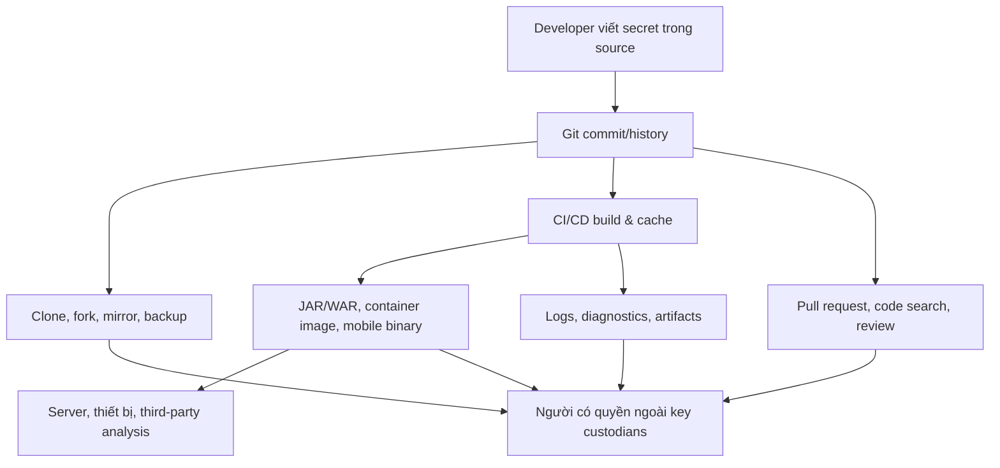
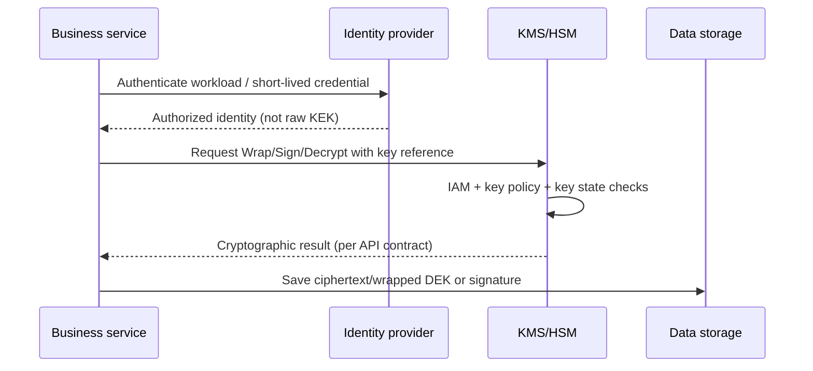
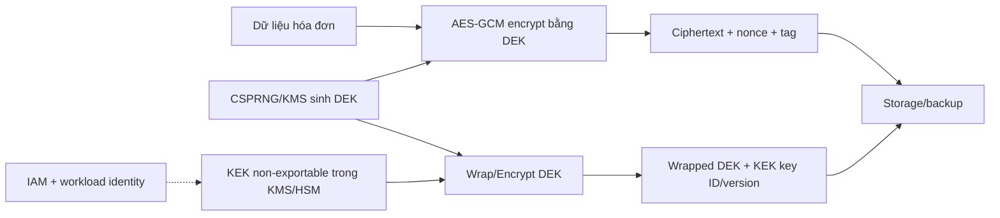
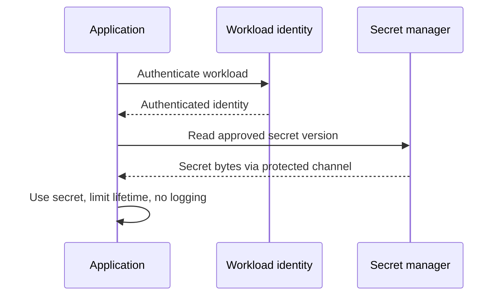
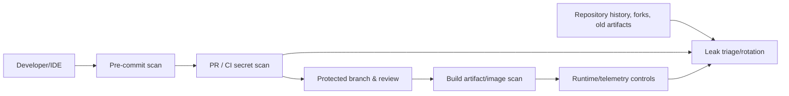
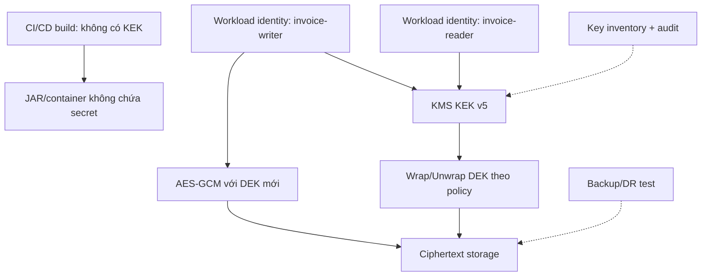

# Không lưu key trong source code

## 1. Nguyên tắc: source code không phải nơi bảo quản vật liệu khóa bí mật

**Không lưu key trong source code** nghĩa là **không nhúng vật liệu khóa bí mật vào mã nguồn, cấu hình được commit, tài nguyên đóng gói trong ứng dụng hoặc artifact được phân phối**. Một ứng dụng không nên phụ thuộc vào việc “không ai đọc mã nguồn” để giữ an toàn cho AES key, HMAC secret, private signing key, DEK, KEK hay seed mật mã.

Ví dụ, nếu ứng dụng Java chứa:

```java
// ANTI-PATTERN - chuỗi dưới đây chỉ là placeholder, không phải khóa thật.
private static final String AES_KEY_BASE64 = "<embedded-secret-key>";
```

thì bất kỳ ai đọc được repository, file class đã biên dịch, bản sao artifact, image hoặc một dump cấu hình phù hợp đều có thể tìm cách trích xuất bí mật. Thậm chí khi repository là private, quyền của developer, CI robot, backup, mirror và quá trình bàn giao có thể làm số người có khả năng đọc mã lớn hơn nhóm được phép sử dụng khóa.

Một private key hoặc symmetric key bị lộ có thể ảnh hưởng **dữ liệu đã mã hóa từ trước**, chứ không chỉ các request được xử lý sau thời điểm lộ. Chỉ xóa một dòng code và phát hành bản build mới **không thu hồi** vật liệu đã bị sao chép.

Bài học thuộc chương **Key storage** của module `SECURITY_KEY_MANAGEMENT_FUNDAMENTALS`. Module bao quát vòng đời khóa từ **tạo, cấp phát, lưu trữ, sử dụng, xoay vòng đến thu hồi và hủy**, liên hệ mật mã đối xứng/bất đối xứng, chữ ký số, **KMS/HSM**, envelope encryption, IAM và kiểm toán. Không hardcode key là một kiểm soát đầu vào quan trọng để các biện pháp này thực sự có hiệu quả.

### Mục tiêu học tập

Sau bài, bạn có thể:

1. Xác định **secret key material** nào tuyệt đối không nên xuất hiện trong source, kể cả dưới dạng encode, chia nhỏ, nén hay mã hóa với một mật khẩu cũng hardcode.
2. Phân biệt **public key, certificate, key ID/alias** với **private key, DEK, KEK, HMAC secret và seed**.
3. Giải thích vì sao **Git history, CI/CD logs, container image, mobile binary, Java bytecode và backup** làm lộ secret ngay cả khi file hiện tại đã được sửa.
4. Chọn cơ chế lưu khóa **KMS/HSM, secret manager, encrypted keystore hoặc managed identity** theo threat model.
5. Sử dụng **workload identity và IAM** để giảm nhu cầu phân phối raw key tới ứng dụng.
6. Thiết kế **envelope encryption DEK–KEK** để khóa có phạm vi ảnh hưởng lớn không xuất hiện trong code.
7. Xây dựng ví dụ Java 17 dùng **KeyProvider abstraction**, tạo key bằng CSPRNG cho demo và mô tả tích hợp KMS production.
8. Thiết lập **secret scanning** trong IDE, pre-commit, CI và repository, nhưng hiểu giới hạn của từng công cụ.
9. Lập runbook **incident response** cho key đã lộ qua Git, artifact, log hoặc thiết bị người dùng.
10. Kiểm tra rotation, revocation, backup/DR, audit và key destruction mà không tạo thêm bản sao bí mật.

## 2. Những giá trị nào là key bí mật?

Không nên hiểu `key` chỉ là một chuỗi có tên biến `KEY`. Có rất nhiều loại vật liệu và năng lực mật mã cần được bảo vệ.

| Giá trị | Có bí mật không? | Nếu lộ hoặc bị sửa có thể gây gì? |
| --- | --- | --- |
| **AES symmetric key / DEK** | **Có** | Giải mã ciphertext liên quan; tạo ciphertext giả nếu có thiết kế xác thực sai hoặc attacker dùng key đúng cách. |
| **KEK / master wrapping key** | **Có** | Có thể mở nhiều wrapped DEK; blast radius lớn. |
| **Private signing key** (Ed25519, ECDSA, RSA-PSS) | **Có** | Ký giả thông điệp, token, bản phát hành hoặc tài liệu. |
| **HMAC/MAC shared secret** | **Có** | Tạo MAC hợp lệ; verifier biết raw secret thường có thể tạo tag. |
| **Private KEM/decapsulation key** | **Có** | Decapsulate shared secret trong những luồng tương ứng. |
| **DRBG seed / RNG secret state** | **Có hoặc nhạy cảm** | Có thể ảnh hưởng các key/token được tạo; phạm vi tùy nguồn và thiết kế. |
| **Password pepper** | **Có** | Ảnh hưởng cơ chế bảo vệ password verifiers. |
| **Private TLS certificate key** | **Có** | Giả mạo endpoint/chữ ký tùy giao thức và trust. |
| **Opaque session/reset/API token** | **Có trong thời gian hiệu lực** | Truy cập hoặc mạo danh nếu hệ thống dùng token làm bearer capability. |
| **Public verification key** | Thường **không** | Không phải secret, nhưng mapping/trust phải chống đánh tráo. |
| **X.509 certificate public** | Thường **không** | Có thể công bố; cần kiểm tra nguồn, thời hạn, chain và revocation. |
| **Key ID, alias, version, KMS resource ARN/reference** | Thường **không** | Có thể lưu trong config, nhưng không tự cấp quyền; vẫn có thể tiết lộ topology. |
| **Nonce/IV, password salt, AEAD tag** | Thường **không** | Cần tính đúng đắn/toàn vẹn/uniqueness theo giao thức, không coi là key. |

**Điểm quyết định:** giá trị có tạo ra **năng lực bí mật** hay không. Một chuỗi là password, seed, raw key hay credential dù mang tên `configToken` hoặc `salt2` vẫn phải được quản lý như secret khi bản chất của nó là secret.

### 2.1. Public key có thể nằm trong code không?

Một **public key** hoặc certificate pin có thể được nhúng vào ứng dụng khi giao thức yêu cầu một **trust anchor/pin ổn định** và có quy trình cập nhật, xác thực, rotation, expiry và kiểm soát nguồn gốc.

Tuy vậy:

- Public key **không cần giữ bí mật**, nhưng **không được tin một public key tùy ý do đối thủ thay**.
- Có thể phải cập nhật app khi đổi trust anchor/pin; đó là vấn đề lifecycle, không phải rò secret.
- Không lưu **private key** cạnh public key trong cùng package.
- Với JWT, verifier chỉ cần **public verification key/JWKS đáng tin cậy**; không cần private signing key.
- Trong hệ thống KEM, bên gửi có thể có public encapsulation key; private decapsulation key chỉ ở bên nhận.

Vì vậy, quy tắc không phải “mọi chuỗi có chữ key đều cấm”, mà là **không phát hành bí mật trong source/binary và phải bảo vệ tính xác thực của các dữ liệu công khai quan trọng**.

### 2.2. Key reference khác key material

Một ví dụ cấu hình an toàn hơn là **tham chiếu tới tài nguyên quản lý**, không chứa raw secret:

```yaml
crypto:
  environment: production
  kekReference: "billing/prod/invoice-kek"
  defaultKeyVersionPolicy: "current-approved"
  contentAlgorithm: "AES-256-GCM"
  aadSchemaVersion: 2
```

Đây là **metadata**, không phải khóa AES. Ứng dụng còn phải xác thực workload identity, được IAM cấp quyền đúng key/operation và kiểm tra quyền nghiệp vụ. Chỉ biết `kekReference` **không được coi là có quyền Decrypt**.

## 3. Vì sao hardcoded key nguy hiểm dù repository là private?

Đường lan truyền của một secret được commit thường rộng hơn người tạo ra nó.



Ngay cả khi sau đó xóa secret khỏi branch chính, nó có thể còn trong:

- **Git history** và clones đã có trước đó.
- **Pull request diff**, code review notification, commit email, issue tracker.
- **CI/CD caches**, build logs, uploaded artifacts và container image layers.
- **Java `.class` bytecode**, constant pool, resource files được đóng gói trong JAR.
- **Container registry**, các phiên bản image cũ, deployment rollback.
- **Backup/snapshot** của developer workstation, build runner, server.
- **Crash dump, heap dump, telemetry, error report** sau khi app đã load key.
- **Mobile/desktop binary** hoặc thiết bị người dùng; người kiểm soát endpoint có thể phân tích ứng dụng.

**Private repository là kiểm soát truy cập cho mã nguồn, không phải key vault.** Một người được quyền đọc code để review không mặc nhiên phải có quyền lấy production KEK hay private signing key.

### 3.1. Hardcode có thể bị lộ qua Java bytecode

Java `static final String` chứa literal có thể được lưu trong constant pool của class file. Obfuscation có thể làm việc phân tích khó hơn, nhưng **không tạo ranh giới bảo mật đáng tin** cho một bí mật cần được giải mã/đọc bởi chính ứng dụng.

Các biến thể cũng không an toàn:

```java
// ANTI-PATTERN - các giá trị chỉ là placeholder để minh họa.
String keyText = "<secret-part-A>" + "<secret-part-B>";

byte[] keyBytes = java.util.Base64.getDecoder()
        .decode("<secret-key-base64>");

String password = new StringBuilder()
        .append("<embedded-password>")
        .toString();
```

Dù chia chuỗi, mã hóa Base64, dùng hex, thay byte order hoặc XOR với một hằng số, **phần mềm có đủ dữ liệu để khôi phục khóa** thì người phân tích phần mềm thường cũng có thể làm được điều đó.

### 3.2. “Đã xóa key khỏi source hiện tại” chưa phải remediation

Một commit xóa chuỗi khỏi code làm **giảm đường phát hành mới**, nhưng không làm khóa đã lộ tự mất hiệu lực. Khi một secret đã từng được commit, phải đánh giá nó **có khả năng bị truy cập và sao chép** qua lịch sử/các bản phân phối không thể thu hồi.

Quy trình chuẩn thường cần **rotate hoặc revoke secret**, cập nhật consumers, đánh giá dữ liệu lịch sử và xử lý các bản sao. Việc rewrite Git history có thể là bước giảm bề mặt tiếp xúc, **không thay cho key rotation**.

## 4. Những anti-pattern cần nhận diện trong code và cấu hình

### 4.1. Nhúng raw symmetric key vào Java

```java
// SAI: Placeholder minh họa, không dùng secret thật trong tutorial.
private static final String SECRET_AES_KEY =
        "<real-aes-key-would-be-hardcoded-here>";
```

Rủi ro: source/JAR bị đọc thì AES key bị lộ; không có owner, version/rotation tự động hay hạn chế operation. Dùng một key cho mọi tenant còn làm phạm vi ảnh hưởng lớn hơn.

### 4.2. Nhúng private signing key vào resource

```text
src/main/resources/
  application.yml
  jwt-private-key.pem   # ANTI-PATTERN
  production-secrets.json
```

Một file `.pem` hoặc keystore đặt trong classpath có thể được đóng vào JAR/WAR/image. Nếu là private key production, bất kỳ consumer của artifact có thể tìm thấy key material dù repository không công khai.

Đừng nhầm `public-cert.pem` với `private-key.pem`; **certificate công khai** không phải private signing key.

### 4.3. Đưa key dạng Base64 vào YAML hoặc properties

```yaml
# SAI - chỉ là ví dụ minh họa, không chứa secret thực.
crypto:
  aesKey: "<base64-encoded-secret>"
  keystorePassword: "<password-copied-from-local-machine>"
  privateKey: "<pem-private-key-as-string>"
```

Base64, hex và URL encoding chỉ là biểu diễn; **không mã hóa nội dung**.

### 4.4. “Mã hóa” secret bằng một khóa cũng nằm trong source

Giả sử ứng dụng lưu ciphertext của KEK nhưng có sẵn **password/unwrap key** trong binary. Nếu người đọc artifact có thể tìm cả ciphertext và phương thức mở, lớp mã hóa này **không tạo ra trust boundary độc lập**.

Đặt một key khác trong environment do cùng người quản trị và cùng pipeline có thể cải thiện một phần việc phân phối, nhưng phải đánh giá **bên nào giữ quyền đọc và ai có thể lấy cả hai**. Một thiết kế đúng cần **root of trust/secret delivery** ngoài đường phân phối source/artifact.

### 4.5. Sinh key bằng dữ liệu đoán được trong source

```java
// SAI cho khóa mật mã:
byte[] seed = "invoice-prod-fixed-seed"
        .getBytes(java.nio.charset.StandardCharsets.UTF_8);

// Không dùng seed cố định/đoán được để tạo DEK/KEK.
```

Việc sử dụng seed trong chương trình có thể chỉ làm key khác hình thức chứ không tăng entropy. Hash của một hằng số vẫn là hằng số có thể suy ra.

**Key generation phải dùng CSPRNG/KMS/HSM được duyệt**, không tự chế seed từ timestamp, tên máy, config hay password entropy thấp.

### 4.6. Commit file `.env` hoặc khóa trong test fixture

```text
.env.production         # secret file không được commit
src/test/resources/real-service-account.json
local-backup/keystore.p12
terraform.tfstate       # có thể chứa secret material tùy resource/provider
```

File `.env` chỉ có giá trị bảo mật nếu **không bị commit, phân phối rộng hoặc lưu trong artifact**, và vẫn phải kiểm tra quyền trên host, CI/CD và secret delivery. `.gitignore` không làm một file đã được Git track biến mất khỏi history.

**Test key** có thể tồn tại trong một fixture công khai khi chắc chắn đó là key mẫu không dùng cho hệ thống thật và không bị tái sử dụng. Nhưng không copy production key để “test cho tiện”, và không giả định một chuỗi trong `src/test` mặc nhiên vô hại.

## 5. Cơ chế lưu secret thay thế: chọn theo khả năng và phạm vi

Không có một nơi lưu duy nhất phù hợp mọi loại khóa. Cần chọn dựa trên **mức nhạy cảm, quyền sử dụng, giới hạn export, backup, latency và compliance**.

| Cách lưu/dùng | Lợi ích | Giới hạn/rủi ro | Mục đích phù hợp |
| --- | --- | --- | --- |
| **KMS managed key** | KEK/master key được quản trị bằng resource ID, IAM, audit, rotation | Grant `Decrypt`/`Sign` có thể bị lạm dụng; API/provider có giới hạn | KEK, wrapping, một số signing keys |
| **HSM / HSM cluster** | Có thể giữ private material non-exportable, hardware boundary và quorum | Vận hành, backup/HA, firmware/PKCS#11, key ceremony | Root, CA, high-value signing/KEK |
| **Secret manager** | Secret version, IAM, audit, phân phối theo workload | App có thể nhận **raw secret**, vẫn phải bảo vệ memory/log | API secret, webhook HMAC, keystore password |
| **Encrypted keystore** | File có password, integration JCA/PKCS12 | File có thể bị copy; password/ACL và process memory là điểm yếu | Một số workload đặc thù, local/dev |
| **OS/platform keystore** | Tích hợp quyền hệ điều hành hoặc hardware-backed keystore tùy platform | Khác nhau theo OS/device và migration/backup | Device-bound/application keys |
| **Workload identity + KMS API** | Không cần nhúng cloud access token cố định, kiểm soát theo service | IAM thiết kế sai vẫn có thể abuse capability | Production service dùng KEK hoặc private signing key |
| **Secrets mounted as protected file** | Giảm hardcode và có thể hạn chế quyền file | Volume, ACL, agent, file backup/rotation cần giám sát | Runtime cần raw secret theo contract |
| **Environment variables** | Tách source và artifact nếu inject đúng | Có thể lộ qua debug/process/env dump, child process, CI logs | Chỉ khi được đánh giá phù hợp và có biện pháp bù |

### 5.1. Khác biệt “không lưu trong source” và “không cho app thấy key”

Hai mức bảo vệ:

- **Mức 1 — Externalize secret:** ứng dụng tải raw key từ secret manager hoặc file được bảo vệ. Secret **không nằm trong source** nhưng vẫn hiện diện trong process và có thể bị sao chép nếu process bị chiếm.
- **Mức 2 — Keep master/private key non-exportable:** ứng dụng chỉ dùng **KMS/HSM key reference + cryptographic operation**. Key material có phạm vi lớn không được cung cấp qua API raw bytes. Tuy nhiên attacker có quyền `Sign`/`Decrypt` vẫn có thể lạm dụng API.

Nên ưu tiên mức bảo vệ đáp ứng mục tiêu, không tuyên bố một secret manager thông thường có cùng đặc tính với HSM.

### 5.2. Lưu key ID trong code có được không?

**Có thể**, vì key ID/resource reference thường **không phải secret**. Nhưng nên cấu hình **theo môi trường**, có policy review và kiểm soát thay đổi để tránh trỏ nhầm key production, key version hoặc tenant.

Mọi thao tác phải dựa trên **định danh workload đã xác thực** và **IAM**, không tin rằng một chuỗi key ID bí mật sẽ ngăn người khác gọi KMS.

### 5.3. Một file không nằm trong Git chưa chắc đã an toàn

Một secret file bị mount sai quyền (`world-readable`), được đưa vào container image, snapshot hoặc CI artifact vẫn có thể lộ. Cần bảo vệ cả **lifecycle của file**: tạo, injection, đọc, rotation, backup, logging và deletion.

## 6. Thiết kế đề xuất: workload identity → KMS/HSM

Với khóa có phạm vi ảnh hưởng rộng như **KEK** hoặc **private signing key**, kiến trúc khuyến nghị là dùng **workload identity** để gọi một dịch vụ quản lý khóa, thay vì đưa raw key vào source.



Thiết kế cần xác định:

1. **Workload identity riêng** cho service và môi trường; tránh shared account rộng.
2. **Least privilege** theo key resource, operation, tenant/context và thời hạn.
3. **Key purpose** rõ: Encrypt/Decrypt khác Sign/Verify, Wrap/Unwrap, GenerateMac/VerifyMac hoặc Decapsulate.
4. **Key type/algorithm** đúng policy; không dùng cùng vật liệu tùy tiện cho AES và HMAC.
5. **Audit** trên cả KMS và application/broker, không log plaintext/private key.
6. **Rotation/old versions** theo consumer và ciphertext history.
7. **Retry/timeouts/availability** nhưng không fallback về key hardcoded khi KMS unavailable.
8. **Business authorization** trước thao tác decrypt hoặc trả dữ liệu; IAM KMS không thay quyền object.

### 6.1. Khi KMS trả plaintext DEK

Một số KMS APIs kiểu **GenerateDataKey** có thể trả **plaintext DEK tạm thời** và wrapped/encrypted DEK cho ứng dụng; đó là kiến trúc envelope encryption hợp lệ khi được bảo vệ đúng.

Điều quan trọng là:

- **KEK vẫn được giữ trong KMS/HSM** theo provider contract.
- Plaintext DEK chỉ nên sống đủ để mã hóa/giải mã và **không vào source, log, metrics hoặc persistent plaintext storage**.
- Dữ liệu lưu dài hạn chỉ chứa **ciphertext, wrapped DEK và metadata được bảo vệ/đúng định dạng**.
- Có cơ chế quản lý bộ nhớ, limits, logging và process isolation.

**Non-exportable KEK không có nghĩa plaintext DEK không bao giờ xuất hiện trong application.** Phải mô tả đúng đường đi vật liệu.

## 7. Envelope encryption loại bỏ nhu cầu hardcode KEK

Một mô hình quen thuộc:



**DEK** là secret dùng mã hóa payload; **KEK** bảo vệ DEK. Thay vì nhúng `byte[] MASTER_KEY` trong code, service lưu **KEK reference** và để KMS/HSM thực hiện thao tác đã được ủy quyền.

### 7.1. Các thành phần cần ghi trong envelope

Ví dụ schema JSON (giá trị trong dấu `<...>` chỉ là placeholder):

```json
{
  "formatVersion": 2,
  "contentCipher": "AES-256-GCM",
  "keyReference": "billing/prod/invoice-kek",
  "keyVersion": "v5",
  "wrappedDek": "<base64url-wrapped-dek>",
  "nonce": "<base64url-96-bit-nonce>",
  "ciphertextAndTag": "<base64url-ciphertext-tag>",
  "aadSchemaVersion": 1,
  "tenantId": "tenant-01",
  "objectId": "invoice-42"
}
```

Envelope thực tế phải ràng buộc **tenant, object, key ID/version, algorithm và format version** bằng AAD và/hoặc wrapping context được thiết kế đúng. Không cho client tự thay `keyReference` và nhận quyền decrypt tenant khác.

### 7.2. Nonce không phải secret nhưng AES-GCM cấm tái sử dụng

AES-GCM thường dùng nonce 96 bit. Nonce được lưu công khai bên ciphertext, nhưng **không được tái sử dụng nonce với cùng một AES-GCM key**. Random nonce có xác suất collision; hệ thống số lượng lớn cần chiến lược uniqueness/usage bounds phù hợp.

Đổi việc lưu KEK sang KMS không cứu được một hệ thống sinh GCM nonce cố định hoặc làm rơi authentication tag.

### 7.3. Rotation khác rewrap và re-encrypt

- **Rotate KEK:** key version mới được dùng cho wrapped DEK của dữ liệu mới.
- **Rewrap DEK:** chuyển lớp bảo vệ DEK từ KEK v4 sang v5, **không thay bản thân DEK**.
- **Re-encrypt với DEK mới:** mã hóa lại payload khi DEK bị lộ/yếu hoặc chính sách yêu cầu.
- **Retire KEK cũ:** dừng new-use nhưng có thể giữ Unwrap cho dữ liệu/backup lịch sử.
- **Destroy KEK:** chỉ khi không còn dependency bắt buộc và có approval/bằng chứng provider.

Một DEK đã bị tiết lộ không tự trở nên bí mật vì được rewrap bằng KEK mới.

## 8. Java 17: tách mã ứng dụng khỏi nguồn chứa key

Mẫu quan trọng là ứng dụng **phụ thuộc vào một interface cấp khóa/cryptographic capability**, không chứa literal key hay mã tải secret tùy tiện trong business code.

Một ứng dụng production nên có:

- **Business service:** request/response, authorization dữ liệu, không biết raw KEK.
- **Crypto adapter:** ánh xạ operation vào KMS/HSM theo trusted policy.
- **Key registry/config:** giữ key ID/version, purpose, algorithm, region, **không chứa raw key**.
- **IAM:** identity của workload được phép gọi đúng API.
- **Audit:** event theo actor/key version, không ghi secret.

### 8.1. Demo Java 17 chạy độc lập: key chỉ được sinh tại runtime

Demo tạo một **ephemeral AES-256 DEK** bằng `KeyGenerator` với `SecureRandom`. **Không có một raw AES key hardcoded**. Nó minh họa AES-GCM với AAD, kiểm tra tampering và một `KeyProvider` để tách cách cấp key khỏi business code.

Demo **không phải KMS integration**: key chỉ sống trong một process và **không dùng để mã hóa dữ liệu cần giữ qua restart**. Production thay provider bằng KMS/HSM hoặc cơ chế phân phối key được bảo vệ và có version/backup đúng.

```java
import java.nio.charset.StandardCharsets;
import java.security.MessageDigest;
import java.security.SecureRandom;
import javax.crypto.AEADBadTagException;
import javax.crypto.Cipher;
import javax.crypto.KeyGenerator;
import javax.crypto.SecretKey;
import javax.crypto.spec.GCMParameterSpec;

public final class NoHardcodedKeyDemo {
    private static final SecureRandom RNG = new SecureRandom();
    private static final int GCM_TAG_BITS = 128;
    private static final int NONCE_BYTES = 12;

    interface KeyProvider {
        SecretKey currentDemoKey() throws Exception;
    }

    static final class EphemeralDemoKeyProvider implements KeyProvider {
        private final SecretKey key;

        EphemeralDemoKeyProvider() throws Exception {
            KeyGenerator generator = KeyGenerator.getInstance("AES");
            generator.init(256, RNG);
            key = generator.generateKey();
        }

        public SecretKey currentDemoKey() {
            return key; // Key do CSPRNG sinh, KHÔNG từ source.
        }
    }

    record Envelope(byte[] nonce, byte[] ciphertextAndTag) {}

    static Envelope encrypt(
        SecretKey key, byte[] plaintext, byte[] aad
    ) throws Exception {
        byte[] nonce = new byte[NONCE_BYTES];
        RNG.nextBytes(nonce);

        Cipher cipher = Cipher.getInstance("AES/GCM/NoPadding");
        cipher.init(
            Cipher.ENCRYPT_MODE,
            key,
            new GCMParameterSpec(GCM_TAG_BITS, nonce)
        );
        cipher.updateAAD(aad);
        return new Envelope(nonce, cipher.doFinal(plaintext));
    }

    static byte[] decrypt(
        SecretKey key, Envelope envelope, byte[] aad
    ) throws Exception {
        Cipher cipher = Cipher.getInstance("AES/GCM/NoPadding");
        cipher.init(
            Cipher.DECRYPT_MODE,
            key,
            new GCMParameterSpec(GCM_TAG_BITS, envelope.nonce())
        );
        cipher.updateAAD(aad);
        return cipher.doFinal(envelope.ciphertextAndTag());
    }

    public static void main(String[] args) throws Exception {
        KeyProvider keys = new EphemeralDemoKeyProvider();

        byte[] plaintext =
            "invoice=INV-42;amount=1000"
                .getBytes(StandardCharsets.UTF_8);
        byte[] aad =
            "tenant=tenant-01;object=INV-42;format=v1"
                .getBytes(StandardCharsets.UTF_8);

        Envelope envelope = encrypt(
            keys.currentDemoKey(), plaintext, aad
        );
        byte[] recovered = decrypt(
            keys.currentDemoKey(), envelope, aad
        );

        System.out.println(
            "Decrypt matches: "
            + MessageDigest.isEqual(plaintext, recovered)
        );

        byte[] tampered = envelope.ciphertextAndTag().clone();
        tampered[0] ^= 1;
        boolean rejected = false;
        try {
            decrypt(
                keys.currentDemoKey(),
                new Envelope(envelope.nonce().clone(), tampered),
                aad
            );
        } catch (AEADBadTagException expected) {
            rejected = true;
        }
        System.out.println("Tampering rejected: " + rejected);

        // Không in, encode, log hay persist raw key ở đây.
    }
}
```

Chạy với JDK 17+ và provider hỗ trợ AES-256-GCM:

```bash
javac NoHardcodedKeyDemo.java
java NoHardcodedKeyDemo
```

Output mong đợi:

```text
Decrypt matches: true
Tampering rejected: true
```

### 8.2. Bài học từ demo

1. `KeyGenerator` sinh khóa dựa trên CSPRNG/provider, **không đọc literal trong source**.
2. `KeyProvider` tạo một **điểm thay thế được** cho cách lưu/truy cập key.
3. Business code không chứa một key production có thể bị trích từ bytecode.
4. AES-GCM có nonce, AAD, authentication tag và kiểm tra tampering.
5. Demo key nằm trong process: **không durable**, không backup, không thể decrypt dữ liệu sau restart.
6. KMS/HSM non-exportable key không nhất thiết hiện ra dưới dạng Java `SecretKey` có bytes; production provider có thể expose key handle, SDK operation hoặc `Signature`/`Cipher` thông qua provider.
7. Random nonce 96 bit chỉ là minh họa; production cần strategy/usage bounds bảo đảm nonce uniqueness.
8. Demo chưa giới hạn kích thước input, object authorization, audit và key version; **không copy nguyên vào production như một crypto framework**.

### 8.3. Không dùng `System.getenv()` để giả vờ đã giải quyết hoàn toàn bài toán

Một anti-pattern khác là chuyển key literal sang environment:

```java
// VẪN LÀ RAW KEY TRONG PROCESS; chỉ chuyển nơi phân phối.
String rawKey = System.getenv("APP_AES_KEY");
```

Nếu value được inject an toàn, đây có thể là bước **tách source khỏi secret**, nhưng vẫn cần kiểm soát: ai set được env, ai đọc được deployment config, process dump, child process, CI logs, rotation và secret access. Không biến một env var thành bằng chứng “key đã non-exportable”.

Với **KEK hoặc signing key có giá trị cao**, thường nên giữ private/master material trong KMS/HSM và để ứng dụng dùng **identity + cryptographic API**.

## 9. Java/KMS production: giữ key reference, không giữ raw KEK

Không dùng một đoạn pseudo SDK và coi đó là API chung của mọi provider. Các nhà cung cấp có **tên method, key type, authorization, rotation và response format khác nhau**.

Pseudocode khái niệm:

```text
function encryptInvoice(authenticatedCaller, invoice):
    authorizeWrite(authenticatedCaller, invoice.tenant, invoice.id)

    keyRef = trustedRegistry.currentKekFor(invoice.tenant)
    requireApprovedKeyPurpose(keyRef, "invoice-dek-wrapping")

    // KMS/crypto provider kiểm soát KEK và IAM:
    response = kms.generateDataKey(
        keyRef, authenticatedEncryptionContext(invoice)
    )

    dek = response.plaintextDekOrHandle  // Có thể tạm lộ DEK theo API.
    wrappedDek = response.encryptedDek

    nonce = nextNonceUnderApprovedGcmPolicy(dek)
    ciphertext = aesGcmEncrypt(
        dek, invoice.contents, nonce,
        canonicalAad(invoice.tenant, invoice.id, keyRef)
    )
    safelyReleaseTemporaryDekWhereSupported(dek)

    storeEnvelope(
        ciphertext, nonce, wrappedDek,
        keyRef.id, keyRef.version, aadFormatVersion
    )
```

```text
function decryptInvoice(authenticatedCaller, envelope):
    authorizeRead(
        authenticatedCaller,
        envelope.tenant, envelope.objectId
    )

    keyRef = trustedRegistry.resolveExactVersion(
        envelope.keyId, envelope.keyVersion
    )
    requireKeyAllowedForRead(keyRef, authenticatedCaller)

    dek = kms.unwrapDataKey(
        keyRef, envelope.wrappedDek,
        authenticatedEncryptionContext(envelope)
    )
    plaintext = aesGcmDecryptAndVerify(
        dek, envelope.ciphertextAndTag, envelope.nonce,
        canonicalAad(envelope.tenant, envelope.objectId, keyRef)
    )
    safelyReleaseTemporaryDekWhereSupported(dek)
    return plaintext
```

**Những điểm cần triển khai thật:**

- `trustedRegistry` phải do **nguồn cấu hình tin cậy** kiểm soát; không sử dụng raw key ID/tenant do client tự chọn để vượt quyền.
- KMS IAM kiểm tra **đúng workload identity** và scope.
- Provider contract quyết định có `GenerateDataKey`, `Encrypt/Decrypt`, `Wrap/Unwrap` hay API khác.
- AAD/encryption context phải ràng buộc metadata và có canonical encoding, tránh ambiguity.
- Data authorization **độc lập** với KMS authorization.
- Kết quả từ KMS có thể chứa plaintext DEK; xử lý memory/logging an toàn.
- Phải có key version, rotation overlap, backup/DR và audit.

## 10. Workload identity: không nhúng cloud credentials để truy cập KMS

Ngay cả khi KEK nằm trong KMS, nếu application phải hardcode **cloud API key/service account JSON** để gọi KMS, bạn chỉ chuyển vấn đề từ “lộ KEK” sang “lộ credential có quyền dùng KEK”.

Mẫu an toàn hơn:

- Sử dụng **workload identity/service identity** của môi trường chạy và **short-lived credentials** khi nền tảng hỗ trợ.
- Tách principals theo service, tenant/scope, region và production/staging.
- Không đặt long-lived access key trong Git, Dockerfile, Kubernetes manifest dạng rõ hoặc local test package.
- Giới hạn quyền `Encrypt/Decrypt/Wrap/Unwrap/Sign/VerifyMac/GenerateMac` đúng mục đích.
- Tách quyền `CreateKey`, `SetKeyPolicy`, `ScheduleDeletion` và audit administration.
- Ghi audit key operations mà không ghi plaintext/secret.

### 10.1. Least privilege theo operation

| Service/principal | Có thể cần | Không nên mặc định có |
| --- | --- | --- |
| `invoice-writer` | Wrap/Encrypt DEK đúng tenant | Decrypt toàn bộ archive, Sign JWT, Destroy key |
| `invoice-reader` | Unwrap/Decrypt dữ liệu được phép | Thay key policy, decrypt tenant khác |
| `auth-issuer` | Sign bằng private signing key cụ thể | Export private key, sửa trusted JWKS tùy ý |
| `api-gateway` | Verify với public key đáng tin cậy | Private Sign permission |
| `backup-restore` | Unwrap/Decrypt có approval time-bound | Truy cập production liên tục không audit |
| `key-administrator` | Rotate/Disable theo quy trình | Đọc raw DEK/keystore password vô cớ |
| `auditor` | List/Describe metadata và audit | Decrypt/Sign/Destroy |

**Không tự giả định provider có cùng tên operation**; bảng diễn tả quyền nghiệp vụ. Ánh xạ sang IAM verbs và key policy thực tế phải được kiểm thử.

### 10.2. Khóa non-exportable vẫn có thể bị lạm dụng

Một service bị chiếm mà có quyền `Sign` có thể tạo chữ ký qua HSM dù không bao giờ export private key. Tương tự, `Decrypt` có thể trả DEK/plaintext theo API và cho phép truy cập dữ liệu nếu application authorization yếu.

Vì vậy, giữ secret ngoài source là **một lớp bảo vệ**, không thay thế phân tách quyền, rate limit, policy theo nội dung ký, object authorization và incident monitoring.

## 11. Secret manager, environment variable và mounted file

Khi ứng dụng **bắt buộc phải sử dụng raw secret** (ví dụ một webhook HMAC secret tương thích với đối tác), có thể chọn secret manager/secure injection thay vì hardcode.

### 11.1. Tải secret tại runtime

Một luồng khái niệm:



Điểm quan trọng:

- **Secret ID/reference** có thể nằm trong config, nhưng **secret value không nằm trong code**.
- Secret manager phải có IAM, TLS/transport protection, audit và rotation policy.
- Nếu ứng dụng caching secret, phải quản lý **lifetime, eviction, version update và stale-value handling**.
- Khi rotate HMAC key, bên gửi/bên nhận cần giai đoạn **overlap có giới hạn** và xác minh đúng version.
- Việc lấy secret từ manager không bảo đảm raw bytes **không bao giờ xuất hiện trong process**.

### 11.2. Environment variable có thật sự “secure” không?

Môi trường runtime có thể inject secret qua env vars, nhưng **giá trị env** có thể xuất hiện trong:

- Debugging, error reports, diagnostics hoặc cấu hình CI.
- Child process, process inspection tùy OS/quyền.
- Container inspect/misconfigured deployment tools.
- Log in ra toàn bộ environment khi khởi động.

Vì vậy không nên coi env var là vault. Nếu dùng, phải bảo vệ cả **nguồn inject, access to runner/host, logging và rotation**. Với secret rất nhạy cảm, cân nhắc phương pháp **file/IPC/identity-based API** có ranh giới phù hợp hơn.

### 11.3. Kubernetes Secrets không thay cho threat model

Một Kubernetes Secret là cơ chế phân phối dữ liệu qua cluster API. Việc **giấu khỏi Git** là tốt, nhưng cần đánh giá cấu hình **encryption at rest của control plane**, RBAC, etcd backups, pod/service account access, mount permissions và runtime secret exposure.

Nếu một manifest chứa raw secret value rồi được commit, bạn vẫn đã đưa secret vào source control dù đối tượng mang tên `Secret`. Dùng cơ chế **external secrets/secret controller** được duyệt và workload identity khi phù hợp; không giả định mọi deployment đã bật những kiểm soát đó.

### 11.4. Java heap và key bytes

- Tránh tạo `String` chứa secret khi có thể dùng `byte[]`/`char[]` hoặc key handle theo API.
- Không in `SecretKey.getEncoded()`, HMAC key, password hay JWT private material vào log.
- Không tùy tiện serialise secret vào cache/session/exception.
- Có thể xóa một mảng byte do app sở hữu khi xong, nhưng **`Arrays.fill` không chứng minh mọi bản sao trong JVM/native/provider đã bị zeroize**.
- Kiểm soát heap dumps, debugger, crash reports, profiling và operator access.
- Không đưa secret vào tracing attributes, monitoring labels hoặc analytics events.

## 12. Secret scanning: phát hiện key trước khi commit và sau khi phát hành

Một hệ thống phòng vệ tốt có **nhiều lớp** phát hiện secret:



### 12.1. Nên kiểm tra những vị trí nào?

- Java source, Kotlin, YAML, properties, JSON, shell scripts.
- `.env` và secret files vô tình được Git track.
- PEM/PKCS#8 private key headers, key stores và service account JSON.
- CI workflows, deployment manifests, Helm values, IaC source và state artifacts.
- Test fixtures; lỗi thường gặp là đem khóa thật vào `src/test`.
- Git commit history, release tags, branches, fork/mirror theo khả năng truy cập hợp lệ.
- JAR/WAR, container image layers, mobile binary, build logs và backup artifacts.

**Không phải mọi chuỗi giống khóa đều là secret**, nên scanner cần quy trình triage và phân loại false positives. Ngược lại, scanner không bảo đảm bắt được secrets đã chia nhỏ, tự encode, chèn whitespace, encrypt/obfuscate hoặc lưu trong file binary.

### 12.2. Kiểm tra nhanh trong Git

Các lệnh sau chỉ minh họa một bước tìm kiếm **thủ công**; chúng **không thay thế secret scanner chuyên dụng** và không nên in/lan truyền secret thật ra log công khai.

```bash
# Kiểm tra các file đang được Git theo dõi.
git ls-files

# Tìm những vị trí có tên biến đáng rà soát
# (không khẳng định mỗi kết quả là secret).
git grep -n -I -E 'private.?key|secret.?key|keystore.?password|api.?token'

# Xem lịch sử thay đổi của một file đã biết.
git log --oneline -- path/to/application.yml
```

Nếu phát hiện raw key, **không dán nguyên value** vào issue, email, chat hoặc ticket. Chỉ ghi **loại secret, key ID/fingerprint an toàn, vị trí và commit reference**, cùng thông tin owner được phân quyền.

Dùng scanner hỗ trợ **pattern + entropy heuristics + provider-specific validation**, cài vào pre-commit và CI, nhưng phải đánh giá quyền truy cập/output của scanner vì nó có thể nhìn thấy chính secret cần bảo vệ.

### 12.3. Quy tắc chặn CI

Một chính sách có thể:

1. **Fail build** nếu phát hiện private key/prod secret mới và chưa có quyết định triage.
2. Kiểm tra source và **artifact** được phân phối, không chỉ diff của PR.
3. Dùng allowlist có **owner, reason, expiry**, không cho bỏ qua scanner bằng regex rộng.
4. Không tự đưa raw secret bị quét vào console output, Slack hay issue bot.
5. Có bước phân loại test dummy, public key, certificate và false positive.
6. Theo dõi **secrets từng xuất hiện trong history** và tình trạng rotation.
7. Không đưa token của secret scanner vào source hay cấp quyền rộng hơn cần thiết.

### 12.4. `.gitignore` cần nhưng chưa đủ

Ví dụ cấu hình tránh track một số file local:

```gitignore
.env
.env.*
*.p12
*.pfx
*.key
local-secrets/
!example.env
```

Những pattern này có thể có ngoại lệ hợp lệ (ví dụ `public.key`), nên cần điều chỉnh theo repository. **`.gitignore` chỉ ảnh hưởng file chưa được track**, không tự xóa secret đã commit, không chặn một người cố ý `git add -f` hoặc phát hiện chuỗi trong file khác.

`example.env` phải chỉ chứa **tên biến và placeholder không có giá trị thật**. Đừng đăng một file example có credentials production rồi tin `example` nghĩa là an toàn.

## 13. Nếu key đã bị commit: xử lý như sự cố tiềm tàng

Khi phát hiện raw secret trong source hoặc Git history, **ưu tiên giảm khả năng bị lạm dụng**, rồi mới dọn dẹp bản sao. Không nên dành toàn bộ thời gian viết lại Git history trong khi token/key vẫn đang hoạt động.

### 13.1. Runbook theo trình tự hợp lý

1. **Xác nhận nhanh:** đó là key thật hay fixture? Key phục vụ môi trường nào, có còn hiệu lực không? Không copy raw bytes sang hệ thống khác để hỏi.
2. **Phân loại bí mật:** DEK, KEK, HMAC, private signing, API token, cloud credential hay seed? Mỗi loại có cách thu hồi khác nhau.
3. **Giới hạn truy cập và cô lập:** khóa quyền của principal bị lộ, chặn download/artifact nếu có thể; tránh gây mất dữ liệu đột ngột.
4. **Thu thập bằng chứng:** vị trí file/commit, thời gian xuất hiện, ai có quyền read, logs truy cập, image/tags liên quan; bảo vệ chain of custody.
5. **Tạo vật liệu/credential mới** từ CSPRNG/KMS/HSM đúng policy, với IAM tối thiểu.
6. **Triển khai consumer migration:** ứng dụng và đối tác chuyển sang key/token mới; kiểm tra read/verify lịch sử.
7. **Revoke/distrust/rotate** key cũ theo đúng loại và phạm vi; không mặc định xóa vật liệu cũ tức thì nếu còn retention.
8. **Đánh giá dữ liệu bị ảnh hưởng:** ciphertext, token, signatures, wrapped DEKs, backups và thậm chí plaintext đã bị tải.
9. **Loại secret khỏi source/artifact/history** theo quy trình đã được phê duyệt; xử lý cả mirror/fork/backup trong khả năng, tránh làm mất bằng chứng điều tra.
10. **Kiểm chứng hậu quả:** scanner pass, credentials cũ không còn usable trong phạm vi cần thiết, IAM được rà soát, audit không còn truy cập bất thường.
11. **Ghi postmortem:** nguyên nhân, thời gian phơi lộ, ảnh hưởng, cách ngăn tái diễn và owner remediation.

Một khóa xuất hiện trong repository công khai phải được xem là **có khả năng bị bên ngoài đọc**, không chờ bằng chứng chắc chắn rằng đã có người lấy. Với repository private, vẫn phải đánh giá **quyền đọc và các bản sao**; không tự khẳng định secret chưa từng bị tiếp cận.

### 13.2. Xử lý Git history: hữu ích nhưng không đủ

Có thể cần loại secret khỏi lịch sử bằng công cụ được phê duyệt và điều phối với repo owner. Việc rewrite history:

- Thay đổi commit hashes, ảnh hưởng các branch/PR/forks/clones.
- Không thu hồi bản sao đã được tải về.
- Có thể làm đứt liên kết audit; phải bảo toàn evidence ở nơi được phép.
- Cần thông báo teams, xử lý caches/artifacts, rotation và đối chiếu sau làm sạch.
- Không thay thế **credential revocation, key rotation hoặc re-encryption**.

**Không đưa câu lệnh xóa hàng loạt history lên production repository mà chưa có kế hoạch phê duyệt và kiểm chứng.**

### 13.3. Cần phân biệt key rotation với quyền truy cập bị lộ

Nếu một **cloud access token** bị commit, revoke token/credential và kiểm tra IAM/operations là bước đầu. Nếu **KEK raw bytes** bị commit, có thể phải migrate wrapped DEKs và đánh giá khả năng giải mã dữ liệu. Nếu **private signing key** bị commit, có thể phải cập nhật verifier trust ngoài việc sinh key mới.

Mỗi đối tượng cần runbook đúng mục đích; một lệnh `git rm` hoặc đổi password không tương đương xử lý mọi loại secret.

## 14. Khi loại khóa khác nhau bị lộ thì xử lý khác nhau ra sao?

| Loại bị lộ | Đối thủ có thể làm gì? | Hướng xử lý chính |
| --- | --- | --- |
| **AES DEK** | Giải mã dữ liệu được mã hóa dưới DEK nếu có ciphertext; tạo bản mã/tag hợp lệ với key | Re-encrypt bằng DEK mới khi cần; rà soát copies/backup và dữ liệu đã truy cập |
| **KEK** | Unwrap nhiều DEK nếu có wrapped DEKs và ngữ cảnh đủ | Cô lập, rotate KEK, đánh giá rewrap/re-encrypt, blast radius và key copies |
| **Private signing key** | Tạo chữ ký giả có thể được verifier tin | Tạo key mới, chuyển signer, revoke/distrust key cũ theo giao thức, cập nhật verifier/JWKS/certificates |
| **HMAC shared secret** | Tạo tag giả, xác minh/thay message theo threat model | Rotate shared secret, cập nhật producer/verifier, versioned overlap có giới hạn |
| **Private decapsulation key** | Decapsulate shared secret từ ciphertext phù hợp | Rotate/migrate KEM and envelopes, đánh giá archival ciphertext và trust |
| **Cloud credential có KMS permissions** | Gọi Encrypt/Decrypt/Sign theo quyền được cấp | Revoke credential, kiểm tra operation logs, giảm IAM, xem xét key impact |
| **Password/pepper** | Tăng khả năng tấn công password verifiers theo thiết kế | Rotate/rework verifier scheme có kế hoạch, bảo vệ accounts và theo dõi abuse |
| **Public verification key** | Bản thân public key thường không phải bí mật | Kiểm tra **tính xác thực/trust binding**, không nhất thiết rotate private key chỉ vì public key công khai |

### 14.1. Một DEK bị lộ không được “chữa” bằng KEK mới

**Rewrap** là mã hóa lại DEK dưới KEK mới. Nếu đối thủ đã có raw DEK, họ có thể tiếp tục giải mã ciphertext cũ đã thu thập. Muốn khôi phục bảo mật cho dữ liệu trong tương lai, có thể cần **DEK mới và re-encrypt dữ liệu**, đồng thời đánh giá dữ liệu đã bị lộ.

### 14.2. Hủy private signing key không làm chữ ký cũ tự sai

Một private signing key bị lộ có thể được kẻ tấn công dùng tạo chữ ký giả. Sau khi destroy bản key trong KMS, **public key** cũ vẫn có thể verify những chữ ký đã tạo bằng private key đó. Cần cập nhật **issuer/JWKS/certificate trust/revocation**, token lifetime, cache và các verifier phù hợp.

### 14.3. HMAC không có verifier độc lập về bí mật

Nếu webhook consumer có raw HMAC secret, nó **có thể tạo MAC**. Không ghi rằng “verifier chỉ có quyền verify” trừ khi dùng KMS/HSM API tách quyền **và không phát key bytes**, đồng thời provider/IAM thực thi phân tách đó.

## 15. Git, CI/CD, container và client application: kiểm soát theo từng lớp

### 15.1. Repository và code review

- Cấm commit raw production keys, service credentials, key stores không kiểm soát.
- Review các thay đổi IAM, KMS resource IDs, cryptographic algorithms và secret delivery.
- Chạy secret scanner trước commit và trong PR/CI.
- Có owner để triage false positives và kích hoạt rotation khi thấy secret thật.
- Kiểm tra history, branches và release tags theo phạm vi được phép.

### 15.2. CI/CD runner

Một secret injected vào CI có thể bị in bởi `set -x`, verbose logging, test failure hoặc một script không được tin cậy. Nên:

- Dùng short-lived identity/token có quyền tối thiểu.
- Tách production deployment secrets khỏi PR builds không đáng tin.
- Không cung cấp signing private key trực tiếp cho pipeline nếu có thể dùng HSM signing service.
- Giới hạn artifacts, caches, logs và người được phép download.
- Phân biệt **secret injection chỉ tại lúc chạy** với việc build secret vào image/layer.

### 15.3. Container image và Dockerfile

**Anti-pattern**: đặt một secret trong `ARG`, `ENV` hoặc `COPY` rồi đóng image/layer và đẩy lên registry. Dù xóa file ở layer sau, secret vẫn có thể tồn tại trong image history/layers tùy quy trình build.

Thiết kế tốt hơn dùng **runtime identity + KMS/secret manager**, hoặc cơ chế build secrets chuyên dụng đã được kiểm tra cho những trường hợp bắt buộc dùng ở build time. Không phân phối private key production trong container image.

### 15.4. Mobile/desktop application

Bất kỳ secret **chung cho toàn bộ client** được đóng trong mobile/desktop binary nên được xem là **có thể trích xuất** bởi người kiểm soát thiết bị. Obfuscation, split strings hay native library có thể tăng độ khó phân tích nhưng không đảm bảo giữ một shared master key bí mật.

Các phương án tốt hơn:

- Giữ **server signing/KEK/API secrets** ở backend hoặc KMS/HSM.
- Dùng **public key trong client** khi giao thức yêu cầu verification hoặc key encapsulation.
- Dùng **per-device/per-user keys** trong platform keystore/secure enclave khi phù hợp.
- Cấp token có scope/expiry thay vì nhúng một credential chung vĩnh viễn.
- Giới hạn backend authorization; không coi API key trong app là hàng rào bảo mật duy nhất.

## 16. Backup, restore và key lifecycle sau khi loại khỏi source

Đưa secret ra khỏi code không có nghĩa có thể bỏ qua **backup và khôi phục**. Một hệ thống còn ciphertext nhưng mất KEK có thể mất dữ liệu không thể cứu được.

### 16.1. Các metadata cần quản lý

```yaml
keyId: billing/prod/invoice-kek
keyVersion: v5
owner: billing-security
keyType: symmetric
algorithmFamily: AES
purpose: invoice-dek-wrapping
provider: managed-kms
origin: provider-generated
exportability: non-exportable
state: ACTIVE_FOR_NEW_USE
secretValueStoredInSource: false
allowedOperations:
  - Wrap
  - Unwrap
serviceConsumers:
  - invoice-writer
  - invoice-reader
  - backup-restore
dependencyInventoryRef: invoice-wrapped-deks-v5
backupRestoreEvidenceRef: dr-restore-test-2026-11
policyRef: key-policy-v4
```

Đây là **schema inventory minh họa**, không phải bằng chứng tự động rằng key thực sự nằm ngoài source. Trường `secretValueStoredInSource: false` phải được **kiểm chứng** từ repository/artifacts/scanner và kiến trúc thực tế, không chấp nhận vì người khai tự đánh dấu.

### 16.2. Backup dữ liệu phải tương thích key versions

Đối với envelope encryption:

- Live data có thể đã rewrap sang KEK v5 nhưng snapshot năm trước còn dùng v3/v4.
- Nếu backup phải khôi phục theo retention, phải có đường **Unwrap đúng key version**.
- Restore drill cần kiểm thử ciphertext, wrapped DEK, key ID/version, region, IAM, format và AAD.
- Không lưu raw KEK cạnh ciphertext backup chỉ để tăng tiện lợi.
- Không destroy version cũ khi còn **data dependencies** chưa xử lý.

### 16.3. Zeroization và destruction khác xóa source

- Xóa literal từ code: chặn **nguồn phát hành thêm** một secret qua code mới.
- Revoke IAM: chặn **danh tính** dùng capability trong phạm vi.
- Disable key: chặn **provider operations**, vật liệu thường vẫn còn.
- Rotate/re-encrypt: thay vật liệu cho use-case hoặc dữ liệu tương ứng.
- Destroy key material: hủy **vật liệu trong phạm vi xác định** khi đáp ứng retention/legal hold và có evidence.
- Crypto-erasure: dữ liệu mã hóa có thể không còn giải mã khả thi khi **mọi đường lấy secret cần thiết** bị loại bỏ theo các giả định mật mã phù hợp.

Không dùng `rm`, xóa Git tag hoặc `Arrays.fill(...)` để khẳng định đã xóa mọi bản sao key trong SSD, VM snapshot, backup, JVM hoặc hệ thống đối tác.

## 17. Audit và monitoring: chứng minh khóa không nằm trong source

Một chính sách không chỉ tuyên bố “không hardcode secret”, mà cần **evidence** kiểm tra độc lập.

| Kiểm soát | Nguồn bằng chứng | Điều cần xác minh |
| --- | --- | --- |
| **Source scanning** | PR/CI scan và repository history | Scanner bao phủ đúng repo, branch, artifact và kỳ đánh giá |
| **Key inventory** | Key registry + KMS/HSM metadata | Key origin, owner, purpose, consumers, exportability |
| **Runtime identity** | IAM grants, workload auth logs | Không dùng static credential ẩn trong binary |
| **KMS usage** | Provider audit log | Actor, key ID/version, operation, region, result |
| **Secret manager** | Access policies, read events | Ai có thể lấy plaintext secret, có audit/rotation |
| **CI/CD artifacts** | Image/artifact scans, build config | Không build key vào JAR/container/layer |
| **Rotation evidence** | Change ticket, key version, consumer rollout | Exposed keys đã được thay/thôi tin cậy đúng thời điểm |
| **Backup/DR** | Restore test, dependency inventory | Không mất dữ liệu khi bỏ key cũ |
| **Incident history** | Ticket, timeline, revocation and scope | Mọi key đã từng lộ có remediation/owner |

### 17.1. Event nào hữu ích?

```yaml
event: "key.material.exposure.detected"
detectedAt: "2026-11-28T04:00:00Z"
findingId: "KEY-LEAK-042"
locationType: "git-history"
repositoryRef: "internal-repo-3"
pathRef: "src/main/resources/legacy-crypto.yml"
secretClass: "symmetric-kek"
keyReference: "billing/prod/invoice-kek:v2"
rawSecretIncludedInEvent: false
owner: "billing-security"
action: "triage-and-rotation"
```

Đây là **mẫu log nội bộ minh họa**. Báo cáo finding không nên chứa raw key, private PEM body, toàn bộ credential hay ciphertext/PII không cần thiết. Đường dẫn/key IDs cũng có thể nhạy cảm, nên phải bảo vệ cả audit store.

### 17.2. Đánh giá coverage của scanner

Một scanner không báo lỗi **không chứng minh tất cả key đã an toàn** nếu:

- Chỉ scan diff hiện tại, bỏ Git history.
- Không scan file binary hoặc artifact.
- Không có quyền vào repo/branch/fork tương ứng.
- Secret nằm dưới dạng tự chia nhỏ, encoded hoặc trong CI settings/logs.
- KMS secret được lấy và **log ở runtime** chứ không có trong source.
- Cơ chế allowlist bỏ qua quá nhiều pattern.

Auditor nên ghi **phạm vi, thời gian, phiên bản policy, sources và false-negative limitations**. Cần đối chiếu architectural review và runtime telemetry, không chỉ “CI xanh”.

## 18. Case study: KEK hóa đơn bị nhúng trong ứng dụng Java

### 18.1. Bối cảnh

`invoice-platform` có hai microservices:

- `invoice-writer` mã hóa hóa đơn bằng AES-GCM.
- `invoice-reader` giải mã hóa đơn và phục vụ những người dùng được cấp quyền.

Hệ thống cũ dùng một **KEK tĩnh** để bảo vệ DEK. Lập trình viên từng đưa KEK vào `application.yml` để cả hai service chạy không cần gọi KMS. Cùng file được commit lên Git và đóng trong JAR/container image.

### 18.2. Mẫu thiết kế sai

```text
application.yml:
    kekBase64 = <embedded-production-key>

invoice-writer.jar:
    resources/application.yml contains raw KEK

invoice-reader.jar:
    resources/application.yml contains raw KEK

backup:
    ciphertext + JARs + old image layers
```

Tác động:

1. Developer/CI principal có thể lấy KEK dù không có quyền KMS.
2. Người đọc artifact có KEK và wrapped DEKs có thể mở nhiều DEK.
3. Không biết rõ ai đã copy bytes qua các năm.
4. Không có key version tách biệt cho ciphertext/backup.
5. Việc xóa literal khỏi branch main không thu hồi bản cũ.
6. Nếu DEK bị lộ, chỉ rotate KEK không đủ giải quyết dữ liệu đã bị ảnh hưởng.

### 18.3. Thiết kế sau cải tiến



Runbook thực hiện:

1. Phát hiện và **xử lý KEK cũ là potentially exposed**.
2. Inventory mọi service, JAR/image tag, Git revisions, dữ liệu, wrapped DEK và backup phụ thuộc.
3. Provision KEK mới trong KMS/HSM, non-exportable khi provider hỗ trợ.
4. Tạo workload identities riêng và IAM tối thiểu cho writer/reader/DR.
5. Ứng dụng đổi sang **key ID/version** từ trusted registry; không còn raw KEK trong mã.
6. Writer dùng key mới để tạo wrapped DEK; reader hỗ trợ dữ liệu lịch sử qua migration đã kiểm soát.
7. Nếu chỉ KEK cũ có rủi ro, đánh giá rewrap; nếu DEK/raw plaintext cũng lộ, có thể cần **re-encrypt với DEK mới**.
8. Reconcile live database, backups, snapshot, external consumers; chạy restore tests.
9. Revoke/quản trị key cũ theo policy, không destroy khi còn nghĩa vụ đọc backup cần giữ.
10. Loại secret khỏi source/artifact/history theo quy trình; không coi cleanup là rotation.
11. Chạy negative IAM tests, scan artifacts, kiểm tra logging và phân công audit/owner.

### 18.4. Những câu hỏi auditor cần trả lời

- KEK từng nằm ở những commit/artifacts nào? Ai có quyền đọc?
- Chức năng writer/reader có còn chứa hoặc log raw key không?
- KMS/HSM thực sự giữ key mới; ứng dụng có thể export raw KEK không?
- Bản ghi và backup còn phụ thuộc KEK cũ trong bao lâu?
- Dữ liệu bị lộ có cần re-encrypt, thông báo hoặc đáp ứng nghĩa vụ khác không?
- Có bảo đảm **thao tác Sign/Decrypt/Wrap** được tách IAM, business authorization và audit?
- Kết quả scan/restore/migration và final key states có thể kiểm chứng độc lập không?

## 19. Case study: private signing key trong mobile app

### 19.1. Tình huống

Nhóm phát triển muốn nhúng một **private key ký request** vào Android/iOS app để mọi client tạo chữ ký giống server. Ý tưởng này **không thể giữ private key chung bí mật đáng tin cậy** trước người kiểm soát một thiết bị: họ có thể phân tích binary, instrumentation hoặc tìm đường sử dụng key qua app.

Rủi ro:

- Một private key lộ cho phép kẻ tấn công giả mạo chữ ký của **mọi client** dùng cùng key.
- Obfuscation chỉ tăng chi phí phân tích, không tạo non-exportable server key.
- Rotation thường buộc phát hành app mới và chờ khách hàng cập nhật.
- Server khó phân biệt các client nếu dùng chung một secret.

### 19.2. Kiến trúc phù hợp hơn

- Server giữ **private signing key** trong KMS/HSM; client nhận public key để verify khi cần.
- Nếu cần chứng minh danh tính thiết bị, cân nhắc **per-device key pair** được tạo trong platform keystore/secure enclave theo khả năng, có enrollment và attestation theo threat model.
- Nếu chỉ cần authentication, dùng protocol/token phù hợp với **scope, expiry, renewal và revocation**, không dùng private key chung hardcoded.
- Quyền API backend vẫn phải xác minh **user/device identity**, không dựa đơn độc vào một “API key bí mật” nằm trong binary.

**Public key pin** có thể là dữ liệu cấu hình công khai có bảo vệ integrity; **private signing key chung** không nên được nhúng vào client binary.

## 20. Những hiểu nhầm và sai lầm phổ biến

| Hiểu nhầm | Hậu quả | Cách xử lý |
| --- | --- | --- |
| “Repo private nên đặt KEK trong code vẫn an toàn.” | Nhiều developer/CI/backup có quyền đọc code. | Dùng KMS/HSM/secret manager; least privilege. |
| “Đổi key sang Base64/hex đã mã hóa bí mật.” | Encoding giải được tức thì. | Không đưa raw material vào code/resource. |
| “Chia key thành 3 String là đủ.” | Binary có đủ dữ liệu để ghép. | Tách secret storage và trust boundary. |
| “Obfuscate Java .class sẽ không ai lấy được key.” | Runtime phải khôi phục key; có thể reverse-engineer. | Non-exportable key hoặc server-side capability. |
| “Xóa secret khỏi commit mới là đã thu hồi.” | Git history/artifact có bản cũ. | Rotation/revocation + cleanup. |
| “`.gitignore` tự xóa secret đã track.” | History còn nguyên, file vẫn có thể được commit. | Triage history và key exposure. |
| “KMS reference bí mật thay cho IAM.” | Key ID không phải credential. | Authenticate workload và authorize operation. |
| “Đưa raw KEK vào env var là non-exportable.” | Env có thể lộ; app vẫn giữ bytes. | Đánh giá secret delivery hoặc KMS/HSM. |
| “Kubernetes Secret mặc định giải quyết mọi rủi ro.” | RBAC/etcd/backup/pod access có thể sai. | Cluster encryption/config/access controls. |
| “Secret manager không bao giờ đưa secret ra app.” | Nhiều API trả raw bytes cho caller. | Bảo vệ memory, logs, IAM và rotation. |
| “HSM key non-exportable không thể bị dùng sai.” | Kẻ chiếm quyền `Sign/Decrypt` vẫn abuse API. | IAM, business policy, audit. |
| “Một KEK dùng cho mọi tenant thuận tiện.” | Blast radius lớn, khó tách tenant. | Key granularity theo risk model. |
| “Rotate KEK khôi phục DEK đã lộ.” | Rewrap không đổi DEK. | Re-encrypt bằng DEK mới khi cần. |
| “Signing private key lộ nhưng hủy là hết token giả.” | Verifier có thể còn tin public key cũ. | Revocation/trust/JWKS policy riêng. |
| “Đưa API token vào mobile binary để không cần backend.” | Người kiểm soát app có thể trích hoặc dùng token. | Per-device identity, server controls, expiring token. |
| “CI scan pass thì không còn secret.” | Có thể bỏ history, binary, obfuscation, runtime logs. | Scan nhiều lớp + audit. |
| “Backups không cần key nếu ciphertext vẫn còn.” | Có thể không khôi phục được khi KEK bị mất. | Key-version dependencies, restore drills. |
| “Xóa alias KMS nghĩa là key đã Destroyed.” | Vật liệu có thể vẫn còn. | Provider authoritative state + copy inventory. |
| “Có public verification key trong source là lộ private key.” | Public key không bí mật; cần integrity/trust. | Phân biệt secret và public material. |
| “Xóa file key khỏi SSD chắc chắn zeroize.” | Snapshots, journal, wear leveling và backups có thể còn. | Media sanitization/cryptographic erasure theo policy. |

## 21. Ma trận kiểm thử cho chính sách không hardcode key

| Kiểm thử | Tình huống | Kỳ vọng |
| --- | --- | --- |
| **Source scan** | Developer commit literal giả lập private-key content | CI chặn hoặc yêu cầu triage, không log raw value. |
| **Git history** | Secret từng tồn tại ở commit cũ | Phát hiện/exposure runbook; không chỉ scan HEAD. |
| **Resource packaging** | `src/main/resources` có private key | Artifact scan phát hiện, build bị chặn. |
| **Docker layer** | Secret được `COPY` rồi xóa ở layer sau | Phát hiện image history/layer, không phát hành. |
| **Java bytecode** | Secret bị chia nhỏ trong static constants | Review/source scan/architecture detect; không dựa scanner duy nhất. |
| **Secret delivery** | Secret manager không sẵn sàng | Fail closed; không fallback sang hardcoded key. |
| **IAM** | Writer chỉ được Wrap nhưng thử Unwrap | KMS/app policy từ chối. |
| **Tenant isolation** | Tenant A yêu cầu key/ciphertext tenant B | Từ chối bởi object auth và key context. |
| **Signing key** | Verifier yêu cầu quyền `Sign` | Không có grant; dùng public verification key. |
| **Non-exportable** | App cố export private key HSM | Provider/IAM từ chối và audit. |
| **GCM integrity** | Ciphertext/tag/AAD bị sửa | Authenticated decrypt thất bại. |
| **GCM nonce** | Nonce bị lặp dưới cùng DEK | Policy kiểm soát/giám sát; xử lý rủi ro collision. |
| **Rotation** | KEK v5 mới nhưng writer vẫn dùng v4 | Cutover chưa pass; xác định consumer và chặn new use. |
| **Legacy read** | Backup có wrapped DEK dưới KEK v3 | Có đường restore/Unwrap đúng version khi còn retention. |
| **Leaked DEK** | DEK cũ đã bị lộ, chỉ rewrap bằng KEK mới | Không coi remediation đủ; đánh giá re-encrypt. |
| **Leaked signer** | Private key cũ bị lộ, verifier còn trust | Review trust/revocation, không chỉ destroy KMS key. |
| **Env dumping** | Service ghi toàn bộ environment ra log | Test/monitoring chặn, hạn chế quyền và rotate nếu lộ. |
| **Client binary** | Mobile app chứa shared private key/token | Phát hiện trước release; chuyển sang server/per-device design. |
| **Audit** | Key event chứa raw DEK/private key | Fail security hygiene, xử lý exposure. |
| **Key destroy** | Ticket yêu cầu hủy version còn data dependency | Block/defer theo policy, đòi restore evidence. |
| **Compromise** | Credential bị lộ qua source | Revoke/rotate, đánh giá logs/usage và tất cả bản sao. |
| **Negative test** | KMS outage, wrong key/version, missing IAM | Không lấy key fallback trong binary; fail closed. |

## 22. Checklist production: không lưu key trong source code

1. **Inventory secret:** đã nhận diện AES/DEK/KEK, HMAC, private keys, pepper, KEM keys và credentials thực sự là secret?
2. **Source:** code, config, YAML, JSON, properties, tests và resources không chứa raw production key?
3. **History:** đã scan Git history/branches/tags/PR diffs theo phạm vi và theo dõi từng secret từng lộ?
4. **Artifacts:** JAR/WAR, container layers, mobile binaries và CI outputs không đóng secret?
5. **No pseudo-obfuscation:** không dùng Base64/XOR/split strings hoặc khóa giải mã cũng hardcoded để che key?
6. **Root of trust:** KEK/master/signing key quan trọng được giữ ở KMS/HSM hoặc miền quản lý phù hợp?
7. **Secret manager:** khi app phải nhận raw secret, đã có IAM, TLS, audit, rotation và memory hygiene?
8. **Identity:** workload dùng principal ngắn hạn được xác thực, không nhúng cloud access key/service account JSON?
9. **Least privilege:** Encrypt/Decrypt/Sign/Wrap/Unwrap tách đúng service, purpose, tenant và environment?
10. **Data authorization:** KMS cho phép chưa đủ; đã kiểm quyền object trước khi decrypt/trả plaintext?
11. **Non-exportable:** yêu cầu về không xuất private/KEK material được enforce thực tế bởi provider/HSM?
12. **Java:** application không có `static final` secret; key generation dùng CSPRNG, key access qua abstraction/provider?
13. **Envelope encryption:** raw KEK không nằm trong DB/source; wrapped DEK và metadata/version lưu đúng?
14. **AEAD:** nonce uniqueness, AAD binding, authentication tag và hạn mức sử dụng đã thiết kế?
15. **Key granularity:** một key không bảo vệ quá nhiều tenant/dataset vượt threat model?
16. **Key inventory:** owner, key ID/version, origin, provider, usage, consumer và dependencies rõ ràng?
17. **Secret scanning:** IDE/pre-commit/CI/history/artifact scans và quy trình triage có owner, không log raw findings?
18. **CI/CD:** runner, PR builds, deployment secrets và cache/logs được phân quyền/chặn leak?
19. **Host/runtime:** env vars, mounted files, heap dumps, process logs, crash reports và backup được bảo vệ?
20. **Rotation:** có kế hoạch cutover consumer, key version, legacy decrypt/verify và audit?
21. **Exposure response:** nếu một key đã vào Git, đã đánh giá thu hồi/rotate, rewrap/re-encrypt và phạm vi quá khứ?
22. **Backup/DR:** restore được dữ liệu còn retention với key ring/version sẽ còn tồn tại sau rotation?
23. **Destruction:** không hủy KEK vì chỉ không thấy use gần đây; có dependency inventory, legal hold, approval và final state?
24. **Public key:** certificate/JWKS/pins được phân phối xác thực và có kế hoạch thay thế, dù không cần bí mật?
25. **Audit:** có evidence về nơi giữ key, IAM, operation, policy, scans và sự cố mà không lưu raw secret?
26. **Test:** thử wrong principal, wrong key, tenant mismatch, tampered ciphertext, KMS outage và recovery paths?

**Ghi nhớ:** Quy tắc **“Không lưu key trong source code”** nhằm tách **mã có thể được đọc/phân phối** khỏi **vật liệu khóa phải được bảo vệ và có vòng đời riêng**. Không hardcode không chỉ là xóa literal: phải xử lý Git history, CI/CD, artifacts, secret delivery, quyền runtime và dữ liệu đã bị ảnh hưởng nếu key từng lộ. Với hệ thống quan trọng, hãy giữ **KEK/private signing key trong KMS/HSM** khi phù hợp, cấp **workload identity/IAM tối thiểu**, quản lý **DEK/KEK qua envelope encryption**, kiểm toán sử dụng và chuẩn bị rotation, backup/DR, revocation và destruction. Một key không có trong source vẫn có thể bị lạm dụng qua API; vì thế an toàn thực sự đến từ **kiểm soát cả vật liệu, quyền sử dụng, dữ liệu phụ thuộc và bằng chứng vận hành**.
