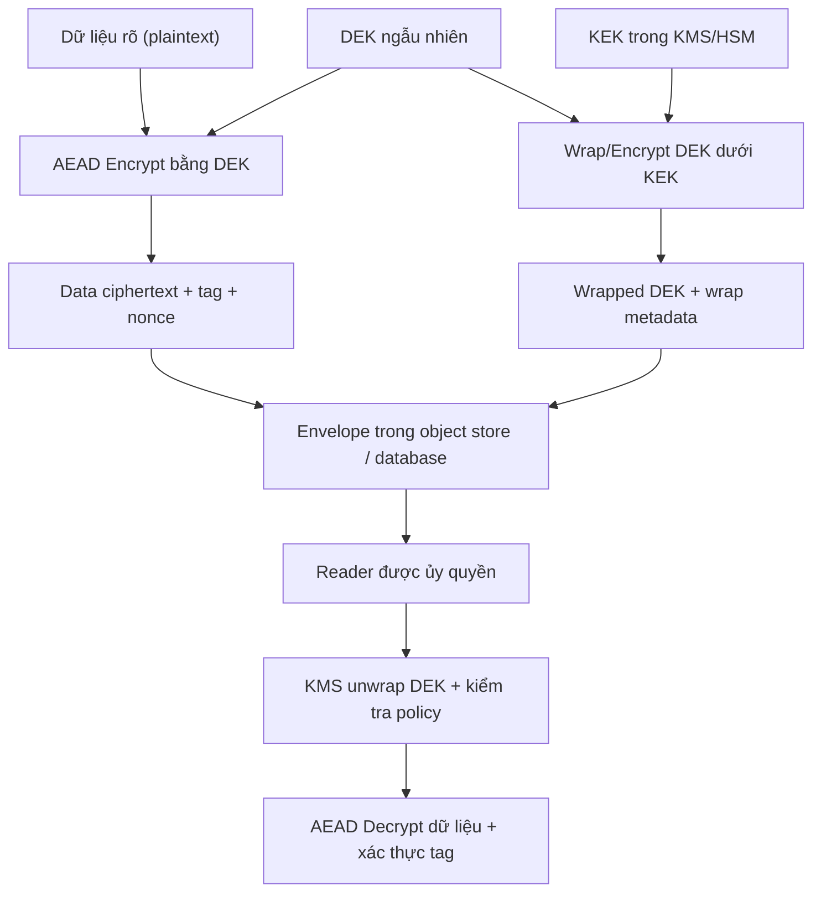
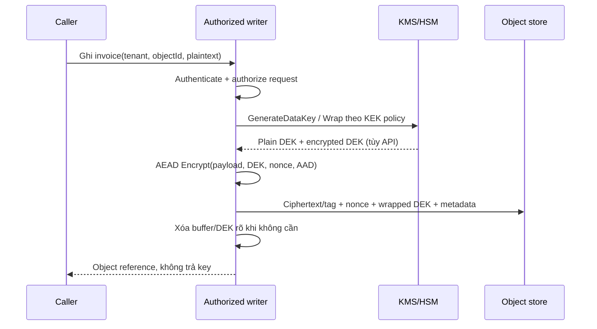
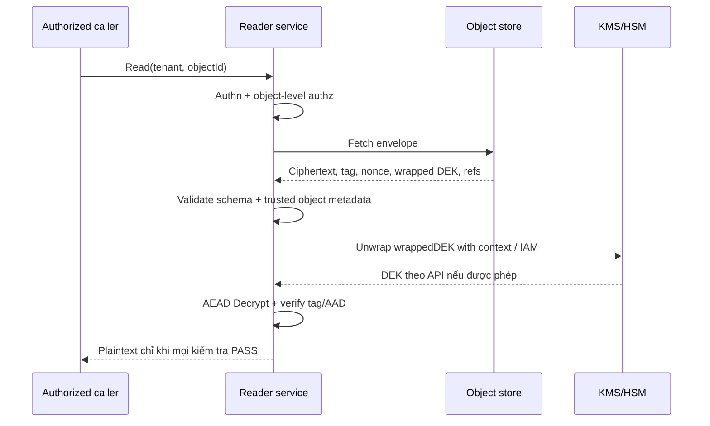

# Envelope encryption là gì? — Mã hóa phong bì trong quản lý khóa mật mã

Trong chương **Envelope encryption** của module **SECURITY_KEY_MANAGEMENT_FUNDAMENTALS**, *envelope encryption* (mã hóa phong bì) là một **mẫu kiến trúc quản lý khóa**: dữ liệu được mã hóa bằng một **Data Encryption Key (DEK)**, sau đó DEK được **bảo vệ bằng một Key Encryption Key (KEK)** hoặc cơ chế bọc khóa tương đương. Hệ thống lưu **bản mã dữ liệu** cùng **DEK đã bọc/mã hóa**, chứ không cần lưu DEK rõ trong kho dữ liệu.

Ý tưởng này xuất hiện trong lưu trữ đối tượng, mã hóa dữ liệu tại ứng dụng, sao lưu, cơ sở dữ liệu, hệ thống đa tenant và các dịch vụ sử dụng **KMS/HSM**. Nó giải quyết bài toán: *làm sao mã hóa rất nhiều dữ liệu bằng các khóa dữ liệu ngắn hạn hoặc phạm vi hẹp mà vẫn quản lý được khóa gốc, phân quyền, xoay vòng, kiểm toán và khôi phục ở quy mô lớn?*

**Điểm cần nhớ ngay:** envelope encryption **không phải một thuật toán mật mã mới**. Nó là cách **kết hợp thuật toán mã hóa dữ liệu** (thường là AEAD như AES-GCM), **cơ chế bảo vệ DEK** (key wrapping, AEAD hoặc dịch vụ KMS tương ứng), **metadata có xác thực**, **kiểm soát quyền** và **vòng đời khóa**. Thiết kế có thể rất an toàn, nhưng cũng có thể thất bại nếu dùng sai nonce, để lộ KEK, bỏ qua quyền nghiệp vụ hoặc hủy khóa khi backup vẫn phụ thuộc.

Bài này kết nối envelope encryption với các nội dung của module: **vòng đời khóa từ tạo, cấp phát, lưu trữ, sử dụng, xoay vòng, thu hồi đến hủy**, mật mã đối xứng/bất đối xứng, chữ ký số, KMS/HSM, IAM và kiểm toán.

## 1. Mục tiêu học tập

Sau bài học, bạn có thể:

- Giải thích envelope encryption bằng mô hình **DEK — KEK — ciphertext** và phân biệt khóa dữ liệu với khóa quản lý.
- Mô tả từng bước **encrypt**, **decrypt**, **wrap/unwrap**, xác thực AEAD tag và truy vết key ID/version.
- Hiểu tại sao **DEK và KEK có vòng đời, quyền sử dụng và phạm vi ảnh hưởng khác nhau**.
- Thiết kế một **envelope record** có thuật toán, nonce/IV, tag, wrapped DEK, key reference, AAD và metadata tin cậy.
- Phân biệt **encryption-at-rest**, **envelope encryption**, **key wrapping**, **public-key hybrid encryption**, **TLS** và **digital signature**.
- Nhận diện vai trò của **KMS/HSM**, key policy, IAM, encryption context, per-tenant isolation, audit và backup.
- Phân biệt **rewrap/re-encrypt DEK** với **re-encrypt payload**, cũng như xử lý đúng khi KEK/DEK bị lộ.
- Đọc một ví dụ **Java 17 AES-GCM** tự chứa để hiểu nguyên lý, cùng các ràng buộc quan trọng khi chuyển sang production.
- Lập checklist kiểm thử, rotation, incident response và key destruction an toàn.

## 2. Hình dung nhanh: vì sao gọi là “phong bì”?

Hãy tưởng tượng một hồ sơ nhạy cảm được khóa bằng **một chìa riêng cho hồ sơ**. Chìa đó được đặt vào **một phong bì niêm phong** chỉ bộ phận quản lý khóa có quyền mở. Khi cần đọc hồ sơ, hệ thống được ủy quyền mở phong bì, lấy chìa và giải mã hồ sơ.

Trong mật mã:

- **Plaintext:** dữ liệu ban đầu, như hóa đơn hoặc thông tin khách hàng.
- **DEK — Data Encryption Key:** khóa dùng mã hóa dữ liệu thực tế.
- **KEK — Key Encryption Key:** khóa dùng bọc/mã hóa **DEK**; thường được quản lý tập trung bởi KMS/HSM.
- **Wrapped DEK / encrypted DEK:** bản DEK đã được bảo vệ dưới KEK.
- **Ciphertext + authentication tag:** bản mã dữ liệu cùng bằng chứng xác thực theo cơ chế AEAD.
- **Envelope metadata:** thông tin giúp chọn đúng thuật toán, DEK/KEK, nonce, tenant và policy khi khôi phục.



Một cách biểu diễn giản lược:

\[
C_{\mathrm{data}} = \operatorname{AEAD.Enc}(DEK, N_{\mathrm{data}}, P, A_{\mathrm{data}})
\]

\[
W_{\mathrm{DEK}} = \operatorname{Wrap}(KEK, DEK, A_{\mathrm{wrap}})
\]

Trong đó:

- \(P\): plaintext; \(C_{\mathrm{data}}\): ciphertext kèm tag nếu định dạng gộp tag.
- \(N_{\mathrm{data}}\): nonce/IV cho phép mã hóa dữ liệu.
- \(A_{\mathrm{data}}\): dữ liệu bổ sung được xác thực (AAD), ví dụ tenant và object ID.
- \(W_{\mathrm{DEK}}\): DEK sau khi được wrap/mã hóa.
- \(A_{\mathrm{wrap}}\): ngữ cảnh bảo vệ DEK, nếu thuật toán/API hỗ trợ.

**Lưu ý ký hiệu:** `Wrap` có thể là một thuật toán key wrapping chuyên dụng hoặc một cơ chế AEAD được dùng đúng cách để mã hóa key material. Không phải mọi dịch vụ gọi API là `WrapKey`; có KMS hỗ trợ `Encrypt/Decrypt` hoặc `GenerateDataKey` để đạt cùng mục tiêu quản trị.

### 2.1. Tại sao không mã hóa tất cả dữ liệu trực tiếp bằng KEK?

Nếu một KMS key duy nhất phải trực tiếp mã hóa mọi đoạn dữ liệu, hệ thống có thể gặp:

- **Giới hạn API/độ dài:** nhiều KMS chỉ xử lý plaintext nhỏ hoặc có quota, không phù hợp mã hóa file nhiều gigabyte.
- **Chi phí và độ trễ:** gọi remote KMS cho từng block hoặc từng thông điệp có thể tốn chi phí và tăng latency.
- **Blast radius:** mọi dữ liệu phụ thuộc trực tiếp một khóa, khiến rotation và phân quyền theo object/tenant khó hơn.
- **Khó tách workload:** không dễ tạo data key ngắn hạn, per-object hoặc per-batch mà vẫn giữ KEK trong ranh giới mạnh.

Envelope encryption cho phép **mã hóa khối lượng dữ liệu bằng DEK ở gần ứng dụng**, trong khi **KEK được bảo vệ và quản lý tập trung**. Tuy nhiên, **DEK có thể xuất hiện ở bộ nhớ ứng dụng** tùy API; mẫu kiến trúc không tự loại bỏ rủi ro runtime compromise.

### 2.2. Phân biệt vai trò DEK và KEK

| Tiêu chí | DEK | KEK |
| --- | --- | --- |
| **Mục đích** | Mã hóa/giải mã **payload**. | Bảo vệ/khôi phục **DEK**. |
| **Phạm vi** | Có thể riêng cho object, file, tenant, batch hoặc phiên. | Thường bảo vệ nhiều DEK nhưng nên giới hạn theo tenant/service. |
| **Ví dụ thuật toán** | AES-256-GCM cho dữ liệu. | AES key-wrap, AES-GCM hoặc KMS/HSM wrapping scheme được duyệt. |
| **Nơi tồn tại** | Có thể trong bộ nhớ ứng dụng khi encrypt/decrypt; bản wrapped lưu với payload. | Thường trong KMS/HSM/secret boundary; không nhất thiết xuất được. |
| **Quyền quan trọng** | `Encrypt`, `Decrypt` dữ liệu trong scope. | `Wrap`/`Unwrap` hoặc `GenerateDataKey`/`Decrypt` theo provider. |
| **Rotation** | Có thể yêu cầu mã hóa lại dữ liệu cũ. | Có thể chỉ cần **rewrap** DEK, không đổi payload. |
| **Khi bị lộ** | Ciphertext dùng DEK đó có thể bị ảnh hưởng trực tiếp. | Mọi wrapped DEK mà attacker có thể mở dưới KEK đó đều có nguy cơ. |
| **Hủy khóa** | Phải xét bản mã dữ liệu đang phụ thuộc. | Phải xét tất cả wrapped DEK và backup còn phụ thuộc. |

**Một DEK có thể được bọc dưới nhiều KEK** vì yêu cầu multi-region, migration hoặc chia sẻ hợp lệ. Cách làm này tăng độ linh hoạt nhưng cũng tạo thêm **bản sao wrapped DEK, quyền unwrap và dependency** cần kiểm kê. Không thêm nhiều KEK chỉ vì có thể.

## 3. Các cách tổ chức khóa trong thực tế

### 3.1. Một DEK cho mỗi object

Ví dụ mỗi hóa đơn hoặc mỗi file có DEK riêng:

```text
invoice-101 -> DEK-101 -> wrapped under KEK-billing
invoice-102 -> DEK-102 -> wrapped under KEK-billing
invoice-103 -> DEK-103 -> wrapped under KEK-billing
```

Ưu điểm là **phân tách phạm vi ảnh hưởng**: nếu DEK-101 bị lộ, các đối tượng dùng DEK khác không tự bị lộ. Có thể hủy riêng DEK khi đối tượng hết hạn, miễn là không còn bản sao/đường khôi phục khác.

Đổi lại, hệ thống phải quản lý nhiều DEK, metadata và thao tác wrap/unwrap. Cần tính đến **quota KMS, cache, batch processing và concurrency**.

### 3.2. Một DEK theo tenant, lô dữ liệu hoặc giai đoạn

Một DEK có thể được tái sử dụng có giới hạn theo tenant hoặc batch, nhằm giảm số lượng thao tác quản trị. Đổi lại, **blast radius lớn hơn** và cần quản lý chặt **nonce uniqueness, usage budget và cryptoperiod**.

Không chọn DEK per-tenant rồi dùng mãi không có giới hạn chỉ vì mỗi tenant đã có một KEK khác nhau.

### 3.3. Một KEK theo tenant hoặc security domain

```text
Tenant A:
  KEK-A  -> DEK-A1, DEK-A2, ...

Tenant B:
  KEK-B  -> DEK-B1, DEK-B2, ...

Không cho:
  Writer/Reader tenant A tự unwrap DEK của tenant B.
```

Tách KEK theo tenant giúp dễ giới hạn quyền và cách ly blast radius. Nhưng nếu nhiều tenant vẫn cùng sử dụng một tài khoản KMS admin hoặc một service role có `Decrypt` trên tất cả KEK, việc tách tên khóa **chưa tạo cách ly hoàn chỉnh**.

## 4. Luồng mã hóa một object từ đầu đến cuối

Giả sử dịch vụ Java cần lưu hóa đơn. Hệ thống dùng AES-256-GCM cho payload; KEK được KMS/HSM quản lý.

### 4.1. Bước 1 — Chọn chính sách và kiểm tra quyền

Dịch vụ xác nhận:

- Người gửi có quyền tạo hóa đơn cho đúng **tenant** và **object**.
- Data classification cho phép lưu object ở hệ thống này.
- Policy chỉ định thuật toán/mode được phép và key scope.
- KMS key reference thực tế (không chỉ alias động) và workload identity đúng.
- Object ID/version có cách diễn giải ổn định và bảo vệ tính toàn vẹn.

**Không để client tự gửi key ID của tenant khác** rồi chấp nhận chỉ vì key ID tồn tại.

### 4.2. Bước 2 — Tạo DEK

Ứng dụng tạo DEK bằng CSPRNG được duyệt hoặc gọi API KMS để sinh data key. Với AES-256, DEK có **256 bit ngẫu nhiên** theo cơ chế thích hợp.

Hai hướng phổ biến:

- **Client-side DEK generation:** ứng dụng sinh DEK, sau đó gọi KMS `Wrap/Encrypt` để bảo vệ nó. DEK rõ tồn tại trong ứng dụng.
- **KMS-generated data key:** một API như `GenerateDataKey` của một số nhà cung cấp có thể trả **plaintext DEK** cho phiên mã hóa và **encrypted DEK** để lưu. API và mức bảo vệ cụ thể tùy provider.

**Không suy rằng KMS sinh DEK nghĩa là ứng dụng không bao giờ thấy plaintext DEK**. Phải đọc đúng hợp đồng API và giới hạn thời gian giữ DEK trong bộ nhớ.

### 4.3. Bước 3 — Mã hóa payload bằng AEAD

Ứng dụng:

1. Chọn AEAD đã được duyệt, ví dụ **AES-256-GCM**.
2. Sinh/cấp nonce theo quy tắc đảm bảo **không lặp nonce với cùng DEK**.
3. Xây **AAD ổn định** gồm tenant ID, object ID, content version và thông tin domain separation theo schema.
4. Mã hóa plaintext, nhận **ciphertext và authentication tag**.
5. Không xuất plaintext DEK ra log, URL, exception, telemetry hoặc file cấu hình.

**Nonce không cần giữ bí mật**; nó cần đáp ứng yêu cầu uniqueness của mode. GCM dùng nonce 96 bit là lựa chọn phổ biến, nhưng **sinh nonce ngẫu nhiên không bảo đảm xác suất trùng bằng 0**. Cần xét số lần mã hóa, throughput và key scope; khi cần, dùng cơ chế cấp phát nonce duy nhất.

### 4.4. Bước 4 — Bảo vệ DEK bằng KEK

Nếu DEK chưa được KMS trả về ở dạng encrypted, dịch vụ gửi DEK tới cơ chế wrap/encrypt được duyệt để có **wrapped DEK**. KMS kiểm tra quyền dùng KEK; nếu hỗ trợ, yêu cầu gắn **encryption context/AAD** cho đúng tenant, object và purpose.

Đối với mô hình KMS-generated data key, **encrypted DEK** có thể đã được trả từ bước 2; không cần tự wrap lại nếu API và policy không yêu cầu.

### 4.5. Bước 5 — Lưu envelope

Lưu một object gồm **data ciphertext, data nonce/tag, wrapped DEK và metadata để khôi phục**. Dù object store/database không được tin cậy tuyệt đối, phải có cách **xác thực dữ liệu và metadata**.

### 4.6. Bước 6 — Xóa tham chiếu plaintext không cần thiết

Sau khi encrypt:

- Không lưu plaintext DEK trong database, log, cache lâu dài hoặc response.
- Giảm thời gian tồn tại của buffer chứa plaintext/DEK.
- Với Java/JVM, `Arrays.fill` có thể xóa một mảng do ứng dụng kiểm soát nhưng **không đảm bảo mọi bản sao trong provider/heap đã được xóa**.
- Nếu hệ thống cần cache DEK, phải có policy về TTL, phạm vi, giới hạn memory, audit và invalidation khi compromise.



## 5. Luồng giải mã: từ envelope về plaintext

Giải mã là quá trình ngược lại, nhưng **không được bỏ qua kiểm tra quyền chỉ vì có thể lấy được DEK**.

1. **Xác thực caller:** xác định workload, người dùng, tenant và mục đích đọc.
2. **Ủy quyền dữ liệu:** xác minh caller có quyền đọc đúng object/version, không chỉ quyền gọi KMS.
3. **Đọc metadata:** kiểm tra schema version, kích thước, algorithm allowlist, actual KEK key reference, object ID và nonce.
4. **Chọn đúng KEK:** KMS/HSM xác định khóa thực sự bảo vệ DEK; không tin key reference từ file nếu nó dẫn đến miền không được phép.
5. **Unwrap/decrypt DEK:** gọi KMS với principal được cấp quyền và encryption context tương ứng nếu có.
6. **Khôi phục DEK trong phạm vi cần thiết:** giảm thời gian sống của bản rõ; không cache vô hạn.
7. **AEAD Decrypt payload:** dùng đúng data nonce và AAD, kiểm tra authentication tag. **Nếu tag sai, từ chối toàn bộ kết quả**.
8. **Trả plaintext qua kênh có quyền:** không log dữ liệu, key hoặc exception chứa secret.
9. **Audit:** ghi actor, key ID/version, tenant, object scope, operation và kết quả theo chính sách.



**Điểm dễ nhầm:** `Decrypt` thành công không tự chứng minh caller được phép xem dữ liệu. KMS thường biết **khóa và principal**, nhưng không nhất thiết biết đầy đủ quyền nghiệp vụ trên hóa đơn, hồ sơ y tế, nhân viên hoặc tenant. Quyết định authorization ở tầng ứng dụng vẫn bắt buộc.

## 6. Envelope format: lưu chính xác những gì?

Một envelope cần đủ thông tin để **khôi phục đúng khóa và đúng nội dung** sau rotation, restore hoặc chuyển đổi provider.

Ví dụ cấu trúc JSON **minh họa**, không phải định dạng chuẩn hoặc request của KMS cụ thể:

```json
{
  "schemaVersion": 1,
  "recordId": "invoice-2026-000147",
  "tenantId": "tenant-a",
  "contentVersion": 7,
  "dataAlgorithm": "AES-256-GCM",
  "dataKeyId": "dek/invoice-2026-000147/v1",
  "dataNonce": "<base64url-data-nonce>",
  "dataCiphertextAndTag": "<base64url-payload>",
  "keyWrapAlgorithm": "provider-managed",
  "wrappingKekRef": "kms/region-a/billing-kek-v3",
  "wrapVersion": 2,
  "wrappedDek": "<base64url-encrypted-DEK>",
  "policyVersion": 12
}
```

### 6.1. Trường nào tối thiểu?

| Trường | Mục đích | Nguy cơ khi thiếu/sai |
| --- | --- | --- |
| **schemaVersion** | Biết cách parse và kiểm tra bản ghi. | Nhầm phiên bản, downgrade hoặc xử lý sai encoding. |
| **dataAlgorithm** | Chọn đúng AEAD theo allowlist. | Dùng sai mode hoặc bị attacker ép thuật toán yếu. |
| **dataNonce/IV** | Giải mã payload bằng cùng nonce đã dùng encrypt. | Giải mã lỗi hoặc nguy cơ nếu quy trình encrypt reuse nonce. |
| **ciphertextAndTag** | Dữ liệu đã mã hóa và authentication tag. | Không phát hiện sửa đổi nếu bỏ qua tag. |
| **wrappedDek** | Bản DEK đã được bảo vệ. | Không lấy lại DEK để giải mã. |
| **actual KEK key ref/version** | Chỉ đúng KEK lịch sử, không dựa vào alias hiện hành. | Sau rotation có thể unwrap sai hoặc không tìm được khóa. |
| **tenantId/objectId** | Ràng buộc ngữ cảnh và authorization. | Cross-tenant/key substitution nếu không xác thực. |
| **dataKeyId/contentVersion** | Truy vết DEK và phiên bản nội dung. | Khó rotation, replay/rollback và điều tra. |
| **wrap algorithm/version** | Biết xử lý wrapped DEK và migration. | Dùng sai mechanism hoặc giải mã không tương thích. |
| **policyVersion** | Liên kết quyết định bảo mật/audit. | Không giải thích được vì sao một operation được cho phép. |

**Không lưu plaintext DEK, raw KEK hay KMS authentication credential trong envelope.** Metadata được lưu cạnh ciphertext phải được xem là **untrusted input cho đến khi xác thực**.

### 6.2. Base64 là encoding, không phải encryption

Một trường `wrappedDek` thường được Base64/Base64URL-encode để lưu JSON. Base64 **không bảo mật**; tính bí mật phải đến từ thao tác wrap/encrypt DEK. Nếu field đang chứa **DEK plaintext được Base64-encode**, toàn bộ mẫu thiết kế envelope đã bị phá vỡ.

### 6.3. Data nonce và wrapping nonce độc lập

Nếu dùng AES-GCM để mã hóa cả payload và DEK, sẽ có **hai phép encrypt khác nhau**:

```text
Data encryption:
  key     = DEK
  nonce   = dataNonce
  AAD     = dataAAD
  output  = dataCiphertext + dataTag

DEK protection (khi dùng AEAD wrap):
  key     = KEK
  nonce   = wrapNonce
  AAD     = wrapAAD
  output  = wrappedDEK + wrapTag
```

Hai nonce không nhất thiết phải khác nhau về byte nếu dùng **hai khóa hoàn toàn độc lập**, nhưng **mỗi phép encrypt phải tuân thủ uniqueness theo đúng key của nó**. Để giảm nhầm lẫn, nên tạo và lưu nonce riêng cho hai lớp. Một số thuật toán **AES Key Wrap (RFC 3394)/KWP (RFC 5649)** không sử dụng nonce GCM theo kiểu này; phải tuân thủ scheme cụ thể.

## 7. AAD, metadata xác thực và chống tráo khóa

Một trong những lỗi khó phát hiện nhất là **key substitution**: attacker không cần biết plaintext DEK, chỉ cần thay encrypted DEK hoặc metadata sao cho dịch vụ sử dụng sai ngữ cảnh/tenant.

Với AEAD, **Additional Authenticated Data (AAD)** được ràng buộc với authentication tag nhưng không được mã hóa. Có thể dùng nó để gắn ciphertext vào:

- `tenantId` và `objectId`;
- loại dữ liệu hoặc domain separation (`invoice:v1`, `customer-note:v2`);
- `contentVersion` và schema version;
- mục đích của DEK, key ID cố định và chính sách được duyệt.

Ví dụ:

```text
dataAAD = canonicalEncode(
  "invoice-data:v1",
  tenantId,
  objectId,
  contentVersion,
  dataKeyId
)

wrapAAD = canonicalEncode(
  "invoice-dek-wrap:v1",
  tenantId,
  objectId,
  dataKeyId,
  wrappingKekRef,
  wrapVersion
)
```

**Phân biệt AAD của payload và AAD của wrapped DEK rất quan trọng.** Nếu data AAD ràng buộc vào `wrappingKekRef`, một lần **rewrap DEK dưới KEK mới** có thể khiến payload tag không còn khớp, buộc phải re-encrypt payload dù DEK không đổi. Nên đặt vào **data AAD những trường bất biến theo vòng đời nội dung**, còn metadata thay đổi khi rewrap nằm trong **wrap AAD** hoặc lớp xác thực riêng phù hợp.

### 7.1. Canonicalization: hai bên phải tạo cùng byte AAD

AAD không phải là “một object JSON có ý nghĩa tương đương”. AEAD xác thực **chuỗi byte chính xác**. Ví dụ hai chuỗi sau có thể cùng ý nghĩa với con người nhưng **khác byte**:

```text
tenant-a | invoice-17
tenant-a|invoice-17
```

Nếu dùng nối string không rõ ranh giới, có thể gây ambiguity giữa các trường. Nên dùng encoding **có độ dài, kiểu và thứ tự xác định**, hoặc chuẩn canonical serialization đã được đánh giá. Key IDs, tenant IDs và phiên bản nên được validate từ nguồn tin cậy, không lấy nguyên từ input attacker rồi coi tag là authorization.

### 7.2. AEAD không tự chống rollback

Nếu attacker thay envelope hiện hành bằng **một envelope cũ vẫn có authentication tag hợp lệ**, AEAD có thể giải mã thành công. Vì vậy:

- Lưu **version/counter monotonic** hoặc state hiện hành trong cơ sở dữ liệu/registry đáng tin.
- Kiểm tra object version, trạng thái thu hồi, legal hold và policy hiện tại.
- Khi đọc, so sánh envelope với **nguồn sự thật**, không chỉ “tag khớp”.
- Có thể ký manifest/bản ghi nếu cần bằng chứng lâu dài, nhưng phải quản lý trust/signing key riêng.

**Encryption, integrity và freshness là ba thuộc tính liên quan nhưng không đồng nhất.**

## 8. Chọn thuật toán mã hóa dữ liệu và thuật toán bọc khóa

### 8.1. Payload: ưu tiên AEAD được duyệt

**AES-GCM** là lựa chọn phổ biến cho dữ liệu. Các yêu cầu vận hành gồm:

- DEK có entropy mạnh và độ dài hợp lệ.
- Nonce uniqueness cho từng cặp key/nonce.
- Authentication tag được tạo và **kiểm tra trước khi tin plaintext**.
- AAD thống nhất giữa writer/reader.
- Giới hạn lượng dữ liệu, số lần dùng key và chính sách rotation.
- Khi mã hóa file lớn, cần thiết kế **chunking/streaming có xác thực** chứ không tự cắt block tùy tiện rồi dùng cùng nonce.

**ChaCha20-Poly1305** cũng là một lựa chọn AEAD trong các môi trường/giao thức hỗ trợ, nhưng không nên tự thay algorithm đang được policy xác nhận. Những chi tiết về nonce và key schedule phải đi theo đúng mode cụ thể.

### 8.2. Bảo vệ DEK: nhiều cơ chế có thể được dùng

| Cơ chế | Ý tưởng | Điều phải kiểm tra |
| --- | --- | --- |
| **AES Key Wrap** | Thuật toán chuyên bọc key material. | Provider, định dạng, kích thước input, integrity/unwrap failure. |
| **AES Key Wrap with Padding** | Biến thể hỗ trợ độ dài input khác. | Tương thích với standard và provider. |
| **AES-GCM wrapping** | Mã hóa DEK bằng AEAD dưới KEK. | Nonce uniqueness, tag, AAD và metadata. |
| **KMS encrypt/decrypt** | Provider xử lý bảo vệ DEK qua API. | Payload size, encryption context, IAM, key usage và audit. |
| **KMS GenerateDataKey** | Provider tạo DEK và phiên bản encrypted. | API trả những bản rõ/bản mã nào, ai được quyền. |
| **Public-key recipient wrapping / KEM** | Bảo vệ secret cho recipient public key, sau đó dẫn xuất wrapping key. | Xác thực public key, OAEP/KEM/KDF/AEAD đúng giao thức. |

**Không dùng AES-ECB để bọc một DEK** chỉ vì input có độ dài khớp block; phải dùng cơ chế key wrap hoặc AEAD đã được thiết kế. Không “mã hóa” DEK bằng XOR đơn giản hay hash một chiều mà không có quy trình khôi phục hợp lệ.

### 8.3. Envelope encryption có dùng mật mã bất đối xứng không?

**Có thể có.** Trong một mô hình **hybrid encryption**:

1. Sender sinh DEK ngẫu nhiên để mã hóa payload bằng AEAD.
2. DEK được bảo vệ cho recipient bằng **RSA-OAEP** hoặc **KEM + KDF + AEAD** theo protocol.
3. Recipient dùng private key tương ứng để khôi phục khóa rồi giải mã payload.

Đây vẫn là ý tưởng **“mã hóa dữ liệu bằng khóa ngẫu nhiên và bảo vệ khóa đó bằng một cơ chế khác”**. Nhưng phải phân biệt:

- **RSA-OAEP** là key transport/encryption scheme, không phải chữ ký RSA-PSS.
- **X25519/ECDH** tạo shared secret; phải có KDF/key schedule và xác thực peer.
- **ML-KEM** là KEM hậu lượng tử; không phải thuật toán chữ ký và cần parameter set/combiner đúng chuẩn khi dùng hybrid.
- Public key recipient phải được **xác thực**; nếu attacker tráo public key, DEK có thể bị bọc cho attacker.
- Một hệ thống cloud KMS có thể sử dụng symmetric KEK nội bộ mà không cần public-key crypto cho mỗi object.

## 9. KMS/HSM trong kiến trúc envelope encryption

Một **KMS (Key Management Service)** cung cấp API quản lý khóa, IAM và audit; **HSM (Hardware Security Module)** là thiết bị/ranh giới bảo vệ mật mã được thiết kế chuyên dụng. Chúng có thể phối hợp, nhưng **không đồng nghĩa mọi KMS là HSM duy nhất** hoặc mọi HSM cung cấp chính xác API như cloud KMS.

### 9.1. KMS làm gì?

Tùy provider:

- Tạo và bảo vệ **KEK/master key**.
- Cho phép `GenerateDataKey`, `Encrypt`, `Decrypt`, `ReEncrypt` hoặc wrapping API tương đương.
- Phân quyền theo principal, key ID, algorithm, key policy và encryption context.
- Theo dõi key versions, state, grants, scheduled deletion và rotation.
- Ghi audit các thao tác quản trị và data-plane calls theo khả năng dịch vụ.

**Không giả định** mọi KMS hỗ trợ một nút “chỉ cấm wrap mới nhưng vẫn cho unwrap lịch sử”. Một số thao tác `DisableKey` có thể chặn cả hai chiều; cần kiểm tra hợp đồng API/permissions cụ thể.

### 9.2. Data key caching có nên dùng?

Caching plaintext DEK có thể giảm độ trễ và chi phí KMS, nhưng đồng thời **mở rộng thời gian sống secret trong RAM** và số object có thể bị lộ nếu process bị chiếm quyền.

Một chính sách cache hợp lý phải xét:

- TTL ngắn và giới hạn số lần encrypt/byte dưới DEK.
- Phạm vi cache theo tenant/purpose/key version, tránh cross-tenant reuse.
- Không cache raw KEK trong app nếu kiến trúc muốn giữ nó trong KMS/HSM.
- Invalidate khi đổi policy, rotation, incident hoặc thu hồi.
- Đo usage budget và nonce generation cho **mọi writer**, kể cả cache hits.
- Không để cache trở thành đường bypass IAM khi principal mất quyền.

Nếu không cần cache, **đừng thêm caching chỉ vì đây là envelope encryption**.

### 9.3. KMS grant khác quyền nghiệp vụ

Ví dụ:

```text
KMS:
  principal billing-reader được phép Decrypt với billing/KEK-v4

Business service:
  principal đó chỉ được đọc invoice của tenant-a
  và chỉ những invoice có trạng thái/ủy quyền phù hợp

Không thể suy:
  "Decrypt grant exists" -> "mọi invoice đều được đọc".
```

KMS không thay thế business authorization. Nếu quyền KMS quá rộng, attacker có thể unwrap nhiều DEK ngay cả khi **không thể export KEK**.

## 10. Java 17: ví dụ envelope encryption hai lớp bằng AES-GCM

Ví dụ sau giúp quan sát toàn bộ quy trình:

1. Tạo **DEK AES-256** và **KEK AES-256** ngẫu nhiên.
2. Dùng DEK mã hóa payload bằng **AES-GCM** với `dataAAD`.
3. Dùng KEK mã hóa **raw DEK** bằng AES-GCM khác với `wrapAAD`.
4. Lưu mô hình envelope chứa hai cặp `nonce + ciphertext/tag`, key ID và metadata.
5. Khôi phục DEK bằng KEK, sau đó giải mã payload.
6. Kiểm tra trường hợp attacker thay `tenantId`: việc xác thực thất bại.

**Giới hạn quan trọng:** demo tạo **KEK trong JVM** chỉ để chạy độc lập. **Production nên giữ KEK trong KMS/HSM** và thay phần `wrapDek`/`unwrapDek` bằng API được ủy quyền, không lưu/export raw KEK chỉ để dùng ví dụ này. Code cũng không xử lý file/DB, atomic writes, cross-tenant IAM hoặc khả năng xóa toàn bộ bản sao plaintext trong heap.

```java
import java.io.ByteArrayOutputStream;
import java.io.DataOutputStream;
import java.nio.charset.StandardCharsets;
import java.security.GeneralSecurityException;
import java.security.SecureRandom;
import java.util.Arrays;
import javax.crypto.AEADBadTagException;
import javax.crypto.Cipher;
import javax.crypto.KeyGenerator;
import javax.crypto.SecretKey;
import javax.crypto.spec.GCMParameterSpec;
import javax.crypto.spec.SecretKeySpec;

public final class EnvelopeEncryptionDemo {
    private static final SecureRandom RANDOM = new SecureRandom();
    private static final int NONCE_BYTES = 12;
    private static final int TAG_BITS = 128;

    // record chỉ minh họa; byte[] được copy để tránh mutate từ bên ngoài.
    record Blob(byte[] nonce, byte[] ciphertextAndTag) {
        Blob {
            nonce = nonce.clone();
            ciphertextAndTag = ciphertextAndTag.clone();
        }
        @Override public byte[] nonce() { return nonce.clone(); }
        @Override public byte[] ciphertextAndTag() {
            return ciphertextAndTag.clone();
        }
    }

    record Envelope(
            String tenantId,
            String objectId,
            String dataKeyId,
            String wrappingKekRef,
            Blob payload,
            Blob wrappedDek) {}

    static SecretKey newAes256() throws GeneralSecurityException {
        KeyGenerator generator = KeyGenerator.getInstance("AES");
        generator.init(256, RANDOM);
        return generator.generateKey();
    }

    static byte[] aad(String domain, String... fields) throws Exception {
        // Encoding độ dài-prefix giúp không nhập nhằng ranh giới các field.
        ByteArrayOutputStream bytes = new ByteArrayOutputStream();
        try (DataOutputStream out = new DataOutputStream(bytes)) {
            putField(out, domain);
            for (String field : fields) {
                putField(out, field);
            }
        }
        return bytes.toByteArray();
    }

    static void putField(DataOutputStream out, String field) throws Exception {
        byte[] encoded = field.getBytes(StandardCharsets.UTF_8);
        if (encoded.length == 0 || encoded.length > 1024) {
            throw new IllegalArgumentException("Invalid metadata");
        }
        out.writeInt(encoded.length);
        out.write(encoded);
    }

    static Blob seal(SecretKey key, byte[] plaintext, byte[] context)
            throws GeneralSecurityException {
        byte[] nonce = new byte[NONCE_BYTES];
        RANDOM.nextBytes(nonce);

        Cipher cipher = Cipher.getInstance("AES/GCM/NoPadding");
        cipher.init(Cipher.ENCRYPT_MODE, key,
                new GCMParameterSpec(TAG_BITS, nonce));
        cipher.updateAAD(context);

        return new Blob(nonce, cipher.doFinal(plaintext));
    }

    static byte[] open(SecretKey key, Blob blob, byte[] context)
            throws GeneralSecurityException {
        Cipher cipher = Cipher.getInstance("AES/GCM/NoPadding");
        cipher.init(Cipher.DECRYPT_MODE, key,
                new GCMParameterSpec(TAG_BITS, blob.nonce()));
        cipher.updateAAD(context);
        // Nếu AAD/tag/ciphertext sai, doFinal phải báo lỗi.
        return cipher.doFinal(blob.ciphertextAndTag());
    }

    static byte[] dataAad(Envelope e) throws Exception {
        // Không đưa KEK ref vào data AAD vì rewrap có thể đổi KEK.
        return aad("data:v1",
                e.tenantId(), e.objectId(), e.dataKeyId());
    }

    static byte[] wrapAad(Envelope e) throws Exception {
        return aad("dek-wrap:v1",
                e.tenantId(), e.objectId(),
                e.dataKeyId(), e.wrappingKekRef());
    }

    static Envelope encrypt(String tenantId, String objectId,
            String dataKeyId, String kekRef,
            byte[] plaintext, SecretKey kek) throws Exception {
        SecretKey dek = newAes256();

        Envelope metadata = new Envelope(
                tenantId, objectId, dataKeyId, kekRef, null, null);
        Blob encryptedData = seal(dek, plaintext, dataAad(metadata));

        // Raw DEK cần export trong demo để mã hóa dưới KEK.
        // Production: dùng API KMS wrapping / GenerateDataKey.
        byte[] rawDek = dek.getEncoded();
        if (rawDek == null || rawDek.length != 32) {
            throw new SecurityException("Expected AES-256 DEK");
        }
        try {
            Blob wrapped = seal(kek, rawDek, wrapAad(metadata));
            return new Envelope(tenantId, objectId, dataKeyId,
                    kekRef, encryptedData, wrapped);
        } finally {
            Arrays.fill(rawDek, (byte) 0);
        }
    }

    static byte[] decrypt(Envelope e, SecretKey kek) throws Exception {
        // Caller phải xác minh tenant/object và key ID theo registry.
        byte[] rawDek = open(kek, e.wrappedDek(), wrapAad(e));
        try {
            if (rawDek.length != 32) {
                throw new SecurityException("Invalid AES DEK size");
            }
            SecretKey dek = new SecretKeySpec(rawDek, "AES");
            return open(dek, e.payload(), dataAad(e));
        } finally {
            Arrays.fill(rawDek, (byte) 0);
        }
    }

    public static void main(String[] args) throws Exception {
        SecretKey demoKek = newAes256(); // CHỈ trong demo

        byte[] message = "Hoa don noi bo"
                .getBytes(StandardCharsets.UTF_8);

        Envelope e = encrypt(
                "tenant-a", "invoice-17",
                "dek/invoice-17/v1", "kms/billing-kek-v3",
                message, demoKek);

        byte[] recovered = decrypt(e, demoKek);
        System.out.println("Round-trip OK: " +
                Arrays.equals(message, recovered)); // true

        // Giả lập attacker thay tenant metadata.
        Envelope tampered = new Envelope(
                "tenant-b", e.objectId(), e.dataKeyId(),
                e.wrappingKekRef(), e.payload(), e.wrappedDek());
        try {
            decrypt(tampered, demoKek);
            throw new AssertionError("Tampering unexpectedly accepted");
        } catch (AEADBadTagException expected) {
            System.out.println("Tampering rejected: true");
        }

        Arrays.fill(message, (byte) 0);
        Arrays.fill(recovered, (byte) 0);
    }
}
```

Đầu ra dự kiến:

```text
Round-trip OK: true
Tampering rejected: true
```

### 10.1. Những điều cần đọc đúng từ code

- **Hai `seal` khác nhau:** một dùng DEK cho payload; một dùng KEK cho DEK. Mỗi lần tạo nonce ngẫu nhiên riêng.
- **`Blob` lưu nonce và ciphertext/tag**. Không lưu key rõ vào blob.
- **`dataAad`** ràng buộc tenant, object và data key ID, **không ràng buộc KEK ref** để không vô tình bắt re-encrypt payload khi chỉ rewrap.
- **`wrapAad`** ràng buộc thông tin bọc DEK và KEK ref; đổi metadata này mà không tạo wrapped DEK tương ứng sẽ làm tag sai.
- **`AEADBadTagException`** cho biết xác thực GCM thất bại trong kịch bản sai AAD/tag; khi xây API, không cung cấp chi tiết lỗi có thể trở thành oracle cho attacker.
- **`new SecretKeySpec(rawDek, "AES")`** tạo key object phục vụ Java Cipher; zeroize raw array chỉ giảm một số bản sao, không bảo đảm mọi byte key trong JVM biến mất.
- **`getEncoded()`** chỉ hợp lệ nếu key exportable. Với HSM non-exportable, đường thiết kế phải dùng **provider API** chứ không ép xuất key.
- **`Array.equals`/`Arrays.equals` trong demo** chỉ kiểm tra round-trip, không phải hàm so sánh bí mật để xác thực token/MAC; GCM tag được kiểm tra bên trong Cipher.

### 10.2. Các yêu cầu phải bổ sung trước production

1. **KEK ngoài JVM:** thay raw KEK demo bằng KMS/HSM key reference và API wrapping được kiểm soát.
2. **IAM + business authz:** kiểm tra principal, tenant, object và purpose từ nguồn tin cậy **trước khi** gọi KMS/đọc plaintext.
3. **Persistent encoding:** xác định schema version, canonical serialization, giới hạn kích thước và quy tắc parse; ví dụ không triển khai file/DB I/O.
4. **Nonce budgeting:** với KEK dùng wrap nhiều DEK, phải đảm bảo nonce không lặp và giới hạn số lần sử dụng theo mô hình. Cần đánh giá việc dùng GCM ngẫu nhiên với KEK dài hạn; khi phù hợp chọn **key wrap algorithm/provider** chuyên dụng.
5. **Integrity + freshness:** AAD chống sửa metadata đã ràng buộc nhưng không chống replay một envelope cũ hợp lệ; cần registry/version state tin cậy.
6. **Provider behavior:** KMS encryption context, ciphertext portability, key import, region và API semantics khác nhau giữa nhà cung cấp.
7. **Memory:** Java không bảo đảm zeroization hoàn chỉnh; giảm thời gian sống và hạn chế các bản sao của raw DEK.
8. **Failure handling:** nếu KMS, storage, crypto operation hoặc authentication tag lỗi, **không trả plaintext một phần** và không fallback xuống plaintext/thuật toán yếu.
9. **Key lifecycle:** rotation, rewrap, backup, cryptoperiod, deactivation, legal hold và destruction phải có policy ngoài đoạn code.
10. **Audit/observability:** ghi key ID, operation, policy, actor, context và result; không log raw secret, ciphertext không cần thiết hoặc plaintext nhạy cảm.

**Giới hạn thiết kế quan trọng:** demo là bằng chứng nguyên lý; không thể chuyển nguyên class vào dịch vụ production rồi tuyên bố đã có encryption at rest đạt chuẩn tổ chức.

## 11. Rotation: thay KEK có cần mã hóa lại dữ liệu không?

**Thông thường không nhất thiết**. Đây là một lợi ích lớn của envelope encryption.

Giả sử:

```text
Payload:
  C = AEAD(DEK-v1, plaintext)

Trước:
  W-old = Wrap(KEK-v2, DEK-v1)

Sau rotation KEK:
  W-new = Wrap(KEK-v3, DEK-v1)

Payload C có thể không đổi.
```

Quá trình này gọi là **rewrap**: lấy DEK thông qua đường unwrap hợp lệ rồi bọc lại dưới KEK mới; có provider cho phép thao tác **re-encrypt wrapped key bên trong dịch vụ** mà ứng dụng không cần nhận plaintext DEK. Tên và bảo đảm API khác nhau tùy KMS.

### 11.1. Rewrap KEK và re-encrypt payload là hai việc khác

| Hoạt động | Thay đổi gì? | Khi nào dùng? |
| --- | --- | --- |
| **Rotate KEK, new writes only** | Các DEK mới được bọc bởi KEK mới; bản ghi cũ vẫn cần KEK cũ. | Rotation định kỳ khi chấp nhận hỗ trợ key lịch sử. |
| **Rewrap DEK** | Thay `wrappedDek`/wrap nonce/context/key ref, **DEK không đổi**. | Muốn chuyển wrapped DEK cũ sang KEK mới mà không thay payload. |
| **Re-encrypt payload bằng DEK mới** | Tạo DEK mới, data nonce/tag/ciphertext mới, rồi wrap DEK mới. | Khi cần thay DEK hoặc DEK cũ có rủi ro bị lộ. |
| **Re-encrypt toàn bộ theo schema/algorithm mới** | Có thể đổi cipher, content encoding, key hierarchy. | Migration thuật toán, data format hoặc yêu cầu bảo mật mới. |

**Đừng nói “xoay KEK đã đổi DEK”** khi chỉ rewrap. DEK có thể vẫn là chính một secret trước đó, được dùng để giải mã payload đã tồn tại.

### 11.2. AAD và rotation

Nếu **data AAD** chứa `kekRef` hoặc `wrapVersion` thay đổi, payload tag có thể không còn hợp lệ sau rewrap. Một schema tốt thường:

- Giữ data AAD dựa trên các trường **bất biến của payload**.
- Cho phép wrap AAD thay đổi khi KEK đổi và **tạo lại wrapped DEK + wrap tag tương ứng**.
- Sử dụng versioned metadata và trusted registry để kiểm tra liên kết giữa hai lớp.
- Không âm thầm sửa object ID/tenant khi rewrap mà bỏ qua AAD và quyền dữ liệu.

### 11.3. Runbook rewrap an toàn

1. Kiểm kê các object/wrapped DEK đang dùng **actual KEK-v2** cùng region, tenant, backup và key versions.
2. Sinh/activate KEK-v3 trong KMS/HSM, phân quyền tách biệt `Wrap-new` và `Unwrap-historical` khi khả thi.
3. Chuyển writer sang KEK-v3 cho mọi DEK mới; kiểm tra không còn new wraps vào v2.
4. Chạy rewrap có **idempotency, checkpoint, giới hạn tốc độ và audit**.
5. Xác minh mỗi object mới bằng decryption test/tag và kiểm tra metadata; không làm mất data AAD.
6. Kiểm tra backup bất biến, cold storage, offline consumers và DR trước khi định hủy v2.
7. Khi dependency inventory về v2 đã được giải quyết, hủy key theo phê duyệt, retention và legal hold.

**Không gọi `DisableKey` để chặn wrap mới bằng v2 nếu hành động đó đồng thời làm mọi `Unwrap` lịch sử thất bại**. Cần hiểu đúng provider semantics và lên phương án rewrap/segregation trước.

## 12. DEK rotation, cryptoperiod và usage budget

Một DEK có thể:

- Được sinh **per-object** và chỉ dùng để encrypt object đó một lần; protection cryptoperiod kết thúc sớm, nhưng khả năng decrypt còn cần theo data retention.
- Được tái sử dụng **per-segment/per-tenant/batch** với time/usage budget, yêu cầu nonce uniqueness và blast radius được chấp nhận.
- Được dẫn xuất từ một master secret theo KDF đã phê duyệt, với context/domain separation rõ.

Không nên nhầm **thời gian DEK cần được giữ để decrypt** với **thời gian còn được phép dùng DEK mã hóa mới**.

### 12.1. Cryptoperiod của KEK

Một KEK có thể được ngừng **bọc DEK mới** nhưng vẫn cần **unwrap DEK lịch sử**. Chính sách nên có:

- `activatedAt` và `protectionExpiresAt` cho **new wraps**.
- `rotationDueAt` để chuẩn bị key thay thế.
- Historical unwrap policy gắn với dependencies và IAM.
- `retentionReviewAt` hoặc mốc rà soát archival.
- `destroyAfter` chỉ là **mốc dự kiến**, không phải quyết định xóa tự động.

**Hết hạn bảo vệ mới không đồng nghĩa hủy ngay**. Nếu hủy KEK trong khi các bản backup vẫn chứa DEK bọc dưới KEK đó, dữ liệu có thể mất khả năng khôi phục vĩnh viễn.

## 13. Multi-tenant: envelope encryption không tự cách ly dữ liệu

Một mô hình nhiều tenant có thể dùng:

- **Một KEK cho mỗi tenant** để giảm blast radius và dễ áp policy.
- **Một KEK chung theo service** kết hợp encryption context và IAM chặt, khi threat model cho phép.
- **DEK riêng theo object** giúp giới hạn tác động khi một DEK bị lộ.

Nhưng tách khóa là **một phần** của tenant isolation, không phải toàn bộ.

### 13.1. Tình huống confused deputy

Giả sử service có `Decrypt` trên KEK của tenant A và B. Client tenant A gửi envelope metadata:

```text
tenantId = "tenant-b"
wrappedDek = <DEK thuộc tenant B>
objectId = "invoice-b-99"
```

Nếu ứng dụng chỉ tin các trường trong file rồi gọi KMS, có thể giải mã dữ liệu tenant B dù caller không có quyền. Các biện pháp:

1. Tenant ID thực của caller đến từ **identity token/session đáng tin**.
2. Resource authorization kiểm tra tenant/object trong **database/registry tin cậy**.
3. KMS key policy/encryption context ràng buộc đúng principal/tenant khi provider hỗ trợ.
4. AAD của DEK và data ciphertext ràng buộc tenant/object/purpose.
5. Không chọn key reference tùy ý từ user input; dùng allowlist và trusted mapping.

**KMS grant không thay thế object-level authorization.** Một service có quyền mở KEK theo hệ thống vẫn phải từ chối yêu cầu dữ liệu không thuộc caller.

### 13.2. Audit và key ID

Mỗi envelope nên truy vết được:

```text
requestId
tenantId / objectId
dataKeyId / DEK version (nếu có)
actualKekRef / KEK version
algorithm / schemaVersion
policyVersion
encrypt/decrypt/rewrap action
actor/service identity
timestamp + outcome
```

Không ghi raw KEK, plaintext DEK, shared secret, bearer token hoặc nội dung nhạy cảm vào audit. Metadata như object ID cũng cần kiểm soát quyền xem.

## 14. Tính sẵn sàng, KMS outage và caching

Envelope encryption thường **phụ thuộc vào KMS ở lúc tạo/khôi phục DEK**. Dữ liệu có thể lưu an toàn ở object store nhưng **không thể decrypt khi KMS hoặc IAM không sẵn sàng**.

### 14.1. Những trường hợp lỗi

| Sự cố | Ảnh hưởng | Phản ứng phù hợp |
| --- | --- | --- |
| **KMS outage** | Không tạo/unwrap được DEK ở một số luồng. | Retry có backoff, DR, hạn mức hợp lý, fail closed; không bỏ encryption. |
| **IAM revoked** | Unwrap bị từ chối. | Xem lại quyền, xác minh thay đổi chủ ý, không tạo credential tạm rộng. |
| **Wrong KEK ref** | Không thể unwrap hoặc sai miền trust. | Dùng actual key version, reconcile inventory; không thử mọi key tùy ý. |
| **DEK cache hết TTL** | Cần gọi KMS lại; tăng độ trễ. | Cache có giới hạn và metrics; không bypass quyền. |
| **KEK disabled/deleted** | Wrapped DEK có thể không mở được. | Dependency inventory và restore drills trước khi disable/destroy. |
| **Cross-region DR** | KEK/DEK/ref có thể không tương thích hoặc không replicated. | Test provider-specific backup/replica; xác minh data/keys đồng bộ. |
| **Tampered envelope** | AEAD tag/metadata validation thất bại. | Deny, báo sự cố, không trả plaintext một phần. |
| **Nonce reuse** | Có thể làm mất bảo đảm confidentiality/integrity của GCM. | Dừng new encrypt, điều tra phạm vi, rotate key và đánh giá dữ liệu. |

**Không lưu KEK plaintext ở ứng dụng chỉ để tránh phụ thuộc KMS** khi toàn bộ mục tiêu kiến trúc là giữ KEK trong miền bảo vệ mạnh. Muốn tăng availability, thiết kế replication/backup/grants phù hợp và thử DR định kỳ.

### 14.2. Lưu DEK ở RAM có nghĩa là gì?

Envelope encryption **không hoàn toàn loại bỏ plaintext key khỏi runtime**. Đối với client-side encrypt/decrypt, ứng dụng thường cần DEK rõ trong RAM trong một khoảng thời gian. Các biện pháp bổ trợ:

- Process isolation, hạn chế debug/core dump và quyền truy cập bộ nhớ.
- Giới hạn thời gian sống, số lượng DEK cùng tồn tại và quyền workload.
- Không serialise DEK thành JSON/string/log và không gửi qua telemetry.
- Cẩn trọng khi cache DEK trên disk hoặc shared Redis; encryption phải có threat model.
- Thu hồi session/grant và invalidate cache khi incident.
- Với hệ có yêu cầu mạnh hơn, đánh giá provider/HSM thực thi crypto trong ranh giới an toàn mà không xuất secret tới app, chấp nhận trade-off hiệu năng.

## 15. Threat model và tác động khi lộ khóa

### 15.1. DEK bị lộ

Giả sử attacker lấy được DEK của `invoice-17`. Nếu họ có ciphertext tương ứng, họ có thể giải mã nó mà không cần KEK. **Rewrap DEK cũ dưới KEK mới không giúp attacker quên DEK**. Cần đánh giá phạm vi dữ liệu và **re-encrypt bằng DEK mới**, cùng khả năng đã lộ plaintext trước đó.

### 15.2. KEK bị lộ

Nếu attacker có **KEK-v2** và đã lấy được nhiều wrapped DEK dưới v2, họ có thể giải mã các DEK đó tùy scheme. Chuyển sang KEK-v3 ngăn tạo wraps mới dưới v2 nhưng **không tự xóa việc lộ dữ liệu quá khứ**. Cần xác định tất cả wrapped DEK bị ảnh hưởng, các bản mã liên quan và có thể phải re-encrypt payload bằng DEK mới.

### 15.3. Workload có quyền `Decrypt` bị chiếm

Ngay cả khi KEK non-exportable trong HSM, một workload có quyền KMS `Decrypt/Unwrap` vẫn có thể gọi API để lấy DEK rõ rồi đọc dữ liệu. Điều này là **lạm dụng capability**, không nhất thiết là export KEK. Bảo vệ cần IAM least privilege, object authorization, rate limiting, anomaly detection, dữ liệu scope và hạn chế token.

### 15.4. Bản ghi envelope bị sửa

Nếu chỉ kiểm tra ciphertext data tag nhưng **không xác thực metadata đúng cách**, attacker có thể tráo `wrappedDek`, `tenantId`, `keyId` hoặc `contentVersion` gây gián đoạn hoặc lỗi cross-context. AEAD/AAD giải quyết một phần, nhưng cần **trusted registry và anti-rollback**.

### 15.5. Object store bị lộ nhưng KEK an toàn

Nếu attacker chỉ lấy được **ciphertext + wrapped DEK** mà không có KEK, DEK rõ hoặc quyền unwrap, envelope encryption có thể giúp bảo vệ tính bí mật theo thuật toán và cấu hình đúng. Tuy nhiên:

- **Metadata** như tenant/object IDs vẫn có thể lộ.
- Nếu passphrase/KEK cùng bị lộ từ nơi khác, bảo vệ bị suy yếu.
- Data confidentiality không thay thế tính toàn vẹn, quyền truy cập và khả năng xóa.
- Một bản encrypted object có thể tiếp tục tồn tại ngoài ý muốn trong snapshot/backup.

### 15.6. Không nhầm với chữ ký số

**Envelope encryption cung cấp confidentiality và AEAD integrity theo mô hình khóa**, nhưng **không tự mang thuộc tính non-repudiation hoặc chứng minh ai đã ký**. Nếu cần chứng minh nguồn gốc tài liệu cho bên thứ ba, phải dùng **digital signature** hoặc cơ chế authentication/provenance thích hợp, cùng PKI/public key trust. Một service sở hữu KEK/DEK có thể tạo ciphertext/tag mới; AEAD tag không phải chữ ký số.

## 16. Kiểm thử bảo mật: phải thử cả đường thất bại

Một hệ thống envelope encryption nên có test cho **data layer**, **key layer** và **authorization layer**.

| Bài test | Kết quả mong muốn |
| --- | --- |
| Round-trip encrypt/decrypt hợp lệ | Plaintext khôi phục đúng byte. |
| Sửa một byte data ciphertext | AEAD verification fail, không trả plaintext. |
| Sửa data nonce | Decrypt/tag verification fail. |
| Sửa wrapped DEK | Unwrap fail khi có integrity hoặc khóa được kiểm tra đúng. |
| Sửa tenant/object ID trong AAD | Fail, không decrypt cross-tenant. |
| Rewrap sang KEK mới | Data ciphertext giữ nguyên **nếu schema cho phép**, unwrap/verify vẫn đúng. |
| Sau rewrap dùng KEK cũ để unwrap wrapped DEK mới | Fail theo policy/crypto. |
| Dùng wrong KEK / wrong key version | Fail, không thử fallback yếu. |
| Caller có KMS grant nhưng không có quyền object | Bị chặn trước khi trả plaintext. |
| Caller tenant A yêu cầu object tenant B | Deny, không tin tenant ID do client tự khai. |
| Reuse nonce với cùng key (test policy) | Bị ngăn/phát hiện trong cơ chế cấp phát nonce. |
| Đổi schemaVersion sang phiên bản không hỗ trợ | Bị từ chối. |
| Envelope cũ hợp lệ sau khi bị revoke | Bị chống rollback/trusted state từ chối. |
| KMS timeout/unavailable | Fail closed, retry có giới hạn, không ghi plaintext. |
| DEK/KEK bị compromised | Incident workflow xác định scope, rotation và re-encrypt khi cần. |
| Backup sau rotation vẫn chứa wrapped DEK cũ | Restore drill thành công với key/rights đúng hoặc đã migration. |
| KEK đã scheduled deletion còn dependencies | Quản trị cảnh báo và hoãn hủy cho đến khi được giải quyết. |
| Data key cache vượt TTL/usage budget | Tạo DEK mới, cache entry bị thu hồi; không dùng stale key. |

### 16.1. Kiểm thử Java 17 demo

Ngoài trường hợp giả mạo tenant, nên thử:

- Thay `objectId` nhưng giữ ciphertext/tag.
- Đổi `wrappingKekRef` sang key không đúng.
- Thay một byte `wrappedDek.ciphertextAndTag`.
- Thay một byte `payload.ciphertextAndTag`.
- Thử wrapped DEK được mã hóa bằng KEK khác.
- Dùng key sai thuật toán/kích thước hoặc provider không hỗ trợ GCM.
- Kiểm tra đường lỗi **không in raw key/plaintext**.

Không kiểm thử bảo mật bằng cách **cố ý reuse nonce trong production**. Nên kiểm tra logic cấp phát nonce/quota trong môi trường mô phỏng hoặc đơn vị test.

## 17. Tình huống thực tế: hóa đơn, backup và dịch vụ ký

### 17.1. Hóa đơn lưu dài hạn

Một công ty dùng Java service lưu hàng triệu hóa đơn trong object store:

1. Writer có quyền trên tenant/object, tạo DEK mới cho hóa đơn.
2. Payload được mã hóa bằng AES-GCM; DEK được wrap dưới **KEK-billing-v3** của KMS.
3. Object lưu envelope + ciphertext/tag; database lưu mapping owner, version và retention.
4. Reader được phép xác thực caller/object, gọi KMS để unwrap DEK và kiểm tra AEAD tag.
5. Khi KEK-billing-v4 được đưa vào dùng, new writes chuyển sang v4; các envelope cũ có thể rewrap theo batch.
6. Backup DR được kiểm thử: các bản cũ dùng v3 vẫn mở được cho tới khi được migrate.
7. Key owner chỉ duyệt hủy v3 khi dependencies, retention và legal hold đã xử lý.

**Điểm học:** KEK rotation không nhất thiết yêu cầu mã hóa lại hàng triệu payload, nhưng việc **hủy v3 trước khi migrate** có thể khiến backup không thể phục hồi.

### 17.2. Sao lưu cơ sở dữ liệu

Một hệ thống backup có thể tạo DEK cho mỗi bản backup và wrap dưới archival KEK. Khi bản backup hết retention:

- Xóa payload và các replica theo policy.
- Đánh giá có thể hủy DEK hoặc wrapped DEK tương ứng, xác minh không còn bản sao khác.
- Archival KEK chỉ hủy khi không còn backup/wrapped DEK nào phụ thuộc.
- Hủy KEK có thể làm nhiều backup cùng mất khả năng giải mã, nên cần **dependency manifest và dual approval**.

### 17.3. Chữ ký số và dữ liệu mã hóa là hai lớp

Một release pipeline có thể:

- **Mã hóa** artifact nhạy cảm bằng DEK và KEK theo envelope encryption.
- **Ký số** manifest/hash artifact bằng private signing key được quản lý riêng.

Receiver cần xác minh chữ ký bằng public key đáng tin và decrypt theo quyền. **Không dùng một DEK AES làm signing private key**. Nếu signing key bị lộ, chỉ rewrap DEK không sửa được trust; nếu KEK lộ, thay signing key không tự khôi phục confidentiality.

## 18. Anti-patterns thường gặp

| Sai lầm | Hậu quả | Thay bằng |
| --- | --- | --- |
| Dùng cùng một khóa làm DEK và KEK. | Key hierarchy không tách biệt, rủi ro chéo purpose. | Sinh DEK/KEK riêng, IAM và cryptoperiod riêng. |
| Lưu plaintext DEK trong JSON cạnh ciphertext. | Mã hóa payload mất ý nghĩa khi file bị đọc. | Lưu **wrapped DEK**, KEK ở miền khác. |
| Lưu raw KEK cùng wrapped DEK và cấp cùng ACL. | Một quyền read có thể lấy cả hai lớp. | KEK trong KMS/HSM hoặc miền độc lập. |
| Chỉ Base64-encode DEK. | Không có bảo mật mật mã. | Key wrapping/AEAD được duyệt. |
| Dùng AES-ECB/thuật toán tự chế để wrap. | Không có bảo đảm key wrapping/integrity thích hợp. | AES Key Wrap/KWP, AEAD hoặc KMS API. |
| Dùng nonce GCM lặp dưới cùng key. | Có thể phá confidentiality/integrity. | Chiến lược nonce uniqueness và usage budget. |
| Tin `tenantId` lấy từ envelope là authorization. | Confused deputy và cross-tenant decrypt. | Trusted identity/resource mapping, KMS context và AAD. |
| Chỉ dùng `alias=current`, không lưu actual KEK key ID. | Không biết key version lịch sử sau rotation. | Lưu immutable key ref/version cho wrapped DEK. |
| Cho phép thuật toán lấy trực tiếp từ untrusted JSON. | Downgrade hoặc parser confusion. | Algorithm allowlist và versioned schema. |
| Data AAD gắn `wrappingKekRef` nhưng muốn rewrap không đổi payload. | Tag không khớp sau đổi KEK. | Phân data AAD bất biến và wrap AAD có version riêng. |
| Tin AEAD đã chống mọi replay/rollback. | Envelope cũ hợp lệ có thể được dùng lại. | Trusted monotonic version/state và anti-rollback. |
| Bỏ qua AEAD tag hoặc trả plaintext trước khi xác thực. | Chấp nhận dữ liệu bị sửa, rò thông tin. | Xác thực toàn bộ trước khi sử dụng. |
| KMS non-exportable nên không cần giới hạn `Decrypt`. | Workload có quyền vẫn mở DEK hàng loạt. | IAM least privilege, object authz và audit. |
| Cache plaintext DEK vô thời hạn. | Mở rộng phạm vi lộ khi process bị chiếm. | TTL/usage budget, memory protection, invalidate. |
| Xoay KEK rồi khẳng định DEK cũ đã đổi. | Đánh giá sai hiệu quả rotation. | Phân biệt rewrap với data re-encryption. |
| DEK đã lộ nhưng chỉ rewrap lại. | Attacker vẫn biết DEK để đọc ciphertext cũ. | Đánh giá re-encrypt bằng DEK mới và incident scope. |
| Hủy KEK ngay khi key mới hoạt động. | Wrapped DEK trong backup không thể mở. | Migration, restore drill và dependency review. |
| Không theo dõi backup/replica/multi-region. | Có thể không khôi phục sau outage. | Inventory và kiểm thử DR thực tế. |
| Log plaintext DEK để debug. | Lộ bí mật qua log, trace và backup. | Chỉ log key IDs, operation refs và kết quả. |
| Xem envelope encryption là chữ ký số. | Không có nguồn gốc/non-repudiation theo yêu cầu. | Kết hợp signature/trust khi cần. |

## 19. Checklist thiết kế envelope encryption

1. **Mục tiêu:** mã hóa dữ liệu loại nào, thời hạn bảo mật/lưu giữ bao lâu, threat model là gì?
2. **DEK scope:** mỗi object, batch, tenant hay phiên? Blast radius và usage budget phù hợp?
3. **DEK generation:** CSPRNG/DRBG hoặc KMS data-key API đủ entropy và đúng thuật toán?
4. **AEAD:** AES-GCM hay scheme được duyệt, nonce unique, tag được kiểm tra, AAD nhất quán?
5. **KEK:** KEK dùng để wrap DEK, không dùng trực tiếp mã hóa dữ liệu hàng loạt ngoài thiết kế?
6. **Isolation:** KEK ở KMS/HSM hoặc miền tin cậy riêng; raw KEK không được lưu cạnh ciphertext?
7. **Key wrapping:** scheme/provider phù hợp, integrity và encryption context đúng?
8. **Envelope schema:** có schema version, data nonce, ciphertext/tag, wrapped DEK và **actual** KEK ref/version?
9. **Metadata:** tenant/object/purpose được xác thực và kiểm tra từ trusted registry, không dựa vào client JSON?
10. **AAD:** data AAD gắn ngữ cảnh payload bất biến, wrap AAD gắn ngữ cảnh key wrapping, có domain separation?
11. **Anti-rollback:** version/state mới nhất được giữ tại nguồn đáng tin, không chỉ trông vào AEAD tag?
12. **IAM:** principal nào được GenerateDataKey/Wrap/Unwrap; có object-level business authorization?
13. **Runtime:** DEK plaintext tồn tại ở đâu, trong bao lâu, có cache không, làm sao invalidate?
14. **Audit:** ghi key ID, actor, tenant, operation, policy version và result mà không log key/plaintext?
15. **Key policy:** DEK và KEK có cryptoperiod, rotation due, historical decrypt và retention riêng?
16. **Rotation:** có phân biệt new writes, rewrap KEK, re-encrypt DEK và thay cipher algorithm?
17. **Availability:** KMS outage/region DR có runbook fail-closed và kế hoạch backup/replication?
18. **Backup:** wrapped DEK và old KEK refs có được kiểm kê; restore drill đã thử?
19. **Incident:** khi DEK/KEK hoặc quyền `Decrypt` bị lộ, có xác định phạm vi và xử lý quá khứ?
20. **Destruction:** có phê duyệt, giải quyết dependencies, legal hold và bản sao trước khi hủy?

## 20. Câu hỏi tự kiểm tra

1. Envelope encryption là thuật toán hay mẫu kiến trúc? Hai khóa **DEK** và **KEK** có vai trò gì?
2. Vì sao mã hóa payload trực tiếp qua KMS cho từng block thường kém phù hợp với dữ liệu lớn?
3. Một object được mã hóa bằng DEK riêng có lợi ích gì khi so sánh với một DEK dùng cho mọi tenant?
4. Bản ghi envelope cần những trường nào để giải mã đúng sau khi KEK được rotation?
5. Vì sao `wrappedDek` dạng Base64 không tự là bằng chứng đã mã hóa?
6. Trong mô hình có KMS `GenerateDataKey`, ứng dụng có thể thấy plaintext DEK không? Còn KEK thì sao?
7. Phân biệt `dataNonce` với `wrapNonce`; điều kiện uniqueness áp dụng cho khóa nào?
8. Nếu attacker sửa `tenantId` trong envelope, AAD có tác dụng gì? Vì sao vẫn cần IAM và object authorization?
9. Tại sao `wrappingKekRef` không nhất thiết nên nằm trong data AAD khi thiết kế hỗ trợ rewrap?
10. AEAD tag có phát hiện được attacker thay toàn bộ envelope bằng một bản hợp lệ cũ không? Làm sao chống rollback?
11. Một lần rewrap từ KEK-v2 sang KEK-v3 có thay đổi DEK và data ciphertext không?
12. Nếu DEK cũ bị lộ, tại sao chỉ rewrap dưới KEK mới không làm dữ liệu trở lại bí mật?
13. Nếu KEK cũ bị lộ, những wrapped DEK nào có nguy cơ bị ảnh hưởng?
14. Khi nào cần lưu public key/certificate/trust và digital signature **bên cạnh** envelope encryption?
15. Nếu ứng dụng có quyền KMS `Decrypt` trên tất cả tenants, tại sao KEK non-exportable vẫn chưa đủ cách ly dữ liệu?
16. KMS `DisableKey` có thể làm hỏng trường hợp nào với dữ liệu lịch sử?
17. Nếu cache DEK để giảm số lần gọi KMS, những giới hạn và cơ chế thu hồi nào cần thêm?
18. Với backup bất biến, vì sao không được hủy old KEK ngay sau khi writer chuyển sang key mới?
19. Demo Java17 đã bảo đảm được điều gì về GCM/AAD, và còn thiếu những gì để dùng production?
20. Có cách nào tăng khả năng khôi phục và đa vùng mà không đưa raw KEK lên filesystem ứng dụng?

**Ghi nhớ:** **Envelope encryption mã hóa dữ liệu bằng DEK và bảo vệ DEK bằng KEK hoặc một cơ chế key wrapping tương đương**. Nhờ phân tách hai lớp, hệ thống có thể quản lý khóa tập trung trong KMS/HSM và thay KEK bằng **rewrap** mà không nhất thiết mã hóa lại payload. Nhưng bảo mật thực sự vẫn đòi hỏi **AEAD/nonce đúng, metadata được xác thực, IAM và quyền nghiệp vụ, key ID/version đáng tin, cache có giới hạn, audit, backup và rotation có kiểm thử**. Khi **DEK hoặc KEK bị lộ**, thao tác đổi khóa tương lai không tự khôi phục bí mật của dữ liệu quá khứ; phải đánh giá và xử lý toàn bộ vòng đời khóa cùng các bản sao phụ thuộc.
