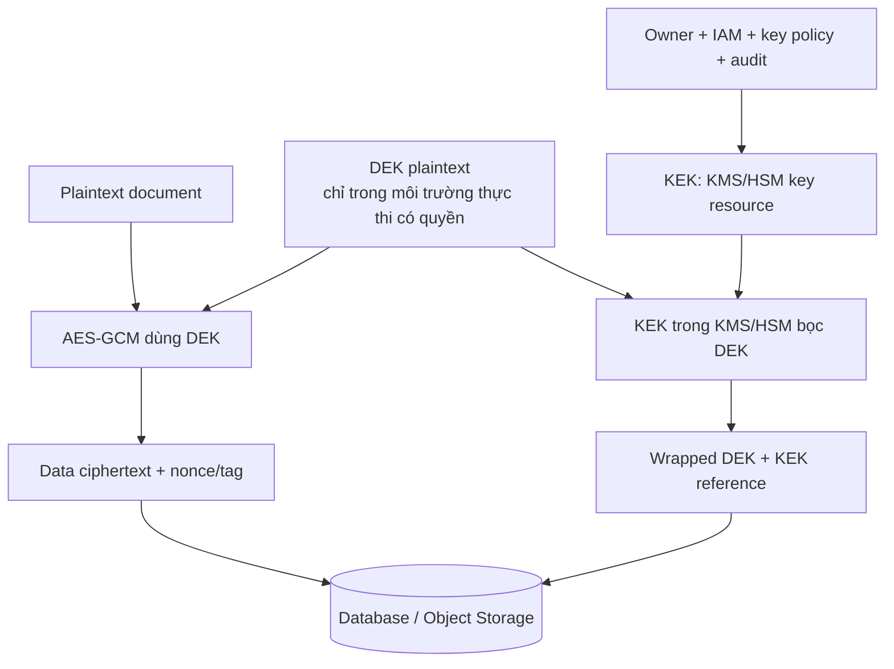
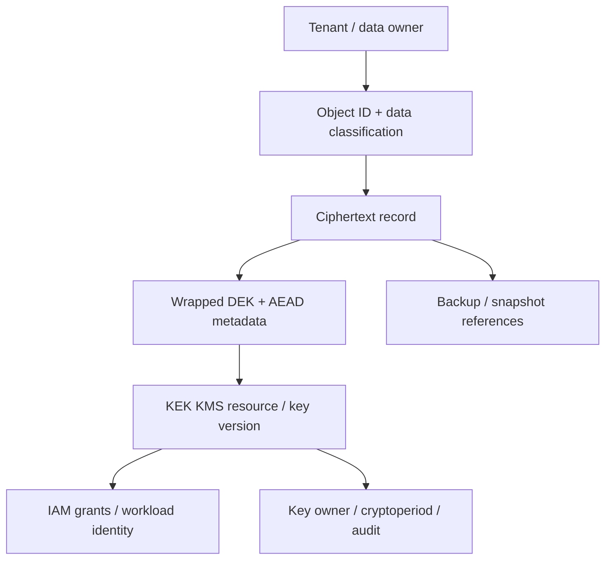
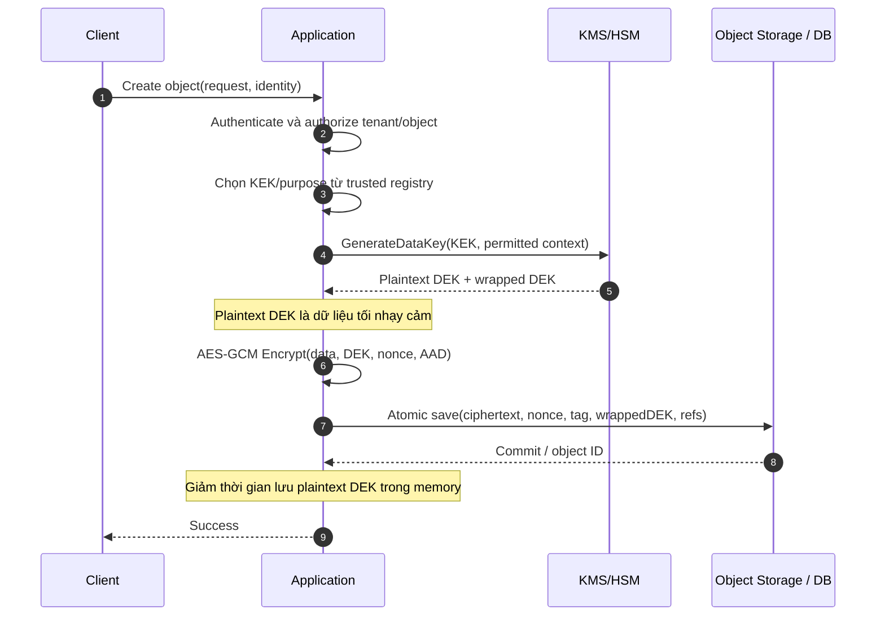
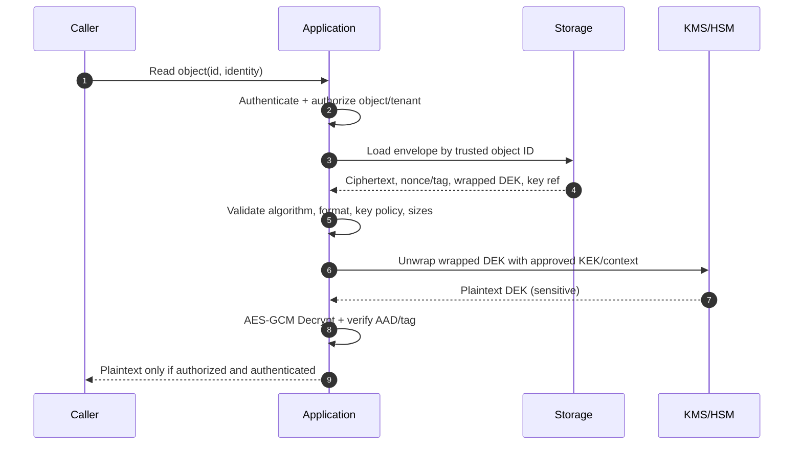
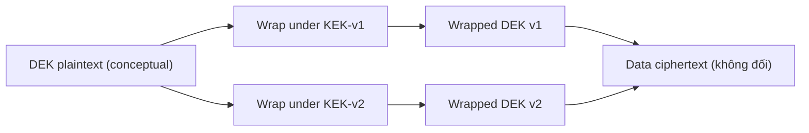
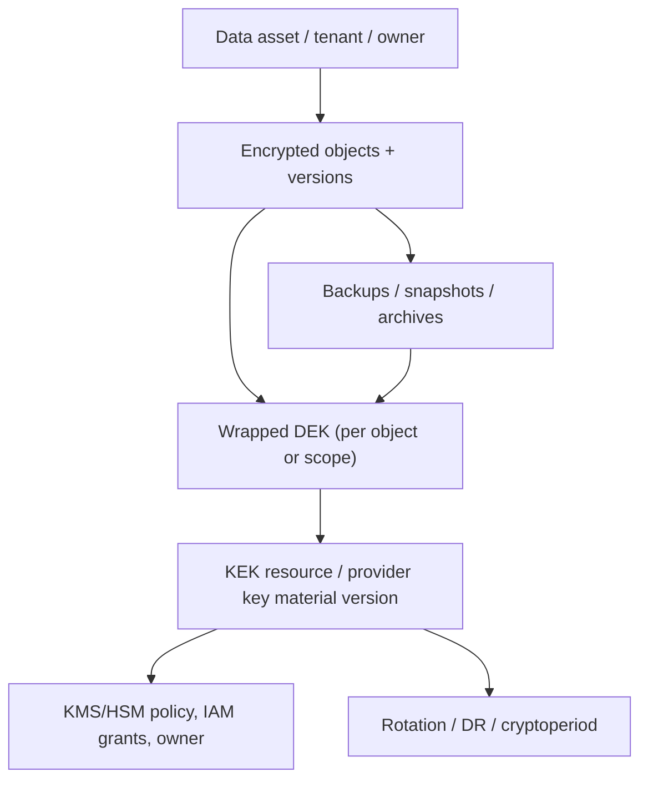
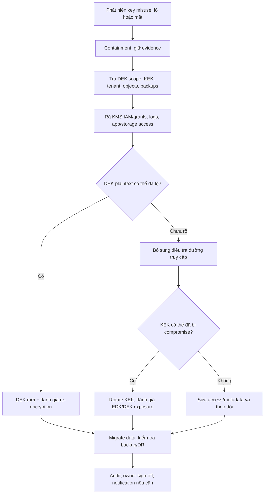
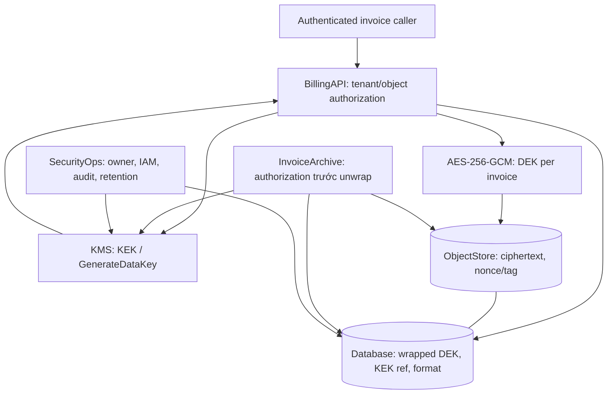

# Data encryption key — Vai trò của DEK trong envelope encryption

> **Chương:** Envelope encryption  
> **Module:** SECURITY_KEY_MANAGEMENT_FUNDAMENTALS — tìm hiểu toàn bộ vòng đời khóa mật mã từ tạo, cấp phát, lưu trữ, sử dụng, xoay vòng đến thu hồi và hủy; kết nối mật mã đối xứng, bất đối xứng, chữ ký số, KMS/HSM, envelope encryption, kiểm soát truy cập và kiểm toán để bảo vệ khóa an toàn.

## 1. Mục tiêu học tập

Sau khi học xong, bạn có thể:

1. Giải thích **Data Encryption Key (DEK)** là gì, công việc nào thuộc DEK, công việc nào thuộc **Key Encryption Key (KEK)** trong mô hình envelope encryption.
2. Mô tả **vòng đời DEK** từ thiết kế phạm vi, sinh khóa, sử dụng, bảo vệ dưới KEK, lưu tham chiếu, cấp quyền, rotation đến hủy.
3. Chọn độ dài, thuật toán và cách sinh DEK đáp ứng threat model; phân biệt **độ dài key**, **entropy**, **nonce/IV** và **AAD**.
4. Thiết kế **DEK per object, per tenant, per batch** và nhận diện ảnh hưởng của lựa chọn này tới blast radius, chi phí KMS, nonce uniqueness và retention.
5. Hiểu **wrapped DEK / encrypted data key (EDK)** và vì sao việc lưu EDK cạnh ciphertext có thể phù hợp, còn lưu **plaintext DEK** cạnh ciphertext thường phá ranh giới bảo mật.
6. Giải thích luồng mã hóa/giải mã dùng KMS/HSM, kể cả trường hợp API như `GenerateDataKey` trả về **plaintext DEK và encrypted DEK**.
7. Phân tích chính xác **KEK rotation**, **DEK rewrap**, **DEK rotation kèm re-encryption**, **key disable/revocation** và **cryptographic erasure**.
8. Thiết kế metadata bao gồm algorithm, nonce/tag, wrapped DEK, key ID/version, format version, tenant/object association và provenance.
9. Đọc ví dụ Java 17 với AES-256-GCM và hợp đồng KMS giả lập, cùng SQL mô tả lưu ciphertext và wrapped DEK.
10. Xây dựng kiểm thử âm tính, kế hoạch backup/DR và cách phản ứng khi DEK/KEK có thể đã bị lộ.

## 2. Data Encryption Key là gì?

**Data Encryption Key (DEK)** là khóa mật mã dùng **trực tiếp để mã hóa và giải mã dữ liệu**. Trong một thiết kế envelope encryption điển hình, DEK là khóa đối xứng: ứng dụng dùng cùng khóa đó (hoặc vật liệu dẫn xuất theo profile thích hợp) để thực hiện phép mã hóa/giải mã dữ liệu.

Ví dụ: mỗi file hóa đơn có một **AES-256 DEK** để ứng dụng mã hóa nội dung bằng AES-GCM. Để tránh phải lưu raw DEK dưới dạng plaintext cạnh file, hệ thống **bọc DEK** bằng một **KEK** được bảo vệ trong KMS/HSM.

Ba tài sản quan trọng là:

- **Plaintext data:** nội dung hóa đơn, bản ghi, tài liệu, object cần bảo vệ.
- **Data ciphertext:** kết quả mã hóa plaintext bằng DEK theo thuật toán/mode cụ thể.
- **Wrapped DEK (encrypted data key):** bản DEK được mã hóa/bọc bởi KEK để có thể lưu mà không xuất hiện raw DEK trong database hoặc object store.

**DEK không đồng nghĩa KEK.** DEK bảo vệ *dữ liệu nghiệp vụ*, KEK bảo vệ *khóa DEK*. Đây là phân tách **key hierarchy** nhằm hạn chế blast radius và làm rotation/quản trị khóa thuận tiện hơn.

### 2.1. Mô hình đơn giản



Khi giải mã, ứng dụng chỉ có thể tái tạo plaintext khi:

1. Được phép đọc object và **được phép dùng KEK/unwrap DEK**.
2. Có **wrapped DEK và key reference/context hợp lệ**.
3. Có đúng **ciphertext, nonce/IV, authentication tag và AAD** theo định dạng.
4. Thuật toán/mode vẫn được hỗ trợ theo chính sách.
5. Dữ liệu qua được **xác minh AEAD**, không phải chỉ “có đủ byte để decrypt”.

### 2.2. Một DEK không nhất thiết là một tài nguyên KMS riêng

Một **KEK** thường là resource có ID/alias/policy/lifecycle riêng trong KMS/HSM. Một **DEK per file** có thể chỉ tồn tại dưới dạng:

- Plaintext DEK trong RAM **trong thời gian mã hóa/giải mã ngắn**.
- Một hoặc nhiều **wrapped DEK blobs** được lưu cùng object.
- Metadata cần thiết để unwrap và quản lý vòng đời.

Vì vậy không phải cứ có 10 triệu file dùng 10 triệu DEK thì cần tạo 10 triệu **KMS key resources**. Tùy provider, một KEK có thể wrap hàng triệu DEK; quản lý **key material plaintext** và **key resources** là hai việc khác nhau.

### 2.3. DEK khác một mật khẩu hoặc một API token

DEK thông thường nên là **khóa ngẫu nhiên mật mã** được sinh từ CSPRNG/KMS, không phải:

- Password người dùng.
- API token/bearer token.
- `SHA256(tenantId)`.
- Tên công ty + thời gian hiện tại.
- Dãy UUID nối lại và cắt 32 byte.
- Một `Random` seed cố định.

Các giá trị trên có mục đích hoặc entropy không tương đương một DEK AES được sinh đúng; chúng có thể tạo ra **khóa dễ dự đoán** dù kích thước cuối cùng là 32 byte.

## 3. Vì sao envelope encryption tách DEK khỏi KEK?

### 3.1. Dùng một khóa duy nhất cho mọi dữ liệu có vấn đề gì?

Giả sử một dịch vụ dùng một **master key** để mã hóa trực tiếp mọi hóa đơn của 100.000 khách hàng. Nếu key đó bị lộ, attacker có thể giải mã **toàn bộ ciphertext** mà họ đã hoặc sẽ lấy được. Ngoài ra:

- Khó giới hạn data scope hoặc xóa mật mã cho một object.
- Phải điều phối nonce/IV và các giới hạn sử dụng trên lượng dữ liệu rất lớn.
- Nhiều service cần quyền dùng cùng một khóa nhạy cảm.
- Rotation trực tiếp master key có thể kéo theo re-encrypt khối lượng lớn.
- Khó thay đổi người sở hữu, tenant, region và chính sách của từng bộ dữ liệu.

### 3.2. Dùng nhiều DEK dưới một KEK giúp gì?

Một mô hình **per-object DEK + centralized KEK** có thể:

- **Thu hẹp phạm vi** nếu một DEK bị lộ: chỉ những object dùng DEK đó chịu ảnh hưởng trực tiếp.
- **Đơn giản hóa nonce management** nếu một DEK chỉ được dùng một lần, nhưng vẫn phải dùng IV đúng.
- Cho phép **rotate/re-encrypt một object** mà không ảnh hưởng tất cả object khác.
- Cho phép **rewrap nhiều DEK dưới KEK mới** mà không nhất thiết mã hóa lại ciphertext khi DEK vẫn được tin cậy.
- Giữ **KEK lâu dài hơn theo policy**, nằm trong HSM/KMS, còn DEK sinh theo nhu cầu.
- Giúp mapping object → wrapped DEK → KEK → key owner để audit.

### 3.3. Tách khóa không tự động tạo cách ly hoàn hảo

Mô hình này vẫn có những giới hạn:

- Nếu **KEK bị lộ** và attacker có wrapped DEK từ database, nhiều DEK có thể bị giải bọc.
- Nếu một **workload có quyền KMS Decrypt rộng** bị chiếm, attacker có thể gọi unwrap hàng loạt.
- Nếu **plaintext DEK được log/cache vô hạn**, tách KEK không giải quyết được.
- Nếu nhiều DEK được sinh từ **seed đoán được** hoặc thực chất giống nhau, lợi ích isolation giảm mạnh.
- Nếu object authorization sai, API có thể tự giải mã dữ liệu tenant khác.

**Envelope encryption tách key hierarchy và khả năng quản trị; nó không thay identity, authorization, secret hygiene hay incident response.**

## 4. DEK và KEK: phân biệt chính xác

| Thuộc tính | DEK | KEK |
| --- | --- | --- |
| **Mục đích chính** | Encrypt/decrypt dữ liệu | Wrap/unwrap hoặc bảo vệ key material |
| **Phạm vi điển hình** | Object, tenant, batch, phiên | Key family, service, tenant hoặc security domain |
| **Độ nhạy** | Bí mật; có thể giải mã data ciphertext | Bí mật; nếu lộ có thể mở nhiều DEK |
| **Lưu ở đâu** | Plaintext tạm thời trong trusted runtime; wrapped DEK ở storage | KMS/HSM/approved key store |
| **Tần suất tạo mới** | Thường nhiều hơn, theo workload | Theo cryptoperiod/policy |
| **Metadata đi kèm** | Algorithm, nonce/tag, AAD, wrapped-key reference | Resource ID/version, IAM/key policy, rotation, owner |
| **Khi thay khóa** | Thường phải re-encrypt dữ liệu dùng DEK đó | Có thể rewrap DEK, tùy threat model |
| **Khi bị lộ** | Dữ liệu dùng DEK đó có nguy cơ | Toàn bộ wrapped DEKs trong phạm vi KEK có nguy cơ |
| **Khả năng export** | App có thể cần plaintext trong RAM | Nên hạn chế mạnh, non-exportable khi phù hợp |
| **Xóa khóa** | Có thể làm một object không đọc được | Có thể làm rất nhiều object/backup không đọc được |

### 4.1. “KEK non-exportable” không có nghĩa DEK chưa ra khỏi KMS

Một KMS có thể giữ **KEK không export được**, nhưng API `GenerateDataKey` trả:

- Plaintext DEK cho ứng dụng.
- Wrapped DEK để lưu.

Khi đó **DEK đã tồn tại ngoài KMS** trong app process. Kiến trúc phải bảo vệ RAM, logs, error path, process dump và thời gian tồn tại của plaintext DEK. Không quảng bá một giải pháp kiểu này là “mọi khóa không bao giờ rời HSM”.

### 4.2. Key usage phải được tách

Không nên lấy raw DEK rồi đồng thời dùng làm:

- AES-GCM encryption key.
- HMAC key.
- Key wrapping key.
- Password pepper.
- Session authentication secret.

Nếu một master secret phải dẫn xuất nhiều khóa theo purpose, cần **KDF được chuẩn hóa với domain separation**. Mỗi output có **usage policy riêng**. Không trộn các primitive chỉ vì chúng chấp nhận cùng số byte khóa.

## 5. Độ mạnh, thuật toán và kích thước DEK

### 5.1. DEK AES

AES theo FIPS 197 có khóa:

| Loại | Độ dài | Số byte | Gợi ý |
| --- | ---: | ---: | --- |
| **AES-128** | 128 bit | 16 byte | Có thể phù hợp nhiều profile và threat model |
| **AES-192** | 192 bit | 24 byte | Hợp lệ, nhưng cần kiểm tra provider support |
| **AES-256** | 256 bit | 32 byte | Phổ biến khi policy yêu cầu biên an toàn lớn hơn |

Không có **AES-512** theo chuẩn AES. Một DEK dài 32 byte **không tự đảm bảo** 256 bit entropy nếu nó được tạo từ một password hoặc seed dễ đoán.

### 5.2. Thuật toán mã hóa dữ liệu: ưu tiên AEAD

Trong hệ thống mới, lựa chọn điển hình là **AEAD**:

- **AES-GCM:** mã hóa có xác thực, yêu cầu quản trị key/nonce nghiêm ngặt.
- **ChaCha20-Poly1305:** AEAD theo profile chuẩn; DEK và nonce theo đặc tả cụ thể.
- Các AEAD hoặc chế độ được chuẩn hóa khác theo khả năng platform và policy.

Đừng tự kết hợp AES-CBC + hash thông thường rồi tuyên bố có authenticated encryption. Nếu phải dùng tổ hợp encrypt-then-MAC, thiết kế phải tuân profile được đánh giá và **khóa MAC tách khỏi khóa encryption**.

### 5.3. Một DEK có thể bảo vệ bao nhiêu dữ liệu?

Phụ thuộc:

- Primitive, mode và số block.
- Key size/security strength.
- Số lần encrypt trên DEK.
- Chính sách nonce/IV; ví dụ GCM không được reuse key+IV.
- Cryptoperiod và mức dữ liệu nhạy cảm.
- Blast radius khi key lộ.
- Provider quotas và latency.

**Không quy định một ngưỡng phổ quát** “AES-256 DEK được dùng mãi mãi”. NIST SP 800-38D và profile cụ thể có các ràng buộc theo cách xây IV, invocation count và giới hạn dữ liệu.

## 6. Sinh DEK: CSPRNG, KMS hay HSM?

### 6.1. Nguyên tắc entropy

Một DEK ngẫu nhiên nên được sinh bằng **CSPRNG/DRBG có entropy source và cách vận hành phù hợp**. Nó cần khó đoán đối với đối thủ ngay cả khi attacker biết:

- Thời gian tạo file.
- Object ID.
- Tenant ID.
- Hostname và số phiên làm việc.
- Các key ID khác.
- Thuật toán được chọn.

Đây thường là **đầu vào công khai/metadata**, không phải secret entropy.

### 6.2. Java `KeyGenerator`

```java
import java.security.GeneralSecurityException;
import java.security.SecureRandom;
import javax.crypto.KeyGenerator;
import javax.crypto.SecretKey;

public final class DekGenerator {
    private static final SecureRandom RNG = new SecureRandom();

    private DekGenerator() {}

    public static SecretKey aes256()
            throws GeneralSecurityException {
        KeyGenerator generator = KeyGenerator.getInstance("AES");
        generator.init(256, RNG);
        return generator.generateKey();
    }
}
```

`SecretKey` là một abstraction JCA; với provider phần mềm, key material có thể export được qua `getEncoded()`. Với một provider/HSM cụ thể, key handle có thể non-exportable. **Không giả định mọi `SecretKey` đều được HSM bảo vệ.**

### 6.3. Không sử dụng các nguồn dự đoán được

```java
// SAI: không dùng java.util.Random làm nguồn tạo DEK.
byte[] weakDek = new byte[32];
new java.util.Random(System.currentTimeMillis()).nextBytes(weakDek);

// SAI: password, tenant ID, timestamp không phải 256-bit entropy.
byte[] anotherWeakDek =
    java.security.MessageDigest.getInstance("SHA-256")
      .digest("tenant-42-invoices".getBytes(
           java.nio.charset.StandardCharsets.UTF_8));
```

Một hash có output 256 bit vẫn có thể chứa **rất ít entropy thực** nếu input dễ đoán. Nếu key bắt nguồn từ **password của con người**, phải dùng password-based KDF phù hợp (Argon2id, scrypt hoặc PBKDF2 theo policy); tốt hơn, nếu thiết kế cho phép, **DEK nên sinh độc lập từ CSPRNG/KMS**.

### 6.4. Dịch vụ KMS sinh Data Key

Một số dịch vụ KMS cung cấp API tương tự `GenerateDataKey`, trả **plaintext DEK và wrapped DEK** dưới một KEK. Có các điểm cần xác minh theo sản phẩm:

- Key ID của KEK, algorithm, key size và wrapping context.
- Identity/permission cần cho API tạo data key.
- KMS có **trả plaintext** hay chỉ ciphertext/key handle?
- Ciphertext DEK có tự mang provider/key reference/version không?
- Có hỗ trợ rewrap server-side hoặc data key pair hay không?
- Metadata nào cần được lưu để unwrap ở DR region?
- Audit có log context và các request parameters nhạy cảm không?

**Không tự coi API của mọi provider giống nhau.** KMS key rotation có thể giữ các phiên bản vật liệu khóa nội bộ khác nhau và semantics decrypt không trùng giữa nhà cung cấp.

### 6.5. Sinh DEK trên KMS có an toàn tuyệt đối không?

KMS quản lý tốt hơn một số ranh giới, nhưng nguy cơ vẫn còn nếu:

- Ứng dụng được cấp `GenerateDataKey/Decrypt` quá rộng.
- Plaintext DEK bị in ra log, đưa vào telemetry hoặc lỗi.
- Bản sao DEK được cache lâu mà không giới hạn scope.
- App tự cho caller chỉ định KEK tùy ý.
- KMS ciphertext/context bị lưu thiếu hoặc liên kết sai tenant.
- Dữ liệu at rest vẫn bị mã hóa bằng AEAD có nonce reuse.

**Nguồn tạo key là điều kiện cần; đường đi plaintext và quản trị quyền mới quyết định mức độ bảo vệ thực.**

## 7. Phạm vi DEK: per object, per tenant, per batch hay per session?

Một trong những lựa chọn kiến trúc quan trọng nhất là **một DEK bảo vệ những đối tượng nào**.

| Kiểu scope | Mô hình | Ưu điểm | Đánh đổi |
| --- | --- | --- | --- |
| **Per object** | Mỗi file/row có DEK riêng | Blast radius nhỏ, rotation/xóa theo object | Wrapped DEK và KMS requests nhiều |
| **Per tenant** | DEK chung cho tenant | Đơn giản hơn với một số workloads | Nonce/usage limits và lộ một DEK ảnh hưởng tenant |
| **Per dataset** | Một tập dữ liệu dùng DEK | Phù hợp xử lý tập trung | Khó tách tenant/object khi thay quyền |
| **Per batch** | DEK mới theo job/time window | Cân bằng throughput | Lộ key ảnh hưởng toàn batch |
| **Per session** | Session/traffic key trong giao thức | Key sống ngắn, có rekey | Không tự thay DEK phục vụ encryption at rest |
| **Per record field** | Mỗi trường nhạy cảm có DEK riêng | Rất hẹp | Metadata và chi phí phức tạp |

### 7.1. Ví dụ per-object DEK

Một SaaS lưu 1 triệu file; mỗi file có:

```text
object_id
ciphertext
nonce
tag
wrapped_dek
wrapping_kek_ref
crypto_format_version
```

Nếu 1 DEK của 1 object bị lộ và thật sự **không được tái sử dụng cho object khác**, phạm vi dữ liệu trực tiếp dùng key đó bị giới hạn ở object tương ứng.

Tuy nhiên nếu attacker có quyền **KMS Decrypt** mọi wrapped DEK, phạm vi thực tế vẫn có thể lên đến toàn tenant/công ty. **Blast radius phải xét cả key hierarchy và IAM**, không chỉ số lượng DEK.

### 7.2. Per-tenant DEK cần kiểm soát nonce nghiêm ngặt

Nếu dùng một DEK cho nhiều bản ghi AES-GCM:

- Cần đảm bảo **unique IV/nonce dưới cùng key**, kể cả across shards/workers/restarts.
- Theo dõi số invocation/usage limits.
- Phải tách tenant identity trong authorization và AAD/context.
- Khi lộ DEK, cần đánh giá **mọi row** của tenant.
- Không dùng cùng DEK giữa dev/staging/prod.
- Có kế hoạch versioning khi rotate DEK; không thay DEK dưới tên cũ rồi làm mất quyền decrypt cũ.

### 7.3. Per-object DEK giảm nhưng không xóa mọi nguy cơ

Nếu mỗi DEK chỉ được dùng một lần để mã hóa một object, random nonce 96 bit cho AES-GCM thường dễ quản lý hơn so với hàng triệu lần encrypt trên một DEK. Nhưng:

- Không được dùng cùng DEK để encrypt lại object trong retry mà **vô tình reuse cùng nonce**.
- Không được tạo DEK từ seed cố định do snapshot/clone DRBG.
- Nếu một “object” chứa stream/chunk được mã hóa nhiều lần, mỗi chunk là một invocation và cần nonce strategy/usage limits.
- KMS grants vẫn phải giới hạn; không cho service “được quyền một object” tự động unwrap mọi object.

### 7.4. Key hierarchy nên theo data classification

Dữ liệu public, internal và restricted có thể có:

- KEK/key policies khác nhau.
- DEK scopes khác nhau.
- Quorum/HSM requirement khác nhau.
- Retention/DR và rotation deadline khác nhau.
- Các principal được phép Decrypt/Unwrap khác nhau.

**Không áp cùng một scope cho mọi loại dữ liệu chỉ vì tất cả đều dùng AES.**

## 8. Dữ liệu nào cần lưu cùng DEK đã bọc?

Một **envelope** là tập metadata đủ để giải mã an toàn. Một cấu trúc khái niệm:

```json
{
  "formatVersion": 1,
  "dataAlgorithm": "AES-256-GCM",
  "keyScope": "per-object",
  "objectId": "invoice-2026-0813",
  "tenantId": "tenant-42",
  "ciphertextAndTag": "<base64-data-ciphertext>",
  "nonce": "<base64-12-byte-nonce>",
  "wrappedDek": "<base64-wrapped-key>",
  "wrappingKekRef": "kms://prod/region-a/keys/invoice-kek",
  "wrappingContext": {
    "purpose": "invoice-v1",
    "tenant": "tenant-42",
    "object": "invoice-2026-0813"
  },
  "aadSchema": "invoice-aad-v1",
  "createdAt": "2026-11-28T08:00:00Z",
  "keyOwnerTeamId": "billing-platform"
}
```

**Đây là schema minh họa**, không phải API request/response của một provider cụ thể. Các chuỗi `<base64-...>` là placeholders, **không phải bí mật**. Nếu xử lý dữ liệu thật, không ghi raw key vào JSON.

### 8.1. Các trường tối thiểu cần lưu

| Trường | Công dụng | Lưu ý |
| --- | --- | --- |
| `formatVersion` | Chọn đúng schema parser | Không lấy làm key material version |
| `dataAlgorithm` | Biết AEAD/mode/size | Chỉ chấp nhận allowlist |
| `ciphertextAndTag` | Ciphertext data + authentication tag | Không trộn tag với wrapped key tag |
| `nonce` | IV cho data AEAD | Phải đúng rules của mode |
| `wrappedDek` | DEK ciphertext | Có thể giữ cùng data ciphertext |
| `wrappingKekRef` | Tham chiếu KEK/resource | Đối chiếu nguồn tin cậy |
| `kekMaterialVersion` | Version nếu provider expose/đòi hỏi | Không tự bịa version |
| `aadSchema` | Quy tắc canonical hóa AAD | Phải tái tạo byte chính xác |
| `tenantId`/`objectId` | Liên kết dữ liệu nghiệp vụ | Không tự coi field DB là authorization |
| `cryptoRevision` | Hỗ trợ migration/concurrency | Không tự chống rollback khi attacker sửa DB |

### 8.2. Không nên lưu những gì?

**Không** đưa vào database/object metadata:

```text
plaintextDek
plaintextKek
privateKeyPem
masterKeyBytes
passwordPepper
hsmPin
drbgSeedOrState
temporaryUnwrapToken
serviceCredential
```

Nếu plaintext DEK nằm trong cùng database với ciphertext, attacker có DB dump có thể giải mã mà không cần KEK. Chuyển nó sang **Base64/hex** không thay đổi tính bí mật.

### 8.3. Một object có thể có nhiều wrapped DEK

Ví dụ một DEK được bọc cho các recipients khác nhau:

```text
data ciphertext -> encrypted under DEK-X

DEK-X -> wrapped under KEK-Primary
      -> wrapped under KEK-DR
      -> wrapped for authorized external recipient
```

Đây là **nhiều đường truy cập cùng một DEK**. Cần quản lý recipient identity, key policy, revocation và dữ liệu lịch sử. Xóa một wrapper **không khiến recipient đã từng unwrap DEK quên khóa**.

## 9. Nonce/IV và AAD: hai khái niệm không thay DEK

### 9.1. Nonce/IV trong AES-GCM

**Nonce** là giá trị được truyền vào thuật toán mã hóa; với AES-GCM, **không được dùng lại cùng cặp key + IV** trong những điều kiện bảo mật yêu cầu uniqueness. IV thường **không cần bí mật** nhưng phải được quản lý đúng.

Ví dụ minh họa:

```text
DEK  = 32 bytes từ CSPRNG/KMS (bí mật)
IV   = 12 bytes theo chính sách unique-IV (không bí mật)
AAD  = canonical(tenantId, objectId, formatVersion)
TAG  = authentication tag (ví dụ 128 bit)
CT   = ciphertext data
```

**DEK không phải nonce**. Một nonce 12 byte dù random không phải khóa AES-128/256. Một DEK 32 byte không được tự dùng làm IV chỉ vì “cũng là ngẫu nhiên”.

### 9.2. Vì sao reuse GCM nonce nguy hiểm?

Nếu cùng key + IV được dùng cho nhiều plaintext, có thể gây tổn hại nghiêm trọng tới confidentiality và integrity theo thuộc tính của GCM. Việc dùng key sinh từ HSM **không khắc phục** nonce reuse tại ứng dụng.

Các hệ thống high-throughput, distributed workers hoặc snapshot/rollback cần chiến lược IV:

- Random IV theo profile và **giới hạn số invocation** phù hợp.
- Deterministic IV có prefix/counter được phân bổ không trùng, **bền vững sau restart/failover**, nếu profile cho phép.
- Theo dõi key usage limits và cutover trước khi vượt ngưỡng.
- Thiết kế khác khi một DEK dùng cho một object so với hàng triệu chunks.

Không nêu một hạn mức “mỗi DEK được mã hóa đúng \(2^{32}\) lần” như chuẩn chung cho mọi cách xây IV; phải kiểm tra **NIST SP 800-38D** và profile cụ thể.

### 9.3. AAD là gì?

**Additional Authenticated Data (AAD)** được xác thực cùng ciphertext nhưng không được mã hóa bởi AEAD. Nó có thể ràng buộc data với:

- Tenant ID.
- Object ID.
- Data classification hoặc purpose.
- Crypto format version.
- Canonical header của envelope.

Nếu attacker cố **sao chép ciphertext của object A sang B**, AAD khác có thể khiến xác minh tag thất bại, nếu identity đó đến từ **nguồn tin cậy**.

### 9.4. AAD không phải authorization

Nếu API cho phép caller tự gửi `tenantId=admin` rồi dùng đúng giá trị ấy làm AAD, attacker vẫn có thể yêu cầu giải mã sai tenant khi application/KMS policy cho phép. AAD **chỉ bảo vệ liên kết bit-đến-bit**, không tự chứng minh caller có quyền đọc dữ liệu.

Dùng authenticated principal và server-side mapping để xác minh tenant/object **trước khi gọi KMS**.


### 9.5. AAD và KMS encryption context không giống nhau

Trong thiết kế envelope có thể có:

- **Data AAD:** nhập cho AES-GCM khi mã hóa document.
- **Wrapping context:** metadata nhập cho KMS khi wrap/unwrap DEK, nếu API hỗ trợ.

Cả hai cần được bảo toàn, nhưng **không nhất thiết có cùng serialization/semantics**. Một provider có thể đưa encryption context vào audit logs; không đưa plaintext bí mật vào context.

## 10. Gắn DEK vào dữ liệu và quyền truy cập

Một DEK per file rất hữu ích khi có thể truy ngược:



### 10.1. Quyền không thể quyết định chỉ từ `wrappedDek`

Không cho caller:

- Tự chọn KEK của tenant khác.
- Gửi bất kỳ wrapped DEK blob rồi yêu cầu service unwrap thay.
- Chỉ định algorithm ngoài allowlist.
- Chuyển `objectId` sang object của người khác.
- Tạo data ciphertext mới dưới retired DEK mà không có policy.
- Gọi raw KMS decrypt API qua một đường bypass không kiểm tra business authorization.

### 10.2. KMS nhìn thấy service, nhưng không nhất thiết thấy end-user

Một service như `invoice-reader` có thể có quyền KMS Decrypt trên một tập KEK rộng. KMS thường biết **workload/service identity**, nhưng không tự biết **end-user** và data entitlement ở ứng dụng.

Vì vậy luồng đọc cần:

1. Authenticate caller.
2. Authorize tenant + object.
3. Load envelope metadata.
4. Validate key reference/algorithm/format theo **trusted policy**.
5. Gọi KMS unwrap trong scope hợp lệ.
6. AEAD decrypt + verify.
7. Return plaintext khi toàn bộ bước đạt; audit không chứa secret.

### 10.3. Chống confused deputy

Một service có quyền decrypt nhiều tenant rất dễ trở thành **confused deputy** nếu lấy `kekRef` từ yêu cầu của client mà không đối chiếu.

Đúng hơn, `approvedKekFor(tenant, object, purpose)` phải dựa vào một **registry được bảo vệ**, với principal và object đã được xác thực. Nếu metadata trong database có thể bị attacker sửa, cần so sánh nó với trusted key policy hoặc ràng buộc bằng cơ chế integrity/authorization khác.

## 11. Luồng mã hóa: tạo DEK và viết một envelope

Một luồng mã hóa điển hình đối với **DEK per object**:



### 11.1. Trước khi sinh DEK

Ứng dụng phải xác định:

1. Người dùng/workload có quyền ghi dữ liệu trong tenant không?
2. Data classification và key usage policy yêu cầu gì?
3. Có cần một DEK mới hay dữ liệu phải được xử lý theo existing key family?
4. KEK nào được phép dùng để wrap DEK trong environment này?
5. KMS provider nào và account/region nào là nguồn có thẩm quyền?
6. Output có thể được lưu nguyên tử với envelope metadata không?

**Không để client chỉ định tùy ý một key ID đang tồn tại trong KMS.** Với những dữ liệu nghiệp vụ, hệ thống nên chọn key từ mapping tenant/purpose mà owner và policy đã phê duyệt.

### 11.2. Sau khi nhận DEK

Nếu KMS trả DEK plaintext:

- Chỉ giữ trong **trusted runtime** cần mã hóa.
- Không chuyển qua `String` hoặc các serialization/logging framework.
- Không truyền raw DEK qua message queue, webhook hoặc ticket.
- Không đặt DEK plaintext trong database, file cấu hình, tracing hoặc exception.
- Giới hạn số bản sao, thời gian tồn tại trong RAM và kích thước request.
- Dùng `finally` để xóa các buffer do app sở hữu khi có thể; hiểu đây là **best-effort**, không phải xóa vật lý tuyệt đối trong JVM.
- Giữ **wrapped DEK** và key reference đủ phục vụ decrypt/restore.

### 11.3. Ghi atomically

Những thành phần sau phải thuộc **cùng một document version**:

```text
data ciphertext
AEAD nonce/IV
AEAD tag
wrapped DEK
wrapping KEK reference/version
crypto format / AAD schema
tenant ID / object ID / data version
```

Nếu ciphertext của v2 được commit nhưng wrapped DEK của v1 còn lại, dữ liệu có thể không giải mã được. Cần atomic DB transaction, atomic object replacement hoặc mô hình immutable object version có publication pointer.

KMS request và database transaction **không tự có ACID transaction chung**. Khi KMS thành công nhưng lưu DB thất bại, hệ thống cần idempotent retry/error handling thay vì giả định rollback DB sẽ hủy DEK.

### 11.4. Không tạo ciphertext mới dưới key đã retired

Một KEK cũ có thể vẫn còn cần cho **Decrypt/Unwrap** lịch sử. Nhưng data được tạo mới nên sử dụng **key được phép origin/wrap mới**, theo policy.

Sự phân biệt giữa `encrypt-new` và `decrypt-old` giúp key rotation không bị kẹt trong trạng thái “khóa cũ tiếp tục tạo thêm dữ liệu”.

## 12. Luồng giải mã: unwrap DEK và xác thực dữ liệu



### 12.1. Kiểm soát trước khi gọi KMS

Ứng dụng nên:

- Xác minh **authenticated principal**.
- Kiểm tra quyền **tenant và object**.
- Đọc envelope bằng object identity đã được xác nhận.
- Validate `wrappingKekRef` và algorithm/format theo trusted registry.
- Kiểm tra envelope size để tránh attacker gửi blob khổng lồ gây DoS.
- Chỉ gọi `Unwrap/Decrypt` nếu key reference phù hợp business policy.
- Ghi audit metadata, không ghi raw key.

Nếu quyền object chưa được xác minh, ứng dụng có thể bị lạm dụng như **dịch vụ giải bọc DEK** cho dữ liệu người gọi không có quyền.

### 12.2. Khi tag AEAD thất bại

Nếu `Cipher.doFinal` khi decrypt AES-GCM báo lỗi như `AEADBadTagException`, không được:

- Trả plaintext một phần.
- Chuyển sang AES-CBC/ECB để “cứu” dữ liệu.
- Bỏ qua AAD để thử lại bừa bãi.
- Dùng một key/nonce được đoán.
- Ghi toàn bộ plaintext/ciphertext nhạy cảm vào log để debug.

Cần báo lỗi có kiểm soát, giữ event/correlation ID, phân biệt khả năng **tampering, corruption, wrong DEK, wrong nonce, wrong AAD hoặc format migration**.

### 12.3. AEAD tag không chứng minh dữ liệu chưa bị rollback

Một attacker có quyền ghi database có thể khôi phục **một envelope cũ từng hợp lệ**. Tag của blob cũ vẫn có thể xác minh đúng.

Nếu nghiệp vụ cần chống rollback, phải dùng **monotonic revision/freshness source** ngoài phạm vi attacker, transaction integrity hoặc cơ chế có trạng thái đáng tin. Chỉ gắn `updatedAt` trong chính DB vào AAD **không giải quyết** nếu attacker có thể rollback cả giá trị ấy.

## 13. Java 17: mô hình envelope encryption với DEK từ KMS

Ví dụ sau minh họa luồng **per-object DEK + AES-256-GCM + wrapped DEK**. Các interface **KMS client và storage chưa có implementation thực**; chúng biểu thị ranh giới, còn các thao tác JCA mã hóa/giải mã là mã Java hợp lệ.

### 13.1. Thiết kế interface

```java
import java.util.Map;
import java.util.UUID;

public interface EnvelopeGateway {
    // Một KMS adapter thật phải xác thực key policy, IAM và context.
    DataKey generateDataKey(
        String approvedKekRef,
        Map<String, String> trustedContext
    ) throws Exception;

    byte[] unwrap(
        String approvedKekRef,
        byte[] wrappedDek,
        Map<String, String> trustedContext
    ) throws Exception;

    record DataKey(byte[] plaintextDek, byte[] wrappedDek) {}
}

public interface EnvelopeRepository {
    void insertAtomically(EncryptedObject record) throws Exception;
    EncryptedObject load(String tenantId, UUID objectId) throws Exception;

    record EncryptedObject(
        String tenantId,
        UUID objectId,
        int formatVersion,
        String algorithm,
        byte[] iv,
        byte[] ciphertextAndTag,
        byte[] wrappedDek,
        String kekRef
    ) {}
}
```

Một implementation production cần defensive copies cho các `byte[]`, quyền sở hữu buffer rõ ràng, giới hạn kích thước, audit và timeout. `record` của Java **không tự làm array immutable**.

### 13.2. Java service mã hóa và giải mã

```java
import java.nio.ByteBuffer;
import java.nio.charset.StandardCharsets;
import java.security.GeneralSecurityException;
import java.security.SecureRandom;
import java.util.Arrays;
import java.util.Map;
import java.util.Objects;
import java.util.UUID;

import javax.crypto.Cipher;
import javax.crypto.spec.GCMParameterSpec;
import javax.crypto.spec.SecretKeySpec;

public final class EnvelopeService {
    private static final SecureRandom RNG = new SecureRandom();
    private static final int AES_DEK_BYTES = 32;
    private static final int GCM_IV_BYTES = 12;
    private static final int GCM_TAG_BITS = 128;
    private static final int FORMAT_VERSION = 1;

    public record Actor(String principalId, String authenticatedTenant) {}

    public interface Authorization {
        void requireWrite(Actor actor, UUID objectId);
        void requireRead(Actor actor, UUID objectId);
        String approvedKekForNewWrite(String tenantId);
        void requireHistoricalKekAllowed(
            String tenantId, UUID objectId, String kekRef);
    }

    private final EnvelopeGateway kms;
    private final EnvelopeRepository repository;
    private final Authorization authorization;

    public EnvelopeService(
            EnvelopeGateway kms,
            EnvelopeRepository repository,
            Authorization authorization) {
        this.kms = Objects.requireNonNull(kms);
        this.repository = Objects.requireNonNull(repository);
        this.authorization = Objects.requireNonNull(authorization);
    }

    public UUID encryptAndStore(Actor actor, byte[] plaintext)
            throws Exception {

        Objects.requireNonNull(actor);
        Objects.requireNonNull(plaintext);

        String tenant = Objects.requireNonNull(actor.authenticatedTenant());
        UUID objectId = UUID.randomUUID();
        authorization.requireWrite(actor, objectId);

        String kekRef = authorization.approvedKekForNewWrite(tenant);
        Map<String, String> wrapContext = context(tenant, objectId);

        EnvelopeGateway.DataKey dataKey =
            kms.generateDataKey(kekRef, wrapContext);

        byte[] plaintextDek =
            Objects.requireNonNull(dataKey.plaintextDek());
        try {
            if (plaintextDek.length != AES_DEK_BYTES) {
                throw new GeneralSecurityException(
                    "Invalid DEK length; expected 256 bits");
            }
            byte[] wrappedDek =
                Objects.requireNonNull(dataKey.wrappedDek());

            // Ví dụ: một DEK mới cho một object, một lần encrypt.
            byte[] iv = new byte[GCM_IV_BYTES];
            RNG.nextBytes(iv);

            Cipher cipher = Cipher.getInstance("AES/GCM/NoPadding");
            cipher.init(Cipher.ENCRYPT_MODE,
                new SecretKeySpec(plaintextDek, "AES"),
                new GCMParameterSpec(GCM_TAG_BITS, iv));
            cipher.updateAAD(aad(tenant, objectId));
            byte[] ciphertextAndTag = cipher.doFinal(plaintext);

            EnvelopeRepository.EncryptedObject stored =
                new EnvelopeRepository.EncryptedObject(
                    tenant, objectId, FORMAT_VERSION,
                    "AES-256-GCM", iv,
                    ciphertextAndTag, wrappedDek, kekRef);

            repository.insertAtomically(stored);
            return objectId;

        } finally {
            // Best-effort: không thể bảo đảm xóa mọi bản sao JVM/provider.
            Arrays.fill(plaintextDek, (byte) 0);
        }
    }

    public byte[] loadAndDecrypt(Actor actor, UUID objectId)
            throws Exception {

        Objects.requireNonNull(actor);
        Objects.requireNonNull(objectId);
        String tenant = Objects.requireNonNull(actor.authenticatedTenant());

        // Không unwrap trước khi có quyền trên object.
        authorization.requireRead(actor, objectId);

        EnvelopeRepository.EncryptedObject record =
            repository.load(tenant, objectId);
        if (record == null
                || !tenant.equals(record.tenantId())
                || !objectId.equals(record.objectId())
                || record.formatVersion() != FORMAT_VERSION
                || !"AES-256-GCM".equals(record.algorithm())
                || record.iv() == null
                || record.iv().length != GCM_IV_BYTES
                || record.ciphertextAndTag() == null
                || record.ciphertextAndTag().length < GCM_TAG_BITS / 8
                || record.wrappedDek() == null
                || record.wrappedDek().length == 0) {
            throw new GeneralSecurityException("Invalid envelope");
        }

        authorization.requireHistoricalKekAllowed(
            tenant, objectId, record.kekRef());

        byte[] dek = kms.unwrap(
            record.kekRef(), record.wrappedDek(),
            context(tenant, objectId));

        try {
            if (dek == null || dek.length != AES_DEK_BYTES) {
                throw new GeneralSecurityException(
                    "Invalid unwrapped data key");
            }

            Cipher cipher = Cipher.getInstance("AES/GCM/NoPadding");
            cipher.init(Cipher.DECRYPT_MODE,
                new SecretKeySpec(dek, "AES"),
                new GCMParameterSpec(GCM_TAG_BITS, record.iv()));
            cipher.updateAAD(aad(tenant, objectId));

            // Chỉ return sau khi xác minh AEAD tag thành công.
            return cipher.doFinal(record.ciphertextAndTag());

        } finally {
            if (dek != null) {
                Arrays.fill(dek, (byte) 0);
            }
        }
    }

    private static Map<String, String> context(
            String tenant, UUID objectId) {
        return Map.of(
            "purpose", "encrypted-object-v1",
            "tenant", tenant,
            "objectId", objectId.toString()
        );
    }

    private static byte[] aad(String tenant, UUID id) {
        byte[] tenantBytes =
            tenant.getBytes(StandardCharsets.UTF_8);

        // Canonical byte encoding: version, length prefix, tenant, UUID.
        ByteBuffer buf = ByteBuffer.allocate(
            4 + 4 + tenantBytes.length + 8 + 8);
        buf.putInt(FORMAT_VERSION);
        buf.putInt(tenantBytes.length);
        buf.put(tenantBytes);
        buf.putLong(id.getMostSignificantBits());
        buf.putLong(id.getLeastSignificantBits());
        return buf.array();
    }
}
```

### 13.3. Điều mã mẫu thể hiện

- **Một DEK mới per object** và một lần AES-GCM Encrypt trong ví dụ.
- DEK có **đúng 32 byte** theo profile AES-256 đã chọn.
- KMS wrapping context ràng buộc purpose, tenant và object.
- Data AAD có **encoding xác định**, không dùng chuỗi ghép mơ hồ.
- KEK cho write mới được chọn từ **trusted Authorization**, không do client tự nhập.
- Reader kiểm tra **tenant/object/format/algorithm/key reference** trước KMS unwrap.
- **Plaintext DEK chỉ dùng trong RAM**; database nhận ciphertext, nonce/tag, wrapped DEK, key ref.
- `finally` xóa array DEK thuộc quyền sở hữu app ở mức **best effort**.
- Lỗi AEAD tag làm `doFinal` thất bại, không trả một bản plaintext chưa xác thực.

### 13.4. Giới hạn bắt buộc nếu triển khai thật

Đây là **ví dụ kiến trúc**, chưa là ứng dụng production:

1. `EnvelopeGateway`, `EnvelopeRepository`, `Authorization` là hợp đồng, chưa có IAM/KMS/DB implementation.
2. `byte[]` trong record là mutable; cần defensive copy ở serialization/storage boundary.
3. Không triển khai rate limiting, queueing, quota, audit, timeout, cancel, error mapping và idempotency.
4. Không có giới hạn tối đa cho mọi chiều dữ liệu; cần chống memory/CPU DoS.
5. Không có nonce allocation cho **tái sử dụng DEK hoặc streaming/chunk encryption**; per-object new-DEK trong ví dụ không tự áp dụng cho mọi use case.
6. Không có bản chống rollback/replay hoặc optimistic concurrency.
7. `Arrays.fill` không xóa các bản sao bên trong JVM/JCA/provider hoặc crash dumps.
8. `UUID.randomUUID()` phục vụ object ID, **không thay KMS/CSPRNG tạo DEK**.
9. Không có multi-key recipient, backup/DR, rotation hoặc policy exceptions.
10. Người vận hành phải xác minh chính xác **KMS API semantics**, thuật toán wrap, context, key version và permission ở provider thực.

### 13.5. Anti-pattern trong Java

```java
// SAI: nhận DEK thô rồi ghi vào DB cạnh ciphertext.
repository.save("invoice-1", ciphertext, plaintextDek);

// SAI: Base64 chỉ là encoding, không phải bảo mật.
logger.info("dek={}", Base64.getEncoder()
    .encodeToString(plaintextDek));

// SAI: cho client yêu cầu unwrap bằng một key reference bất kỳ.
kms.unwrap(request.getKekRef(), request.getWrappedDek(),
           request.getContext());

// SAI: bỏ qua tag GCM khi decrypt fail rồi trả dữ liệu một phần.
```

## 14. SQL: lưu DEK đã bọc và key references

Đối với database lưu encrypted objects, có thể có một bảng **key family registry** và một bảng **encrypted object**. Sau đây là SQL theo phong cách PostgreSQL để minh họa định dạng, **không phải schema hoàn chỉnh của provider hay sản phẩm thật**.

### 14.1. Registry: metadata, không phải secret vault

```sql
CREATE TABLE encryption_key_registry (
    kek_ref              TEXT PRIMARY KEY,
    key_kind             TEXT NOT NULL,
    owner_team_id        TEXT NOT NULL,
    custodian_team_id    TEXT NOT NULL,
    environment          TEXT NOT NULL,
    purpose              TEXT NOT NULL,
    lifecycle_state      TEXT NOT NULL,
    allow_new_wrap       BOOLEAN NOT NULL,
    created_at           TIMESTAMPTZ NOT NULL,
    last_reviewed_at     TIMESTAMPTZ,
    CHECK (key_kind = 'SYMMETRIC_KEK'),
    CHECK (lifecycle_state IN (
        'PENDING', 'ENABLED', 'DECRYPT_ONLY',
        'DISABLED', 'PENDING_DELETION'
    ))
);
```

`kek_ref` là reference logic/canonical mapping; key resource thực phải được đối chiếu provider/account/region/version theo policy. Đặc biệt, **không dùng registry để lưu plaintext KEK**.

### 14.2. Envelope record

```sql
CREATE TABLE encrypted_object (
    tenant_id         TEXT NOT NULL,
    object_id         UUID NOT NULL,
    crypto_format     SMALLINT NOT NULL,
    data_algorithm    TEXT NOT NULL,
    nonce             BYTEA NOT NULL,
    ciphertext_tag    BYTEA NOT NULL,
    wrapped_dek       BYTEA NOT NULL,
    wrapping_kek_ref  TEXT NOT NULL
                      REFERENCES encryption_key_registry(kek_ref),
    aad_schema        TEXT NOT NULL,
    record_revision   BIGINT NOT NULL DEFAULT 1,
    created_at        TIMESTAMPTZ NOT NULL DEFAULT CURRENT_TIMESTAMP,
    updated_at        TIMESTAMPTZ NOT NULL DEFAULT CURRENT_TIMESTAMP,
    PRIMARY KEY (tenant_id, object_id),
    CHECK (crypto_format = 1),
    CHECK (data_algorithm = 'AES-256-GCM'),
    CHECK (octet_length(nonce) = 12),
    CHECK (octet_length(ciphertext_tag) >= 16),
    CHECK (octet_length(wrapped_dek) > 0),
    CHECK (record_revision > 0)
);
```

**SQL constraints không chứng minh:** DEK đủ entropy, nonce uniqueness, tag GCM hợp lệ, đúng KMS key version hoặc caller có quyền. Đây là **các kiểm soát khác**.

### 14.3. Không lưu plaintext DEK

```sql
-- KHÔNG LÀM THẾ NÀY:
CREATE TABLE unsafe_document (
    object_id UUID PRIMARY KEY,
    data_ciphertext BYTEA NOT NULL,
    plaintext_dek BYTEA NOT NULL
);
```

Nếu attacker có DB dump chứa cả plaintext DEK và data ciphertext, họ có thể bỏ qua KEK/KMS. Tách thành hai bảng cùng quyền truy cập thường **không tạo ra trust boundary có ý nghĩa**.

### 14.4. Kiểm kê các KEK còn có dữ liệu phụ thuộc

```sql
SELECT wrapping_kek_ref,
       COUNT(*) AS encrypted_object_count
FROM encrypted_object
GROUP BY wrapping_kek_ref
ORDER BY encrypted_object_count DESC;
```

Đây chỉ là tập **active rows trong database này**. Một KEK có thể vẫn được dùng trong:

- Backups và snapshots.
- Object versions không nằm trong query.
- Hệ thống analytics/archives.
- Các recipient envelopes khác.
- Tenant hoặc region bên ngoài database hiện tại.

Không hủy key chỉ vì query trên trả **0 row**.

## 15. Tính nhất quán, lỗi mạng và retry/idempotency

### 15.1. Tạo DEK thành công nhưng ghi dữ liệu thất bại

Giả sử:

1. KMS sinh DEK và trả wrapped DEK.
2. App mã hóa dữ liệu.
3. Database commit timeout, client không biết bản ghi đã tồn tại chưa.

Sai lầm: retry toàn bộ mà không có **idempotency key/object ID** rõ, tạo hai document với DEK khác nhau, hoặc ghi đè một object không đồng bộ với envelope mới.

Hướng xử lý:

- Dùng stable **request idempotency token** từ đường API đã xác thực.
- Lưu ciphertext/envelope metadata **atomically**.
- Khi commit outcome bất định, tra object/document revision trước khi quyết định retry.
- Một lần mã hóa mới dưới **DEK/nonce mới** hoặc một retry sử dụng lại kết quả đã lưu an toàn; **không reuse cặp key+nonce** để mã hóa plaintext khác.
- Ghi audit KMS/data operation theo correlation ID không chứa raw key.

### 15.2. Envelope phải là một khối logic

```text
Document version V:
  algorithm = AES-256-GCM
  nonce     = N-V
  ciphertextAndTag = CT-V
  wrappedDEK = EDK-V
  wrappingKEKRef = K-V
  aadSchema = S-V
  revision = V
```

Nếu migration chỉ cập nhật `wrappedDEK` nhưng giữ sai `wrappingKEKRef`, hoặc app cập nhật ciphertext mà không cập nhật tag/nonce, document có thể trở thành **không thể phục hồi**.

Nên ghi **cả envelope trong một DB transaction** hoặc một immutable object version có manifest được xác thực; sau đó mới chuyển pointer/active revision.

### 15.3. KMS outage: không fallback sang key yếu

Khi KMS bị timeout/throttle/unavailable:

- Không sử dụng `SHA256(timestamp)` để tạo DEK.
- Không hardcode default KEK hoặc quay lại plaintext storage.
- Không bỏ qua AEAD tag.
- Không dùng key của tenant khác chỉ vì API trả lỗi.
- Dùng retry/backoff/circuit breaker có giới hạn và **DR đã thiết kế, được kiểm thử**.
- Nếu không thể hoàn tất thao tác an toàn, **fail closed** và báo lỗi dịch vụ.

Availability của KMS là một phần của SLO/RTO/RPO; phải thiết kế **từ trước**, không phá chính sách mật mã khi sự cố xảy ra.

## 16. Rotation của DEK và KEK không giống nhau

Đây là phân biệt then chốt đối với mọi hệ thống envelope encryption.

| Hành động | Có thay DEK không? | Có thay data ciphertext không? | Có thay wrapped DEK không? |
| --- | --- | --- | --- |
| **Chọn KEK mới cho write mới** | DEK mới của object mới | Object mới có ciphertext mới | EDK mới dưới KEK mới |
| **Rewrap DEK** | **Không** | **Không** | **Có**, dưới KEK mới |
| **Re-encrypt data bằng DEK mới** | **Có** | **Có** | **Có**, cần wrapped DEK mới |
| **Đổi alias KEK** | Không nhất thiết | Không nhất thiết | Không nhất thiết |
| **Revoke IAM grant** | Không | Không | Không |
| **Destroy KEK** | Không tự thay DEK | Không | Có thể làm EDK cũ không unwrap được |

### 16.1. Rotate KEK

Một công ty chuyển KEK `invoice-kek-v1` sang `invoice-kek-v2`. Các object mới dùng v2 để wrap DEK mới. Các object cũ **có thể** tiếp tục giữ wrapped DEK dưới v1 cho đến khi rewrap được thực hiện.

Đừng nhầm `alias invoice-kek-current -> v2` với việc **mọi dữ liệu cũ đã được rewrap**.

### 16.2. Rewrap DEK

**Rewrap** giữ nguyên DEK, tạo một **key envelope mới** dưới KEK mới:



Tùy provider, rewrap có thể diễn ra **bên trong KMS** bằng API re-encrypt hoặc đòi hỏi unwrap rồi wrap lại trong trusted runtime. Dùng phương án **giảm exposure của plaintext DEK** nếu API hỗ trợ và policy cho phép.

### 16.3. Rotate DEK và re-encrypt

Khi DEK bị lộ, hết cryptoperiod hoặc cần thay security domain, chỉ rewrap là **không đủ**.

Quy trình cần:

1. Sinh **DEK mới** bằng CSPRNG/KMS đã xác minh.
2. Giải mã dữ liệu cũ bằng old DEK trong môi trường tin cậy.
3. Mã hóa lại bằng **new DEK** với nonce/AAD/profile đúng.
4. Bọc new DEK dưới approved KEK.
5. Ghi ciphertext+new EDK+metadata **atomically**.
6. Verify đọc lại/restore và xử lý backups/old object versions.
7. Chỉ retire/destroy old DEK/key wrappers khi hết dependency và phù hợp retention.

### 16.4. Rewrap không giải quyết DEK plaintext đã bị lộ

Nếu attacker đã lấy **plaintext DEK**, việc thay vỏ EDK không khiến attacker quên key. Attacker vẫn có thể decrypt data ciphertext cũ mà họ có được. Tương tự, **re-encrypt dữ liệu hôm nay** không xóa bản ciphertext/plaintext cũ mà attacker đã sao chép.

Cần đánh giá phạm vi disclosure, lưu trữ cũ, notification/compliance và điều tra theo incident policy.

### 16.5. Rewrap an toàn khi có concurrent writes

Nếu một worker rewrap trong lúc ứng dụng cập nhật object, cần tránh mất dữ liệu:

```sql
-- Pseudocode tham số theo phong cách SQL client, không chạy psql trực tiếp.
UPDATE encrypted_object
SET wrapped_dek = :new_wrapped_dek,
    wrapping_kek_ref = :new_kek_ref,
    record_revision = record_revision + 1,
    updated_at = CURRENT_TIMESTAMP
WHERE tenant_id = :tenant_id
  AND object_id = :object_id
  AND record_revision = :expected_revision
RETURNING record_revision;
```

Nếu cập nhật **0 rows**, worker phải đọc lại bản hiện tại; không overwrite mù quáng. Nếu cả data ciphertext được re-encrypt, transaction/CAS phải bao gồm **đầy đủ envelope**.

## 17. Key deletion, cryptographic erasure và retention

### 17.1. Hủy DEK có thể xóa dữ liệu mật mã không?

Về lý thuyết, nếu **không còn cách nào để khôi phục DEK** và dữ liệu chỉ còn ở dạng ciphertext được mã hóa đúng, việc hủy DEK có thể khiến dữ liệu không giải mã được. Nhưng để kết luận **cryptographic erasure** phải xác minh:

- Mọi raw DEK copies trong logs, memory dump, caches, backups, replicas.
- Mọi wrapped DEK cùng KEK/recipient keys tương ứng.
- Bản plaintext data đã export, cache hoặc gửi cho người nhận.
- Các object versions, snapshots, archive/WAL/CDN và recovery paths.
- Chính sách retention/legal hold và yêu cầu backup DR.
- Key destruction thực sự hoàn tất, không chỉ “schedule deletion”.

**Xóa một dòng EDK trong database chưa chắc xóa dữ liệu mật mã** nếu còn EDK copy hoặc DEK đã bị recipient biết.

### 17.2. Hủy KEK nguy hiểm hơn hủy một DEK

Một KEK thường bọc **nhiều DEK**. Hủy KEK chưa được migrate có thể làm mất khả năng decrypt **rất nhiều object**, kể cả backup lịch sử.

Trước khi hủy:

1. Đối soát EDK references trên active storage.
2. Đối soát backups/snapshots/archives.
3. Kiểm tra các version/replica của KEK ở các vùng.
4. Kiểm thử restore.
5. Xác định data owner/legal hold.
6. Kiểm tra recipient wraps và external dependencies.
7. Lấy phê duyệt key owner/risk authority theo policy.
8. Giữ bằng chứng destruction/retirement.

### 17.3. Decrypt-only là một trạng thái hữu ích

Một KEK hết thời hạn dùng **Encrypt/Wrap mới** vẫn có thể cần cho **Decrypt/Unwrap lịch sử**. Có thể giảm quyền theo policy thay vì xóa ngay.

Tuy nhiên `decrypt-only` là một trạng thái **quản trị** hoặc key usage policy; provider có thể không cung cấp state name giống hệt. Cần enforce bằng grants/wrapping workflows phù hợp.

## 18. Backup và disaster recovery cho DEK

### 18.1. Backup data và EDK phải đi cùng nhau

Một bản backup chỉ chứa data ciphertext nhưng không giữ:

- Wrapped DEK.
- KEK identity/context/version.
- Nonce/tag/AAD schema.
- Crypto format version.
- Key permission để unwrap.

thì có thể trở thành dữ liệu không thể decrypt.

Cần kiểm thử **restore hoàn chỉnh** chứ không chỉ xác nhận SQL dump/object backup đọc được.

### 18.2. KEK ở vùng DR có thực sự dùng được không?

Một key alias cùng tên ở region B **không bảo đảm** có cùng key material như region A. Tùy provider, có thể có multi-region key semantics, replication hoặc backup/restore mechanism riêng.

Trước khi xây DR:

- Kiểm tra **key material compatibility**.
- Kiểm tra quyền và identity của workload phục hồi.
- Kiểm tra wrapping context và API version.
- Lưu EDK và metadata bên cạnh ciphertext.
- Định nghĩa recovery khi KEK bị disable, revoke hoặc mất account.
- Thử restore với **old KEK versions**, không chỉ latest.
- Không export master KEK ra file plaintext “để dự phòng”.

### 18.3. Bảo vệ backup dù dữ liệu đã mã hóa

Backup có thể chứa:

- Tenant/object metadata, timestamps, key references.
- Dữ liệu không mã hóa ở các cột khác.
- EDK có thể giải mã sau này nếu KEK lộ.
- Những ciphertext/DEK versions đã retire trong hệ thống chính.
- Dấu vết nghiệp vụ nhạy cảm qua indexes hoặc filename.

Cần backup encryption/access controls, integrity verification, audit, retention và restore testing. **App-level ciphertext của một field không bảo vệ tất cả thông tin trong backup.**

### 18.4. KMS/HSM backup

HSM/KMS thường có cách sao lưu/replication được quản lý riêng; key non-exportable không có nghĩa “không cần DR”. Cần quy trình provider-approved, kiểm thử, quorum/dual control khi cần, và tách quyền với database admin.

## 19. IAM, KMS permissions và những đường lộ DEK

### 19.1. Tách actor

| Vai trò | Cần thiết trong vòng đời DEK | Không nên mặc định có |
| --- | --- | --- |
| **Key owner** | Chấp thuận scope, purpose, cryptoperiod và retirement | Raw DEK/KEK của mọi object |
| **KMS/HSM custodian** | Quản lý key resource, wrapping policy, DR | Đọc tất cả plaintext nghiệp vụ |
| **Write service** | Tạo DEK, mã hóa dữ liệu thuộc scope | Decrypt/Unwrap mọi dữ liệu lịch sử nếu không cần |
| **Read service** | Unwrap DEK sau object authorization | Tạo/sửa master KEK, export raw KEK |
| **Database admin** | Vận hành DB, backup, schema | KMS Decrypt toàn bộ tenant |
| **SOC/auditor** | Metadata, usage logs, alert, evidence | Raw DEK trong logs/export |
| **Emergency responder** | Containment/break-glass tạm thời | Quyền thường trực không audit |
| **End-user** | Quyền object/tenant đã xác thực | Chỉ định KEK/KMS context tùy ý |

### 19.2. HSM không ngăn lạm dụng API `Decrypt`

Một KEK non-exportable vẫn có thể bị dùng để unwrap DEK bởi **workload có quyền**. Nếu một service account bị compromise và có `Decrypt` grant rộng, attacker có thể phục hồi nhiều DEK mà không cần export KEK.

Giảm rủi ro bằng:

- Least privilege, key usage separation và scoped service identities.
- Application object/tenant authorization.
- KMS IAM/key policies và encryption context nếu hỗ trợ.
- Monitoring truy cập bất thường, rate/quota controls khi thích hợp.
- Tách dev/prod, cross-account grants và break-glass.
- Kiểm tra quyền sau rotation và thay đổi owner.
- Đánh giá liệu per-tenant KEK có giảm blast radius đủ để bù chi phí.

### 19.3. Những đường lộ plaintext DEK phổ biến

- `logger.info("key={}", Base64(dek))`.
- APM tracing tự thu body KMS response.
- Crash/core/heap dumps.
- Debugger hoặc remote support session.
- Cache plaintext DEK không có TTL/tenant isolation.
- CSV export/report chứa cột “raw_key”.
- CI/CD artifact, test fixture hoặc config.
- Message queue event phát DEK cho consumer.
- “Temporary” file trên disk bị snapshot/backup.
- Email/ticket/chat chứa key material.

**Base64, hex hoặc JSON escaping không mã hóa bí mật.** Một thiết kế production nên không cần raw DEK ở các kênh trên.

## 20. Key inventory và dependency completeness

Một hệ thống envelope encryption đáng tin phải trả lời:

> “Key resource này đang bảo vệ những DEK nào; những DEK đó đang bảo vệ dữ liệu, tenant và bản backup nào?”

### 20.1. Quan hệ cần quản lý



Một **logical key family** có thể quản trị hàng triệu DEK per object. Không nhất thiết lập một ticket owner cho từng DEK ephemeral plaintext; có thể kế thừa policy/owner từ data asset. Nhưng vẫn cần **reference đủ để decrypt/rotate/erasure**.

### 20.2. Inventory đầy đủ không phải chỉ đếm key resources

Đếm “100 KEKs trong KMS” không cho biết:

- Có EDK nào dưới một KEK đã bị xóa chưa?
- Có object nào mất wrapped DEK?
- Có DEK versions nào còn nằm trong backup không?
- Có KEK resource nào bị orphan/no owner?
- Có audit grants vượt scope?
- Có một data key bị tái sử dụng ngoài mong muốn không?

Cần kết hợp **KMS/HSM discovery, DB/object metadata, backup catalog, IaC/deployment manifests, application/data owner attestation**.

### 20.3. Truy vấn các wrapped DEKs chưa có registry mapping

```sql
SELECT o.wrapping_kek_ref,
       COUNT(*) AS dependent_objects
FROM encrypted_object AS o
LEFT JOIN encryption_key_registry AS r
       ON r.kek_ref = o.wrapping_kek_ref
WHERE r.kek_ref IS NULL
GROUP BY o.wrapping_kek_ref;
```

Đây là một **metadata finding**, không chứng minh key thực đã biến mất. Có thể thiếu sync registry hoặc KMS ở region khác. Không xóa object/EDK chỉ để làm số liệu “sạch”.

### 20.4. Mẫu số coverage phải từ nguồn độc lập

Nếu “100% row có wrapped DEK” chỉ được tính trên rows do ứng dụng đang biết, không chứng minh:

- Mọi encrypted object đã được import.
- Mọi backup được kiểm kê.
- Mọi KMS resource/old version có owner.
- Mọi tenant dùng đúng data encryption policy.

Tổ chức nên công bố **scope, coverage limitations, source scan errors và unknown dependencies** trong báo cáo.

## 21. Multi-tenant, cross-region và key recipients

### 21.1. Per-tenant KEK hay shared KEK?

**Per-tenant KEK** có thể:

- Cho phép revoke/suspend tenant riêng.
- Cải thiện phân tách IAM/ownership.
- Giảm blast radius ở tầng KEK.
- Hỗ trợ BYOK/CMEK theo hợp đồng.

Đánh đổi: nhiều KMS resources, grants, quotas, rotation tasks, cost, availability dependencies và key inventory records.

**Shared KEK với per-object DEK** có thể tối ưu quy mô, nhưng application+KMS authorization phải mạnh; nếu shared KEK bị lộ, nhiều wrapped DEKs có thể bị ảnh hưởng. **Per-object DEK không bù hoàn toàn rủi ro của một shared KEK bị compromise.**

### 21.2. BYOK/HYOK/external key managers

Một khách hàng có thể cung cấp/kiểm soát KEK hoặc đường unwrap. Trong mô hình đó:

- Service provider có thể **không sở hữu** master key material.
- Khách hàng revoke/disable key có thể làm dữ liệu không đọc được.
- Internal key inventory vẫn phải ghi **external key dependency, owner/contact và data scope**.
- Hợp đồng cần quy định availability, DR, deletion và trách nhiệm hỗ trợ.
- Một nội bộ ticket không thể cho phép service dùng key mà khách hàng đã revoke.
- Nếu plaintext DEK từng được cấp cho service, phải đánh giá cache/lifetime khi khách hàng yêu cầu thu hồi.

### 21.3. Multi-region DEK và KEK

Nếu data replicas chạy qua region B:

- EDK dưới KEK region A **không tự unwrap được** bởi KEK tên giống region B.
- Có thể cần approved multi-region keys, rewrap hoặc nhiều recipients.
- Context, IAM, algorithm và key version phải tương thích.
- Backup ở region B cần các quyền, network paths và audit thích hợp.
- Key deletion/suspension ở region A phải tính đến phụ thuộc cross-region.

### 21.4. Nhiều recipient của một DEK

Một object có thể được mã hóa một lần, rồi DEK được wrapped riêng cho:

- Dịch vụ xử lý chính.
- Dịch vụ khôi phục đã ủy quyền.
- Đối tác được phép.
- Người dùng có public encryption key phù hợp.

Cần kiểm soát **recipient identity**, key usage, crypto profile và hạn truy cập. Nếu đã giao plaintext DEK cho recipient, chỉ xóa một wrapper **không bảo đảm họ không còn bản DEK cũ**; có thể phải thay DEK và re-encrypt.

## 22. Hiệu năng và độ sẵn sàng khi sử dụng DEK

Envelope encryption bổ sung một số thao tác: xin data key, mã hóa dữ liệu cục bộ, lưu wrapped DEK, unwrap khi đọc, cùng audit và rotation. Các thao tác này cần được đưa vào **latency budget, throughput budget, failure model và disaster recovery plan**.

### 22.1. Những lựa chọn tối ưu và đánh đổi

| Lựa chọn | Lợi ích | Rủi ro / điều kiện |
| --- | --- | --- |
| **Per-object DEK** | Blast radius hẹp, metadata độc lập | Nhiều wrapped keys và KMS calls |
| **Per-batch DEK** | Giảm overhead cho batch lớn | Một DEK ảnh hưởng nhiều objects, nonce phức tạp |
| **Cache plaintext DEK có TTL** | Giảm latency unwrap | Memory exposure, revocation delay |
| **KMS server-side rewrap** | Giảm việc xuất DEK ở migration worker | Phải có API/provider support và key context phù hợp |
| **Asynchronous migration** | Giảm downtime khi rotation | Cần idempotency và concurrency control |
| **Key scope theo tenant** | Tách ownership và permissions | Nhiều key resources, grants, quotas |

Không nên tối ưu bằng cách lưu raw DEK trong database, dùng một shared DEK toàn doanh nghiệp hoặc bỏ AEAD verification.

### 22.2. Caching DEK là quyết định có tác động bảo mật

Nếu phải cache DEK plaintext, cần quy định:

- **TTL ngắn** và số lần sử dụng tối đa theo key policy.
- Phân vùng cache theo key identity, tenant, data scope và purpose.
- Chống cross-tenant cache key confusion.
- Không ghi plaintext DEK ra file/log/telemetry.
- Hạn chế process dump/swap theo khả năng platform.
- Invalidation khi revoke, rotate hoặc thay authorization.
- Monitoring lượng key trong memory và các bất thường truy cập.
- Chấp nhận rằng **thu hồi IAM grant không làm plaintext DEK đã cache biến mất ngay**.

Một cached DEK từng được unwrap hợp lệ có thể tiếp tục giải mã dữ liệu **ngay cả khi KEK bị disable**, trong thời gian cache còn tồn tại. Phải thiết kế revocation semantics thực tế.

### 22.3. API KMS không dành để mã hóa mọi payload lớn

Nhiều dịch vụ KMS được tối ưu cho **key protection và payload nhỏ**. Envelope encryption cho file/stream lớn thường dùng KMS bảo vệ DEK, sau đó mã hóa dữ liệu bằng thư viện AEAD được hỗ trợ trong application/runtime. Tùy provider, các API có giới hạn size, latency và quotas; cần đọc tài liệu thật.

### 22.4. KMS outage phải có phương án rõ

Khi `GenerateDataKey` hoặc `Decrypt/Unwrap` không khả dụng:

1. Phân biệt lỗi quyền, key state, quota, context mismatch, network và provider outage.
2. Retry với backoff, deadline và idempotency khi phù hợp.
3. Dùng **DR/failover được thiết kế trước**, không giả định alias khác region cùng key material.
4. Nếu không thể tiếp tục an toàn, **fail closed** cho tác vụ cần key.
5. Audit/alert mà không log raw DEK hoặc ciphertext nhạy cảm.
6. Không fallback sang `SHA256(timestamp)`, key hardcoded hoặc plaintext database writes.

## 23. Những anti-pattern khi quản lý DEK

| Sai lầm | Tác động | Cách thay thế |
| --- | --- | --- |
| Dùng `java.util.Random` sinh DEK | Dễ dự đoán | CSPRNG/KMS được phê duyệt |
| Hash password/tenant ID thành 32 byte | Độ dài đủ nhưng entropy thấp | DEK ngẫu nhiên, KDF đúng trường hợp |
| Một DEK dùng cho mọi tenant | Blast radius lớn | Key scope theo data/risk |
| Reuse GCM key + nonce | Mất bảo đảm AEAD | Nonce allocation và usage limits |
| Lưu raw DEK với ciphertext | DB dump có cả khóa | Lưu wrapped DEK |
| Dùng Base64 thay key wrapping | Không bảo vệ bí mật | KMS/HSM/KEK wrapping chuẩn |
| Log KMS `GenerateDataKey` response | Lộ DEK qua telemetry | Redaction và secret hygiene |
| Cho client chỉ định KEK tùy ý | Confused deputy | Trusted mapping + authorization |
| Chỉ check tag, không check tenant | Crypto đúng nhưng leak dữ liệu | Object/tenant authorization |
| AAD dùng dữ liệu chưa xác thực | Binding sai ngữ cảnh | Canonical trusted metadata |
| Dùng alias làm key version | Decrypt sai sau rotation | Canonical provider key reference |
| Rewrap rồi coi DEK đã mới | Đánh giá sai compromise | Re-encrypt nếu DEK bị lộ |
| Hủy KEK ngay khi alias đổi | Không thể restore backup | Dependency/retention review |
| Cache DEK plaintext vô hạn | Khó revoke, exposure tăng | TTL, scope, invalidation |
| Tag GCM fail thì thử ECB/CBC | Downgrade và integrity loss | Reject, investigate |
| EDK/ciphertext commit riêng | Envelope không nhất quán | Atomic write/versioned record |
| Thay key ID trong DB là đủ | Có thể key confusion | KMS context/identity verification |
| Non-exportable KEK = không thể lạm dụng | API Unwrap vẫn có thể bị gọi | Least privilege, monitoring |
| Xóa EDK row = crypto erasure | Còn wrapper/key/data copies | Kiểm kê mọi recovery path |
| Không test old key versions | DR/migration có thể mất dữ liệu | Restore tests qua nhiều rotation |
| Không có owner | Không rõ ai chịu trách nhiệm | Key inventory + RACI |
| Một happy-path decrypt test | Không chứng minh an toàn | Negative/integration tests |

## 24. Threat model: khi các ranh giới bị xâm phạm

### 24.1. Chỉ database/object store bị lộ

Attacker có thể đọc data ciphertext, wrapped DEK, nonce/tag và metadata. Nếu KEK không lộ, KMS permissions không bị chiếm và thuật toán/implementation đúng, **DB dump riêng lẻ không đủ để giải mã dữ liệu nhạy cảm**.

Tuy nhiên metadata, các cột chưa được mã hóa, indexes, backups và object IDs vẫn có thể lộ thông tin. Attacker có quyền ghi còn có thể xóa/rollback blobs; AEAD không tự bảo vệ availability hoặc anti-replay.

### 24.2. Ứng dụng bị compromise

Attacker có thể đọc plaintext trong RAM, thu plaintext DEK, gọi KMS bằng workload role, sửa output hoặc lấy dữ liệu từ app API. Envelope encryption **không thay hardening, workload isolation, authorization, rate limiting và monitoring**.

Một DEK per object giúp giới hạn **phạm vi của chính DEK**, nhưng nếu service có quyền Unwrap mọi object, attacker vẫn có thể đi qua nhiều EDKs.

### 24.3. KEK hoặc KMS admin bị compromise

Một KEK bị lộ có thể mở nhiều wrapped DEK. Một admin account bị chiếm có thể cấp grants, sửa policy, disable/delete key hoặc lạm dụng KMS tùy quyền. Cần:

- Tách nhiệm vụ key owner, custodian, workload, auditor.
- Review IAM/key policies/cross-account grants.
- Monitoring key use và policy changes.
- Dual control/quorum cho thao tác nhạy cảm khi có yêu cầu.
- Key inventory xác định mọi data dependencies.
- Kế hoạch rotate KEK, đánh giá DEK exposure và DR.

### 24.4. Chỉ một DEK bị lộ

Điều tra **mọi ciphertext từng dùng DEK đó**, không chỉ object hiện tại. Cần xem object versions, batch processing, caches, backups và recipients. Nếu DEK được tạo từ nguồn entropy yếu, có thể nhiều DEK khác cũng bị ảnh hưởng.

### 24.5. Threat model phải tính quyền ghi chứ không chỉ quyền đọc

Một attacker có quyền sửa wrapped DEK, key reference, format, ciphertext hoặc revision có thể:

- Gây mất khả năng decrypt.
- Thử key/algorithm confusion.
- Sao chép envelope của tenant A sang B.
- Rollback blob cũ có AEAD tag hợp lệ.
- Hủy/che key dependencies trước rotation.

Giải pháp gồm trusted policy, AAD/context, atomic records, DB permissions, version controls và **freshness anchor bên ngoài phạm vi attacker** khi cần chống rollback.

## 25. Incident response khi DEK bị lộ hoặc quản lý sai

### 25.1. Các dấu hiệu cần điều tra

- Raw DEK xuất hiện trong logs, traces, message queues, dumps hoặc database.
- `KMS Decrypt/Unwrap` bất thường, tăng theo burst hoặc từ workload mới.
- IAM grant/cross-account access được mở rộng trái phê duyệt.
- Random seed hoặc DRBG bị lỗi và tạo DEK đoán được.
- AES-GCM nonce reuse dưới cùng DEK.
- Một số object mất EDK/key reference sau migration.
- KEK không khả dụng hoặc bị xóa trong khi backup vẫn cần.
- Envelope metadata bị thay/rollback ngoài workflow.

### 25.2. Trình tự xử lý



### 25.3. Rủi ro và phương án

| Sự cố | Hành động trọng tâm |
| --- | --- |
| **DEK lộ** | Sinh DEK mới, re-encrypt affected data, đánh giá bản sao cũ |
| **KEK lộ** | Rotate KEK, xác định wrapped DEKs có nguy cơ, kiểm tra DEK đã unwrap |
| **GCM nonce reuse** | Ngừng use DEK sai, rà confidentiality/integrity, thay key |
| **DRBG/entropy lỗi** | Sửa nguồn trước khi sinh khóa mới, rà khóa tạo trong khoảng ảnh hưởng |
| **Grant quá rộng** | Giảm/revoke quyền và điều tra `Decrypt` events |
| **EDK mất** | Khôi phục metadata/backup hợp lệ; không đoán lại DEK từ object ID |
| **KEK xóa nhầm** | Phục hồi qua approved DR nếu có, đánh giá dữ liệu không thể khôi phục |
| **Valid ciphertext rollback** | Điều tra version, database writes và integrity/freshness design |

### 25.4. Những việc không nên làm

- Không dùng key hardcoded để khôi phục “cho nhanh”.
- Không log raw DEK để debug lỗi unwrap.
- Không hủy hàng loạt keys trong lúc chưa xác định dependencies.
- Không coi rewrap chữa được DEK đã bị lộ.
- Không tuyên bố dữ liệu attacker đã lấy trước đây được “bí mật trở lại” sau khi re-encrypt.
- Không sửa lịch sử audit hoặc backdate approval để che thao tác ngoài policy.

## 26. Case study: DEK per invoice cho hệ thống Billing

### 26.1. Yêu cầu

Một nền tảng SaaS lưu hóa đơn nhiều tenant:

- **BillingAPI:** tạo dữ liệu.
- **InvoiceArchive:** đọc lại theo quyền.
- **KMS:** bảo vệ KEK production.
- **ObjectStore:** lưu data ciphertext và envelope.
- **Database:** quản lý tenant/object/retention index.
- **SecurityOps:** rà key inventory, grants và audit.

Yêu cầu chính: DB-only attacker không đọc được invoice payload; một DEK lộ có phạm vi hẹp; key rotation và restore vẫn hoạt động sau nhiều năm.

### 26.2. Phương án thiết kế



Luồng ghi:

1. Xác thực người dùng, xác định tenant từ identity.
2. Cấp invoice ID ở server.
3. Lấy DEK từ KMS dưới approved KEK.
4. Mã hóa payload bằng AES-GCM, nonce đúng profile.
5. Data AAD ràng buộc tenant/invoice/format từ trusted metadata.
6. Lưu ciphertext + IV/tag + EDK + KEK reference như **một logical version**.
7. Không ghi DEK plaintext ở DB, audit, trace hoặc log.

Luồng đọc: xác thực/ủy quyền → nạp envelope → kiểm tra key reference và format → KMS unwrap → AEAD verify/decrypt → trả dữ liệu. KMS logging chỉ giữ metadata và actor, không giữ DEK.

### 26.3. Anti-pattern bị phát hiện

Ứng dụng cũ tạo DEK:

```java
// SAI: mọi invoice đều dùng key từ một biến môi trường.
byte[] dek = java.util.Base64.getDecoder().decode(
    System.getenv("GLOBAL_INVOICE_AES_KEY"));
```

Điều này có thể tạo key scope toàn doanh nghiệp, nguy cơ nhiều replicas chia sẻ secret và lộ qua config/dump. Team thay bằng **per-object DEK** từ KMS, giữ wrapped DEK ở storage, thắt chặt IAM và kiểm tra không có raw DEK trong logs.

### 26.4. Tình huống rotation

KEK-v1 hết kỳ cho **Wrap mới**, KEK-v2 được dùng cho object mới. Một worker rewrap active EDKs. Đội vận hành định hủy v1 ngay sau khi alias đổi sang v2.

Security yêu cầu **chưa hủy**, vì backups, object versions và DR region vẫn có thể cần unwrap dưới v1. Phải reconcile dependency graph, test restore nhiều mốc thời gian, xin owner approval và chỉ hủy khi mọi retention/legal-hold conditions đã được xử lý.

### 26.5. Tình huống DEK bị log

Một service vô tình ghi `GenerateDataKey` response chứa plaintext DEK vào APM logs. Đổi KEK và rewrap các EDK không giúp attacker đã lấy DEK quên khóa.

Nhóm cần:

- Dừng log và hạn chế quyền truy cập historical traces.
- Tìm affected DEKs/invoices bằng correlation IDs/key references.
- Đánh giá data exposure và nghĩa vụ notification.
- Sinh DEK mới, re-encrypt affected invoice data nếu cần.
- Xử lý backups và key copies theo policy.
- Đổi IAM/log redaction và chạy negative tests.

### 26.6. Kết luận của case

**Một DEK mạnh không đủ** nếu quyền unwrap, nonce, data scope hoặc logging sai. Thiết kế phải gắn DEK với key hierarchy, object authorization, storage format, backup/DR và toàn bộ vòng đời.

## 27. Checklist thiết kế Data Encryption Key

| Câu hỏi | Bằng chứng cần có |
| --- | --- |
| **Purpose** | Encryption algorithm/profile được duyệt |
| **Entropy** | KMS/CSPRNG/DRBG và provider đáng tin |
| **Key size** | AES-128/192/256 hoặc profile khác đúng policy |
| **Key scope** | Per-object/tenant/batch, blast radius có đánh giá |
| **Mode** | AEAD thích hợp, tag verification bắt buộc |
| **Nonce** | Unique per key, usage limits/restart strategy |
| **Data AAD** | Trusted metadata, canonical format |
| **KMS context** | Đúng contract provider, không chứa secrets |
| **KEK boundary** | KEK được bảo vệ, grants tối thiểu |
| **Plaintext DEK** | Không log, không lưu trong DB, hạn chế lifetime |
| **EDK format** | Wrapped DEK/key reference/version/algorithm |
| **Storage atomicity** | Ciphertext+nonce/tag+EDK cùng logical version |
| **Format versioning** | Có parser allowlist và compatibility tests |
| **Object authorization** | Tenant/object check trước KMS unwrap |
| **IAM** | Workload identities/grants đúng scope |
| **Key owner** | Owner/custodian, rotation/retention policy |
| **Rewrap vs re-encrypt** | Phân biệt rõ trong runbook |
| **Concurrency** | CAS/revision và idempotent migration |
| **Restore** | Data+EDK+KEK versions+IAM ở DR |
| **Multi-tenant** | No cross-tenant unwrap, BYOK dependencies |
| **Monitoring** | Key creation/decrypt/grant events, tag failures |
| **Incident plan** | DEK/KEK compromise, nonce reuse, key loss |
| **Erasure** | Mọi wrappers/key copies/backup đã xem xét |
| **Negative tests** | Wrong tenant, context, tag, IV, KEK, outage |

## 28. Kiểm thử âm tính

| Thử nghiệm | Tình huống | Kết quả mong đợi |
| --- | --- | --- |
| Wrong tenant | Caller A yêu cầu object B | Từ chối trước KMS |
| Key substitution | DB key reference đổi sang key khác | Trusted policy từ chối |
| Wrong wrapping context | EDK được unwrap với context khác | Fail theo KMS contract |
| Wrong data AAD | Đổi tenant/object/format | AEAD fail |
| Tampered ciphertext/tag | Đổi một byte | Không trả plaintext |
| IV invalid | Nonce sai độ dài/format | Reject trước decrypt |
| Nonce reuse | Same DEK+nonce trong hai encryption | Bị phát hiện/ngăn theo design |
| Unknown algorithm | Data yêu cầu ECB/unknown mode | Reject, không downgrade |
| Old KEK wrap-new | Retired KEK dùng mã hóa mới | Từ chối |
| Old KEK decrypt-old | Historical EDK hợp lệ | Cho phép theo retention policy |
| Missing EDK | Ciphertext không có wrapped DEK | Fail và restore theo runbook |
| KMS outage | API không khả dụng | Fail closed/approved DR |
| Unauthorized KMS | Workload không có grant | Deny + audit |
| Secret logging | KMS response có DEK plaintext | Không rò qua telemetry |
| Partial write | DB timeout khi commit | Retry idempotent, không mất envelope |
| Concurrent migration | App write khi worker rewrap | CAS phát hiện conflict |
| Valid rollback | Trả lại old envelope hợp lệ | Freshness control phát hiện nếu yêu cầu |
| Key mismatch DR | Region B không có compatible key | Restore test cảnh báo |
| BYOK revoked | External KEK bị disable | Không bypass quyền khách hàng |
| High-volume use | Vượt usage/nonce limits | Rotate/deny theo policy |
| Oversized EDK | Blob sai/giả mạo | Reject, resource limits |
| Key delete with backups | Key còn backup dependencies | Gate ngăn destroy |

### 28.1. Test không trùng key chưa chứng minh RNG an toàn

Tạo 100.000 DEK rồi không thấy key trùng **không chứng minh** entropy hoặc prediction resistance. Cần đánh giá CSPRNG/provider, configuration, entropy source và threat model. Statistical tests chỉ bổ trợ, không thay assurance của thiết kế.

### 28.2. Test nhiều thế hệ khóa và định dạng

Cần thử EDK trước và sau KEK rotation, DEK re-encryption, object format versions cũ, backup nhiều thời điểm, disabled/decrypt-only key, IAM grant thay, multi-region và recipient envelopes.

### 28.3. Streaming plaintext cần tag verification

Với AEAD streaming/chunk encryption, không công bố plaintext chưa được xác thực ở bước cuối nếu primitive/API yêu cầu xác minh tag toàn thông điệp. Hệ thống xử lý file lớn có thể cần **authenticated chunking protocol** với nonce/sequence binding và chống reordering/truncation đã được đánh giá.

## 29. Bài tập tự kiểm tra

**Câu 1.** DEK khác KEK thế nào? Vì sao một KEK thường bảo vệ nhiều DEK?

**Gợi ý:** DEK mã hóa dữ liệu, KEK bọc DEK; phân tách giúp quản trị root key và các object riêng.

**Câu 2.** Một ứng dụng dùng `Random` tạo 32 byte rồi gọi là AES-256 key có đủ 256 bit entropy không?

**Gợi ý:** Không. Cần CSPRNG/KMS, byte length không phải chứng minh entropy.

**Câu 3.** Per-object DEK có cần tạo một KMS resource riêng cho mỗi file không?

**Gợi ý:** Không nhất thiết. Có thể dùng một KEK KMS wrap nhiều DEK riêng.

**Câu 4.** Vì sao wrapped DEK lưu cạnh ciphertext có thể phù hợp, còn raw DEK thì không?

**Gợi ý:** EDK còn cần KEK/unwrap permission; raw DEK cho DB dump đường giải mã trực tiếp.

**Câu 5.** KMS trả plaintext DEK và EDK. Có thể nói DEK không bao giờ ra khỏi KMS không?

**Gợi ý:** Không. App nhận plaintext và phải bảo vệ memory/logs.

**Câu 6.** GCM nonce 96 bit có cần bí mật giống DEK không?

**Gợi ý:** Thường không, nhưng phải unique theo key và đúng IV construction.

**Câu 7.** Lặp DEK+nonce hai lần có được HSM KEK bảo vệ không?

**Gợi ý:** Không. Lỗi nằm ở data AEAD layer.

**Câu 8.** AAD chứa object ID có tự xác minh caller được phép đọc object đó không?

**Gợi ý:** Không. AAD bảo vệ byte binding; cần business authorization độc lập.

**Câu 9.** Dùng `tenantId` do client tự khai làm KMS context có đủ cách ly tenant không?

**Gợi ý:** Không. Tenant phải từ authenticated principal và key policy.

**Câu 10.** Per-tenant DEK khác per-object DEK về blast radius thế nào?

**Gợi ý:** Per-tenant tăng số object bị ảnh hưởng khi DEK lộ; per-object tăng overhead.

**Câu 11.** Alias KEK trỏ v2 có làm EDK cũ tự chuyển khỏi v1 không?

**Gợi ý:** Không. Phải rewrap/kiểm tra semantics provider.

**Câu 12.** Rewrap DEK có thay data ciphertext không?

**Gợi ý:** Thông thường không, chỉ EDK/KEK binding đổi.

**Câu 13.** Khi raw DEK bị lộ, rewrap dưới KEK mới có đủ chưa?

**Gợi ý:** Không. Cần xem xét DEK mới và re-encrypt.

**Câu 14.** KEK bị lộ có ảnh hưởng gì nếu DB chứa hàng triệu wrapped DEK?

**Gợi ý:** Attacker có thể unwrap nhiều DEK; rà blast radius và bản sao data.

**Câu 15.** Non-exportable KEK có ngăn một workload được cấp `Decrypt` rộng lạm dụng không?

**Gợi ý:** Không. API rights cần least privilege và audit.

**Câu 16.** Backup có ciphertext nhưng mất EDK, có thể restore không?

**Gợi ý:** Có thể không; cần key envelope và KEK/version/permission.

**Câu 17.** KEK cùng alias ở hai region có chắc giống key material không?

**Gợi ý:** Không; kiểm tra provider semantics và restore test.

**Câu 18.** `formatVersion=1` có nghĩa KEK version 1 không?

**Gợi ý:** Không. Data format và key version là hai khái niệm.

**Câu 19.** Nếu attacker sửa key reference trong DB, app cần làm gì?

**Gợi ý:** So với trusted registry/policy trước unwrap.

**Câu 20.** Active DB không còn tham chiếu KEK-v1, có thể hủy ngay không?

**Gợi ý:** Không. Xem backups, snapshots, archives, recipients và retention.

**Câu 21.** Vì sao zeroizing `byte[]` chỉ là best-effort trong JVM?

**Gợi ý:** JCA/JVM/provider có thể tạo bản sao key ở memory khác.

**Câu 22.** Có nên trả một phần plaintext khi AEAD tag chưa xác minh xong không?

**Gợi ý:** Không, cần chỉ công bố dữ liệu đã xác thực.

**Câu 23.** Khi KMS lỗi, có thể tạo DEK bằng `SHA256(timestamp)` tạm thời không?

**Gợi ý:** Không. Fail closed hoặc DR đã thiết kế.

**Câu 24.** Khách hàng BYOK đã revoke key, internal policy exception có thể vượt quyền họ không?

**Gợi ý:** Không, cần tuân shared responsibility và hợp đồng.

**Câu 25.** Re-encrypt hôm nay có làm ciphertext attacker lấy năm ngoái trở nên bí mật lại không?

**Gợi ý:** Không. Phải đánh giá disclosure quá khứ.

**Câu 26.** Vì sao key inventory cần dependency graph từ KEK tới EDK và backups?

**Gợi ý:** Để đánh giá rotation, blast radius, restore và tránh xóa nhầm.

**Câu 27.** Có thể dùng cùng một DEK AES-GCM qua nhiều workers không giới hạn invocation không?

**Gợi ý:** Không. Cần IV strategy và usage limits.

**Câu 28.** Cache raw DEK một tuần để giảm KMS latency cần đánh giá gì?

**Gợi ý:** TTL, exposure, quyền, revocation, tenant isolation, memory/dump.

**Câu 29.** KMS wrapping context và data AAD phải luôn có cùng byte không?

**Gợi ý:** Không nhất thiết; mỗi lớp có contract và mục đích khác nhau nhưng phải được tái tạo đúng.

**Câu 30.** Migration chỉ thay EDK mà không thay keyRef trong cùng transaction có thể gây gì?

**Gợi ý:** Envelope mất đồng bộ và không decrypt được; cần atomic update/CAS.

## 30. Ghi nhớ

1. **DEK dùng mã hóa dữ liệu; KEK dùng bọc DEK.** Envelope encryption tách key hierarchy, giảm nhu cầu lưu raw keys cạnh ciphertext.
2. **DEK phải được tạo đúng entropy và scope.** 32 byte từ password/hash ID/`Random` không mặc nhiên là AES-256 key an toàn.
3. **DEK per object giảm blast radius** nhưng không thay IAM/object authorization nếu workload có quyền unwrap rộng.
4. **KMS `GenerateDataKey` có thể trả plaintext DEK tới app**, nên bảo vệ RAM, cache, logs và traces.
5. **Envelope lưu ciphertext + nonce/tag + EDK + key reference + format/AAD metadata** để decrypt/restore đúng phiên bản.
6. **AES-GCM cần nonce uniqueness dưới cùng DEK** và xác minh tag; AAD không tự cấp quyền hoặc chống rollback một blob cũ hợp lệ.
7. **KEK rotation, DEK rewrap và DEK re-encryption khác nhau.** Rewrap không khắc phục raw DEK đã lộ.
8. **Backup/DR phải giữ khả năng unwrap EDK lịch sử**, không chỉ giữ ciphertext. Không hủy key khi còn dependency hoặc legal hold.
9. **Owner, key inventory, IAM, KMS/HSM, audit và incident response** là những phần không tách rời của quản trị DEK.
10. **Mục tiêu là kiểm soát được ai, khi nào, ở đâu và với dữ liệu nào DEK được sinh/dùng/thu hồi**, không chỉ gọi được AES.

### Tài liệu tham khảo

- **NIST SP 800-57 Part 1 — Recommendation for Key Management: General:** key types, cryptoperiod, lifecycle, compromise và destruction.
- **NIST SP 800-57 Part 2 — Best Practices for Key Management Organizations:** chính sách, vai trò và vận hành key management.
- **NIST SP 800-130 — A Framework for Designing Cryptographic Key Management Systems:** key hierarchy, metadata và thiết kế CKMS.
- **NIST SP 800-133 — Recommendation for Cryptographic Key Generation:** sinh key material.
- **FIPS 197 — Advanced Encryption Standard (AES):** AES-128/192/256.
- **NIST SP 800-38D — GCM:** nonce/IV construction, tag và giới hạn AEAD.
- **NIST SP 800-90A/90B:** DRBG và entropy source.
- **RFC 3394 / RFC 5649 — AES Key Wrap / Key Wrap with Padding:** bọc/giải bọc DEK bằng KEK.
- **RFC 5869 — HKDF:** key derivation và domain separation.
- **RFC 9180 — Hybrid Public Key Encryption (HPKE):** bảo vệ keying material cho public-key recipients khi phù hợp.
- **OWASP Key Management Cheat Sheet:** key generation, storage, rotation, revocation, backup và destroy.
- **OWASP Cryptographic Storage Cheat Sheet:** DEK/KEK, AEAD và mã hóa dữ liệu.
- **Java SE JCA/JCE Reference Guides:** `SecureRandom`, `KeyGenerator`, `Cipher`, `GCMParameterSpec` và `SecretKeySpec`.
- **Tài liệu của KMS/HSM, database và object store provider thực tế:** `GenerateDataKey`, wrapping contexts, IAM, key versions, cross-region, restore và API limits.

**Lưu ý:** toàn bộ tên khóa, ID, số liệu, SQL và Java trong bài mang tính minh họa. Triển khai thực phải dựa trên **data classification, chính sách, threat model, KMS/HSM provider, cryptographic profile, quyền thực tế và retention/DR requirements**. Nội dung này hoàn thành STEP 4; QA chuyên môn và kiểm thử theo nền tảng thuộc giai đoạn tiếp theo.


