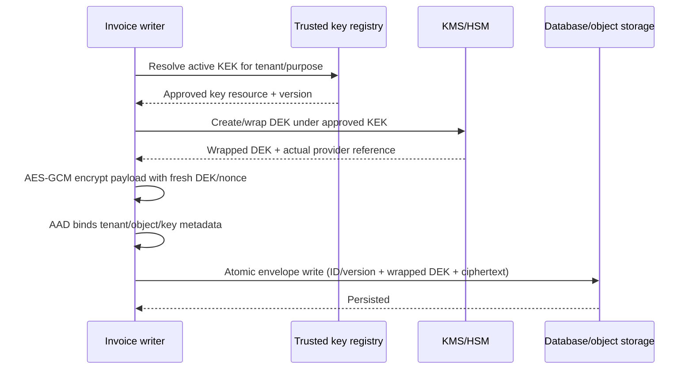
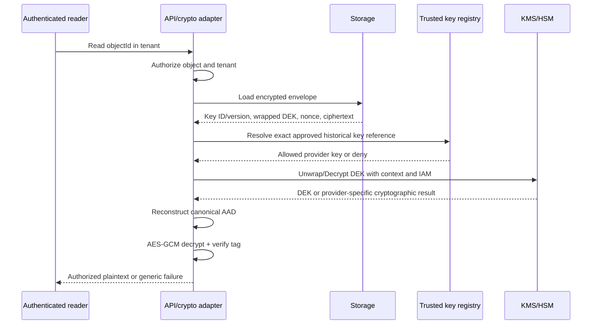
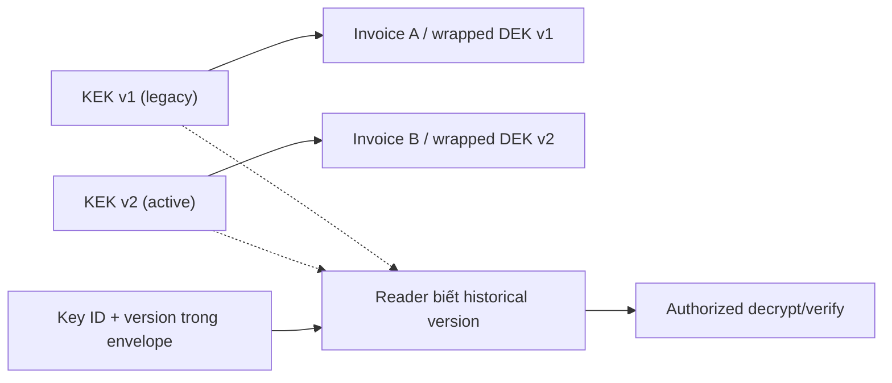
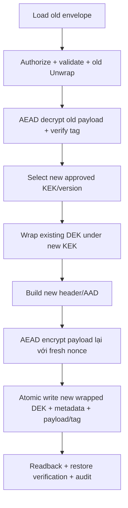
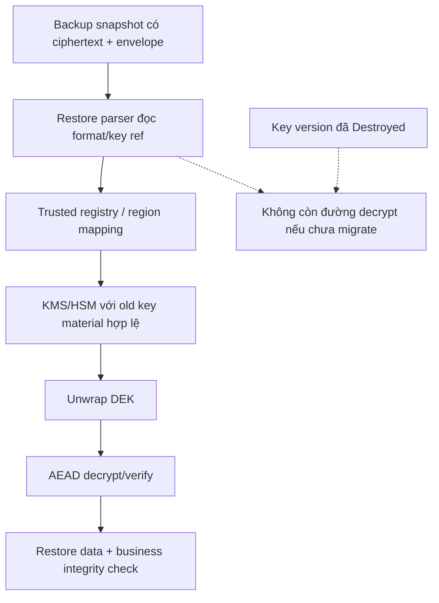

# Lưu key ID cùng ciphertext

## 1. Vì sao ciphertext cần đi kèm key ID?

**Lưu key ID cùng ciphertext** là thực hành ghi lại **định danh khóa hoặc tham chiếu khóa được quản lý** ngay trong *envelope* (bản ghi bao gói dữ liệu mã hóa), để hệ thống biết **cần tìm khóa nào khi giải mã**, kể cả sau khi đổi key version, di chuyển dữ liệu, phục hồi backup hoặc thay đổi deployment.

Điểm quan trọng: **key ID không phải key material**. Nó chỉ là một **thông tin định tuyến có thể công khai trong phạm vi được phép**. Một chuỗi như `billing/prod/invoice-kek` không phải 256 bit khóa AES và tự nó không cho phép gọi KMS `Decrypt`. Mật mã vẫn dựa trên **vật liệu bí mật được giữ an toàn**, thuật toán, kiểm tra toàn vẹn và authorization.

Hãy tưởng tượng một hóa đơn được mã hóa hôm nay bằng DEK, rồi DEK được bọc bởi KEK phiên bản `v4`. Sáu tháng sau, KEK mới `v5` được sử dụng cho hóa đơn mới. Nếu bản ghi cũ chỉ lưu ciphertext mà không lưu **KEK reference/version** hoặc một **wrapped DEK** chứa đủ thông tin tương đương, reader có thể không biết phải dùng khóa nào để mở dữ liệu lịch sử. Thử từng khóa cho tới khi “giải mã được” không phải chiến lược quản lý khóa có thể tin cậy.

Bài này thuộc chương **Envelope encryption** của module `SECURITY_KEY_MANAGEMENT_FUNDAMENTALS`. Mục tiêu module là hiểu vòng đời từ **sinh, cấp phát, lưu trữ, sử dụng, xoay vòng, thu hồi và hủy khóa**, kết nối mật mã đối xứng/bất đối xứng, chữ ký số, **KMS/HSM**, envelope encryption, IAM và kiểm toán. Lưu key ID/version đi cùng ciphertext là một chi tiết định dạng dữ liệu nhưng ảnh hưởng trực tiếp tới **rotation, tính toàn vẹn, khả năng khôi phục và blast radius khi xảy ra sự cố**.

### Sau bài học, bạn có thể

1. Phân biệt **key ID**, **key version**, **alias**, **key material**, **wrapped DEK** và **key reference** của provider.
2. Thiết kế một **encrypted envelope** có đủ trường để giải mã nhiều năm sau.
3. Hiểu vì sao **key ID không bí mật**, nhưng phải được **xác thực và ràng buộc với dữ liệu/tenant**.
4. Sử dụng **AAD (Additional Authenticated Data)** của AEAD để ràng buộc key metadata vào ciphertext; không tin metadata do client tự sửa.
5. Thiết kế **trusted key registry** và giới hạn quyền `Decrypt/Unwrap` bằng IAM, purpose và object-level authorization.
6. Phân biệt **application key version** với **version nội bộ của managed KMS key**, tránh khẳng định provider nào cũng cung cấp cùng API.
7. Lưu metadata và ciphertext **cùng một transaction/object** để tránh lệch phiên bản khi ghi, backup hoặc rewrap.
8. Viết ví dụ **Java 17 AES-GCM hai lớp (DEK/KEK)** có key ID/version, AAD canonical, kiểm thử tampering và key rotation.
9. Lập kế hoạch **rewrap, re-encrypt, restore, destroy** và xử lý khóa bị lộ hoặc metadata không còn đáng tin.
10. Kiểm tra lỗi thường gặp bằng **ma trận test và checklist production**.

## 2. Bài toán định tuyến khóa khi nhiều version cùng tồn tại

Xét chuỗi sự kiện sau:

| Thời điểm | Tác vụ | KEK dùng cho DEK | Dữ liệu lưu |
| --- | --- | --- | --- |
| Tháng 01 | Tạo hóa đơn A | `invoice-kek:v1` | Ciphertext A + wrapped DEK A |
| Tháng 04 | Rotate KEK | `invoice-kek:v2` | Hóa đơn cũ chưa tự đổi key |
| Tháng 05 | Tạo hóa đơn B | `invoice-kek:v2` | Ciphertext B + wrapped DEK B |
| Tháng 08 | Restore backup tháng 01 | **Vẫn cần v1** nếu chưa migrate | Reader phải xác định đúng version |
| Tháng 09 | Rewrap DEK A sang v2 | `invoice-kek:v2` | Thay wrapped DEK và metadata liên quan theo transaction |

**Alias `current` có thể trỏ sang v2**, nhưng điều đó không làm wrapped DEK A tự được bọc lại. Nếu giải mã hóa đơn A bằng cách luôn hỏi `current`, hệ thống có thể trả lỗi hoặc mất khả năng đọc lịch sử.

Đường đi đúng thường là:

1. Đọc envelope của A.
2. Lấy **key reference/version** đã lưu, hoặc để provider định tuyến theo opaque wrapped-key blob khi contract cho phép.
3. Xác thực key reference có thuộc **danh mục khóa đáng tin cho tenant/purpose** không.
4. Gọi KMS/HSM hoặc key registry tương ứng dưới quyền identity được xác thực.
5. Unwrap DEK, rồi AES-GCM decrypt với **nonce/tag và AAD** của chính envelope.
6. Kiểm tra authorization dữ liệu trước khi trả plaintext cho caller.

**Không sử dụng “thử từng key” làm mặc định.** Cách đó gây độ trễ, mở rộng oracle, khó audit, khó giới hạn số lần gọi KMS và có thể vô tình chấp nhận key sai mục đích.

### 2.1. Hai truy vấn cần hỗ trợ

**Từ ciphertext:** dùng khóa nào, phiên bản gì, format nào, dữ liệu thuộc tenant/object nào và còn đọc được không?

**Từ key/version:** những ciphertext, wrapped DEKs, bảng dữ liệu, archive, queue, backup và consumer nào còn phụ thuộc phiên bản ấy?

Muốn đánh giá **có được hủy KEK v1 hay không**, chỉ biết v2 đã active là không đủ; cần cả **dependency inventory** từ key version sang dữ liệu lịch sử.

## 3. Các khái niệm phải tách bạch

| Khái niệm | Ví dụ | Có phải bí mật? | Tác dụng |
| --- | --- | --- | --- |
| **Key material** | 32 byte AES key | **Có** | Thực hiện phép toán mã hóa/giải mã. |
| **Key ID** | `invoice-kek/prod` | Thường không | Xác định key object trong registry. |
| **Key version** | `v4` | Không | Phân biệt thế hệ/biến thể key material hoặc version ứng dụng. |
| **Key alias** | `invoice-kek/current` | Không | Tham chiếu có thể thay đích khi rotate. |
| **Provider key reference** | Resource ID hoặc URI/ARN KMS | Thường không | Định vị resource trong provider/account/region. |
| **DEK** | SecretKey AES-256 dùng cho hóa đơn A | **Có** | Mã hóa payload. |
| **KEK** | Khóa trong KMS để bọc DEK | **Có** | Bảo vệ DEK khi lưu. |
| **Wrapped DEK** | Bản mã có xác thực của DEK | Không phải secret dạng rõ | Lưu cạnh ciphertext; cần KEK để mở. |
| **Nonce/IV** | 12 byte cho AES-GCM | Thường không | Phải tuân thủ uniqueness dưới cùng key. |
| **AEAD tag** | Tag xác thực 128 bit | Không | Giúp phát hiện dữ liệu/AAD/key không khớp. |
| **AAD/context** | Tenant, object, schema, key metadata | Thường không | Xác thực ngữ cảnh khi decrypt. |
| **`kid` trong JWT/JWS** | Header nhận diện signing key | Không | Key-selection hint, **không chứng minh trust**. |

### 3.1. ID là con trỏ, không phải bằng chứng quyền sử dụng

Đọc được `keyId` không giúp kẻ tấn công tự sinh DEK hoặc giải mã AES nếu key material được bảo vệ đúng. Tuy nhiên, key ID có thể tiết lộ **kiến trúc, môi trường, khách hàng hoặc loại dữ liệu**, nên không công bố bừa bãi.

Quan trọng hơn, **không dùng key ID như mật khẩu**:

```text
SAI:
  Ai gửi keyId đúng thì hệ thống cho Decrypt.

ĐÚNG:
  Authenticated principal
       + business permission cho object/tenant
       + key policy/IAM
       + exact key reference được trusted registry duyệt
       + AEAD/wrapping authentication
  => mới tiếp tục decrypt.
```

### 3.2. Version không phải alias

`invoice-kek/current` thường là một **con trỏ mutable**. `invoice-kek:v4` là một phiên bản **được xác định tại thời điểm ghi** theo registry/hợp đồng provider.

Khi tạo dữ liệu mới, có thể giải alias `current` sang key/version đã duyệt. Sau đó cần **lưu danh tính thực tế đã dùng**, không chỉ lưu literal `current`, nếu định dạng và provider yêu cầu exact historical version.

**Ngoại lệ cần hiểu:** không phải cloud KMS nào cũng cho ứng dụng chọn hoặc nhìn thấy từng bản material version. Một **managed KMS key** có thể tự rotate material **bên trong** trong khi key ID logic không đổi; ciphertext blob của provider chứa thông tin mà KMS dùng để tìm đúng backing material. Trong trường hợp này:

- Lưu **logical key reference** và **opaque provider ciphertext/wrapped DEK** theo contract.
- Không tự bịa `version=v5` cho backing material không được provider expose.
- Nếu ứng dụng luân phiên **những key resources riêng** hoặc **các version do mình quản lý**, lưu exact app-level key reference/version.
- Giữ capability decrypt theo chính sách lưu trữ và verify restore trước retirement/destroy.

### 3.3. Key ID trong envelope là *claim*, không phải trust root

Bản ghi nằm trong object storage/DB có thể bị sửa bởi attacker có quyền ghi. Trường `keyId` từ ciphertext vì thế là **input chưa tin cậy**.

Hệ thống chỉ được dùng nó làm **gợi ý chọn khóa trong một tập khóa đã được duyệt**, sau khi kiểm tra tenant, environment, purpose, algorithm, ID format, registry và IAM. Không cho envelope chỉ tới bất kỳ URI KMS, secret path, URL JWKS hoặc provider account nào rồi tự động truy xuất.

## 4. Envelope cần chứa những gì?

Một envelope tốt chứa vừa đủ để **định tuyến và xác minh**, không chứa plaintext key:

```json
{
  "formatVersion": 2,
  "contentAlgorithm": "AES-256-GCM",
  "wrappingAlgorithm": "PROVIDER-KMS-WRAP",
  "kekReference": "billing/prod/invoice-kek",
  "kekVersion": "v4",
  "encryptedDek": "<opaque-provider-wrapped-dek>",
  "nonce": "<base64url-96-bit-nonce>",
  "ciphertextAndTag": "<base64url-aes-gcm-output>",
  "aadSchema": "invoice-v2",
  "tenantId": "tenant-01",
  "objectId": "INV-0042"
}
```

Các giá trị trong dấu `<...>` chỉ là placeholder. Ví dụ không đại diện cho định dạng của cloud KMS cụ thể.

**Tuyệt đối không lưu `rawDek`, `rawKek`, private signing key, HMAC secret hoặc password của keystore trong envelope**.

### 4.1. Field nào bắt buộc, field nào tùy giao thức?

| Field | Vai trò | Lưu ý |
| --- | --- | --- |
| `formatVersion` | Phân biệt format và parser | Không nhầm với **key version**. |
| `contentAlgorithm` | Suite AEAD của payload | Chỉ nhận allowlist; không tin thuật toán do client tùy ý chọn. |
| `wrappingAlgorithm` | Cách mã hóa/bọc DEK | Có thể do provider blob tự mô tả; không tự đoán. |
| `kekReference` / `keyId` | Định tuyến KEK hoặc data key | Kiểm tra registry/purpose/tenant trước KMS call. |
| `kekVersion` | Phiên bản material theo app/provider | **Có thể không có** nếu managed provider chỉ expose logical key ID. |
| `encryptedDek` | Raw DEK đã được bọc/mã hóa | Provider-native blob có thể chứa key metadata riêng. |
| `wrapNonce` | Nonce khi tự dùng AEAD để bọc DEK | Không bắt buộc trong AES-KW/KWP hoặc opaque provider blob. |
| `nonce` | Nonce/IV cho payload AEAD | Đúng độ dài, tránh reuse dưới cùng DEK. |
| `ciphertextAndTag` | Payload và authentication tag | Tag có thể lưu tách hoặc gộp theo format đã version. |
| `aadSchema` | Cách xây dựng AAD canonical | Cần tương thích qua migration. |
| `tenantId`, `objectId` | Ngữ cảnh nghiệp vụ | Phải đối chiếu với ngữ cảnh **đã xác thực** ở backend. |
| `createdAt` hoặc `rotationBatchId` | Truy vết, quản trị | Không nhất thiết tham gia mật mã; nếu an ninh phụ thuộc phải authenticate. |

Với **mã hóa trực tiếp bằng một data key tồn tại lâu**, không có wrapped DEK cho từng record, có thể lưu **dataKeyId + version** và nonce/tag. Với **envelope encryption**, thường cần **KEK reference + wrapped DEK**. Không giả định một record phải có cả DEK ID riêng và KEK ID riêng nếu hệ thống không quản lý DEK như resource độc lập.

### 4.2. Lưu tag tách hay gộp?

AES-GCM có **ciphertext và authentication tag**. Một số thư viện trả về `ciphertext || tag`, thư viện khác có trường tag riêng. Cả hai đều có thể đúng nếu **formatVersion** xác định rõ cách đọc, độ dài tag được policy cho phép và parser kiểm tra bounds.

Không tự cắt 16 byte cuối ciphertext nếu thuật toán/provider/tag length chưa được xác minh.

### 4.3. Có nên lưu raw metadata JSON trước và sau mã hóa?

JSON chỉ là **biểu diễn lưu trữ**. Nếu AAD được tính bằng bytes của JSON, cần canonical serialization thật sự (thứ tự field, Unicode, escaping, số, khoảng trắng và null). Không tự giả định hai object JSON có cùng ý nghĩa sẽ tạo **cùng byte sequence**.

Đơn giản và an toàn hơn là định nghĩa **AAD encoding cố định, có version và length prefix**, rồi decode metadata theo schema và tạo lại đúng bytes theo spec; hoặc dùng một canonical encoding được chuẩn hóa và triển khai nhất quán.

## 5. Luồng mã hóa và lưu key ID cùng ciphertext



### 5.1. Những bước bắt buộc phía writer

1. **Authorize write** đối với tenant/object.
2. Lấy **key reference từ trusted config/registry**, không dùng key ID tùy ý do client gửi.
3. Xác minh **purpose, algorithm, key state, region, environment** và quyền caller.
4. Tạo DEK ngẫu nhiên qua CSPRNG/KMS, hoặc chọn key schedule được phê duyệt.
5. Gọi KMS/HSM bọc DEK bằng KEK hoặc API tương đương; thu về wrapped DEK/opaque blob.
6. Sinh nonce AES-GCM theo chiến lược **không trùng dưới cùng DEK**.
7. Tạo **AAD canonical**, có domain separation và ràng buộc tenant/object/key metadata.
8. AEAD encrypt, lấy ciphertext/tag; không log raw DEK, KEK hay plaintext.
9. Ghi **toàn bộ envelope atomically**: key reference, wrapped DEK, nonce, ciphertext/tag và version/schema.
10. Log **metadata an toàn** (key ID/version, operation, principal, request ID) theo policy.

Không được tạo ciphertext bằng v4 nhưng lưu metadata nói v5 vì alias đã chuyển đích giữa bước giải alias và bước ghi. Nếu provider chỉ trả opaque blob, lưu **response metadata thực sự** theo contract, không suy đoán.

### 5.2. Khi nào một KEK/DEK mới được tạo?

Một chiến lược phổ biến: mỗi object hoặc mỗi batch có **DEK mới**; nhiều DEK được bọc bằng cùng **KEK được quản lý**. Điều này giảm blast radius khi lộ một DEK và đơn giản hóa nonce management.

Không có một granularity cố định cho mọi hệ thống. Quyết định dựa trên **data size, throughput, operation quotas, key lifetime, rotation và nhu cầu crypto-erasure**.

## 6. Luồng giải mã: key ID chỉ được dùng sau kiểm tra tin cậy



Điểm **fail closed**:

- Không tìm thấy key ID/version trong **trusted registry** → từ chối hoặc workflow phục hồi có kiểm soát.
- Key không thuộc môi trường/tenant/purpose → từ chối.
- Key đã `Disabled/Destroyed` hoặc không được phép decrypt lịch sử → từ chối theo policy.
- `wrapped DEK`, nonce, tag hoặc AAD không hợp lệ → từ chối, **không trả plaintext chưa xác thực**.
- Không có quyền IAM/biz authorization → từ chối; **không bỏ qua** bằng cách thử key khác.
- Dữ liệu hỏng/chưa đủ metadata → xử lý theo incident/data repair workflow, không tự phát minh key version.

### 6.1. Vì sao không tin tenantId nằm sẵn trong envelope?

Nếu attacker có quyền chỉnh record có thể thay `tenantId` từ A sang B. Backend phải so sánh tenant/object **đã xác thực từ request và domain model** với envelope. Ràng buộc AAD giúp phát hiện metadata bị thay so với ciphertext ban đầu, nhưng **AAD không thay thế authorization**.

Nếu server chỉ lấy tenant từ record rồi dùng nó để quyết định quyền, có thể tạo **confused-deputy** hoặc cross-tenant exposure. Quyền được quyết định từ **caller authenticated + resource ownership** trước khi unwrap.

### 6.2. Không gửi key ID thẳng vào một endpoint bất kỳ

Không cho dữ liệu lưu trữ tùy ý chỉ định:

- URL của KMS/secret manager do attacker kiểm soát.
- `kid`/`jku`/`x5u` không có allowlist để tải public key/secret.
- Account/region/tenant khác ngoài trusted registry.
- Một key thuộc purpose `jwt-signing` để thử unwrap DEK.

Các trường envelope **chỉ là dữ liệu cần kiểm tra**, không phải lệnh cấu hình IAM hoặc network routing.

## 7. Ràng buộc key ID/version bằng AAD để ngăn metadata substitution

Khi mã hóa bằng AEAD, **AAD** cho phép một số bytes **không mã hóa** nhưng được **xác thực** cùng ciphertext. Đây là cơ chế thích hợp để ràng buộc metadata như `keyId`, `keyVersion`, `tenantId` và `objectId` vào dữ liệu.

### 7.1. Nếu không ràng buộc metadata có thể xảy ra gì?

Giả sử hai tenants dùng hai KEK khác nhau. Attacker sửa field `keyId` hoặc `tenantId` của record:

- Nếu key ID mới không có quyền hoặc DEK không unwrap được, thao tác phải thất bại.
- Nhưng nếu ứng dụng có **fallback, thử nhiều keys hoặc bỏ qua tenant authorization**, metadata bị sửa có thể gây confusion, oracle, misuse hoặc access path ngoài dự kiến.
- Dù ciphertext có tag GCM, **tag chỉ xác thực AAD mà bạn thực sự cung cấp** và plaintext/ciphertext dưới key tương ứng. Nếu không đưa metadata cần bảo vệ vào AAD hoặc key wrapping context, không thể dựa vào tag để khẳng định metadata đó không bị thay.

Lợi ích của authenticated metadata: **thay key ID/version/tenant/object mà không có quyền sẽ làm verify/decrypt thất bại** trong thiết kế đúng và giúp phát hiện record tampering.

### 7.2. Không đưa mọi thứ vào AAD một cách tùy tiện

AAD nên bao gồm **những thuộc tính có ảnh hưởng đến ngữ nghĩa an toàn**, ví dụ:

```text
domain = "invoice-payload/v2"
formatVersion = 2
contentAlgorithm = "AES-256-GCM"
wrappingAlgorithm = "provider-kms-wrap"
kekReference = "billing/prod/invoice-kek"
kekVersion = "v4"
tenantId = "tenant-01"
objectId = "INV-0042"
```

Cần xác định rõ **key ID/version của KEK** có tham gia AAD nào:

- **Payload AEAD AAD:** xác thực quan hệ ciphertext–tenant/object–envelope metadata.
- **Wrapping AEAD AAD hoặc KMS encryption context:** xác thực quan hệ wrapped DEK–tenant/object–KEK reference theo capability provider.
- **Key registry/IAM:** kiểm tra key thực sự được duyệt và caller có quyền.

Nếu tham chiếu KEK nằm trong payload AAD, **rewrap sang KEK mới phải cập nhật payload authentication**. Không thể chỉ thay header và wrapped DEK mà không cập nhật AEAD tag hoặc mã hóa lại payload theo sơ đồ. Đây là đánh đổi thiết kế quan trọng.

### 7.3. Hai phương án AAD và hệ quả rewrap

| Phương án | Payload AAD chứa | Khi rewrap DEK |
| --- | --- | --- |
| **A. Bind full envelope header** | Tenant, object, format, **KEK ID/version**, thuật toán | Thay KEK ref/version → cần **xác thực/mã hóa lại payload** để tag khớp (hoặc cơ chế authenticated header update được thiết kế riêng). |
| **B. Separate immutable data context** | Tenant, object, content suite, stable data ID/DEK context; **không chứa KEK ref mutable** | Có thể chỉ rewrap DEK và cập nhật **wrapping-authenticated metadata**, giữ payload ciphertext/tag nếu DEK/AAD payload giữ nguyên. |

**Không có một phương án đúng cho mọi mục tiêu.** Nếu yêu cầu **rewrap nhanh không decrypt toàn bộ payload**, phương án B thường thuận lợi hơn, nhưng phải **authenticate riêng** KEK reference, key version, wrapped DEK và mối liên hệ với data context. Nếu không, attacker có thể thay header mà hệ thống không phát hiện cho đến bước unwrap.

Trong ví dụ Java bên dưới, để người học thấy rõ tính liên kết, ta chọn **phương án A**: cùng header được authenticated trong cả bước wrap và mã hóa payload. Vì vậy ví dụ **không tuyên bố hỗ trợ rewrap chỉ bằng thay `wrappedDek`**; migration phải kiểm tra và tạo lại payload/tag đúng cách.

### 7.4. AAD có thể công khai nhưng phải canonical

AAD không cần bí mật; cần **cùng bytes khi mã hóa và giải mã**. Tránh nối chuỗi không phân tách:

```text
"tenant=" + tenant + "|object=" + object
```

nếu các giá trị có thể chứa `|`, Unicode hoặc encoding bất định. Các phương án tốt hơn: **length-prefix**, binary schema có version, hoặc canonical CBOR/JSON theo một specification duy nhất và có kiểm thử xuyên ngôn ngữ.

Không “sửa format” rồi bỏ AAD cũ để giải mã dữ liệu lịch sử; phải version và hỗ trợ migration rõ ràng.

## 8. Lưu trữ envelope sao cho key ID không bị lệch ciphertext

### 8.1. Cùng record/object hay bảng riêng?

Có thể lưu metadata:

1. **Trong cùng object/blob** với ciphertext, ví dụ JSON/CBOR/binary envelope.
2. **Trong cùng hàng database**: `key_id`, `key_version`, `wrapped_dek`, `nonce`, `ciphertext`.
3. **Trong bảng metadata riêng**, liên kết bằng object ID/version với transaction hoặc consistency protocol được chứng minh.
4. **Trong metadata của object storage**, nếu giới hạn kích thước, đồng bộ và integrity được bảo đảm.

**Khuyến nghị:** key ref và dữ liệu mã hóa nên được xem là **một đơn vị logic có version**, ghi/đổi **atomically** khi có thể. Không cho bảng metadata ghi v5 nhưng bảng ciphertext vẫn chứa payload/tag dùng AAD v4.

### 8.2. Bản ghi có hai loại version

Ví dụ một row:

```sql
CREATE TABLE encrypted_invoices (
    tenant_id          VARCHAR(128) NOT NULL,
    object_id          VARCHAR(128) NOT NULL,
    record_version     BIGINT NOT NULL,
    format_version     INTEGER NOT NULL,
    content_algorithm  VARCHAR(64) NOT NULL,
    kek_reference      VARCHAR(512) NOT NULL,
    kek_version        VARCHAR(128),
    wrapped_dek        BYTEA NOT NULL,
    wrap_nonce         BYTEA,
    data_nonce         BYTEA NOT NULL,
    ciphertext_tag     BYTEA NOT NULL,
    aad_schema         VARCHAR(64) NOT NULL,
    PRIMARY KEY (tenant_id, object_id)
);
```

- `record_version`: optimistic locking/transaction version của dữ liệu nghiệp vụ.
- `format_version`: version của encoder/parser envelope.
- `kek_version`: version khóa theo thiết kế.
- `aad_schema`: version chuẩn hóa ngữ cảnh xác thực.

**Không gộp cả bốn thành một trường `version` không rõ nghĩa.**

### 8.3. Transaction và optimistic concurrency

Khi rewrap hoặc đổi định dạng:

```sql
UPDATE encrypted_invoices
SET kek_reference = :new_kek_ref,
    kek_version = :new_kek_version,
    wrapped_dek = :new_wrapped_dek,
    wrap_nonce = :new_wrap_nonce,
    ciphertext_tag = :new_ciphertext_and_tag,
    record_version = record_version + 1
WHERE tenant_id = :tenant_id
  AND object_id = :object_id
  AND record_version = :expected_record_version;
```

Đây là **SQL minh họa** cho phương án A của mục 7 (cần cập nhật payload authentication nếu AAD có KEK reference). **Payload ciphertext/tag phải được tạo lại đúng cách** trước khi update. Nếu không muốn đọc/re-encrypt toàn bộ payload, dùng phương án AAD B có authenticated wrap context độc lập và schema/transaction tương ứng.

**Không cập nhật `kek_version` trước rồi mới cập nhật wrapped DEK ở transaction khác**; lỗi giữa chừng sẽ tạo record không giải mã được.

### 8.4. Parser và encoding

Khi đọc envelope từ untrusted storage, phải:

- Kiểm tra **formatVersion được hỗ trợ** và reject unknown critical fields.
- Giới hạn kích thước chuỗi ID, array, ciphertext và wrapped DEK trước allocate/API call.
- Kiểm tra Base64url/canonical form khi áp dụng; không coi mọi chuỗi decode được là hợp lệ.
- Không cho parser tùy ý cấp phát bộ nhớ theo length field do attacker cung cấp.
- Kiểm tra AEAD nonce/tag length và **exact algorithm allowlist**.
- Không tự động chạy migration với record chưa qua authorization/integrity checks.
- Không log toàn bộ untrusted payload hoặc plaintext khi lỗi.

## 9. Ví dụ Java 17: AES-GCM hai lớp với key ID/version và AAD

Ví dụ dưới đây chạy độc lập bằng **Java 17+** và provider hỗ trợ AES-256-GCM. Nó cố ý không gọi cloud KMS thật, nhưng mô phỏng ý tưởng **key registry đáng tin**: ứng dụng ghi lại `keyId` và `keyVersion` vào envelope, sinh DEK mới bằng `KeyGenerator`, dùng một **KEK version** để mã hóa DEK, và dùng DEK cho payload.

**Đây là demo giáo dục**: KEK tồn tại trong process để minh họa. **Production nên thay registry local bằng KMS/HSM/secret-manager strategy được quản trị**, dùng wrapping API/suite do provider hỗ trợ, không xuất raw KEK vào ứng dụng.

### 9.1. Source: `KeyIdWithCiphertextDemo.java`

```java
import java.io.ByteArrayOutputStream;
import java.io.DataOutputStream;
import java.io.IOException;
import java.nio.charset.StandardCharsets;
import java.security.GeneralSecurityException;
import java.security.MessageDigest;
import java.security.SecureRandom;
import java.util.Arrays;
import java.util.HashMap;
import java.util.Map;
import java.util.Objects;
import javax.crypto.AEADBadTagException;
import javax.crypto.Cipher;
import javax.crypto.KeyGenerator;
import javax.crypto.SecretKey;
import javax.crypto.spec.GCMParameterSpec;
import javax.crypto.spec.SecretKeySpec;

public final class KeyIdWithCiphertextDemo {
    static final SecureRandom RNG = new SecureRandom();
    static final String CONTENT_ALG = "AES-256-GCM";
    static final String WRAP_ALG = "AES-256-GCM-DEK-WRAP-DEMO";
    static final int NONCE_BYTES = 12;
    static final int GCM_TAG_BITS = 128;
    static final int VERSION = 1;
    static final String KEK_ID = "billing/prod/invoice-kek";

    // Composite identity: không ghép string mơ hồ.
    record KeyRef(String id, String version) {}

    record Header(
        int formatVersion,
        String kekId,
        String kekVersion,
        String contentAlgorithm,
        String wrappingAlgorithm,
        String tenantId,
        String objectId
    ) {}

    record Envelope(
        Header header,
        byte[] wrapNonce,
        byte[] wrappedDek,
        byte[] dataNonce,
        byte[] ciphertextAndTag
    ) {}

    static final class TrustedKeyRegistry {
        private final Map<KeyRef, SecretKey> keys = new HashMap<>();

        void add(KeyRef ref, SecretKey kek) {
            keys.put(ref, kek);
        }

        SecretKey requireApproved(KeyRef ref)
                throws GeneralSecurityException {
            SecretKey key = keys.get(ref);
            if (key == null) {
                throw new GeneralSecurityException(
                    "Exact key reference is not approved/available"
                );
            }
            return key;
        }
    }

    static SecretKey newAes256Key() throws GeneralSecurityException {
        KeyGenerator gen = KeyGenerator.getInstance("AES");
        gen.init(256, RNG);
        return gen.generateKey();
    }

    static byte[] newNonce() {
        byte[] iv = new byte[NONCE_BYTES];
        RNG.nextBytes(iv);
        return iv;
    }

    // Canonical length-prefix encoding, không phụ thuộc JSON key order.
    static void field(DataOutputStream out, String value)
            throws IOException {
        byte[] utf8 = value.getBytes(StandardCharsets.UTF_8);
        out.writeInt(utf8.length);
        out.write(utf8);
    }

    static byte[] aad(String domain, Header header)
            throws IOException {
        ByteArrayOutputStream buffer = new ByteArrayOutputStream();
        try (DataOutputStream out = new DataOutputStream(buffer)) {
            field(out, domain);
            out.writeInt(header.formatVersion());
            field(out, header.contentAlgorithm());
            field(out, header.wrappingAlgorithm());
            field(out, header.kekId());
            field(out, header.kekVersion());
            field(out, header.tenantId());
            field(out, header.objectId());
        }
        return buffer.toByteArray();
    }

    static byte[] aesGcmEncrypt(
        SecretKey key, byte[] nonce, byte[] plaintext, byte[] aad
    ) throws GeneralSecurityException {
        Cipher cipher = Cipher.getInstance("AES/GCM/NoPadding");
        cipher.init(Cipher.ENCRYPT_MODE, key,
            new GCMParameterSpec(GCM_TAG_BITS, nonce));
        cipher.updateAAD(aad);
        return cipher.doFinal(plaintext);
    }

    static byte[] aesGcmDecrypt(
        SecretKey key, byte[] nonce, byte[] ciphertext, byte[] aad
    ) throws GeneralSecurityException {
        Cipher cipher = Cipher.getInstance("AES/GCM/NoPadding");
        cipher.init(Cipher.DECRYPT_MODE, key,
            new GCMParameterSpec(GCM_TAG_BITS, nonce));
        cipher.updateAAD(aad);
        return cipher.doFinal(ciphertext);
    }

    static Envelope encrypt(
        TrustedKeyRegistry registry,
        KeyRef selectedKek,
        String tenantId,
        String objectId,
        byte[] plaintext
    ) throws Exception {
        // Production: selectedKek phải được trusted registry/IAM duyệt,
        // không lấy từ untrusted user input.
        SecretKey kek = registry.requireApproved(selectedKek);
        Header header = new Header(
            VERSION, selectedKek.id(), selectedKek.version(),
            CONTENT_ALG, WRAP_ALG, tenantId, objectId
        );

        SecretKey dek = newAes256Key();
        byte[] rawDek = dek.getEncoded();
        if (rawDek == null || rawDek.length != 32) {
            throw new GeneralSecurityException("DEK not exportable in demo");
        }

        try {
            // Hai key khác nhau: KEK cho wrapped DEK, DEK cho payload.
            byte[] wrapNonce = newNonce();
            byte[] wrappedDek = aesGcmEncrypt(
                kek, wrapNonce, rawDek, aad("dek-wrap/v1", header)
            );

            byte[] dataNonce = newNonce();
            byte[] dataCiphertext = aesGcmEncrypt(
                dek, dataNonce, plaintext, aad("payload/v1", header)
            );

            return new Envelope(
                header, wrapNonce, wrappedDek,
                dataNonce, dataCiphertext
            );
        } finally {
            Arrays.fill(rawDek, (byte) 0);
        }
    }

    static byte[] decrypt(
        TrustedKeyRegistry registry,
        Envelope envelope,
        String expectedTenantId,
        String expectedObjectId
    ) throws Exception {
        Header header = envelope.header();

        // Không chấp nhận thuật toán/format/key arbitrary từ DB.
        if (header.formatVersion() != VERSION
                || !CONTENT_ALG.equals(header.contentAlgorithm())
                || !WRAP_ALG.equals(header.wrappingAlgorithm())
                || !KEK_ID.equals(header.kekId())) {
            throw new GeneralSecurityException(
                "Unsupported or untrusted envelope header"
            );
        }

        // expectedTenant/Object phải đến từ authenticated domain data.
        if (!Objects.equals(expectedTenantId, header.tenantId())
                || !Objects.equals(expectedObjectId, header.objectId())) {
            throw new GeneralSecurityException(
                "Authenticated object context mismatch"
            );
        }

        if (envelope.wrapNonce().length != NONCE_BYTES
                || envelope.dataNonce().length != NONCE_BYTES
                || envelope.wrappedDek().length < 16
                || envelope.ciphertextAndTag().length < 16) {
            throw new GeneralSecurityException("Invalid envelope lengths");
        }

        KeyRef exactRef = new KeyRef(
            header.kekId(), header.kekVersion()
        );
        SecretKey kek = registry.requireApproved(exactRef);

        byte[] rawDek = aesGcmDecrypt(
            kek, envelope.wrapNonce(), envelope.wrappedDek(),
            aad("dek-wrap/v1", header)
        );
        try {
            if (rawDek.length != 32) {
                throw new GeneralSecurityException(
                    "Unwrapped DEK has invalid size"
                );
            }
            SecretKey dek = new SecretKeySpec(rawDek, "AES");
            return aesGcmDecrypt(
                dek, envelope.dataNonce(),
                envelope.ciphertextAndTag(),
                aad("payload/v1", header)
            );
        } finally {
            Arrays.fill(rawDek, (byte) 0);
        }
    }

    public static void main(String[] args) throws Exception {
        TrustedKeyRegistry registry = new TrustedKeyRegistry();
        registry.add(new KeyRef(KEK_ID, "v1"), newAes256Key());
        registry.add(new KeyRef(KEK_ID, "v2"), newAes256Key());

        // Rotation: writer dùng v2; reader vẫn có thể hỗ trợ v1.
        KeyRef active = new KeyRef(KEK_ID, "v2");
        byte[] plaintext = "invoice=INV-42;amount=1000"
            .getBytes(StandardCharsets.UTF_8);

        Envelope stored = encrypt(
            registry, active, "tenant-01", "INV-42", plaintext
        );
        byte[] result = decrypt(
            registry, stored, "tenant-01", "INV-42"
        );

        System.out.println("Stored KEK ID: "
            + stored.header().kekId());
        System.out.println("Stored version: "
            + stored.header().kekVersion());
        System.out.println("Decrypt matches: "
            + MessageDigest.isEqual(plaintext, result));

        // Đánh tráo version từ v2 sang v1 -> unwrap tag sai.
        Header changedHeader = new Header(
            VERSION, KEK_ID, "v1", CONTENT_ALG, WRAP_ALG,
            "tenant-01", "INV-42"
        );
        Envelope altered = new Envelope(
            changedHeader, stored.wrapNonce(), stored.wrappedDek(),
            stored.dataNonce(), stored.ciphertextAndTag()
        );
        boolean wrongVersionRejected = false;
        try {
            decrypt(registry, altered, "tenant-01", "INV-42");
        } catch (AEADBadTagException expected) {
            wrongVersionRejected = true;
        }
        System.out.println("Wrong version rejected: "
            + wrongVersionRejected);

        // Đổi object context từ INV-42 sang INV-99 -> fail closed.
        boolean wrongObjectRejected = false;
        try {
            decrypt(registry, stored, "tenant-01", "INV-99");
        } catch (GeneralSecurityException expected) {
            wrongObjectRejected = true;
        }
        System.out.println("Wrong object rejected: "
            + wrongObjectRejected);

        // Cố tình sửa payload ciphertext -> AEAD tag không khớp.
        byte[] tampered = stored.ciphertextAndTag().clone();
        tampered[0] ^= 1;
        boolean tamperRejected = false;
        try {
            decrypt(
                registry,
                new Envelope(stored.header(), stored.wrapNonce(),
                    stored.wrappedDek(), stored.dataNonce(), tampered),
                "tenant-01", "INV-42"
            );
        } catch (AEADBadTagException expected) {
            tamperRejected = true;
        }
        System.out.println("Tampered payload rejected: "
            + tamperRejected);

        Arrays.fill(plaintext, (byte) 0);
        Arrays.fill(result, (byte) 0);
        Arrays.fill(tampered, (byte) 0);
    }
}
```

Chạy từ terminal với Java 17+:

```bash
javac KeyIdWithCiphertextDemo.java
java KeyIdWithCiphertextDemo
```

Output dự kiến:

```text
Stored KEK ID: billing/prod/invoice-kek
Stored version: v2
Decrypt matches: true
Wrong version rejected: true
Wrong object rejected: true
Tampered payload rejected: true
```

### 9.2. Những điểm demo thể hiện

- **Có registry/key ring** giữ hai KEK versions. Dữ liệu mới dùng v2, dữ liệu cũ vẫn có thể cần v1.
- **Header** chứa KEK ID, exact version, algorithm, tenant và object.
- **Hai lớp AEAD khác nhau:** KEK mã hóa DEK; DEK mã hóa payload. Nonce được cấp riêng cho từng phép toán dưới từng key.
- **Canonical AAD có length prefix và domain separation** giữa `dek-wrap/v1` và `payload/v1`.
- **Tampered version** không bị chấp nhận chỉ vì registry có một key tên v1.
- **Caller object context** phải khớp envelope; mismatch bị từ chối.
- **Tag invalid** không cho plaintext; code không thử tất cả KEKs.
- Không log raw KEK/DEK, không có secret key hardcode.

### 9.3. Giới hạn của demo và bước production hóa

1. **Không có KMS/HSM thật:** KEK nằm trong Java memory. Dùng cloud/provider API để bảo vệ KEK lớn, key policy và audit.
2. **Không có serialization/persistence thật:** record `Envelope` đại diện cho các trường phải lưu. Production cần schema có limits, canonical encoding và atomic writes.
3. **Không có object authorization:** `expectedTenantId` và `expectedObjectId` phải đến từ authenticated caller, resource ownership và policy, không do client gửi tùy tiện.
4. **Không có defensive copies trong record arrays:** các `byte[]` mutable; production DTO/parser cần copy/validate và tránh aliasing/TOCTOU.
5. **Random 96-bit GCM nonce:** phải tuân thủ usage bounds, multi-instance uniqueness và key rotation; không tuyên bố collision impossible.
6. **DEK raw bytes:** `getEncoded()` và `SecretKeySpec` chỉ để minh họa in-process wrapping; KMS SDK/KeyHandle có contract khác, tránh export material không cần thiết.
7. **Two-layer AES-GCM demo:** production có thể chọn **AES-KW/KWP hoặc KMS-native wrapping**, không tự viết wrapper tùy tiện. Dùng nguyên tắc nonce/AAD đúng nếu wrapping bằng AEAD.
8. **KEK ID hardcoded trong demo chỉ là public reference**, không phải KEK secret; production có thể đọc từ registry/config có quản trị.
9. **Không có retention/rotation migration:** nếu đổi KEK header theo ví dụ này, payload AAD thay đổi; phải xác thực/mã hóa lại payload chứ không chỉ thay wrapped DEK.
10. **Không có metrics, quotas, retries hoặc DR:** bắt buộc bổ sung theo SLA, provider semantics và threat model.
11. **Không có zeroization tuyệt đối:** `Arrays.fill` giảm lifetime vài mảng, không đảm bảo mọi bản copy của key material đã biến mất trong JVM/provider.
12. **Không nên phân biệt lỗi chi tiết cho client:** thông báo nội bộ có thể phục vụ audit, nhưng response công khai nên hạn chế key enumeration và oracle.

## 10. Key ID và key version khi rotation

Rotation thường gồm hai thời kỳ khác nhau:

- **Originator use:** key/version được phép tạo ciphertext, wrapped DEK hoặc chữ ký mới.
- **Recipient use:** key/version vẫn được dùng để decrypt/unwrap/verify dữ liệu lịch sử theo retention.



### 10.1. Kế hoạch cutover

1. **Tạo KEK mới** hoặc cấu hình managed rotation theo provider.
2. **Provision permissions/registry:** writer có quyền dùng active key mới, reader có đường legacy decrypt đúng policy.
3. **Tạo envelope mới:** ghi reference/version thực tế và data/wrap context.
4. **Theo dõi logs:** bảo đảm không còn `Wrap` mới bằng key đã retire cho new use.
5. **Migrate historical data nếu cần:** rewrap hoặc re-encrypt theo sơ đồ AAD và key hierarchy.
6. **Khôi phục thử backup:** dữ liệu lưu với metadata cũ vẫn đọc được.
7. **Giảm quyền legacy:** thu hồi unnecessary grants khi dependencies hết.
8. **Chỉ destroy** nếu tất cả dữ liệu bắt buộc giữ và bản sao/backup đã xử lý theo destruction policy.

### 10.2. Version nội bộ provider khác app version

Một số managed KMS tự giữ nhiều backing key materials trong một key resource. Provider ciphertext có thể tự nhận biết generation cũ, **không expose keyVersion tương đương `v1/v2`** cho ứng dụng.

Đừng làm mất dữ liệu do tự tạo một version field rồi dùng field ấy thay logic của provider. Cần phân biệt:

- **Logical KMS resource ID**, có thể ổn định qua managed rotation.
- **Application key set version**, ví dụ khi tạo một KMS resource mới.
- **Internal key-material generation**, có thể chỉ provider biết.
- **Envelope format version**, chỉ quy định parser/encoding.
- **Data record version**, dùng optimistic concurrency.

Tài liệu nghiệp vụ cần mô tả rõ mỗi version có nghĩa gì.

### 10.3. Alias current dùng ở đâu?

- **Encrypt new:** có thể sử dụng trusted alias/current pointer đã được policy duyệt.
- **Decrypt historical:** dùng exact reference/opaque provider blob tương thích; không mặc định alias current.
- **Audit:** lưu resolved key resource/operation ID khi provider trả được; alias đơn thuần không phải bằng chứng material thế hệ nào được dùng.
- **Recovery:** sau migration/repoint alias vẫn cần cách resolve tài liệu cũ.

## 11. Rewrap và re-encrypt khi metadata được xác thực

Một lỗi thiết kế phổ biến là: “vì DEK không đổi, chỉ cần thay `keyId` và `wrappedDek` trong DB”.

Điều đó **chỉ đúng khi key wrapping và payload authentication cho phép**; nếu payload AAD có chứa old KEK ID/version, tag hiện tại sẽ **không còn hợp lệ** sau khi đổi header.

### 11.1. Quy trình rewrap theo phương án A (full header AAD)



Có thể giữ cùng DEK nếu không bị lộ và policy cho phép; **nếu mã hóa lại payload bằng cùng DEK thì phải dùng nonce mới**. Đừng lấy ciphertext cũ và tự tính “tag mới” bằng một thao tác không được API/protocol cho phép.

### 11.2. Rewrap nhanh theo phương án B (stable payload AAD)

Nếu payload AAD **không phụ thuộc mutable KEK metadata**, có thể:

- Giữ nguyên DEK và ciphertext/tag.
- Mở wrapped DEK cũ bằng KEK cũ đã được phê duyệt.
- Bọc lại DEK bằng KEK mới.
- Cập nhật **wrapping AAD/context** bao gồm stable data ID/tenant và key metadata mới.
- Ghi atomically wrapped DEK mới và authenticated wrapping header.

Nhưng phải thiết kế chuẩn để **không cho attacker đổi wrapped DEK giữa hai objects/tenants**. Metadata liên quan đến quyền và tính toàn vẹn phải được xác thực bằng wrapping layer và/hoặc một authenticated manifest.

### 11.3. Khi phải re-encrypt bằng DEK mới?

- DEK cũ bị lộ hoặc có entropy thấp.
- Thuật toán/nonce strategy cũ không còn đáp ứng chính sách.
- Cần thay đổi key granularity hoặc crypto policy.
- Rủi ro từ việc lạm dụng DEK cũ khiến giữ nó là không phù hợp.

**Rewrap KEK không làm DEK bị lộ trở nên bí mật lại**. Nếu attacker đã có raw DEK/ciphertext, họ vẫn có thể decrypt các ciphertext cũ đã thu thập.

### 11.4. Đổi metadata có thể yêu cầu migration payload

Khi `tenantId` hoặc `objectId` của dữ liệu thay đổi, nếu các giá trị đó nằm trong payload AAD, chỉ cập nhật cột DB sẽ làm decrypt thất bại. Tùy chính sách, có thể cần decrypt/verify và encrypt lại với AAD mới, hoặc thiết kế stable immutable object ID để tránh các migration không cần thiết.

## 12. KMS/HSM integration: không dựa vào một format chung tưởng tượng

### 12.1. Provider-native ciphertext có thể tự chứa key reference

Một số KMS trả **encrypted data key** dưới dạng opaque ciphertext blob, nơi provider đã nhúng metadata để nhận biết key resource/generation khi decrypt. Khi đó có thể:

- Lưu nguyên **opaque blob** do KMS trả.
- Lưu **logical key reference** để audit, policy enforcement, DR/migration nếu hữu ích.
- Không phân tích/sửa thủ công nội dung blob ngoài API chính thức.
- Xem tài liệu provider để biết có phải truyền `keyId` khi decrypt và encryption context nào bắt buộc không.

**Không đảm bảo mọi KMS cho chọn `v3` trực tiếp hoặc cho đọc internal key-material version.** Nếu KMS tự rotate, logical key ID có thể giữ nguyên.

### 12.2. Provider-enforced encryption context

Một số dịch vụ KMS hỗ trợ **encryption context/AAD** cho phép ràng buộc thêm tenant/object/purpose. Nếu dùng, cần:

- Xây dựng context từ **authenticated domain data**, không từ raw client metadata.
- Lưu/khôi phục context đầy đủ để decrypt.
- Chuẩn hóa kiểu/encoding, tránh whitespace, Unicode và case mismatch.
- Không đưa secret/PII không cần thiết vào context/logs; một số context có thể hiển thị trong audit.
- Kiểm tra provider có áp dụng context cho **đúng operation/key type** không.

Encryption context là một lớp bảo vệ, **không thay IAM và authorization dữ liệu**.

### 12.3. BYOK/imported material

Nếu KEK được sinh bên ngoài và import, bản gốc có thể tồn tại ở HSM hoặc backup khác. Lưu key ID/provider reference trong envelope không nói rằng **mọi copy key material** đã được kiểm soát. Inventory cần ghi source/custody và scope của từng bản sao.

Hủy imported key tại một KMS không tự hủy bản raw material vẫn nằm ở hệ thống nguồn.

### 12.4. KMS key policy và crypto broker

Nếu service nghiệp vụ gọi qua `crypto-broker`, audit KMS có thể chỉ nhìn thấy principal của broker. Phải có đường attribution:

```text
Authenticated caller
    -> broker policy (tenant/object/purpose)
    -> KMS principal + exact key resource
    -> provider operation ID
    -> audit correlation ID
```

Không tin một header `X-Service-Name` không xác thực để quyết định ai được phép chọn key ID.

## 13. Bảo mật key ID/metadata: không bí mật nhưng cũng không vô hại

### 13.1. Metadata disclosure

Một key ID như `finance/acquirer-xyz/prod/top-secret-accounts` có thể tiết lộ khách hàng, environment hoặc business classification. Kể cả không đủ để decrypt, việc public nó có thể giúp attacker lập bản đồ hệ thống.

Nên:

- Chọn opaque IDs hoặc tên vừa đủ để quản trị.
- Không đưa account/project/region nhạy cảm vào public URLs nếu không cần.
- Phân quyền truy cập ciphertext inventory, key registry và audit metadata.
- Không dùng security-through-obscurity: key ID bí mật **không thay thế** IAM.

### 13.2. Metadata integrity và availability

Một attacker có quyền sửa metadata có thể không decrypt được, nhưng có thể:

- Làm hệ thống gửi request tới key không tồn tại → gây **DoS**.
- Gây lượng KMS lookups lớn → quota/cost exhaustion.
- Chuyển record vào version cũ gây log noise/incident.
- Làm mất khả năng restore vì field key ID không còn.
- Nếu application chọn khóa/tenant sai, tạo **confused deputy**.

Giải pháp: authenticated metadata, trusted registry, parser limits, access control, rate-limit và audit; không chỉ dựa vào AEAD tag.

### 13.3. Key ID cho phép route, nhưng không cho phép enumerate

Không trả cho client các lỗi như:

```text
Key billing/prod/customer-123/v4 exists but you cannot Decrypt it.
```

nếu không cần thiết. Có thể trả lỗi chung, còn bên trong lưu mã lỗi, request ID và key reference đã được phân quyền. Tránh biến decrypt API thành **key existence oracle**.

## 14. Multi-tenant: key ID phải gắn với tenant/object được xác thực

### 14.1. Key-per-tenant và shared KEK

Hai mô hình đều tồn tại:

| Mô hình | Lợi thế | Rủi ro/điều kiện |
| --- | --- | --- |
| **KEK riêng mỗi tenant** | Dễ giới hạn blast radius và quyền | Quản lý nhiều key, quotas/cost, lifecycle |
| **KEK dùng chung có domain/context** | Ít key resources, vận hành đơn giản hơn | Blast radius lớn hơn, bắt buộc object-level auth và context binding |
| **DEK riêng mỗi object** | Khoanh vùng ciphertext khi lộ DEK | Nhiều wrapped DEKs và operation/audit |
| **DEK riêng mỗi batch/partition** | Cân bằng hiệu năng và độ phức tạp | Lộ key ảnh hưởng nhiều records trong batch |

Không có thiết kế bắt buộc chung cho mọi tenant. Quan trọng là registry và IAM phản ánh **quyền thật**, không chỉ naming convention.

### 14.2. Luồng xác minh multi-tenant

1. Đọc caller identity từ authentication layer.
2. Xác định tenant được phép và kiểm tra object ownership trong DB/domain.
3. Load envelope của **đúng object**.
4. Đối chiếu `tenantId/objectId` với ngữ cảnh đã kiểm chứng.
5. Tra `keyId/version` trong **trusted mapping của tenant/purpose**.
6. Gọi KMS/HSM theo IAM và encryption context đúng.
7. Kiểm tra AEAD tag và chỉ trả plaintext đã được xác thực.

Nếu API nhận `tenant=foo` từ query parameter rồi dùng tham số này để chọn key không có authorization, attacker có thể điều hướng crypto gateway dùng quyền rộng cho dữ liệu không thuộc họ.

## 15. Key ID trong ciphertext và `kid` của chữ ký số: giống nhưng khác

Trong **JWS/JWT**, header `kid` có thể giúp verifier chọn public verification key; trong envelope encryption, `keyId` giúp reader chọn KEK/data key. **Cả hai là key-selection hints**, không phải bằng chứng đủ để chấp nhận dữ liệu.

| Chủ đề | Envelope encryption | JWT/JWS verification |
| --- | --- | --- |
| **Key được chọn** | KEK hoặc data key để unwrap/decrypt | Public verification key để kiểm chữ ký |
| **Thông tin bên cạnh payload** | Key ID/version, wrapped DEK, nonce, tag | Header `kid`, `alg` và chữ ký |
| **Nguồn tin cậy** | Trusted key registry + IAM/context | Trusted issuer/JWKS/PKI, allowed algorithms |
| **Điểm xác thực** | AEAD tag + wrapping auth + business authorization | Signature verify + issuer/audience/expiry/claims policy |
| **Sai lầm phổ biến** | Chọn bất kỳ KMS key từ untrusted header | Tin `kid`/`jku` tùy ý hoặc chấp nhận `alg` không cho phép |

**Không dùng JWT `kid` làm phép so sánh 1:1 với KEK version.** Một public key có thể được phân phối qua JWKS, trong khi KEK material được giữ kín và chỉ dùng qua KMS. Chữ ký đúng về toán học cũng chưa đủ để khẳng định claims được chấp nhận.

### 15.1. Khi private signing key bị lộ

Hủy private signing key tại issuer **không tự vô hiệu chữ ký đã tạo**: verifier có thể còn tin public key cũ. Cần quản lý key ID, JWKS cache, issuer trust/revocation và token expiry đúng quy trình.

### 15.2. HMAC key ID cũng cần quản lý

Với HMAC, key ID đi kèm message/MAC có thể giúp verifier chọn đúng shared secret version. Nhưng ai giữ raw HMAC secret có khả năng **tạo tag**, không chỉ verify. Nếu tách `GenerateMac` và `VerifyMac` qua KMS/HSM, phải kiểm tra provider/IAM thật sự thực thi phân quyền.

## 16. Backup/DR: key ID giúp restore nhưng không thay key material

Một backup đầy đủ cho encrypted records cần:

- Ciphertext và authentication tag.
- Wrapped DEK hoặc provider-native encrypted data key blob.
- Nonce/IV, AAD schema/context và metadata format.
- **Key ID/version** khi định dạng/registry cần để tìm đúng material.
- Khả năng truy cập KEK/legacy key theo policy hoặc **đường recovery đã được duyệt**.
- Authorization và audit cho restore workload.



### 16.1. Những câu hỏi cần hỏi trước destroy key version

- Còn bản ghi **live** hoặc archive dưới version này?
- Backup lạnh/offline nào còn phải được giữ và đọc?
- Có job hiếm chạy, queue/retry hoặc đối tác lưu ciphertext cũ không?
- Có bằng chứng **rewrap/re-encrypt thành công**, không chỉ báo “alias rotated”?
- Restore drill với đúng key ring sau khi destroy dự kiến có đạt không?
- Imported/exported key copies có nằm trong inventory không?
- Legal hold và data retention đã được giải quyết chưa?

**Không hủy một version chỉ vì 30/90 ngày không thấy KMS usage**. Dữ liệu có thể chỉ được đọc trong kịch bản DR rất hiếm.

### 16.2. Cross-region và migration provider

Key ID của cloud KMS có thể gồm account/region/resource semantics. Khi restore qua vùng khác, không tự sửa chuỗi key ID trong envelope rồi cho rằng KEK đã di chuyển.

Cần cơ chế chính thức từ provider, replica/migration policy hoặc rewrap qua nguồn cho phép, cùng **version mapping đáng tin, compatibility tests và audit**. Không export private KEK ngoài policy chỉ để phục hồi nhanh.

### 16.3. Backup chính metadata

Nếu mất `keyId`/`keyVersion` do database migration lỗi, ciphertext có thể còn nguyên nhưng hệ thống không biết đường giải mã. Vì vậy metadata phải nằm trong **cùng retention/backup/restore plan** với ciphertext, có schema version và consistency checks.

## 17. Khi key ID bị mất, bị thay hoặc key đã bị hủy

### 17.1. Mất metadata không giống lộ key material

Nếu mất key ID nhưng KMS còn material, có thể tồn tại đường **recover metadata có kiểm chứng** từ backup, audit, inventory hoặc provider blob. Không tự thử một danh sách hàng nghìn keys theo kiểu brute-force để “phục hồi tự động”.

Cần:

1. Dừng/giới hạn xử lý record lỗi.
2. Đối chiếu bản backup metadata và version history.
3. Xác thực ownership, ciphertext integrity và key provenance.
4. Dùng quy trình recovery có owner/approval/audit.
5. Ghi rõ tính chắc chắn, không tự gán key version dựa trên ngày gần đúng.

### 17.2. Key ID bị sửa

Nếu attacker thay key ID/version hoặc context:

- Trusted registry có thể từ chối trước KMS.
- KMS unwrap có thể từ chối do sai key/context.
- AEAD tag có thể từ chối khi AAD không khớp.
- Dù vậy, có thể gây DoS, quota abuse hoặc lỗi logic nếu code không kiểm tra.

Hệ thống cần **logging, alert và recovery**, không fallback âm thầm sang key không liên quan.

### 17.3. Key bị lộ nhưng metadata vẫn đúng

Nếu raw DEK/KEK bị lấy cắp, việc metadata vẫn đúng **không giúp ciphertext bí mật trở lại**. Cần scope assessment, rotate, rewrap/re-encrypt tùy vật liệu đã lộ, update grants và xem xét dữ liệu đã bị đọc.

**Destroy bản key trong KMS không xóa bản copy đã rò rỉ.**

### 17.4. Key Destroyed thực sự

Khi provider xác nhận key material/version bị hủy, nếu ciphertext vẫn phụ thuộc key ấy và không có bản sao/recovery hợp lệ, dữ liệu có thể **không thể giải mã nữa**. Việc biết key ID chỉ giúp nhận ra nguyên nhân, không tái tạo secret từ metadata.

Do đó, cần pre-destruction checklist đầy đủ, không dùng key ID làm “bản sao lưu khóa”.

## 18. Kiểm toán và kiểm kê dependency theo key ID/version

Một lợi ích rất lớn của việc lưu key ID cùng ciphertext là khả năng **đếm dữ liệu phụ thuộc từng version**.

Ví dụ SQL minh họa:

```sql
SELECT
    kek_reference,
    kek_version,
    COUNT(*) AS encrypted_record_count
FROM encrypted_invoices
GROUP BY kek_reference, kek_version
ORDER BY kek_reference, kek_version;
```

Nếu provider không expose `kek_version`, dùng **logical key reference và metadata khác theo contract**, không tự tạo giá trị không thật.

### 18.1. Query xác định dữ liệu cần migration

```sql
SELECT tenant_id, object_id, record_version,
       kek_reference, kek_version
FROM encrypted_invoices
WHERE kek_reference = :target_kek_id
  AND kek_version = :old_version
ORDER BY tenant_id, object_id;
```

Query chỉ bao phủ **bảng đang xét**, không bao phủ backup, object storage, downstream copies, queue hay đối tác. Không xem `COUNT(*) = 0` là bằng chứng đã được phép destroy KEK.

### 18.2. Log nên ghi gì?

```yaml
event: invoice.crypto.decrypt
eventTime: "2026-11-28T02:00:00Z"
principal: "principal://prod/billing/invoice-reader"
tenantScope: "tenant-01"
objectRef: "INV-0042"
kekReference: "billing/prod/invoice-kek"
kekVersion: "v4"
contentAlgorithm: "AES-256-GCM"
operation: "UnwrapThenDecrypt"
requestId: "req-0042"
providerOperationRef: "kms-op-090"
result: "success"
```

Đây là schema **minh họa**. Không log raw KEK, DEK, plaintext, unredacted token, full sensitive ciphertext hay seed. Key references và object IDs cũng có thể nhạy cảm; nên phân quyền và retention audit log.

### 18.3. Những metrics hữu ích

- **Số encrypted records theo key ID/version** trong live storage.
- **Số requests legacy Unwrap/Decrypt** theo time bucket.
- **Số records không có key reference hoặc format không được hỗ trợ**.
- **Số decrypt failures do missing key, invalid tag hoặc IAM deny** đã được phân nhóm an toàn.
- **Số key versions có backup phụ thuộc** và restore evidence.
- **Tỷ lệ cutover** từ old KEK sang new KEK.
- **Số untrusted key IDs** bị từ chối tại registry và quota overhead.
- **Số orphaned key references** trỏ tới registry entry đã bị xóa.

**Không thu thập raw keys vào metrics** để đối chiếu entropy hoặc “cho dễ debug”.

## 19. Case study: hệ thống hóa đơn đa tenant và KEK rotation

### 19.1. Bối cảnh

`invoice-platform` phục vụ hàng trăm tenant. Mỗi hóa đơn dùng DEK AES-256-GCM; DEK được bọc bằng KEK trong KMS. Ba nhóm service:

- `invoice-writer` mã hóa hóa đơn và ghi envelope.
- `invoice-reader` đọc hóa đơn theo quyền người dùng.
- `backup-restore` khôi phục snapshot khi có sự cố.

Ban đầu app lưu:

```json
{
  "id": "INV-0042",
  "ciphertext": "<ciphertext>",
  "nonce": "<nonce>"
}
```

Không có key reference/version, wrapped DEK, tag/AAD format rõ ràng. Đến lúc đổi KEK, service chỉ còn biết `CURRENT_KEK` trong config. Backup cũ có thể không giải mã được.

### 19.2. Thiết kế cải tiến

```json
{
  "formatVersion": 2,
  "tenantId": "tenant-01",
  "objectId": "INV-0042",
  "contentAlgorithm": "AES-256-GCM",
  "aadSchema": "invoice-v2",
  "kekReference": "billing/prod/invoice-kek",
  "kekVersion": "v4",
  "encryptedDek": "<opaque-encrypted-dek>",
  "nonce": "<12-byte-base64url-nonce>",
  "ciphertextAndTag": "<aead-output>"
}
```

- Writer dùng **trusted active KEK** và persist version thực.
- Reader đối chiếu caller/tenant/object trước khi gọi KMS.
- KMS policy chỉ cho đúng service `Wrap/Unwrap` theo purpose.
- Key ID/version và data context được authenticate bằng wrapping/payload AAD theo một schema rõ.
- Backup lưu toàn envelope, giữ được key ring/DR plan.
- KMS audit/metadata giúp truy vết operator và version.

### 19.3. Khi rotate v4 → v5

| Thành phần | v4 | v5 |
| --- | --- | --- |
| Writer | Ngừng Wrap cho dữ liệu mới | Bắt đầu Wrap |
| Reader | Unwrap các envelope lịch sử khi còn retention | Unwrap dữ liệu mới |
| Backup/DR | Cần v4 cho snapshot chưa migrate | Cần v5 cho snapshot mới |
| Inventory | Đếm dependencies v4 và thời gian phải giữ | Ghi new-use records |
| Destroy policy | Chặn hủy khi còn dependency v4 | Không liên quan tới v4 cleanup ngay lập tức |

Nếu có kế hoạch rewrap, team phải xem **schema AAD**. Nếu payload tag binds `kekVersion=v4`, không được chỉ sửa `kekVersion=v5` và wrapped DEK; phải **migrate authentication đúng cách** hoặc sử dụng kiến trúc AAD ổn định đã thiết kế từ đầu.

### 19.4. Nếu attacker đổi key ID

Attacker có quyền sửa bản ghi có thể chuyển `kekVersion` sang v3 hoặc `tenantId` sang tenant khác. Hệ thống tốt:

1. Từ chối lựa chọn key ngoài trusted registry/scope.
2. Kiểm tra tenant/object ownership.
3. Xác minh wrapping AAD/context và payload tag.
4. Ghi audit tampering mà không tiết lộ chi tiết keys.
5. Không fallback thử hàng loạt versions.

### 19.5. Nếu key v4 bị compromise

- Cô lập quyền IAM và đánh giá exfiltration vs capability abuse.
- Xác định chính xác **wrapped DEKs/ciphertexts** gắn v4, kể cả backups/exports.
- Provision key sạch, áp dụng IAM tối thiểu.
- Đánh giá cần **rewrap DEK** hay **re-encrypt bằng DEK mới** tùy raw DEK/ciphertext nào có thể đã bị lộ.
- Không tự coi key destroy là thu hồi bytes đã bị attacker copy.
- Kiểm thử restore và retention trước hủy.
- Dùng metadata key ID/version làm **đầu vào điều tra**, không như bằng chứng tự động rằng mọi record đã an toàn.

## 20. Những sai lầm thường gặp

| Sai lầm | Hậu quả | Cách đúng |
| --- | --- | --- |
| Chỉ lưu ciphertext, không lưu key ID/metadata cần thiết | Reader/DR không tìm được material lịch sử | Envelope có reference/schema/version/nonce/tag/wrapped DEK |
| Lưu `current` alias thay vì exact version khi app quản lý versions | Sau rotation đọc nhầm key | Resolve identity khi encrypt; lưu exact app-level reference |
| Tự bịa internal KMS key version | Logic sai với managed rotation | Tuân provider contract; dùng logical ID + opaque blob |
| Coi key ID là secret/credential | API cho Decrypt chỉ vì ID đúng | IAM, trusted registry và object authorization |
| Đọc key ID từ record rồi gọi bất kỳ KMS URI | SSRF/confused deputy/cross-account | Registry/allowlist/purpose/tenant scope |
| Đổi `kekVersion` mà không thay wrapped DEK/tag | Dữ liệu không thể decrypt | Migration atomically, AAD/wrap consistency |
| Cho payload AAD chứa KEK version nhưng quảng cáo “rewrap không động payload” | Tag mới không khớp | Chọn AAD scheme phù hợp, document trade-off |
| Không authenticate tenant/object metadata | Metadata confusion hoặc cross-tenant misuse | AEAD AAD, KMS context, business auth |
| Dùng JSON serialization tùy thứ tự field làm AAD | Decrypt fail giữa languages/versions | Canonical encoding/version/length-prefix |
| Chỉ lưu algorithm string lấy từ client | Downgrade/algorithm confusion | Approved suite allowlist và policy |
| Lưu raw DEK cùng ciphertext | Mất ý nghĩa envelope protection | Chỉ wrapped DEK, giữ KEK trong KMS/HSM |
| Không lưu nonce/tag | Không thể AEAD decrypt/verify | Persist đúng format, tag length và nonce strategy |
| Dùng random nonce rồi tuyên bố uniqueness tuyệt đối | Có thể collision ở quy mô lớn | Usage bounds/rotation/counter strategy |
| Thử từng key khi decrypt fail | Oracle, quota, audit mơ hồ | Exact resolution, fail closed |
| Đánh đồng KMS `Decrypt success` với user có quyền đọc data | Bỏ qua object authorization | Kiểm quyền trước khi trả plaintext |
| Key version cũ không có trong DR registry | Backup không restore được | Key continuity, restore test và retention |
| Xóa key v4 vì query live DB count=0 | Snapshot/queue/đối tác còn phụ thuộc | Dependency inventory đầy đủ |
| Xóa alias rồi ghi key đã Destroyed | Material có thể còn | Provider authoritative state và copy inventory |
| Rewrap DEK đã lộ rồi coi dữ liệu an toàn | Attacker vẫn có DEK/ciphertext cũ | Đánh giá re-encrypt DEK mới và compromise |
| Log raw DEK/secret để debug routing | Tạo nguồn rò key | Log chỉ metadata và evidence ref |
| Quên optimistic lock khi thay envelope | Có thể lệch metadata/ciphertext | Atomic write và version check |
| Không giới hạn kích thước field do attacker cung cấp | Memory/CPU/KMS cost DoS | Schema validation, size/rate limits |

## 21. Ma trận kiểm thử key ID đi cùng ciphertext

| Nhóm | Tình huống | Kỳ vọng |
| --- | --- | --- |
| **Đúng version** | Writer tạo envelope v2, reader có đúng key | Decrypt hợp lệ sau authorization. |
| **Key rotation** | V1 cũ và v2 mới cùng tồn tại | Reader dùng exact reference từ record, không lấy current mù quáng. |
| **Unknown key ID** | Envelope trỏ tới key không đăng ký | Từ chối trước KMS call hoặc controlled recovery. |
| **Unknown key version** | Metadata nói `v999` | Không thử các key khác; fail closed. |
| **Tampered key ID** | Đổi `billing` sang `payments` | Registry/purpose/AAD từ chối. |
| **Tampered version** | Đổi `v2` thành `v1` | Unwrap/tag mismatch, không trả DEK/Plaintext. |
| **Tampered tenant** | Tenant A record thành tenant B | Business auth/context và AEAD từ chối. |
| **Tampered object ID** | Đổi `INV-42` sang `INV-99` | Context mismatch/tag fail. |
| **Tampered wrapped DEK** | Sửa một byte blob | Wrapping authentication thất bại. |
| **Tampered ciphertext/tag** | Sửa một byte payload | AEAD decrypt thất bại. |
| **Tampered nonce** | Sửa data/wrap nonce | Decrypt/tag thất bại theo suite. |
| **Wrong AAD schema** | Parser dùng schema v1 cho record v2 | Từ chối hoặc migration có kiểm soát, không bỏ qua AAD. |
| **Algorithm downgrade** | Metadata ép `AES/ECB` hoặc `none` | Allowlist từ chối. |
| **KMS provider rotation** | Resource ID giữ nguyên sau managed rotation | Dùng opaque provider blob/contract, không bịa internal version. |
| **Concurrent rewrap** | Hai workers cùng update | Optimistic lock/transaction không làm lệch fields. |
| **Partial storage failure** | Wrapped DEK mới ghi nhưng ciphertext/tag cũ | Atomic update hoặc rollback. |
| **Cross-region DR** | Restore ở region khác | Trusted key mapping/provider recovery, không sửa ID tùy tiện. |
| **Missing metadata** | Ciphertext có tag nhưng mất key ref | Recovery từ backup có chứng cứ, không brute-force keys. |
| **Legacy backup** | Backup còn wrapped DEK v1 | Giữ capability/restore đúng version cho retention. |
| **Destroy preflight** | Live count=0 nhưng archive còn v1 | Ngăn destroy, cần full dependency inventory. |
| **Access denied** | Caller có ciphertext + key ID nhưng thiếu IAM | KMS từ chối, không fallback. |
| **Audit metadata** | Log key ID và operation | Không có raw KEK/DEK/plaintext. |
| **Large invalid header** | keyId dài bất thường | Parser chặn trước allocate/lookup. |
| **Compromised KEK** | Attacker có raw v1 KEK | Xác định scope theo key ID/version; incident và migration. |

## 22. Checklist production: lưu key ID cùng ciphertext

1. **Định danh:** đã phân biệt key material, key ID, app-level version, provider version, alias và format version?
2. **Đúng scope:** envelope lưu KEK reference cho wrapped DEK hoặc direct data-key reference đúng kiến trúc?
3. **Provider contract:** managed KMS rotation có expose version thật không; opaque ciphertext blob có tự định tuyến material?
4. **Key registry:** ID/version được tra qua nguồn tin cậy, không dùng URI hoặc key name tùy ý từ untrusted envelope?
5. **IAM:** principal được phép Unwrap/Decrypt đúng resource/purpose/tenant/environment?
6. **Business authorization:** caller phải có quyền đối với object trước khi trả plaintext?
7. **Envelope fields:** có format version, content algorithm, key ref/version khi cần, wrapped DEK, nonce, tag và AAD schema?
8. **No raw key:** không lưu DEK/KEK/private key dạng rõ cạnh ciphertext, trong Git/log/backup config?
9. **Authenticated metadata:** key ref, version, tenant và object được ràng buộc bằng AAD/wrapping context hoặc authenticated manifest?
10. **Canonical encoding:** AAD bytes có chuẩn hóa/version, không phụ thuộc thứ tự JSON field?
11. **Scheme design:** đã chọn AAD bind full KEK header hay stable payload context, hiểu hệ quả rewrap?
12. **Algorithm policy:** không cho header quyết định arbitrary cipher, padding hoặc key purpose?
13. **Nonce:** AES-GCM có uniqueness strategy/usage bound, nonce và tag được lưu đúng format?
14. **Atomicity:** key ID/version và ciphertext/wrapped DEK/tag được lưu hoặc đổi cùng một transaction/logical unit?
15. **Concurrency:** migration dùng optimistic locking/version kiểm tra, không race giữa writer/rewrap jobs?
16. **Validation:** parser kiểm tra length, format, Base64url, nonce/tag và key ID trước API call?
17. **Error handling:** thiếu key, wrong version, invalid tag, IAM deny được xử lý fail closed, không lộ key enumeration?
18. **Rotation:** writer dùng active version, reader hỗ trợ legacy decrypt khi còn retention?
19. **Managed KMS:** không tự buộc người dùng cung cấp internal backing-key version mà provider không expose?
20. **Migration:** rewrap/re-encrypt phù hợp AAD, wrapping integrity và key compromise scope?
21. **Backups:** snapshot lưu cả envelope metadata và có key continuity/DR tests?
22. **Destruction:** tìm đủ live/archive/queue/backup/external dependencies trước khi destroy version?
23. **Cross-region:** ID/provider reference mapping có phê duyệt, không thay metadata thay cho migration?
24. **Tenant:** đối chiếu authenticated tenant/object và registry mapping; tránh confused deputy?
25. **Audit:** log principal, operation, key ref/version, outcome, policy và correlation ID nhưng không có secret?
26. **Monitoring:** cảnh báo unknown key, legacy new use, tampering, missing metadata, KMS abuse và quota anomalies?
27. **Compromise:** có thể truy ra ciphertext gắn một compromised key version và quyết định rewrap vs re-encrypt?
28. **Recovery:** mất key ID/version có workflow khôi phục metadata từ bằng chứng; không đoán hoặc thử mọi key?
29. **Testing:** có negative tests cho tampered metadata, wrong tag, wrong tenant, unknown key, concurrent migration và DR?
30. **Ownership:** service/data/key owners chịu trách nhiệm với schema, rotation, retention và final deletion?

**Ghi nhớ:** **Lưu key ID cùng ciphertext** là điều kiện thiết yếu để biết **khóa nào bảo vệ dữ liệu nào**, đặc biệt trong envelope encryption có **DEK được bọc bằng KEK** và nhiều key versions cùng tồn tại. Nhưng **key ID chỉ là định tuyến, không phải bí mật và không phải quyền truy cập**. Muốn an toàn, hệ thống phải giữ **KEK/private material trong KMS/HSM hoặc miền quản lý phù hợp**, tra cứu bằng **trusted registry**, giới hạn **IAM + business authorization**, ràng buộc metadata qua **AAD/wrapping authentication**, lưu **envelope atomically**, quản lý **rotation, backup, migration, audit và destruction** theo đúng phiên bản. Khi làm đúng, ciphertext có thể được giải mã và kiểm chứng sau nhiều năm **mà không phải đoán key**, đồng thời tổ chức có bằng chứng để kiểm kê và thu hồi khóa an toàn.
