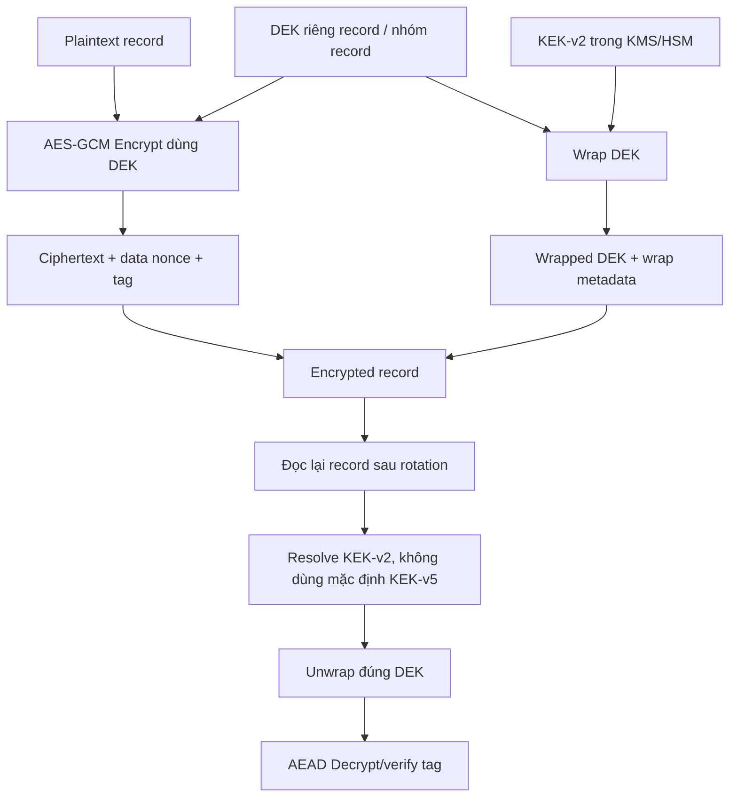
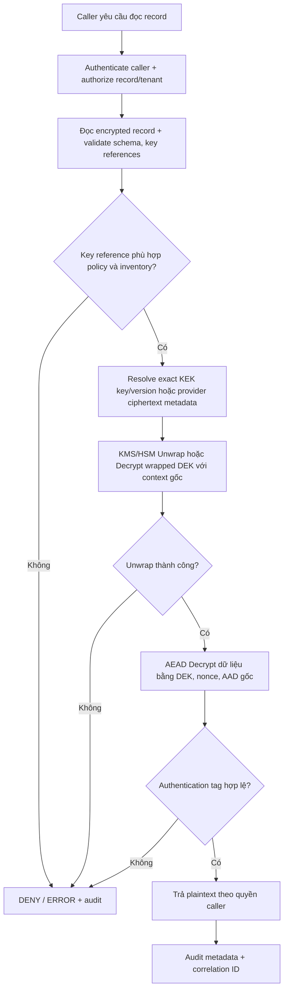
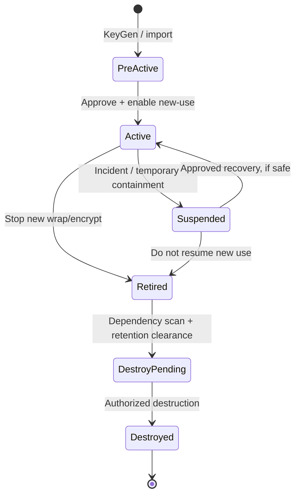
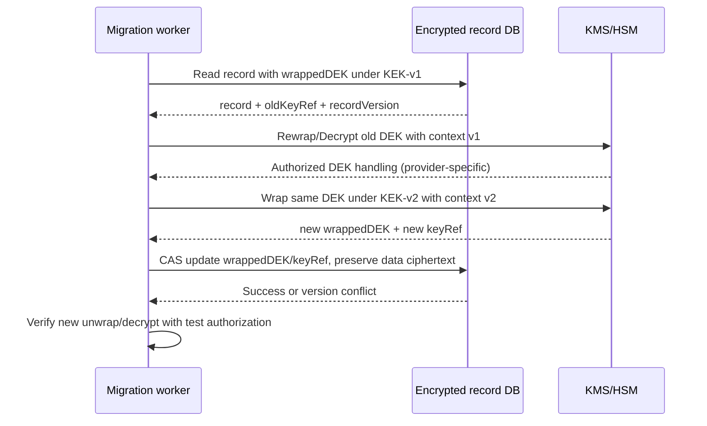

# Decrypt bằng key version trong envelope encryption

> **Chương:** Envelope encryption  
> **Module:** SECURITY_KEY_MANAGEMENT_FUNDAMENTALS

Một hệ thống lưu dữ liệu khách hàng bằng **envelope encryption** đã vận hành nhiều năm. Mỗi quý, đội bảo mật xoay vòng khóa mã hóa dùng để bảo vệ các data key. Hôm nay, service tạo bản ghi mới với **KEK v5**; nhưng một hóa đơn từ năm trước vẫn chứa **DEK được wrap bằng KEK v2**. Khi người dùng yêu cầu đọc hóa đơn cũ, dịch vụ không thể lấy KEK v5 chỉ vì đó là khóa đang active rồi hy vọng giải mã thành công. Nó cần **xác định khóa/phiên bản thực sự đã bảo vệ DEK**, thực hiện unwrap đúng ngữ cảnh, sau đó mới giải mã ciphertext dữ liệu bằng **DEK phù hợp**.

**Decrypt bằng key version** là việc chọn và sử dụng đúng **định danh khóa hoặc phiên bản vật liệu khóa** khi mở dữ liệu đã mã hóa, dựa trên metadata đáng tin của bản ghi và cơ chế versioning của KMS/HSM/ứng dụng. Đây là một yêu cầu sống còn đối với dữ liệu tồn tại lâu hơn một chu kỳ rotate key.

Bài học thuộc **SECURITY_KEY_MANAGEMENT_FUNDAMENTALS**, liên kết mật mã đối xứng, bất đối xứng, KMS/HSM, IAM, kiểm toán và vòng đời **tạo → cấp phát → lưu trữ → sử dụng → xoay vòng → thu hồi → hủy**. Trọng tâm là **luồng giải mã**, không đánh đồng việc chuyển alias cho dữ liệu mới với việc mã hóa lại dữ liệu cũ.

Sau bài học, bạn có thể:

- Phân biệt **DEK, KEK, logical key ID, material version, alias và key version metadata của record**.
- Xác định khi nào API KMS **tự chọn vật liệu cũ** và khi nào ứng dụng phải cung cấp **explicit key ID/version**.
- Thiết kế encrypted-record format có **wrapped DEK, key reference, nonce, authentication tag, AAD/schema version**.
- Thực hiện decrypt theo trình tự **authorize resource → resolve KEK → unwrap DEK → AEAD decrypt**, từ chối bản ghi bị thay đổi metadata.
- Hiểu tác động của **KEK rotation, rewrap, DEK rotation, reencrypt, disabling và destroying**.
- Viết và kiểm thử mô hình Java 17 dùng AES-GCM với **key version registry giả lập**, không nhầm với quyền lưu raw KEK trong production.
- Xử lý các trường hợp **missing key, wrong version, tampered metadata, tenant mismatch, stale cache, KMS outage**.
- Thiết kế inventory, runbook, monitoring và migration bảo đảm vừa bí mật vừa **khôi phục được dữ liệu lịch sử**.

## 1. Tại sao decrypt phải gắn với key version?

Mã hóa không chỉ tạo `ciphertext`. Để giải mã về sau, hệ thống cần biết **bằng khóa nào**, **scheme nào**, **metadata nào** và **quyền nào** để thực hiện phép toán ngược lại.

Một bản ghi mã hóa bằng AEAD có thể mang dạng logic:

```text
EncryptedRecord
  keyRef            = "kek-orders-v2"
  wrappedDEK        = <bytes>
  dataNonce         = <bytes>
  ciphertextAndTag  = <bytes>
  dataAlgorithm     = "AES-256-GCM"
  aadSchema         = "order-record-v1"
  tenantId          = "T-42"
  objectId          = "order-87310"
```

Khi đọc bản ghi này trong lúc key hiện hành là `kek-orders-v5`, **keyRef v2 vẫn phải được tôn trọng** theo chính sách. Nếu thay v2 bằng v5 một cách cơ học, KMS/HSM thường không thể unwrap DEK cũ, hoặc AEAD kiểm tra tag thất bại.

### 1.1. Sai lầm trực quan: “key hiện tại giải mã được dữ liệu cũ”

Thử tưởng tượng:

```text
Ngày 01: Encrypt record A; DEK-A được wrap dưới KEK-v1
Ngày 30: Rotation; new writes dùng KEK-v2
Ngày 60: Decrypt record A

Sai: luôn dùng "current KEK" -> KEK-v2.
Đúng: đọc metadata record A, xác định tham chiếu KEK-v1,
      hoặc dùng cơ chế ciphertext tự mô tả của provider để KMS
      tự tìm đúng material cũ bên trong cùng logical key.
```

Câu trả lời cụ thể phụ thuộc **cách nhà cung cấp quản lý key versions**. Một số KMS có **automatic rotation** giữ các phiên bản vật liệu bên trong một logical key, và `Decrypt` có thể nhận ciphertext blob chứa thông tin cần thiết để provider tự chọn material cũ. Một thiết kế dùng **key IDs riêng cho mỗi lần manual rotation** lại cần record lưu và chọn **đúng key ID cũ**.

**Không áp một quy tắc chọn version cứng lên mọi KMS.** Trước khi xây luồng decrypt, phải nắm rõ semantics của API và loại ciphertext đang dùng.

### 1.2. Key version giải quyết hai bài toán

1. **Cryptographic correctness:** đúng vật liệu khóa để giải mã/unwrap; nếu sai, phép toán thường thất bại, nhưng không nên dựa vào “thử đến khi được”.
2. **Lifecycle correctness:** biết phải giữ key nào cho dữ liệu cũ, khi nào rewrap/reencrypt và khi nào có thể hủy.

Một record có version rõ ràng cũng giúp kiểm toán **key nào đã bảo vệ object nào**, chứ không chỉ ghi nhận một alias có thể thay đổi theo thời gian.

## 2. Ba khái niệm phải tách: DEK, KEK và key version

**DEK (Data Encryption Key)** là khóa dùng mã hóa **dữ liệu thực**. **KEK (Key Encryption Key)** là khóa bảo vệ DEK, thường qua `WrapKey/UnwrapKey`, `GenerateDataKey` hoặc phép toán KMS tương đương.



| Thành phần | Vai trò | Có cần version/identity? |
|---|---|---|
| **DEK** | Mã hóa một/một nhóm record | Có: `dekId`, version hoặc record binding nếu DEK tái dùng |
| **KEK** | Wrap/unwrap DEK | Có: key ID, material version hoặc provider ciphertext metadata |
| **Logical key** | Tài nguyên KMS/ứng dụng đại diện một mục đích | Có, nhưng có thể giữ nhiều material versions |
| **Material version** | Phiên bản byte khóa thực tế | Cần theo semantics provider/registry |
| **Alias / active pointer** | Chọn key cho **new operations** | **Không phải** tham chiếu lịch sử ổn định |
| **Wrapped DEK** | DEK đã được bảo vệ bằng KEK | Lưu đầy đủ bytes/format và binding cần thiết |
| **Ciphertext dữ liệu** | Bản mã tạo bằng DEK | Cần nonce, tag, algorithm/AAD scheme |

### 2.1. Một DEK có thể có nhiều wrapped versions

Cùng một **DEK-v7** có thể được wrap lần đầu dưới **KEK-v2**, rồi **rewrap** dưới **KEK-v5**. DEK vẫn là cùng vật liệu, nên:

- Dữ liệu mã hóa bằng DEK-v7 có thể không đổi.
- Wrapped DEK bytes và KEK reference thay đổi.
- `dekGeneratedAt` **không reset**.
- `kekWrappingVersion` là thuộc tính của **bản wrap hiện hành**.

Nếu thiết kế lưu **nhiều bản wrap của cùng DEK** để hỗ trợ migration, phải có policy chọn bản nào, đảm bảo version cũ được xóa/retire đúng lúc và không tạo vòng phụ thuộc không có kiểm soát.

### 2.2. Alias không nên dùng để resolve record cũ

Giả sử `alias/orders-kek-current` hôm qua trỏ tới KEK-v2, hôm nay trỏ KEK-v5. Nếu bản ghi cũ chỉ lưu alias mà không có **ciphertext blob tự mô tả** hay version/key reference cố định, hệ thống có thể không biết unwrap bằng vật liệu nào. Nên:

- Lưu **immutable key ID/ARN/version** hoặc đúng định dạng **provider-managed encrypted data key** có thể tự xác định key.
- Dùng alias `current` cho **đường mã hóa mới**.
- Lưu **actual key ID/version** được dùng tại thời điểm thao tác, thay vì lấy alias sau đó để ghi metadata.

## 3. “Key version” trong KMS không phải lúc nào cũng giống nhau

Có ít nhất ba mô hình phổ biến:

| Mô hình | Khi rotate | Khi decrypt record cũ |
|---|---|---|
| **Provider-managed material rotation** trong một logical key | Provider có thể giữ key ID logic ổn định và tạo material mới nội bộ | API Decrypt có thể tự chọn material phù hợp từ ciphertext/provider metadata, nếu sản phẩm hỗ trợ |
| **Manual rotation thành key resource riêng** | Tạo KEK-v2 như một key ID/resource khác, đổi routing/alias | Record hoặc registry cần biết **đúng key ID cũ**; không suy ra từ alias hiện tại |
| **Application-owned versioning** | Ứng dụng quản lý mapping version → key object/material | Ứng dụng phải tra bảng version có kiểm soát, kiểm tra policy và gọi đúng key |

Ngoài ra còn **key pair** (RSA recipient/private key) với version riêng, hoặc **data-key version** theo mỗi object. Số `v3` do ứng dụng đặt **không tự trùng** với material version của provider.

### 3.1. Provider-managed ciphertext format

Một KMS có thể xuất **encrypted data key blob** chứa metadata đủ để dùng lại `Decrypt` dưới logical key, kể cả sau automatic rotation. Ứng dụng không nên tự giải mã/đoán layout blob. Cần:

1. Lưu blob **nguyên vẹn**, đúng bytes, đúng encoding.
2. Bảo tồn **encryption context/AAD** nếu API yêu cầu ở lúc Decrypt.
3. Kiểm tra quyền principal và key policy cho thao tác mở key.
4. Hiểu việc **disable hoặc schedule deletion** của logical key có chặn decrypt các material versions cũ không.
5. Kiểm tra **cross-account, cross-region, key version semantics** cụ thể của provider khi migrate.

Một số provider cho phép Decrypt ciphertext mà không truyền key ID vì blob tự mô tả; một số API lại bắt buộc cung cấp key name/version. **Không đoán từ tên phương thức `Decrypt` mà phải đọc hợp đồng API của provider đang dùng.**

### 3.2. Manual key rotation cần mapping chính xác

Nếu KEK-v1 và KEK-v2 là hai tài nguyên khác nhau, metadata nên lưu **immutable key reference** cho mỗi record hoặc wrapped DEK:

```text
record-1001 -> encryptedDEK-v1 -> kms/key/KEK-v1
record-1002 -> encryptedDEK-v2 -> kms/key/KEK-v2

Current writes after cutover:
  activeKeyRef = kms/key/KEK-v2

Read old record-1001:
  use kms/key/KEK-v1 (if retained and policy allows)
```

Không tạo code thử v2, rồi v1, rồi v0 cho đến khi GCM tag hợp lệ. **Brute-force version selection** vừa tốn chi phí vừa có thể biến lỗi phân quyền thành oracle, làm mờ audit và che mất metadata bị hỏng.

### 3.3. Version của DEK không phải version của KEK

Một bản ghi có thể có `dekGeneration=7` và `kekVersion=3`, hai con số này khác nhau về ý nghĩa. Việc copy một field `keyVersion` chung cho cả hai dễ khiến migration sai. Nên đặt tên rõ:

```json
{
  "dekReference": "data-key-generation-7",
  "wrappingKeyReference": "kms://orders/kek-v3",
  "wrappedDekFormatVersion": 2,
  "dataCipherFormatVersion": 1
}
```

**Format version** cũng là một thứ khác nữa: nó mô tả cách encode ciphertext/metadata, không phải key material. Schema version có thể tăng dù key không thay đổi.

## 4. Dữ liệu tối thiểu cần lưu để decrypt lại

Với một thiết kế **AES-256-GCM cho data, AES-GCM hoặc KMS wrap operation cho DEK**, bản ghi cần thông tin đủ cho hai bước **unwrap** và **decrypt**.

| Trường | Bắt buộc tùy scheme | Tại sao |
|---|---|---|
| `recordId`, `tenantId` | Context/authorization | Chọn đúng resource; ràng buộc bằng AAD nếu có |
| `dataAlgorithm` | Có khi hỗ trợ nhiều scheme | Không thử ngẫu nhiên thuật toán từ input |
| `dataNonce` | AEAD yêu cầu nonce | Decrypt cần đúng nonce đã dùng khi Encrypt |
| `ciphertextAndTag` | Có | Dữ liệu mã hóa và authentication tag |
| `aadSchemaVersion` | Nếu có AAD versioning | Tái tạo đúng AAD bytes ban đầu |
| `wrappedDek` | Có với envelope | Đưa đến KMS/HSM hoặc unwrap đúng KEK |
| `wrappingKeyReference` | Nếu wrapped blob không tự mô tả | Chọn đúng KEK/key version |
| `wrapAlgorithm/formatVersion` | Khi scheme thay đổi theo thời gian | Tránh nhầm encoding và scheme |
| `wrapNonce/tag/context` | Nếu wrap dùng AEAD tại ứng dụng | Phải giải mã DEK chính xác và kiểm tra tính toàn vẹn |
| `dekId/dekVersion` | Nếu DEK dùng lại hoặc có inventory riêng | Xác định nguồn và phạm vi DEK |
| `keyPolicy/owner/provenance references` | Quản trị/audit | Không thay thế các trường giải mã nhưng quan trọng cho lifecycle |

**Không cần ghi raw DEK/KEK/private key** cùng ciphertext. Một số KMS data-key APIs trả **plaintext DEK tạm thời** cho workload: chỉ giữ trong bộ nhớ theo nhu cầu, bảo vệ runtime và tránh log/dump.

### 4.1. Mẫu encrypted record có version rõ

```json
{
  "schemaVersion": 2,
  "recordId": "order-87310",
  "tenantId": "T-42",
  "data": {
    "algorithm": "AES-256-GCM",
    "nonceB64": "<base64-12-byte-nonce>",
    "ciphertextAndTagB64": "<base64-ciphertext-with-tag>",
    "aadSchema": "orders-record-v1"
  },
  "dataKey": {
    "dekId": "dek-order-87310",
    "wrappedDekB64": "<base64-encrypted-dek>",
    "wrappingKeyRef": "kms://orders/kek-v2",
    "wrappedDekFormat": "provider-managed-v1",
    "wrappingContextSchema": "orders-wrap-v1"
  },
  "createdAt": "2026-04-05T09:30:00Z"
}
```

Ví dụ này dùng placeholder thay vì bytes thật; **không thể chạy Decrypt với các placeholder**. Nếu blob của provider đã chứa key material selector, `wrappingKeyRef` có thể là metadata kiểm toán/validation thay vì tham số bắt buộc. Ứng dụng cần **một hợp đồng rõ ràng**: field nào đáng tin, field nào là hint và field nào được KMS xác thực nội bộ.

### 4.2. Record format phải có khả năng đọc lâu dài

Dữ liệu có thể tồn tại nhiều năm, nên đừng chỉ lưu object serialized theo class Java hiện tại rồi hy vọng phiên bản tương lai vẫn đọc được. Cần:

- **Explicit schema/algorithm version**, danh sách cipher suites cho phép.
- Encoding nhất quán cho bytes, nonce, tag, wrapped DEK (ví dụ Base64 được xác định chính xác).
- Giới hạn kích thước record, nonce/tag length, field names; từ chối format lạ.
- Có kế hoạch hỗ trợ/deprecate những định dạng cũ mà không phải mở quyền giải mã tùy ý.
- Test **compatibility fixtures** từ các version được tạo trong quá khứ.

Không dùng chuỗi `"latest"` thay key material identifier trong record lịch sử nếu không có cơ chế giải mã tự mô tả tương ứng.

## 5. Quy trình Decrypt bằng key version: từ kiểm tra quyền đến plaintext

Luồng giải mã an toàn không bắt đầu ở `Cipher.doFinal`. Nó bắt đầu từ **quyền trên bản ghi** và **validation metadata**.



### 5.1. Bước 1 — Xác minh principal và object authorization

Người dùng được phép đọc `record-1001` không mặc định có quyền `record-1002` dù hai record được wrap dưới cùng KEK. KMS thường biết quyền **sử dụng key**, không biết đầy đủ quyền **đọc bản ghi nghiệp vụ**. Phải kiểm tra tenant/owner/access control trước phép Decrypt.

Không nhận `tenantId` do caller tự khai làm cơ sở cấp quyền; ánh xạ tenant cần xuất phát từ identity/session và object metadata đáng tin.

### 5.2. Bước 2 — Phân tích record và chọn đúng version

Kiểm tra:

- Format/schema nằm trong allowlist.
- Key ID/ref đến **đúng tenant, service, environment và purpose**.
- Key version trạng thái cho phép **legacy decrypt**, dù có thể đã ngừng new-encrypt.
- Không dùng alias current làm bằng chứng vật liệu quá khứ.
- Nếu provider blob chứa key ID, kiểm tra metadata/ref không mâu thuẫn với key trả về khi API có khả năng xác minh.

Nếu key reference không tìm thấy, báo **KEY_VERSION_UNAVAILABLE** hoặc trạng thái tương đương; không tự thử hàng loạt keys.

### 5.3. Bước 3 — Unwrap DEK

Gọi KMS/HSM theo API và quyền đã được duyệt. Với encryption context/AAD, cần tái tạo **chính xác** các cặp key/value hoặc bytes yêu cầu ở lần wrap. Không tự “chuẩn hóa” khác đi sau schema migration.

Nếu KMS trả plaintext DEK cho ứng dụng, giảm thời gian giữ, không log, không cache dài hạn, bảo vệ memory và biết rằng quyền Unwrap có thể cấp khả năng đọc dữ liệu tương ứng.

### 5.4. Bước 4 — AEAD Decrypt dữ liệu

Với AES-GCM, Decrypt cần đúng:

1. Raw DEK bytes hoặc key handle phù hợp.
2. Nonce đã dùng trong lần Encrypt tương ứng.
3. Ciphertext và authentication tag chưa bị sửa.
4. **AAD bytes đúng y hệt** lần Encrypt.
5. Algorithm/tag length/format theo schema.

Nếu tag sai, **không trả một phần plaintext** cho client và không tự fallback sang mode không xác thực. Với Java JCA, cần xử lý lỗi `AEADBadTagException` theo hướng thông báo tổng quát và audit bảo mật.

### 5.5. Bước 5 — Audit nhưng không lộ dữ liệu

Audit có thể gồm request ID, principal, record/key reference, key version, action, policy version, kết quả, thời gian và lý do từ chối. **Không log raw DEK, KEK, plaintext record, HMAC key hoặc bearer tokens.**

## 6. AAD và xác thực metadata: ngăn tráo phiên bản/tenant

Một record có `wrappingKeyRef` không có nghĩa caller có quyền sửa trường này. Nếu attacker thay metadata của một bản ghi để ép server truy vấn key của tenant khác, hệ thống có thể trở thành **cross-tenant decryption oracle**, hoặc ít nhất gây lỗi và mờ audit.

**AEAD (Authenticated Encryption with Associated Data)** cho phép ràng buộc dữ liệu không mã hóa như `tenantId`, `recordId`, `purpose`, `schemaVersion` với ciphertext qua authentication tag.

### 6.1. Hai miền AAD khác nhau

Trong envelope encryption có thể có **hai phép AEAD**:

- **Data AEAD:** AES-GCM mã hóa plaintext bằng DEK; AAD có thể là `tenantId + recordId + dataSchema + purpose`.
- **DEK-wrapping AEAD:** mã hóa/wrap DEK bằng KEK; AAD có thể là `tenantId + recordId + wrappingKeyRef + wrapSchema + purpose` nếu ứng dụng tự thực hiện wrap, hoặc **encryption context** theo hợp đồng KMS.

Hai miền nên có **domain separation** và canonical encoding nhất quán. Ví dụ:

```text
Data AAD:
  domain = "orders:data:v1"
  tenant = "T-42"
  record = "order-87310"

Wrap AAD:
  domain = "orders:wrap:v1"
  tenant = "T-42"
  record = "order-87310"
  wrappingKeyRef = "kms://orders/kek-v2"
```

**Điểm tinh tế khi rewrap:** Nếu data AAD có **KEK version** thì đổi KEK version sẽ đòi hỏi tính lại data authentication tag, thường dẫn đến phải decrypt/reencrypt dữ liệu. Nếu muốn **rewrap DEK mà không đổi data ciphertext**, hãy thiết kế data AAD **không phụ thuộc vào thuộc tính chỉ thay đổi do rewrap**. Wrapping AAD có thể ràng buộc KEK version vì nó được tính lại trong lần wrap mới.

### 6.2. AAD không tự tạo authorization

Khi client tự khai `tenantId=T-99` và bản ghi được mã hóa với AAD T-99, authentication tag vẫn có thể hợp lệ nếu attacker có quyền tạo ciphertext cho tenant đó. Phải **đối chiếu record ownership và caller identity từ nguồn tin cậy** trước Decrypt. AAD bảo vệ tính toàn vẹn ràng buộc, không tự trả lời “user có được đọc bản ghi này không?”.

### 6.3. Canonical encoding phải được duy trì qua năm tháng

Không nối chuỗi thiếu phân tách như `tenant + record`: `"ab"+"c"` và `"a"+"bc"` có cùng bytes. Dùng encoding có **length-prefix** hoặc một canonical serialization được xác định rõ. Unicode normalization, thứ tự JSON fields và case-folding có thể thay đổi bytes của AAD; nếu schema đổi, cần version hóa để đọc được record cũ.

### 6.4. Không tin `keyRef` như một quyền để mở secret bất kỳ

Với key registry, luôn kiểm tra key reference được chọn có thuộc **allowed key set** của service/tenant/purpose. Nếu KEK ref có thể do attacker tạo URL tùy ý, một service principal rộng có thể được dùng để truy vấn các keys nằm ngoài phạm vi record. Chỉ accept ref theo **registry mapping và allowlist/provider semantics** đã phê duyệt.

## 7. Key registry: giải quyết version theo cách xác định được

Một **key registry** là nguồn metadata cho biết key ID, purpose, material versions, vòng đời, quyền và dependencies. Nó không phải kho raw key. Với manual rotation, registry là cầu nối giữa **record key reference** và **KMS/HSM key object**.

Ví dụ:

| Key reference | Provider key handle | Purpose | New Encrypt | Legacy Decrypt | Trạng thái |
|---|---|---|---|---|---|
| `orders/kek-v1` | `kms://prod/orders/001` | Wrap DEK đơn hàng | Không | Có nếu đúng quyền | RETIRED_NEW_USE |
| `orders/kek-v2` | `kms://prod/orders/002` | Wrap DEK đơn hàng | Không | Có nếu đúng quyền | RETIRED_NEW_USE |
| `orders/kek-v3` | `kms://prod/orders/003` | Wrap DEK đơn hàng | Có | Có nếu đúng quyền | ACTIVE |
| `billing/kek-v1` | `kms://prod/billing/101` | Wrap DEK hóa đơn | Theo chính sách khác | Theo chính sách khác | ACTIVE |

Ở đây `orders/kek-v2` là định danh ứng dụng, còn `kms://...` chỉ là URI minh họa; **không dùng chính các URI này như syntax của một nhà cung cấp thật**.

### 7.1. Không nhầm registry với alias current

Registry nên duy trì hai khái niệm riêng:

- **Write selector:** khóa hiện được chọn cho `WrapNewDek/EncryptNew`.
- **Read resolver:** ánh xạ **key reference của record** thành key object/version phù hợp cho `UnwrapLegacy`.

```text
Write selector for tenant T-42:
  activeWrappingKeyRef = orders/kek-v3
  epoch = 47

Read resolver:
  orders/kek-v1 -> provider key 001 (legacy decrypt allowed)
  orders/kek-v2 -> provider key 002 (legacy decrypt allowed)
  orders/kek-v3 -> provider key 003 (active)
```

Nếu update active write pointer sang v4, **không xóa read mapping của v1–v3** cho đến khi thực sự hết dependencies. Việc cập nhật alias có thể là một operation atomic ở provider, nhưng các ứng dụng/region khác vẫn cần handling cache và eventual consistency tùy kiến trúc.

### 7.2. State machine theo mục đích sử dụng



Đây là **trạng thái logic**, không phải state machine chuẩn của KMS. Provider `Disabled` có thể chặn **toàn bộ** Decrypt, chứ không cung cấp trạng thái “chỉ đọc legacy”. Nếu cần legacy decrypt-only, có thể phải cưỡng chế bằng **IAM, principal separation, application routing hoặc tính năng provider chuyên biệt** trong khi key object còn khả dụng.

### 7.3. Tính bất biến và sửa sai registry

Không sửa dòng `orders/kek-v2 -> key 002` thành `key 003` vì muốn migration nhanh. Dữ liệu đã wrap với vật liệu 002 không tự đổi thành 003. Nếu mapping bị sai, sử dụng **correction event có audit** và bằng chứng; nếu cố đổi key reference cho record, phải thực sự rewrap và xác thực kết quả.

### 7.4. Các trường registry nên có

| Nhóm | Metadata |
|---|---|
| Identity | Logical purpose, key ID, provider resource ID, material version/alias |
| Protection | Algorithm, key size/curve, allowed operations, non-exportability |
| Ownership | Owner, tenant, environment, region, policy version |
| Provenance | KeyGen/import/restore, creation timestamps, source evidence |
| Lifecycle | Active from, stop-new-use, permitted legacy read, disable/destroy |
| Dependencies | Wrapped DEK counts, encrypted records, backups, public trust |
| Audit | Actor, approvals, request/operation IDs, reconciliation results |

**Creation time** và **import time** không thay thế key version. Một vật liệu nhập vào KMS hôm nay có thể đã sinh nhiều năm trước.

## 8. AES-GCM: nonce, authentication tag và lỗi giải mã

Trong ví dụ chính của bài, DEK dùng **AES-256-GCM**, một chế độ AEAD. Đây là một lựa chọn phổ biến, nhưng không phải tất cả envelope encryption đều dùng đúng scheme này.

### 8.1. Nonce phải khớp và không được tái sử dụng khi Encrypt

- Decrypt cần **nonce giống chính xác lần Encrypt**.
- Với AES-GCM, cặp **(key, nonce)** không được dùng lại cho hai lần mã hóa độc lập cần nonce duy nhất.
- Nonce thường **không cần bí mật**, nhưng phải có tính duy nhất theo scheme.
- Với nonce ngẫu nhiên 96 bit, rủi ro va chạm tăng theo **tổng lượt Encrypt của cùng DEK**, kể cả nhiều process/region.
- Chọn **DEK mới cho mỗi object** thường giảm độ phức tạp quản lý nonce liên-record, nhưng vẫn cần đảm bảo không tái sử dụng nonce sai trong những lần encrypt bằng cùng DEK.

Đừng suy ra **rotate KEK reset nonce budget của DEK**. Nếu cùng raw DEK tiếp tục mã hóa dữ liệu, ngân sách và lịch sử nonce của nó vẫn tiếp diễn.

### 8.2. Tag và AAD không thể “bỏ qua cho dữ liệu cũ”

Nếu ciphertext không được xác thực, attacker có thể tác động plaintext theo cách nguy hiểm tùy mode. Với AES-GCM, lỗi authentication tag là **lỗi bảo mật cần dừng**. Không có chế độ “ignore tag error” hợp lệ để cứu một record bị hỏng.

Nếu một phiên bản record cũ dùng AAD khác, cách đúng là **khôi phục canonical AAD schema cũ** và thực hiện decrypt theo đúng scheme; không loại bỏ AAD cho tất cả ciphertext.

### 8.3. Phân loại lỗi

| Hiện tượng | Nguyên nhân có thể | Điều không được làm |
|---|---|---|
| KMS không tìm được version | Mapping sai, key bị xóa/disable, region/account nhầm | Thử mọi key hoặc đổi alias vô điều kiện |
| KMS `AccessDenied` | Principal thiếu quyền hoặc key policy thay | Cấp `kms:*` cho mọi workload |
| Unwrap authentication error | Sai key, sai wrapping context, wrapped DEK bị sửa | Đọc DEK bỏ xác thực |
| Data AEAD bad tag | Sai DEK/nonce/AAD/ciphertext, corruption hoặc tamper | Trả plaintext chưa xác thực |
| Decrypt đúng nhưng dữ liệu sai nghiệp vụ | Sai schema/codec, record mapping hoặc application bug | Kết luận ngay “AES bị phá” |
| Lỗi chỉ ở một vùng/instance | Stale cache, replica thiếu key, IAM/region drift | Thay toàn bộ key versions trước điều tra |
| Lỗi sau rewrap | Lost update, AAD chứa version cũ, mất wrapped DEK gốc | Xóa bản backup của bản wrap cũ ngay |

Trả thông báo lỗi cho caller theo **mức chi tiết được phép**, tránh phân biệt quá mức “key nào tồn tại, key nào không” dẫn tới oracle tiết lộ hạ tầng. Hệ thống nội bộ vẫn phải có **reason code và correlation ID** để điều tra.

## 9. Java 17: mô phỏng decrypt đúng KEK version

Ví dụ sau trình bày đầy đủ đường:

**Sinh DEK → Encrypt data bằng AES-GCM → Wrap DEK bằng KEK-v1 → Rotate active KEK sang v2 → Decrypt record v1 → Rewrap DEK sang v2 → Decrypt record đã rewrap**.

Để chương trình tự chạy mà không cần cloud account, nó sử dụng **`FakeKekRegistry` lưu AES KEK ngay trong bộ nhớ Java**. Đây chỉ là mô hình học tập. **Trong production, managed KEK nên nằm trong KMS/HSM** và ứng dụng gọi API Unwrap/Decrypt đúng policy, không lưu raw KEK trong map. Các nguyên tắc AEAD/nonce/AAD/record version trong demo vẫn hữu ích để hiểu luồng.

Mã sử dụng Java 17 và thư viện JCA/JCE tiêu chuẩn, không cần dependency ngoài:

```java
import javax.crypto.AEADBadTagException;
import javax.crypto.Cipher;
import javax.crypto.KeyGenerator;
import javax.crypto.SecretKey;
import javax.crypto.spec.GCMParameterSpec;
import javax.crypto.spec.SecretKeySpec;
import java.nio.ByteBuffer;
import java.nio.charset.StandardCharsets;
import java.security.SecureRandom;
import java.util.Arrays;
import java.util.HashMap;
import java.util.Map;

public final class VersionedEnvelopeDemo {
    private static final String GCM = "AES/GCM/NoPadding";
    private static final SecureRandom RNG = new SecureRandom();

    record WrappedDek(
            String kekVersion,
            byte[] wrapNonce,
            byte[] encryptedDekWithTag) {}

    record EncryptedRecord(
            String recordId,
            String tenantId,
            String algorithm,
            String aadSchema,
            byte[] dataNonce,
            byte[] ciphertextWithTag,
            WrappedDek wrappedDek) {}

    // CHỈ LÀ FAKE KMS. Production KHÔNG giữ raw KEK
    // trong Map của ứng dụng; dùng KMS/HSM API.
    static final class FakeKekRegistry {
        private final Map<String, SecretKey> material = new HashMap<>();
        private String activeVersion;

        void createVersion(String id) throws Exception {
            if (material.containsKey(id)) {
                throw new IllegalArgumentException("Version exists");
            }
            KeyGenerator generator = KeyGenerator.getInstance("AES");
            generator.init(256, RNG);
            material.put(id, generator.generateKey());
        }

        void selectForNewWrites(String version) {
            if (!material.containsKey(version)) {
                throw new IllegalStateException(
                        "Unknown active version");
            }
            activeVersion = version;
        }

        String activeVersion() {
            return activeVersion;
        }

        SecretKey resolveExactVersion(String version) {
            SecretKey found = material.get(version);
            if (found == null) {
                throw new IllegalStateException(
                        "KEY_VERSION_UNAVAILABLE");
            }
            return found;
        }

        // Chỉ mô phỏng việc KHÔNG CÒN ĐỌC ĐƯỢC key version.
        // Không phải xóa an toàn raw key khỏi JVM/HSM.
        void removeVersion(String version) {
            material.remove(version);
        }
    }

    // Length-prefixed encoding tránh nhập nhằng khi nối chuỗi.
    private static byte[] aad(
            String domain, String tenant, String recordId,
            String extra) {
        String[] fields = { domain, tenant, recordId, extra };
        byte[][] encoded = new byte[fields.length][];
        int total = 0;
        for (int i = 0; i < fields.length; i++) {
            encoded[i] = fields[i].getBytes(StandardCharsets.UTF_8);
            total += Integer.BYTES + encoded[i].length;
        }
        ByteBuffer output = ByteBuffer.allocate(total);
        for (byte[] field : encoded) {
            output.putInt(field.length);
            output.put(field);
        }
        return output.array();
    }

    private static byte[] nonce() {
        byte[] value = new byte[12]; // 96 bit cho AES-GCM.
        RNG.nextBytes(value);
        return value;
    }

    private static Cipher initGcm(
            int mode, SecretKey key, byte[] nonce) throws Exception {
        Cipher cipher = Cipher.getInstance(GCM);
        cipher.init(mode, key, new GCMParameterSpec(128, nonce));
        return cipher;
    }

    private static WrappedDek wrapDek(
            FakeKekRegistry registry,
            String kekVersion, String tenant, String recordId,
            byte[] rawDek) throws Exception {
        byte[] wrapNonce = nonce();
        Cipher cipher = initGcm(
                Cipher.ENCRYPT_MODE,
                registry.resolveExactVersion(kekVersion),
                wrapNonce);
        cipher.updateAAD(aad(
                "orders:wrap:v1", tenant, recordId, kekVersion));
        byte[] protectedDek = cipher.doFinal(rawDek);
        return new WrappedDek(
                kekVersion, wrapNonce, protectedDek);
    }

    private static byte[] unwrapDek(
            FakeKekRegistry registry,
            EncryptedRecord record) throws Exception {
        WrappedDek wrapped = record.wrappedDek();
        // KHÔNG thử lần lượt mọi KEK trong registry.
        SecretKey exactKek =
                registry.resolveExactVersion(wrapped.kekVersion());
        Cipher cipher = initGcm(
                Cipher.DECRYPT_MODE, exactKek, wrapped.wrapNonce());
        cipher.updateAAD(aad(
                "orders:wrap:v1",
                record.tenantId(),
                record.recordId(),
                wrapped.kekVersion()));
        byte[] rawDek = cipher.doFinal(wrapped.encryptedDekWithTag());
        if (rawDek.length != 32) {
            Arrays.fill(rawDek, (byte) 0);
            throw new SecurityException("Unexpected DEK length");
        }
        return rawDek;
    }

    static EncryptedRecord encrypt(
            FakeKekRegistry registry,
            String tenant, String recordId, byte[] plaintext)
            throws Exception {
        String writeVersion = registry.activeVersion();
        if (writeVersion == null) {
            throw new IllegalStateException("No active KEK");
        }
        byte[] rawDek = new byte[32];
        RNG.nextBytes(rawDek); // DEK mới riêng cho record này.
        try {
            byte[] dataNonce = nonce();
            Cipher cipher = initGcm(
                    Cipher.ENCRYPT_MODE,
                    new SecretKeySpec(rawDek, "AES"), dataNonce);
            cipher.updateAAD(aad(
                    "orders:data:v1", tenant, recordId, "schema-v1"));
            byte[] ciphertext = cipher.doFinal(plaintext);
            WrappedDek wrapped = wrapDek(
                    registry, writeVersion, tenant, recordId, rawDek);
            return new EncryptedRecord(
                    recordId, tenant, "AES-256-GCM", "schema-v1",
                    dataNonce, ciphertext, wrapped);
        } finally {
            Arrays.fill(rawDek, (byte) 0);
        }
    }

    static byte[] decrypt(
            FakeKekRegistry registry,
            EncryptedRecord record,
            String authorizedTenant) throws Exception {
        // Production phải xác thực caller + object ownership;
        // không lấy authorizedTenant trực tiếp từ JSON của client.
        if (!record.tenantId().equals(authorizedTenant)) {
            throw new SecurityException("OBJECT_NOT_AUTHORIZED");
        }
        if (!"AES-256-GCM".equals(record.algorithm())
                || !"schema-v1".equals(record.aadSchema())) {
            throw new SecurityException("FORMAT_NOT_ALLOWED");
        }
        byte[] rawDek = unwrapDek(registry, record);
        try {
            Cipher cipher = initGcm(
                    Cipher.DECRYPT_MODE,
                    new SecretKeySpec(rawDek, "AES"),
                    record.dataNonce());
            cipher.updateAAD(aad(
                    "orders:data:v1",
                    record.tenantId(),
                    record.recordId(),
                    record.aadSchema()));
            return cipher.doFinal(record.ciphertextWithTag());
        } finally {
            Arrays.fill(rawDek, (byte) 0);
        }
    }

    static EncryptedRecord rewrap(
            FakeKekRegistry registry,
            EncryptedRecord record, String newKekVersion)
            throws Exception {
        byte[] rawDek = unwrapDek(registry, record);
        try {
            WrappedDek updated = wrapDek(
                    registry, newKekVersion,
                    record.tenantId(), record.recordId(), rawDek);
            // Data ciphertext, nonce và data AAD schema GIỮ NGUYÊN.
            return new EncryptedRecord(
                    record.recordId(), record.tenantId(),
                    record.algorithm(), record.aadSchema(),
                    record.dataNonce(), record.ciphertextWithTag(),
                    updated);
        } finally {
            Arrays.fill(rawDek, (byte) 0);
        }
    }

    public static void main(String[] args) throws Exception {
        FakeKekRegistry registry = new FakeKekRegistry();
        registry.createVersion("kek-v1");
        registry.selectForNewWrites("kek-v1");

        byte[] original = "Don hang thu nghiem"
                .getBytes(StandardCharsets.UTF_8);
        EncryptedRecord old = encrypt(
                registry, "T-42", "order-1001", original);

        // Rotation ảnh hưởng new writes, KHÔNG đổi record cũ.
        registry.createVersion("kek-v2");
        registry.selectForNewWrites("kek-v2");
        System.out.println("Active write KEK: "
                + registry.activeVersion());
        System.out.println("Old record KEK: "
                + old.wrappedDek().kekVersion());

        byte[] readOld = decrypt(registry, old, "T-42");
        System.out.println("Legacy decrypt matches: "
                + Arrays.equals(original, readOld));
        Arrays.fill(readOld, (byte) 0);

        // Thay bản wrap DEK, không reencrypt data ciphertext.
        EncryptedRecord moved = rewrap(
                registry, old, "kek-v2");
        System.out.println("Data ciphertext unchanged: "
                + Arrays.equals(old.ciphertextWithTag(),
                                moved.ciphertextWithTag()));

        byte[] readMoved = decrypt(registry, moved, "T-42");
        System.out.println("After rewrap decrypt matches: "
                + Arrays.equals(original, readMoved));
        Arrays.fill(readMoved, (byte) 0);

        // Thay tenant metadata nhưng không có tag hợp lệ.
        EncryptedRecord tampered = new EncryptedRecord(
                moved.recordId(), "T-99",
                moved.algorithm(), moved.aadSchema(),
                moved.dataNonce(), moved.ciphertextWithTag(),
                moved.wrappedDek());
        try {
            decrypt(registry, tampered, "T-99");
            throw new AssertionError("Tampering accepted");
        } catch (AEADBadTagException expected) {
            System.out.println("Tampering rejected by AEAD");
        }

        // Chỉ sau khi mọi dependencies đã migrate, key cũ
        // mới có thể được ngừng cung cấp theo policy.
        registry.removeVersion("kek-v1"); // Fake, không destroy thật.
        try {
            decrypt(registry, old, "T-42");
            throw new AssertionError("Missing key accepted");
        } catch (IllegalStateException expected) {
            System.out.println("Old version unavailable, as expected");
        }

        byte[] finalRead = decrypt(registry, moved, "T-42");
        System.out.println("Migrated record readable: "
                + Arrays.equals(original, finalRead));
        Arrays.fill(finalRead, (byte) 0);
        Arrays.fill(original, (byte) 0);
    }
}
```

### 9.1. Kết quả mong đợi

```text
Active write KEK: kek-v2
Old record KEK: kek-v1
Legacy decrypt matches: true
Data ciphertext unchanged: true
After rewrap decrypt matches: true
Tampering rejected by AEAD
Old version unavailable, as expected
Migrated record readable: true
```

Điểm quan trọng:

- Sau rotation, **new writes chọn v2**, nhưng record cũ vẫn tham chiếu **v1**.
- Khi v1 còn khả dụng, record cũ vẫn có thể Decrypt; không cần thử key mới.
- **Rewrap bằng v2** tạo wrapped DEK mới, giữ nguyên data ciphertext và data nonce.
- Khi v1 không còn khả dụng, record chưa migrate **không mở được**; record đã rewrap sang v2 vẫn đọc được.
- Sửa metadata tenant mà không có tag phù hợp bị từ chối, **không trả plaintext**.

### 9.2. Giới hạn bảo mật và vận hành của demo

1. **Raw KEK nằm trong Java Map** chỉ để minh họa key version; production cần KMS/HSM key handle, IAM, audit, policy, quota và cơ chế backup của provider.
2. Wrapped DEK ở đây được mã hóa bằng **AES-GCM dùng KEK**, không đại diện cho mọi chuẩn wrapping như AES-KW/AES-KWP hay encrypted data-key format riêng của KMS.
3. **Nonce của phép wrap cũng phải duy nhất dưới cùng KEK.** Với KEK dùng để wrap rất nhiều DEK, phải chọn scheme/nonce budget đúng và cân nhắc KMS key wrap API đã được đánh giá. Random 96-bit nonce của demo không phải bằng chứng an toàn cho quy mô vô hạn.
4. `FakeKekRegistry` không hỗ trợ effective permissions, key states thực, region/tenant policy, storage durability, concurrency hoặc key destruction.
5. `record` của Java chứa `byte[]` có thể sửa được; production phải phòng **mutable aliases, unsafe deserialization và tampered metadata** bằng validation/defensive copies.
6. `SecretKeySpec` và provider có thể sao chép key bytes. `Arrays.fill` chỉ xóa những buffer ta sở hữu; không bảo đảm xóa mọi bản sao khỏi heap.
7. `authorizedTenant` là giá trị đã tin trong giả định demo. Trong production phải lấy từ **authenticated identity + server-side object authorization**.
8. Demo không xử lý crash giữa **rewrap và database commit**, backup, outbox, idempotency, parallel migrations hoặc khả năng rollback.
9. Không có access-control integration test. **Không dùng đoạn mã như mã quản lý khóa production** mà chưa triển khai đầy đủ threat model và provider API.

## 10. Thử nghiệm cần có cho decrypt theo version

Một hệ thống thực nên có **integration tests** sử dụng các key versions và quyền thực tế trong môi trường test, không chỉ unit test logic.

| Tình huống | Kết quả kỳ vọng |
|---|---|
| Encrypt dưới v1, rotate active sang v2 rồi decrypt record v1 | **Thành công** nếu policy vẫn cho legacy decrypt |
| Encrypt new record dưới v2 | Metadata phải ghi **actual v2**, không dùng alias không rõ |
| Xóa mapping v1 khi còn record phụ thuộc | **Fail có kiểm soát**, được monitor; không fallback thử key khác |
| Thay `wrappingKeyRef` sang một key ID tùy ý | **Từ chối** bởi mapping/AEAD/encryption context |
| Tenant A đọc record của tenant B | **Từ chối trước KMS** |
| Thay data nonce hoặc ciphertext/tag | AEAD authentication error; **không trả plaintext** |
| Thay AAD schema hoặc record ID | Authentication thất bại hoặc schema bị từ chối |
| Rewrap v1 → v2, giữ ciphertext dữ liệu | Decrypt vẫn cho **plaintext giống hệt**, data ciphertext không đổi |
| Reencrypt DEK v1 → DEK v2 | Ciphertext/tag và metadata mới, nội dung nghiệp vụ không đổi |
| Retired v1 không còn new encrypt nhưng còn old decrypt | **Đúng policy**, nếu provider/key object hỗ trợ đường usage này |
| Disabled/destroyed v1 | Decrypt record phụ thuộc **không thể thành công** nếu không có bản sao/đường recovery |
| KMS/registry không sẵn sàng | Thất bại có kiểm soát; không mở quyền hoặc dùng key từ config trái policy |
| Retry migration cùng record | Không sinh nhiều bản wrap mâu thuẫn hay ghi đè version mới |
| Hai worker cùng rewrap một record | CAS/transaction phát hiện race, không mất ciphertext metadata |
| Backup cũ được restore | Version/key dependencies đúng, không thay active pointer sai |

### 10.1. Test fixtures phải giữ lại ciphertext lịch sử

Một tập kiểm thử có thể lưu **encrypted test fixtures** (không chứa dữ liệu nhạy cảm) được tạo bằng v1, v2 và các schema khác nhau. Khi thay code/SDK/KMS, chạy lại các fixture để biết hệ thống còn giải mã được dữ liệu cũ.

**Không lưu raw production keys vào repository để chạy test.** Test keys phải thuộc môi trường riêng, có kiểm soát; với provider-managed encrypted blobs cần giữ đúng key objects test hoặc fixtures mô phỏng được đánh giá.

### 10.2. Positive tests chưa đủ

Việc decrypt được record v1 không chứng minh rằng tenant B không thể truy cập record v1. Cần **negative tests** về identity, object ownership, key policy, AAD mismatch, key ID tampering và secret leakage trong logs.

## 11. KMS/HSM Decrypt API: ai chọn key material version?

Một yếu tố thiết kế quan trọng là **phần việc của provider** và **phần việc của ứng dụng** khác nhau theo loại KMS.

### 11.1. Khi provider giữ key versions bên trong một logical key

Trong mô hình **provider-managed rotation**, hệ thống có thể chỉ lưu **encrypted data key blob** do API GenerateDataKey/Encrypt trả về. Sau khi rotate, provider vẫn có thể giữ bản material cũ bên trong logical key và tự chọn material phù hợp để Decrypt blob lịch sử.

Điều đó **không có nghĩa**:

- Ứng dụng được bỏ qua phân quyền trên record/tenant.
- Mọi KMS có thể giải mã bằng key ID mới khác hoàn toàn.
- Key vẫn giải mã được khi bị **disabled, deleted, inaccessible hoặc revoked**.
- Blob của provider được phép sửa/trích metadata tùy ý.
- Automatic rotation là **reencrypt dữ liệu đã lưu**.

Nếu API không đòi tham số `keyVersion`, đó có thể là do **ciphertext format/protocol đã mang thông tin nội bộ**; không phải vì key version vô nghĩa. Inventory và retention vẫn cần theo dõi key dependencies ở cấp logical key.

### 11.2. Khi ứng dụng quản lý phiên bản riêng

Ở mô hình mỗi lần rotation là một key resource khác:

```text
CURRENT_FOR_NEW_WRAP = KMS key-2026-v3

Record A:
  wrappingKeyRef = KMS key-2024-v1

Record B:
  wrappingKeyRef = KMS key-2025-v2

Record C:
  wrappingKeyRef = KMS key-2026-v3
```

Ứng dụng hoặc registry phải định tuyến A→v1, B→v2, C→v3; KMS/HSM kiểm tra principal có quyền Unwrap/Decrypt ở từng key. Khi bỏ một key resource cũ, phải biết những records còn phụ thuộc.

### 11.3. Khi dùng HSM trực tiếp

Một HSM có thể cung cấp **key handles** với thuộc tính không export được và API Unwrap/Decrypt. Việc một handle có tồn tại và được phép dùng sau rotation phụ thuộc **partition, backup/restore, key state và key usage attributes**.

Không lưu một volatile HSM session handle như **định danh vĩnh viễn của ciphertext** nếu handle không ổn định qua restart/DR; cần provider key identifier/label/UUID hoặc registry mapping có khả năng khôi phục. **Không coi tên label là identity mật mã nếu label có thể được tái sử dụng.**

### 11.4. Những câu hỏi phải trả lời khi tích hợp provider

| Câu hỏi | Vì sao quan trọng? |
|---|---|
| Encrypted DEK blob có **tự mô tả key** không? | Quyết định record có cần explicit key ID/version hay không |
| Automatic rotation có giữ material cũ để decrypt không? | Đánh giá backward compatibility |
| Disable/key deletion ảnh hưởng **mọi material versions** hay chỉ version được chọn? | Tránh mất dữ liệu |
| KMS hỗ trợ **encryption context** nào? | Phải lưu/khôi phục đúng AAD và IAM conditions |
| API kiểm tra tenant/object ở mức nào? | Bổ sung object authorization ngoài KMS |
| Có **ReEncrypt/rewrap** mà không trả plaintext DEK cho app không? | Giảm phơi bày DEK trong migration |
| Key có thể restore sang region/account khác không? | Xây DR hợp lệ |
| Public key/recipient key versions có được truy vấn bằng immutable ID không? | Tránh chọn sai private key trong envelope bất đối xứng |

Hãy ghi các câu trả lời vào **decision record** và test hợp đồng API trước production. Đừng phỏng đoán hành vi chỉ từ tên tính năng “rotation” trên giao diện.

## 12. Cryptoperiod: new-use và legacy-decrypt là hai cửa sổ khác nhau

Quản lý vòng đời khóa cần tách:

- **Originator-use period:** khoảng được phép tạo ciphertext hoặc wrap DEK mới bằng key.
- **Recipient-use period:** khoảng key còn được phép dùng để mở ciphertext/wrapped DEK cũ.

Một KEK đã ngừng new-use có thể vẫn cần giải mã dữ liệu lịch sử.

| Trạng thái logic | Wrap DEK mới | Unwrap DEK cũ | Điều cần lưu ý |
|---|---|---|---|
| PRE_ACTIVE | Không | Thường không | Đang kiểm tra readiness |
| ACTIVE | Theo quyền | Theo quyền | Giới hạn algorithm/tenant/quota |
| RETIRED_NEW_USE | Không | Có thể có | Cần retention và dependency tracking |
| SUSPENDED | Không | Có thể bị chặn | Xác định lý do: sự cố, vận hành, nghi lộ |
| COMPROMISED | Không | Chỉ khi incident plan cho phép/giám sát | Không tự bật lại rộng vì muốn duy trì dịch vụ |
| DESTROY_PENDING | Không | Phụ thuộc provider/policy | Không bắt đầu nếu còn dependencies |
| DESTROYED | Không | Không | Có thể mất dữ liệu không thể đảo ngược |

**Đây là trạng thái nghiệp vụ**, không phải các enum phổ quát của KMS. Nếu gọi `DisableKey` làm KMS từ chối cả `Decrypt`, ta không thể tạo trạng thái “decrypt-only” chỉ bằng một dòng trong registry. Phải thiết kế enforcement riêng hoặc dùng tính năng thích hợp của provider.

### 12.1. Tính tuổi key đúng đối tượng

Logical key object có thể được tạo năm 2023 nhưng material version mới được tạo năm 2026. Một imported KEK có thể có resource creation hôm qua nhưng material gốc đã sinh nhiều năm trước. Vì vậy:

- Phân biệt **key object createdAt**, **material generatedAt**, **importedAt**, **activatedAt**.
- Một bản ghi v1 vẫn phải map tới **material v1** dù object đã rotate nội bộ.
- Không tính cryptoperiod chỉ từ thời gian một alias được cập nhật.
- Khi thiếu generation time gốc, ghi **UNKNOWN** và review, không coi tuổi bằng 0.

### 12.2. Trước khi hủy một key version

Điều kiện tối thiểu:

1. Inventory xác định key ID/version và **phạm vi dữ liệu**.
2. Không còn wrapped DEK/ciphertext/backup đòi version đó, hoặc retention đã cho phép mất khả năng giải mã theo quyết định được phê duyệt.
3. Migration/rewrap đã được xác minh **end-to-end**, không chỉ đếm số job thành công.
4. Có negative tests và restore drill từ bản backup tương ứng.
5. Owner/security approver xác nhận kế hoạch và tác động.
6. Sau khi hủy, hệ thống ghi audit/tombstone đầy đủ; không xóa lịch sử key inventory để che dấu phụ thuộc.

Đặc biệt với **KEK bảo vệ nhiều DEK**, một thao tác xóa vội có thể làm mất truy cập hàng triệu record dù tất cả data ciphertext vẫn còn.

## 13. Rewrap: chuyển lớp bọc DEK sang KEK version mới

**Rewrap** là lấy DEK đang được bảo vệ dưới KEK cũ, rồi tạo bản wrapped DEK mới dưới KEK mới, **không nhất thiết phải giải mã và mã hóa lại nội dung dữ liệu**.



Với API hỗ trợ chuyển trực tiếp encrypted data key trong provider, **DEK plaintext có thể không cần đi qua ứng dụng**. Nếu không có, migration worker có thể phải nhận plaintext DEK trong thời gian ngắn theo quyền đã phê duyệt; phải bảo vệ memory/log/host, giới hạn principal và thực hiện kiểm soát bổ sung.

### 13.1. Rewrap không phải rename version

Sai:

```sql
-- PHẢN VÍ DỤ: metadata đổi nhưng ciphertext DEK không đổi.
UPDATE encrypted_record
SET wrapping_key_ref = 'kek-v2'
WHERE wrapping_key_ref = 'kek-v1';
```

Đúng về ý nghĩa là **tạo wrapped DEK mới** rồi thay cả `wrappedDEK` và `wrappingKeyRef` **atomically**, sau khi unwrap/wrap hợp lệ và có khả năng xác minh.

### 13.2. Quy trình migration an toàn

1. **Inventory:** liệt kê records dùng KEK-v1 theo immutable reference.
2. **Approval:** xác định scope, tenant, môi trường, key versions, permissions và rollback.
3. **Read:** lấy record cùng `recordVersion` và metadata AAD/context.
4. **Resolve:** kiểm tra v1 còn quyền legacy unwrap, v2 cho phép wrap mới.
5. **Transform:** rewrap bằng API phù hợp; giữ nguyên data ciphertext nếu design cho phép.
6. **Verify:** kiểm tra wrapped DEK mới có thể mở và data ciphertext decrypt được bằng DEK đó; dùng test giới hạn phù hợp với dữ liệu thực.
7. **Commit:** thay `wrappedDEK/keyRef/wrapMetadata` bằng **transaction/CAS** để tránh partial update.
8. **Audit:** ghi old/new key refs, record ID hoặc reference, policy/operation IDs, kết quả; không log DEK bytes.
9. **Reconcile:** đếm records còn v1 và đối soát backup, DR, delayed writes.
10. **Retire:** chỉ ngừng legacy decrypt/hủy v1 sau khi đầy đủ điều kiện.

### 13.3. Đồng thời và idempotency

Nếu hai workers cùng rewrap:

```text
Worker A:
  Read record revision 17; keyRef v1.
  Rewrap DEK to v2; CAS update expected revision 17.
  Success -> revision 18.

Worker B:
  Also read revision 17.
  CAS expected revision 17 -> FAIL_CONFLICT.
  Re-read revision 18; verify already migrated.
```

Không nên để worker B ghi đè bản wrapped DEK mới bằng một bản cũ từ snapshot. Một số KMS API trả kết quả **không deterministic bytes** vì nonce ngẫu nhiên, nên idempotency không đồng nghĩa byte ciphertext wrap phải giống nhau. Điều cần là **cùng vật liệu DEK, đúng key version/context và trạng thái cuối nhất quán**.

### 13.4. Kiểm chứng bản rewrap

Chỉ kiểm tra `newKeyRef == v2` chưa đủ. Cần xác nhận:

- Wrapped DEK v2 thực sự decrypt/unwrap được bằng KEK-v2.
- Raw DEK sau unwrap là đúng vật liệu dùng cho ciphertext.
- Data AEAD tag xác minh thành công với nonce/AAD gốc.
- Record không bị đổi tenant/object/mục đích không hợp lệ.
- Khi tương thích cần giữ version v1 để rollback có kiểm soát, phải có cơ chế không mở thêm quyền ngoài ý định.

Với dữ liệu nhạy cảm, việc **verify toàn bộ plaintext** cần authorization và xử lý memory an toàn; có thể dùng kiểm thử trên tập mẫu + cryptographic checks theo chiến lược được phê duyệt, không bắt buộc đưa tất cả plaintext ra ngoài chỉ để đo migration.

## 14. Reencrypt: khi phải thay DEK hoặc bản mã dữ liệu

**Reencrypt** khác rewrap: thay DEK hoặc data encryption scheme thường cần **giải mã rồi mã hóa lại data**.

| Hoạt động | DEK material | KEK/wrapped DEK | Data ciphertext/nonce/tag |
|---|---|---|---|
| Đổi active KEK alias cho writes mới | Cũ giữ nguyên trên record cũ | Không tự thay old wrapped DEK | Không đổi |
| Rewrap DEK dưới KEK mới | **Không đổi** | Tạo wrap mới, đổi keyRef | Có thể **không đổi** |
| Reencrypt bằng DEK mới | **Đổi** | Cần wrapped DEK mới tương ứng | **Đổi** ciphertext/nonce/tag |
| Đổi schema dữ liệu nhưng giữ DEK | Có thể giữ | Không nhất thiết đổi | Thường cần encrypt lại nếu AAD/format thay |
| Chuyển algorithm hoặc AEAD mode | Theo scheme/đánh giá | Có thể đổi | Cần ciphertext và format mới |

### 14.1. Khi nào rewrap không đủ?

- DEK plaintext **đã bị lộ**, không chỉ KEK.
- Đã xảy ra **AES-GCM nonce reuse** dưới cùng DEK.
- DEK có entropy yếu hoặc scheme/algorithm không còn được phép.
- Dữ liệu cần tách tenant/security domain và key material cũ quá rộng.
- AAD của ciphertext cần thay đổi theo schema mới và không thể giữ nguyên tag.

Nếu **KEK bị lộ**, chỉ rewrap cùng DEK sang KEK mới **không tự đảm bảo** rằng DEK vẫn bí mật: attacker có thể có wrapped DEK và bản sao KEK cũ, đã unwrap DEK trước đó hoặc vẫn có khả năng làm vậy với ciphertext cũ. Cần đánh giá **khả năng lộ DEK/dữ liệu lịch sử** và có thể phải reencrypt bằng DEK mới.

### 14.2. Reencrypt phải bảo toàn ý nghĩa nghiệp vụ

Một record reencrypt đúng cần:

- Giải mã bản cũ bằng đúng DEK/AAD/nonce/tag và authorization.
- Sinh DEK và nonce mới theo policy.
- Mã hóa đúng plaintext/canonical representation được phép.
- Lưu ciphertext, tag, wrapped DEK, key references, schema và revision atomically.
- Kiểm tra round-trip và ngăn lost updates với writes mới.
- Cập nhật inventory, backup/DR và audit để không xóa key cũ trước khi hết phụ thuộc.

Đối với hệ thống có traffic ghi trong khi migrate, phải chọn **dual-read, controlled writes, versioned record updates hoặc transaction strategy**; không reencrypt một snapshot cũ rồi ghi đè thay đổi nghiệp vụ mới.

## 15. Multi-tenant: key version đúng nhưng quyền tenant sai vẫn là sự cố

Giả sử tenant A và B được bảo vệ dưới cùng một KEK logic (có thể hợp lý trong vài threat models). KMS principal có `Decrypt` trên KEK ấy không có nghĩa user A được đọc ciphertext của B.

### 15.1. Ba điều kiện độc lập

Một luồng đọc cần:

1. **Caller authorization:** user/workload có quyền trên record thuộc tenant B hay không.
2. **Key usage permission:** service được phép Unwrap/Decrypt theo key ID/purpose/tenant không.
3. **Cryptographic integrity:** wrapped DEK và data ciphertext có đúng key/nonce/AAD/tag không.

Mỗi lớp giải quyết một phần khác nhau. Thiếu điều (1), attacker có thể dùng service KMS của ứng dụng như **decryption oracle**.

### 15.2. Ràng buộc record và keyRef

Ví dụ policy:

```yaml
# Cấu hình minh họa, không phải policy syntax của cloud KMS.
tenantId: "T-42"
purpose: "orders-data-encryption"
allowedKeyReferences:
  - "orders/T-42/kek-v1"
  - "orders/T-42/kek-v2"
activeForNewWrap: "orders/T-42/kek-v2"
legacyDecrypt:
  - keyRef: "orders/T-42/kek-v1"
    allowed: true
    requiresObjectAuthorization: true
  - keyRef: "orders/T-42/kek-v2"
    allowed: true
    requiresObjectAuthorization: true
onUnknownKeyRef: "DENY_AND_ALERT"
onTenantMismatch: "DENY_AND_ALERT"
```

Tenant và allowedKeyReferences phải được **suy ra/kiểm tra từ identity và registry tin cậy**, không nhận nguyên từ request JSON. Nếu KMS hỗ trợ context-based permissions, dùng context để tăng enforcement nhưng không coi nó tự đủ khi caller có thể tự chọn mọi context.

### 15.3. Key sharing và blast radius

Có thể chia một KEK cho nhiều tenants nếu tổ chức chọn kiến trúc đó với policy đủ chặt và đáp ứng threat model. Tuy nhiên:

- Một principal có quyền Decrypt trên shared KEK có thể ảnh hưởng nhiều tenant.
- Key compromise làm phạm vi rewrap/reencrypt rộng.
- Việc thu hồi hoặc destroy KEK sẽ ảnh hưởng mọi tenant còn wrapped DEK.

Tách KEK theo tenant/project/environment có thể giảm blast radius nhưng làm tăng số key, quota, chi phí và yêu cầu vận hành. **Lựa chọn phải dựa trên mô hình rủi ro, không phải một quy tắc cứng.**

## 16. Distributed systems: cache, epoch và metadata trong các node

Trong hệ thống nhiều pods/regions, một lần rotation có thể tạo giai đoạn:

```text
Node A: write selector = KEK-v3 (epoch 13)
Node B: write selector = KEK-v2 (epoch 12, cache chưa refresh)

Record X: actual wrapped with KEK-v3
Record Y: actual wrapped with KEK-v2

Reader sau đó phải chọn đúng version từ X/Y,
không lấy "current epoch" của chính reader.
```

### 16.1. Những quy tắc quan trọng

- **Writer** chọn active key theo policy và ghi **actual keyRef/version** cùng wrapped DEK trong **cùng giao dịch logic**.
- **Reader** dùng metadata của record/registry để resolve key lịch sử; không phụ thuộc writer cache hiện tại.
- Cache key registry phải có **TTL/version/epoch**, khả năng invalidate và xử lý revoke/disable.
- Nếu key bị nghi compromise, stale cache không được phép tiếp tục **new-use** bất chấp policy mới.
- Snapshot/database replication phải giữ tính nhất quán giữa `wrappedDEK` và `wrappingKeyRef`.
- Không dùng “thời gian hiện tại” để đoán key version khi record thiếu metadata. Đồng hồ các node có thể lệch và rotations có overlap.

### 16.2. Write ordering và race condition

Trong lúc rotate:

1. Tạo key-v3 và kiểm tra provider/IAM.
2. Mở quyền new-use theo plan.
3. Đưa registry active pointer sang v3 với expected epoch.
4. Writers refresh; một số có thể vẫn ghi v2 trong overlap nếu được phê duyệt.
5. Dữ liệu được lưu kèm **actual version**.
6. Chỉ khi không còn new writes v2 mới retire new-use v2; legacy read tiếp tục.

Nếu cần “từ epoch 13 tất cả writes bắt buộc v3”, writer còn epoch 12 phải **tạm dừng/retry** theo giao thức, không tự cho phép stale key vì dễ triển khai.

### 16.3. Không cache raw KEK ở ứng dụng để giảm KMS latency

Một cache plaintext KEK trên host mở rộng vùng có thể lộ secret, phá mô hình non-exportable và có thể khiến revocation không có hiệu lực. Thay vào đó:

- Dùng provider API/key handles, connection reuse và batching theo policy.
- Với DEK tạm thời ở ứng dụng, giới hạn lifetime và phạm vi dữ liệu.
- Dùng data-key caching **chỉ khi threat model/key budget/nonce strategy** cho phép và hệ thống theo dõi total uses.
- Đặt rate/quota và latency objectives rõ, không dùng security bypass như cơ chế tối ưu hóa mặc định.

### 16.4. Idempotency của Decrypt và Retry

Decrypt về mặt toán học thường có thể lặp lại với cùng ciphertext/key/nonce/AAD (không phải một lần **Encrypt mới**), nhưng **quyền** có thể thay đổi giữa retries. Nếu key bị revoke hoặc record ownership đổi, retry không được dùng authorization được cache vô hạn. Phải kết hợp request-level timeouts, permission re-check theo policy và audit để tránh retry storm tạo KMS quota/DoS.

## 17. Backup, restore và multi-region: dữ liệu không thể đọc nếu mất key version

**Ciphertext có thể được backup thành công nhưng không thể giải mã khi phục hồi** nếu key versions hoặc đường Unwrap tương ứng không còn. Điều này đặc biệt nguy hiểm khi KEK thuộc một account/region/HSM partition mà DR site không truy cập được.

### 17.1. Bản backup cần nhiều hơn data ciphertext

Một backup encrypted record phải giữ:

- Ciphertext, nonce, tag và AAD/codec schema.
- Wrapped DEK **đúng bytes** và key reference/blob format.
- Record ID, tenant/owner mapping hoặc metadata đủ để khôi phục authorization.
- Version/algorithm registry đã được dùng khi mã hóa.
- Cơ chế để truy cập **KEK material cũ** theo chính sách, bao gồm quyền, key state và region.
- Kế hoạch khôi phục các provider-managed wrapped blobs nếu chúng gắn với một KMS domain cụ thể.

Việc chỉ restore bảng `encrypted_records` mà không restore **key registry** hoặc mất KEK có thể khiến dữ liệu trở thành bản mã vĩnh viễn không đọc được.

### 17.2. Không giả định cross-region là copy key ID

Một key ID ở region A không tự bảo đảm rằng cùng vật liệu có thể dùng ở region B. Các lựa chọn DR tùy provider và chính sách:

- Dùng provider-managed **multi-region key/material replication** nếu sản phẩm hỗ trợ và đáp ứng policy.
- Backup/restore key material qua **HSM wrapping/approved recovery mechanism** được thiết kế.
- Rewrap/reencrypt dữ liệu sang key của region mới trong một đợt migration có kiểm soát.
- Vẫn gọi KMS region nguồn khi DR xảy ra nếu availability/security policy cho phép (nhưng có thể mất tính độc lập DR).

Mỗi cách có rủi ro riêng về custody, data residency, network, quota và quyền. **Không copy raw KEK từ HSM ra file chỉ để làm DR nhanh** nếu thiết kế bắt buộc non-exportable.

### 17.3. Restore drill bắt buộc kiểm tra bản ghi cũ

Một restore test có ý nghĩa nên:

1. Dựng môi trường DR có principal/IAM phù hợp.
2. Khôi phục **một số encrypted fixtures** trải qua nhiều key versions và schema versions.
3. Resolve key references đúng (không trỏ bừa về current).
4. Unwrap DEK và Decrypt bằng AAD/nonce/tag gốc, kiểm tra kết quả.
5. Thử quyền bị cấm: tenant sai, key ref sai và principal không có quyền phải bị từ chối.
6. Đối chiếu key inventory, audit và kết quả migration còn dang dở.
7. Kiểm tra bản backup cũ không ghi đè active key pointer/registry epoch hoặc tái kích hoạt key đã bị compromise.

**Test chỉ tạo được KMS key object không chứng minh dữ liệu cũ đã decrypt được.**

### 17.4. Key escrow và backup không phải thuốc chữa mọi sự cố

Backup raw key có thể tăng khả năng khôi phục nhưng cũng tạo **bản sao secret** để attacker tấn công. Tổ chức có thể dùng key shares/dual control/HSM-backed recovery, song phải hiểu:

- Key cũ còn tồn tại ở bao nhiêu bản sao và ai có thể dùng?
- Có thể restore bản **material version chính xác** hay chỉ cùng tên key object?
- Restore có giữ nguyên các thuộc tính `decrypt/unwrapped-only` hoặc phải thiết lập policy mới?
- Kế hoạch hủy key có tính đến backups, snapshots và imported copies không?

**Key version được chọn đúng trên giấy vẫn vô ích nếu material đã bị hủy không thể khôi phục.**

## 18. Khi key bị disable, bị xóa hoặc bị lộ

Vòng đời khóa vừa là bài toán **an ninh**, vừa là bài toán **tính sẵn sàng của dữ liệu**.

### 18.1. Key version không khả dụng

Trình tự xử lý:

1. Kiểm tra key ID/version thực tế trong record và registry.
2. Xác định đây là lỗi policy, IAM, service endpoint, provider state, region hay key material đã mất.
3. Đối chiếu KMS/HSM audit, deletion schedule, last successful decrypt và change ticket.
4. **Không sửa record keyRef** thành current để che lỗi.
5. Nếu key chỉ bị disabled và vẫn an toàn, có thể khôi phục **quyền legacy decrypt hẹp** qua change/incident approval.
6. Nếu key đã bị hủy, chỉ khôi phục từ **material/backup hợp lệ** nếu còn khả năng; thông báo nguy cơ mất dữ liệu nếu không thể.
7. Cập nhật inventory và ngăn sự cố lặp lại bằng dependency gate.

### 18.2. KEK bị compromise

Giả sử attacker có bản sao **raw KEK-v1**. Nếu attacker đồng thời có wrapped DEKs v1 và ciphertext, họ có thể unwrap DEK và giải mã dữ liệu, tùy scheme và dữ liệu mà họ đã thu thập. **Không thể thu hồi bản sao KEK khỏi attacker bằng cách đổi IAM**.

Phản ứng có thể cần:

- Chặn new-use KEK-v1, phân quyền và cô lập các workloads đã bị chiếm.
- Tạo KEK-v2 và thực hiện rewrap, **nhưng không coi rewrap tự xóa rủi ro các wrapped DEK/ciphertext v1 đã bị sao chép**.
- Đánh giá có cần **thay DEK và reencrypt** dữ liệu với keys mới, đặc biệt khi có khả năng DEK đã lộ.
- Xác định các bản backup/replica còn chứa wrapped DEK v1 và xử lý theo policy.
- Audit key uses, owner/tenant impact và các sự kiện truy cập trái phép.

### 18.3. DEK bị compromise hoặc nonce reuse

Nếu DEK-v7 đã lộ, đổi KEK bảo vệ cùng DEK-v7 không làm DEK bí mật trở lại. Nếu cùng DEK bị reuse AES-GCM nonce, confidentiality/integrity của các ciphertext liên quan có thể bị tổn hại. Thông thường cần:

1. Dừng **Encrypt mới** dưới DEK-v7.
2. Khoanh vùng records/nonce/ciphertexts bị ảnh hưởng.
3. Sinh **DEK mới độc lập** bằng RNG/KMS phù hợp.
4. Reencrypt dữ liệu theo kế hoạch có authorization.
5. Giữ/chặn quyền đọc key cũ theo incident response và retention cần thiết.

Kết quả decrypted plaintext từ dữ liệu đã compromise cần được xem xét trước khi dùng làm nguồn tin cậy cho migration: dữ liệu có thể đã bị giả mạo nếu integrity bị phá.

### 18.4. KMS bị chiếm quyền sử dụng nhưng KEK non-exportable

Một principal bị chiếm có thể được gọi `Decrypt` hàng loạt qua KMS mà không lấy raw KEK. Đó là **decryption oracle**. Phải đánh giá plaintext hoặc DEKs đã được tiết lộ, chứ không kết luận vô hại vì key material chưa bị export.

Trong sự cố này, rút IAM/grants có thể ngăn các lần dùng API tiếp theo, nhưng không thu hồi plaintext đã được sao chép. Cần kiểm tra object authorization, key usage logs và blast radius.

## 19. Envelope encryption bất đối xứng và KEM: version của private key cũng quan trọng

Không phải mọi envelope encryption đều dùng KEK AES đối xứng. Một sender có thể mã hóa/đóng gói DEK bằng **public key của recipient**:

- **RSA-OAEP:** public key mã hóa một bí mật có kích thước phù hợp; recipient dùng private key tương ứng để giải mã.
- **KEM/HPKE:** sender encapsulate shared secret bằng recipient public key; các bên dẫn xuất key qua KDF/AEAD theo giao thức đã được xác định.
- **Key agreement:** phiên trao đổi khóa theo protocol, có thể dùng ephemeral keys để tăng forward secrecy trong ngữ cảnh thích hợp.

### 19.1. Recipient key version cần bất biến

```text
2025:
  recipient public key = recipient-key-v1
  wrapped data-key blob được tạo cho v1

2026:
  recipient public key = recipient-key-v2
  new ciphertext được tạo cho v2

Decrypt ciphertext 2025:
  phải dùng private key tương ứng recipient-key-v1
  (nếu key còn và policy cho phép).
```

Public key v2 **không tự giải mã được ciphertext mã hóa cho v1**. Không chọn recipient private key theo “key mới nhất” mà phải dùng **key identifier / encapsulation metadata đã được xác thực**.

### 19.2. RSA-PSS và RSA-OAEP không cùng mục đích

Một RSA private key có thể được provider cấu hình cho **Sign** hoặc **Decrypt**, nhưng không được tự suy ra quyền Decrypt từ việc key có khả năng ký RSA-PSS. Phải đúng key usage, scheme/padding, IAM và mục đích đã được phê duyệt.

Tương tự, **Ed25519** là signing scheme, không dùng Ed25519 private key để decapsulate. **X25519** là key agreement và **ML-KEM** là key encapsulation; key algorithms phải khớp envelope protocol. Không dùng cùng key material cho nhiều purpose nếu không được thiết kế và đánh giá.

### 19.3. KEM không tự xác thực sender

Người có recipient public key có thể Encapsulate theo base KEM. Recipient cần kiểm tra **đúng sender/trust/protocol context** ở tầng thích hợp nếu hệ thống cần sender authentication. Việc Decapsulate thành công không tự nói ai đã tạo ciphertext.

### 19.4. Forward secrecy và dữ liệu lưu trữ dài hạn

Nếu private recipient key **static** bị lộ trong tương lai và attacker đã lưu ciphertext/encapsulations cũ, nhiều scheme có thể cho phép giải mã dữ liệu quá khứ. Không khẳng định “mọi KEM ciphertext đều forward-secret” chỉ vì encapsulation dùng randomness.

Một giao thức có ephemeral key agreement và key schedule xác thực có thể cung cấp **forward secrecy trong điều kiện cụ thể**, khác với nhu cầu **giữ key lâu dài để mở dữ liệu at rest**. Key version/retention phải phản ánh khác biệt đó.

## 20. Format evolution: decrypt dữ liệu cũ khi thuật toán hoặc schema đổi

Versioning chỉ thành công nếu code tương lai vẫn hiểu cách ciphertext được tạo.

### 20.1. Algorithm suite là một phần của format

Ví dụ một hệ thống ban đầu dùng AES-GCM, sau đó chuyển sang một AEAD khác:

```text
record-v1:
  formatVersion = 1
  dataAlgorithm = AES-256-GCM
  tagLength = 128
  nonceLength = 96 bits
  aadSchema = orders-data-v1

record-v2:
  formatVersion = 2
  dataAlgorithm = ALLOWLISTED_NEW_AEAD
  nonce/tag rules = theo scheme mới
  aadSchema = orders-data-v2
```

Ứng dụng không được dựa vào một chuỗi algorithm do attacker tự chọn để tải provider/plugin tùy ý. Duy trì **allowlist thuật toán theo format version**, validation nghiêm và kế hoạch sunset định dạng cũ.

### 20.2. AAD schema và dữ liệu thay đổi

Nếu một record cũ có AAD là `tenant + objectId`, còn schema mới thêm `legalRegion`, Decrypt record cũ vẫn cần AAD v1. Tự áp AAD v2 cho mọi record sẽ làm GCM tag fail.

Để migration an toàn:

- Giữ parser/canonical encoder của schema cũ trong giai đoạn hỗ trợ.
- Chỉ gọi decrypt theo **metadata format hợp lệ**.
- Sau khi decrypt và authorize, có thể **reencrypt** thành format v2.
- Nếu chỉ rewrap KEK mà không đổi data AAD, data ciphertext vẫn có thể giữ nguyên.
- Không xóa schema decoder cũ khi còn ciphertext/backup dùng format đó.

### 20.3. Key version và format version cần namespace khác nhau

```text
dataCipherFormatVersion = 2
wrappingCipherFormatVersion = 1
wrappingKeyVersion = "kek-2026-v4"
dataKeyGeneration = "dek-order-87310"
registryEpoch = 47
```

Một field chung `version: 2` làm mất nghĩa và gây lỗi khi chỉ một thành phần đổi. Thiết kế schema phải phân biệt **thuật toán, serialization, material identity, lifecycle và routing**.

## 21. API decrypt an toàn: không cho caller tùy ý chọn KEK

Một API sai thiết kế:

```text
POST /decrypt
{
  "kekVersion": "any-key",
  "ciphertext": "...",
  "tenantId": "caller-chooses"
}
```

Nếu backend dùng principal có quyền KMS rộng để đáp ứng request này, nó có nguy cơ trở thành **arbitrary decryption service**.

API phù hợp hơn có thể nhận **resource ID**:

```text
GET /orders/{orderId}

1) Authenticate caller.
2) Authorize caller's access to orderId.
3) Load encrypted record and trusted metadata.
4) Resolve keyRef through server-owned key registry/policy.
5) Decrypt wrapped DEK through the authorized KMS/HSM path.
6) AEAD decrypt data with original nonce/AAD.
7) Return only fields permitted to caller.
```

### 21.1. Metadata từ database cũng cần validation

Database có thể bị ghi sai hoặc bị attacker sửa khi một ứng dụng bị chiếm. Không coi `keyRef` từ database là **IAM grant**. Trước khi gọi KMS, kiểm tra record identity, tenant, algorithm, key mapping và policy.

Ngay cả khi AAD bảo vệ metadata sau Decrypt, **authorization phải đến trước** để tránh dùng KMS cho record ngoài quyền. AEAD là lớp integrity bổ sung, không phải thay thế access control.

### 21.2. Tránh oracle theo thông báo lỗi

Không trả ra bên ngoài những phản hồi quá khác nhau như:

- “KEK-v2 có tồn tại nhưng bạn không có quyền”.
- “KEK-v99 không tồn tại”.
- “Wrapped DEK đúng nhưng data tag sai”.

nếu việc phân biệt này giúp attacker dò keys/records. Có thể dùng lỗi tổng quát `DECRYPT_UNAVAILABLE` cho client và reason codes chi tiết trong audit nội bộ đã được bảo vệ. Giới hạn rate/quota và giám sát các lỗi lặp bất thường.

### 21.3. Không để bộ giải mã “tự sửa” ciphertext

Nếu decrypt thất bại, không tự:

- Đổi keyRef sang current.
- Bỏ kiểm tra tag.
- Bỏ AAD hoặc thay tenant ID.
- Cho phép algorithm fallback không kiểm soát.
- Ghi đè encrypted record để “thử lại”.

Phải **điều tra** trước; nếu thật sự cần sửa metadata sai, phải có correction/migration được phê duyệt và **bằng chứng về key/version đúng**.

## 22. Audit và monitoring theo key version

Audit hữu ích phải trả lời **ai giải mã record nào, bằng key reference/version nào và kết quả ra sao**, đồng thời tránh ghi secret.

Ví dụ:

```json
{
  "eventType": "ENVELOPE_DECRYPT_DECISION",
  "timestamp": "2026-11-28T09:30:00Z",
  "requestId": "req-9261",
  "callerIdentity": "orders-reader-prod",
  "tenantId": "T-42",
  "recordReference": "order-87310",
  "operation": "UNWRAP_DEK_AND_DECRYPT_DATA",
  "wrappingKeyRef": "orders/kek-v2",
  "dataCipherFormatVersion": 1,
  "keyPolicyVersion": "orders-key-policy-v7",
  "authorizationDecision": "ALLOW",
  "kmsRequestId": "kms-request-1182",
  "result": "SUCCESS",
  "rawDekLogged": false
}
```

Đây là cấu trúc minh họa, không phải log format của provider. Một số metadata như object ID/tenant vẫn có thể nhạy cảm, nên audit log cần **quyền đọc, retention và bảo vệ tính toàn vẹn**.

### 22.1. Tín hiệu giám sát quan trọng

| Tín hiệu | Điều cần điều tra |
|---|---|
| Decrypt/Unwrap theo KEK retired tăng đột biến | Có batch legacy hợp lệ hay lạm dụng key cũ? |
| Key version không tìm thấy | Migration/registry drift, key deletion, region sai |
| `AccessDenied` sau cutover | IAM grant hoặc policy theo version chưa đồng bộ |
| AEAD bad tag tăng theo một schema | Codec/AAD migration lỗi, ciphertext bị sửa hoặc sai DEK |
| Record mới vẫn dùng KEK đã retire | Writer cache stale hoặc direct bypass |
| Số records còn dùng KEK-v1 không giảm | Rewrap worker không chạy, failed jobs hoặc backup chưa migrate |
| Key version cũ sắp xóa nhưng còn dependencies | Nguy cơ data loss |
| Key usage từ principal hoặc tenant lạ | Decryption oracle/IAM misconfiguration |
| Latency hoặc KMS quota tăng | Rewrap batch, retry storm hoặc workload lạm dụng |
| Không có correlation giữa app authorization và KMS Decrypt | Đường gọi trực tiếp hoặc audit thiếu |

### 22.2. Không suy ra an toàn từ “không có lỗi”

Khi Decrypt thành công nhưng caller không có quyền trên bản ghi, **không có lỗi mật mã** nào xuất hiện. Phải giám sát object authorization và IAM. Khi raw DEK đã rời KMS, attacker có thể dùng nó ngoài API mà KMS không thấy; audit KMS **không bao quát toàn bộ lifetime của DEK**.

### 22.3. Thống kê dependencies để quyết định hủy

Nên theo dõi:

- Số live records theo **wrapping key version**.
- Số backup/snapshots còn dùng key version.
- Giai đoạn rewrap/reencrypt và tỷ lệ verified.
- Những key không còn new writes nhưng vẫn có legacy read traffic.
- Key owners và deadline retention.

Không chỉ đếm bản ghi trong database chính; delayed queues, archives, object storage và DR snapshots cũng có thể chứa wrapped DEK cũ.

## 23. Case study: rotate KEK của hệ thống hóa đơn vẫn phải đọc hồ sơ cũ

Một nền tảng hóa đơn điện tử lưu trữ records nhiều năm:

- Data ciphertext dùng **DEK per invoice** và AES-GCM.
- DEK được wrap bằng **KMS KEK**.
- Tổ chức tạo key resource mới mỗi đợt manual rotation.
- Mỗi hóa đơn lưu **wrapped DEK, KEK key ID, data nonce, tag, AAD schema và tenant**.

### 23.1. Dòng thời gian

| Thời điểm minh họa | Sự kiện | Metadata kết quả |
|---|---|---|
| 2025-01-15 | KEK-v1 active, tạo invoice A | Invoice A → wrapped DEK dưới KEK-v1 |
| 2025-07-15 | Rotate sang KEK-v2 | Writes mới → v2; invoice A vẫn v1 |
| 2026-01-15 | Rotate sang KEK-v3 | Writes mới → v3; invoice A vẫn v1 nếu chưa rewrap |
| 2026-11-28 | Khách hàng đọc invoice A | Resolver cần v1, trừ khi record đã được migrate |
| Sau 2026-11-28 | Migration rewrap A từ v1 sang v3 | Wrapped DEK/keyRef đổi sang v3; data ciphertext có thể giữ |

Đơn giản hóa sai:

```java
// PHẢN VÍ DỤ: dùng current key cho dữ liệu lịch sử.
String version = registry.activeWrappingKeyVersion();
byte[] rawDek = kms.unwrap(version, record.wrappedDek());
```

Ý tưởng đúng:

```java
// PSEUDOCODE: interface kms/registry là logic minh họa.
String keyRef = record.wrappingKeyRef();
keyRegistry.assertLegacyReadAllowed(
        keyRef, authenticatedTenant, record.purpose());
byte[] rawDek = kms.unwrap(
        keyRef, record.wrappedDek(), originalEncryptionContext);
```

Với một provider-managed encrypted data-key blob tự chọn material cũ, ứng dụng có thể không truyền `keyRef` vào API. Nhưng policy vẫn cần bảo đảm blob thuộc **đúng tenant/purpose, đúng resource và đúng KMS domain**, đồng thời theo dõi logical key cần giữ lại.

### 23.2. Lỗi sau lần rotation thứ ba

Một nhà phát triển thay phần đọc:

```text
Old implementation: resolve wrappingKeyRef from record
New implementation: always use alias/invoice-kek-current
```

Canary chỉ test hóa đơn mới (v3) nên tất cả đều PASS. Sau deploy, đọc hóa đơn 2025 thất bại. Nhóm xử lý nghĩ dữ liệu đã hỏng, dự định ghi lại `keyRef=v3` trên hàng triệu bản ghi. Đó là quyết định nguy hiểm vì **không hề rewrap DEK**.

### 23.3. Cách xử lý đúng

1. Kiểm tra một encrypted fixture dưới KEK-v1 với đúng metadata/AAD.
2. Xác nhận KEK-v1 còn ở trạng thái **legacy decrypt** và principal có quyền.
3. Khôi phục version-based resolver, chặn việc tự thay keyRef.
4. Bổ sung regression tests cho dữ liệu v1/v2/v3 và key selection.
5. Đối chiếu change ticket/usage policy để xem v1 có được phép tiếp tục decrypt không.
6. Lập migration rewrap nếu muốn loại bỏ v1, có CAS, backup và verification.
7. Chỉ lên lịch hủy v1 sau khi inventory chứng minh hết phụ thuộc.

### 23.4. Kết quả mong đợi

- Dữ liệu lịch sử được đọc bằng **key reference từng dùng** hoặc cơ chế provider tương thích.
- Writes mới tiếp tục dùng KEK-v3.
- Key-v1 vẫn được quản trị, audit và hạn chế đúng mục đích.
- Migration tạo wrapped DEKs mới **trước** khi loại bỏ key cũ.
- Không cấp quyền `Decrypt` wildcard vì sự cố.

## 24. Case study: xóa KEK-v1 khi còn DEK trong backup

Giả sử tất cả live records đã được rewrap sang KEK-v2. Dashboard cho thấy:

```text
Live database:
  records with KEK-v1 = 0
  records with KEK-v2 = 4,200,000
```

Operator quyết định schedule deletion cho KEK-v1. Tuy nhiên, hệ thống còn **backup 90 ngày** và các snapshots chưa được kiểm tra, chứa wrapped DEK gắn với KEK-v1.

### 24.1. Hậu quả khi phục hồi snapshot cũ

Trong một sự cố khôi phục, database được restore từ snapshot 60 ngày trước. Một bản ghi chứa:

```json
{
  "recordId": "invoice-legacy-074",
  "wrappingKeyRef": "kek-v1",
  "wrappedDekB64": "<encrypted-key-from-backup>",
  "dataCiphertextB64": "<encrypted-invoice-from-backup>"
}
```

Nếu KEK-v1 đã bị hủy không có đường recovery, bản ghi có thể **không giải mã được**, dù key-v2 hoạt động và database restore thành công.

### 24.2. Phòng tránh trước destroy

| Hạng mục | Yêu cầu kiểm tra |
|---|---|
| **Live DB** | Không còn wrapped DEK dưới v1 |
| **Object storage** | Không có objects/archive/vectors còn refer v1 |
| **Backups/snapshots** | Đã migrate hoặc retention cho phép loại bỏ; kiểm thử restore |
| **Queues/delayed jobs** | Không còn writes/retries tạo wrapped DEK v1 |
| **DR region** | Có khả năng decrypt bằng key cũ trong phạm vi cần thiết |
| **Key shares/imported copies** | Tình trạng và chính sách destruction rõ |
| **Owner/approvals** | Đồng ý với hậu quả mất khả năng decrypt dữ liệu đã hết hạn |

**Đếm 0 record đang hoạt động không chứng minh 0 dependency**. Key inventory phải xem xét toàn bộ vòng đời lưu trữ dữ liệu.

### 24.3. Nếu xóa mất key thật sự

Đầu tiên phải xác minh **provider deletion semantics**: key đang chờ deletion hay material đã bị hủy? Có khả năng cancel deletion theo chính sách không? Nếu chưa bị hủy và không nghi compromise, khôi phục trạng thái sau phê duyệt có thể cứu dữ liệu.

Nếu material đã bị hủy:

- Kiểm tra backup/key-recovery mechanism được phê duyệt; không tự phục dựng từ dữ liệu ngẫu nhiên.
- Không sửa `wrappingKeyRef` sang v2 rồi kỳ vọng tag hợp lệ.
- Đánh giá dữ liệu mất khả năng đọc và các cam kết retention/business continuity.
- Ghi rõ giới hạn phục hồi, bằng chứng và trách nhiệm xử lý.

**Không tồn tại một thuật toán có thể giải mã ciphertext AEAD đúng cách khi không còn DEK hoặc cách khôi phục DEK**, trừ các sai sót bảo mật/điều kiện ngoài thiết kế mà ta không được dựa vào.

## 25. Runbook: đọc record mã hóa qua nhiều vòng rotation

Một runbook đủ tốt phải bao quát **chuẩn bị, authorization, read path, xử lý lỗi, migration và hủy**.

### Phase A — Chuẩn bị key version model

1. Xác định provider model: **auto-rotation trong một logical key** hay **key resources riêng**.
2. Định nghĩa metadata bất biến cần lưu trong ciphertext record: keyRef/blob, wrapped DEK, nonce, tag, algorithm và AAD/schema.
3. Xác định version/alias nào phục vụ **writes mới**, version nào còn **legacy read**.
4. Thiết lập key registry có owner, purpose, tenant, environment, material provenance và lifecycle.
5. Thiết kế key selection theo explicit version hoặc KMS ciphertext metadata, không theo giờ hiện tại.
6. Đảm bảo quyền `Decrypt/Unwrap` không rộng hơn object authorization và key usage policy.

### Phase B — Read/Decrypt thông thường

7. Authenticate caller/workload bằng identity đáng tin.
8. Authorize user/tenant trên **record ID cụ thể**.
9. Tải ciphertext record và kiểm tra schema/size/encoding allowlist.
10. Resolve exact key version hoặc provider-managed encrypted blob đúng policy.
11. Unwrap DEK với wrapping context gốc qua KMS/HSM.
12. AEAD decrypt bằng **nonce, tag, AAD và algorithm của record**.
13. Trả dữ liệu trong phạm vi cho phép; không xuất raw DEK/KEK.
14. Ghi audit/metrics gồm key version, principal, request ID và kết quả không bí mật.

### Phase C — Xử lý lỗi

15. Với key version unavailable: xem trạng thái provider, region, policy, registry, deletion logs.
16. Với AccessDenied: xác định đúng role/action/keyRef, không mở IAM wildcard.
17. Với bad tag: dừng output, không bỏ qua AAD và không fallback qua scheme yếu.
18. Với record keyRef đáng ngờ: kiểm tra tenant/purpose mapping và preserve evidence.
19. Với lỗi do outage: retry có backoff/rate limit theo policy, không cache raw KEK trái yêu cầu.
20. Với key bị compromise: xử lý incident thay vì tự bật lại legacy decrypt.

### Phase D — Migration / rewrap

21. Lập danh sách records/DEKs phụ thuộc v1 từ **inventory, backups, queues, archives**.
22. Tạo và kiểm tra KEK-v2/v3; cấp quyền migration nhỏ nhất.
23. Rewrap DEK hoặc reencrypt data theo **threat model** và loại compromise.
24. Commit cặp **wrappedDEK/keyRef** atomically với version check/CAS.
25. Verify kết quả bằng read path, audit trạng thái và không để mất record updates.
26. Reconcile số dependencies còn lại, xử lý retries/idempotency.

### Phase E — Retire/hủy

27. Chặn key cũ tạo wraps mới; kiểm tra các writers không còn stale.
28. Giữ legacy decrypt khi còn retention, không disable khi provider chặn toàn bộ decrypt.
29. Thử DR/restore các fixtures từ nhiều key versions.
30. Owner/security approver xác nhận không còn dependencies trước delete.
31. Hủy vật liệu theo chính sách, ghi tombstone/audit và xác nhận provider state.

### 25.1. Khi nào một đợt migration hoàn thành?

**Migration không được coi hoàn thành** chỉ vì tất cả jobs trả success. Cần:

- Records mới và cũ có metadata/key version đúng.
- Không còn wrapped DEK hoặc ciphertext cần version cũ trong các kho phải duy trì.
- Không còn delayed writers tạo dữ liệu dưới version cũ ngoài policy.
- Decrypt/Verify fixtures lịch sử chạy đúng trong DR.
- KMS key policy và registry có effective permissions phù hợp.
- Đã giải quyết failures, retries, partial commits và backup retention.
- Có approval và audit đủ để cho phép retire/destroy.

### 25.2. Điều kiện dừng của migration

Dừng hoặc quarantine khi:

- Không xác định được version thật của wrapped DEK.
- KMS trả authentication failure hoặc key metadata mâu thuẫn.
- Data AEAD tag sai, dù unwrap có vẻ thành công.
- Object ownership/tenant không khớp.
- CAS conflict kéo dài hoặc có nghi lost updates.
- KMS quota/backoff hoặc rate limit gây ảnh hưởng dịch vụ.
- Key đang bị nghi compromise và plan bình thường không còn phù hợp.

Không tự đánh dấu các record thất bại thành “đã migrate” để đạt 100% dashboard.

## 26. Anti-pattern khi decrypt theo key version

| Anti-pattern | Rủi ro | Cách làm đúng |
|---|---|---|
| Luôn lấy `currentKey` để decrypt record cũ | Không giải mã được key versions lịch sử | Resolve từ record hoặc provider ciphertext format |
| Lưu alias có thể thay đổi mà không lưu actual key reference | Mất thông tin vật liệu đã dùng | Immutable key ID/version hoặc blob tự mô tả |
| Dùng một trường `version` cho DEK, KEK, format và alias | Nhầm ý nghĩa khi migration | Tách version theo mỗi thực thể/scheme |
| Khi decrypt fail, thử v5 → v4 → v3 cho đến khi được | Oracle, latency, audit mơ hồ, dễ vượt quyền | Exact resolve + explicit errors |
| Chỉ thay `wrappingKeyRef` thành v2 | Wrapped DEK vẫn được tạo dưới v1 | Rewrap thật và commit atomically |
| Ghi key ID từ active alias sau khi encrypt | Có thể không trùng key thực tế do rotation/caching | Persist actual keyRef returned/used |
| Đặt KEK version trong data AAD rồi rewrap không reencrypt | AEAD tag sai | Tách data AAD khỏi wrap-only metadata |
| Không giữ AAD schema cũ | Record lịch sử không decrypt được | Versioned canonical AAD encoding |
| Bỏ kiểm tra tag AES-GCM khi dữ liệu cũ lỗi | Mất integrity, tạo plaintext không đáng tin | Fail closed và điều tra nguyên nhân |
| Chấp nhận keyRef do client tự khai không xác thực | Cross-tenant decryption oracle | Server-side registry và resource authorization |
| Cấp KMS Decrypt quyền toàn production cho read service | Một principal chiếm quyền đọc nhiều dữ liệu | Least privilege + object authorization |
| Rotate KEK rồi hủy key cũ ngay | Live/backups vẫn có wrapped DEK cũ | Inventory, rewrap/retention và restore test |
| Rotate KEK để xử lý DEK đã lộ | Raw DEK cũ vẫn nguy hiểm | Thay DEK và reencrypt theo sự cố |
| Retry migration không có CAS | Lost update/mismatch giữa keyRef và wrapped DEK | Transaction + idempotency |
| Cache raw KEK trong mỗi pod | Phá security boundary, khó revoke | Dùng key handle và KMS/HSM APIs |
| Chỉ kiểm tra live database trước destroy | Backup/queues/DR còn dependencies | Dependency graph toàn lưu trữ |
| Tin `providerKeyCreatedAt` là ngày sinh material gốc | Tuổi khóa sai khi import/rotation | Theo dõi KeyGen/import/material version |
| Đổi public key recipient rồi nghĩ ciphertext cũ dùng private key mới | Sai cặp khóa bất đối xứng | Giữ correct recipient key version |
| Chỉ log KMS success, không kiểm tra người dùng có quyền | Decrypt hợp lệ về mật mã nhưng trái nghiệp vụ | Correlate app auth với KMS usage |
| Khi provider AccessDenied, cấp `kms:*` | Mở rộng phạm vi và rủi ro mất dữ liệu | Sửa chính xác role/action/keyRef |
| Không có test fixtures từ những version cũ | Regression chỉ phát hiện sau production deploy | Bộ test multi-version có kiểm soát |
| Restore snapshot cũ rồi ghi đè current registry pointer | Tái chọn key đã retired/compromised | Reconcile epochs/state và kiểm tra DR |

## 27. Checklist thiết kế và vận hành Decrypt bằng key version

**A. Thiết kế key hierarchy**

- [ ] Biết rõ **DEK nào mã hóa dữ liệu, KEK nào wrap DEK**, key IDs và version semantics.
- [ ] Phân biệt logical key ID, material version, alias/current pointer và data cipher format version.
- [ ] Xác định provider **tự resolve old material trong ciphertext** hay cần explicit key resource/version.
- [ ] Có nơi ghi key provenance, key owner, purpose, environment, tenant và cryptoperiod.
- [ ] Không lưu raw DEK/KEK/private key với encrypted record.
- [ ] Key generation và import timestamps không bị trộn với ngày tạo resource/activation.

**B. Encrypted record metadata**

- [ ] Có wrapped DEK còn nguyên vẹn và key reference/blob metadata cần thiết.
- [ ] Có data nonce, ciphertext/tag, AEAD algorithm và AAD/serialization version.
- [ ] Khi encrypt, lưu **actual key version** dùng, không lấy alias hiện thời sau đó.
- [ ] Data AAD có ràng buộc tenant/record/purpose phù hợp và đủ ổn định nếu cần rewrap.
- [ ] Wrap AAD/encryption context được lưu hoặc tái tạo đúng, có scheme version riêng.
- [ ] Encoding canonical, giới hạn size, length-prefixed context và algorithm allowlist được kiểm tra.

**C. Read/Decrypt path**

- [ ] Authenticate caller và authorize **object/tenant trước KMS/HSM**.
- [ ] Không để caller chọn keyRef ngoài tập được cho phép hoặc tự khai tenant có quyền.
- [ ] Resolve đúng key/material version hoặc dùng provider ciphertext format đúng hợp đồng API.
- [ ] KMS principal chỉ có quyền Unwrap/Decrypt cần thiết theo key/purpose/environment.
- [ ] Không thử nhiều keys khi thiếu version, không fallback sang algorithm/mode yếu.
- [ ] AEAD bad tag hoặc sai AAD dẫn tới **fail closed**, không trả partial plaintext.
- [ ] Không log raw DEK, KEK, plaintext hoặc sensitive request tokens.

**D. Rotation, migration và concurrency**

- [ ] Writes mới dùng key version mới; reads lịch sử vẫn resolve version của record.
- [ ] Hiểu **rewrap vs reencrypt**, chọn đúng hành động theo threat model.
- [ ] Khi rewrap, cập nhật `wrappedDEK/keyRef/wrapMetadata` trong **một transaction/CAS**.
- [ ] Data ciphertext giữ nguyên khi rewrap chỉ nếu AAD/format cho phép.
- [ ] Có idempotency và xử lý parallel workers/retries/partial failures.
- [ ] Có record/key version metrics, migration reconciliation và verify round-trip.
- [ ] Không rotate KEK rồi tuyên bố đã xử lý sự cố DEK bị lộ/nonce reuse.

**E. Lifecycle và disaster recovery**

- [ ] Có chính sách tách **new-use period** và **legacy-decrypt period**.
- [ ] Không disable hoặc destroy KEK khi còn live/archived/backup wrapped DEKs phụ thuộc.
- [ ] Key inventory tính cả object storage, queues, replica, snapshots và DR regions.
- [ ] Có restore drill với **ciphertext fixtures từ nhiều key versions**.
- [ ] Biết giới hạn cross-region/account/provider key material recovery.
- [ ] Khi compromise, có incident plan cho KEK/DEK/key usage/authorization và trust.
- [ ] Việc hủy key có owner/security approval, dependency evidence và audit.

**F. Kiểm thử và monitoring**

- [ ] Test v1 Encrypt → rotate v2 → Decrypt v1 → rewrap v2 → Decrypt v2.
- [ ] Test metadata tampering, tenant mismatch, wrong keyRef, bad tag, stale cache và missing key.
- [ ] Test KMS IAM/AccessDenied, service outage, quota và retry policy.
- [ ] Theo dõi các key versions có decrypt traffic và records còn phụ thuộc.
- [ ] Correlate application authorization với KMS Unwrap/Decrypt events.
- [ ] Có alert nếu key retired vẫn dùng cho writes mới hoặc sắp destroy mà dependencies chưa về 0.

## 28. Câu hỏi tự kiểm tra

**1. DEK và KEK khác nhau như thế nào trong envelope encryption?**  
DEK dùng mã hóa dữ liệu; KEK bảo vệ DEK bằng wrap/encrypt theo thiết kế. Decrypt thường mở DEK trước, sau đó dùng DEK để giải mã data ciphertext.

**2. Record A được mã hóa khi active KEK-v1; hôm nay active là KEK-v3. Dùng v3 để unwrap A được không?**  
Không mặc định. Phải dùng **đúng key/material version đã wrap DEK** hoặc blob tự mô tả được provider hỗ trợ. v3 chỉ là lựa chọn hiện hành cho writes mới.

**3. KMS automatic rotation luôn buộc ứng dụng ghi material version riêng không?**  
Không. Một số provider giữ nhiều material versions trong logical key và có ciphertext format đủ để `Decrypt` tự chọn. Nhưng phải kiểm tra **semantics cụ thể của provider** và giữ dependencies/rights của logical key.

**4. Tại sao alias không phải tham chiếu tốt cho encrypted record lịch sử?**  
Vì alias có thể đổi đích. Cần **immutable key ID/version** hoặc ciphertext format của provider có thể resolve vật liệu đúng.

**5. Có thể thử lần lượt mọi KEK để decrypt nếu thiếu key version không?**  
Không nên. Nó gây chi phí và audit mơ hồ, tạo oracle và che lỗi metadata/authorization. Cần **đối soát nguồn chứng cứ** hoặc báo không tìm được version.

**6. Rewrap DEK có thay raw DEK không?**  
Không về bản chất. Rewrap đổi lớp bảo vệ bằng KEK; cùng DEK có thể tiếp tục giải mã data ciphertext cũ.

**7. Rewrap có phải reencrypt dữ liệu không?**  
Không. Rewrap có thể giữ data ciphertext/nonce/tag nguyên vẹn. Reencrypt thường dùng DEK/scheme mới và tạo ciphertext mới.

**8. Khi nào không thể chỉ rewrap mà cần reencrypt?**  
Ví dụ raw DEK đã lộ, AES-GCM nonce reuse, DEK yếu hoặc format/algorithm mới yêu cầu đổi data encryption.

**9. Tại sao data AAD không nên chứa KEK version nếu muốn rewrap mà giữ data ciphertext?**  
Vì đổi KEK version khiến AAD khác, tag data AES-GCM cũ không còn hợp lệ. Nên phân tách **data AAD ổn định** và **wrap AAD có thể thay theo KEK**.

**10. Nếu attacker sửa `wrappingKeyRef` của record, điều gì phải xảy ra?**  
Resolver/policy hoặc wrapping AEAD/encryption context cần **từ chối**. Không được tùy tiện chọn key khác để mở ciphertext.

**11. Bảo vệ tenant ID trong AAD có thay thế object authorization được không?**  
Không. AEAD ràng buộc tính toàn vẹn dữ liệu; **quyền đọc record** vẫn phải xác định từ caller identity và server-side resource mapping.

**12. Một record AES-GCM cần những trường gì để Decrypt?**  
Đúng DEK, nonce, ciphertext/tag, canonical AAD và algorithm/tag length; với envelope còn cần wrapped DEK và KEK reference hoặc provider ciphertext format tương đương.

**13. Sai GCM tag có thể bỏ qua cho bản ghi cũ không?**  
Không. Tag fail có thể do key/nonce/AAD sai hoặc tampering/corruption. Không trả plaintext chưa xác thực.

**14. Xóa keyRef v1 khỏi registry có làm wrapped DEK tự đổi thành v2 không?**  
Không. Cần **rewrap DEK thật** rồi commit metadata mới; xóa mapping cũ quá sớm gây mất khả năng giải mã.

**15. Một KEK mới được tạo có tự cải thiện tính an toàn của DEK cũ đã bị lộ không?**  
Không. Nếu DEK đã lộ, rewrap dưới KEK mới vẫn giữ cùng raw DEK. Cần đánh giá **đổi DEK và reencrypt**.

**16. Nếu KMS key ở trạng thái Disabled, có còn Decrypt lịch sử được không?**  
Tùy provider, nhiều trường hợp Disabled chặn mọi phép toán. Trạng thái “retired for new writes but legacy decrypt allowed” phải được **cưỡng chế bằng policy/IAM/ứng dụng hoặc tính năng provider phù hợp**.

**17. Vì sao không hủy KEK v1 khi dashboard live records về 0?**  
Vì backup, snapshots, object archive, delayed messages hoặc DR site vẫn có thể chứa wrapped DEK v1.

**18. Một worker rewrap đọc revision 10, nhưng worker khác đã ghi revision 11. Worker đầu có nên ghi kết quả không?**  
Không nếu việc ghi sẽ đè trạng thái mới. Cần **CAS/transaction**, re-read và kiểm tra trạng thái đã migrate.

**19. Sau rewrap, có thể xác nhận thành công chỉ vì field `wrappingKeyRef=v2` không?**  
Không. Phải kiểm chứng wrapped DEK v2 thực sự unwrap được và data ciphertext decrypt/verify được bằng DEK đó.

**20. Vì sao provider-managed encrypted data key blob không nên tự parse để lấy version?**  
Vì blob có thể là **opaque format** có metadata/authentication do provider quản lý. Ứng dụng cần tuân thủ API contract, tránh sửa hoặc đoán layout không được hỗ trợ.

**21. Key reference có nên được truyền từ client và dùng trực tiếp trong KMS request không?**  
Không nếu không có validation. KeyRef phải được lấy/đối chiếu với **record metadata, tenant, purpose và registry** đáng tin.

**22. Envelope encryption dùng RSA-OAEP hoặc KEM có cần key version không?**  
Có. Recipient ciphertext cần được xử lý bằng **private key tương ứng với public key** dùng khi encrypt/encapsulate, và phải có trust/protocol metadata phù hợp.

**23. KEM có tự xác thực sender không?**  
Base KEM không tự chứng minh danh tính sender. Nếu cần sender authentication, phải dùng giao thức bổ sung được thiết kế.

**24. Có thể cache raw KEK trên mọi node để tránh gọi KMS không?**  
Không nên trong kiến trúc yêu cầu non-exportable KEK. Cách này mở rộng vùng lộ secret, khó revoke và có thể phá ranh giới quản lý KMS/HSM.

**25. Khi restore backup cũ, điều gì cần khôi phục ngoài ciphertext?**  
Wrapped DEK, nonce/tag/AAD/schema, key/version registry, khả năng sử dụng KEK material cũ và quyền provider phù hợp.

**26. Nếu KMS trả AccessDenied sau rotate, có nên cấp quyền Decrypt wildcard không?**  
Không. Cần kiểm tra principal, keyRef, region, policy, purpose và approval, rồi chỉnh đúng quyền tối thiểu.

**27. Vì sao Decrypt thành công chưa chứng minh ứng dụng an toàn?**  
Caller có thể không có quyền trên record. KMS kiểm tra quyền dùng khóa, còn ứng dụng cần **object authorization** và data access controls.

**28. Làm sao biết có thể hủy key version cũ?**  
Cần kiểm kê live/archive/backups/DR dependencies, verify migration, kiểm thử restore và có phê duyệt về retention/rủi ro trước destruction.

**29. Khi một phiên bản khóa không tìm thấy, ứng dụng nên làm gì?**  
**Dừng giải mã có kiểm soát**, ghi reason code/correlation, đối soát inventory/provider/backup, không tự thử mọi key hay ghi sửa metadata.

**30. Điểm quan trọng nhất của Decrypt bằng key version là gì?**  
**Dữ liệu lịch sử phải được mở bằng khóa và ngữ cảnh thực sự đã bảo vệ nó**, không bằng khóa được chọn cho lần ghi mới hôm nay; đồng thời phải xác minh quyền đọc dữ liệu và tính toàn vẹn.

## 29. Bảng thuật ngữ nhanh

| Thuật ngữ | Ý nghĩa |
|---|---|
| **Envelope encryption** | Mã hóa dữ liệu bằng DEK, bảo vệ DEK bằng KEK/public-key scheme |
| **DEK** | Data-encryption key, khóa trực tiếp mã hóa plaintext |
| **KEK** | Key-encryption key, khóa dùng wrap/unwrap DEK |
| **Wrapped DEK** | DEK được mã hóa/bảo vệ dưới KEK hoặc scheme phù hợp |
| **Key ID** | Định danh khóa; không mặc định là vật liệu bí mật |
| **Material version** | Phiên bản byte khóa thật theo provider/registry |
| **Logical key** | Tài nguyên khóa có thể bao gồm nhiều material versions |
| **Alias/current pointer** | Tham chiếu có thể thay đổi để chọn key cho new-use |
| **Key resolver** | Thành phần xác định đúng key/material version cho một record |
| **KMS/HSM** | Dịch vụ/thiết bị bảo vệ key material và thực hiện phép toán |
| **AEAD** | Mã hóa xác thực, hỗ trợ integrity và AAD theo scheme |
| **AES-GCM** | AEAD của AES với nonce và authentication tag |
| **Nonce** | Giá trị phục vụ scheme; không lặp dưới cùng key khi yêu cầu |
| **AAD** | Dữ liệu xác thực bổ sung, không cần được mã hóa |
| **Encryption context** | Context dùng cho phép mã hóa/giải mã theo hợp đồng của KMS |
| **Cipher format version** | Phiên bản serialization/algorithm metadata của record |
| **Originator-use period** | Cửa sổ cho phép tạo ciphertext/DEK wrap mới |
| **Recipient-use period** | Cửa sổ còn cần Decrypt/Unwrap dữ liệu lịch sử |
| **Rewrap** | Đổi lớp bảo vệ DEK, có thể giữ raw DEK và data ciphertext |
| **Reencrypt** | Mã hóa lại dữ liệu, thường với DEK mới hoặc AEAD scheme mới |
| **CAS (Compare and Swap)** | Ghi có điều kiện theo expected version để tránh lost update |
| **Key inventory** | Sổ key/version, owner, policy, provenance, dependencies, lifecycle |
| **Key compromise** | Mất bí mật/kiểm soát vật liệu hoặc quyền sử dụng khóa bị lạm dụng |
| **Decryption oracle** | Dịch vụ bị lợi dụng để mở ciphertext ngoài thẩm quyền |
| **Restore drill** | Kiểm thử thực tế khả năng khôi phục dữ liệu và key dependencies |

## 30. Ghi nhớ

**Decrypt bằng key version là yêu cầu bảo toàn khả năng đọc dữ liệu mã hóa trong nhiều vòng đời khóa.** Bản ghi có DEK được wrap bởi KEK-v1 không tự trở thành bản ghi dưới KEK-v3 khi alias/current pointer thay đổi. Hệ thống phải lưu hoặc khôi phục được **đúng key reference/material version và wrapping context**; với KMS có ciphertext tự mô tả, phải tôn trọng hợp đồng API để provider chọn vật liệu cũ phù hợp.

Luồng đúng là **authenticate và authorize record → validate record format/key reference → resolve exact KEK hoặc provider blob → unwrap DEK → AEAD decrypt với nonce/tag/AAD gốc → audit và trả dữ liệu theo quyền**. Không thử các key versions tùy ý, không bỏ xác thực tag và không cho client tự chỉ định một KMS key ngoài phạm vi.

Trong vòng đời **tạo → cấp phát → lưu trữ → sử dụng → xoay vòng → thu hồi → hủy**, hãy tách **new-use** khỏi **legacy-decrypt**, phân biệt **rewrap DEK** với **reencrypt dữ liệu**, quản lý nonce/key budgets và key version metadata. Khi migrate, phải **commit atomically, kiểm tra readback, đối soát live data và backups/DR**. Khi compromise, cần đánh giá DEK/KEK bị ảnh hưởng thực sự, vì thay KEK không xóa nguy cơ DEK đã lộ.

**Một key version chỉ có thể được retire hoặc hủy an toàn sau khi biết chính xác dữ liệu nào vẫn phụ thuộc và chứng minh đường khôi phục còn hoạt động.** Nhờ kết hợp key inventory, KMS/HSM, IAM, object authorization, AEAD integrity và kiểm toán, hệ thống có thể xoay vòng khóa thường xuyên mà vẫn bảo vệ và đọc được dữ liệu lịch sử theo đúng chính sách.
