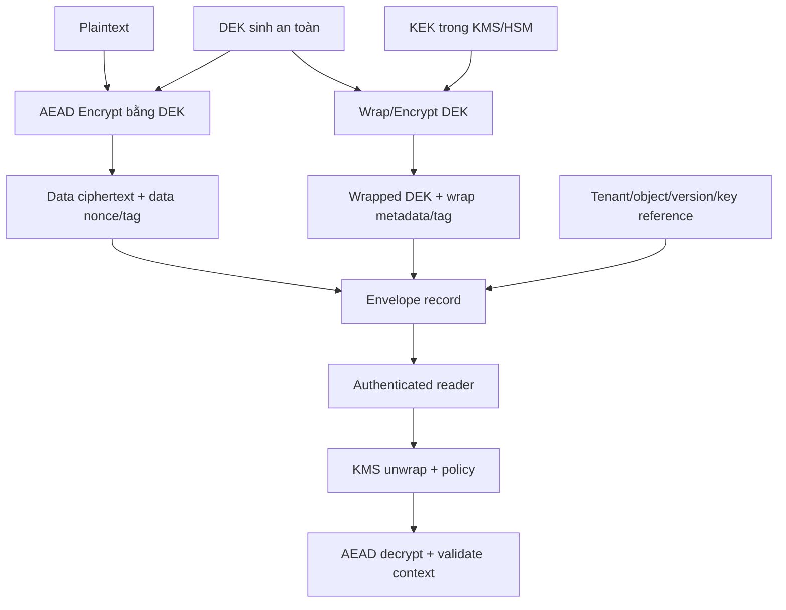
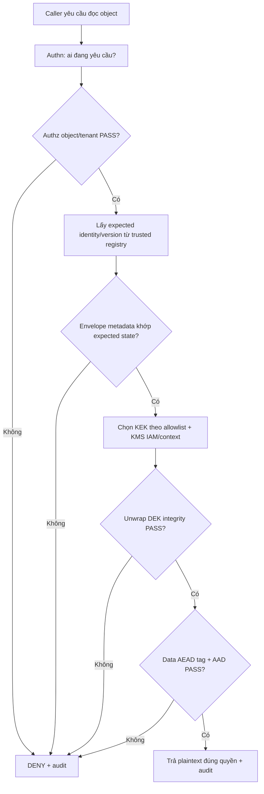

# Envelope integrity — Bảo đảm tính toàn vẹn trong envelope encryption

Trong chương **Envelope encryption** của module **SECURITY_KEY_MANAGEMENT_FUNDAMENTALS**, **envelope integrity** là tập các bảo đảm giúp hệ thống phát hiện và từ chối việc **dữ liệu mã hóa, khóa dữ liệu đã bọc hoặc thông tin liên kết giữa chúng bị sửa đổi, tráo đổi hoặc sử dụng sai ngữ cảnh**. Khi thiết kế envelope encryption, chỉ hỏi “ciphertext có giấu được plaintext không?” là chưa đủ. Cần hỏi thêm: *ciphertext có còn nguyên vẹn không, DEK mở ra có đúng cho đối tượng này không, metadata có bị tráo tenant không, bản ghi có bị rollback về phiên bản đã thu hồi không, và ai thực sự được phép yêu cầu giải mã?*

Một envelope thông thường chứa **ciphertext của dữ liệu**, **wrapped DEK (Data Encryption Key)** và **metadata** để chọn đúng khóa, thuật toán, version, tenant, object và ngữ cảnh. **KEK (Key Encryption Key)** bảo vệ DEK, thường nằm trong **KMS/HSM**. Vì vậy tính toàn vẹn phải được kiểm soát **theo nhiều lớp**: dữ liệu, vật liệu khóa đã bọc, quan hệ giữa các lớp và trạng thái tin cậy bên ngoài envelope.

**Điểm cốt lõi:** **AEAD** (như AES-GCM) có thể phát hiện thay đổi ciphertext, tag và **AAD** đã được ràng buộc; **key wrapping** có thể cung cấp kiểm tra tính toàn vẹn của DEK theo scheme. Tuy nhiên, **một envelope cũ hợp lệ vẫn có thể vượt kiểm tra AEAD nếu bị replay/rollback**, và một caller được phép gọi KMS chưa chắc được phép đọc dữ liệu nghiệp vụ. Không có một “tag thần kỳ” nào thay thế **trusted registry, IAM, authorization, anti-rollback, audit và quản lý vòng đời khóa**.

Bài học kết nối envelope integrity với **mật mã đối xứng/bất đối xứng, chữ ký số, KMS/HSM, kiểm soát truy cập, kiểm toán và vòng đời khóa từ sinh, cấp phát, lưu trữ, sử dụng, xoay vòng đến thu hồi và hủy**, đúng phạm vi của module.

## 1. Mục tiêu học tập

Sau bài học, bạn có thể:

- Phân biệt **confidentiality**, **integrity**, **authenticity**, **freshness** và **authorization** trong mô hình envelope.
- Chỉ ra những thành phần cần bảo vệ: **payload ciphertext/tag**, **wrapped DEK/tag**, **nonce**, **algorithm/schema**, **key ID**, **tenant/object/version** và **key policy**.
- Giải thích cách **AEAD/AAD**, **AES Key Wrap/KWP** hoặc **KMS encryption context** hỗ trợ tính toàn vẹn, cùng giới hạn của từng cơ chế.
- Thiết kế **data AAD** và **wrap AAD** tách biệt để cho phép **rewrap KEK mà không nhất thiết mã hóa lại payload**.
- Phát hiện **key substitution, ciphertext swapping, metadata tampering, cross-tenant confusion, downgrade và rollback**.
- Hiểu vì sao **KMS key policy** và **object-level authorization** đều cần thiết, dù ciphertext/tag hợp lệ.
- Xây một ví dụ **Java 17** dùng AES-GCM hai lớp, kiểm thử sửa ciphertext, tráo metadata, kiểm tra version và rewrap.
- Thiết kế kế hoạch kiểm thử âm tính, giám sát, incident response và bảo vệ các bản sao/backup trước khi hủy khóa.

## 2. Nhắc lại kiến trúc envelope encryption

Envelope encryption phân tách hai mục đích:

- **DEK**: khóa dùng để mã hóa/giải mã **nội dung**.
- **KEK**: khóa dùng để **bảo vệ DEK** bằng key wrap, AEAD hoặc API quản lý khóa tương đương.



Ở mô hình có **AES-GCM cho cả hai lớp**, có thể ký hiệu:

\[
(C_d,T_d) = \operatorname{GCM.Enc}(DEK,N_d,P,A_d)
\]

\[
(C_k,T_k) = \operatorname{GCM.Enc}(KEK,N_k,DEK,A_k)
\]

Trong đó:

- \(P\): plaintext; \(C_d,T_d\): bản mã payload và tag của dữ liệu.
- \(C_k,T_k\): bản mã DEK và tag của lớp bọc.
- \(N_d\), \(N_k\): các nonce thuộc **hai thao tác mã hóa khác nhau**.
- \(A_d\): **data AAD**, thường gắn với danh tính và phiên bản bất biến của payload.
- \(A_k\): **wrap AAD**, thường gắn với danh tính DEK, owner và KEK thực tế.

Đây là **một cách triển khai**, không phải định nghĩa duy nhất. Nếu dùng **AES-KW (RFC 3394)** hoặc **AES-KWP (RFC 5649)**, lớp wrap có cách kiểm tra integrity và format khác AES-GCM, không có tham số nonce/tag GCM giống ví dụ trên. Nếu dùng KMS `GenerateDataKey`, provider có thể trả sẵn plaintext DEK cho phiên xử lý và encrypted DEK để lưu.

**Lưu ý:** việc mã hóa payload phải hoàn tất và xác thực đúng **trước khi ứng dụng tin hoặc phát tán plaintext ở phía đọc**. Với luồng streaming, không trả ra các chunk chưa được xác thực cuối cùng khi dùng scheme chỉ bảo đảm integrity toàn bản tin tại lúc kết thúc.

## 3. Integrity là gì — và không phải là gì?

### 3.1. Năm thuộc tính thường bị nhầm

| Thuộc tính | Câu hỏi | Envelope có tự bảo đảm không? |
| --- | --- | --- |
| **Confidentiality** | Kẻ chỉ có file lưu trữ có đọc được plaintext không? | Có thể, khi DEK/KEK an toàn và scheme đúng. |
| **Cryptographic integrity** | Ciphertext, AAD hoặc wrapped key bị sửa có bị phát hiện không? | Có thể, bằng AEAD/tag hoặc scheme wrapping có integrity. |
| **Authenticity theo key** | Dữ liệu có do bên **giữ khóa phù hợp** tạo hoặc chấp nhận không? | AEAD chứng minh ở mức các bên chia sẻ secret, không định danh tác giả độc lập. |
| **Freshness/anti-rollback** | Đây có phải **phiên bản mới nhất được phép** không? | **Không tự động**; cần nguồn version/state tin cậy bên ngoài. |
| **Authorization** | Caller có quyền đọc đúng object và tenant không? | **Không**; cần IAM và kiểm tra nghiệp vụ. |

Thêm một thuộc tính khác là **non-repudiation** (*chống chối bỏ* theo mô hình áp dụng). **AES-GCM tag không phải chữ ký số**: mọi bên sở hữu cùng DEK đều có thể tạo tag hợp lệ; tag không tự chứng minh một người cụ thể đã ký tài liệu.

### 3.2. Integrity phải được định nghĩa trên “đúng đối tượng”

Giả sử có ciphertext được mã hóa hợp lệ cho hóa đơn A. Nếu attacker không sửa ciphertext mà **chép cả envelope A sang vị trí của hóa đơn B**, kiểm tra tag có thể vẫn thành công nếu hệ thống tin danh tính ghi bên trong envelope.

Vì vậy điều cần bảo vệ không chỉ là *“bytes này chưa bị sửa”*, mà còn:

> “Bytes này thuộc **đúng tenant, đúng object, đúng phiên bản, đúng key purpose**, được yêu cầu bởi **caller có quyền**, và còn **hợp lệ theo state hiện tại**.”

Đó là **integrity của mối quan hệ**, không chỉ integrity của từng trường riêng lẻ.

## 4. Các lớp integrity trong một envelope

Một envelope tốt thường có các lớp sau:

| Lớp | Đối tượng cần bảo vệ | Cơ chế chính | Giới hạn cần nhớ |
| --- | --- | --- | --- |
| **L1 — Payload integrity** | Plaintext sau giải mã phải tương ứng ciphertext/tag và data AAD. | AEAD như AES-GCM. | Không xác nhận bản ghi là mới nhất hay caller có quyền. |
| **L2 — Wrapped-DEK integrity** | DEK khôi phục phải là key material được bảo vệ dưới KEK đúng. | AES-KW/KWP, AEAD, KMS wrapper. | Không tự bảo đảm DEK thuộc payload nếu thiếu binding. |
| **L3 — Context/binding integrity** | Tenant, object, contentVersion, dataKeyId, purpose, KEK ref. | AAD, authenticated metadata, trusted mapping. | Trường có thể sửa hoặc không nằm trong AAD vẫn cần chính sách khác. |
| **L4 — State/freshness integrity** | Phiên bản hiện hành, trạng thái bị thu hồi, chống rollback. | Trusted registry, monotonic revision, manifest/transaction. | Không thể suy từ tag của một record độc lập. |
| **L5 — Access/accountability** | Ai được unwrap, xem dữ liệu, đổi policy, rotate hoặc xóa. | IAM/KMS, business authz, audit. | Key không exportable vẫn có thể bị lạm dụng qua API. |

### 4.1. Ba câu hỏi cần kiểm tra khi decrypt

1. **DEK có được mở đúng không?** Lớp wrap đã xác thực thành công, đúng KEK, context, key version và key purpose?
2. **Payload có còn đúng không?** Lớp data đã xác thực tag/AAD và khớp DEK, nonce, ciphertext?
3. **Có được trả dữ liệu không?** Trusted registry xác nhận tenant/object/version, caller có quyền, record không bị thu hồi hoặc rollback?

Cả ba phải **PASS**. Nếu câu 1 hoặc 2 thất bại, không được “cố decrypt với key khác” theo kiểu thử-và-sai ngoài policy. Nếu câu 3 thất bại, **không trả plaintext**, ngay cả khi kết quả mật mã là hợp lệ.

## 5. AES-GCM và tính toàn vẹn payload

**AES-GCM** là một chế độ **Authenticated Encryption with Associated Data (AEAD)**. Với key, nonce, plaintext và AAD, nó tạo ciphertext cùng authentication tag. Ở phía decrypt, nếu bất kỳ phần được xác thực nào bị sửa, `Cipher.doFinal` của Java sẽ thất bại với lỗi xác thực thích hợp khi tag không hợp lệ.

### 5.1. Ciphertext, tag và AAD có vai trò gì?

```text
AEAD Encrypt:
  key       = DEK
  nonce     = N_data
  plaintext = bytes của dữ liệu nghiệp vụ
  AAD       = canonical tenantId/objectId/version/dataKeyId
  result    = ciphertext + authenticationTag

AEAD Decrypt:
  dùng lại key, nonce, ciphertext/tag và AAD tương ứng
  -> chỉ chấp nhận plaintext nếu authentication PASS
```

- **Ciphertext** mang nội dung được mã hóa.
- **Tag** giúp phát hiện thay đổi ciphertext/AAD trong mô hình mật mã khi secret còn an toàn.
- **AAD** được **xác thực nhưng không mã hóa**. Tenant/object ID trong AAD có thể vẫn công khai trong metadata.
- **Nonce** thường không bí mật, nhưng **không được lặp với cùng key trong AES-GCM**. Nonce sai thường khiến tag verification thất bại; lặp nonce ở bước encrypt có thể gây mất bảo đảm nghiêm trọng hơn.
- **Key** phải đúng DEK và có nguồn entropy/thuật toán phù hợp.

### 5.2. Đừng xem authentication tag là checksum tùy ý

Một checksum hoặc hash không có khóa có thể phát hiện **lỗi lưu trữ vô tình**, nhưng attacker sửa cả ciphertext và checksum có thể vượt qua. **AEAD tag** gắn với **khóa bí mật**, nên có thuộc tính bảo vệ khác.

Mặt khác, **AES-GCM tag không thay thế chữ ký số**. Người giữ DEK hoặc có khả năng yêu cầu encrypt phù hợp có thể tạo bản mã/tag mới; không có bằng chứng độc lập về một tác giả duy nhất.

### 5.3. Vì sao nonce là điều kiện integrity?

Khi GCM tái sử dụng **cùng nonce với cùng DEK** cho nhiều bản tin, các bảo đảm về confidentiality và authentication có thể bị phá vỡ. **Không thể khắc phục lỗi nonce bằng cách tăng độ dài tag** hoặc chỉ thêm AAD.

Do đó dù bài tập trung integrity, kiến trúc vẫn cần:

- Chính sách cấp phát nonce **duy nhất theo DEK** cho mọi writer/region.
- Hạn mức số lần mã hóa, lượng dữ liệu, cryptoperiod và trigger đổi key.
- Không dùng lại state bộ đếm sau crash/restore hoặc clone VM.
- Khi dùng nonce ngẫu nhiên, đánh giá **xác suất va chạm và tổng số thông điệp**; không khẳng định “96 bit là không thể trùng”.
- Với file lớn, dùng scheme chunking/streaming được thiết kế để mỗi chunk có nonce/sequence được xác thực, không phát từng chunk plaintext chưa xác thực.

## 6. Integrity của wrapped DEK

Một DEK đã bọc không chỉ cần giữ kín; hệ thống phải phát hiện việc **wrapped key bị sửa hoặc không đúng ngữ cảnh**.

### 6.1. Các cơ chế bảo vệ DEK

| Cơ chế | Cách hoạt động khái quát | Tính toàn vẹn |
| --- | --- | --- |
| **AES Key Wrap (RFC 3394)** | Bọc key material theo thuật toán chuyên dụng. | Có kiểm tra integrity theo cơ chế wrap; không phải AES-GCM tag/AAD tùy ý. |
| **AES Key Wrap with Padding (RFC 5649)** | Bọc input dài không nhất thiết chia hết cho block phù hợp. | Có kiểm tra cấu trúc/integrity theo scheme. |
| **AES-GCM wrap** | Mã hóa raw DEK bằng KEK qua AEAD. | Xác thực ciphertext, tag và wrap AAD; cần nonce uniqueness dưới KEK. |
| **KMS Encrypt/Decrypt** | Provider bảo vệ và khôi phục key material theo API. | Tùy thuật toán/ciphertext format/encryption context của provider. |
| **KMS GenerateDataKey** | Provider cấp DEK mới và encrypted DEK. | Cần đọc đúng hợp đồng API, key policy và encryption context. |
| **RSA-OAEP / KEM-based wrapping** | Bảo vệ secret cho recipient public key. | Integrity/decapsulation theo scheme, **không tự xác thực danh tính sender**. |

**Không lấy AES-ECB để mã hóa một DEK** chỉ vì DEK vừa đúng một số block. Cần scheme key wrap/AEAD có thuộc tính bảo vệ phù hợp và được duyệt.

### 6.2. Một wrapped DEK hợp lệ vẫn có thể thuộc sai payload

Giả sử có hai records:

```text
Record A:
  dataCiphertext_A, dataAAD_A, wrappedDEK_A

Record B:
  dataCiphertext_B, dataAAD_B, wrappedDEK_B
```

Attacker thay `wrappedDEK_A` bằng `wrappedDEK_B`:

- Nếu DEK khác nhau, **payload AEAD** thường thất bại khi dùng sai DEK.
- Nhưng không nên dựa toàn bộ khả năng chống tráo vào sự kiện “khóa tình cờ khác nhau”.
- Nếu DEK được tái sử dụng giữa object/tenant hoặc một số metadata không được ràng buộc, **binding lỏng** có thể tạo lỗ hổng về ngữ cảnh/ủy quyền.
- Nếu cả ciphertext và wrapped DEK của B bị copy sang vị trí A, kiểm tra tag nội bộ của B có thể PASS — lúc này **trusted object identity và anti-rollback** là tối quan trọng.

Vì vậy nên ràng buộc **data AAD** với danh tính payload ổn định và **wrap AAD** với danh tính DEK/record, rồi kiểm tra chúng với **nguồn tin cậy** khi đọc.

### 6.3. Nonce của wrap khác nonce của payload

Nếu cả data encryption và DEK wrapping dùng AES-GCM:

```text
dataNonce:
  thuộc thao tác encrypt payload dưới DEK
wrapNonce:
  thuộc thao tác encrypt DEK dưới KEK

Yêu cầu:
  uniqueness của dataNonce theo từng DEK
  uniqueness của wrapNonce theo từng KEK
```

Một KEK có thể bọc **hàng triệu DEK**, nên chiến lược cấp phát nonce và usage budget của lớp wrap cần thiết kế riêng. Khi provider hỗ trợ **AES-KW/KWP** hoặc KMS-managed wrapping, hãy cân nhắc ưu điểm của scheme dành riêng cho key material; không tự ép mọi trường hợp thành AES-GCM tự quản lý nonce.

## 7. Bảo vệ metadata: những trường nào cần ràng buộc?

Một mẫu envelope record dùng trong bài:

```json
{
  "schemaVersion": 3,
  "tenantId": "merchant-17",
  "objectId": "invoice-0092",
  "contentVersion": 8,
  "dataAlgorithm": "AES-256-GCM",
  "dataKeyId": "dek/invoice-0092/v2",
  "dataNonce": "<base64url-12-byte-nonce>",
  "dataCiphertextAndTag": "<base64url-ciphertext-plus-tag>",
  "wrappingAlgorithm": "provider-managed",
  "actualKekRef": "kms/billing/kek-v5",
  "wrappedDek": "<base64url-wrapped-key>",
  "wrapVersion": 4,
  "policyVersion": 15
}
```

Đây là **schema minh họa** chứ không phải một chuẩn đã được kiểm định. Giá trị Base64URL là biểu diễn dữ liệu, **không tạo confidentiality** nếu nội dung chưa được mã hóa.

### 7.1. Phân loại trường trong envelope

| Trường | Vai trò bảo mật | Cách xử lý |
| --- | --- | --- |
| `schemaVersion` | Quy tắc parse và tập thuật toán hợp lệ. | Allowlist; nếu ảnh hưởng interpretation, cần xác thực/binding đúng cách. |
| `tenantId` | Ranh giới dữ liệu và IAM. | Xác thực bằng AAD và so với identity/registry tin cậy. |
| `objectId` | Ràng buộc payload vào đối tượng. | Data/wrap binding; không tin client tự khai. |
| `contentVersion` | Phân biệt phiên bản payload. | Data AAD và trusted current version chống rollback. |
| `dataKeyId` | Nhận dạng DEK/nhóm dữ liệu. | Binding để tránh dùng key sai, đối chiếu registry. |
| `dataAlgorithm` | Scheme data encryption. | Chọn từ allowlist; ràng buộc với authenticated header. |
| `dataNonce` | Tham số AEAD data. | Giữ đúng giá trị, độ dài và uniqueness khi encrypt. |
| `dataCiphertextAndTag` | Payload bí mật và tag. | Xác thực đầy đủ trước khi tin plaintext. |
| `wrappingAlgorithm` | Scheme đã bọc DEK. | Allowlist và authenticated metadata; không fallback tùy tiện. |
| `actualKekRef` | Tham chiếu KEK thật, có version. | Wrap AAD/trusted mapping; không chỉ alias động. |
| `wrappedDek` | Ciphertext/key-wrap output của DEK. | Unwrap kiểm tra integrity, context, đúng key. |
| `wrapVersion` | Phiên bản bản bọc có thể thay khi rewrap. | Wrap binding/registry; không ép vào data AAD nếu muốn rewrap độc lập. |
| `policyVersion` | Audit/quyết định quản trị. | Trusted policy state, không coi trường JSON tự khai là quyền. |

**Các trường không được ràng buộc hoặc không được kiểm tra bởi trusted mapping là bề mặt tấn công.** Đừng khẳng định mọi metadata được xác thực chỉ vì payload sử dụng AES-GCM.

### 7.2. Data AAD: ràng buộc vào payload bất biến

Đối với bản ghi hóa đơn, một data AAD hợp lý là:

```text
dataAAD = canonicalEncode(
  "data-envelope:v3",
  schemaVersionForData,
  tenantId,
  objectId,
  contentVersion,
  dataKeyId,
  dataAlgorithm
)
```

Các trường này xác định **đối tượng và nội dung**; khi payload không đổi, chúng thường không thay. Khi metadata này thay đổi, ciphertext/tag có thể không còn hợp lệ, đúng mục đích phát hiện sửa đổi.

### 7.3. Wrap AAD: ràng buộc vào lớp quản lý khóa

```text
wrapAAD = canonicalEncode(
  "wrapped-dek:v3",
  tenantId,
  objectId,
  contentVersion,
  dataKeyId,
  actualKekRef,
  wrappingAlgorithm,
  wrapVersion
)
```

Khi **rewrap DEK dưới KEK mới**, `actualKekRef` hoặc `wrapVersion` thay đổi. Tạo wrapped DEK/tag mới với **wrap AAD mới**; payload và data AAD vẫn có thể giữ nguyên.

**Thiết kế quan trọng:** tránh đưa **metadata thay đổi do KEK rotation** như `actualKekRef`, `wrapVersion` vào **data AAD** nếu yêu cầu cho phép rewrap mà không re-encrypt payload. Ngược lại, không được để việc tách AAD biến thành lỗ hổng: **cả hai lớp phải dùng các định danh liên kết bất biến** và registry kiểm tra mối quan hệ.

### 7.4. Tại sao cần domain separation?

Nếu một secret/key hierarchy phục vụ nhiều mục đích hoặc metadata có thể được diễn giải theo nhiều cách, cần phân biệt ngữ cảnh bằng **nhãn domain**:

```text
"data-envelope:v3" ≠ "wrapped-dek:v3"
"invoice:v1" ≠ "payroll:v1"
"tenant-A" ≠ "tenant-B"
```

Các nhãn này giúp tránh **cross-protocol/context confusion** khi cùng hình thức serialization có thể đại diện những đối tượng khác nhau. Nhưng domain label **không thay thế khóa/purpose separation**; nếu chính sách yêu cầu, dùng các DEK/KEK khác nhau theo tenant và nghiệp vụ.

## 8. Canonicalization: integrity xác thực byte, không xác thực “ý nghĩa”

AEAD nhận **dãy byte AAD cụ thể**. Hai chuỗi nhìn tương tự nhưng encode khác nhau sẽ có tag khác nhau; nếu cách nối không rõ ranh giới, các bộ giá trị khác nhau đôi khi tạo cùng một chuỗi byte.

Ví dụ cách nối mơ hồ:

```text
Nối không có độ dài:
  ["ab", "c"]  -> "abc"
  ["a", "bc"]  -> "abc"   (xung đột ngữ cảnh)

Nối có length-prefix:
  (2,"ab")(1,"c")
  (1,"a")(2,"bc")        (khác nhau)
```

Một format tốt cần:

1. Xác định **thứ tự trường, kiểu dữ liệu và encoding** (ví dụ UTF-8).
2. Có **độ dài tường minh** hoặc canonical serialization được đặc tả rõ.
3. Phân biệt số nguyên với chuỗi, giá trị null với chuỗi rỗng, các phiên bản schema.
4. Quy tắc Unicode normalization và so sánh identifier được áp dụng nhất quán nếu có.
5. Không phụ thuộc thứ tự key của JSON object, khoảng trắng hay định dạng thời gian mơ hồ.
6. Giới hạn kích thước/độ sâu/field count trước khi parse để tránh DoS.
7. Nếu thêm trường **critical** ở phiên bản mới, định nghĩa cách client cũ xử lý: **fail closed** khi không hiểu thuộc tính ảnh hưởng bảo mật.

**Không hash JSON tùy tiện rồi gọi đó là “canonical integrity”** nếu serializer của writer và reader khác nhau. Cách làm đó có thể khiến dữ liệu hợp lệ không giải mã được hoặc tạo ambiguity khó audit.

## 9. Integrity không tự chống rollback và replay

### 9.1. Vì sao một record cũ vẫn có tag hợp lệ?

Giả sử:

```text
Version 8 (hiện hành):
  invoice-92 đã được cập nhật, envelope E8 có tag hợp lệ

Version 6 (đã bị thay thế):
  envelope E6 cũng có tag hợp lệ từ thời điểm trước

Attacker có quyền sửa object store:
  thay E8 bằng E6
```

**Cả E6 và E8 có thể đều vượt AEAD verification.** Thuật toán không có thông tin ngoại sinh về **phiên bản nào là hiện hành**. Tên object hay trường `contentVersion` ghi ngay trong một envelope cũ cũng bị replay cùng envelope đó.

### 9.2. Cơ chế chống rollback

- **Trusted registry/database** giữ current version hoặc minimum accepted version, cập nhật giao dịch có điều kiện (CAS/transaction).
- **Monotonic counter** hoặc sequence được bảo vệ bởi cơ chế ngoài kho có thể bị attacker sửa.
- **Signed manifest hoặc checkpoint** khi cần tính toàn vẹn của cả tập object; public key/trust phải được bảo vệ riêng.
- **Append-only/tamper-evident audit** với bảo vệ toàn vẹn chuỗi sự kiện, theo phạm vi kiến trúc.
- **Policy state** ghi thời điểm key/record bị revoked, expired, compromised hoặc xóa.
- **Replay defense** khi dữ liệu là thông điệp/giao dịch: request ID, timestamp/window, nonce/message ID đã xử lý và idempotency.

**Đặc biệt:** nếu attacker chiếm được **cả object store và trusted registry**, hệ thống không còn khả năng chống rollback chỉ dựa trên các thuộc tính lưu trong cùng miền tin cậy. Cần định nghĩa ranh giới tin cậy và vị trí giữ state độc lập.

### 9.3. Phân biệt replay request với rollback dữ liệu

- **Replay request:** gửi lại một request hoặc ciphertext đã hợp lệ tới API để thực hiện hành động lần nữa; cần chống replay theo giao thức.
- **Rollback data:** thay trạng thái lưu trữ bằng một bản cũ hợp lệ; cần trusted version/state.
- **Reorder chunks:** sắp lại thứ tự chunk đã mã hóa; cần xác thực **chunk index/order/total length/finalization** trong thiết kế streaming.

Một AEAD tag riêng cho từng chunk không tự bảo đảm **toàn file không thiếu chunk** nếu manifest, thứ tự và số chunk không được xác thực.

## 10. Threat model: những kiểu sửa đổi envelope phổ biến

| Hành vi attacker | Nếu chỉ dùng encryption “bí mật” | Kiểm soát cần có |
| --- | --- | --- |
| Đổi một byte ciphertext | Có thể tạo dữ liệu sai/không xác định. | AEAD tag verification. |
| Đổi/loại bỏ authentication tag | Không thể chấp nhận record như hợp lệ. | Fail closed, kiểm tra tag đầy đủ. |
| Đổi `dataNonce` | Decrypt không nhất quán hoặc nguy cơ nếu nonce management yếu. | Validate nonce, tag và policy uniqueness. |
| Đổi `wrappedDek` | Dùng sai khóa hoặc gây lỗi. | Key wrap integrity + data AEAD. |
| Tráo `actualKekRef` | Chọn sai KEK hoặc liên miền. | Wrap AAD, trusted key mapping, IAM. |
| Tráo `tenantId`/`objectId` | Dữ liệu bị gán sai tenant/object. | Data/wrap AAD + trusted object authorization. |
| Copy cả envelope B vào vị trí A | Tag nội bộ của B có thể hợp lệ. | External expected identity + trusted registry. |
| Replay envelope bản cũ hợp lệ | Tag vẫn có thể đúng. | Monotonic version, revocation state/anti-rollback. |
| Đổi `dataAlgorithm` sang thuật toán yếu | Có thể downgrade nếu parser linh hoạt quá mức. | Algorithm allowlist, authenticated schema/version. |
| Gắn thêm field parser không hiểu | Có thể làm hai hệ thống hiểu metadata khác nhau. | Strict versioned schema, critical field rules. |
| Đổi alias `current` sau rotation | Có thể unwrap sai hoặc không tìm được key. | Actual key ID/version, trusted mapping. |
| Chiếm workload có `Decrypt` rộng | Có thể unwrap DEK hợp lệ hàng loạt. | IAM least privilege, business authorization, anomaly detection. |
| Chiếm key registry | Có thể thay current version/allowed tenant. | Tách quyền, transaction integrity, audit độc lập và hạn chế admin. |
| Thay đổi AAD encoding giữa writer/reader | Dữ liệu cũ không thể decrypt hoặc diễn giải sai. | Canonical encoding, versioning, compatibility tests. |

Một số tấn công làm **DoS** chứ không trực tiếp lộ plaintext. Integrity policy vẫn phải xử lý chúng: kiểm tra kích thước, hạn mức retry, alert và không trả chi tiết lỗi mật mã có thể trở thành oracle.

## 11. KMS/HSM và integrity của lớp quản lý khóa

**KMS/HSM** thường là nơi giữ KEK hoặc thực thi thao tác trên khóa quản lý, nhưng **không có một API bảo vệ integrity giống hệt ở mọi nhà cung cấp**.

### 11.1. Encryption context của KMS

Một số KMS cho phép truyền **encryption context / associated data** khi encrypt/unwrap. Ví dụ logic:

```json
{
  "tenantId": "merchant-17",
  "objectId": "invoice-0092",
  "purpose": "dek-wrap:v3",
  "dataKeyId": "dek/invoice-0092/v2"
}
```

Nếu provider ràng buộc context này vào ciphertext theo mechanism phù hợp, **unwrap phải nhận đúng context** mới thành công. Tuy nhiên:

- Encryption context thường **không bí mật**; không đặt plaintext nhạy cảm vào đó.
- **Cú pháp, khả năng hỗ trợ và cách canonicalize** phụ thuộc provider.
- Một số KMS có thể ghi context vào audit, khiến metadata lộ cho người đọc log.
- Context đúng không chứng minh caller có **quyền nghiệp vụ** trên object.
- Không tự tạo context chỉ từ client JSON chưa được xác thực; so với trusted identity/registry.

### 11.2. Không đánh đồng integrity với key non-exportability

Một KEK non-exportable trong KMS/HSM giúp hạn chế đường xuất **raw key material**. Nhưng nếu service có quyền `Decrypt` trên KEK, attacker chiếm service vẫn có thể unwrap một DEK mà họ có ciphertext.

Do đó:

- **Key secrecy:** ngăn xuất/lộ KEK.
- **Key operation authorization:** giới hạn ai được unwrap, với context nào, bao nhiêu lần và trong khoảng thời gian nào.
- **Data authorization:** kiểm tra caller có quyền đọc object/tenant thật hay không.
- **Envelope integrity:** kiểm tra bản mã/metadata có khớp ngữ cảnh đã được phép.

Đây là các kiểm soát **bổ sung cho nhau**, không phải lựa chọn một trong bốn.

### 11.3. Actual key reference quan trọng hơn alias động

Nếu một envelope chỉ lưu `alias/current-billing-key`, sau rotation alias có thể trỏ sang KEK mới, còn wrapped DEK lịch sử vẫn thuộc KEK cũ. Lưu **actual immutable KEK key ID/version** hoặc một ciphertext format/provider metadata đủ xác định khóa lịch sử.

**Không tin** rằng một trường `actualKekRef` trong JSON là hợp lệ chỉ vì nó trông giống định danh KMS; cần ánh xạ với tenant/purpose và quyền sử dụng **ở nguồn tin cậy**.

## 12. Multi-tenant và integrity của ranh giới dữ liệu

Giả sử một service hỗ trợ tenant A và tenant B. Service có quyền unwrap cả KEK-A và KEK-B để phục vụ nhiều khách hàng. Client A cố gửi một envelope chứa key reference hoặc ciphertext của B.

**Cách kiểm tra đúng:**

1. Caller identity phải được xác thực và ánh xạ đến **tenant A** từ session/token phía server.
2. Object ID và bản ghi phải được lấy qua **access-controlled query**, không chỉ từ metadata client.
3. Envelope tenant/object/version phải khớp trusted record.
4. Key reference phải thuộc **allowlisted keys** cho tenant, purpose và cryptoperiod.
5. Data AAD và wrap AAD phải tạo từ **đúng trusted context**.
6. KMS IAM/encryption context nên giới hạn thêm nếu provider hỗ trợ.
7. Nếu bất kỳ điều kiện nào sai, từ chối **trước khi trả plaintext**.



**Không dùng “unwrap thành công” làm điều kiện duy nhất để mở dữ liệu.** Cùng một KMS role có thể được dùng cho nhiều object, nhưng business authorization phải quyết định **object nào thực sự được đọc**.

## 13. Key rotation và integrity: thiết kế rewrap không làm hỏng payload

Một lý do chọn envelope encryption là có thể **thay KEK mà không cần mã hóa lại payload**, khi DEK và payload encryption vẫn hợp lệ.

### 13.1. Hai miền AAD khác nhau

```text
DATA (bất biến khi chỉ đổi KEK):
  dataCiphertext, dataNonce, dataTag
  dataAAD = tenant + object + contentVersion + dataKeyId + dataAlgorithm

WRAP (thay đổi khi đổi KEK):
  wrappedDEK, wrapMetadata
  wrapAAD = tenant + object + contentVersion + dataKeyId
          + actualKekRef + wrapVersion
```

Khi rewrap:

- Unwrap DEK cũ dưới KEK cũ, với **context đúng**.
- Wrap cùng DEK dưới KEK mới, với **wrap AAD mới**.
- Cập nhật wrapped DEK và KEK reference một cách nhất quán.
- **Giữ nguyên data ciphertext, dataNonce, dataTag và dataAAD** nếu payload không đổi.
- Kiểm tra record identity/content version từ trusted registry; bảo vệ quá trình publish chống partial update.
- Có audit/idempotency và backup/DR plan.

Nếu data AAD ràng buộc `actualKekRef`, việc đổi KEK **làm data tag thất bại** trừ khi re-encrypt/retag payload theo giao thức. Đó có thể là quyết định kiến trúc chủ ý, nhưng không được tuyên bố “rewrap không đổi data” nếu schema đã buộc hai lớp chặt theo cách này.

### 13.2. Rewrap không tự xác thực lại mọi dữ liệu

Một thao tác rewrap chỉ xử lý **DEK** có thể thành công dù payload ciphertext đã bị sửa/hỏng từ trước. Hãy phân biệt:

- **Key-level migration success:** KEK mới mở được DEK.
- **End-to-end data integrity success:** payload được decrypt với **đúng AAD/tag**.
- **Operational correctness:** trusted registry, current version, quyền và backup đã đồng bộ.

Tùy chi phí và yêu cầu, migration có thể xác minh payload bằng sample hoặc toàn bộ; phải ghi rõ **mức độ bảo đảm** của mỗi bước. Đừng ghi “đã validate dữ liệu” chỉ vì API KMS `ReEncrypt` trả success.

### 13.3. Re-encrypt bằng DEK mới

Nếu **DEK bị lộ** hoặc muốn thay thuật toán/usage scope, có thể phải sinh **DEK mới**, mã hóa lại payload với nonce/tag mới rồi wrap DEK mới. Thao tác này có thể kéo theo cập nhật **dataKeyId, contentVersion, data AAD** và manifest.

**Rewrap** chỉ đổi cách bảo vệ **cùng một DEK**. Nó không khiến attacker đã biết DEK quên được khóa, nên không khôi phục confidentiality của ciphertext mà attacker có.

## 14. Integrity với streaming, file lớn và chunked encryption

Đối với file nhiều GB, một lời gọi AEAD cho toàn bộ file có thể không phù hợp về bộ nhớ/streaming. **Chia file thành nhiều chunk** cần thêm cấu trúc bảo vệ tính toàn vẹn của **thứ tự và tính đầy đủ**.

### 14.1. Những gì phải được xác thực ở mỗi chunk

Một mô hình đã được thiết kế có thể gắn vào AAD:

```text
domain = "file-chunk:v2"
fileId = trusted file identity
tenantId = trusted tenant
chunkIndex = 0,1,2,...
chunkCount / finalChunkMarker
contentVersion
algorithm/nonce strategy ID
```

**Chỉ xác thực từng chunk riêng lẻ không đủ** nếu attacker có thể **bỏ chunk cuối, đảo thứ tự hoặc phát lại một chunk cũ** mà ứng dụng vẫn coi như file hoàn chỉnh. Cần kiểm tra **manifest được xác thực**, tổng độ dài, số chunk, vị trí và dấu kết thúc theo thiết kế.

### 14.2. Streaming decrypt phải thận trọng

Một số API streaming có thể trả **plaintext tạm thời trước khi tag cuối được xác minh**. Không gửi plaintext đó cho client hoặc đưa vào xử lý có side effect nếu scheme chưa xác thực toàn bản tin.

Có thể chọn:

- Authenticated chunking với tag riêng và **manifest/ordering validation**.
- Ghi plaintext tạm vào vùng cách ly, chỉ publish sau khi xác thực hoàn tất.
- Dùng thư viện/định dạng streaming AEAD đã được thiết kế và kiểm thử, thay vì tự chế phân mảnh GCM.

Nonce generation phải tuân thủ **uniqueness cho mỗi chunk dưới cùng DEK**; số thứ tự chunk hoặc khóa dẫn xuất per-chunk phải được xử lý theo protocol, không tùy tiện tái dùng nonce.

## 15. Java 17: minh họa integrity hai lớp và kiểm thử sửa đổi

Đoạn Java dưới đây dùng **AES-256-GCM** cho cả data encryption và bảo vệ DEK. Nó có mục đích **giảng giải**: ở môi trường thật, KEK nên nằm trong **KMS/HSM** và thao tác wrap/unwrap phải được ủy quyền, không tạo rồi giữ raw KEK trong JVM như demo.

**Các thuộc tính được minh họa:**

- Payload tag xác thực **data AAD** dựa trên tenant/object/content version/DEK ID.
- Wrapped-DEK tag xác thực **wrap AAD** gồm cả KEK reference.
- Reader nhận **expected identity từ nguồn được tin cậy**, không đơn thuần tin metadata của envelope.
- Sửa ciphertext hoặc metadata sai ngữ cảnh phải thất bại.
- Một lần **rewrap** sang KEK mới giữ nguyên data ciphertext nhưng cập nhật lớp wrapped DEK.

```java
import java.io.ByteArrayOutputStream;
import java.io.DataOutputStream;
import java.nio.charset.StandardCharsets;
import java.security.SecureRandom;
import java.util.Arrays;
import java.util.Objects;
import javax.crypto.AEADBadTagException;
import javax.crypto.Cipher;
import javax.crypto.KeyGenerator;
import javax.crypto.SecretKey;
import javax.crypto.spec.GCMParameterSpec;
import javax.crypto.spec.SecretKeySpec;

public final class EnvelopeIntegrityDemo {
    private static final SecureRandom RNG = new SecureRandom();
    private static final int NONCE_BYTES = 12;
    private static final int TAG_BITS = 128;
    private static final int DEK_BYTES = 32;

    record Identity(
            String tenantId, String objectId,
            long contentVersion, String dataKeyId) {
        Identity {
            Objects.requireNonNull(tenantId);
            Objects.requireNonNull(objectId);
            Objects.requireNonNull(dataKeyId);
            if (contentVersion < 1) {
                throw new IllegalArgumentException("Invalid version");
            }
        }
    }

    record Blob(byte[] nonce, byte[] ciphertextAndTag) {
        Blob {
            Objects.requireNonNull(nonce);
            Objects.requireNonNull(ciphertextAndTag);
            if (nonce.length != NONCE_BYTES
                    || ciphertextAndTag.length < 16) {
                throw new IllegalArgumentException("Invalid AEAD blob");
            }
            nonce = nonce.clone();
            ciphertextAndTag = ciphertextAndTag.clone();
        }
        @Override public byte[] nonce() {
            return nonce.clone();
        }
        @Override public byte[] ciphertextAndTag() {
            return ciphertextAndTag.clone();
        }
    }

    record Envelope(
            Identity identity, String actualKekRef,
            Blob data, Blob wrappedDek) {}

    static SecretKey newAes256() throws Exception {
        KeyGenerator generator = KeyGenerator.getInstance("AES");
        generator.init(256, RNG);
        return generator.generateKey();
    }

    // Encoding có length-prefix, không nối chuỗi không phân tách.
    static byte[] encode(String domain, String... fields)
            throws Exception {
        ByteArrayOutputStream bytes = new ByteArrayOutputStream();
        try (DataOutputStream out = new DataOutputStream(bytes)) {
            put(out, domain);
            for (String field : fields) {
                put(out, field);
            }
        }
        return bytes.toByteArray();
    }

    static void put(DataOutputStream out, String field)
            throws Exception {
        byte[] b = Objects.requireNonNull(field)
                .getBytes(StandardCharsets.UTF_8);
        if (b.length == 0 || b.length > 256) {
            throw new IllegalArgumentException("Invalid field");
        }
        out.writeInt(b.length);
        out.write(b);
    }

    static byte[] dataAad(Identity id) throws Exception {
        return encode("data:v1",
                id.tenantId(), id.objectId(),
                Long.toString(id.contentVersion()), id.dataKeyId());
    }

    static byte[] wrapAad(Identity id, String kekRef)
            throws Exception {
        return encode("wrap:v1",
                id.tenantId(), id.objectId(),
                Long.toString(id.contentVersion()),
                id.dataKeyId(), kekRef);
    }

    static Blob seal(SecretKey key, byte[] clear, byte[] aad)
            throws Exception {
        byte[] nonce = new byte[NONCE_BYTES];
        RNG.nextBytes(nonce);
        Cipher cipher = Cipher.getInstance("AES/GCM/NoPadding");
        cipher.init(Cipher.ENCRYPT_MODE, key,
                new GCMParameterSpec(TAG_BITS, nonce));
        cipher.updateAAD(aad);
        return new Blob(nonce, cipher.doFinal(clear));
    }

    static byte[] open(SecretKey key, Blob blob, byte[] aad)
            throws Exception {
        Cipher cipher = Cipher.getInstance("AES/GCM/NoPadding");
        cipher.init(Cipher.DECRYPT_MODE, key,
                new GCMParameterSpec(TAG_BITS, blob.nonce()));
        cipher.updateAAD(aad);
        return cipher.doFinal(blob.ciphertextAndTag());
    }

    static Envelope encrypt(
            Identity id, String kekRef,
            byte[] plaintext, SecretKey demoKek) throws Exception {
        SecretKey dek = newAes256();
        Blob data = seal(dek, plaintext, dataAad(id));

        // Demo có DEK plaintext trong JVM. Production ưu tiên KMS.
        byte[] rawDek = dek.getEncoded();
        if (rawDek == null || rawDek.length != DEK_BYTES) {
            throw new SecurityException("DEK not exportable");
        }
        try {
            Blob wrapped = seal(demoKek, rawDek, wrapAad(id, kekRef));
            return new Envelope(id, kekRef, data, wrapped);
        } finally {
            Arrays.fill(rawDek, (byte) 0);
        }
    }

    static byte[] decrypt(
            Envelope envelope, Identity expected,
            String trustedKekRef, SecretKey authorizedKek)
            throws Exception {
        // expected & trustedKekRef phải lấy từ registry/IAM đã tin.
        if (!envelope.identity().equals(expected)
                || !envelope.actualKekRef().equals(trustedKekRef)) {
            throw new SecurityException("Envelope identity mismatch");
        }

        byte[] rawDek = open(authorizedKek, envelope.wrappedDek(),
                wrapAad(expected, trustedKekRef));
        try {
            if (rawDek.length != DEK_BYTES) {
                throw new SecurityException("Invalid DEK size");
            }
            SecretKey dek = new SecretKeySpec(rawDek, "AES");
            return open(dek, envelope.data(), dataAad(expected));
        } finally {
            Arrays.fill(rawDek, (byte) 0);
        }
    }

    static Envelope rewrap(
            Envelope original, Identity expected,
            String oldKekRef, SecretKey oldKek,
            String newKekRef, SecretKey newKek) throws Exception {
        if (!original.identity().equals(expected)
                || !original.actualKekRef().equals(oldKekRef)) {
            throw new SecurityException("Old key reference mismatch");
        }

        byte[] rawDek = open(oldKek, original.wrappedDek(),
                wrapAad(expected, oldKekRef));
        try {
            Blob newWrapped = seal(newKek, rawDek,
                    wrapAad(expected, newKekRef));

            // Dữ liệu/tag của payload không cần đổi khi chỉ rewrap.
            return new Envelope(
                    expected, newKekRef, original.data(), newWrapped);
        } finally {
            Arrays.fill(rawDek, (byte) 0);
        }
    }

    public static void main(String[] args) throws Exception {
        SecretKey oldKek = newAes256(); // Demo only
        SecretKey newKek = newAes256();

        Identity id = new Identity(
                "tenant-A", "invoice-42", 3, "dek/invoice-42/v1");
        byte[] message = "Hoa don hop le".getBytes(StandardCharsets.UTF_8);

        Envelope first = encrypt(id, "kek-v1", message, oldKek);
        byte[] restored = decrypt(first, id, "kek-v1", oldKek);
        System.out.println("Valid round-trip: " +
                Arrays.equals(message, restored)); // true

        // Sửa ciphertext nhưng giữ tag cũ: phải bị từ chối.
        byte[] changed = first.data().ciphertextAndTag();
        changed[0] ^= 1;
        Envelope tampered = new Envelope(
                first.identity(), first.actualKekRef(),
                new Blob(first.data().nonce(), changed),
                first.wrappedDek());
        try {
            decrypt(tampered, id, "kek-v1", oldKek);
            throw new AssertionError("Tampering was accepted");
        } catch (AEADBadTagException expectedTagFailure) {
            System.out.println("Data tampering rejected: true");
        }

        // Trusted registry yêu cầu version 4, record v3 không hợp lệ.
        Identity expectedNewVersion = new Identity(
                "tenant-A", "invoice-42", 4, "dek/invoice-42/v1");
        try {
            decrypt(first, expectedNewVersion, "kek-v1", oldKek);
            throw new AssertionError("Rollback was accepted");
        } catch (SecurityException expectedPolicyFailure) {
            System.out.println("Old version rejected by registry: true");
        }

        // Rewrap KEK mà giữ nguyên payload, data nonce và data tag.
        Envelope migrated = rewrap(first, id,
                "kek-v1", oldKek, "kek-v2", newKek);
        byte[] after = decrypt(migrated, id, "kek-v2", newKek);
        System.out.println("Rewrap still decrypts: " +
                Arrays.equals(message, after));
        System.out.println("Payload unchanged: " +
                Arrays.equals(
                        first.data().ciphertextAndTag(),
                        migrated.data().ciphertextAndTag()));

        Arrays.fill(message, (byte) 0);
        Arrays.fill(restored, (byte) 0);
        Arrays.fill(after, (byte) 0);
    }
}
```

Đầu ra dự kiến:

```text
Valid round-trip: true
Data tampering rejected: true
Old version rejected by registry: true
Rewrap still decrypts: true
Payload unchanged: true
```

### 15.1. Điều gì đã được chứng minh?

- **Sửa ciphertext payload** khiến AES-GCM authentication thất bại.
- **Version cũ** bị chặn nhờ một giá trị `expectedNewVersion` mô phỏng **trusted registry**; **không phải do GCM tự phát hiện rollback**.
- **Rewrap** thay KEK reference và wrapped DEK; payload ciphertext/tag không đổi vì data AAD chỉ chứa các trường bất biến.
- `Blob` sao chép mảng byte để hạn chế việc caller sửa dữ liệu bên trong sau khi tạo record. Điều này **không phải** một cơ chế bảo mật tổng quát chống process compromise.
- `encode` dùng length-prefix để tạo AAD nhất quán, phân biệt thứ tự và ranh giới trường.
- `decrypt` cần caller/registry cung cấp expected identity và KEK ref được ủy quyền; không chỉ dùng trường lấy từ envelope không tin cậy.

### 15.2. Những gì ví dụ **chưa** đáp ứng cho production

1. **KEK thật:** KEK demo nằm trong JVM, chưa được bảo vệ non-exportable bằng KMS/HSM. Thực tế thay phần wrap/unwrap bằng API provider có IAM và context.
2. **Business authorization:** biến `expected` là placeholder cho trusted mapping. Production phải kiểm tra caller, owner, tenant, object state và purpose.
3. **Anti-rollback thực sự:** demo không có registry/transaction/monotonic version; nó chỉ cho thấy nơi phải so sánh expected version.
4. **Persistent storage:** không có schema serialize/parse, file ACL, database transaction, atomic publish hoặc giới hạn kích thước file.
5. **Nonce discipline:** `SecureRandom` 96-bit mỗi lần encrypt là minh họa; cần giới hạn số lần dùng key, đánh giá va chạm/cấp phát duy nhất trong môi trường nhiều node và KMS.
6. **Algorithm agility:** demo cố định AES-256-GCM và không xử lý migration thuật toán/versioned policy.
7. **KMS failures:** không có quota, backoff, incident alert, circuit breaker, audit hoặc DR.
8. **Key erasure:** `Arrays.fill` chỉ giảm thời gian tồn tại một số bản sao key; `SecretKeySpec` và Java provider có thể giữ bản sao nội bộ.
9. **Key compromise:** tag hợp lệ không chứng minh data được tạo trước lúc key bị lộ; attacker có key có thể tạo tag hợp lệ.
10. **Audit:** không log operation/key ID và policy; production cần audit không chứa DEK, KEK hoặc plaintext nhạy cảm.

**Không copy nguyên demo làm crypto subsystem production.** Nên ưu tiên thư viện/format được kiểm định, các API KMS/HSM phù hợp và negative test tại ranh giới triển khai thật.

## 16. Kiểm thử âm tính cho envelope integrity

Một bài test tốt không chỉ xác nhận “round-trip decrypt đúng”. Cần chủ động kiểm tra nhiều dạng sửa đổi và phân biệt **failure do mật mã** với **failure do policy**.

| Test case | Kết quả mong muốn | Tầng phát hiện |
| --- | --- | --- |
| Payload ciphertext sửa 1 byte | Reject, không trả plaintext. | Data AEAD tag. |
| Data authentication tag bị cắt hoặc sửa | Reject. | Data AEAD parse/tag. |
| Data nonce bị đổi | Reject với đúng AAD/key. | Data AEAD. |
| Wrapped DEK bị sửa | Reject ngay tại unwrap hoặc data AEAD. | Wrap integrity / payload. |
| Wrap nonce/tag bị sửa | Reject; không fallback. | Wrapping scheme. |
| Tenant ID bị đổi từ A sang B | Reject khi so expected context. | Registry/authz + AAD. |
| Object ID bị đổi | Reject. | Registry/authz + AAD. |
| Data key ID bị sửa | Reject nếu binding đúng. | AAD + registry. |
| Actual KEK ref bị đổi | Reject hoặc KMS từ chối. | Trusted key mapping + wrap AAD/IAM. |
| Ciphertext của object B bị copy sang A | Reject dù tag B hợp lệ. | Expected identity + data AAD. |
| Cả envelope version 6 bị replay khi hiện hành là 8 | Reject. | Trusted version/anti-rollback. |
| Envelope v3 sử dụng algorithm bị cấm | Reject trước khi decrypt. | Schema/algorithm allowlist. |
| Có field critical không hiểu | Reject. | Strict parser/version policy. |
| Rewrap KEK v1 sang v2 | Payload unchanged nhưng wrapped DEK mới hợp lệ. | Migration integration test. |
| Sau rewrap vẫn chỉ có old KEK | Unwrap không được phép theo policy. | KMS + wrap context. |
| Caller có KMS `Decrypt` nhưng thiếu quyền đọc object | Reject. | Business authorization. |
| Replay thông điệp giao dịch đã được xử lý | Reject/deduplicate. | Replay tracking/idempotency. |
| Streaming file bị mất chunk cuối | Reject toàn file. | Authenticated manifest/final marker. |
| KMS outage/timeout | Fail closed, retry có giới hạn. | Operational policy. |
| Key compromised/deactivated | Thao tác theo incident/cryptoperiod policy. | IAM/KMS/registry. |

### 16.1. Cách phân loại lỗi trong hệ thống

- **Bad input/format:** kích thước, schema, encoding hoặc algorithm không hợp lệ.
- **Authentication failure:** tag, wrapped key integrity hoặc AAD không khớp.
- **Authorization failure:** caller/tenant/object/key scope không được phép.
- **Freshness failure:** phiên bản lỗi thời hoặc object đã bị thu hồi.
- **Availability failure:** KMS/storage/provider không sẵn sàng.

Đối với client không tin cậy, **không nhất thiết trả chi tiết phân biệt các lỗi mật mã** vì có thể tạo oracle. Log nội bộ nên có correlation ID, key reference, security event, nhưng không chứa raw key/plaintext; bảo vệ log khỏi bị sửa.

### 16.2. Chú ý khả năng chống downgrade

Khi giải mã bản ghi cũ:

- Không tự động chọn mode yếu chỉ vì client gửi `dataAlgorithm`.
- Mỗi `schemaVersion` có **allowlist algorithm/parameter set** và chính sách cho phép historical decrypt.
- Không chấp nhận tag dài tùy ý hoặc tự cắt tag ngoài policy.
- Nếu giao thức có field critical, client cũ không hiểu phải **reject**, không bỏ qua.
- Lưu bằng chứng object được tạo hợp lệ trong giai đoạn algorithm/key còn được cấp phép, nhưng **không tin client tự khai timestamp**.

## 17. Vòng đời khóa, cryptoperiod và integrity

Integrity của envelope có thể bị ảnh hưởng trực tiếp khi **key state hoặc quyền sử dụng thay đổi**.

| Giai đoạn | Cần bảo đảm |
| --- | --- |
| **Generate** | DEK/KEK sinh từ CSPRNG/HSM phù hợp, đúng algorithm/purpose. |
| **Activate/Provision** | KEK ref/usage/tenant được đăng ký và cấp quyền đúng. |
| **Encrypt/Wrap** | AEAD, nonce, AAD, trusted metadata và audit nhất quán. |
| **Read/Unwrap** | Policy, KMS key state, object authz, tag và current version PASS. |
| **Rotate KEK** | Rewrap với KEK mới, update wrap metadata nhất quán, giữ data integrity. |
| **Rotate DEK** | Re-encrypt payload, cập nhật data nonce/tag/AAD/version, kiểm thử end-to-end. |
| **Deactivate** | Cấm tạo bảo vệ mới bằng key cũ, xử lý lịch sử đúng quyền nếu cần. |
| **Compromised** | Không tin AEAD tag như bằng chứng “dữ liệu chắc chắn không bị giả mạo”; đánh giá phạm vi. |
| **Archive/Backup** | Backup giữ đủ wrapped DEK, KEK ref, encryption context và trusted metadata. |
| **Destroy** | Chỉ hủy sau khi xử lý dependencies, retention, legal hold và có evidence. |

### 17.1. Integrity khi metadata/version thay đổi

Khi **rewrap** mà không đổi payload, thay đổi wrap metadata **không nhất thiết** cần tăng `contentVersion` của dữ liệu, nhưng cần **wrap revision/manifest revision** riêng để quản trị atomic update và anti-rollback. Trong khi đó, khi **re-encrypt payload** bằng DEK mới, data identity/version và AAD thường thay đổi.

Một kiến trúc có thể có hai counter:

```text
contentVersion:
  thay khi nội dung plaintext hoặc data-encryption identity thay

wrapRevision:
  thay khi wrapped DEK / KEK ref được migrate

trustedRecordRevision:
  counter ngoài object store để chống rollback của toàn envelope
```

Đây là **một cách tổ chức**, không phải quy tắc chuẩn duy nhất. Cần chọn mô hình nhất quán giữa DB, object storage, KMS, backup, cache và chính sách pháp lý.

### 17.2. Không hủy KEK khi còn wrapped DEK lịch sử

Nếu hóa đơn cũ đang lưu `wrappedDek` dưới KEK-v3, việc hủy KEK-v3 trước khi rewrap/restore hoàn tất có thể khiến hóa đơn **không giải mã được**, dù ciphertext/tag vẫn còn nguyên vẹn.

Vì vậy **integrity PASS không đồng nghĩa availability PASS**. Một hệ thống cần cả **bảo vệ khỏi sửa đổi** lẫn **khả năng lấy đúng khóa** qua vòng đời.

## 18. Tích hợp chữ ký số, MAC và manifest integrity

AEAD tag thường xác thực dữ liệu trong phạm vi những bên **sở hữu hoặc sử dụng cùng secret**. Nếu tổ chức cần xác minh **nguồn gốc bởi bên thứ ba** hoặc phát hiện thao tác giả mạo bởi một bên có quyền mã hóa, có thể cần lớp bổ sung.

### 18.1. Digital signature cho manifest

Một mô hình:

```text
Envelope:
  ciphertext + wrapped DEK + authenticated metadata

Manifest:
  object identity
  content/version
  digest hoặc commitment đến envelope
  policy/trust reference

Signature:
  ký manifest bằng private signing key riêng
  verifier sử dụng public key/trust chain đáng tin
```

Cần xác định **manifest bao gồm những trường nào**. Nếu manifest ký cả `wrappedDek` và `actualKekRef`, mỗi lần rewrap có thể yêu cầu **ký lại manifest**. Nếu muốn rewrap không ảnh hưởng chữ ký payload, có thể tách **data manifest cố định** khỏi **key-wrap manifest có version/signature riêng**.

**Không dùng một AES DEK làm private signing key.** Chữ ký số có key type, trust, cryptoperiod và quy trình xác minh riêng.

### 18.2. HMAC có thay chữ ký không?

HMAC có thể bảo vệ integrity của manifest giữa các bên cùng giữ secret. Nhưng **ai có secret HMAC cũng có thể tạo MAC mới**, nên HMAC không tự tạo bằng chứng nguồn gốc độc lập như một mô hình public-key signature phù hợp.

MAC/signature cũng không tự chống rollback nếu **bản ghi cũ có MAC/signature hợp lệ**; vẫn cần current state hoặc chính sách freshness.

## 19. Backup, DR, replication và integrity

Một envelope còn nguyên tag chưa chắc có thể khôi phục được nếu **KEK bị xóa, provider key version không còn hoặc encryption context bị mất**.

### 19.1. Manifest cho backup

Bản backup nên giữ đủ:

- Ciphertext, data nonce/tag, wrapped DEK và thông tin wrap.
- Actual KEK key ID/version, provider/region nếu cần, data algorithm và schema version.
- Metadata được xác thực để tái tạo data/wrap AAD.
- Trusted record identity và snapshot/version state.
- Phụ thuộc vào historical KEKs, crypto policy và retention.
- Bằng chứng restore thử nghiệm, ownership và approvals.

Một bản backup có wrapped DEK nhưng mất **đúng encryption context** có thể không unwrap được, ngay cả khi KEK còn tồn tại.

### 19.2. Restore drill cần thử điều gì?

1. Phục hồi một object và metadata từ backup.
2. Khôi phục trusted identity/version/manifest bằng nguồn được phê duyệt.
3. Xác minh KEK lịch sử hoặc replica hợp lệ và quyền KMS.
4. Unwrap DEK đúng context, decrypt payload và **verify tag**.
5. Kiểm thử sai KEK, sai tenant, sai object, bị sửa tag và bản backup lỗi thời.
6. Không cho restore tạo quyền `Encrypt/Wrap` mới bằng key đã deactivated ngoài policy.
7. Đối chiếu object count, snapshot integrity, restore outcome và audit.
8. Nếu backup chứa bản cũ hợp lệ, xác định **đó là restore được phê duyệt hay rollback bị cấm**; quy trình DR có thể có quyền đặc biệt nhưng phải được ghi nhận.

### 19.3. Integrity khi replicate đa vùng

Với multi-region:

- Các vùng cần thống nhất **key references, replication policy, encryption context và trust mapping**.
- Không giả định KEK ref ở region A tự dùng được tại region B.
- Phải giải quyết replication lag, object version conflict và event ordering.
- Nếu có write từ nhiều region, nonce uniqueness cho DEK dùng chung phải được bảo đảm toàn cục.
- Audit migration/rotation liên vùng và kiểm thử decrypt trong đúng vùng dự phòng.

## 20. Giám sát, audit và incident response

### 20.1. Ghi nhận những gì?

| Sự kiện | Trường audit gợi ý |
| --- | --- |
| `ENVELOPE_CREATED` | actor, tenant, objectId, dataKeyId, KEK ref, algorithm, policyVersion, result. |
| `DEK_WRAPPED` / `UNWRAPPED` | requestId, key version, context hash/reference, outcome. |
| `DATA_AEAD_FAILURE` | object ref, tenant, policy version, correlation ID, failure class. |
| `WRAP_INTEGRITY_FAILURE` | actualKekRef, encrypted-DEK ref, context, provider error class. |
| `ENVELOPE_METADATA_MISMATCH` | expected vs observed identity/version (giới hạn thông tin nhạy cảm). |
| `ROLLBACK_REJECTED` | trusted current version, attempted version và source. |
| `REWRAP_STARTED/COMPLETED` | old/new KEK ref, wrapRevision, job ID, item count, outcome. |
| `KEY_POLICY_CHANGED` | principal, changeId, approvals, scope, old/new policy version. |
| `KEY_COMPROMISE_DECLARED` | incident ref, key scope, actions và trạng thái recovery. |

Log **không chứa** raw DEK, raw KEK, plaintext, private key, secret-bearing tokens hoặc encrypted key payload không cần thiết. Nếu cần đối chiếu context, dùng **metadata được làm sạch** hoặc tham chiếu/hash theo privacy policy; tránh biến log thành kho dữ liệu nhạy cảm.

### 20.2. Metrics hữu ích

- Tỉ lệ AEAD/tag validation failures theo service/tenant/key version.
- Tỉ lệ KMS unwrap failures phân theo permission, wrong context, key state, outage.
- Số lần **metadata mismatch** hoặc cross-tenant access attempts.
- Số record bị rollback rejection hoặc version conflict.
- Tiến độ rewrap, số record chưa migrate và số backup còn phụ thuộc old KEK.
- Nonce/usage budget của từng DEK/KEK, nếu hệ thống theo dõi được.
- Số thay đổi algorithm/profile và key policy ngoài change window.
- Tỉ lệ restore drill thành công sau rotation.
- Thời gian cô lập principal/key khi phát hiện compromise.

**Một lỗi tag đơn lẻ không đủ kết luận attacker đang tấn công**: có thể do corruption, sai key reference, sai serialization hoặc deploy lệch phiên bản. Cần điều tra theo tín hiệu, không “tự sửa” bằng cách tắt kiểm tra integrity.

### 20.3. Khi phát hiện tamper hoặc compromise

1. **Dừng trả plaintext** ở nhánh thất bại; không fallback sang chế độ không xác thực.
2. Ghi correlation ID, nguồn dữ liệu, key ref, version và thời điểm; bảo vệ bằng chứng.
3. Xác định lỗi thuộc **data integrity, wrap integrity, metadata mismatch, rollback hay provider outage**.
4. Cách ly object/workload hoặc credential có dấu hiệu nguy cơ, giới hạn blast radius.
5. Kiểm tra logs KMS, object-store versions, deployment, IAM grants và trusted registry.
6. Nếu **DEK lộ**, đánh giá lại confidentiality của payload; rewrap không làm secret trở lại an toàn.
7. Nếu **KEK lộ**, đánh giá tất cả wrapped DEK mà attacker có thể đã lấy; chỉ rotate KEK không đủ.
8. Nếu **workload có quyền unwrap bị chiếm**, điều tra các lời gọi hợp lệ bị lạm dụng, dù KEK non-exportable.
9. Sau xử lý, xác minh restore/re-encrypt/re-wrap theo policy, cập nhật inventory và audit; không xóa evidence vội.

## 21. Tình huống tổng hợp: hóa đơn số được rewrap an toàn

Một hệ thống Java lưu hóa đơn theo tenant, với **AES-GCM DEK riêng theo object** và KEK trong KMS.

### 21.1. Lúc tạo hóa đơn

- Tài khoản writer xác thực tenant và quyền tạo invoice.
- Dịch vụ sinh DEK, mã hóa payload với data AAD gồm `tenantId`, `invoiceId`, `contentVersion` và `dataKeyId`.
- KMS tạo hoặc wrap DEK dưới KEK-v4, sử dụng encryption context đúng policy.
- Envelope được lưu cùng data nonce/tag và wrapped DEK; registry ghi **expected version** và actual KEK ref.

### 21.2. Khi đọc

- Reader chỉ được chọn invoice đã được authorize từ trusted query.
- Registry cung cấp expected tenant/invoice/version/key scope.
- Envelope fields phải khớp expected; unwrap đúng context.
- AES-GCM decrypt phải verify tag; không thành công thì **không trả dữ liệu**.
- Log chỉ chứa metadata và kết quả, không chứa plaintext/DEK.

### 21.3. Khi rotate KEK-v4 sang KEK-v5

- New writes dùng v5; writer ngừng wrap mới dưới v4.
- Batch rewrap các DEK cũ bằng v5; **không sửa payload ciphertext/data AAD** nếu không đổi DEK/data.
- Wrap revision và actual KEK ref được cập nhật nhất quán qua transaction/atomic publish.
- Reader vẫn kiểm tra data tag và current version trước khi trả plaintext.
- Backup và DR được kiểm thử trước khi xem xét hủy v4.

### 21.4. Khi attacker sửa object storage

| Attack | Kết quả kỳ vọng |
| --- | --- |
| Sửa ciphertext hóa đơn | **Data AEAD fail**. |
| Sửa wrapped DEK | **Unwrap hoặc payload AEAD fail**. |
| Đổi tenant ID | **Trusted identity hoặc AAD fail**. |
| Copy toàn bộ envelope hóa đơn B sang A | **Expected object identity fail**. |
| Khôi phục bản hóa đơn cũ có tag hợp lệ | **Trusted version/anti-rollback fail**. |
| Thay wrap metadata sau migration | **Wrap AAD hoặc trusted key mapping fail**. |

**Bài học từ tình huống:** integrity là **chuỗi kiểm tra nhiều tầng**, không phải chỉ gọi `Cipher.doFinal` rồi trả kết quả.

## 22. Anti-patterns và hệ quả

| Anti-pattern | Hệ quả | Phương án đúng |
| --- | --- | --- |
| Mã hóa bằng AES-CBC không có MAC/integrity phù hợp. | Ciphertext có thể bị sửa mà không được phát hiện an toàn. | AEAD hoặc scheme authenticated encryption đúng chuẩn. |
| Bỏ qua GCM authentication tag khi decrypt. | Chấp nhận plaintext chưa xác thực. | Chỉ trả plaintext sau tag verification PASS. |
| Dùng AES-ECB để wrap DEK. | Thiếu bảo đảm key-wrap/integrity phù hợp. | AES-KW/KWP, AEAD hoặc KMS API được duyệt. |
| Lặp nonce GCM với cùng DEK hoặc KEK. | Có thể phá confidentiality/integrity. | Nonce uniqueness theo key và usage budget. |
| Chỉ xác thực payload mà không xác thực wrapped DEK. | Không có kiểm soát integrity lớp key, lỗi/tráo khó phân tích. | Wrap scheme có kiểm tra integrity và context. |
| Dùng `tenantId` client tự khai làm nguồn quyền. | Cross-tenant decrypt/confused deputy. | Trusted identity và object-level authorization. |
| Đặt mọi metadata trong JSON nhưng không đưa vào AAD/check. | Field bị sửa mà tag vẫn đúng. | Authenticated metadata và trusted registry. |
| Data AAD gắn KEK ref dù muốn rewrap độc lập. | Rewrap làm payload tag không khớp. | Tách data AAD bất biến và wrap AAD. |
| Dùng nối chuỗi mơ hồ cho AAD. | Context collision/serialization mismatch. | Length-prefix/canonical encoding. |
| Coi GCM tag đã bảo vệ chống rollback. | Bản cũ hợp lệ có thể được replay. | Trusted version và monotonic state. |
| Coi KMS decrypt thành công là được phép đọc object. | IAM KMS có thể rộng hơn quyền nghiệp vụ. | Business authz trước khi trả plaintext. |
| Tin `alias=current` là key ID lịch sử. | Rotation làm mất khả năng xác định KEK đúng. | Actual key ref/version và reconciliation. |
| Coi rewrap là đã thay DEK. | Đánh giá sai rủi ro secret cũ bị lộ. | Re-encrypt bằng DEK mới khi cần. |
| Xóa KEK cũ ngay sau chuyển new writes. | Backup/wrapped DEK lịch sử không thể mở. | Dependency inventory, migration và restore drill. |
| Chia file thành chunks nhưng không xác thực thứ tự/chunk cuối. | Có thể mất/tráo chunk vẫn bị chấp nhận. | Authenticated manifest/index/final marker. |
| Log DEK/plaintext hoặc encryption context nhạy cảm. | Lộ dữ liệu qua telemetry. | Chỉ log metadata cần thiết đã làm sạch. |
| Tắt integrity verification để xử lý lỗi KMS. | Biến sự cố availability thành lỗi bảo mật. | Fail closed, DR và incident workflow. |
| KMS KEK non-exportable nên bỏ IAM granular. | Attacker có quyền unwrap vẫn lấy DEK. | Key policy, tenant scope, authz và audit. |
| Không kiểm tra algorithm/schema version. | Downgrade hoặc parser ambiguity. | Strict allowlist và authenticated format. |
| Dựa vào một registry cùng trust domain với object store cho anti-rollback. | Attacker chiếm cả hai có thể sửa current version. | Thiết kế state/approval/evidence ở trust boundary phù hợp. |

## 23. Checklist thiết kế envelope integrity

1. **Threat model:** attacker có thể đọc, sửa, xóa hoặc rollback object store, key registry hay IAM ở mức nào?
2. **Payload AEAD:** data cipher có integrity và tag verification đầy đủ?
3. **Nonce:** dataNonce unique theo DEK; wrapNonce unique theo KEK nếu wrap dùng GCM?
4. **Wrap integrity:** cơ chế bọc DEK có kiểm tra tính toàn vẹn đúng scheme?
5. **Key separation:** DEK và KEK tách mục đích, nguồn sinh và quyền?
6. **Schema:** phiên bản, thuật toán, nonce, tag, wrapped DEK, actual key ref đầy đủ và được validate?
7. **Data AAD:** ràng buộc tenant/object/content version/dataKeyId bất biến theo payload?
8. **Wrap AAD:** ràng buộc tenant/object/DEK ID/KEK ref và wrap version?
9. **AAD encoding:** các trường được canonicalize có độ dài/kiểu/thứ tự xác định?
10. **Cross-layer binding:** reader kiểm tra DEK/wrapped record thuộc đúng payload và trusted object?
11. **External identity:** expected tenant/object/version đến từ nguồn đáng tin, không từ file/client?
12. **Authorization:** caller có cả KMS permission **và** quyền nghiệp vụ trên object?
13. **Anti-rollback:** current version/revocation state được bảo vệ ngoài miền attacker kiểm soát?
14. **Algorithm policy:** chỉ cho phép profiles hợp lệ, không downgrade khi lỗi?
15. **Streaming:** chunk order/count/final marker được xác thực; không trả plaintext chưa verify?
16. **Rewrap:** đổi wrap metadata mà không phá data AAD; atomic publish và audit migration?
17. **Key rotation:** khác biệt giữa KEK rewrap và DEK/data re-encrypt được thực thi đúng?
18. **Availability:** backup giữ key ref/context, restore drill kiểm tra decrypt sau rotation?
19. **KMS/HSM:** actual capabilities, encryption context, IAM/grants và provider-specific semantics được xác minh?
20. **Caching:** DEK cache có TTL/usage budget, phân tenant và invalidation khi incident?
21. **Audit:** tag failure, metadata mismatch, rollback, rewrap, policy changes được log không lộ secret?
22. **Compromise:** có runbook cho DEK/KEK/workload bị lộ và đánh giá dữ liệu quá khứ?
23. **Destruction:** KEK không bị xóa khi còn wrapped DEK/backup/legal hold phụ thuộc?
24. **Test:** có đầy đủ negative tests cho tamper, swap, replay, migration, wrong context và KMS outage?

## 24. Câu hỏi tự kiểm tra

1. Trong envelope encryption, integrity của **payload**, **wrapped DEK** và **metadata** khác nhau như thế nào?
2. AEAD cung cấp những bảo đảm nào và vì sao tag không tự là chữ ký số?
3. Vì sao một ciphertext/tag hợp lệ có thể vẫn không phải bản ghi hiện hành hợp lệ?
4. Data AAD nên chứa những trường nào khi thiết kế hỗ trợ rewrap KEK không đổi payload?
5. Wrap AAD nên chứa những trường nào để hạn chế key substitution và sai key reference?
6. Điều gì xảy ra nếu `actualKekRef` nằm trong data AAD rồi hệ thống thay KEK?
7. Vì sao `["ab","c"]` và `["a","bc"]` gây vấn đề nếu AAD chỉ là nối chuỗi không có độ dài?
8. Lặp nonce GCM ảnh hưởng thế nào tới confidentiality và integrity?
9. AES-KW/KWP có giống AES-GCM wrap về nonce, tag và AAD không?
10. Nếu attacker tráo cả envelope B sang vị trí A, vì sao tag của B có thể vẫn đúng?
11. Để chống rollback, hệ thống cần giữ state nào ngoài envelope và ở ranh giới tin cậy nào?
12. KMS encryption context giúp gì; nó có thay quyền đọc dữ liệu nghiệp vụ không?
13. Một KEK non-exportable trong HSM có ngăn được workload có quyền `Decrypt` bị chiếm không?
14. Rewrap KEK-v1 sang KEK-v2 có thay DEK hoặc data ciphertext không? Điều kiện nào làm câu trả lời khác?
15. Nếu DEK bị lộ, tại sao rewrap không khiến ciphertext cũ trở lại bí mật?
16. Vì sao thử restore backup cần kiểm tra cả KEK version, encryption context, tag và trusted registry?
17. Khi encrypt file lớn theo chunk, cần xác thực gì để tránh mất chunk, đổi thứ tự hoặc cắt chunk cuối?
18. Java 17 demo chống sửa ciphertext bằng cơ chế nào và chống version cũ bằng cơ chế nào?
19. Trong một multi-tenant service, tại sao không được lấy tenant ID từ ciphertext JSON làm nguồn quyết định quyền?
20. Dùng chữ ký số cho manifest có ưu điểm gì so với chỉ dùng AEAD? Rewrap có làm phát sinh yêu cầu ký lại không?
21. Nếu payload tag lỗi sau deploy, những nguyên nhân hợp lệ nào khác tấn công cần được điều tra?
22. Làm sao audit rewrap mà không lưu raw DEK hoặc plaintext trong log?
23. Tại sao integrity PASS không đồng nghĩa availability PASS nếu KEK đã bị hủy?
24. Những kiểm thử âm tính nào bạn sẽ ưu tiên trước khi triển khai envelope encryption cho dữ liệu thanh toán?

**Ghi nhớ:** **Envelope integrity không chỉ là “AES-GCM có tag”**. Một thiết kế an toàn cần **xác thực payload bằng AEAD**, **bảo vệ wrapped DEK bằng cơ chế wrap có integrity**, **ràng buộc metadata/DEK/payload bằng AAD có encoding rõ ràng**, đồng thời **so với trusted identity/version** để chống key substitution, cross-tenant confusion, replay và rollback. **KMS/HSM, IAM và quyền nghiệp vụ** quyết định ai được dùng khóa; **rotation/rewrap, backup, audit và incident response** quyết định khả năng duy trì bảo mật và khôi phục suốt vòng đời khóa.
