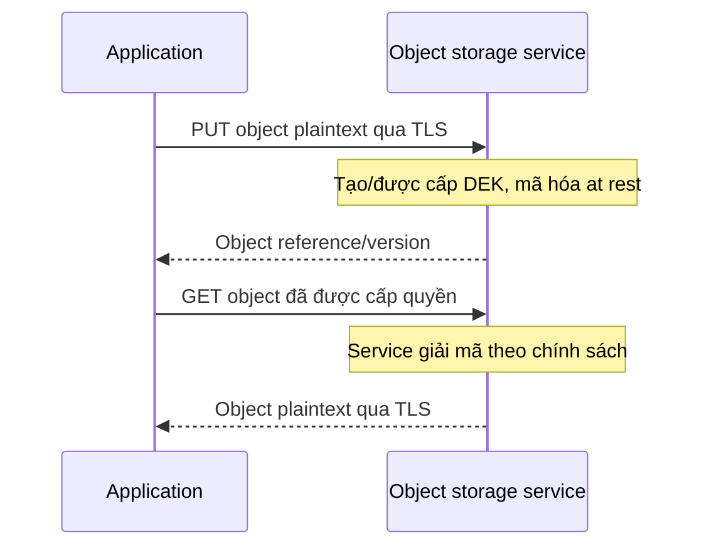
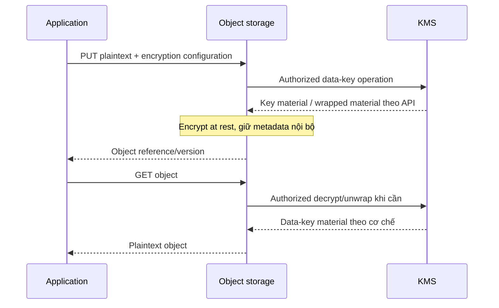
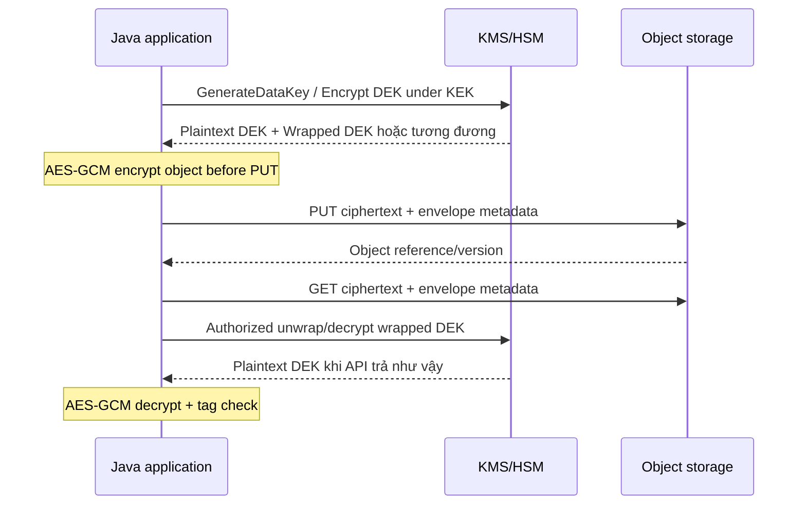
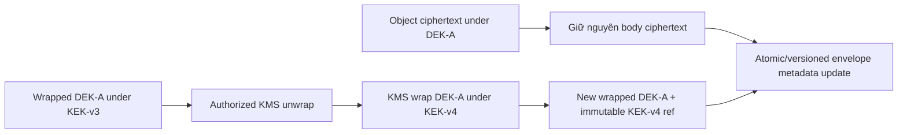
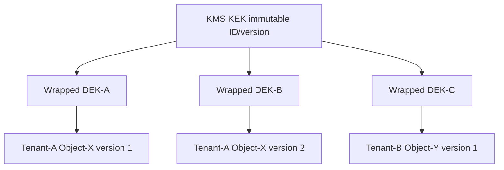
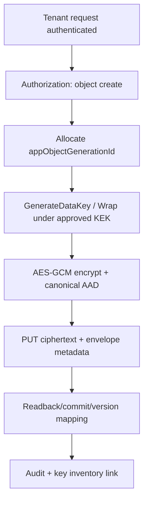
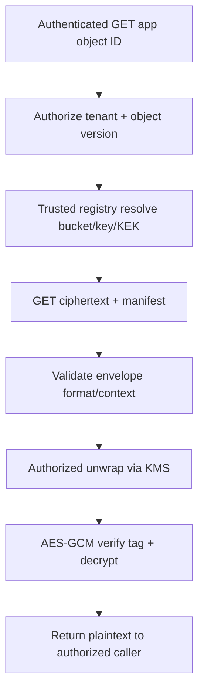

# Envelope encryption trong object storage: Bảo vệ object bằng DEK, KEK và metadata có thể truy vết

> **Chương:** Envelope encryption  
> **Bài học:** Envelope encryption trong object storage  
> **Module:** `SECURITY_KEY_MANAGEMENT_FUNDAMENTALS` — hiểu vòng đời khóa mật mã từ tạo, cấp phát, lưu trữ, sử dụng, xoay vòng đến thu hồi và hủy; kết nối mật mã đối xứng, bất đối xứng, chữ ký số, KMS/HSM, envelope encryption, kiểm soát truy cập và kiểm toán để thiết kế hệ thống bảo vệ khóa an toàn.

## 1. Bài toán: Object đã bật encryption nhưng ai thực sự giữ khóa?

Một nền tảng thương mại điện tử lưu hàng triệu file hóa đơn, chứng từ và ảnh lên object storage:

```text
object://prod-invoices/tenant-42/2026/11/invoice-7821.pdf
object://prod-invoices/tenant-19/2026/11/invoice-9054.pdf
```

Nhóm vận hành bật tùy chọn **encryption at rest** của bucket. Nhưng khi đánh giá bảo mật, hàng loạt câu hỏi xuất hiện:

- Dữ liệu được mã hóa **ở ứng dụng trước khi upload** hay **ở dịch vụ object storage sau khi nhận plaintext**?
- Khóa mã hóa từng object (Data Encryption Key, **DEK**) sinh ở đâu và tồn tại ở dạng rõ tại những nơi nào?
- DEK được bảo vệ bằng **Key Encryption Key (KEK)** nào? KEK nằm trong KMS/HSM hay ứng dụng?
- Metadata nào cho biết **key ID, key version, thuật toán, nonce và wrapped DEK**?
- Quyền tải object (`GetObject`) có tách khỏi quyền dùng KEK (`Decrypt`) không?
- Nếu object được copy sang bucket/region khác, version mới có dùng key cũ hay key mới?
- Khi KMS key bị disable/delete, hàng triệu object còn giải mã được không?
- Một object ciphertext bị attacker đổi sang object của tenant khác có được phát hiện không?
- Có thể thay KEK bằng **rewrap** mà không phải đọc/ghi lại toàn bộ object lớn không?
- File trong backup, archive và object versions cũ có còn phụ thuộc KEK đã định hủy không?

Câu trả lời nằm ở việc hiểu **envelope encryption** trong một hệ lưu trữ object có phiên bản, metadata, API và IAM riêng.

**Envelope encryption** là kiến trúc dùng **DEK** để mã hóa dữ liệu, sau đó dùng **KEK** để bảo vệ DEK. Với object storage, thông thường có ít nhất hai lớp:

```text
Object plaintext --(DEK)--> Object ciphertext
DEK plaintext    --(KEK)--> Wrapped DEK
```

Object storage có thể thực hiện toàn bộ luồng này **ở phía dịch vụ**, hoặc ứng dụng có thể mã hóa payload **trước khi upload**. Hai mô hình có khác biệt quan trọng về điểm plaintext xuất hiện, quyền truy cập, metadata, rotation và audit.

> **Nguyên tắc:** Một object được gắn nhãn “encrypted” không tự chứng minh rằng người có quyền đọc object không thể xem plaintext. Phải kiểm tra **ai được phép giải mã**, **khóa được sử dụng ở đâu** và **bằng chứng nào xác nhận data flow thực tế**.

### Mục tiêu học tập

Sau bài này, bạn có thể:

1. Mô tả kiến trúc **DEK–KEK** trong object storage và ý nghĩa của *wrapped DEK*.
2. Phân biệt **server-side encryption (SSE)**, **SSE với KMS**, **customer-supplied keys** và **client-side envelope encryption**.
3. Thiết kế luồng upload/download theo **authenticated principal, tenant, object identity, key ID/version và AAD**.
4. Hiểu AES-GCM, nonce, authentication tag, canonical metadata, envelope format version và các rủi ro thay thế/replay object.
5. Xử lý **multipart/chunked uploads**, versioning, copy, replication, lifecycle, archive và restore.
6. Phân biệt **alias rotation**, **KEK rewrap**, **DEK rotation** và **re-encryption**.
7. Đọc ví dụ **Java 17 AES-GCM** mô phỏng client-side envelope encryption, biết giới hạn so với KMS thật.
8. Thiết kế quyền `GetObject` và quyền KMS `Decrypt` theo **least privilege**, chống cross-tenant/confused deputy.
9. Xây dựng inventory, logging, kiểm thử, runbook và disaster recovery cho object ciphertext và key hierarchy.

---

## 2. Kiến thức nền: Object storage khác filesystem và database như thế nào?

Object storage thường cung cấp:

- **Bucket/container/namespace** chứa các object.
- **Object key** là định danh logic/path-like, ví dụ `tenant-42/invoice-7821.pdf`.
- **Object body** là tập byte của dữ liệu.
- **Object metadata/tags** và một số trường do dịch vụ quản lý.
- **Object version ID** nếu bật versioning theo cơ chế provider.
- **PUT/GET/HEAD/COPY/DELETE**, multipart upload hoặc các API tương đương.
- **IAM/bucket policy**, lifecycle/retention/replication, logging và inventory theo dịch vụ.

Dấu `/` trong object key thường chỉ là cách tổ chức **namespace**, không nhất thiết là thư mục POSIX với owner/mode bits.

### 2.1. Object identity không chỉ là “tên file”

Ví dụ:

```text
bucket         = invoices-prod
objectKey      = tenant-42/invoices/7821.pdf
objectVersion  = version-id-8a7b
tenantId       = tenant-42
```

Trong hệ có versioning, **hai phiên bản cùng object key** có thể chứa hai bản mã khác nhau, mỗi bản phụ thuộc DEK/KEK riêng. Khi thiết kế metadata/AAD cần quyết định có ràng buộc **version ID do storage cấp** hay dùng **immutable application object ID** trước khi upload.

Một khó khăn: object version ID do dịch vụ sinh **sau khi PUT** thường không thể biết trước để đưa vào AAD tại bước mã hóa. Giải pháp là dùng một ID bất biến do **ứng dụng/registry cấp trước** và ghi mapping `applicationObjectId ↔ storageVersionId` sau khi upload; không tự hứa có thể bind version ID chưa tồn tại.

### 2.2. Thư mục/prefix không phải security boundary

```text
tenant-42/
tenant-19/
```

Đây là cách đặt tên. Nếu backend có quyền `GetObject` toàn bucket và lấy object key trực tiếp từ request, attacker có thể thử dùng key của tenant khác.

Cần:

1. Xác thực principal.
2. Xác định tenant và quyền đọc tài liệu từ **nguồn tin cậy**.
3. Resolve object ID thành bucket/key/version có kiểm soát.
4. Kiểm tra storage IAM và quyền KMS/KEK nếu có.
5. Đảm bảo encryption context/AAD phù hợp tenant/object.
6. Audit cả hành động đọc object và giải mã.

### 2.3. Object metadata không mặc nhiên được xác thực mật mã

Một số metadata nằm ngoài ciphertext. Kẻ có quyền thay object/metadata có thể đổi:

```text
keyRef
algorithm
nonce
wrappedDek
tenantId
objectId
```

nếu định dạng của ứng dụng không có cơ chế bảo vệ thích hợp.

**AEAD authentication tag chỉ xác thực ciphertext và AAD đã thực sự được đưa vào thuật toán**, chứ không tự xác thực mọi thuộc tính trong bảng metadata hoặc các tag của object store.

---

## 3. Envelope encryption: Hai loại khóa và hai thao tác

### 3.1. Data Encryption Key (DEK)

DEK là khóa dùng mã hóa payload:

```text
DEK --(AES-GCM)--> encrypted object bytes
```

Một thiết kế thường dùng **DEK ngẫu nhiên mới cho mỗi object hoặc phiên bản object**. Điều này giúp:

- Giới hạn lượng dữ liệu chịu tác động nếu một DEK bị lộ.
- Tránh phải phối hợp nonce giữa rất nhiều object dưới cùng DEK.
- Cho phép xoay vòng/bảo vệ từng object riêng.
- Phân quyền và truy vết theo domain dữ liệu.

Nhưng **không bắt buộc mọi hệ đều dùng một DEK cho mỗi object**. Một DEK có thể bảo vệ một nhóm/chunk theo protocol, với giới hạn sử dụng và nonce strategy phù hợp. Quyết định phải rõ trong security design.

### 3.2. Key Encryption Key (KEK)

KEK dùng để bọc hoặc mã hóa DEK:

```text
KEK --(KMS Wrap/Encrypt)--> Wrapped DEK
```

Trong nhiều kiến trúc, KEK được quản lý ở **KMS/HSM**, không được export dưới dạng plaintext và được dùng qua API với IAM.

Một KEK có thể bảo vệ **nhiều DEK**, vì vậy blast radius lớn hơn một DEK đơn lẻ. Quyền `Decrypt/Unwrap` của KEK cần được quản lý nghiêm ngặt.

### 3.3. Bản ghi object envelope

Mẫu định dạng khái niệm:

```json
{
  "formatVersion": 1,
  "applicationObjectId": "inv-7821-version-01",
  "tenantId": "tenant-42",
  "encryptionAlgorithm": "AES-256-GCM",
  "dekWrapping": {
    "provider": "approved-kms",
    "wrappingKeyId": "immutable-kek-id-v3",
    "wrappingAlgorithm": "provider-defined",
    "wrappedDek": "<base64url-opaque-blob>"
  },
  "objectEncryption": {
    "nonce": "<base64url-12-byte-nonce>",
    "authenticationTagLocation": "attached-to-ciphertext",
    "aadSchemaVersion": 1
  },
  "ciphertextLocation": "object://invoices-prod/.../ciphertext"
}
```

Đây là **ví dụ ứng dụng client-side envelope**, không phải định dạng được tất cả object storage providers trả về. Dấu `<...>` là placeholder minh họa, không phải dữ liệu thật.

**Không đưa `rawDek`, `rawKek`, private key hay passphrase vào metadata**. Không coi `wrappingKeyId` hay `nonce` là bí mật, nhưng phải bảo vệ **tính toàn vẹn** và ranh giới tenant của chúng.

### 3.4. KEK có thể là khóa đối xứng hoặc bất đối xứng

Một hệ có thể bọc DEK bằng:

- AES Key Wrap/KWP hoặc cơ chế AEAD đã được thiết kế đúng.
- API KMS sử dụng managed symmetric key.
- Mã hóa bất đối xứng đến recipient public key theo hybrid encryption/key transport protocol được phê duyệt.
- Cơ chế HSM key wrapping đặc thù.

**Không lấy RSA private key để mã hóa object hàng gigabyte trực tiếp.** Asymmetric cryptography thường bảo vệ/thiết lập keying material ngắn, còn symmetric DEK xử lý payload lớn hiệu quả hơn.

### 3.5. Vì sao gọi là “phong bì”?

DEK là chìa khóa mở “nội dung thư”; wrapped DEK là phong bì chứa chìa khóa đã được bảo vệ. Dữ liệu có thể được sao chép cùng phong bì mà không lộ DEK, nếu wrapping, quyền và metadata đúng.

Tuy vậy, **wrapped DEK đi cùng ciphertext không làm dữ liệu an toàn nếu KEK bị lộ** hoặc người dùng không được phép có thể gọi KMS `Decrypt` thông qua một service có quyền quá rộng.

---

## 4. Ba kiến trúc mã hóa object thường gặp

### 4.1. Server-side encryption bằng khóa do storage quản lý

Luồng khái niệm:



Trong mô hình này, ứng dụng truyền plaintext tới dịch vụ object storage. Storage đảm nhận mã hóa khi lưu và giải mã khi phục vụ `GET` theo cấu hình.

**Ưu điểm:** ít thay đổi ứng dụng; quản lý key/metadata thường được tự động hóa bởi provider.

**Giới hạn:** boundary tin cậy bao gồm object storage service và các principal có quyền thực hiện `GET`. Nếu mục tiêu là **dịch vụ lưu trữ không bao giờ thấy plaintext**, SSE thông thường không đáp ứng.

### 4.2. Server-side encryption sử dụng KMS-managed key

Một biến thể SSE cho phép dùng **customer-managed key** trong KMS:



Mô hình trên là **trừu tượng**; cách storage service cache keys, cấp DEKs, gọi KMS và ghi internal envelope thay đổi theo nhà cung cấp.

**Điểm mạnh:** có thể kiểm soát KMS key policy, key lifecycle, audit KMS và tách trách nhiệm.

**Điểm cần kiểm chứng:** principal nào cần quyền KMS, khi nào KMS được gọi, caching có thay đổi số lượng event ra sao, KMS key nào dùng cho object/version, và **object read có dẫn tới plaintext** khi storage service được phép decrypt.

### 4.3. Client-side envelope encryption

Ứng dụng tự mã hóa object **trước khi upload**:



**Ưu điểm:**

- Object store có thể chỉ nhận **ciphertext**, không cần thấy plaintext.
- Ứng dụng có thể bind tenant/object bằng AAD và quản lý encryption format.
- Khả năng triển khai trên nhiều provider nếu metadata/protocol được chuẩn hóa cẩn thận.
- Cần cả quyền tải ciphertext và quyền giải bọc DEK để có plaintext.

**Đổi lại:**

- Ứng dụng giữ plaintext DEK trong memory theo API và phải tự xử lý nonce/AAD/tag.
- Multipart, range-read, metadata migration, versioning và stream processing phức tạp hơn.
- Application availability phụ thuộc cả KMS, metadata và format tương thích.
- Sai code/nonce có thể phá bảo mật, dù KEK đặt trong HSM.

### 4.4. Không coi hai mô hình là tương đương

| Câu hỏi | Server-side encryption | Client-side envelope |
|---|---|---|
| Storage nhận plaintext object? | **Có** trong mô hình SSE thông thường. | **Không**, nếu mã hóa đúng trước PUT. |
| Ai quản lý payload encryption algorithm? | Provider/dịch vụ theo cấu hình. | Ứng dụng/protocol. |
| Ai tạo/giữ DEK plaintext lúc mã hóa? | Dịch vụ theo mô hình provider. | Ứng dụng hoặc crypto provider của app. |
| Wrapped DEK nằm đâu? | Thường trong metadata nội bộ/format provider. | Trong envelope sidecar/header/metadata do ứng dụng quản lý. |
| App có tự xử lý nonce/AAD? | Thường không đối với SSE at rest. | **Có**, phải thiết kế chặt chẽ. |
| Quyền GET object tự cho plaintext? | Thường có khi quyền SSE/KMS đủ theo policy. | Không nếu thiếu wrapped-DEK decryption, nhưng backend vẫn có thể tự decrypt nếu được quyền. |
| Dùng across providers dễ dàng? | Có thể cần provider-specific migration. | Có thể portable nếu format và key wrapping được thiết kế đúng. |
| Audit KMS đầy đủ từng object GET? | Phụ thuộc key caching và dịch vụ. | Phụ thuộc app calls/caching; không tự đủ. |

---

## 5. Thuật ngữ SSE-S3, SSE-KMS, SSE-C và client-side encryption

Một số nhà cung cấp, đặc biệt hệ sinh thái Amazon S3, có các thuật ngữ:

| Thuật ngữ | Diễn giải ở mức khái niệm | Điều phải hiểu |
|---|---|---|
| **SSE-S3** | Server-side encryption do object storage quản lý khóa. | Server nhận plaintext qua kênh truyền và giải mã khi được phép. |
| **SSE-KMS** | Server-side encryption sử dụng KMS key mà policy có thể kiểm soát. | Quyền object storage và quyền KMS cần được thiết kế cùng nhau. |
| **DSSE-KMS** | Dual-layer server-side encryption dùng KMS theo khả năng dịch vụ cụ thể. | Không suy ra client-side confidentiality hay hai lớp key có cùng cơ chế. |
| **SSE-C** | Client cung cấp key cho dịch vụ storage mã hóa/giải mã server-side theo API. | Client chịu trách nhiệm quản lý/đưa key mỗi lần cần; không giống client-side encrypt-before-upload. |
| **Client-side encryption** | Client mã hóa payload trước PUT. | Quản lý envelope, metadata, key lifecycle và decryption code thuộc ứng dụng. |

**Tên gọi và hành vi cụ thể phụ thuộc nhà cung cấp, loại bucket/API/region và phiên bản dịch vụ.** Không copy API headers hay giả định “mọi object store hỗ trợ SSE-KMS giống nhau” khi chưa xác minh.

### 5.1. SSE-C không phải client-side encryption

Trong SSE-C kiểu phổ biến, client **gửi khóa qua kết nối an toàn cho object store** để service mã hóa/giải mã. Dịch vụ vẫn xử lý plaintext object và key trong ranh giới server theo API.

Trong client-side encryption, app gửi **ciphertext**, không cần cho object store biết plaintext DEK.

### 5.2. SSE-KMS không tự làm dữ liệu “zero knowledge”

Nếu một principal được phép gọi `GetObject` và những KMS permissions cần thiết đều cho phép, object storage có thể trả **plaintext**. Việc dùng customer-managed KEK không tự biến mô hình thành end-to-end encryption.

### 5.3. Có thể dùng cả hai lớp SSE và client-side

Ví dụ:

```text
Client encrypts plaintext -> ciphertext
Object store SSE encrypts ciphertext again at rest
```

Có thể đáp ứng các yêu cầu vận hành/compliance khác nhau, nhưng:

- Không nên “nhân đôi” tùy tiện mà không xét chi phí và ích lợi.
- SSE không thay thế integrity của client-side envelope.
- Client-side encryption không bỏ nhu cầu storage IAM, retention, audit và lifecycle.
- Phải quản lý **hai bộ policy/keys và hai loại failure mode**.

---

## 6. Thiết kế client-side envelope cho một object

### 6.1. Luồng upload từng bước

```text
1. Principal đã xác thực yêu cầu lưu object cho tenant T.
2. App kiểm tra quyền ghi tài nguyên, tạo applicationObjectId/version mới.
3. App chọn KEK từ registry theo tenant, environment, purpose.
4. App yêu cầu KMS sinh DEK hoặc sinh DEK an toàn theo policy.
5. App mã hóa payload bằng AES-GCM dưới DEK, nonce duy nhất.
6. App bọc DEK dưới KEK qua API được cấp quyền.
7. App tạo envelope metadata: format, keyRef, wrappedDEK,
   nonce, algorithm, authenticated context, object ID/version.
8. App PUT ciphertext + envelope metadata tới object storage.
9. App ghi mapping bucket/key/version/tenant/keyRefs vào registry.
10. App xác minh write/readback/commit và audit; xử lý retry.
11. App dọn plaintext key khỏi các buffers trong phạm vi có thể.
```

Trong nhiều KMS có API `GenerateDataKey`, bước sinh và bọc DEK được provider xử lý cùng nhau; KMS có thể trả **plaintext DEK và wrapped DEK**. Mô hình khác có thể sinh DEK ở app rồi gọi `Encrypt`/`Wrap` của KMS.

### 6.2. Luồng download từng bước

```text
1. Xác thực principal và kiểm tra quyền đọc object O của tenant T.
2. Resolve O -> bucket/key/immutable storage version qua registry tin cậy.
3. GET ciphertext + authenticated envelope metadata.
4. Kiểm tra formatVersion, allowed algorithm, expected tenant/object ID.
5. Resolve KEK/keyVersion từ trusted policy/registry.
6. KMS unwrap wrapped DEK với context được xác thực.
7. Dùng DEK để AES-GCM decrypt và xác minh tag/AAD.
8. Chỉ sau thành công mới cấp plaintext cho caller được phép.
9. Audit objectId, keyRef/version, principal và kết quả.
10. Giới hạn key lifetime/caching, dọn buffers best effort.
```

**Thứ tự quan trọng:** phải xác thực quyền người dùng trước khi để service quyền cao truy xuất và unwrap key của bất kỳ object nào do caller đưa vào.

### 6.3. Vì sao kiểm tra trước `Decrypt`?

Một backend có quyền KMS rộng có thể vô tình trở thành **confused deputy**:

```text
Client tenant-A gửi objectKey của tenant-B
Backend có quyền đọc cả hai tenant và gọi KMS Decrypt
Backend trả plaintext B cho A
```

Ngay cả khi data ciphertext được mã hóa tốt, lỗi application authorization có thể làm lộ dữ liệu. AAD thêm lớp kiểm tra binding, nhưng **AAD không tự biết caller có quyền đọc**.

### 6.4. Streaming và file lớn

Không nhất thiết tải toàn bộ gigabyte plaintext vào heap rồi mã hóa. Có thể stream hoặc chunk theo protocol, nhưng cần đảm bảo:

- Tính toàn vẹn của **toàn bộ object**, không chỉ từng chunk riêng.
- Nonce/IV uniqueness theo DEK và chunk.
- Chunk index, total count/length, object ID trong authenticated context.
- Không trả partial plaintext chưa được xác minh theo threat model.
- Tồn tại manifest/commit marker bảo đảm object hoàn chỉnh.
- Retry/cancel/resume không tái sử dụng nonce cho **nội dung khác** dưới cùng DEK.

Những ràng buộc này sẽ được phân tích kỹ ở phần multipart.

---

## 7. AES-GCM, nonce và authentication tag trong object storage

### 7.1. Tại sao dùng AEAD?

AES-GCM là ví dụ **Authenticated Encryption with Associated Data (AEAD)**:

```text
(ciphertext, tag) = AEAD_Encrypt(DEK, nonce, plaintext, AAD)
plaintext         = AEAD_Decrypt(DEK, nonce, ciphertext, AAD, tag)
```

Giải mã thất bại khi ciphertext/tag/AAD bị thay đổi không hợp lệ. Điều này quan trọng vì object store và metadata có thể bị sửa bởi lỗi hoặc attacker có quyền ghi.

**Không dùng AES-ECB** để mã hóa object. Nếu cần CBC/CTR với MAC phải thiết kế đúng encrypt-then-MAC và key separation; AEAD thường là lựa chọn đơn giản hơn khi môi trường hỗ trợ.

### 7.2. AES-GCM nonce

Một mô hình phổ biến dùng **nonce 96 bit (12 byte)** với authentication tag 128 bit.

- Với **DEK mới cho mỗi object**, một nonce mới có thể được tạo an toàn cho object đó.
- Nếu dùng **cùng DEK nhiều lần**, tuyệt đối không lặp nonce dưới cùng DEK.
- Nếu triển khai phân tán/chunking, cần quản lý tính duy nhất trên toàn bộ các lần encrypt dưới cùng DEK.
- Random nonce có xác suất collision không bằng 0; high-volume usage cần giới hạn và strategy phù hợp.
- Nonce không phải bí mật nhưng phải lưu chính xác.

**Lặp nonce GCM dưới cùng key có thể gây hậu quả mật mã nghiêm trọng**. “Mã hóa at rest” không sửa được lỗi này.

### 7.3. Authentication tag là kiểm tra bắt buộc

Sau khi GET ciphertext, phải xác minh tag. Một số API JCA ném `AEADBadTagException` khi xác thực thất bại.

**Không được bỏ qua lỗi tag và trả plaintext dở dang**, không “tiếp tục giải mã” với một nonce/key khác cho tới khi có kết quả trông có vẻ hợp lý.

### 7.4. AEAD không tự chống rollback

Nếu attacker thay ciphertext bằng **bản cũ hợp lệ cùng object identity/AAD và key**, tag vẫn có thể hợp lệ. Đây là **replay/rollback**.

Muốn chống rollback, cần thêm:

- Immutable application object version/generation.
- Registry có monotonic revision/expected version được bảo vệ.
- Conditional write hoặc object versioning và policy chọn version đáng tin.
- Signed/authenticated manifest, state checkpoint hoặc transaction log khi mô hình rủi ro yêu cầu.
- Audit/log chống sửa và khả năng điều tra.

**AEAD bảo vệ tính toàn vẹn bản mã**, không tự chứng minh đây là *phiên bản mới nhất hợp lệ*.

---

## 8. AAD: Ràng buộc ciphertext với tenant và object

### 8.1. AAD là gì?

**Associated Authenticated Data (AAD)** là metadata được đưa vào phép xác thực của AEAD, nhưng bản thân AAD không được mã hóa.

Với object:

```text
tenantId
applicationObjectId
contentType/protocolVersion nếu cần
encryptionFormatVersion
purpose
immutable KEK reference
```

có thể là các trường cần ràng buộc.

Ví dụ:

```text
AAD = canonicalEncode(
    "object-content-v1",
    tenantId,
    applicationObjectId,
    encryptionAlgorithm,
    wrappingKeyId
)
```

Nếu attacker copy cùng ciphertext từ tenant A sang tenant B và ứng dụng dùng **AAD B**, AES-GCM decrypt sẽ thất bại nếu mã hóa ban đầu đã bind A.

### 8.2. AAD phải canonical

Sai:

```text
tenantId + "|" + objectKey
```

nếu input tự do có thể chứa `|`, xuống dòng hoặc các dạng Unicode normalization khác nhau.

Tốt hơn là **length-prefixed binary encoding** hoặc một format canonical đã chuẩn hóa và version hóa.

Ví dụ minh họa:

```text
AAD(v1):
  length(domain) | domain
  length(tenantId) | tenantId
  length(appObjectId) | appObjectId
  length(algorithm) | algorithm
  length(kekId) | kekId
```

Cả encrypt và decrypt phải dùng **cùng byte sequence**. Không tự chuyển chữ hoa/thường, format JSON hay sắp xếp field khác nhau khi đọc.

### 8.3. Lấy AAD từ nguồn nào?

Không nên đọc `tenantId` trực tiếp từ object metadata rồi coi đó là bằng chứng tenant của người dùng.

Trong luồng download:

1. `tenantId` được xác định từ phiên đã xác thực.
2. `applicationObjectId` được lấy từ authorization/registry.
3. `kekId` được chọn/đối chiếu qua trusted mapping.
4. Object envelope metadata được kiểm tra nhất quán với expected values.
5. AEAD Decrypt xác minh tag với expected AAD.

Nếu attacker thay metadata để khớp key mà họ điều khiển, **ứng dụng vẫn phải từ chối ở lớp authorization/registry**, thay vì tự tin metadata do attacker cung cấp.

### 8.4. Encryption context của KMS

Một số KMS hỗ trợ **encryption context** hoặc **additional authenticated data** khi wrap DEK.

Ví dụ context:

```json
{
  "tenant": "tenant-42",
  "purpose": "OBJECT_DEK",
  "applicationObjectId": "invoice-7821-v1"
}
```

Tính chất/format và giới hạn của context tùy KMS. Nhiều dịch vụ xem encryption context là **thông tin không bí mật**, có thể hiển thị trong audit logs.

**Không đặt email khách hàng, passphrase, raw DEK hoặc PII không cần thiết vào context**. Context giúp bind thao tác nhưng không tự phân quyền nếu IAM/Key policy không thực thi đúng.

### 8.5. AAD cho wrapped DEK và object ciphertext nên tách domain

Một thiết kế có thể dùng:

```text
contentAAD = canonical("object-content-v1", tenant, objectId, alg, kekRef)
wrapAAD    = canonical("dek-wrap-v1",      tenant, objectId, alg, kekRef)
```

Tách `domain` giúp tránh nhầm mục đích xác thực. KMS API có thể tự định nghĩa encryption context, nên khi tích hợp cần tuân thủ semantics của provider.

---

## 9. Envelope metadata nằm ở đâu?

### 9.1. Ba cách tổ chức

| Cách | Ví dụ | Ưu điểm | Rủi ro |
|---|---|---|---|
| **Object metadata** | `x-meta-envelope-*` hoặc API tương đương. | Dễ đi cùng object. | Giới hạn size/header, copy semantics, metadata update behavior, integrity. |
| **Header trong body** | Magic bytes + envelope header + ciphertext. | Tự chứa, portable qua một số storage. | Cần parser an toàn, versioned format, streaming/range phức tạp. |
| **Sidecar/manifest** | `object.enc` + `object.manifest`. | Linh hoạt cho chunked objects và nhiều recipients. | Hai object có thể lệch phiên bản, race/partial commit, cần integrity và transactions. |

Có thể dùng database registry làm **nguồn sự thật** liên kết storage ID và key references. Không nên có một bên nói `kek-v2` còn bên khác nói `kek-v3` mà không có kiểm soát inconsistency.

### 9.2. Trường metadata khuyến nghị cho client-side format

| Trường | Ý nghĩa | Bảo vệ |
|---|---|---|
| `formatVersion` | Version serialization/protocol. | Parser allowlist, authenticate/bind. |
| `applicationObjectId` | Identity bất biến của dữ liệu/phiên bản logic. | Registry và AAD. |
| `tenantId` | Tenant đã xác thực. | Server-side authorization và AAD. |
| `algorithm` | AES-256-GCM hoặc algorithm được policy duyệt. | Allowlist, authenticated metadata. |
| `nonce` | 96-bit nonce cho AES-GCM. | Lưu nguyên vẹn; không lặp dưới DEK. |
| `tag`/tag location | Authentication tag. | Xác minh trước khi cung cấp plaintext. |
| `wrappedDek` | Key material đã được bọc. | AEAD/wrapping integrity và IAM. |
| `wrappingKeyId` | Immutable KEK key ID/version. | Đối chiếu registry, không chỉ alias. |
| `wrapAlgorithm` | Mechanism được KMS hỗ trợ. | Policy allowlist, version. |
| `contextVersion` | AAD/encryption-context schema. | Canonical versioned decoding. |
| `storageVersionId` | Định danh phiên bản thực tế của object. | Registry, anti-rollback. |
| `plaintextLength` | Chiều dài trước mã hóa khi cần. | Authenticate nếu sử dụng cho security checks. |
| `chunkManifestRef` | Manifest của các phần khi chia chunk. | Authenticate và chống mix/reorder. |

Không cần mọi trường trong mọi định dạng. **Quan trọng là đủ thông tin để giải mã chính xác và kiểm tra quyền/integrity, không phụ thuộc alias hiện tại**.

### 9.3. Không đặt raw secret trong object metadata

Sai:

```json
{
  "ciphertext": "...",
  "rawDekBase64": "...",
  "kmsAccessToken": "..."
}
```

Một người có quyền đọc object metadata có thể lấy secret và vô hiệu hóa mục đích mã hóa.

Đúng về nguyên tắc:

```json
{
  "ciphertext": "...",
  "encryptedDataKey": "...",
  "keyId": "immutable-key-ref",
  "algorithm": "AES-256-GCM"
}
```

Wrapped DEK vẫn cần **KMS IAM, provider integrity, key dependency và metadata binding**, không phải cứ có base64 ciphertext là đủ.

### 9.4. Metadata size limits và object tags

Mỗi provider có giới hạn khác nhau về user metadata, HTTP headers, object tags và cập nhật chúng. Những envelope phức tạp có thể cần lưu trong **body header** hoặc manifest thay vì user metadata.

Không sử dụng object tags do caller có quyền sửa như nguồn duy nhất của `tenantId` hoặc `authorization=true`.

---

## 10. IAM: Object permission và KMS permission là hai vòng kiểm soát

### 10.1. Các quyền tối thiểu thường cần

Một service upload sử dụng SSE-KMS hoặc client-side envelope có thể cần:

- Quyền ghi đúng bucket/key namespace.
- Quyền sử dụng KEK phục vụ tạo/wrap DEK.
- Quyền đọc/ghi key metadata registry phù hợp.
- Quyền KMS `Decrypt`/`ReEncrypt` nếu có workflow tương ứng.
- Quyền audit/log cần thiết, không phải quyền xóa log.

Một service download có thể cần:

- Quyền `GetObject`/read ciphertext.
- Quyền KMS `Decrypt/Unwrap` **đúng key** nếu dùng KMS-managed KEK.
- Quyền nghiệp vụ đọc object cho đúng tenant.
- Quyền đọc metadata/manifest có kiểm soát.

### 10.2. Ma trận quyền minh họa

| Vai trò | Object store | KMS/HSM | Hạn chế quan trọng |
|---|---|---|---|
| **Object writer** | PUT đúng prefix/tenant được phép. | Tạo/wrap DEK theo KEK scope. | Không decrypt mọi tenant, không delete key. |
| **Object reader** | GET đúng objects đã được xác thực. | Decrypt wrapped DEK theo quyền. | Không được tự chọn arbitrary KEK/object. |
| **Key custodian** | Thường chỉ cần metadata/inventory. | Create/rotate/disable qua approval. | Không mặc nhiên xem plaintext object. |
| **Auditor** | Read-only metadata/logs. | DescribeKey/log read. | Không Sign/Decrypt/Destroy. |
| **Replication service** | Copy/replicate đúng nguồn–đích. | Grants nếu quy trình cần unwrap/reencrypt. | Giới hạn region/account/key scope. |
| **Recovery operator** | Khôi phục theo phạm vi/retention. | Tạm quyền phục hồi có audit/quorum. | Không có quyền vĩnh viễn quá rộng. |

### 10.3. Object reader có thể decrypt được khi nào?

Với **SSE-KMS**, quyền đọc object kết hợp với KMS grants theo cơ chế dịch vụ có thể dẫn tới plaintext. Vì vậy **không được quảng bá** rằng SSE-KMS cho phép admin bucket đọc ciphertext nhưng “chắc chắn” không thể đọc plaintext trong mọi cấu hình; phải kiểm tra policies và caller identity.

Với **client-side envelope**, một người chỉ tải ciphertext nhưng không có KEK có thể không giải mã được. Nhưng backend có cả quyền GET lẫn KMS Decrypt **có khả năng giải mã**; authorization ở app là rất quan trọng.

### 10.4. Không dựa vào prefix do client cung cấp

Một API yếu:

```text
GET /files?objectKey=tenant-b/private.pdf
```

backend dùng quyền storage rộng rồi trả plaintext. Tên prefix có vẻ rõ tenant nhưng **không thay thế** kiểm tra subject–resource–action.

Tốt hơn:

```text
Authenticated principal -> authorized applicationObjectId
Registry -> trusted bucket/key/version + approved KEK
Storage/IAM + KMS + AEAD -> plaintext only after checks
```

### 10.5. Presigned URL và quyền giải mã

Một **presigned URL** thường trao quyền thực hiện một thao tác object-store nhất định trong thời hạn/điều kiện áp dụng. Với SSE, người dùng URL có thể nhận **plaintext từ object store** nếu hành vi SSE/KMS và người ký URL cho phép thao tác đó.

Vì thế:

- Không coi một URL có chữ ký là “chỉ phát ciphertext” khi object dùng SSE.
- Giới hạn thời hạn, method, object/version và ràng buộc security theo provider.
- Không phát presigned URL trước khi kiểm tra quyền nghiệp vụ.
- Với client-side ciphertext, presigned GET có thể phát ciphertext; việc unwrap DEK vẫn cần được kiểm soát.
- Không đưa raw data key vào query string/URL.

---

## 11. Object versioning: Một key path có nhiều envelope khác nhau

### 11.1. Versioning thay đổi key dependency graph

Ví dụ:

```text
invoice-7821.pdf
  version v1 -> DEK-A -> KEK-2025
  version v2 -> DEK-B -> KEK-2026
  version v3 -> DEK-C -> KEK-2026
```

Một object key duy nhất có **nhiều bản lưu trữ**, mỗi bản có thể phụ thuộc DEK/KEK khác nhau.

**Tuyệt đối không kết luận “toàn bộ object đã được mã hóa dưới KEK mới” chỉ vì `HEAD` trên current version cho thấy key mới.**

### 11.2. Xóa current version không nhất thiết xóa phiên bản cũ

Tùy provider, thao tác delete có thể tạo delete marker hoặc xóa riêng một version. Phiên bản cũ/ciphertext cũ có thể vẫn tồn tại.

Điều đó tác động đến:

- Cryptoperiod và key destruction.
- Quyền read historical versions.
- Incident response và bảo vệ dữ liệu đã lộ.
- Retention/legal hold.
- Kiểm kê wrapped DEKs.
- Audit và data residency.

### 11.3. Ràng buộc AAD với application generation

Khi object store cấp version ID sau PUT, ứng dụng có thể:

```text
appObjectGenerationId = UUID an toàn/opaque ID được cấp trước
encrypt AAD includes appObjectGenerationId
PUT ciphertext
store returned storageVersionId
registry maps both IDs
```

Không nên đưa `storageVersionId` chưa biết vào AAD rồi “sửa lại metadata” sau khi mã hóa mà không re-authenticate.

### 11.4. Rollback và “current” pointer

Có thể một old version có AEAD tag hợp lệ nhưng không còn được phép phục vụ. Hệ thống cần kiểm tra registry current generation hoặc policy version expected, không chỉ `Decrypt` thành công.

Một cách là **conditional/versioned registry transaction** và event log có integrity; cách cụ thể phụ thuộc mục tiêu chống rollback.

---

## 12. Copy, move, rename và storage-side operations

### 12.1. Copy không luôn giữ nguyên encryption semantics

Một thao tác COPY giữa object/bucket có thể:

- Tạo object/version mới.
- Tự áp dụng SSE policy của destination.
- Dùng KMS key khác.
- Sao chép hoặc thay thế user metadata.
- Yêu cầu quyền decrypt key nguồn và encrypt key đích.
- Không tương thích với client-side AAD ràng buộc object ID mới.

**Không suy ra copy một ciphertext sang path mới thì plaintext luôn decrypt được.** Phải xem envelope/AAD và key references.

### 12.2. Client-side AAD có thể cố ý cấm copy ciphertext sang object ID khác

Giả sử ciphertext được mã hóa với:

```text
AAD = tenant-42 + invoice-7821-v1
```

Nếu copy blob sang `tenant-19/invoice-9001` rồi dùng AAD mới, tag sẽ fail. Đây có thể là **điều mong muốn** để ngăn ciphertext substitution.

Khi muốn thực hiện nghiệp vụ “duplicate file”, phải quyết định:

- Bản copy giữ nguyên **logical object identity** hay là object mới?
- Có được phép sử dụng lại cùng DEK không?
- Có cần decrypt và re-encrypt với DEK mới/AAD mới?
- Có cần rewrap DEK dưới KEK của tenant đích?
- Có cần thay legal/retention metadata?

**Copy ciphertext byte-for-byte không tự chuyển quyền sở hữu dữ liệu.**

### 12.3. Rename object thường là copy + delete

Với nhiều object stores, không có rename nguyên tử như POSIX filesystem. Một workflow rename có thể phải copy rồi delete.

Cần đảm bảo:

- Trạng thái trung gian/partial failure được xử lý.
- Không mất key references/version metadata.
- AAD có phụ thuộc storage path không?
- Object cũ/versions/backups còn tồn tại hay đã xóa?
- Audit và authorization không cho vượt tenant boundary.

### 12.4. SSE copy và re-encrypt khác client-side rewrap

Nếu object store thực hiện server-side copy với SSE-KMS, có thể destination ciphertext được mã hóa lại bằng key được chỉ định theo provider semantics.

Nhưng nếu body đã là **client-side ciphertext**, việc storage SSE tự mã hóa lại lớp ngoài **không thay đổi DEK/wrapped DEK trong client-side envelope**. Muốn đổi KEK ứng dụng phải rewrap đúng lớp.

---

## 13. Multipart upload, chunked objects và range requests

### 13.1. Multipart upload làm phát sinh bài toán nonce và integrity

Với file lớn, một ứng dụng có thể chia thành nhiều phần:

```text
Object 12 GiB
  chunk 0
  chunk 1
  chunk 2
  ...
```

Nếu client-side encrypt từng chunk độc lập bằng cùng DEK, cần **nonce duy nhất cho từng chunk**. Dùng nonce ngẫu nhiên không có quản lý cũng có collision risk khi số chunk tăng; dùng counter phải giữ unique state/identifier khi retry và upload phân tán.

### 13.2. Cấu trúc AEAD per chunk

Ví dụ thiết kế khái niệm:

```text
One DEK per logical object generation.

For chunk i:
  nonce_i = uniqueNonce(objectGeneration, i)
  aad_i   = canonical(
      "object-chunk-v1",
      tenantId,
      objectGenerationId,
      i,
      expectedChunkCount,
      expectedPlaintextLength,
      algorithm
  )
  ciphertext_i, tag_i = AES-GCM(DEK, nonce_i, chunk_i, aad_i)
```

**Không tự ghép nonce bằng công thức tùy tiện trong production.** Nếu dùng counter-based nonce, cần thiết kế vùng bit/counter size, giới hạn chunk, uniqueness across retry/restart và không tái sử dụng cùng `(DEK, nonce)` cho plaintext khác.

Một cách giảm rủi ro là **DEK mới cho mỗi upload attempt/generation**, công bố object chỉ sau khi toàn bộ chunk và manifest được xác minh.

### 13.3. Authenticated manifest

Một manifest cho chunked ciphertext có thể chứa:

```json
{
  "formatVersion": 1,
  "objectGenerationId": "inv-7821-gen-04",
  "chunkCount": 3,
  "totalPlaintextBytes": 12700000,
  "chunkList": [
    {"index": 0, "cipherLength": 4000016},
    {"index": 1, "cipherLength": 4000016},
    {"index": 2, "cipherLength": 4700016}
  ],
  "wrappedDekRef": "manifest-envelope-04"
}
```

**Manifest phải được xác thực**, ví dụ bằng AEAD-bound fields hoặc MAC/chữ ký của một protocol được thiết kế; nếu chỉ lưu JSON không được bảo vệ, attacker có thể bỏ, lặp hoặc đổi thứ tự chunk.

Không tự giả định AEAD tag từng chunk xác thực **số lượng và thứ tự toàn bộ object**.

### 13.4. Chú ý `ETag`, checksum và hash

Một object-store `ETag` không mặc nhiên là **cryptographic authentication tag của AES-GCM**, và trong multipart/loại encryption khác có thể không bằng MD5 của plaintext.

Phân biệt:

- **Checksum**: giúp phát hiện hỏng dữ liệu khi truyền/lưu, tùy thuật toán và trust model.
- **AEAD tag/MAC/signature**: xác thực mật mã theo key và context.
- **ETag**: metadata/version/concurrency theo semantics provider, không thay AEAD integrity.
- **Content hash**: có thể giúp dedup/integrity khi đã được xác thực bằng trust anchor riêng.

### 13.5. Range GET

Nếu ứng dụng muốn tải byte range từ object được mã hóa:

- Với AEAD toàn object, thường cần xử lý/kiểm tag của toàn ciphertext để xác thực đầy đủ.
- Với chunked AEAD, có thể giải mã/verify những chunk được tải, **nhưng vẫn cần manifest đáng tin** để xác thực vị trí, length và toàn bộ object context.
- Không trả partial plaintext trước khi bảo đảm mức integrity phù hợp threat model.
- SSE thường xử lý range semantics theo provider; không áp giả định client-side chunking lên SSE.

---

## 14. Java 17: Demo client-side envelope với AES-GCM

Ví dụ này tập trung vào các thuộc tính quan trọng:

- **DEK 256 bit được sinh ngẫu nhiên** cho một object.
- **AES-GCM** mã hóa payload bằng DEK và nonce riêng.
- **KEK demo** dùng AES-GCM để bọc DEK với **nonce khác**, và AAD domain khác.
- `tenantId`, `objectId`, `algorithm` và `keyRef` được đưa vào **canonical length-prefixed AAD**.
- Luồng decrypt nhận tenant/object/keyRef **từ nguồn đã xác thực/được ủy quyền**.
- `keyRef` là reference cố định cho khóa demo; không có alias động.
- Khi ciphertext bị sửa, AEAD tag verification sẽ thất bại.
- Không in raw DEK/KEK hoặc bản mã nhạy cảm vào log.

**Đây là demo trong bộ nhớ, KHÔNG phải KMS thật.** KEK được sinh và giữ trong JVM để tiện minh họa. Production nên dùng API KMS/HSM được phê duyệt để wrap/unwrap DEK, có IAM, audit, versioning, quotas và key lifecycle.

```java
import java.io.ByteArrayOutputStream;
import java.io.DataOutputStream;
import java.io.IOException;
import java.nio.ByteBuffer;
import java.nio.charset.StandardCharsets;
import java.security.GeneralSecurityException;
import java.security.SecureRandom;
import java.util.Arrays;

import javax.crypto.Cipher;
import javax.crypto.SecretKey;
import javax.crypto.spec.GCMParameterSpec;
import javax.crypto.spec.SecretKeySpec;

public final class ObjectEnvelopeDemo {
    private static final SecureRandom RNG = new SecureRandom();
    private static final int KEY_BYTES = 32;       // AES-256
    private static final int NONCE_BYTES = 12;     // 96-bit
    private static final int GCM_TAG_BITS = 128;
    private static final String ALGORITHM = "AES-256-GCM";

    private ObjectEnvelopeDemo() {}

    // Chỉ là cấu trúc demo. Mảng byte trong record là mutable.
    // Production cần defensive copies, serializer an toàn và metadata auth.
    record Envelope(
            int formatVersion,
            String tenantId,
            String applicationObjectId,
            String immutableKekRef,
            byte[] wrappingNonce,
            byte[] wrappedDek,
            byte[] contentNonce,
            byte[] ciphertextAndTag) {}

    // Canonical AAD: mỗi trường là độ dài 4 byte + UTF-8 bytes.
    // Không ghép chuỗi với dấu phân tách có thể xuất hiện trong input.
    static byte[] aad(String... fields) {
        try {
            ByteArrayOutputStream bytes = new ByteArrayOutputStream();
            DataOutputStream out = new DataOutputStream(bytes);
            for (String field : fields) {
                byte[] part = field.getBytes(StandardCharsets.UTF_8);
                out.writeInt(part.length);
                out.write(part);
            }
            out.flush();
            return bytes.toByteArray();
        } catch (IOException impossible) {
            throw new IllegalStateException(impossible);
        }
    }

    static byte[] freshNonce() {
        byte[] nonce = new byte[NONCE_BYTES];
        RNG.nextBytes(nonce);
        return nonce;
    }

    static byte[] encryptGcm(
            SecretKey key, byte[] nonce,
            byte[] plaintext, byte[] authenticatedData)
            throws GeneralSecurityException {

        Cipher cipher = Cipher.getInstance("AES/GCM/NoPadding");
        cipher.init(Cipher.ENCRYPT_MODE,
                key, new GCMParameterSpec(GCM_TAG_BITS, nonce));
        cipher.updateAAD(authenticatedData);
        return cipher.doFinal(plaintext); // ciphertext || tag
    }

    static byte[] decryptGcm(
            SecretKey key, byte[] nonce,
            byte[] ciphertextAndTag, byte[] authenticatedData)
            throws GeneralSecurityException {

        Cipher cipher = Cipher.getInstance("AES/GCM/NoPadding");
        cipher.init(Cipher.DECRYPT_MODE,
                key, new GCMParameterSpec(GCM_TAG_BITS, nonce));
        cipher.updateAAD(authenticatedData);
        return cipher.doFinal(ciphertextAndTag); // xác minh tag
    }

    static Envelope encryptObject(
            String trustedTenantId,
            String applicationObjectId,
            String immutableKekRef,
            byte[] plaintext,
            SecretKey demoKek)
            throws GeneralSecurityException {

        byte[] rawDek = new byte[KEY_BYTES];
        RNG.nextBytes(rawDek);

        try {
            SecretKey dek = new SecretKeySpec(rawDek, "AES");

            byte[] contentNonce = freshNonce();
            byte[] wrapNonce = freshNonce();

            byte[] contentAad = aad(
                    "object-content-v1", trustedTenantId,
                    applicationObjectId, ALGORITHM, immutableKekRef);
            byte[] wrapAad = aad(
                    "dek-wrap-v1", trustedTenantId,
                    applicationObjectId, ALGORITHM, immutableKekRef);

            byte[] ciphertext = encryptGcm(
                    dek, contentNonce, plaintext, contentAad);
            byte[] wrappedDek = encryptGcm(
                    demoKek, wrapNonce, rawDek, wrapAad);

            return new Envelope(
                    1, trustedTenantId, applicationObjectId,
                    immutableKekRef, wrapNonce,
                    wrappedDek, contentNonce, ciphertext);
        } finally {
            Arrays.fill(rawDek, (byte) 0); // best effort
        }
    }

    static byte[] decryptObject(
            Envelope envelope,
            String authenticatedTenantId,
            String authorizedObjectId,
            String expectedImmutableKekRef,
            SecretKey demoKek)
            throws GeneralSecurityException {

        // Những expected values phải tới từ authz/registry,
        // KHÔNG lấy nguyên vẹn từ input client.
        if (envelope.formatVersion() != 1
                || !envelope.tenantId().equals(authenticatedTenantId)
                || !envelope.applicationObjectId()
                        .equals(authorizedObjectId)
                || !envelope.immutableKekRef()
                        .equals(expectedImmutableKekRef)) {
            throw new SecurityException(
                    "Envelope identity/policy mismatch");
        }

        byte[] wrapAad = aad(
                "dek-wrap-v1", authenticatedTenantId,
                authorizedObjectId, ALGORITHM,
                expectedImmutableKekRef);

        byte[] rawDek = decryptGcm(
                demoKek, envelope.wrappingNonce(),
                envelope.wrappedDek(), wrapAad);

        try {
            if (rawDek.length != KEY_BYTES) {
                throw new SecurityException("Invalid DEK length");
            }

            SecretKey dek = new SecretKeySpec(rawDek, "AES");
            byte[] contentAad = aad(
                    "object-content-v1", authenticatedTenantId,
                    authorizedObjectId, ALGORITHM,
                    expectedImmutableKekRef);

            return decryptGcm(
                    dek, envelope.contentNonce(),
                    envelope.ciphertextAndTag(), contentAad);
        } finally {
            Arrays.fill(rawDek, (byte) 0); // best effort
        }
    }

    public static void main(String[] args) throws Exception {
        // DEMO: KEK sinh ở JVM, không phải non-exportable KMS key.
        byte[] rawKek = new byte[KEY_BYTES];
        RNG.nextBytes(rawKek);
        try {
            SecretKey demoKek = new SecretKeySpec(rawKek, "AES");

            String tenant = "tenant-42";
            String objectId = "invoice-7821-gen-01";
            String kekRef = "kms-demo/immutable-key-v3";
            byte[] plaintext = "INVOICE DEMO"
                    .getBytes(StandardCharsets.UTF_8);

            Envelope env = encryptObject(
                    tenant, objectId, kekRef, plaintext, demoKek);
            byte[] recovered = decryptObject(
                    env, tenant, objectId, kekRef, demoKek);

            System.out.println("Round-trip valid: "
                    + Arrays.equals(plaintext, recovered));

            try {
                decryptObject(
                        env, "tenant-19", objectId, kekRef, demoKek);
                throw new IllegalStateException("Expected tenant denial");
            } catch (SecurityException expected) {
                System.out.println("Cross-tenant denied: true");
            }

            byte[] tampered = env.ciphertextAndTag().clone();
            tampered[0] ^= 0x01;
            Envelope bad = new Envelope(
                    env.formatVersion(), env.tenantId(),
                    env.applicationObjectId(), env.immutableKekRef(),
                    env.wrappingNonce(), env.wrappedDek(),
                    env.contentNonce(), tampered);

            try {
                decryptObject(
                        bad, tenant, objectId, kekRef, demoKek);
                throw new IllegalStateException("Expected tag failure");
            } catch (javax.crypto.AEADBadTagException expected) {
                System.out.println("Tampering detected: true");
            }
        } finally {
            Arrays.fill(rawKek, (byte) 0); // best effort
        }
    }
}
```

### 14.1. Kết quả dự kiến

```text
Round-trip valid: true
Cross-tenant denied: true
Tampering detected: true
```

Đây là kết quả **dự kiến theo logic Java 17**, không phải tuyên bố đã biên dịch/chạy trên mọi JDK/provider.

### 14.2. Phần nào tương ứng với KMS trong production?

Trong demo:

```text
encryptGcm(demoKek, wrapNonce, rawDek, wrapAad)
decryptGcm(demoKek, wrapNonce, wrappedDek, wrapAad)
```

đang mô phỏng **KEK wrapping/unwrapping**. Với KMS thật, thay bằng API/SDK **Encrypt/Decrypt, Wrap/Unwrap hoặc GenerateDataKey** theo provider.

Khi đó:

- `demoKek` **không nên nằm trong JVM** nếu policy yêu cầu non-exportable.
- `immutableKekRef` phải được resolve từ registry đáng tin, không từ client.
- KMS key policy/IAM phải thực thi quyền, tenant context và operation scope.
- Metadata/algorithms nhận từ KMS phải được kiểm tra, không chỉ tin user input.
- Key origin, key version, audit và quotas phải được quản lý.
- Một API `GenerateDataKey` có thể trả cả plaintext DEK và wrapped DEK, thay cho hai bước local-demo riêng.

### 14.3. Giới hạn của ví dụ

- Demo giữ **raw KEK và raw DEK trong JVM**; không đáp ứng yêu cầu KMS/HSM non-exportable.
- AES-GCM wrapping với KEK dùng lặp cần **nonce uniqueness và key usage limits**; KMS thật có cơ chế provider-specific, không mặc định dùng đoạn code này làm wrapping format production.
- `new SecretKeySpec(...)` có thể sao chép key bytes vào object; `Arrays.fill(...)` chỉ zeroize mảng đang nắm, không đảm bảo mọi bản sao trong JVM/GC/provider biến mất.
- `Envelope` dùng `byte[]` có thể bị sửa bởi caller; sản phẩm thực tế cần **defensive copying**, serialization có kiểm soát và input bounds.
- Chưa kiểm tra object version/anti-rollback, duplicate writes, multipart, KMS outages, retention và IAM thật.
- Chưa thiết kế secure streaming, size limits, denial-of-service handling hoặc decrypt output release policy.
- `AAD` đã canonical bằng length prefix, nhưng chưa có schema evolution toàn diện, max-length, normalization và kiểm tra overflow.
- Không mã hóa/chứng thực toàn bộ một JSON manifest; formatVersion/metadata cần được binding theo protocol.
- Đây là bài dạy **cách tư duy**, không phải thư viện mã hóa object sẵn sàng triển khai.

### 14.4. Vì sao in được kết quả mà không in raw key?

Key material không nên bị log chỉ để debug. Khi kiểm thử có thể log:

```text
objectId
tenantId (nếu policy cho phép)
algorithm/formatVersion
key ID/version
round-trip true/false
authorization result
audit correlation ID
```

Không log plaintext object, DEK, KEK, passphrase hoặc wrapped data key nếu không cần; wrapped blob cũng có thể là metadata nhạy cảm theo threat model và nên bảo vệ quyền truy cập.

---

## 15. Multipart phía client: Cạm bẫy của retry và resume

### 15.1. Cùng DEK và nonce không được mã hóa hai plaintext khác nhau

Giả sử uploader chuẩn bị chunk index 5 với nonce thứ 5, nhưng sau timeout một node khác retry chunk 5 với **nội dung đã thay đổi** và tái sử dụng `(DEK, nonce)` cũ. Với AES-GCM, đây là lỗi nghiêm trọng.

Cần có chiến lược:

- Tạo **object generation ID mới + DEK mới** cho một upload attempt thay đổi nội dung.
- Nếu retry một ciphertext chunk đã mã hóa, **phát lại đúng ciphertext bytes đã tạo**, không gọi encrypt lại với plaintext có thể khác.
- Hoặc dùng protocol nonce uniqueness bảo đảm trên nhiều worker/restarts.
- Đóng manifest sau khi tất cả chunk hoàn thành; không cho hiển thị object dở dang.
- Xác thực sequence/chunk count/total length khi download.

### 15.2. Multipart server-side encryption

Nếu object store hỗ trợ SSE cho multipart uploads, dịch vụ thường quản lý encryption per object theo protocol của họ. Nhưng ứng dụng vẫn cần:

- Policy khởi tạo multipart với encryption settings được phép.
- Quyền KMS cần thiết cho upload parts/complete/copy theo API provider.
- Kiểm tra encryption metadata sau khi complete.
- Dọn incomplete multipart uploads để tránh lưu trữ rác và dữ liệu ngoài inventory.
- Không suy ra từng chunk có một DEK riêng trừ khi provider mô tả rõ.

### 15.3. Incomplete uploads và orphaned envelopes

Nếu app tạo wrapped DEK rồi multipart upload thất bại:

```text
KMS GenerateDataKey: success
Object multipart: incomplete
Registry: có envelope nhưng object chưa hoàn thành
```

Cần trạng thái:

```text
CREATED -> UPLOADING -> OBJECT_STORED -> VERIFIED -> ACTIVE
                    \-> FAILED / CLEANUP_PENDING
```

Không publish `ACTIVE` trước khi object và envelope sẵn sàng. Dọn orphaned uploads/envelopes theo policy và giữ audit cần thiết.

### 15.4. Không dùng hash plaintext làm object key mà không cân nhắc privacy

Content-addressed storage/dedup có thể lộ thông tin qua equality, đặc biệt nếu tên/hash có thể đoán từ file thông dụng. Mã hóa client-side bằng DEK ngẫu nhiên làm dedup phức tạp; **convergent encryption** có những rủi ro liên quan đoán nội dung và cross-tenant leakage.

Không triển khai deterministic encryption chỉ để tiết kiệm storage khi chưa có threat model và protocol được thẩm định.

---

## 16. Rotation: Thay KEK khác thay DEK và khác rename alias

### 16.1. Bốn thao tác độc lập

| Thao tác | Thay đổi gì? | Body ciphertext có thể giữ nguyên? | Khi nào? |
|---|---|---|---|
| **Alias cutover** | Tên logic trỏ tới KEK/key version mới. | Có. | Chọn key mới cho thao tác sau. |
| **KEK rewrap** | Wrapped DEK cũ được mở/bọc lại dưới KEK mới. | **Có**, nếu DEK chưa thay. | KEK rotation, policy migration. |
| **DEK rotation** | Sinh DEK mới. | **Không**, nếu dữ liệu cần chuyển sang DEK mới. | DEK lộ/yếu hoặc cryptoperiod/usage limit. |
| **Data re-encryption** | Giải mã và mã hóa lại payload. | Không. | DEK rotation, algorithm/AAD migration hoặc yêu cầu khác. |

**Đổi alias KMS không tự chứng minh tất cả DEK đã được rewrapped.**

### 16.2. Rewrap trong client-side envelope



Một quy trình rewrap cần:

1. Xác minh quyền, identity, object generation và metadata hiện tại.
2. Unwrap old DEK theo key context cũ.
3. Wrap **cùng DEK** bằng KEK mới với context mới được phê duyệt.
4. Bảo đảm body ciphertext vẫn có thể verify/decrypt với DEK đó.
5. Cập nhật wrapping metadata bằng conditional/versioned write.
6. Giữ provenance và audit cả old/new key IDs.
7. Kiểm tra backup/versions/sidecars chưa migrate.
8. Chỉ retire old KEK khi tất cả dependencies phù hợp đã xử lý.

### 16.3. AAD có bind KEK ID thì sao?

Trong demo, **content AAD chứa immutable KEK ref**. Khi rewrap từ KEK-v3 sang KEK-v4, nếu thay field `kekRef` trong content AAD, **tag của body ciphertext sẽ không còn hợp lệ**.

Đây là một **trade-off thiết kế quan trọng**: muốn rewrap mà không re-encrypt payload thì content AAD nên ràng buộc các **identity ổn định không thay đổi khi KEK rotate**, ví dụ:

```text
contentAAD = canonical(
    "object-content-v1",
    tenantId,
    immutableApplicationObjectId,
    contentEncryptionAlgorithm,
    contentKeyIdOrEnvelopeId
)
```

Trong khi:

```text
wrapContext = canonical(
    "dek-wrap-v1",
    tenantId,
    immutableApplicationObjectId,
    oldOrNewKekId,
    contentKeyIdOrEnvelopeId
)
```

**Phải thiết kế ngay từ đầu sự phân tách giữa content binding và KEK binding**. Nếu content AAD đã đưa KEK ref vào như demo, muốn đổi KEK ref trên manifest **có thể cần tính lại tag dưới DEK hoặc re-encrypt** theo protocol; không được âm thầm đổi metadata.

> Đoạn Java ở mục 14 ưu tiên minh họa **tamper binding** bằng cách đưa `kekRef` vào cả hai AAD. Nó **không phải thiết kế tối ưu cho KEK rewrap độc lập với body**. Khi triển khai rewrap ở quy mô object storage, nên dùng immutable content identity độc lập KEK alias/version ở content AAD.

### 16.4. Rewrap metadata phải có tính nguyên tử ở mức ứng dụng

Nếu ciphertext body và envelope metadata ở **hai object khác nhau**, không mặc nhiên có transaction nguyên tử giữa chúng.

Có thể dùng:

- Immutable envelope generations và manifest pointer trong registry.
- Conditional writes theo ETag/version.
- Commit marker sau khi body/metadata đều sẵn sàng.
- Canary verify trên một nhóm object.
- Rollback plan có lịch sử key references.
- Garbage collection chỉ sau khi không còn reader/backup cần generation cũ.

### 16.5. Compromise: Rewrap có đủ không?

**Nếu KEK lộ:**

- Attacker có KEK và bản wrapped DEK có thể unwrap DEK.
- Rewrap DEK mới không thu hồi được plaintext DEK mà attacker có thể đã lấy.
- Cần đánh giá ciphertext/wrapped copies, key exposure window và tạo DEK mới/re-encrypt khi rủi ro yêu cầu.

**Nếu raw DEK lộ:**

- Rewrap **không sửa được**.
- Sinh DEK mới từ nguồn CSPRNG/KMS tin cậy và re-encrypt dữ liệu.
- Đánh giá backups, snapshots và attacker-held ciphertext.

**Nếu chỉ policy/alias cần thay và DEK chưa lộ:** rewrap là phương án tiết kiệm chi phí.

---

## 17. SSE-KMS key rotation và giới hạn cần kiểm chứng

### 17.1. Key rotation managed bởi provider

Một dịch vụ KMS có thể tự xoay vòng vật liệu bên dưới **logical KMS key** mà vẫn hỗ trợ decrypt ciphertext lịch sử theo dịch vụ.

Nhưng:

- Cơ chế này có thể **khác** với tạo customer-managed key resource mới.
- Không nhất thiết rewrite mọi object ciphertext.
- KMS có thể lưu key versions nội bộ và sử dụng format metadata riêng.
- Khóa imported/BYOK có thể có lifecycle/rotation khác.
- Quyền KMS `Decrypt` và tình trạng disabled/deleted key vẫn quan trọng.

**Cần đọc cơ chế và giới hạn của đúng provider/key type**. Không áp một định nghĩa “rotation” cho mọi SSE-KMS.

### 17.2. Đổi bucket default encryption chưa chắc sửa object cũ

Khi thay bucket default encryption setting:

```text
new writes -> new default key/config
existing objects -> có thể vẫn giữ encryption metadata cũ
```

Tùy provider, muốn re-encrypt object cũ cần copy/rewrite/batch operation hoặc quy trình migration riêng. Nếu object versioning bật, phải xem mọi phiên bản cần xử lý, không chỉ current.

### 17.3. Server-side encryption migration

Một kế hoạch SSE migration có thể yêu cầu:

- Inventory object/key mapping.
- Đọc encryption state/KEK refs.
- Quyền copy/re-encrypt phía source và destination.
- Chạy batch trên các current/noncurrent versions theo scope.
- Kiểm tra checksums/versioning/retention.
- Theo dõi failures và retry idempotency.
- Xác minh KMS audit và cost/quota.
- Giữ old KMS key tới khi tất cả dependencies được giải quyết.

### 17.4. Key deletion khác key disable

Disable KMS key có thể làm một nhóm object tạm không đọc được; key deletion khi hoàn thành có thể làm ciphertext **không thể giải mã vĩnh viễn**, tùy provider và bản sao có tồn tại.

Không tự schedule deletion chỉ vì “đã bật rotation”. Trước khi hủy phải có **dependency inventory, backup/DR test và approval**.

---

## 18. Replication, multi-region và cross-account

### 18.1. Replication có thể đổi key phụ thuộc

Khi object được replicate từ region A sang B:

```text
Object A ciphertext/metadata -> destination object B
Source KEK -> có thể khác Destination KEK
```

Với SSE-KMS, replication có thể cần quyền sử dụng source và destination KMS keys theo provider. Với client-side envelope, object body ciphertext có thể được copy byte-for-byte nhưng **KEK/KMS endpoint của region B** có thể không sẵn để unwrap.

Phải quyết định:

- Đích giữ same wrapped DEK/key reference hay rewrap sang KEK của B?
- Dữ liệu có được phép vượt region/data residency boundary?
- App ở region B có quyền gọi source KMS không?
- Nếu source outage, B có độc lập giải mã được không?
- Có version metadata và audit đầy đủ cho bản replica không?

### 18.2. Không suy ra replica tự động decrypt được

Một copy chứa ciphertext và wrapped DEK **không đủ** nếu thiếu KEK, IAM, encryption context, trusted registry và metadata đúng.

DR test cần chạy trong **môi trường cô lập khỏi source** khi phù hợp để chứng minh key dependencies đã được khôi phục.

### 18.3. Không sao chép raw KEK để làm DR nếu policy cấm

Giải pháp “export raw KEK và copy sang region B” có thể phá non-exportability policy. Thay vào đó, dùng replication/backup/reimport/wrapping mechanisms được KMS/HSM hỗ trợ và được phê duyệt.

### 18.4. Cross-account access

Một account có quyền đọc object chưa chắc có quyền dùng KMS key ở account khác. Cần thiết kế đồng thời:

```text
object store resource policy
KMS key/grant policy
workload identity
tenant/application authorization
network/region constraints
audit owner
```

Một wildcard grant rộng để “cho replication chạy” có thể mở đường giải mã vượt phạm vi. Cần negative tests cho account/tenant không được phép.

---

## 19. Lifecycle, retention, Object Lock và key deletion

### 19.1. Data retention và cryptoperiod là hai yêu cầu riêng

Một object có thể phải lưu 7 năm, trong khi KEK hoặc DEK có cryptoperiod sử dụng để tạo dữ liệu mới ngắn hơn.

Có thể:

- Ngừng **Encrypt mới** dưới key cũ.
- Giữ **Decrypt lịch sử** theo quyền trong retention.
- Rewrap DEK để giảm phụ thuộc KEK cũ.
- Re-encrypt nếu DEK/algorithm không còn phù hợp.
- Chỉ hủy key khi không còn bản dữ liệu/chứng cứ cần đến.

### 19.2. Object Lock/immutability không làm key bất tử

Một object được retention lock có thể không bị sửa/xóa theo policy, nhưng nếu KEK bị hủy, object ciphertext vẫn tồn tại mà **không còn giải mã được**.

Vì vậy retention/legal hold đòi **duy trì key availability và metadata** trong phạm vi cần thiết. Tên gọi “immutable object” không bảo đảm “decryptable forever”.

### 19.3. Delete marker, archive và offline restore

Các object storage tiers/archive có thể cần restore asynchronous theo provider. Khi dữ liệu được khôi phục:

- Envelope/key references phải còn tồn tại.
- KMS key phải active/usable theo policy.
- Ứng dụng cần biết đúng object version/generation.
- Chống rollback và metadata tampering vẫn áp dụng.
- Không lộ raw DEK trong batch export/restore logs.

### 19.4. Crypto-shredding phải hiểu phụ thuộc

**Cryptographic erasure** có thể được thực hiện bằng hủy khóa cần thiết để giải mã, nếu mọi bản sao khóa và data paths thỏa điều kiện.

Nhưng:

- Một KEK có thể bảo vệ nhiều DEK/object; hủy KEK có blast radius rất lớn.
- DEK có thể được bọc dưới nhiều KEK/recipient khác nhau.
- Backup hoặc cache có thể còn raw/wrapped keys.
- Nếu object vẫn có plaintext copy ở hệ khác, hủy khóa không xóa copy đó.

**Không dùng key destruction làm phương án delete object khi chưa phân tích key hierarchy và retention/legal holds**.

---

## 20. Backup và disaster recovery cho encrypted objects

### 20.1. “Backup ciphertext” chưa đủ

Một bản backup cần:

```text
Object ciphertext / versions
Envelope metadata / manifest
Wrapped DEK / wrapping algorithm
KEK identifiers and key versions
KMS/HSM access/availability or approved recovery path
Tenant/object trusted registry
IAM policies and approvals
Protocol/schema version
Audit and retention constraints
```

Mất bất kỳ thành phần thiết yếu nào có thể làm object không giải mã được, dù ciphertext còn nguyên.

### 20.2. Thử nghiệm restore

Một drill nên:

1. Chọn mẫu object từ nhiều tenant/key versions/tiers.
2. Khôi phục ciphertext, metadata và object version refs.
3. Xác thực principal/tenant và quyền KMS phù hợp.
4. Unwrap DEK theo đúng KEK version.
5. AEAD decrypt và kiểm tag/AAD.
6. Kiểm tra plaintext checksum/semantic consistency theo quy trình test.
7. Xác nhận audit và kết quả negative case cross-tenant.
8. Không làm active alias/permissions rollback về trạng thái cũ thiếu an toàn.

### 20.3. Recovery không được bỏ qua authorization

Khi SRE gặp lỗi decrypt, không dùng một tài khoản `admin` có quyền KMS `Decrypt *` rồi trả plaintext hàng loạt ra chỗ khác để “sửa nhanh”.

Runbook nên yêu cầu:

- Quyền khẩn cấp có thời hạn và phê duyệt.
- Scope object/version/tenant cụ thể.
- Audit và cơ chế hậu kiểm.
- Data minimization, hạn chế plaintext export.
- Thu hồi quyền khi hoàn tất.

### 20.4. Replication và RPO/RTO

RPO/RTO chỉ có ý nghĩa nếu **key hierarchy** khôi phục cùng dữ liệu. Có thể replica đã cập nhật ciphertext nhưng chưa có permission/key material dùng để decrypt.

Đo RTO với **end-to-end decrypt success** thay vì chỉ đếm số object được copy.

---

## 21. Audit và phát hiện lạm dụng trong object encryption

### 21.1. Hai nguồn log quan trọng

**Object-store audit:**

```text
PUT/GET/COPY/DELETE
object key/version reference
principal/account/region
encryption setting metadata
result, time, correlation ID
```

**KMS/HSM audit:**

```text
GenerateDataKey/Encrypt/Decrypt/ReEncrypt/Rotate/Disable
key ID/version, principal, encryption context (khi được ghi)
result, time, correlation ID
```

Cần kết hợp với **application authorization audit** để biết *ai được phép đọc object theo nghiệp vụ*.

### 21.2. KMS logging không nhất thiết một sự kiện mỗi object GET

Provider có thể cache DEKs, dùng bucket-level intermediate keys hoặc tối ưu backend theo cách làm giảm số API KMS calls. Với client-side application cache cũng tương tự.

Vì vậy **không lấy số KMS Decrypt calls làm số lần object đã được đọc hoặc giải mã** khi chưa hiểu caching semantics.

Cần object access logs và application-level audit riêng, nhất là khi cần phát hiện mass download.

### 21.3. Không log dữ liệu nhạy cảm

Tránh log:

```text
plaintext DEK/KEK
raw object contents
customer PII
private key/password
entire wrapped key blob khi không cần
```

Encryption context có thể xuất hiện trong logs; chỉ dùng opaque tenant/object IDs và hạn chế metadata nhạy cảm.

### 21.4. Các cảnh báo nên có

- KMS `Decrypt` spike hoặc use ngoài approved workload.
- Bucket policy/key policy thay ngoài change window.
- Upload object không đúng encryption policy.
- Copy/replication sang bucket/region/account không được phê duyệt.
- Object metadata drift hoặc wrapped DEK reference không hợp lệ.
- KEK sắp bị disable/delete khi còn dependencies.
- Object versions dùng retired algorithms/keys ngoài policy.
- Unauthorized cross-tenant decrypt attempts.
- Mất audit pipeline hoặc restore thất bại.

---

## 22. Key inventory cho envelope encryption trong object storage

### 22.1. Quan hệ một KEK – nhiều DEK – nhiều object versions



Sơ đồ chỉ minh họa cấu trúc phụ thuộc; thực tế nên phân tách tenant keys khi policy yêu cầu, không mặc định một KEK chung cho tenant A và B.

### 22.2. Schema quản trị khuyến nghị

| Trường | Vai trò |
|---|---|
| `applicationObjectId`, `generationId` | Identity bất biến của nội dung được bảo vệ. |
| `bucket`, `objectKey`, `storageVersionId` | Locator thực tế; quyền truy cập riêng. |
| `tenantId`, `owner` | Trust boundary và trách nhiệm. |
| `encryptionModel` | SERVER_SIDE_KMS / CLIENT_SIDE_ENVELOPE / OTHER. |
| `encryptionAlgorithm`, `formatVersion` | Protocol bảo vệ payload. |
| `dekId`, `wrappedDekRef` | DEK identity/địa chỉ wrapper; không chứa raw key. |
| `kekId`, `kekVersion`, `providerRef` | Dependency và nguồn KEK. |
| `encryptionContextSchema` | Phiên bản AAD/context canonical. |
| `nonceStrategy`, `chunkManifestRef` | Cấu trúc AEAD/chunking. |
| `lifecycleState`, `storageTier` | ACTIVE/ARCHIVED/RETIRED/DELETED... |
| `createdAt`, `rotateBy`, `retentionUntil` | Key/data lifecycle. |
| `replicationStatus`, `restoreTestAt` | DR/availability. |
| `policyVersion`, `lastVerifiedAt` | Compliance evidence. |

### 22.3. Không có inventory đầy đủ sẽ khó hủy KEK an toàn

Nếu một KEK bảo vệ 80 triệu wrapped DEKs, làm sao biết đã migrate hết trước khi delete?

Cần xây:

```text
KEK version -> wrapped DEK references
DEK reference -> object versions/chunks
object version -> tenant/region/retention status
```

Có thể cập nhật bằng events + periodic reconciliation. Không chỉ dựa vào object mới nhất hoặc số `HEAD` sample.

### 22.4. “UNKNOWN” là trạng thái hợp lệ

Nếu một batch object archive chưa thể đọc metadata để xác minh:

```text
inventoryStatus = UNKNOWN
reason = archive-not-available-for-scanning
```

Không được coi tất cả là migrated/pass. Phải có plan khôi phục/đánh giá lại khi muốn disable/delete KEK.

---

## 23. Chính sách cấp đối tượng: Ví dụ policy-as-code

Đây là policy catalog **minh họa**, không phải YAML có hiệu lực trong S3/GCS/Azure hoặc policy engine cụ thể.

```yaml
policyId: object-envelope-baseline
version: 1

scope:
  environments: [prod]
  dataClasses: [CONFIDENTIAL, RESTRICTED]

requirements:
  - id: OBJ-ENC-01
    rule: Every stored object must use approved encryption.
    controlIds: [STORAGE-ENCRYPTION-GATE, OBJECT-INVENTORY]

  - id: OBJ-KMS-01
    rule: KEK must be approved and scoped by tenant/purpose.
    controlIds: [KMS-IAM-LEAST-PRIVILEGE, TENANT-AUTHZ]

  - id: OBJ-AEAD-01
    rule: Client-side ciphertext must bind object identity.
    controlIds: [AAD-CANONICAL-GUARD, AUTH-TAG-VERIFY]

  - id: OBJ-LIFE-01
    rule: Key destruction must account for historic versions.
    controlIds: [KEK-DEPENDENCY-GATE, DR-RESTORE-TEST]

controls:
  - id: STORAGE-ENCRYPTION-GATE
    enforcement: storage-policy-and-provisioning
    expected: deny-plaintext-at-rest-write
    evidence: bucket-policy-and-negative-test

  - id: KMS-IAM-LEAST-PRIVILEGE
    enforcement: kms-key-policy
    expected: unauthorized-kek-decrypt-is-denied
    evidence: kms-policy-snapshot-and-test

  - id: TENANT-AUTHZ
    enforcement: application-service
    expected: cross-tenant-object-decrypt-denied
    evidence: integration-test

  - id: AUTH-TAG-VERIFY
    enforcement: application-crypto-library
    expected: tampered-object-rejected
    evidence: aead-negative-test

  - id: KEK-DEPENDENCY-GATE
    enforcement: key-lifecycle-workflow
    expected: cannot-delete-kek-with-dependencies
    evidence: dependency-scan-and-approval
```

### 23.1. Policy tồn tại không đồng nghĩa control hoạt động

Một bucket policy nói “SSE required” chưa chứng minh:

- Tất cả legacy objects được mã hóa theo key mới.
- Mọi replica/backup có encryption phù hợp.
- Object writer không có đường bypass qua bucket khác.
- Tất cả KMS grants đều đúng scope.
- Client-side envelope có AAD/nonce/tag an toàn.

Cần admission/negative tests, runtime audit và reconciliation thực tế.

### 23.2. Enforcement theo nhiều tầng

```text
CI/IaC gate -> bucket encryption defaults and IAM
Object PUT API -> reject unauthorized data placement
App authorization -> subject/tenant/object binding
KMS/HSM -> key operations and key state
Crypto library -> AEAD and AAD verification
Inventory -> dependency and drift checks
Monitoring -> abuse and lifecycle alerts
```

Đặt đúng điểm thực thi sẽ giảm lỗ hổng “tài liệu đúng nhưng code không tuân thủ”.

---

## 24. Failure modes: Lỗi hay gặp ở object encryption

| Lỗi | Tác động | Cách kiểm soát |
|---|---|---|
| SSE bật ở bucket mới, object cũ chưa migrate | Không đồng nhất encryption policy. | Scan phiên bản/object inventory. |
| Object key/prefix dùng làm quyền duy nhất | Cross-tenant leak. | Authenticated principal + registry. |
| Dùng alias hiện tại cho ciphertext cũ | Không tìm được key version thực. | Immutable key ID/version. |
| KMS key bị disable/delete quá sớm | Nhiều object không decrypt được. | Dependency gate và DR test. |
| Raw DEK lưu cạnh ciphertext | Mất bảo mật envelope. | Chỉ lưu wrapped DEK. |
| AEAD nonce bị lặp dưới cùng DEK | Phá confidentiality/integrity. | Nonce strategy, limits, per-object DEK. |
| Không bind tenant/object vào AAD | Ciphertext có thể bị thay thế/đưa sai context. | Canonical AAD và trusted identifiers. |
| Metadata bị sửa nhưng chưa authenticated | Chọn sai KEK/algorithm/tenant. | Policy allowlist, binding, manifest integrity. |
| Chỉ kiểm tag per chunk, không có manifest | Thêm/bỏ/đổi thứ tự chunk. | Authenticated manifest/sequence/length. |
| Retry multipart với `(DEK,nonce)` và plaintext khác | GCM nonce reuse. | Immutable attempt/generation hoặc DEK mới. |
| Dùng ETag thay AEAD tag | Không có bảo đảm xác thực mật mã đúng. | AEAD verification. |
| Presigned GET của SSE bị hiểu là ciphertext-only | URL holder có thể nhận plaintext. | Phân tích provider semantics và authorization. |
| COPY sang tenant B giữ AAD của A | Decrypt fail hoặc ownership semantics sai. | Business copy workflow/re-encrypt. |
| Replication thiếu KEK destination | DR object tồn tại nhưng không đọc được. | Key replication/wrapping được duyệt. |
| App giữ DEK plaintext cache quá lâu | Blast radius khi process compromise. | TTL/limits, memory hygiene, IAM. |
| KMS Decrypt grant quá rộng | Confused deputy/mass decrypt. | Scoped IAM, tenant authz, audit. |
| Không log object access vì đã có KMS audit | Bỏ sót GET do caching. | Object/application audit riêng. |
| Wrapped DEK ở sidecar bị mất | Ciphertext không giải mã được. | Versioned manifest/backup. |
| Hủy KEK khi object bị Object Lock | Retained object không còn đọc được. | Retention-aware key lifecycle. |
| Rewrap cùng DEK đã bị lộ | Không sửa compromise. | DEK rotation + re-encrypt. |
| Chỉ mã hóa at rest, bỏ TLS | Plaintext lộ khi truyền. | TLS và identity/authz. |
| Object encrypted nhưng malware đọc plaintext qua API hợp lệ | Encryption không chặn authorized misuse. | Least privilege, anomaly detection, workload hardening. |

---

## 25. Kiểm thử chức năng, bảo mật và vận hành

### 25.1. Functional tests

- Upload/download round trip trả đúng plaintext.
- Object encryption format/version được decode đúng.
- Wrapped DEK được unwrap bằng đúng KEK key/version.
- AEAD tag được verify, sai tag fail.
- Objects có size lớn/chunking được reassemble đúng.
- Object current và historical versions được đọc theo policy.
- Copy/migration/replication có key references chính xác.
- Delete/restore không làm mất metadata cần thiết.

### 25.2. Negative security tests

| Test ID | Tình huống | Expected |
|---|---|---|
| `T-OBJ-01` | Tenant A yêu cầu GET object của B. | DENY trước decrypt. |
| `T-KMS-01` | Workload không quyền gọi unwrap KEK. | KMS DENY + audit. |
| `T-AEAD-01` | Sửa một byte ciphertext. | AEAD tag fail. |
| `T-AEAD-02` | Đổi tenant/object identity trong envelope. | Context mismatch/tag fail. |
| `T-META-01` | Đổi `wrappingKeyId` sang key khác. | Registry/policy deny hoặc wrap auth fail. |
| `T-VERSION-01` | Replay old valid ciphertext cùng logical object. | Anti-rollback logic reject nếu version không còn hợp lệ. |
| `T-NONCE-01` | Chunk retry với reused nonce và different content. | Implementation không tạo nonce collision. |
| `T-MULTI-01` | Bỏ/đảo thứ tự chunk. | Manifest verification fail. |
| `T-COPY-01` | Copy ciphertext sang tenant khác mà không chuyển policy. | Deny/decrypt fail. |
| `T-IAM-01` | Cấp wildcard KMS Decrypt trái policy. | CI/admission/drift alert. |
| `T-ROT-01` | Delete old KEK còn dependencies. | Workflow block. |
| `T-DR-01` | Restore ở region không có source KMS. | Có recovery path và decrypt/verify test pass. |
| `T-PUT-01` | Upload thiếu encryption config bắt buộc. | Storage policy reject hoặc app policy fail. |
| `T-LOG-01` | Crash/error khi Decrypt. | Không lộ raw DEK/plaintext trong logs. |

### 25.3. Thử nghiệm không làm lộ dữ liệu thật

Không dùng object chứa thông tin khách hàng thật cho test giải mã, lỗi hoặc log khi không có quyền và yêu cầu phù hợp. Dùng fixture dữ liệu giả, test keys và bucket được kiểm soát.

Với negative test xóa KEK, **không thực hiện phá hủy production keys** để chứng minh workflow. Test gate bằng simulation hoặc key không có dependencies, theo runbook an toàn.

### 25.4. Kiểm thử resilience

Mô phỏng:

- KMS timeout/throttling.
- Object upload success nhưng registry commit fail.
- Registry trả key mapping cũ sau rotation.
- Multipart upload chưa complete.
- Corrupt wrapped DEK/metadata.
- Decryption qua backup/snapshot.
- Region failover, revoked KMS permissions.
- App deploy phiên bản mới chưa hỗ trợ envelope format cũ.

Mục tiêu là **fail safely**, không fallback sang plaintext upload hay KEK hardcoded trong code khi KMS không khả dụng.

---

## 26. Case study: Kho chứng từ nhiều tenant trên object storage

### 26.1. Bối cảnh

Một SaaS quản lý chứng từ cho nhiều doanh nghiệp:

- Hệ `Invoice API` Java 17 và `Document Worker`.
- Mỗi tenant có object namespace/authorization riêng.
- KMS quản lý KEK, HSM hoặc nhà cung cấp bảo vệ key material.
- Object storage bật versioning và retention.
- Một số khách hàng cần client-side encryption để storage không thấy plaintext.
- Có batch export, multipart upload, replication và DR.

### 26.2. Quyết định kiến trúc

**Nhóm dữ liệu thông thường:** SSE-KMS với customer-managed KMS key, storage policy và IAM.

**Nhóm dữ liệu nhạy cảm cao:** client-side AES-GCM envelope per object generation, KEK trong KMS; có thể vẫn bật SSE ở storage theo compliance nếu được chấp nhận.

**Không suy ra phương án client-side tự cho end-to-end bảo mật** nếu Invoice API vẫn có quyền KMS Decrypt và nhận plaintext. Hệ phải mô tả ai được quyền nhìn dữ liệu, kể cả backend operators.

### 26.3. Đường upload nhạy cảm cao



KMS key selection không do client tự gửi raw ARN/key URI; service resolve từ tenant policy.

### 26.4. Đường download



Nếu object metadata khai `tenantId=tenant-19` trong khi principal được cấp tenant-42, hệ thống từ chối trước khi thử các key khác.

### 26.5. Rotation plan

1. Tạo KEK-v4 bằng nguồn được phê duyệt.
2. Xác minh IAM/metadata và quyền workload.
3. Chuyển active generation mới sang KEK-v4.
4. Rewrap DEKs cũ theo dependency inventory nếu policy yêu cầu.
5. Đảm bảo **content AAD không buộc đổi theo KEK ref** nếu muốn rewrap không re-encrypt.
6. Xử lý mọi object versions, archived objects và replicas.
7. Canary decrypt/verify trước khi commit batch.
8. Khôi phục thử các bản backup.
9. Chỉ retire KEK-v3 sau khi không còn dependencies bắt buộc.

### 26.6. Sự cố minh họa

Một operator đổi bucket policy khiến một service account đọc được object của tenant khác. Với SSE-KMS, nếu service cũng có quyền KMS phù hợp, dữ liệu có thể lộ ở dạng plaintext.

Với client-side envelope, object GET chỉ cung cấp ciphertext **nếu service đó không có quyền unwrap**; nhưng nếu backend KMS grant rộng hoặc application authz lỗi, ciphertext vẫn có thể bị giải mã.

**Bài học:** object policy, KMS policy và app authorization là **các lớp cần cùng đúng**.

### 26.7. Ma trận trách nhiệm

| Vai trò | Nhiệm vụ chính |
|---|---|
| **Application owner** | Tenant authorization, AAD/schema, encrypt/decrypt code, object generation. |
| **Platform/storage owner** | Bucket policy, SSE baseline, versioning, replication, lifecycle. |
| **Key custodian** | KEK creation, policy, rotation, deletion gate và HSM/KMS provenance. |
| **Security operations** | KMS/object anomaly detection, incident response, audit. |
| **Data governance** | Retention/legal hold và quyền xử lý dữ liệu. |
| **SRE/DR** | Restore encrypted object + envelope + key hierarchy trong RTO/RPO. |

---

## 27. Checklist production: Envelope encryption trong object storage

### Kiến trúc và threat model

- [ ] Phân biệt SSE và client-side encryption, nêu rõ ai nhìn thấy plaintext.
- [ ] Xác định tenant, object generation, data class và principal được phép.
- [ ] DEK/KEK có purpose, key ID/version và blast radius phù hợp.
- [ ] KEK đặt trong KMS/HSM hoặc cơ chế được phê duyệt.
- [ ] Không coi KMS managed key là bằng chứng zero-knowledge.
- [ ] Không dùng một alias động thay immutable key reference của dữ liệu cũ.

### Mã hóa và metadata

- [ ] Dùng AEAD/algorithm được policy duyệt; tránh ECB.
- [ ] Có nonce uniqueness, key usage limits và tag verification.
- [ ] AAD được canonical, versioned và bind tenant/object từ trusted context.
- [ ] Metadata/manifest chứa wrapped DEK, algorithm, version, key refs đúng.
- [ ] Không có raw DEK/KEK trong object metadata, log, CI hoặc backups.
- [ ] Có chiến lược serialization/version và tránh algorithm downgrade.
- [ ] Có anti-rollback nếu đối tượng cần bảo đảm “bản mới nhất”.
- [ ] Với chunked encryption có authenticated manifest, thứ tự và length.
- [ ] Đã thiết kế content AAD ổn định khi muốn KEK rewrap độc lập với payload.

### IAM và vận hành

- [ ] Object store read/write policy và KMS grants đều least privilege.
- [ ] Application authorization kiểm tra tenant/object/version trước decrypt.
- [ ] Không cho client tự chọn arbitrary KEK/KMS key resource.
- [ ] Presigned URL không bị hiểu sai về khả năng trả plaintext.
- [ ] Có audit object access, KMS usage, app authz và correlation.
- [ ] Có cảnh báo policy drift, mass decrypt và abnormal copy/replication.
- [ ] Không tự fallback sang plaintext upload khi KMS lỗi.
- [ ] Có thử nghiệm thực tế KMS caching/audit semantics của provider.

### Vòng đời và tính sẵn sàng

- [ ] Inventory liên kết KEK version → wrapped DEK → object versions.
- [ ] Rotation phân biệt alias, rewrap, DEK rotation, re-encrypt.
- [ ] Copy/rename/replication có quy trình metadata/context tương thích.
- [ ] Bucket default encryption changes không bị hiểu nhầm là migration object cũ.
- [ ] Có kiểm thử multipart timeout, retries, incomplete upload và cleanup.
- [ ] Có versioning/lifecycle/retention-aware deletion gate cho KEK.
- [ ] Backup chứa ciphertext, envelope, key refs và recovery path.
- [ ] DR drill chứng minh có thể decrypt/verify object lịch sử.
- [ ] Không hủy KEK khi còn object/backup dependency chưa xử lý.

### Kiểm thử và quản trị

- [ ] Có negative tests: cross-tenant, wrong AAD, tamper, old version rollback, wrong KEK.
- [ ] Có key owner, policyVersion, cryptoperiod và audit evidence.
- [ ] Có exception time-bound cho legacy algorithms/keys nếu cần.
- [ ] Có metrics unknown/orphaned wrapped DEKs và rewrap progress.
- [ ] Không tuyên bố “100% encrypted” khi chưa scan đúng scope và versions.
- [ ] Có runbook lộ DEK/KEK, KMS outage, metadata loss và key deletion.

---

## 28. Câu hỏi tự kiểm tra

**Câu 1.** Vì sao SSE-KMS không đồng nghĩa object store không thấy plaintext?

**Gợi ý:** Server-side encryption thường nhận plaintext qua TLS rồi mã hóa khi lưu; `GET` hợp lệ có thể trả plaintext.

**Câu 2.** Tại sao client-side envelope có thể tách quyền GET object khỏi quyền đọc plaintext?

**Gợi ý:** object store chứa ciphertext; cần thêm KEK unwrap và application authorization để lấy DEK.

**Câu 3.** Wrapped DEK có nên lưu cùng ciphertext không?

**Gợi ý:** có thể theo envelope design, nhưng không lưu raw DEK; wrapping integrity, key reference và IAM vẫn quan trọng.

**Câu 4.** Vì sao object key `tenant-b/...` không đủ để chặn tenant A đọc dữ liệu?

**Gợi ý:** prefix chỉ là tên. Backend phải xác thực principal và kiểm tra quyền đối với resource thực.

**Câu 5.** Nếu sao chép ciphertext của tenant A sang tenant B, AEAD có thể giúp gì?

**Gợi ý:** AAD bind tenant/object có thể khiến decrypt với expected B context thất bại; app authz vẫn bắt buộc.

**Câu 6.** Vì sao AES-GCM nonce reuse nguy hiểm trong multipart upload?

**Gợi ý:** cùng `(DEK, nonce)` mã hóa nhiều plaintext khác nhau có thể làm mất confidentiality/integrity.

**Câu 7.** `ETag` của object storage có luôn là AES-GCM authentication tag không?

**Gợi ý:** không. ETag phụ thuộc provider/operation và không thay thế AEAD.

**Câu 8.** Một key alias chuyển từ KEK-v3 sang KEK-v4. Object cũ có tự rewrap không?

**Gợi ý:** không mặc định. Cần inventory và migration tùy SSE/client-side semantics.

**Câu 9.** Tại sao content AAD chứa KEK ID lại làm rewrap khó?

**Gợi ý:** thay KEK ref cũng thay AAD của ciphertext; tag cũ sẽ không xác thực với AAD mới. Cần thiết kế content binding độc lập với KEK nếu muốn rewrap không re-encrypt.

**Câu 10.** Vì sao thay KEK không sửa được DEK đã lộ?

**Gợi ý:** attacker vẫn có raw DEK cũ; cần tạo DEK mới/re-encrypt theo phạm vi.

**Câu 11.** Một object version cũ có AEAD tag hợp lệ. Nó có chắc là version mới nhất không?

**Gợi ý:** không. Cần registry/monotonic version hoặc anti-rollback logic.

**Câu 12.** Khi một bucket bật versioning, muốn hủy KEK phải kiểm tra những gì?

**Gợi ý:** mọi object versions, replicas, archives, wrapped DEKs và backup dependencies.

**Câu 13.** Tại sao presigned GET URL trong SSE-KMS có thể trả plaintext?

**Gợi ý:** API storage phục vụ object đã được giải mã theo quyền người ký/định nghĩa provider; signed URL không mặc định là ciphertext-only.

**Câu 14.** Nếu có client-side encryption và SSE cùng lúc, KMS audit của lớp SSE có đủ theo dõi app decrypt không?

**Gợi ý:** không. Hai lớp key/operations khác nhau và có thể có caching; cần application audit.

**Câu 15.** Vì sao copy object ciphertext sang region DR không bảo đảm đọc được?

**Gợi ý:** cần đúng KEK/key versions, IAM, context và manifest; region B có thể không dùng được source KMS.

**Câu 16.** Khi manifest chunk bị thay thứ tự, tag mỗi chunk có tự phát hiện không?

**Gợi ý:** chỉ khi index/order/length có trong authenticated context hoặc manifest được xác thực, không phải mặc định.

**Câu 17.** Nên bind trực tiếp storage version ID vào AAD trước PUT không?

**Gợi ý:** thường chưa biết ID do provider cấp sau upload; có thể dùng application generation ID cấp trước và registry mapping.

**Câu 18.** Tại sao hủy KEK để “xóa object” nguy hiểm?

**Gợi ý:** một KEK có thể bảo vệ nhiều DEK/object khác, kể cả dữ liệu đang retention/legal hold.

**Câu 19.** API KMS GenerateDataKey có thể trả plaintext DEK cho Java. Điều đó ảnh hưởng ranh giới nào?

**Gợi ý:** plaintext DEK xuất hiện trong app memory dù KEK ở HSM/KMS; cần memory/identity/logging controls.

**Câu 20.** Nếu encryption policy scanner không quét được một lớp archive, có thể báo toàn bộ object PASS không?

**Gợi ý:** không. Phần chưa được xác minh nên có trạng thái UNKNOWN và kế hoạch đối soát.

---

## 29. Tổng kết

**Envelope encryption trong object storage** là cách tách **khóa mã hóa payload (DEK)** khỏi **khóa bảo vệ DEK (KEK)** để lưu và quản lý dữ liệu lớn với quyền truy cập và lifecycle rõ ràng.

Mô hình có thể thực hiện:

- **Server-side:** object storage nhận plaintext, mã hóa khi lưu, giải mã khi GET theo provider/IAM.
- **Server-side với KMS:** kết nối quyền object store với KEK/operations được KMS bảo vệ.
- **Client-side:** ứng dụng mã hóa trước khi upload, tự quản lý envelope/nonce/AAD và yêu cầu KMS unwrap khi download.

Các kết luận quan trọng:

1. **SSE-KMS không tự là end-to-end/zero-knowledge encryption.**
2. **Object access + KMS permission + application authorization** là các ranh giới phải kiểm soát đồng thời.
3. **DEK theo object/version và immutable KEK reference** giúp truy vết, hạn chế blast radius và hỗ trợ rotation.
4. **AEAD, nonce, AAD và authenticated manifest** quyết định tính toàn vẹn, đặc biệt với multi-tenant và multipart.
5. **Một AEAD tag hợp lệ không chứng minh object là phiên bản mới nhất**; cần anti-rollback state khi yêu cầu.
6. **Copy, versioning, replication và archive** tạo thêm key dependencies và rủi ro metadata drift.
7. **Alias rotation, KEK rewrap, DEK rotation và data re-encryption** là bốn hoạt động khác nhau.
8. **KMS/HSM key deletion có thể khiến toàn bộ object phụ thuộc không đọc được**; luôn có dependency gate và DR test.
9. **Wrapped DEK không sửa được DEK đã lộ**; incident response phải đánh giá raw key compromise và data copies.
10. **Audit và inventory cần nhìn cả object operations, KMS operations và vòng đời bản mã thực tế**, không dựa vào một nhãn “encrypted”.

Một thiết kế đúng bảo vệ **không chỉ byte của object**, mà còn bảo vệ **mối quan hệ giữa tenant, phiên bản dữ liệu, DEK, KEK, quyền truy cập, metadata và khả năng phục hồi** trong toàn bộ vòng đời khóa mật mã.

### Tài liệu nền

- **NIST SP 800-57 Part 1**, *Recommendation for Key Management* — key hierarchy, cryptoperiod, lifecycle và quyền sử dụng.
- **NIST SP 800-130**, *A Framework for Designing Key Management Systems* — kiến trúc quản lý khóa và trách nhiệm bảo vệ.
- **NIST SP 800-38D**, *Recommendation for Block Cipher Modes of Operation: Galois/Counter Mode (GCM) and GMAC* — AES-GCM, nonce và AEAD.
- **NIST SP 800-38F**, *Recommendation for Block Cipher Modes of Operation: Methods for Key Wrapping* — cơ chế AES Key Wrap/KWP.
- **RFC 3394** và **RFC 5649** — AES Key Wrap và AES Key Wrap with Padding.
- **FIPS 140-3**, *Security Requirements for Cryptographic Modules* — yêu cầu bảo mật module dùng giữ và thao tác khóa.
- **AWS S3 documentation**, *Server-Side Encryption / SSE-S3 / SSE-KMS / SSE-C / DSSE-KMS* — các mô hình SSE theo API dịch vụ.
- **Google Cloud Storage documentation**, *Encryption options and customer-managed keys* — ví dụ SSE/CMEK theo nền tảng khác.
- **Azure Blob Storage documentation**, *Encryption at rest and customer-managed keys* — lưu trữ blob và key management.
- **Java SE 17 JCA/JCE documentation**, `Cipher`, `GCMParameterSpec`, `SecretKeySpec`, `SecureRandom` — API nền tảng và giới hạn provider.
- **OWASP Key Management Cheat Sheet** — DEK/KEK, key usage, access policy, rotation và audit.
- **OWASP Cryptographic Storage Cheat Sheet** — authenticated encryption, key separation và storage threats.
- **OWASP Secrets Management Cheat Sheet** — IAM, secret lifecycle và bảo vệ key material.
