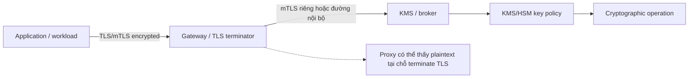
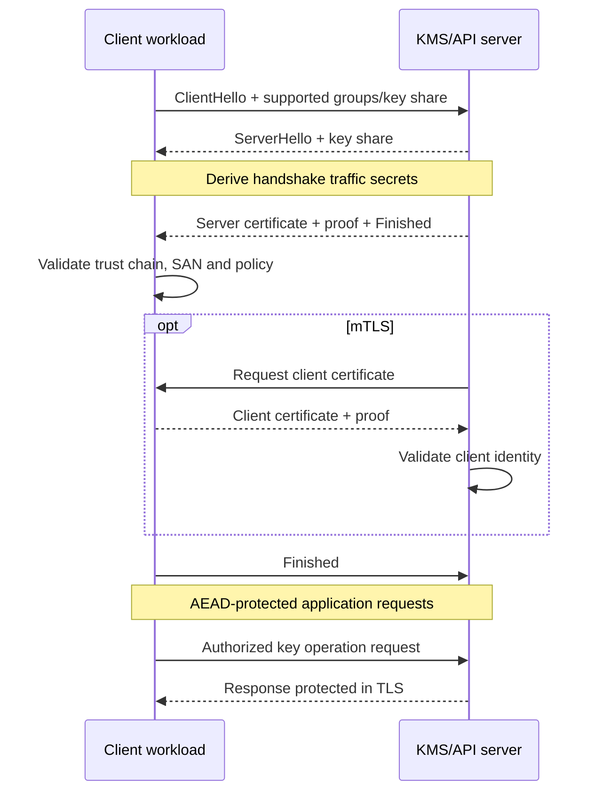
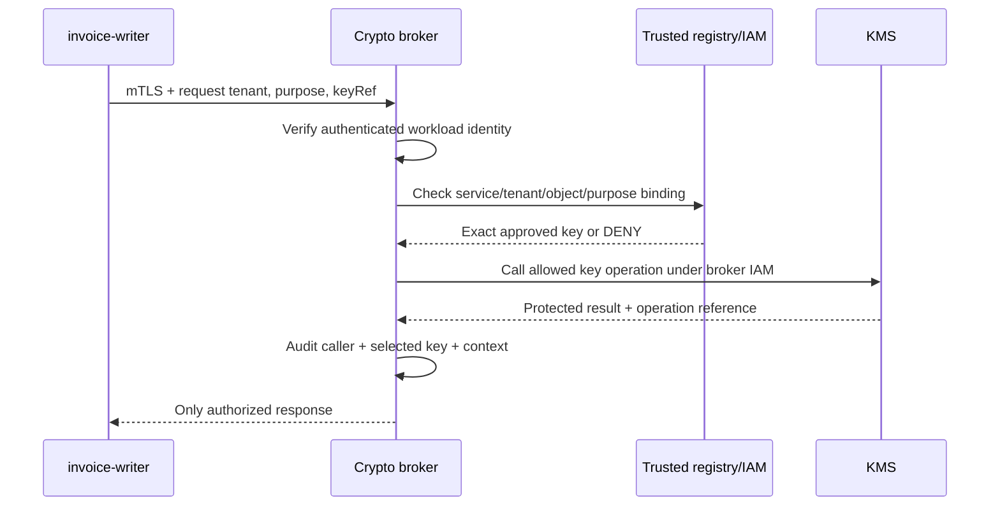
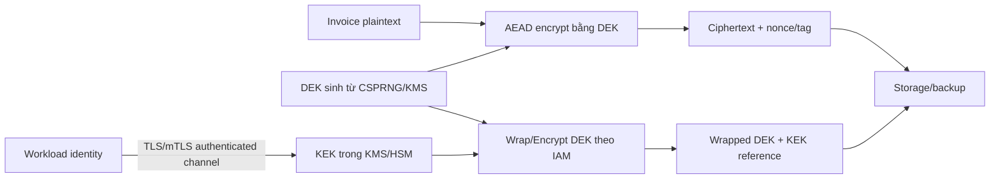
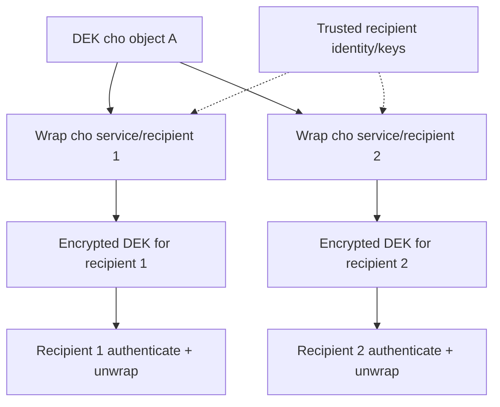
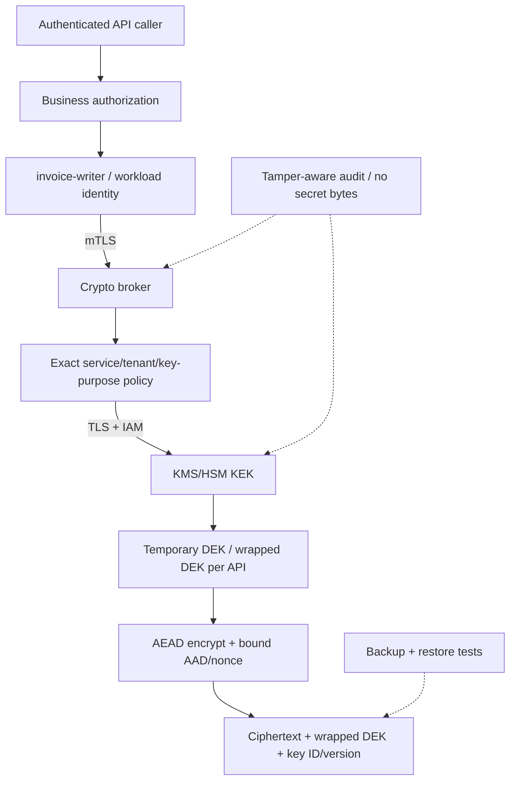

# Secure channel

## 1. Secure channel là gì và vì sao quan trọng khi phân phối khóa?

**Secure channel (kênh truyền an toàn)** là một cơ chế giao tiếp có thiết kế mật mã và xác thực nhằm bảo vệ dữ liệu đi qua một đường truyền giữa những **endpoint xác định**. Trong quản lý khóa, secure channel bảo vệ việc **cấp phát, truyền, trao đổi hoặc sử dụng vật liệu khóa**: một DEK từ KMS tới ứng dụng, một secret được cấp cho workload, một khóa công khai do CA/registry phát hành hoặc một yêu cầu `Sign/Decrypt/Unwrap` gửi tới HSM.

Mối nguy lớn nhất không chỉ là kẻ đứng giữa *nghe lén* mà còn là **giả mạo điểm cuối, sửa thông điệp, tráo khóa, hạ cấp giao thức, phát lại yêu cầu, chuyển request sang tenant khác hoặc dùng credential bị chiếm để gọi một API hợp lệ**. Do đó, “đã bật HTTPS” mới là một điều kiện, không phải kết luận rằng **phân phối khóa an toàn từ đầu đến cuối**.

Bài thuộc chương **Key distribution** của module `SECURITY_KEY_MANAGEMENT_FUNDAMENTALS`. Phạm vi module bao gồm vòng đời **tạo, cấp phát, lưu trữ, sử dụng, xoay vòng, thu hồi và hủy khóa**, liên hệ mật mã đối xứng/bất đối xứng, chữ ký số, KMS/HSM, **envelope encryption**, IAM và kiểm toán. Một secure channel được thiết kế đúng giúp vật liệu khóa tới **đúng người, đúng mục đích, đúng thời điểm và đúng miền tin cậy** mà không biến mạng thành đường rò rỉ secret.

### 1.1. Tình huống mở đầu

Dịch vụ `invoice-writer` yêu cầu KMS cấp một **data encryption key (DEK)** để mã hóa hóa đơn:

```text
invoice-writer  --->  KMS: GenerateDataKey / Wrap / Decrypt
              <---       wrapped DEK + plaintext DEK (nếu API trả)
```

Nếu kết nối không bảo vệ xác thực điểm cuối, attacker có thể đóng giả KMS hoặc nghe được plaintext DEK khi API trả nó. Nếu kết nối có TLS hợp lệ nhưng principal của service được phép `Decrypt` mọi key của mọi tenant, attacker chiếm service vẫn có thể dùng **kênh an toàn để làm điều trái phép**.

**Secure channel giải quyết vấn đề an toàn trên đường truyền; IAM, data authorization, key custody và chính sách nghiệp vụ giải quyết những vấn đề khác.**

### 1.2. Mục tiêu học tập

Sau bài học, bạn có thể:

1. Giải thích **confidentiality, integrity, peer authentication, freshness và key confirmation** của kênh truyền.
2. Phân biệt **TLS 1.3, HTTPS, mTLS, service-mesh mTLS, end-to-end encryption, key wrapping và KMS API authorization**.
3. Hiểu **TLS handshake**, certificate/SAN validation, ECDHE, HKDF/key schedule, session keys và những điều kiện của forward secrecy.
4. Thiết kế **bootstrap trust**, quản lý CA/truststore, cert rotation, revocation và ngăn MITM/downgrade.
5. Phân phối **public key/certificate** khác với **private key/DEK/KEK/HMAC secret**.
6. Sử dụng **KMS/HSM, workload identity, mTLS và envelope encryption** mà không hardcode hoặc xuất master key không cần thiết.
7. Nhận biết nguy cơ **TLS termination ở proxy/service mesh, 0-RTT replay, confused deputy, credential theft và stale identity**.
8. Xây dựng client **Java 17 HttpClient + SSLContext + mTLS PKCS12** có truststore rõ ràng, hostname verification và không log secret.
9. Xây dựng quy trình **rotation, incident response, monitoring, negative tests và disaster recovery**.
10. Biết secure channel **có thể và không thể** bảo đảm điều gì trong một hệ thống phân phối khóa thực.

## 2. Định nghĩa rõ tài sản, kẻ tấn công và ranh giới tin cậy

Một mô hình threat model cơ bản gồm:

- **Tài sản:** plaintext DEK, wrapped DEK, KEK handle, private signing key, HMAC secret, KEM private key, service credentials, identity assertions, key ID/version, KMS policies.
- **Điểm cuối:** application workload, KMS/HSM, crypto broker, secret manager, issuer/CA, client hoặc đối tác.
- **Đường truyền:** mạng nội bộ, public Internet, proxy, gateway, load balancer, service mesh, message queue, VPN hoặc kết nối giữa hai vùng.
- **Đối thủ:** người nghe trộm mạng, MITM trên DNS/route/proxy, insider có quyền, attacker chiếm workload, người thay public key registry, kẻ trộm token/certificate.
- **Hậu quả:** lộ secret, trao nhầm key, mở bọc DEK trái phép, chữ ký giả, gián đoạn phục hồi, sai tenant, replay cấp key, phá audit trail.

### 2.1. Security properties cần kiểm tra

| Thuộc tính | Câu hỏi kiểm soát | Secure channel hỗ trợ như thế nào? |
| --- | --- | --- |
| **Confidentiality** | Người ngoài đường truyền có đọc được DEK/secret không? | Mã hóa dữ liệu trong phiên giữa các điểm kết thúc bảo vệ. |
| **Integrity** | Dữ liệu/key reference có bị sửa trên đường truyền không? | AEAD/MAC bảo vệ record truyền trên kênh. |
| **Server authentication** | Client có thật sự nói chuyện với KMS/secret manager đúng tên không? | Chain chứng chỉ, SAN/hostname verification, trust anchors. |
| **Client authentication** | KMS biết workload nào gọi không? | mTLS, workload token hoặc cơ chế identity đáng tin; TLS một chiều chưa đủ. |
| **Freshness / anti-replay** | Yêu cầu cấp/rotate key có bị lặp ngoài ý muốn? | TLS chống nhiều dạng network record injection; **application** vẫn cần idempotency, state/freshness ở biên phù hợp. |
| **Authorization** | Caller có quyền nhận DEK hoặc `Sign/Decrypt` key này không? | **Không tự có** từ TLS; cần IAM, object/tenant/purpose policy. |
| **Peer identity binding** | Danh tính xác thực có đúng service/tenant mong muốn? | Chứng chỉ/token cần mapping và kiểm tra ngữ cảnh. |
| **Forward secrecy** | Lộ một khóa dài hạn sau này có mở được các phiên quá khứ? | TLS 1.3 dùng ephemeral (EC)DHE ở các mode tương ứng; phụ thuộc handshake và điểm cuối. |
| **Auditability** | Có thể truy vết ai nhận/dùng key nào? | Cần log ở application, broker, KMS/HSM và identity plane. |

**Peer authentication** khác **key confirmation**. Một giao thức có thể trao đổi được shared secret nhưng vẫn thiếu bằng chứng đã nói với đúng đối tác; hoặc có certificate hợp lệ nhưng chưa binding đúng danh tính nghiệp vụ. Khi tự xây protocol, phải phân tích cả hai.

### 2.2. Kênh an toàn bảo vệ đến điểm kết thúc, không bảo vệ mọi nơi



Nếu TLS kết thúc ở proxy, proxy có thể thấy nội dung API **sau giải mã TLS**. Kết nối từ proxy tới backend là một **hop khác**, cần chính sách mã hóa/xác thực riêng khi threat model yêu cầu.

Không tuyên bố “end-to-end encrypted từ ứng dụng tới HSM” nếu thực tế có gateway giải mã, log request body hoặc transform API ở giữa. Một HTTP reverse proxy được cấu hình mTLS cho cả hai hop có thể rất phù hợp, nhưng phải **đánh giá quyền của proxy** như một điểm cuối có năng lực thấy dữ liệu.

## 3. Phân phối key material khác trao đổi public key

Không phải mọi khóa cần cùng một kiểu kênh truyền.

| Đối tượng | Có cần bí mật khi truyền? | Điều cần nhất | Phương án điển hình |
| --- | --- | --- | --- |
| **Public verification key** | Không | Tính xác thực, integrity, trust anchor, version | TLS đúng peer, signed registry, PKI/JWKS đáng tin |
| **X.509 certificate** | Không | Chuỗi tin cậy, identity binding, expiry/revocation | PKI/certificate distribution |
| **Public KEM/encapsulation key** | Không | Đúng người nhận, chống key substitution | Chứng chỉ, signed metadata, authenticated channel |
| **DEK dạng rõ** | **Có** | Bảo mật + đúng recipient/tenant/context | KMS API qua TLS/mTLS, raw DEK tồn tại ngắn, hoặc key handle |
| **KEK/master key** | **Có, rủi ro rất cao** | Không export nếu có thể; giới hạn use capability | KMS/HSM, wrapping/escrow được phê duyệt |
| **Private signing/KEM key** | **Có** | Custody, non-exportability, access control | Sinh/giữ trong HSM/KMS, không phát private key cho verifier |
| **HMAC shared secret** | **Có** | Bảo mật, đúng producer/consumer, rotation overlap | Secret manager/mTLS với quyền hẹp; HSM MAC API nếu hỗ trợ |
| **Wrapped DEK** | Không phải plaintext secret | Integrity, authenticated key/context binding, correct version | Envelope metadata + storage/API transport |
| **Key ID / version / alias** | Thường không | Không bị tráo hoặc dùng sai trust domain | Trusted registry + AAD/policy |
| **Bearer token để gọi KMS** | **Có khi còn hiệu lực** | Confidentiality, scope/expiry/revocation | Workload identity + TLS, tránh static credential |

### 3.1. Chuyển public key không cần giấu, nhưng phải xác thực

Một public key giả có thể khiến client **mã hóa cho attacker** hoặc verifier **tin chữ ký attacker**. Vì thế, dù public key không bí mật, kênh nhận public key vẫn phải có **authentication/provenance**.

Ví dụ:

- Client lấy JWKS từ **issuer URL đã được tin cậy** qua HTTPS, xác thực hostname và issuer.
- Server không làm theo `jku` hoặc `x5u` tùy ý nằm trong token do attacker kiểm soát.
- Bên gửi KEM lấy **public encapsulation key** từ chứng chỉ/registry đã xác minh.
- Certificate pinning hoặc truststore riêng chỉ dùng khi có **rollover/recovery plan**.

### 3.2. Private key không nên bị “phân phối” rộng chỉ vì nhiều nơi cần sử dụng

Nếu ba service cần ký JWT, không nhất thiết phải copy cùng **private signing key** vào ba container. Có thể dùng **central signing service/HSM key handle** và cấp đúng quyền `Sign`, có content authorization, rate limit và audit.

Đối với KEK, ứng dụng thường chỉ cần **Wrap/Unwrap/GenerateDataKey API**, không cần raw bytes. Đối với DEK, một số API trả plaintext tạm thời vì ứng dụng mã hóa dữ liệu cục bộ; đây là lựa chọn có kiểm soát, khác với phân phát KEK tới mọi workload.

## 4. TLS 1.3: nền tảng của secure channel phổ biến

**TLS (Transport Layer Security)** là giao thức bảo vệ kênh giữa các endpoint. Trong giao tiếp web/API, **HTTPS** là HTTP chạy qua TLS.

Một **TLS 1.3 handshake** thông thường gồm các hoạt động khái niệm:

1. Client đề xuất phiên bản/cipher suites và key shares tương ứng.
2. Server chọn tham số được hỗ trợ và phản hồi key share phù hợp.
3. Các bên thỏa thuận shared secret qua **(EC)DHE** trong chế độ áp dụng và dẫn xuất traffic secrets bằng key schedule.
4. Server chứng minh quyền sở hữu private key của chứng chỉ hoặc một cơ chế xác thực được giao thức cho phép.
5. Client **xác thực certificate chain, hostname/SAN, thời hạn và policy tin cậy**.
6. Nếu bật **mTLS**, server cũng yêu cầu và xác thực certificate/identity của client.
7. Sau handshake, record layer dùng AEAD để bảo vệ application data.



Sơ đồ là **mô tả cấp cao, không biểu diễn chính xác mọi thông điệp handshake và thứ tự của TLS 1.3**. Trong TLS 1.3, phần lớn handshake sau ServerHello đã được bảo vệ bằng handshake traffic keys, và các cấu hình PSK/resumption có luồng khác.

### 4.1. Cipher suite và key exchange không phải cùng một thuộc tính

Trong TLS 1.3, **cipher suite** mô tả AEAD và hash tương ứng; nhóm key exchange (ví dụ X25519/P-256 theo hỗ trợ và policy) được thương lượng tách biệt.

Không ghi rằng “TLS_AES_256_GCM_SHA384 đảm bảo dùng ECDHE-P256” chỉ từ tên cipher suite. Phải kiểm tra **phiên TLS thực tế, key share group, credential/identity và chính sách endpoint**.

### 4.2. Forward secrecy có điều kiện

Khi một phiên được thiết lập với **ephemeral Diffie–Hellman**, việc lộ khóa ký chứng chỉ dài hạn *về sau* không đủ để tự tái tạo session traffic keys đã xóa đúng cách từ một bản ghi bắt mạng. Tuy nhiên:

- **Lộ endpoint memory/session secrets** có thể làm lộ phiên tương ứng.
- **PSK-only resumption** không có cùng bảo đảm PFS như PSK-(EC)DHE; cấu hình TLS có ý nghĩa.
- **Record lại traffic sau khi private key bị lộ** có thể kết hợp MITM/giả mạo nếu hệ thống chưa thu hồi trust.
- **Forward secrecy của TLS** không bảo vệ dữ liệu mà application đã lưu dưới một DEK yếu hoặc bị lộ.

Vì vậy PFS là thuộc tính quan trọng của **channel session**, không thay thế rotation/DEK custody hoặc chống exfiltration tại endpoint.

### 4.3. TLS 1.3 không tự thực hiện mutual authentication

TLS có **server authentication** theo mô hình HTTPS thường dùng. **mTLS** là khi **cả client và server** được xác thực bằng chứng chỉ/cơ chế tương ứng.

Nếu KMS/API dựa vào OAuth workload token/iam authorization thay vì client certificate, transport vẫn có thể an toàn nhưng **không gọi đó là mTLS**.

## 5. Xác thực server: tin đúng KMS, không chỉ “có ổ khóa HTTPS”

### 5.1. Certificate chain và SAN/hostname

Một HTTPS client an toàn cần kiểm tra:

- Chứng chỉ server nối tới **trust anchor được chấp nhận** theo chính sách.
- Tên endpoint đang gọi **khớp SAN (Subject Alternative Name)** phù hợp; không chỉ đọc tên CN tùy ý.
- Chứng chỉ còn hiệu lực và đáp ứng extended key usage/constraints cần thiết.
- Handshake version/algorithms nằm trong danh sách được duyệt.
- Cơ chế revocation/status được áp dụng theo **PKI và runtime policy**, biết giới hạn thực tế của CRL/OCSP.
- Không có đường bật **trust-all** hoặc bỏ hostname verification cho production.

Một client có thể xác thực TLS thành công tới **attacker.example** với certificate hợp lệ cho attacker.example. Điều đó **không** chứng minh endpoint là KMS dự kiến. **Đúng hostname, đúng trust domain, đúng endpoint allowlist** rất quan trọng.

### 5.2. Những anti-pattern đặc biệt nguy hiểm

```java
// MINH HỌA ANTI-PATTERN: tuyệt đối không làm như vậy.
// TrustManager chấp nhận tất cả chứng chỉ hoặc HostnameVerifier
// luôn trả true sẽ xóa bỏ mục tiêu xác thực điểm cuối TLS.
```

Tương tự, cấu hình không an toàn như “ignore TLS errors”, không kiểm tra certificate chain, cho phép HTTP fallback hoặc pin certificate cũ không có kế hoạch thay thế có thể dẫn đến MITM hoặc mất availability.

### 5.3. Trust bootstrap: phải tin từ đâu?

Hệ thống cần một điểm khởi đầu đáng tin:

- **System/enterprise CA truststore** được quản trị và cập nhật.
- **Private CA** dành cho service/workload identities có root được phân phối bằng quy trình an toàn.
- **Certificate/public key pinning** trong những hệ thống có threat model/rollover phù hợp.
- **Signed configuration/trust registry** được xác minh bởi khóa đã biết đúng nguồn.

Nếu tải root certificate **từ chính endpoint chưa được xác thực** và mặc định tin nó, có một vòng lặp tin cậy: attacker kiểm soát đường truyền có thể cung cấp CA của họ. Cần bootstrap từ kênh/quy trình đáng tin độc lập.

**TOFU (trust on first use)** chỉ phù hợp với threat model chấp nhận rủi ro lần đầu và có cơ chế cảnh báo đổi khóa; không phải mặc định an toàn cho phân phối KEK production.

## 6. mTLS: xác thực workload ở cả hai phía

Trong **mutual TLS**, client chứng minh sở hữu private key của chứng chỉ client; server xác thực certificate chain và ánh xạ certificate identity tới principal được phép.

Một thiết kế mTLS cần:

1. CA/trust domain được duyệt để phát hành chứng chỉ workload.
2. Client và server đều xác minh peer theo mục đích.
3. SAN/URI identity hoặc định danh workload có cách biểu diễn rõ ràng.
4. Xác minh **certificate identity → workload principal → allowed key operations**.
5. Rotation tự động/định kỳ và graceful overlap cho certificates.
6. Revocation/expiry/revocation-like mechanisms theo khả năng, với chính sách chặn credential bị lộ.
7. Hạn chế quyền truy cập private key của client; nếu có thể giữ trong hardware/OS keystore.
8. Audit danh tính được xác thực chứ không chỉ địa chỉ IP.

### 6.1. mTLS xác thực dịch vụ, không xác thực mọi hành động của dịch vụ

Nếu `invoice-writer` có client cert đúng, KMS/broker vẫn phải kiểm:

- Service có quyền `GenerateDataKey/Wrap` trên KEK này?
- Request thuộc **tenant** nào, caller có quyền trên object đó không?
- Key thuộc **environment/purpose** được duyệt?
- Identity có thể yêu cầu **Decrypt** thay vì chỉ Wrap không?
- Request vượt quota/rate hoặc xuất hiện trong incident window không?

**Certificate hợp lệ không phải một vé thông hành cho mọi key**.

### 6.2. Tránh confused deputy ở crypto broker

Một broker có quyền KMS rộng nhưng nhận request từ nhiều workloads sẽ trở thành **confused deputy** nếu nó sử dụng quyền của mình theo **key ID tùy ý** hoặc tenant header không được xác thực.



Trong audit, phải nối được **upstream authenticated caller** với **broker principal** được KMS quan sát. Header `X-Service-Name` do client tự gán không đủ thay mTLS identity hoặc token xác thực.

## 7. Secure channel qua gateway, service mesh và proxy

**TLS hop-by-hop** là kiến trúc thực tế phổ biến. Kênh có thể bị terminate rồi thiết lập lại tại ingress, API gateway, load balancer, sidecar hoặc service mesh.

```text
Application --mTLS--> Sidecar/Gateway --mTLS--> KMS broker --TLS--> KMS
                   [Termination]             [Termination]
```

Với mỗi hop, phải trả lời:

- Điểm nào **chạm plaintext DEK hoặc token**?
- Certificate/identity nào được xác minh trên hop đó?
- Có cho phép **HTTP downgrade** từ gateway tới backend không?
- Sidecar/gateway có log headers/body chứa raw secret không?
- ai có quyền sửa routing, certificates, policies hoặc traffic mirroring?
- Có khả năng **TLS passthrough/end-to-end** khi cần giới hạn trust boundary không?
- Làm sao ràng buộc **upstream principal** với KMS operation ở hop cuối?

### 7.1. mTLS trong service mesh có tự giải quyết mọi thứ?

Không. Mesh mTLS có thể bảo vệ kết nối workload/sidecar trong mesh, nhưng:

- Bên ngoài mesh hoặc đường egress tới KMS cần TLS riêng.
- Proxy thường là **thành phần được tin cậy**, có quyền nhìn traffic khi terminate.
- Policy có thể cho service A gọi B nhưng **B vẫn phải kiểm operation/tenant/object authorization**.
- Xác thực peer certificate chưa chứng minh request body không bị thay bởi một proxy bị chiếm.
- Workload identity/sidecar certificates có lifecycle và các lỗ hổng cấu hình riêng.

Với key material nhạy cảm, có thể bổ sung **application-level wrapping hoặc end-to-end authenticated envelope** để giảm niềm tin phải đặt vào các proxy trung gian.

### 7.2. TLS tới database không bảo vệ secret đã lưu dạng rõ

Một DEK có thể được gửi qua TLS an toàn nhưng **lưu lại plaintext trong bảng database**, trở thành rủi ro at rest. Ngược lại, một wrapped DEK lưu an toàn có thể bị lộ trong log API nếu handler in full response.

Cần đồng thời bảo vệ:

1. **In transit:** TLS/mTLS.
2. **At rest:** KMS/HSM/secret manager/encrypted store/wrapped DEK.
3. **In use:** process identity, memory, logging, privileges, runtime controls.
4. **In audit:** metadata only, no raw secret.

## 8. Secure channel trong envelope encryption DEK–KEK

**Envelope encryption** thường tránh truyền raw KEK:

- **DEK:** mã hóa dữ liệu nghiệp vụ bằng AEAD như AES-GCM.
- **KEK:** khóa bọc DEK, ưu tiên giữ trong KMS/HSM.
- **Wrapped DEK:** bản mã của DEK, có thể lưu cùng ciphertext.
- **Key ID/version:** định tuyến phiên bản thích hợp; không phải secret.
- **TLS/mTLS:** bảo vệ request/response KMS giữa workload và provider/broker.
- **IAM/context:** chặn workload không có quyền sử dụng KEK.



### 8.1. Hai cách phổ biến để có DEK

| Phương án | Đường đi key material | Secure channel phải bảo vệ |
| --- | --- | --- |
| **Ứng dụng tự sinh DEK qua CSPRNG** | Raw DEK tồn tại tại app; app gọi KMS Wrap/Encrypt nó theo provider API | Request có thể chứa raw DEK; TLS/mTLS, key context và IAM đúng. |
| **KMS sinh data key** | Provider có thể trả **plaintext DEK tạm thời** và wrapped DEK hoặc handle tùy API | Response có thể chứa raw DEK; phải có TLS, authorization và memory hygiene. |
| **KMS/HSM thực hiện crypto nội bộ** | Private/master key không export, app nhận crypto result | Phải bảo vệ identity, request integrity/context và quyền `Sign/Decrypt`. |

**Không tuyên bố “sử dụng KMS đồng nghĩa DEK không bao giờ rời KMS”**; một số data-key APIs cố ý trả plaintext DEK cho local AES-GCM encryption.

### 8.2. Bảo vệ raw DEK trong response

Nếu API cần trả plaintext DEK:

1. Chỉ trả sau authentication, IAM, tenant/purpose authorization và request validation.
2. Sử dụng TLS/mTLS với server identity verification; không có HTTP fallback.
3. Không đưa raw DEK vào URL/query string, analytics, metrics, access log, tracing hoặc exception.
4. Giới hạn time-to-live và lưu trữ DEK trong memory của workload, tránh serializing vào cache vô thời hạn.
5. Chỉ persist **wrapped DEK** và metadata được xác thực.
6. Phân quyền và kiểm soát endpoint/heap dumps.
7. Đánh giá có cần thêm **application-level wrapping đến recipient** khi qua gateway/proxy không.

### 8.3. TLS có thay thế key wrapping không?

**Không.** TLS bảo vệ bytes **trên một hop/phiên**. Khi response kết thúc TLS, dữ liệu có thể xuất hiện dạng rõ ở application hoặc gateway. **Key wrapping** bảo vệ DEK khi lưu hoặc khi chuyển tiếp đến một recipient khác, dựa trên KEK/recipient key được quản lý.

Có thể kết hợp cả hai:

```text
DEK plaintext --[Wrap bằng KEK]--> wrapped DEK
wrapped DEK --[TLS/mTLS]---------> recipient/gateway
recipient authorized --[KMS Unwrap]--> DEK in approved context
```

Dù wrapped DEK không phải plaintext key, cần bảo vệ **integrity, key ID/version và AAD/context** để tránh substitution hoặc cross-tenant misuse.

## 9. Key wrapping và application-level authenticated encryption

Với nhu cầu xuất khẩu có kiểm soát một symmetric key tới recipient, một thiết kế có thể dùng:

- **AES-KW/AES-KWP** theo chuẩn được duyệt cho symmetric keys.
- **AEAD wrap** (ví dụ AES-GCM với nonce độc nhất và AAD ràng buộc key ID/tenant/purpose) nếu protocol quy định và triển khai đúng.
- **KMS-native Wrap/Encrypt** với exact key reference và encryption context.
- **HPKE/KEM-based encapsulation** khi phân phối một key cho bên nhận có public key được xác thực, nếu suite/protocol phù hợp.

### 9.1. Confidentiality không đủ; cần binding recipient và context

Một wrapped key cần gắn với:

- **Recipient identity / public key/KMS key** đã được xác thực.
- **Purpose:** DEK cho invoice, HMAC webhook, signing? Không trộn.
- **Tenant/object/domain** đúng nghiệp vụ.
- **Algorithm suite và version**.
- **Expiration/usage policy** nếu có.
- **Key lifecycle** và bản sao/backup.

Không dựa vào trường `recipientId` do người gửi tùy ý thêm vào JSON rồi gọi đó là authenticated recipient binding.

### 9.2. Key confirmation và unknown-key-share

Trong key agreement/transport, hai bên có thể tính được một shared secret nhưng hiểu nhầm **đối tác** là ai (*unknown-key-share*). Một giao thức an toàn cần ràng buộc identities, transcript/context và key confirmation nếu threat model yêu cầu.

Đừng triển khai một protocol “ECDH → SHA256(sharedSecret) → AES key” tùy tiện. Sử dụng **TLS/HPKE hoặc protocol đã được phân tích**, HKDF/key schedule với domain separation, authentication và state máy rõ ràng.

### 9.3. HPKE/KEM không tự xác thực người gửi

Một scheme mã hóa tới public key recipient có thể bảo vệ confidentiality, nhưng **không tự chứng minh ai đã gửi**, trừ khi chọn mode/giao thức có xác thực sender thích hợp. Public key của recipient phải được xác minh; nếu attacker thay public key, sender có thể mã hóa key cho attacker.

Với KEM, **Encapsulate/Decapsulate** tạo một shared secret, không trực tiếp là quyền đọc dữ liệu; phải dùng KDF/AEAD và binding đúng specification.

## 10. Bảo vệ chống replay, downgrade và nhầm phiên

### 10.1. Replay: TLS không thay state machine của nghiệp vụ

TLS bảo vệ record trong phiên, nhưng một hệ thống còn phải đề phòng **request hợp lệ bị gửi lại** qua các đường ứng dụng được phép, token reuse, retry hoặc các tính năng protocol như 0-RTT.

Các key operations nhạy cảm như:

- `GenerateKey`, `GenerateDataKey`;
- `ImportKeyMaterial` hoặc export/wrap;
- `Rotate`, `Disable`, `ScheduleDestroy`;
- tạo secret/token hoặc cấp grant mới;

cần kiểm soát **idempotency key, request ID, authorization, deadline/freshness và state transition**, cùng replay cache/window phù hợp. Không dựa vào việc “đã HTTPS” để cho phép mutation lặp mà không kiểm tra.

### 10.2. TLS 1.3 0-RTT early data

TLS 1.3 hỗ trợ một số cấu hình **0-RTT early data** cho resumption, nhưng early data có **rủi ro replay** đặc thù. Endpoint/key API nhạy cảm nên **vô hiệu hóa hoặc từ chối 0-RTT** cho các thao tác không idempotent, cấp key hoặc đổi quyền; không tự coi “HTTP GET” là vô hại nếu response chứa secret và endpoint có side effects.

Đây là lựa chọn của server/proxy stack, không chỉ một tùy chọn Java client.

### 10.3. Downgrade và HTTP fallback

Không cho client tự fallback từ HTTPS sang HTTP khi TLS handshake lỗi hoặc server trả lỗi certificate. Cũng tránh redirect tới host/scheme ngoài allowlist có thể mang theo bearer token/secret.

Chính sách nên quy định:

- TLS phiên bản/algorithms cho phép theo runtime/provider.
- Không sử dụng SSLv3/TLS lỗi thời hoặc cipher yếu.
- Cơ chế validation không có nhánh “dev only” lọt vào production.
- Lỗi truststore/certificate phải **fail closed**.
- Các proxy/mesh/gateway cũng tuân thủ cùng mức bảo vệ hoặc được đánh giá riêng.

### 10.4. Replay của wrapped DEK và metadata

Một attacker có thể sao chép **một envelope hợp lệ** từ object A sang object B. Nếu AEAD AAD không bind object/tenant, hệ thống có thể giải mã dữ liệu **đúng mật mã nhưng sai ngữ cảnh**.

Bind **tenantId, objectId, format/version, key purpose** theo AAD/wrapping context và kiểm tra owner từ domain. Một bản sao record hợp lệ trong cùng object/time frame vẫn có thể là **rollback**; muốn chống rollback cần **monotonic version/transaction/anti-rollback state** đáng tin, không chỉ AEAD.

## 11. Chứng chỉ, CA, truststore và vòng đời mTLS

Một hệ thống secure channel vận hành lâu dài cần kế hoạch **provision, renewal, revoke, recovery và audit** cho chứng chỉ.

### 11.1. Lifecycle của server certificate

1. Sinh private key theo policy, ưu tiên storage phù hợp.
2. CSR/certificate issuance từ CA được duyệt.
3. Kiểm tra SAN/identity, key usage/EKU và validity.
4. Triển khai certificate chain và private key có quyền file/HSM phù hợp.
5. Giám sát expiry và renew trước hạn.
6. Hỗ trợ overlap giữa old/new certificate nếu chính sách cho phép.
7. Khi lộ private key, thu hồi/distrust theo PKI và thay identity.
8. Kiểm tra mọi client truststores/pins/CA bundles sau rotation.

### 11.2. Lifecycle của client certificate

Với mTLS, **client private key** trở thành credential nhạy cảm. Không commit vào Git hoặc đưa vào image dùng chung. Nếu dùng PKCS12/PKCS11/OS keystore, phải bảo vệ password, file ACL, device identity và backups.

Một certificate có thể còn hợp lệ theo ngày nhưng principal tương ứng đã không còn được phép dùng key; server phải kiểm **policy hiện hành**, không chỉ “certificate verify OK”.

### 11.3. CRL/OCSP và điểm yếu vận hành

Đối với PKI, **certificate revocation status** có thể được cung cấp bởi CRL/OCSP hoặc cơ chế khác. Nhưng việc client/server kiểm tra revocation **phụ thuộc implementation, cấu hình và khả năng truy cập dịch vụ trạng thái**. Không khẳng định rằng mọi TLS client mặc định kiểm OCSP và fail closed.

Trong hệ thống workload nội bộ, cert ngắn hạn, cấp phát tự động, thu hồi/quyền IAM và giám sát có thể bổ trợ cho revocation. Đánh giá theo threat model và chính sách CA, không áp một câu “đã dùng mTLS thì revocation tự động”.

### 11.4. Certificate pinning cần phương án thay thế

Pinning public key/certificate có thể giảm phụ thuộc CA rộng, nhưng nếu chỉ pin đúng một certificate sắp hết hạn và không có kênh thay đổi đáng tin, key distribution có thể bị **ngừng hoàn toàn** khi renew.

Nên xác định:

- Pin nội dung gì: SPKI key fingerprint hay certificate, theo chính sách.
- Có backup pin/rotation overlap và rollback được kiểm soát không.
- Phân phối cập nhật pin qua cơ chế nào?
- Phải làm gì khi khóa pin bị compromise?
- Chứng chỉ được cấp đúng tên endpoint/identity hay chỉ khớp hash?

Không tự xem pinning là bắt buộc với mọi service nếu truststore/mTLS và policy đã đáp ứng risk model.

## 12. Java 17: HTTPS/mTLS client với truststore và keystore có kiểm soát

Ví dụ Java sau minh họa cách một **key-management client** có thể thiết lập HTTPS/mTLS tới một endpoint **đã biết trước**, dùng **client certificate** và **truststore riêng** thay vì tắt certificate validation.

**Đây là demo cấu hình secure channel**, không phải SDK của một KMS cụ thể và **không đọc/truyền raw DEK**. Request demo là GET tới một endpoint **metadata** trả response body bị bỏ qua. Khi áp dụng cho API cấp key thật, cần thêm request/response model, workload authorization, data-key handling, audit và kiểm tra provider contract.

### 12.1. Điều kiện chuẩn bị

- JDK **17+** có TLS 1.3, `java.net.http.HttpClient` và PKCS12 provider tương thích.
- Một client keystore `client-identity.p12` chứa **private key + certificate chain** được CA nội bộ cấp đúng policy.
- Một truststore `trusted-kms-ca.p12` chứa **CA/trust anchors** để xác thực server.
- Endpoint ví dụ `https://kms.example.internal:8443/v1/key-metadata` có certificate SAN khớp hostname và server yêu cầu/cho phép client auth theo cấu hình.
- Chứng chỉ và passwords là **dữ liệu thực phải giữ ngoài source/CLI arguments/logs**.

### 12.2. Source: `SecureChannelMtlsClientDemo.java`

```java
import java.io.Console;
import java.io.InputStream;
import java.net.URI;
import java.net.http.HttpClient;
import java.net.http.HttpRequest;
import java.net.http.HttpResponse;
import java.nio.file.Files;
import java.nio.file.Path;
import java.security.KeyStore;
import java.security.SecureRandom;
import java.time.Duration;
import java.util.Arrays;
import javax.net.ssl.KeyManagerFactory;
import javax.net.ssl.SSLContext;
import javax.net.ssl.SSLParameters;
import javax.net.ssl.TrustManagerFactory;

public final class SecureChannelMtlsClientDemo {
    private static final String EXPECTED_HOST =
        "kms.example.internal"; // Public endpoint identifier, not secret.

    private static KeyStore loadPkcs12(
        Path path, char[] password
    ) throws Exception {
        KeyStore store = KeyStore.getInstance("PKCS12");
        try (InputStream in = Files.newInputStream(path)) {
            store.load(in, password);
        }
        return store;
    }

    private static SSLContext createContext(
        Path clientKeyStorePath,
        char[] clientPassword,
        Path trustedCaStorePath,
        char[] trustPassword
    ) throws Exception {
        KeyStore client = loadPkcs12(
            clientKeyStorePath, clientPassword
        );
        KeyManagerFactory keyManagers =
            KeyManagerFactory.getInstance(
                KeyManagerFactory.getDefaultAlgorithm()
            );
        keyManagers.init(client, clientPassword);

        KeyStore trustAnchors = loadPkcs12(
            trustedCaStorePath, trustPassword
        );
        TrustManagerFactory trustManagers =
            TrustManagerFactory.getInstance(
                TrustManagerFactory.getDefaultAlgorithm()
            );
        trustManagers.init(trustAnchors);

        SSLContext context = SSLContext.getInstance("TLSv1.3");
        context.init(
            keyManagers.getKeyManagers(),
            trustManagers.getTrustManagers(),
            new SecureRandom()
        );
        return context;
    }

    public static void main(String[] args) throws Exception {
        if (args.length != 3) {
            throw new IllegalArgumentException(
                "Usage: java SecureChannelMtlsClientDemo "
                + "<https-url> <client.p12> <trusted-ca.p12>"
            );
        }

        URI endpoint = URI.create(args[0]);
        if (!"https".equalsIgnoreCase(endpoint.getScheme())
                || endpoint.getUserInfo() != null
                || endpoint.getFragment() != null
                || endpoint.getRawQuery() != null
                || !"/v1/key-metadata".equals(endpoint.getPath())
                || (endpoint.getPort() != 8443
                    && endpoint.getPort() != -1)
                || !EXPECTED_HOST.equalsIgnoreCase(
                    endpoint.getHost())) {
            throw new SecurityException(
                "Endpoint must use HTTPS and the approved host"
            );
        }

        Console console = System.console();
        if (console == null) {
            throw new IllegalStateException(
                "Use an interactive console for passwords. "
                + "Do not hardcode them or pass them on the command line."
            );
        }

        char[] clientPassword = console.readPassword(
            "Client PKCS12 password: "
        );
        char[] trustPassword = console.readPassword(
            "Truststore PKCS12 password: "
        );

        try {
            if (clientPassword == null || trustPassword == null
                    || clientPassword.length == 0
                    || trustPassword.length == 0) {
                throw new SecurityException("Passwords required");
            }
            SSLContext context = createContext(
                Path.of(args[1]), clientPassword,
                Path.of(args[2]), trustPassword
            );

            // HttpClient verifies server certificate/hostname for HTTPS.
            // Preserve endpoint identification; do not trust-all.
            SSLParameters params = new SSLParameters();
            params.setProtocols(new String[] { "TLSv1.3" });
            params.setEndpointIdentificationAlgorithm("HTTPS");

            HttpClient client = HttpClient.newBuilder()
                .sslContext(context)
                .sslParameters(params)
                .connectTimeout(Duration.ofSeconds(5))
                .followRedirects(HttpClient.Redirect.NEVER)
                .build();

            HttpRequest request = HttpRequest.newBuilder(endpoint)
                .timeout(Duration.ofSeconds(10))
                .header("Accept", "application/json")
                .GET() // Demo chỉ yêu cầu metadata, không lấy raw DEK.
                .build();

            HttpResponse<Void> response = client.send(
                request, HttpResponse.BodyHandlers.discarding()
            );
            System.out.println(
                "HTTPS status: " + response.statusCode()
            ); // Không ghi response body/secret.
        } finally {
            if (clientPassword != null) {
                Arrays.fill(clientPassword, '\0');
            }
            if (trustPassword != null) {
                Arrays.fill(trustPassword, '\0');
            }
        }
    }
}
```

**Lưu ý Java 17:** `HttpClient` chưa triển khai `AutoCloseable` trong JDK 17, nên ví dụ tạo client thông thường, không đặt nó trong `try-with-resources`. Truststore/certificate của demo phải do bộ phận có thẩm quyền cung cấp; kênh tới host chưa tồn tại sẽ không thể kết nối thành công.

Ví dụ sử dụng placeholder path/host:

```bash
javac SecureChannelMtlsClientDemo.java

# Chỉ chạy với endpoint/certificates thực sự được phê duyệt.
java SecureChannelMtlsClientDemo \
  https://kms.example.internal:8443/v1/key-metadata \
  /secure/client-identity.p12 \
  /secure/trusted-kms-ca.p12
```

**Điều demo chưa chứng minh:** server có thể yêu cầu mTLS và map certificate tới principal, hoặc có thể không; client có keystore **không đủ để khẳng định server đã yêu cầu/xác thực client certificate**. Phải kiểm tra server configuration, key manager, TLS handshake/session và server-side auth logs.

### 12.3. Các kiểm soát cần thiết khi production hóa

1. Không dùng `TrustManager` chấp nhận mọi certificate hoặc bỏ hostname verification.
2. Chỉ dùng HTTPS tới **endpoint allowlist**; cấu hình host/port theo môi trường và kiểm soát change.
3. Cân nhắc **TLS version/cipher policy** theo provider; không hardcode TLS 1.3 nếu bên đích chưa hỗ trợ mà không có phương án đã duyệt.
4. Bảo vệ **client private key** trong keystore/HSM và passwords qua secret delivery.
5. Không log response chứa raw DEK/HMAC/private key; tránh URL query có bearer tokens.
6. Thêm **IAM/business authorization** và request schema validation trước mọi key operation.
7. Thêm certificate renewal/revocation, retries có giới hạn, timeouts, circuit breakers và audit.
8. Không tự retry các key mutations không idempotent nếu chưa có **idempotency key** được server hỗ trợ.
9. Xác nhận service proxy/mTLS chain nếu deployment có gateway.
10. Không coi `200 OK` là bằng chứng nhận **đúng key material đúng tenant**; phải kiểm tra response, key version và context.

## 13. Java 17: preflight policy kiểm tra key distribution request

Một bài học quan trọng là **transport security không thay authorization**. Đoạn code sau chỉ minh họa **quyết định nghiệp vụ trước khi gọi KMS**, không thay thế xác thực TLS và không gửi secret:

```java
import java.util.Objects;
import java.util.Set;

public final class KeyDistributionPolicyDemo {
    record AuthenticatedWorkload(
        String principalId,
        String tenantId,
        Set<String> roles
    ) {}

    record KeyRequest(
        String keyId,
        String requestedTenant,
        String operation,
        String purpose
    ) {}

    static boolean allowed(
        AuthenticatedWorkload caller,
        KeyRequest request
    ) {
        if (caller == null || request == null
                || caller.roles() == null) {
            return false;
        }
        return Objects.equals(
                    caller.tenantId(), request.requestedTenant())
            && "billing/prod/invoice-kek".equals(request.keyId())
            && "Wrap".equals(request.operation())
            && "invoice-encryption".equals(request.purpose())
            && caller.roles().contains("invoice-writer");
    }

    public static void main(String[] args) {
        AuthenticatedWorkload writer = new AuthenticatedWorkload(
            "principal://prod/billing/writer",
            "tenant-01",
            Set.of("invoice-writer")
        );
        System.out.println(allowed(
            writer,
            new KeyRequest(
                "billing/prod/invoice-kek",
                "tenant-01",
                "Wrap",
                "invoice-encryption"
            )
        )); // true

        System.out.println(allowed(
            writer,
            new KeyRequest(
                "billing/prod/invoice-kek",
                "tenant-02",
                "Decrypt",
                "invoice-encryption"
            )
        )); // false
    }
}
```

**Giới hạn:** các `AuthenticatedWorkload` fields chỉ có giá trị nếu được tạo bởi **identity/authentication layer đáng tin**, không phải từ JSON do người dùng tự gửi. Code chỉ là decision sketch; production cần IAM/KMS policies, approved key registry, audit, request freshness và object-level authorization.

## 14. Secrets delivery trong runtime và supply chain

Một secure channel không giúp gì nếu **client private key hoặc cloud credential** đã bị hardcode trong source/JAR/container image.

### 14.1. Bootstrap không dùng static credential trong Git

- Ưu tiên **workload identity** từ orchestrator/cloud identity provider, hoặc short-lived credentials được cấp an toàn.
- Nếu dùng **mTLS client certificate**, giữ private key trong OS keystore, HSM, protected volume hoặc secret store theo threat model.
- Không commit private key, `client.p12`, PEM, keystore password, service-account JSON vào source.
- Không cho CI PR builds từ nguồn không tin cậy truy cập production secret.
- Thiết kế **renew/revoke** client credentials, tránh dùng một certificate chung cho nhiều workloads.
- Có inventory và audit quyền đọc secret **ở cả secret manager lẫn nơi sử dụng**.

### 14.2. Environment variable và mounted secret

Có thể dùng secret manager để inject một credential vào process, nhưng:

- Environment variables có thể lộ qua diagnostics, child processes, runtime dump.
- Mounted files có thể lộ qua ACL sai, volume snapshots, backup hoặc process compromise.
- **Secret manager trả plaintext** cho ứng dụng theo API thì ứng dụng vẫn là một điểm giữ secret.
- Tách người có quyền đọc source khỏi người có quyền lấy production secret.
- Nếu private signing/KEK non-exportable trong KMS/HSM, hạn chế để app nhận raw bytes không cần thiết.

### 14.3. Public certificate khác client private key

Một certificate công khai có thể được lưu trong repository khi có mục đích rõ; nhưng **private key tương ứng không nên nằm cùng artifact**. Truststore chứa CA/public certificates là trust configuration nhạy cảm về **integrity**, dù không phải secret về confidentiality.

Thay nhầm truststore bằng trust-all để sửa lỗi staging là một hành động phá vỡ xác thực server, không phải biện pháp triển khai hợp lệ.

## 15. Phân phối khóa cho nhiều recipients và nhóm

Một DEK có thể cần dùng bởi nhiều service/recipient. Không nên gửi raw DEK trong một broadcast channel rồi trông chờ mạng nội bộ là bí mật.

### 15.1. Một DEK, nhiều wrapped copies



Cách này có thể hữu ích, nhưng phải:

- Xác minh public key hoặc wrapping KEK của **từng recipient**.
- Ràng buộc tenant/object/purpose và tránh tráo encrypted DEKs giữa recipients.
- Xác định **ai được phép phát thêm một wrapped copy**.
- Quản lý revocation của recipient: đã nhận raw DEK có thể tiếp tục biết nó; chỉ xóa wrapped copy không làm người nhận quên secret.
- Đánh giá chi phí re-encrypt khi loại bỏ quyền một recipient đã có plaintext DEK.

### 15.2. Key group rotation

Trong nhóm nhiều recipients, thành viên rời nhóm là một vấn đề **quản trị bí mật đã biết**. Nếu một thành viên từng có DEK, việc thu hồi quyền KMS sau đó không xóa DEK đã nằm trong memory/backup của họ.

Có thể cần **group key rotation, new DEKs và re-encryption** theo giao thức phù hợp. Không tự thiết kế một “group key protocol” bằng cách chia đều cùng AES key qua email/HTTP.

## 16. Vận hành: timeout, retry, rate limit và availability

Kênh truyền an toàn nhưng không ổn định vẫn có thể làm hệ thống mất khả năng decrypt/issue keys.

### 16.1. Fail closed nhưng vẫn có phương án DR

Nếu KMS unreachable, certificate hết hạn hoặc truststore sai:

- Không fallback sang **HTTP plaintext**, bỏ certificate validation hoặc một KEK hardcoded.
- Ghi **error code, correlation ID, endpoint identity, thời điểm, key reference** mà không log secret.
- Dùng retry có giới hạn và backoff cho các hoạt động **an toàn để retry** theo contract.
- Với key mutations, cần **idempotency/correlation** để tránh tạo key/grant hai lần.
- Có kế hoạch HA/DR, multi-region key availability theo provider và retention.
- Xác minh key policies và các chứng chỉ/certificate chains được phục hồi đúng.
- Quy định cách thông báo incident khi access tới KMS bị gián đoạn.

### 16.2. Session caching và rotation

TLS session resumption giúp giảm latency; key/ticket/PSK lifecycle có rủi ro riêng. Với workloads quan trọng:

- Kiểm tra server trust và credential rotation vẫn có hiệu lực qua connection pools.
- Không cho một session được giữ vô hạn khi identity/certificate/authorization đã bị thu hồi.
- Đảm bảo credential revocation được enforce ở **application authorization**, không chỉ chờ TLS reconnect.
- Với mTLS cert rotation, điều phối việc tạo connection mới và draining connection cũ.
- Hạn chế giữ raw DEK trong cache lâu hơn chính sách cho phép.

### 16.3. Không dùng handshake success làm SLA duy nhất

Cần quan sát:

- Handshake failure và certificate validation failure theo service/region.
- Cert expiry, renewal failure, truststore drift.
- mTLS client principal mapping errors.
- KMS IAM denied/grant changes và request frequency.
- End-to-end `GenerateDataKey/Unwrap/Sign` latency/error rate.
- Anti-replay/idempotency conflicts và unexpected retries.
- Key version/consumer mismatches sau rotation.
- Audit correlation giữa ingress, broker và KMS.

## 17. Kiểm toán secure channel và key distribution

Một audit có căn cứ cần kiểm tra **thiết kế kênh** và **vận hành trong kỳ**, không chỉ có một screenshot “HTTPS enabled”.

| Mục kiểm tra | Evidence phù hợp | Giới hạn |
| --- | --- | --- |
| **TLS policy** | Config ingress/egress, active protocol/cipher checks, server-side enforcement | Một endpoint test không bao phủ mọi đường nội bộ |
| **Hostname/CA validation** | Client truststore config, negative tests với cert sai/SAN mismatch | Browser padlock không chứng minh mọi application client đúng |
| **mTLS** | Server require-client-cert config, issued cert identities, auth logs | Client có cert chưa chứng minh server thực sự yêu cầu mTLS |
| **Identity mapping** | Cert SAN/SPIFFE or token → principal → IAM grants | Cert hợp lệ chưa đủ kiểm tenant/object policy |
| **Key API** | Provider key policy, operation logs, exact key/version | KMS success chưa chứng minh data-level authorization |
| **Secret exposure** | Source/artifact scans, ingress/body log config, runtime redaction | Scanner không bao phủ mọi snapshot/copy |
| **Rotation** | Cert/key version transitions, deployment/consumer evidence | Đổi alias không tự migrate encrypted data |
| **Revocation/incident** | Identity disable, trust updates, timelines, audit refs | Hủy key KMS không xóa bytes đã bị copy |
| **DR/availability** | Failover/restoration tests với đúng key ring và certs | Backup file tồn tại không chứng minh decrypt được |
| **Logging** | Correlation IDs, integrity/coverage/retention controls | Immutable log có thể vẫn thiếu sự kiện |

### 17.1. Ví dụ event an toàn

```yaml
event: key.distribution.request
time: "2026-11-28T02:00:00Z"
requestId: "req-kd-0091"
workloadPrincipal: "principal://prod/billing/invoice-writer"
peerService: "kms-broker"
channel: "mTLS"
peerIdentityVerified: true
keyReference: "billing/prod/invoice-kek"
operation: "GenerateDataKey"
purpose: "invoice-encryption"
tenantScope: "tenant-01"
authzDecision: "ALLOW"
providerOperationId: "kms-operation-0091"
result: "success"
secretMaterialLogged: false
```

Đây là **schema minh họa**, không phải event format tự động của TLS/KMS. Tuyệt đối không log **private key, DEK, KEK, raw HMAC secret, authorization bearer token, plaintext, TLS traffic secrets, keylog file hoặc keystore password**.

### 17.2. Audit log không chứng minh mọi hop đã an toàn

KMS audit có thể ghi “Decrypt success”, nhưng không cho biết một proxy trước đó **đã log toàn bộ response chứa DEK**. Ngược lại, mTLS metrics có thể ghi “handshake success” nhưng không chứng minh caller có quyền đọc dữ liệu của tenant.

Cần trace **identity + channel termination + business authorization + key operation + runtime secret handling**, với scope và độ phủ đã kiểm tra.

## 18. Case study: phân phối DEK trong hệ thống hóa đơn đa tenant

### 18.1. Bối cảnh

Một hệ thống `invoice-platform` có:

- `invoice-writer` tạo hóa đơn, dùng AES-256-GCM DEK.
- `invoice-reader` giải mã hóa đơn khi user có quyền.
- `crypto-broker` điều phối thao tác KMS.
- `KMS` giữ KEK và cấp/unwrap DEKs.
- `gateway/mesh` chuyển traffic nội bộ.
- `backup-restore` phục hồi dữ liệu mã hóa.

Mục tiêu: **không lưu raw KEK trong source**, không cho reader của tenant A mở dữ liệu tenant B, và có khả năng đọc backup cũ sau rotation.

### 18.2. Thiết kế sai

```text
invoice-writer --HTTP--> crypto-broker
    request = {tenantId: "tenant-01", keyId: "any-key"}
    response = {plaintextDek: "...", wrappedDek: "..."}

crypto-broker:
    trust incoming tenantId/keyId without authentication
    uses broad KMS Decrypt and GenerateDataKey grants
    logs response body for debugging
    allows redirect to fallback HTTP endpoint
```

Rủi ro đồng thời:

1. **Nghe lén** raw DEK trên đường HTTP.
2. **Giả mạo broker/KMS** do không xác thực endpoint.
3. **Confused deputy**: caller yêu cầu key của tenant khác.
4. **Broker logs** trở thành kho secret.
5. **IAM quá rộng** khiến chiếm một service ảnh hưởng nhiều key.
6. **Không có key version/purpose binding** cho archive và rotation.
7. Fallback HTTP làm vô hiệu kiểm soát vận chuyển.

### 18.3. Thiết kế cải thiện



**Chi tiết kiểm soát:**

1. Workload `invoice-writer` có danh tính đã xác thực; broker yêu cầu mTLS hoặc một client-authentication method tương đương được duyệt.
2. Broker **kiểm identity từ TLS/session**, không chỉ từ header do caller đưa.
3. Trusted registry giới hạn writer vào đúng KEK/purpose/tenant; IAM ở KMS giới hạn thêm.
4. Nếu KMS trả plaintext DEK, response đi qua kênh có bảo vệ; proxy không log body và app xóa bản sao khi có thể.
5. Writer lưu **wrapped DEK** và ciphertext/tag/nonce/AAD schema, không persist plaintext DEK.
6. Reader được cấp `Unwrap` chỉ trong phạm vi cần thiết và kiểm **user → object/tenant** trước decrypt.
7. Keys có ID/version, cryptoperiod, origin/custody và audit metadata.
8. Backup giữ toàn envelope; restore drill dùng đúng KEK versions còn phải giữ.
9. Chứng chỉ mTLS/KMS endpoints có expiry alerts và rotation policy.
10. Khi compromise, nhóm vận hành phân biệt **lộ credential, raw DEK, KEK và lạm dụng API** để xử lý đúng.

### 18.4. Sự cố: mTLS certificate của broker bị lộ

Nếu attacker lấy được client certificate private key:

- Một số API có thể **tin attacker là broker** nếu còn network access và cert hợp lệ.
- Cần thu hồi/disable identity và grant liên quan, thay credential/cert, điều tra logs và sessions.
- Giám sát KMS operations theo principal/timestamp; đánh giá tài liệu/kho dữ liệu đã truy cập.
- Nếu attacker chỉ có cert mà không có quyền backend IAM bổ sung, mức ảnh hưởng có thể khác; **không tự đồng nhất certificate theft với raw KEK exfiltration**.
- Key rotation có thể cần thiết tùy bằng chứng DEK/KEK/ciphertext đã lộ, không mặc định mọi key đã bị export.

### 18.5. Sự cố: gateway ghi plaintext DEK vào access log

Dù upstream/downstream đều dùng TLS, nếu gateway terminate TLS và log body:

- **Secure channel đã không bảo vệ secret tại gateway sau termination**.
- Phải ngừng logging, hạn chế/quarantine logs theo quy trình điều tra, xác định ai đã truy cập.
- Đánh giá DEK nào bị lộ và dữ liệu nào liên quan; cân nhắc re-encrypt bằng DEK mới.
- Không chỉ xóa log hoặc bật TLS 1.3 rồi tuyên bố dữ liệu cũ an toàn.

## 19. Khi secure channel gặp lỗi hoặc bị compromise

### 19.1. Các nhóm sự cố khác nhau

| Sự cố | Điều có thể ảnh hưởng | Hành động |
| --- | --- | --- |
| **Server certificate expired** | Availability/handshake | Renew/trust update đúng quy trình, không trust-all |
| **Wrong SAN/hostname** | Có nguy cơ MITM hoặc cấu hình sai endpoint | Fail closed, kiểm tra DNS/routing/cert issuance |
| **Private client cert bị lộ** | Mạo danh workload qua mTLS | Revoke/replace identity, giảm quyền, kiểm logs |
| **TLS traffic secret/session key lộ** | Phiên dữ liệu tương ứng có thể bị ảnh hưởng | Điều tra session/endpoint, rotate credentials theo phạm vi |
| **Proxy log raw DEK** | DEK/ciphertext tương ứng có thể lộ | Bảo vệ logs, xác định cohort, re-encrypt khi cần |
| **KMS IAM grant quá rộng** | Dùng khóa sai mục đích dù TLS hợp lệ | IAM remediation, audit principal/operations |
| **KEK raw bytes bị export** | Wrapped DEKs dưới KEK có nguy cơ | Rotate, đánh giá rewrap/re-encrypt, copies/retention |
| **Public-key registry bị tráo** | Recipient/verifier identity bị giả | Phục hồi trust, điều tra sử dụng, revoke/rollover |
| **Replay key-generation request** | Key sprawl, quota, trạng thái sai | Idempotency/freshness, audit, server controls |
| **KMS outage** | Không unwrap/khôi phục dữ liệu | HA/DR runbook, không bỏ TLS/IAM |

### 19.2. Hủy một key không chữa mọi vấn đề của channel

- **Private signing key lộ**: hủy bản tại KMS không xóa bản attacker đã copy, cũng không tự vô hiệu chữ ký/JWT đã phát hành.
- **KEK lộ**: rewrap DEK dưới KEK mới không làm DEK đã được attacker biết trở nên bí mật.
- **DEK lộ**: có thể cần **re-encrypt dữ liệu bằng DEK mới**.
- **Client identity lộ**: có thể cần revoke/grant changes và điều tra KMS API usage, dù raw material của KEK không xuất.
- **TLS error do config**: cần sửa đúng trust/endpoint; không được downgrade sang HTTP.

## 20. Những hiểu nhầm thường gặp

| Hiểu nhầm | Thực tế |
| --- | --- |
| “Có HTTPS là đủ để phân phối KEK.” | Cần đúng peer, IAM, endpoint custody, no leakage và wrapping policy. |
| “Mạng nội bộ/VPN nên không cần TLS.” | Rủi ro insider, compromised host/proxy và lateral movement vẫn tồn tại. |
| “TLS mã hóa nên proxy không bao giờ thấy DEK.” | Proxy **terminate TLS** có thể đọc response/plaintext. |
| “Có client certificate là server chắc chắn bật mTLS.” | Server phải yêu cầu/xác thực cert và mapping identity. |
| “mTLS cho phép service làm mọi key operation.” | Authorization theo key/purpose/tenant tách khỏi authentication. |
| “Chỉ cần certificate chain hợp lệ, không cần hostname.” | Attacker có thể dùng cert hợp lệ cho domain khác. |
| “Client có thể accept-all cert để chạy staging.” | Nếu lọt production, MITM có thể đánh cắp key/token. |
| “TLS 1.3 luôn có PFS trong mọi mode/PSK.” | Security properties phụ thuộc key exchange/resumption mode và endpoint state. |
| “TLS 1.3 0-RTT không thể replay.” | Early data có replay risk; không dùng tùy tiện cho key mutations. |
| “TLS key exchange giống phân phối raw KEK.” | Session traffic keys không phải KEK/DEK nghiệp vụ. |
| “Forward secrecy giúp dữ liệu đã lưu an toàn dù DEK lộ.” | PFS của channel không thay bảo vệ stored data keys. |
| “Public key không bí mật nên nhận từ URL bất kỳ.” | Tính xác thực và trust binding vẫn bắt buộc. |
| “KMS key ID là credential.” | ID là identifier; IAM mới quyết định quyền. |
| “Key non-exportable nghĩa là không thể lạm dụng.” | `Decrypt/Sign` API có thể bị abuse bằng principal bị chiếm. |
| “Bọc DEK rồi gửi HTTP là luôn ổn.” | Wrapped blob vẫn cần integrity/recipient binding; metadata và credential vẫn phải bảo vệ. |
| “Dùng TLS là không cần AAD.” | TLS bảo vệ kênh; AAD ràng buộc ciphertext/wrapped DEK với context sau lưu/relay. |
| “Thay key ID trong envelope là chuyển sang key mới.” | Rewrap/re-encrypt và authenticated metadata update mới là migration. |
| “Certificate pinning là giải pháp bắt buộc cho mọi API.” | Có trade-off quản trị; phải có rollover/recovery plan. |
| “CRL/OCSP luôn được mọi client kiểm tra mặc định.” | Revocation behavior phụ thuộc TLS stack/config/PKI policy. |
| “KMS audit thấy success nghĩa là caller có quyền xem dữ liệu.” | KMS operation auth khác business object authorization. |
| “Lỗi TLS thì fallback HTTP để không downtime.” | Làm mất confidentiality/authentication của kênh. |
| “Đưa client private key vào Docker image vẫn an toàn do TLS.” | Secret tại rest/build artifact vẫn có thể bị copy. |
| “Bật mTLS giữa pod và sidecar là đã E2E tới KMS.” | Có thể có proxy/hop termination khác. |

## 21. Ma trận kiểm thử secure channel trong key distribution

| Nhóm | Tình huống | Kết quả mong đợi |
| --- | --- | --- |
| **TLS trust** | Server certificate do CA không tin cậy ký | Client từ chối handshake. |
| **SAN** | Certificate hợp lệ cho hostname khác | Client từ chối. |
| **Expiry** | Chứng chỉ hết hạn | Fail closed; alert/renewal. |
| **Downgrade** | Endpoint trả redirect sang HTTP | Không gửi secret/token trên HTTP. |
| **mTLS** | Client thiếu cert khi server yêu cầu | Server từ chối. |
| **Workload identity** | Client cert của service A gọi operation của B | Bị IAM/broker policy từ chối. |
| **Wrong tenant** | Caller tenant A đòi wrapped DEK tenant B | Từ chối sau kiểm authenticated identity/ownership. |
| **Wrong key purpose** | Sign key được dùng để Unwrap DEK | Từ chối theo key policy/API. |
| **Unknown key ID** | Header chọn KMS resource không cho phép | Trusted registry từ chối, không thử keys khác. |
| **Key wrapping** | Sửa một byte wrapped DEK | Authentication/unwrapping thất bại. |
| **AAD binding** | Sửa tenant/object/version trong envelope | Từ chối integrity/context. |
| **0-RTT** | Key mutation được gửi bằng early data | Server/gateway không chấp nhận theo policy. |
| **Replay** | Gửi lại `GenerateKey` với same idempotency key | Không tạo tài nguyên ngoài contract. |
| **Proxy logging** | Middleware log body chứa plaintext DEK | Chặn/redact; xử lý exposure. |
| **Multiple hops** | Gateway→backend để HTTP unencrypted | Phát hiện, sửa policy hoặc risk review. |
| **Certificate renewal** | Rotate CA/server/client cert | Kết nối tiếp tục với chain/identity hợp lệ, không trust-all. |
| **Revocation** | Client identity bị thu hồi | Truy cập mới bị chặn theo policy, session dài hạn được xử lý. |
| **KMS outage** | Provider/network unavailable | Fail closed, retries/DR theo thiết kế, không fallback secret hardcoded. |
| **Key rotation** | KEK v2 mới, legacy data v1 còn giữ | Reader/restore dùng đúng version, writer chuyển new use. |
| **Imported material** | KMS đã destroy nhưng bản gốc BYOK còn | Không tuyên bố mọi bản copy đã hủy. |
| **Compromise** | Stolen service account có quyền Decrypt | Audit, revoke/grant change, assess data scope. |
| **Public-key substitution** | JWKS/KEM public key không thuộc trusted issuer | Từ chối, không tin `kid`/URL tùy ý. |
| **Secret scanning** | Client private key hardcoded trong JAR | Build/security review chặn. |
| **Audit coverage** | TLS metrics OK nhưng KMS events bị thiếu | Điều tra log gap, không kết luận toàn bộ an toàn. |
| **DR restore** | Backup ciphertext còn nhưng KMS region không truy cập | Controlled restore plan phải được kiểm thử. |

## 22. Checklist production: secure channel cho phân phối và sử dụng khóa

Trước khi đưa một workflow phân phối khóa vào production:

1. **Tài sản:** raw DEK, KEK, private key, HMAC secret hay chỉ public key/key reference đang đi qua kênh?
2. **Điểm cuối:** đã xác định tất cả clients, servers, gateways, meshes, proxies và những nơi TLS terminate?
3. **Confidentiality:** mọi hop cần bảo vệ có TLS/mTLS hoặc cơ chế channel security được duyệt?
4. **Peer authentication:** client xác minh server certificate chain, SAN, expiry và đúng endpoint/trust domain?
5. **Client identity:** KMS/broker xác thực workload bằng mTLS/token/IAM phù hợp; không chỉ dựa vào IP?
6. **Authorization:** service/tenant/object/purpose/operation được kiểm từ danh tính đã xác thực, không từ caller header tự khai?
7. **Non-exportability:** KEK/private signing key có thể ở KMS/HSM mà không phải truyền raw bytes không?
8. **Raw DEK:** nếu provider trả plaintext DEK, ứng dụng có giảm lifetime, chặn logging/cache/heap dumps và persist chỉ wrapped DEK?
9. **Public key trust:** JWKS/certificates/KEM public keys được lấy từ nguồn tin cậy, chống substitution?
10. **TLS policy:** version, cipher, key exchange, resumption modes và certificate algorithms được duyệt, không fallback insecure?
11. **mTLS lifecycle:** client/server cert có owner, expiry alerts, renewal, revocation và identity mapping?
12. **Bootstrap:** trust anchors/truststore/pins được cấp từ nguồn đáng tin, có kế hoạch rotation/recovery?
13. **0-RTT/replay:** key mutations không chấp nhận early-data replay; có idempotency/freshness ở application?
14. **KDF/key agreement:** nếu tự thiết kế key establishment, đã dùng giao thức được phân tích và identity/transcript binding?
15. **Wrapping:** DEK được bảo vệ bằng scheme/provider phù hợp khi lưu/chuyển tiếp; có recipient/purpose/context binding?
16. **Envelope:** key ID/version/wrapped DEK/nonce/tag/AAD được lưu đúng định dạng; không có raw KEK trong source?
17. **Tenant isolation:** crypto broker không trở thành confused deputy khi nhiều services dùng chung KMS principal?
18. **Proxy:** ingress/service mesh/sidecars có thể xem plaintext ở đâu; logs/traffic mirroring có được bảo vệ?
19. **IAM:** key creation, distribution, `Decrypt/Unwrap/Sign/Destroy` có least privilege, role separation và audit?
20. **Error handling:** certificate/identity/context failure phải fail closed; không trust-all hoặc chuyển sang HTTP?
21. **Availability:** có timeouts, retries đúng semantics, quotas, HA/DR và incident runbook?
22. **Backups:** key ID/version và wrapped DEK được giữ cùng ciphertext, legacy KMS keys còn phục vụ restore theo retention?
23. **Rotation:** kế hoạch rotate certificates, workload credentials, KEKs/DEKs và client truststores có rollout/overlap hợp lý?
24. **Compromise:** khi lộ client cert/token/DEK/KEK, có thể xác định affected principals, operations, data và key versions?
25. **Audit:** log chính xác principal, peer identity, key ref, operation, policy, result, operation ID mà không log secret?
26. **Evidence:** đã kiểm thử hostname mismatch, unknown CA, expired cert, wrong tenant, wrong key, tampering và replay?
27. **Provider compatibility:** TLS/PKI features, KMS data-key responses và key-version semantics có được kiểm từ contract thật?
28. **Destruction:** việc hủy key không gây mất khả năng đọc dữ liệu retention/DR và có final state evidence?

**Ghi nhớ:** **Secure channel** trong phân phối khóa không chỉ có nghĩa là “dùng HTTPS”. Một giải pháp an toàn phải chứng minh **đúng hai endpoint đang giao tiếp, thông điệp không bị nghe lén hoặc sửa trên mỗi ranh giới đã chọn, danh tính workload được kiểm chứng và quyền dùng key được giới hạn chính xác**. TLS/mTLS bảo vệ **in transit**; **KMS/HSM, IAM, key wrapping, envelope encryption, AAD, backup/DR, rotation và audit** bảo vệ secret trong các giai đoạn khác. Không hardcode key, không tắt certificate validation để chữa lỗi kết nối và không giả định forward secrecy hay certificate hợp lệ có thể thay thế authorization. Khi kênh truyền, key custody và chính sách nghiệp vụ được kết nối đúng cách, DEK/KEK có thể được cấp phát hoặc sử dụng an toàn hơn mà không mở rộng không cần thiết phạm vi lộ vật liệu khóa.
