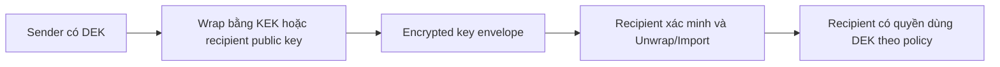
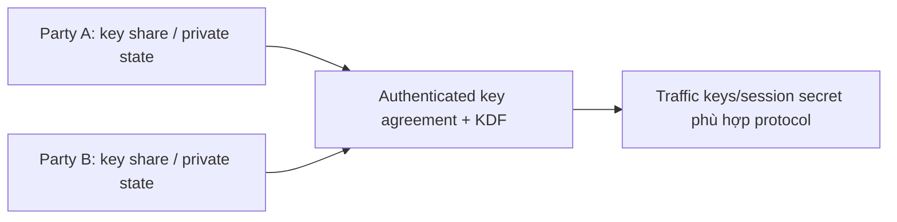
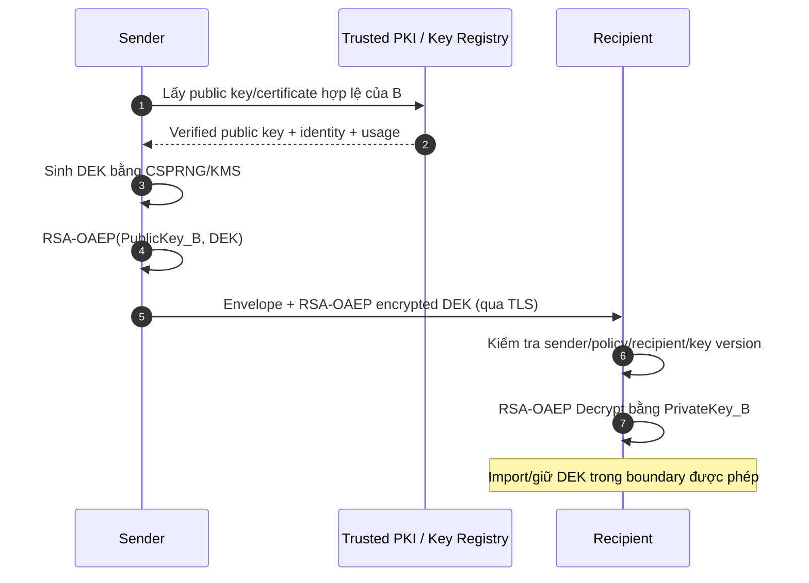
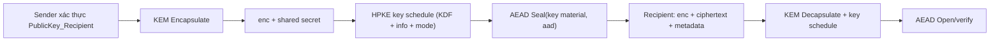
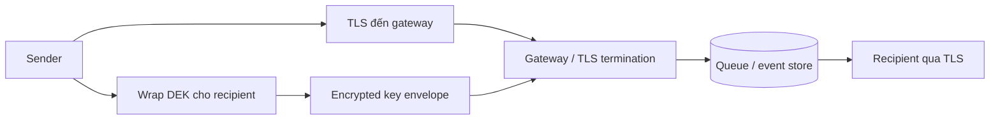
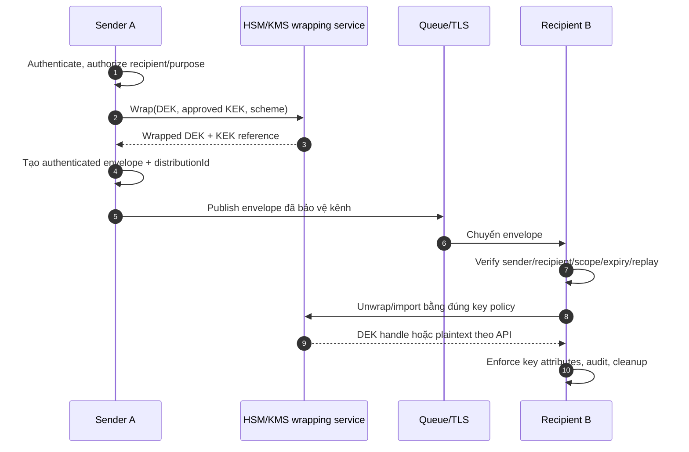
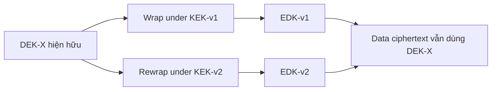
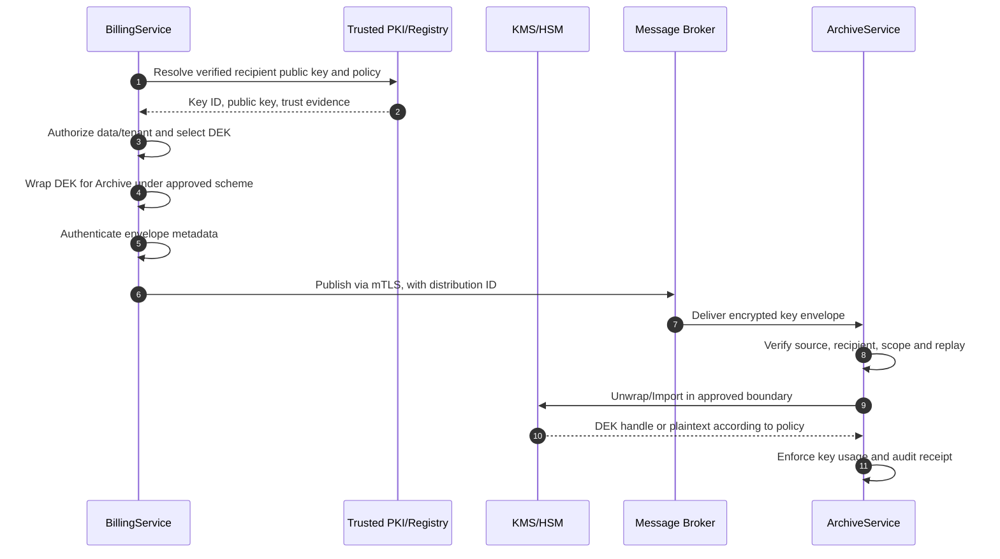

# Key wrapping khi vận chuyển — Bảo vệ vật liệu khóa khi chuyển giao

> **Chương:** Key distribution  
> **Module:** SECURITY_KEY_MANAGEMENT_FUNDAMENTALS — hiểu vòng đời khóa mật mã từ tạo, cấp phát, lưu trữ, sử dụng, xoay vòng đến thu hồi và hủy; kết nối mật mã đối xứng, bất đối xứng, chữ ký số, KMS/HSM, envelope encryption, kiểm soát truy cập và kiểm toán để thiết kế hệ thống bảo vệ khóa an toàn.

## 1. Mục tiêu học tập

Sau bài học, bạn có thể:

1. Phát biểu chính xác **key wrapping** là gì và vì sao việc chuyển một secret qua HTTPS chưa đủ để coi quy trình **phân phối khóa** đã an toàn đầu cuối.
2. Phân biệt **key-to-be-wrapped**, **wrapping key/KEK**, **wrapped key blob**, **recipient identity**, **key transport** và **key agreement**.
3. So sánh các cách bảo vệ khóa khi vận chuyển: **AES Key Wrap (RFC 3394)**, **AES Key Wrap with Padding (RFC 5649)**, **RSA-OAEP**, **HPKE**, KMS/HSM wrapping service và kênh TLS/mTLS.
4. Chọn phương án theo quan hệ tin cậy: hai hệ thống dùng chung KEK, gửi cho bên nhận có public key, key agreement trong giao thức, hoặc import vào HSM không xuất khóa thô.
5. Hiểu các thuộc tính cần đảm bảo: **confidentiality, integrity, recipient binding, key provenance, algorithm/key-use authorization, freshness và auditability**.
6. Thiết kế một **key envelope** có version, key identifiers, wrapping algorithm, metadata và context đủ để bên nhận giải bọc an toàn.
7. Dùng Java JCA với `Cipher.WRAP_MODE`/`UNWRAP_MODE` cho AES-KW và RSA-OAEP một cách có kiểm soát; nhận diện giới hạn của ví dụ.
8. Xử lý các lỗi kỹ thuật: nhầm key/recipient, sai context, ciphertext bị sửa, downgrade thuật toán, replay, thất bại nhập key, KMS outage và retry.
9. Kết nối vận chuyển khóa với **DEK/KEK**, KMS/HSM, zero-trust authorization, cryptoperiod, rewrap, rotation, thu hồi và DR.
10. Xây dựng checklist/negative tests và giải thích khi nào **không nên** truyền khóa mà nên gọi KMS/HSM hoặc thiết lập một session key độc lập.

## 2. Key wrapping khi vận chuyển là gì?

**Key wrapping** là quá trình biến **vật liệu khóa mật mã cần chuyển/lưu** thành một biểu diễn được bảo vệ, thường gọi là **wrapped key** hoặc **encrypted key blob**, dưới sự bảo vệ của một **wrapping key (KEK)** hoặc một cơ chế mật mã dành riêng cho bên nhận.

Mục tiêu là để một bên không được phép, kể cả khi nhìn thấy ciphertext của khóa, **không dễ dàng biết hoặc sửa khóa** mà vẫn qua được kiểm tra xác thực/tính toàn vẹn của cơ chế đã chọn.

Ví dụ:

```text
Bên A:
    DEK_A  = khóa AES-256 cần gửi
    KEK_AB = khóa wrapping đã được chia sẻ và bảo vệ đúng
    EDK    = AES-KW(KEK_AB, DEK_A)

Trên đường truyền:
    keyEnvelope = {version, alg, recipientId, kekRef, EDK, ...}

Bên B:
    xác minh danh tính, quyền, metadata và wrapping key
    DEK_A = AES-KW-UNWRAP(KEK_AB, EDK)
```

Đây là mô hình **symmetric key transport**. Trong trường hợp không có shared KEK, A có thể dùng **public key được xác thực của B** để bảo vệ DEK qua RSA-OAEP/HPKE theo profile chuẩn.

### 2.1. Vì sao “mã hóa khóa trước khi chuyển” vẫn chưa phải mô tả đầy đủ?

Một quy trình vận chuyển khóa cần trả lời:

- **Khóa được sinh ở đâu và với entropy nào?**
- **Ai là bên nhận đã được xác thực?** B có thật là endpoint được ủy quyền?
- **Ai được phép tạo, gửi, unwrap, import và sử dụng khóa?**
- **Wrapping key nằm ở đâu?** Có bị export khỏi HSM/KMS không?
- **Thuật toán wrap nào?** Có xác thực tính toàn vẹn và chống đổi profile không?
- **Recipient đã nhận key loại nào và cho mục đích gì?**
- **Key đã được kiểm tra version, scope, expiration và policy chưa?**
- **Khi bị lỗi, retry, replay, compromise hoặc rollback thì xử lý thế nào?**
- **Key mới nằm dưới trust boundary nào tại bên nhận?**

Nếu chỉ gọi `encrypt(secretBytes)` rồi gửi qua email, một số câu hỏi trên vẫn chưa được giải quyết.

### 2.2. Phân biệt gửi khóa với gửi dữ liệu đã mã hóa

**Data encryption:**

```text
plaintext document
    + DEK
    -> document ciphertext + tag + IV/nonce
```

**Key wrapping:**

```text
plaintext DEK
    + KEK hoặc recipient public key
    -> wrapped DEK / encrypted key
```

Hai kết quả đều có thể là ciphertext, nhưng chúng có **key use, định dạng, độ dài, metadata, tiêu chuẩn và chính sách khác nhau**.

## 3. Khái niệm cốt lõi

| Thành phần | Vai trò | Yêu cầu an toàn |
| --- | --- | --- |
| **Key-to-be-wrapped** | Khóa cần chuyển, thường là DEK/PSK hoặc key khác được phép | Đủ entropy, đúng algorithm và key usage |
| **KEK / wrapping key** | Bảo vệ key material | Cất trong boundary an toàn, hạn chế export/Wrap/Unwrap |
| **Wrapped key blob** | Bản mã của key được vận chuyển/lưu | Không tự được xem là secret plaintext, nhưng phải bảo vệ integrity/availability |
| **Recipient** | Hệ thống được ủy quyền nhận/sử dụng khóa | Xác thực danh tính, policy và trust domain |
| **Sender/distributor** | Bên tạo/bọc và gửi khóa | Có quyền phù hợp, log audit, không tự giả danh |
| **Key ID/version** | Tham chiếu khóa wrap hoặc vật liệu khóa tương ứng | Không dùng alias như bằng chứng đủ về key version |
| **Wrapping algorithm** | Ví dụ AES-KW, AES-KWP, RSA-OAEP | Phải allowlist và phù hợp với key size/format |
| **Context/AAD** | Ràng buộc purpose, tenant, object, recipient nếu cơ chế hỗ trợ | Lấy từ nguồn đáng tin; không thay authorization |
| **Transport channel** | TLS/mTLS, message bus, API, file exchange | Chống nghe lén/giả mạo kênh theo mô hình |
| **Key import/unwrap target** | Keystore, HSM hoặc application runtime | Quyền, trạng thái và exportability sau nhận phải rõ |

### 3.1. Wrapped key không phải một chuỗi key đã “hash”

Hash như SHA-256 không thể **hoàn nguyên** key ban đầu. Key wrapping cho phép **bên được ủy quyền phục hồi đúng key** hoặc import nó vào cryptographic boundary mà không cho ứng dụng thông thường đọc raw key.

Do đó:

```text
SHA256(key)                   -> digest; không unwrap được
Base64(key)                   -> encoding; ai cũng decode được
AES-KW(KEK, key)              -> wrapped key; cần KEK để unwrap
RSA-OAEP(PK_B, key)           -> encrypted key; cần private key B
HPKE Seal(PK_B, info, key)    -> ciphertext; mở theo đúng mode/suite/context
```

Đừng đặt tên biến `wrappedKey` cho một `Base64.getEncoder().encode(key)` rồi cho rằng đã bảo vệ key.

### 3.2. Wrapped key có thể tồn tại lâu hơn chuyến truyền

Một key blob có thể được:

- Truyền qua HTTPS cho recipient.
- Đưa qua message queue được bảo vệ.
- Lưu trong object metadata.
- Lưu trong database cùng ciphertext dữ liệu.
- Sao chép vào backup/DR.
- Được rewrap từ KEK cũ sang KEK mới.

Vì vậy tính an toàn của key wrapping phải xét **key custody lúc nhận, storage và lưu trữ lịch sử**, không chỉ gói mạng trong vài mili giây.

## 4. Key transport, key agreement và key derivation

### 4.1. Key transport

Một bên có/khởi tạo một secret key, rồi **chuyển khóa đó** cho recipient được phép dưới một lớp bảo vệ mật mã.



RSA-OAEP key transport hoặc symmetric key wrapping thuộc mô hình này.

### 4.2. Key agreement

Hai bên tham gia một **giao thức thiết lập secret chung**, ví dụ authenticated Diffie–Hellman hoặc một protocol có ECDHE+KDF. Secret session có thể được dẫn xuất mà **không có bên nào gửi trực tiếp một DEK đã tạo sẵn**.



Trong TLS 1.3, các traffic keys được tạo từ **key schedule** của handshake, không đơn giản là “server gửi AES key bằng RSA”. Khi học key distribution phải giữ rõ **mô hình giao thức thực tế**.

### 4.3. Derivation từ master secret

Một master secret đủ entropy có thể dùng KDF chuẩn (như HKDF theo RFC 5869) để sinh khóa con cho từng purpose. Đây không giống “gửi một DEK tới B”.

Ví dụ về **ý tưởng domain separation**:

```text
master keying material
  -> HKDF(info="service-A|transport-wrap|v1") -> wrapping key
  -> HKDF(info="service-A|data-aead|v1")       -> data key
```

Nếu đầu vào là mật khẩu yếu, HKDF không tự tạo ra entropy. Không dùng `SHA256(password)` như một cách “sinh KEK AES-256 an toàn”.

### 4.4. Bài toán cần lựa chọn

Trước khi wrap, hãy hỏi: **B có thực sự cần biết raw DEK không?**

- Nếu B chỉ cần thực hiện `Decrypt`, có thể sử dụng **KMS/HSM API với key handle**, không xuất key.
- Nếu A và B cùng chạy trong cùng trust domain, có thể thiết kế **KMS grants** thay vì truyền key.
- Nếu B thuộc domain khác, cần **recipient public key được xác thực** hoặc key agreement.
- Nếu secret chỉ dùng trong phiên truyền, dùng **giao thức chuẩn có key schedule**, không tự thiết kế một giao thức gửi key.

**Tránh chuyển raw key nếu có thể giữ thao tác trong boundary bảo vệ.**

## 5. Threat model của việc vận chuyển khóa

Một thiết kế phải chịu được ít nhất các kiểu đối thủ tùy yêu cầu:

### 5.1. Passive eavesdropper

Kẻ tấn công ghi lại packet/network trace/message bus. Mục tiêu là không để họ biết plaintext DEK.

Cơ chế: TLS đúng cấu hình, key wrapping phù hợp, hạn chế raw secret trong payload và logs.

### 5.2. Active man-in-the-middle

Kẻ tấn công có thể:

- Thay public key của recipient bằng key họ kiểm soát.
- Thay key envelope hoặc metadata.
- Downgrade thuật toán.
- Phát lại key blob cũ.
- Gửi envelope của tenant A sang B.
- Tạo endpoint giả có tên giống service hợp lệ.

**Mã hóa một DEK dưới public key do attacker cung cấp không giúp bảo mật cho recipient thật**. Phải xác thực public key và endpoint identity.

### 5.3. Compromised sender

Nếu A bị chiếm quyền, attacker có thể gửi nhầm key, dùng thuật toán ngoài policy, hoặc exfiltrate DEK **trước khi wrap**. Wrapping ciphertext đúng không chứng minh A là nguồn đáng tin trừ khi có **sender authentication và authorization** phù hợp.

### 5.4. Compromised recipient

Nếu recipient B bị chiếm, attacker có thể unwrap key đã được gửi hợp lệ hoặc lạm dụng quyền `Decrypt/Unwrap`. Không thể kỳ vọng key wrapping tự bảo vệ một secret **sau khi đã được giải bọc** tại endpoint bị compromise.

### 5.5. KEK/private unwrapping key bị lộ

Attacker có thể đọc lại wrapped key blobs trong logs, message archive hoặc backup rồi giải bọc khóa. Thay KEK hôm nay **không xóa được các key đã bị unwrap**. Cần đánh giá thời gian compromise và đối tượng có thể bị truy cập.

### 5.6. Replay, rollback và mix-up

Ngay cả key blob có xác thực integrity vẫn có thể bị phát lại từ một **lần phân phối hợp lệ trước đây**. Tùy nghiệp vụ, recipient phải kiểm soát:

- `distributionId` hoặc transaction nonce.
- `issuedAt`/`expiresAt` đã được xác thực bằng nguồn tin cậy.
- `keyMaterialVersion` và monotonic state nếu cần.
- Đúng `tenant/object/service/purpose`.
- Không nhận key đã revoked hoặc key cũ dùng cho **new encryption**.

**AES-KW không tự cung cấp anti-replay, thời hạn hoặc phân quyền.**

## 6. Mục tiêu bảo mật: không chỉ confidentiality

| Thuộc tính | Yêu cầu | Cơ chế có thể đóng góp |
| --- | --- | --- |
| **Confidentiality** | Không lộ DEK cho người không được phép | AES-KW/KWP, RSA-OAEP, HPKE, KMS, TLS |
| **Integrity** | Phát hiện wrapped key bị sửa | Check của KW/KWP, AEAD/key wrapping protocol |
| **Recipient binding** | Chỉ recipient có quyền mới mở được | Key identity, trust store, authenticated key selection |
| **Sender authenticity** | Người gửi là actor được phép | mTLS, signature hoặc giao thức/authenticated mode phù hợp |
| **Key provenance** | Biết key sinh bởi ai, từ RNG nào, mục đích gì | Registry, signed evidence, KMS audit, attestation |
| **Key usage separation** | Key chỉ được dùng cho đúng thuật toán/operation | HSM/KMS policy, key attributes, application authorization |
| **Freshness / anti-replay** | Không tái sử dụng key envelope cũ trái policy | Distribution ID, revisions, TTL/state được xác thực |
| **Availability** | Recipient mở được khi cần và không mất DR | Key backup/replica, key inventory, tested restore |
| **Auditability** | Truy được actor, thời gian, key IDs, decision | Logs không chứa key material |
| **Revocation** | Có thể ngăn use mới khi quyền/key không còn hợp lệ | IAM/grants, key state, encrypted key inventory |

Một primitive key wrapping **thường chỉ giải quyết một phần** bảng trên. Những phần còn lại thuộc **giao thức phân phối khóa, quyền và vận hành**.

## 7. Chọn phương án wrapping/transport

| Phương án | Điều kiện phù hợp | Điểm mạnh | Cần chú ý |
| --- | --- | --- | --- |
| **AES-KW — RFC 3394** | Có shared KEK AES được bảo vệ; key material đủ độ dài chuẩn | Thiết kế wrap chuyên biệt, kiểm tra integrity | Không có AAD tùy ý, phải bind context ngoài primitive |
| **AES-KWP — RFC 5649** | Cần hỗ trợ độ dài key material không bội 64 bit | Có padding và length encoding | Provider support, format/version, không suy ra sender auth |
| **RSA-OAEP** | Recipient có RSA public key được xác thực | Chỉ recipient có private key giải mã được | Message size limit, key/parameter validation, không sender-auth mặc định |
| **HPKE — RFC 9180** | Hệ thống dùng KEM/KDF/AEAD/hybrid public-key workflow | Chuẩn hóa hybrid envelope và context | Chọn đúng mode/suite, Base không xác thực sender |
| **KMS/HSM WrapKey/ReEncrypt** | Root key được quản trị, có policy/roles/audit | Có thể không export KEK và đôi khi rewrap server-side | Vendor semantics/quotas/permissions, recipient import |
| **TLS/mTLS** | Bảo vệ kênh giữa hai endpoint | Kênh bảo mật + peer authentication theo cấu hình | Key plaintext có thể bị lộ ở endpoints/log/queue sau TLS |
| **Authenticated key agreement** | Muốn session traffic keys, không cần chuyển một key có sẵn | Key schedule và thuộc tính handshake | Giao thức chuẩn, identity/authentication/rekey đúng |

Không chọn thuật toán chỉ theo câu “cái nào 256 bit”. Cần xem **loại key cần chuyển, recipient identity, trust boundaries, export policy, cryptoperiod, latency, HSM capabilities và compliance**.

## 8. AES Key Wrap (AES-KW) theo RFC 3394

**AES-KW** là một cơ chế chuyên biệt để **bọc dữ liệu khóa** bằng AES KEK. RFC 3394 mô tả thuật toán wrap/unwrap và kiểm tra integrity đối với dữ liệu khóa có độ dài phù hợp.

### 8.1. Những điểm cần nhớ

- Dùng **AES KEK** được bảo vệ thích hợp, độ dài AES hợp lệ 128/192/256 bit.
- Input key data có độ dài **bội số 64 bit** và theo định dạng RFC 3394 thông thường tối thiểu **128 bit** (hai khối 64 bit).
- Output thông thường dài **hơn input 64 bit** do giá trị kiểm tra ban đầu.
- Default initial value trong RFC 3394 là **8 byte `A6 A6 A6 A6 A6 A6 A6 A6`**.
- Unwrap phải **kiểm tra integrity**, không được trả key plaintext nếu kiểm tra thất bại.
- AES-KW không phải một AEAD API cung cấp AAD tùy ý như AES-GCM.
- Không dùng AES-KW thay cho giao thức phân quyền, xác thực sender hoặc quản lý replay.

### 8.2. Ví dụ kích thước

| Key data input | Độ dài đầu vào | Wrapped output RFC 3394 (thông thường) |
| --- | ---: | ---: |
| DEK AES-128 | 16 byte | 24 byte |
| DEK AES-192 | 24 byte | 32 byte |
| DEK AES-256 | 32 byte | 40 byte |

Đây là **độ dài wrap blob chuẩn**, không tính application envelope metadata, key ID, signature hoặc framing.

### 8.3. Integrity check có phạm vi

AES-KW có cơ chế phát hiện blob bị sửa mà không có KEK; tuy nhiên:

- Không tự xác thực **recipient ID** hay **key purpose**.
- Không tự xác thực sender nếu cả A và B có KEK.
- Không tự chứng minh key đã được sinh bằng CSPRNG đúng.
- Không ngăn attacker phát lại một **wrapped key blob hợp lệ cũ**.
- Không tự tạo **versioning, expiration hoặc audit**.

Một giao thức muốn bảo vệ context có thể sử dụng một **authenticated outer envelope**, KMS encryption context khi có API hỗ trợ, hoặc phương án AEAD/key transport được thiết kế và đánh giá phù hợp. Không bịa “AAD field” cho RFC 3394 rồi giả định nó được xác thực.

### 8.4. Không tạo KEK từ password dễ đoán

Một KEK AES-256 sinh từ `SHA256("company-2026")` vẫn là **khóa yếu về entropy**. KEK nên sinh bằng KMS/CSPRNG/HSM đúng policy; nếu xuất phát từ password thì cần password KDF đúng loại và đánh giá security strength thực.

### 8.5. Unwrap thất bại phải fail closed

Khi integrity check không đạt, API phải trả **lỗi**, không dùng key output chưa xác minh. Không chuyển sang ECB/CBC/NoPadding, không cắt blob hoặc thử nhiều “mẹo” giải mã ngoài policy để “cứu” key.

## 9. AES Key Wrap with Padding (AES-KWP) theo RFC 5649

**AES-KWP** mở rộng ý tưởng key wrap cho dữ liệu có chiều dài **không nhất thiết bội số 8 byte**, với cách encoding độ dài và padding được chuẩn hóa.

### 9.1. Vì sao cần KWP?

Giả sử cần wrap một seed/secret của protocol có **20 byte**. Input này không khớp trực tiếp với yêu cầu input thông thường của AES-KW RFC 3394.

Đừng tự:

```text
padding = thêm số 0 tùy ý rồi coi key sau unwrap có độ dài cố định
```

Thay vào đó dùng **AES-KWP được tiêu chuẩn hóa**, cùng định dạng/protocol version và provider support chính xác.

### 9.2. Những điểm kỹ thuật

- RFC 5649 mô tả **Alternative Initial Value (AIV)** và **Message Length Indicator (MLI)**.
- Padding các byte cuối theo quy tắc của chuẩn; quá trình unwrap phải kiểm tra **integrity, length và padding**.
- Với key data đủ ngắn, RFC 5649 có xử lý riêng cho trường hợp một khối 64 bit sau padding.
- Không được đổi ngầm `AES-KW` thành `AES-KWP` chỉ vì hai cái tên gần giống nhau.
- Cần thống nhất đúng transformation trong crypto provider, key length, serialization và key usage.

### 9.3. KWP không có AAD tùy ý

Giống AES-KW, **không coi AES-KWP tự xác thực tenant, recipient, key version, certificate fingerprint hoặc business purpose**. Nếu giao thức cần các ràng buộc này, phải thiết kế lớp envelope/context được xác thực phù hợp.

### 9.4. Ghi rõ thuật toán trong metadata

Ví dụ một schema có thể dùng:

```json
{
  "wrapAlgorithm": "AES-KWP-RFC5649",
  "kekRef": "kms://domain-a/wrapping-key-v3",
  "wrappedKey": "<base64-ciphertext>"
}
```

Đây là **metadata minh họa**, không phải API chuẩn. Bên nhận phải đối chiếu với **policy/registry đáng tin**, không chấp nhận bất kỳ algorithm nào do dữ liệu chưa tin cậy đề xuất.

## 10. AES-GCM hoặc AEAD để bọc key: khi nào phù hợp?

Có thể mã hóa key material như một payload bằng **AEAD** được phê duyệt, ví dụ AES-GCM, thay vì AES-KW/KWP trong một giao thức riêng. Tuy nhiên, đây là **thiết kế khác** và không được gắn nhãn RFC 3394.

### 10.1. Khác biệt quan trọng

| Yếu tố | AES-KW/KWP | AES-GCM-based wrapping |
| --- | --- | --- |
| **Primitive** | Key-wrap theo RFC 3394/5649 | AEAD cho một payload là key bytes |
| **Nonce/IV ngoài key data** | Cơ chế IV/AIV riêng của key-wrap chuẩn | Phải quản lý GCM nonce **unique theo KEK** |
| **AAD** | Không hỗ trợ AAD tùy ý như AEAD | Hỗ trợ AAD theo API, nếu canonical đúng |
| **Integrity** | Key-wrap integrity checks | AEAD tag verification |
| **Tương thích provider** | Wrap/Unwrap transformation/key type | Encrypt/Decrypt mode, key import/usage semantics |
| **Các sai lầm thường gặp** | Nhầm KW/KWP, không bind metadata | Nonce reuse, tag bypass, context confusion |

### 10.2. Cảnh báo nonce reuse

Dùng **một KEK AES-GCM để wrap nhiều DEK** đồng nghĩa có nhiều lần encrypt dưới cùng KEK. Nếu reuse **key+nonce**, GCM có thể mất bảo đảm nghiêm trọng. Không lấy static nonce hoặc key ID làm nonce.

Chỉ dùng AEAD-based wrapping khi đã định nghĩa đầy đủ:

- Nonce construction và uniqueness xuyên worker/restart/DR.
- AAD canonical và versioned.
- Tag length và verification.
- Output framing/serialization.
- Key usage/policy, KEK cryptoperiod và usage limits.
- Error handling, replay protection khi cần.
- Test vectors và tương thích provider.

**AES-GCM mạnh nhưng không tự miễn trách nhiệm nonce management.**

## 11. RSA-OAEP để vận chuyển DEK tới recipient có public key

Khi Sender không chia sẻ KEK đối xứng với Recipient, một phương án là **mã hóa DEK bằng recipient RSA public key đã được xác thực**, theo RSA-OAEP và profile được duyệt.

### 11.1. Luồng khái niệm



### 11.2. Public key phải được xác thực

RSA-OAEP bảo vệ DEK cho **private key khớp với public key được dùng**. Nếu attacker thay public key B bằng public key của mình, ciphertext được mã hóa cho attacker.

Vì vậy cần:

- PKI/certificate chain validation hoặc trusted key registry phù hợp.
- Đúng identity/SAN/role và trust anchor.
- Key usage/algorithm/certificate validity theo policy.
- Revocation/expiry handling, certificate rotation.
- Không tắt certificate validation để khắc phục lỗi tạm thời.
- Không dùng cùng public key cho mọi purpose nếu chính sách cần tách.

### 11.3. OAEP parameters phải khớp hoàn toàn

Hai bên phải thống nhất:

- RSA modulus/key size theo security policy.
- OAEP message digest, ví dụ SHA-256.
- MGF1 digest, ví dụ SHA-256.
- Label/PSource nếu có.
- Key usage, ciphertext format và import semantics.
- Message length phải thỏa giới hạn RSA-OAEP.

**Không mặc định `RSA/ECB/OAEPWithSHA-256AndMGF1Padding` trên mọi provider có cùng MGF1 digest** nếu không kiểm tra. Trong Java nên cung cấp `OAEPParameterSpec` tường minh khi cần interoperability.

### 11.4. Giới hạn kích thước

Với RSA-OAEP, độ dài message tối đa theo PKCS #1 là:

\[
mLen \leq k - 2hLen - 2
\]

Trong đó `k` là độ dài RSA modulus theo byte, `hLen` là độ dài hash dùng trong OAEP tính theo byte.

Ví dụ RSA-3072 (384 byte) và SHA-256 (32 byte):

\[
384 - 2\times32 - 2 = 318\ \text{byte}.
\]

Một DEK AES-256 dài 32 byte nằm trong giới hạn ví dụ đó. Nhưng RSA-OAEP **không phải công cụ để mã hóa file lớn**; hãy mã hóa dữ liệu bằng DEK/AEAD, rồi bảo vệ **chính DEK** bằng RSA-OAEP.

### 11.5. RSA-OAEP không tự xác thực Sender

Bất kỳ ai có public key B đều có thể tạo một ciphertext RSA-OAEP cho B. Người nhận không thể suy ra chỉ từ việc unwrap thành công rằng **A thật sự là người gửi đã được ủy quyền**.

Cần một lớp **sender authentication/authorization**, ví dụ mTLS với peer identity được xác thực, signature trên key envelope được chuẩn hóa, hoặc một protocol được thiết kế cung cấp thuộc tính đó.

### 11.6. Không có forward secrecy tự động

Nếu attacker ghi lại các RSA-OAEP encrypted DEKs và sau này lấy được private unwrapping key B, attacker có thể giải mã những key blobs cũ đã ghi lại nếu không có bảo vệ bổ sung. **Public-key key transport tới khóa tĩnh không tự đem lại forward secrecy**.

Nếu threat model yêu cầu các thuộc tính mạnh hơn với session keys, hãy cân nhắc authenticated key agreement/giao thức được đánh giá, thay vì tự dựng giao thức RSA key transport.

## 12. HPKE: hybrid public-key key transport

**HPKE (Hybrid Public Key Encryption, RFC 9180)** kết hợp **KEM, KDF và AEAD**, tạo cơ chế hybrid public-key encryption có định dạng và context rõ. Nó phù hợp với nhiều use case cần bảo vệ keying material/payload nhỏ cho recipient có public key.

### 12.1. Tổng quan



`enc` là dữ liệu encapsulation của KEM, không phải plaintext DEK. Recipient cần dùng private key thích hợp và cùng thông số suite/mode/context để mở payload.

### 12.2. Các mode không tương đương

RFC 9180 định nghĩa các mode bao gồm **Base, PSK, Auth và AuthPSK**. Thuộc tính xác thực và ràng buộc phụ thuộc mode và cách quản lý keys/context.

- **Base mode** không tự xác thực Sender.
- **Auth mode** có cơ chế sender authentication dựa trên sender key material theo đặc tả, nhưng vẫn cần tin cậy sender public key/identity đúng cách.
- **PSK modes** phải dùng PSK phù hợp và đúng protocol context.
- Không tự dùng nhãn “HPKE” rồi khẳng định mọi mode có cùng confidentiality/authenticity/forward secrecy.

### 12.3. Bảo vệ đúng recipient key

Giống RSA-OAEP, nếu public key của B bị thay, Sender có thể tạo encrypted key blob cho attacker. Phải xác thực:

- Recipient public key/fingerprint.
- Trust store/certificate/registry entry.
- Key usage và algorithm suite.
- Recipient ID, key version và expiration.
- Sender identity khi cần.
- Protocol `info`/`aad` theo encoding và domain separation.

### 12.4. HPKE không thay application authorization

Ngay cả khi HPKE Open thành công, cần kiểm tra người gửi có được phép phân phối **loại khóa/purpose/tenant** đó không. Một ciphertext được tạo hợp lệ về crypto không chứng minh phê duyệt nghiệp vụ hoặc nguồn gốc tạo key đạt compliance.

### 12.5. KMS/HSM support có thể khác nhau

Không phải mọi HSM/KMS provider đều expose HPKE hoặc các KEMs giống nhau. Nếu private key B là **non-exportable** trong HSM, cần xem adapter có hỗ trợ operations/encapsulation format và key import nội bộ hay không. Tránh xuất private key B ra file plaintext chỉ để chạy một thư viện HPKE ở app.


## 13. TLS/mTLS và key wrapping là hai lớp khác nhau

TLS bảo vệ **kênh truyền giữa hai endpoints** theo cơ chế xác thực/mã hóa của phiên kết nối. Key wrapping bảo vệ **key material dưới một wrapping key hoặc recipient public key**, nên wrapped key blob có thể đi qua trung gian hoặc được lưu lâu dài mà không cần mọi bên trung gian biết raw key.



Nếu chỉ gửi plaintext DEK qua HTTPS, DEK có thể tồn tại ở **TLS termination, gateway, queue, APM logs, batch processor** hoặc nơi nhận khác trước khi đến đúng recipient.

Nếu dùng wrapped DEK qua HTTPS, có thể chỉ recipient được ủy quyền mới có thể unwrap — với điều kiện **KEK/public key và quyền unwrap** được quản lý đúng.

### 13.1. Khi nào TLS đơn thuần có thể đủ?

Một giao thức có thể hợp lệ khi chuyển secret trong kênh TLS/mTLS **đầu cuối giữa hai trusted processes**, không lưu qua trung gian và đáp ứng đầy đủ key custody policy. Key wrapping không phải một lớp bắt buộc thêm vào mọi kết nối.

Cần đánh giá:

- TLS có terminate tại proxy/gateway/sidecar nào không?
- Có process nào nhìn thấy raw key sau TLS termination?
- Recipient có cần **lưu key sau phiên** không?
- Có queue/buffer/backup/trace chứa payload không?
- Key được phép **export/import** giữa hai domains không?
- Có yêu cầu bảo vệ key blob khi lưu lâu dài không?

Với store-and-forward hoặc multi-hop, **object-level key wrapping** thường cung cấp security boundary có ý nghĩa hơn.

### 13.2. mTLS không tự xác thực nguồn gốc của một blob lịch sử

mTLS xác thực hai peer của một **TLS connection**. Nếu envelope đi qua queue và được đọc lại sáu tháng sau, người đọc không trực tiếp quan sát phiên mTLS ban đầu.

Để xác thực **nguồn gốc độc lập với channel**, có thể cần chữ ký số trên canonical envelope, MAC trong giao thức đã được thẩm định hoặc audit/provenance records được tin cậy.

### 13.3. Đừng đặt raw key vào URL, logs hoặc header debug

```text
GET /import?rawKey=<base64-plaintext-key>     # SAI
X-Debug-DEK: <base64-plaintext-key>           # SAI
queue payload {"dekPlaintext":"..."}          # SAI
logger.info("key={} ", Base64(dek));          # SAI
```

**Base64 không mã hóa bí mật**: nó chỉ thay đổi biểu diễn và ai cũng có thể đảo ngược.

## 14. Xác thực recipient và nguồn gốc khóa

### 14.1. Đúng public key là điều kiện sống còn

Trước khi gửi DEK tới B bằng RSA-OAEP/HPKE, Sender phải lấy public key qua **trust store/PKI/key registry được bảo vệ**, kiểm tra:

1. Certificate chain/trust anchor hoặc cơ chế pinning/registry phù hợp.
2. Đúng recipient identity, tên service, account/tenant và environment.
3. Validity, revocation và policy hiện tại.
4. Public key algorithm/key usage và crypto suite.
5. Stable recipient key ID/fingerprint.
6. Quyền phân phối **loại khóa và purpose** cho B.
7. Key rotation và danh sách public keys đã retired.

Nếu attacker thay public key B bằng key của họ, **RSA-OAEP vẫn mã hóa thành công nhưng DEK thuộc về attacker**.

### 14.2. Confidentiality không chứng minh Sender authenticity

Bất kỳ ai biết public key B có thể tạo một RSA-OAEP ciphertext cho B. Tương tự **HPKE Base mode không tự xác thực Sender**. Nếu B chỉ được nhận key từ A, phải có một cơ chế như:

- Authenticated peer identity qua mTLS và mapping quyền.
- Digital signature trên **canonical authenticated envelope**.
- Authenticated mode HPKE phù hợp với trust binding.
- MAC/chứng cứ nguồn gốc trong protocol được chuẩn hóa.

Chữ ký hợp lệ **chưa tự chứng minh** sender có business approval để phát key cho tenant/purpose đó.

### 14.3. Key provenance và attestation

Những hệ thống có assurance cao có thể cần xác minh:

- Key được sinh bởi approved RNG/HSM/KMS.
- Độ dài và thuật toán đúng policy.
- Nguồn khóa chưa export trái phép.
- Target HSM/secure enclave là nơi được phê duyệt.
- Unwrapped key được import với usage/extractability phù hợp.

Attestation cần **xác minh certificate chain, nonce/challenge, freshness và device identity** theo tài liệu provider; một trường JSON `"trusted":true` không phải bằng chứng.

### 14.4. Key confirmation

Một số giao thức cần xác nhận B đã nhận **đúng secret và đúng transcript/identity**, thường qua key confirmation MAC hoặc bước trong giao thức chuẩn. Không gửi **plaintext DEK ngược lại** để chứng minh nhận đúng.

## 15. Thiết kế key envelope có phiên bản

Một key envelope cần **wrapped bytes và metadata** để recipient lựa chọn đúng thuật toán, wrapping key, recipient identity, purpose và kiểm soát replay.

```json
{
  "envelopeVersion": 1,
  "distributionId": "dist-2026-000184",
  "senderId": "billing-key-service",
  "recipientId": "archive-reader-prod",
  "keyPurpose": "decrypt-approved-invoices",
  "keyAlgorithm": "AES",
  "keySizeBits": 256,
  "wrapping": {
    "scheme": "RSA-OAEP",
    "oaepDigest": "SHA-256",
    "mgf": "MGF1",
    "mgfDigest": "SHA-256",
    "recipientPublicKeyRef": "pki://archive-reader-prod/key-2026",
    "wrappedKey": "<base64-rsa-ciphertext>"
  },
  "scope": {
    "environment": "production",
    "tenant": "tenant-42",
    "service": "invoice-archive"
  },
  "issuedAt": "2026-11-28T08:00:00Z",
  "expiresAt": "2026-11-28T08:10:00Z",
  "authEvidenceRef": "signed-envelope/event-184"
}
```

**Đây là schema minh họa**, không phải wire format chính thức của RFC/KMS; placeholders không phải key thật. Chỉ khi có signature/MAC/crypto binding hoặc một nguồn integrity đáng tin mới có thể tin các trường quan trọng.

### 15.1. Những trường cần xác thực

| Trường | Vì sao quan trọng |
| --- | --- |
| `envelopeVersion` | Parse đúng wire format |
| `distributionId` | Chống replay/idempotency theo protocol |
| `senderId`, `recipientId` | Đúng identities và quyền |
| `keyAlgorithm`, `keySizeBits`, `keyPurpose` | Ngăn key type/usage confusion |
| `wrapping.scheme` và parameters | Ngăn downgrade/sai profile |
| `kekRef` hoặc recipient key reference | Không chọn sai wrapping key |
| `wrappedKey` và `enc` nếu HPKE | Payload cần unwrap |
| `tenant`, `environment`, `service` | Phạm vi dữ liệu và vận hành |
| `issuedAt`, `expiresAt` | Thời hạn, nếu authenticated và recipient có clock/state đúng |
| `authEvidenceRef`/signature | Nguồn gốc, kiểm toán và chống giả mạo |

### 15.2. Không nhầm integrity của key blob với integrity metadata

AES-KW/RFC 3394 có integrity check của **wrapped key bytes**, không có AAD tùy ý. Nó không tự bảo vệ `tenantId`, `senderId`, `recipientId`, `expiresAt` trong JSON.

Nếu attacker có thể đổi envelope header rồi để nguyên wrapped key, unwrap có thể thành công nhưng recipient/purpose sai. Cần **authenticated envelope protocol** hoặc phương án AEAD/KMS context có thiết kế phù hợp.

### 15.3. Canonicalization

Khi ký/MAC JSON, các vấn đề cần được giải quyết:

- Thứ tự field, whitespace, Unicode normalization.
- Duplicate keys, unknown critical fields, optional fields.
- Kiểu dữ liệu, Base64 variant, length limits.
- Version và encoding của thuật toán.
- Byte chính xác được ký/MAC.

Không tự cho rằng `JSON.stringify(anyObject)` giống nhau across languages/versions. Dùng canonical encoding/protocol được thẩm định.

### 15.4. Chống replay

Một wrapped blob cũ có integrity hợp lệ vẫn có thể bị phát lại. Các trường `distributionId`, `issuedAt` và `expiresAt` cần:

- Được authenticated.
- Được recipient kiểm tra và giữ replay state/monotonic version nếu cần.
- Được đối chiếu với key status và cryptoperiod.
- Không cho import key cũ làm key mới đang active nếu policy cấm.

**Integrity không đồng nghĩa freshness hoặc authorized purpose.**

## 16. Luồng symmetric wrapping giữa A và B



Không mặc định actor có `Wrap` thì phải có `Unwrap`; sender và recipient nên có identities, grants, key usage độc lập. Với hai tổ chức khác trust boundary, cùng biết raw shared KEK có thể tạo **blast radius lớn** khi một bên bị compromise.

### 16.1. AES-KW không bind metadata mặc định

Một AES-KW ciphertext hợp lệ có thể được đưa từ transaction A sang transaction B nếu cả hai dùng chung KEK. Recipient phải kiểm tra **envelope provenance, recipient, tenant, purpose, version và replay** trước unwrap/import.

### 16.2. Nhận khóa vào HSM có thể khác nhận byte ở ứng dụng

Nếu requirement là **không xuất plaintext DEK khỏi HSM**, target phải hỗ trợ import wrapped key trực tiếp vào HSM/key handle. Unwrap ra Java heap rồi import bằng API plaintext có thể vi phạm policy.

### 16.3. Vẫn dùng TLS/mTLS

Key wrapping không thay toàn bộ authentication/availability protections của transport. TLS giúp chống nghe lén metadata không mã hóa, giả mạo kết nối, spam/DoS (kết hợp ACL/rate-limit) và xử lý kênh truyền theo policy.

## 17. Luồng public-key transport khi không có shared KEK

Khi A muốn gửi DEK cho B không cùng KMS/trust domain:

1. B đăng ký public key/certificate qua trusted provisioning.
2. A xác thực public key B và recipient identity/key use.
3. A chọn key algorithm/size và sinh DEK từ CSPRNG/KMS đúng scope.
4. A dùng **RSA-OAEP hoặc HPKE** theo profile được phê duyệt để bảo vệ DEK.
5. A gắn recipient key ID, purpose, tenant, distribution ID, expiry vào envelope.
6. A xác thực nguồn gốc envelope và truyền qua kênh bảo vệ.
7. B xác minh sender, policy, context và replay trước unwrap/import.
8. B dùng private key được bảo vệ để mở DEK.
9. B áp key attributes, hạn chế export và audit.
10. Hai bên quản lý key lifecycle, rotation và sự cố.

**Khi B đổi RSA/HPKE private key**, wrapped keys cũ không tự mở được bằng key mới. Cần giữ key cũ theo retention hoặc migrate/rewrap theo phương án được phê duyệt.

## 18. Java JCA: AES Key Wrap / Unwrap

Ví dụ Java 17 dưới đây minh họa `Cipher.WRAP_MODE` và `Cipher.UNWRAP_MODE` với transformation `AESWrap` trên JCA provider hỗ trợ. Đây là **mã ví dụ local**, không phải giao thức phân phối production.

```java
import java.security.GeneralSecurityException;
import java.security.MessageDigest;
import java.security.SecureRandom;
import java.util.Arrays;

import javax.crypto.Cipher;
import javax.crypto.KeyGenerator;
import javax.crypto.SecretKey;

public final class AesKeyWrapDemo {
    private static final SecureRandom RNG = new SecureRandom();

    private AesKeyWrapDemo() {}

    static SecretKey generateAesKey(int bits)
            throws GeneralSecurityException {
        KeyGenerator generator = KeyGenerator.getInstance("AES");
        generator.init(bits, RNG);
        return generator.generateKey();
    }

    static byte[] wrap(SecretKey kek, SecretKey dek)
            throws GeneralSecurityException {

        Cipher cipher = Cipher.getInstance("AESWrap");
        cipher.init(Cipher.WRAP_MODE, kek);
        return cipher.wrap(dek);
    }

    static SecretKey unwrap(SecretKey kek, byte[] wrapped)
            throws GeneralSecurityException {

        Cipher cipher = Cipher.getInstance("AESWrap");
        cipher.init(Cipher.UNWRAP_MODE, kek);
        return (SecretKey) cipher.unwrap(
            wrapped,
            "AES",
            Cipher.SECRET_KEY
        );
    }

    public static void main(String[] args)
            throws GeneralSecurityException {

        // Demo: production ưu tiên KMS/HSM cho KEK.
        SecretKey kek = generateAesKey(256);
        SecretKey dek = generateAesKey(256);

        byte[] wrappedDek = wrap(kek, dek);
        SecretKey recovered = unwrap(kek, wrappedDek);

        byte[] originalBytes = dek.getEncoded();
        byte[] recoveredBytes = recovered.getEncoded();
        try {
            if (!MessageDigest.isEqual(
                    originalBytes, recoveredBytes)) {
                throw new GeneralSecurityException(
                    "Unwrapped DEK mismatch");
            }

            System.out.println("AES-KW round-trip verified");
            System.out.println("Wrapped length: " + wrappedDek.length);

        } finally {
            // Best effort: không đảm bảo xóa copies trong JCA/JVM.
            if (originalBytes != null) {
                Arrays.fill(originalBytes, (byte) 0);
            }
            if (recoveredBytes != null) {
                Arrays.fill(recoveredBytes, (byte) 0);
            }
        }
    }
}
```

### 18.1. Ví dụ minh họa điều gì?

- DEK và KEK được sinh riêng bằng `KeyGenerator` kết hợp `SecureRandom`.
- `Cipher.WRAP_MODE` bọc DEK bằng KEK.
- `Cipher.UNWRAP_MODE` giải bọc bằng KEK đúng.
- Unwrap phải kiểm tra integrity và báo lỗi nếu blob sai.
- Một DEK AES-256 input 32 byte tạo AES-KW output thông thường 40 byte.

### 18.2. Chưa đủ cho production

- Không có **sender/recipient identity**, provenance, signature hoặc authenticated envelope.
- Không chống replay hoặc enforce tenant/key use.
- KEK là key phần mềm, có thể export; chưa dùng KMS/HSM.
- `getEncoded()` chỉ dùng cho **test local**; key non-exportable có thể không trả bytes.
- Không bảo đảm zeroization hoàn toàn của JVM/provider.
- `AESWrap` cần được provider hỗ trợ và kiểm thử interoperability.
- Không tự chuyển sang `AESWrapPad` nếu cần AES-KWP; hai dạng ciphertext **không tự tương thích**.

### 18.3. Negative test: blob bị sửa

```java
byte[] tampered = wrappedDek.clone();
tampered[0] ^= 1;

try {
    unwrap(kek, tampered);
    throw new AssertionError("Tampered key accepted");
} catch (GeneralSecurityException expected) {
    // Key wrap integrity check phải từ chối.
}
```

Đây là test **chống sửa blob**, không chứng minh signature, sender auth hay replay protection.

## 19. Java JCA: RSA-OAEP cho recipient

Ví dụ sử dụng RSA-3072, OAEP SHA-256/MGF1-SHA256 tường minh. Trong thực tế **public key của B phải được lấy và xác minh từ PKI/trusted registry** trước khi wrap; demo tự tạo key pair chỉ để kiểm tra operation.

```java
import java.security.GeneralSecurityException;
import java.security.Key;
import java.security.KeyPair;
import java.security.KeyPairGenerator;
import java.security.MessageDigest;
import java.security.PrivateKey;
import java.security.PublicKey;
import java.security.SecureRandom;
import java.security.spec.MGF1ParameterSpec;
import java.util.Arrays;

import javax.crypto.Cipher;
import javax.crypto.KeyGenerator;
import javax.crypto.SecretKey;
import javax.crypto.spec.OAEPParameterSpec;
import javax.crypto.spec.PSource;

public final class RsaOaepKeyTransportDemo {
    private static final SecureRandom RNG = new SecureRandom();

    private static final OAEPParameterSpec OAEP_SHA256 =
        new OAEPParameterSpec(
            "SHA-256",
            "MGF1",
            MGF1ParameterSpec.SHA256,
            PSource.PSpecified.DEFAULT
        );

    private RsaOaepKeyTransportDemo() {}

    static KeyPair generateDemoRecipientKeyPair()
            throws GeneralSecurityException {
        KeyPairGenerator generator =
            KeyPairGenerator.getInstance("RSA");
        generator.initialize(3072, RNG);
        return generator.generateKeyPair();
    }

    static SecretKey generateDek()
            throws GeneralSecurityException {
        KeyGenerator generator =
            KeyGenerator.getInstance("AES");
        generator.init(256, RNG);
        return generator.generateKey();
    }

    static byte[] wrapFor(
            PublicKey verifiedPublicKey,
            SecretKey dek) throws GeneralSecurityException {

        Cipher cipher = Cipher.getInstance("RSA/ECB/OAEPPadding");
        cipher.init(Cipher.WRAP_MODE, verifiedPublicKey, OAEP_SHA256);
        return cipher.wrap(dek);
    }

    static SecretKey unwrapAtRecipient(
            PrivateKey recipientPrivateKey,
            byte[] encryptedDek) throws GeneralSecurityException {

        Cipher cipher = Cipher.getInstance("RSA/ECB/OAEPPadding");
        cipher.init(
            Cipher.UNWRAP_MODE,
            recipientPrivateKey,
            OAEP_SHA256
        );
        Key recovered = cipher.unwrap(
            encryptedDek,
            "AES",
            Cipher.SECRET_KEY
        );
        return (SecretKey) recovered;
    }

    public static void main(String[] args)
            throws GeneralSecurityException {

        KeyPair recipient = generateDemoRecipientKeyPair();
        SecretKey dek = generateDek();

        byte[] wrapped = wrapFor(recipient.getPublic(), dek);
        SecretKey recovered =
            unwrapAtRecipient(recipient.getPrivate(), wrapped);

        byte[] original = dek.getEncoded();
        byte[] actual = recovered.getEncoded();

        try {
            if (!MessageDigest.isEqual(original, actual)) {
                throw new GeneralSecurityException(
                    "Recipient recovered wrong DEK");
            }
            System.out.println("RSA-OAEP round-trip verified");
        } finally {
            if (original != null) Arrays.fill(original, (byte) 0);
            if (actual != null) Arrays.fill(actual, (byte) 0);
        }
    }
}
```

### 19.1. Lưu ý khi dùng mã này

- Chuỗi `RSA/ECB/OAEPPadding` là tên transformation của JCA; chữ `ECB` ở đây **không có nghĩa RSA đang dùng AES-ECB**.
- `OAEPParameterSpec` giúp thống nhất chính xác digest và MGF1 parameters.
- Provider/recipient HSM có thể hỗ trợ các transformation/mechanism khác; cần interoperability tests.
- RSA-OAEP **không xác thực sender**, không tự chống replay.
- Recipient RSA private key cần bảo vệ, có key usage/cryptoperiod/rotation.
- Không dùng RSA-OAEP để encrypt file lớn: nó có giới hạn message length. Hãy encrypt dữ liệu bằng DEK/AEAD, rồi RSA-OAEP wrap **chính DEK**.
- Không có forward secrecy chỉ nhờ RSA-OAEP dưới một static recipient key.
- `getEncoded()` và in kết quả chỉ dành cho demo, không dùng để log raw key.

## 20. KMS/HSM wrapping và import trong security boundary

| Nhóm API | Vai trò | Lưu ý |
| --- | --- | --- |
| `CreateKey`/`GenerateKey` | Tạo key material/resource | Có thể chỉ trả key handle |
| `GenerateDataKey` | Tạo DEK, có thể trả plaintext+wrapped | Không giả định output mọi provider giống nhau |
| `WrapKey`/`Encrypt` | Bọc secret bằng KEK/profile | Chưa thay sender/recipient authorization |
| `UnwrapKey`/`Decrypt` | Mở hoặc import key | Có thể trả raw DEK hoặc key handle |
| `ReEncrypt`/`Rewrap` | Đổi lớp bọc | Không tự thay DEK hoặc data ciphertext |
| `ImportKeyMaterial` | Nhập key vào HSM/KMS | Có thể yêu cầu token/attestation/mechanism riêng |
| `Disable`/`ScheduleDeletion` | Quản trị lifecycle | Không tự xóa key copies ở recipient |

### 20.1. KEK non-exportable không ngăn lạm dụng API

Một KMS giữ KEK không xuất được có thể vẫn bị lạm dụng bởi workload có quyền `Decrypt/Unwrap` quá rộng. Phải kiểm soát IAM/key policy, object/tenant authorization, rate limits, audit và các đường bypass qua console/batch.

### 20.2. Import wrapped key vào HSM

Nếu B yêu cầu key **non-exportable**, key cần được import qua mechanism giữ material bên trong target boundary (khi provider hỗ trợ). Unwrap ra Java heap rồi import plaintext có thể **trái key custody policy** dù sau đó B đặt attribute `extractable=false`.

### 20.3. Server-side rewrap

Có provider hỗ trợ chuyển:

```text
wrapped DEK dưới KEK-v1
    -> HSM/KMS rewrap
    -> wrapped DEK dưới KEK-v2
```

Plaintext DEK không nhất thiết rời KMS trong thao tác đó. **Rewrap không đổi bản thân DEK** và không giải quyết việc DEK đã bị lộ từ trước.

### 20.4. Không export master key để tạo “shortcut”

Nếu HSM không hỗ trợ wrapping profile mong muốn, giải pháp là thay đổi thiết kế/provider hoặc dùng protocol được phê duyệt. Không xuất private unwrapping key/KEK ra plaintext file chỉ để “chuyển dữ liệu cho nhanh”.

## 21. Message bus, file transfer và key envelopes lưu dài hạn

Một wrapped key có thể nằm trong HTTPS, gRPC, Kafka, queue, S3/object store, database, offline media hoặc backup. **Store-and-forward có nghĩa key blob tồn tại sau phiên TLS** và có thể bị đọc, sao chép hoặc replay về sau.

### 21.1. Queue và DLQ

- Producer/consumer identities, topic ACL và tenant scopes phải rõ.
- Distribution ID, format/algorithm version, recipient và expiry được authenticated.
- Dead-letter queue không được chứa raw keys hoặc credentials.
- Logs không lấy toàn payload để debug.
- Reprocessing cần xử lý replay/idempotency.
- Bản message backup có retention và security policy.
- ACK nghĩa là message được xử lý theo contract, **không tự chứng minh recipient đã giữ key an toàn**.

### 21.2. Audit metadata thay vì secret

Nên ghi:

```text
time
distributionId
senderWorkload
recipientId
wrapAlgorithm
kekOrRecipientKeyRef
operation: Wrap / Unwrap / Import / Rewrap
tenantOrPurposeRef (theo chính sách dữ liệu)
decision, errorCode
correlationId
```

Không ghi `plaintextDek`, `rawKek`, private key, HSM PIN hoặc API credentials. Toàn bộ wrapped blob cũng không nhất thiết cần log; càng nhiều encrypted key copies, phạm vi sự cố khi KEK lộ càng rộng.

### 21.3. Offline transfer

Chuyển qua USB/media vật lý vẫn cần:

- Xác thực fingerprint/public key B theo kênh tin cậy.
- Chain-of-custody và tamper evidence.
- Signature/authenticated envelope.
- Đúng recipient import mechanism/key attributes.
- Distribution IDs, approvals và biên bản receipt.
- Không kèm “bản raw DEK dự phòng” trong file ZIP password yếu.

### 21.4. Encryption at rest của queue/DB chưa đủ

Ngay cả khi storage mã hóa data at rest, quản trị viên hoặc service có quyền đọc nội dung queue có thể thấy **plaintext key payload** nếu producer không wrap. Object-level key wrapping có thể giới hạn quyền phục hồi raw key tới recipient có unwrap material, miễn là toàn bộ protocol và IAM được kiểm soát đúng.


## 22. IAM, key usage và phân tách nhiệm vụ

Một wrapping operation chỉ nên xảy ra khi **người gửi, khóa, bên nhận, thuật toán và mục đích** đều nằm trong policy được duyệt.

| Vai trò | Trách nhiệm | Không nên mặc định có |
| --- | --- | --- |
| **Key owner** | Xác định purpose, recipients, cryptoperiod và approval | Export plaintext keys |
| **Sender service** | Wrap/send những keys được phép | Unwrap mọi recipient keys |
| **Recipient service** | Import/unwrap rồi dùng đúng scope | Tự export/redistribute |
| **KMS/HSM custodian** | Vận hành keys, grants, backup | Đọc toàn bộ plaintext nghiệp vụ |
| **PKI/trust owner** | Xác thực recipient certificates/identities | Tự duyệt data access |
| **Security reviewer** | Review protocol/threat model và controls | Bỏ qua business authorization |
| **SOC/auditor** | Theo dõi key use/alerts/evidence | Raw DEK/KEK |
| **Incident commander** | Break-glass có hạn khi sự cố | Quyền khẩn cấp vĩnh viễn |
| **Queue/DB admin** | Vận hành transport/storage | KMS Unwrap mọi keys |

### 22.1. Hành động nào cần quyền riêng?

- `GenerateKey`/`GenerateDataKey`: tạo key mới.
- `Wrap`/`EncryptKey`: tạo encrypted key blob.
- `Unwrap`/`DecryptKey`: phục hồi key hoặc import.
- `Export`: đưa key material ra khỏi trust boundary.
- `Import`: đưa key vào target boundary với attributes cụ thể.
- `Rewrap`: chuyển từ KEK cũ sang mới.
- `Disable`/`Destroy`: thay khả năng truy cập hoặc hủy key.
- `ManagePolicy`: thay quyền hoặc thuật toán được phép.

Không mặc định tất cả operations trên cần cùng role. Đặc biệt **Export private key/KEK** có thể bị cấm theo policy bất kể owner là ai.

### 22.2. Business authorization phải có trước wrapping

Một API như:

```text
POST /transfer-key
body:
  recipientId: client-controlled
  rawKey: client-controlled
  kekRef: client-controlled
```

có thể làm service bị lạm dụng nếu caller tự chọn một KEK hoặc recipient ngoài phạm vi. Dùng **trusted registry** để resolve recipient, purpose, KEK và key attributes từ identity/data object đã được xác thực, không tin request headers hoặc envelope được attacker gửi.

### 22.3. Rights at destination

Một key unwrap thành công **không có nghĩa** nó được phép dùng cho mọi operation. Bên nhận cần áp:

- Key algorithm/size/key type đúng định dạng.
- Usage allowlist như Decrypt-only, Wrap-only hoặc HMAC theo chính sách.
- Non-exportability khi yêu cầu.
- Cryptoperiod, quota và owner.
- Tenant/environment restriction.
- Audit và revocation.
- Từ chối downgrade hoặc import vào key slot không đúng policy.

## 23. Vòng đời KEK/DEK khi phân phối và rotation

### 23.1. Các mốc thời gian khác nhau

Key material có thể có:

```text
createdAt
activatedAt
firstDistributedAt
lastDistributedAt
lastUnwrappedAt
originationUseEndsAt
recipientImportEndsAt
retentionEndsAt
destroyedAt
```

Đây là các mốc quản trị minh họa. Không đồng nhất **ngừng wrap mới** với **không còn cần unwrap lịch sử**.

### 23.2. Rotate wrapping key (KEK)

Sau khi KEK-v1 hết thời hạn dùng `Wrap` cho keys mới:

1. Tạo/activate KEK-v2 theo policy.
2. Đặt v2 là key mặc định cho **new distribution**.
3. Không gửi wrapped keys mới dưới v1 nếu policy cấm.
4. Inventory những blob còn được bảo vệ dưới v1.
5. Rewrap theo batch, chọn provider-side operation khi phù hợp.
6. Kiểm tra recipients, archives và backups còn phụ thuộc v1.
7. Thu hồi grants không cần thiết.
8. Chỉ retire/destroy v1 sau khi có evidence và approval.

### 23.3. Rewrap không đồng nghĩa tạo DEK mới



Nếu **DEK-X đã bị lộ**, rewrap không làm attacker quên nó. Có thể cần sinh **DEK-Y**, re-encrypt dữ liệu, lưu envelope mới và đánh giá bản sao dữ liệu lịch sử.

### 23.4. Đổi recipient key pair

Với RSA-OAEP/HPKE, nếu Recipient B rotate key pair:

- Gửi wrapped DEKs mới cho **public key mới đã được xác thực**.
- Truy vết old encrypted keys vẫn cần old private key để mở.
- Có thể rewrap sang recipient key mới qua authorized workflow.
- Không xóa old private key trước khi migration/retention hoàn tất.
- Nếu old private key đã compromise, phải xác định **wrapped blobs lịch sử attacker có thể đã thu**.

### 23.5. Không dùng revoked key cho origin mới

Một key bị `retired` hoặc `decrypt-only` không nên tiếp tục được dùng cho **new encryption/key distribution** ngoài policy. Việc giữ khả năng unwrap lịch sử phải được kiểm soát chặt bằng IAM/operations.

### 23.6. Key compromise khác key expiry

Khi **KEK/private unwrapping key bị compromise**, các wrapped DEKs cũ có thể đã bị attacker unwrap. Chuyển alias sang v2 chỉ giúp tránh new use; cần điều tra **historical exposure** và có thể thay DEKs/re-encrypt dữ liệu.

## 24. Multi-tenant, multi-region, nhiều recipient

### 24.1. Per-tenant KEK so với shared KEK

| Thiết kế | Ưu điểm | Rủi ro/chi phí |
| --- | --- | --- |
| **Shared KEK cho nhiều tenants** | Ít resources, quản trị đơn giản | KEK compromise ảnh hưởng nhiều DEKs, quyền rộng |
| **Per-tenant KEK** | Tenant isolation và revoke riêng | Nhiều resources, grants, quota/rotation |
| **Per-partner public key** | Chỉ recipient có private key phù hợp mới unwrap | PKI/trust validation và key lifecycle phức tạp |
| **One DEK, multiple wrappers** | Dữ liệu mã hóa một lần cho nhiều recipient | Nhiều đường khôi phục key và khó revoke đã phân phối |
| **KMS cross-account grant** | Có thể không cần export raw key | Provider semantics/IAM/key region constraints |

Không có thiết kế chung cho mọi sản phẩm; chọn theo **blast radius, compliance, data classification, recipient trust domain và vận hành thực tế**.

### 24.2. Recipient ID không được tự chọn từ payload

Kẻ tấn công không được gửi:

```text
recipientId = victim-admin-service
recipientPublicKey = attacker-public-key
```

rồi khiến hệ thống tin rằng key đang được gửi tới service hợp lệ. Recipient identity và public key phải **được ánh xạ trong trusted registry** hoặc xác minh bằng PKI.

### 24.3. Multi-region không đồng nghĩa cùng key material

Key alias cùng tên ở region A và region B **không bảo đảm** đó là cùng KEK hoặc recipient private key. Một encrypted key blob của region A có thể không unwrap được ở region B.

Cần:

- Provider-specific replication/backup semantics.
- Key IDs và version chính xác.
- Wrapping context và algorithm compatibility.
- DR workload identity/permissions.
- Restore test từ ciphertext/EDK lưu lâu dài.
- Không export KEK plaintext để tự “đồng bộ” vùng.

### 24.4. Một DEK bọc cho nhiều recipients

```text
Data ciphertext -> DEK-1

DEK-1 -> wrapper for Recipient A
      -> wrapper for Recipient B
      -> wrapper for DR (approved)
```

Đây là **nhiều đường truy cập cùng DEK**. Nếu A đã unwrap DEK, xóa wrapper của A **không thu hồi plaintext DEK khỏi RAM, bản sao hoặc backup của họ**. Có thể cần sinh DEK mới và re-encrypt dữ liệu cho tập recipients còn được cấp quyền.

### 24.5. BYOK, external KMS và trách nhiệm chia sẻ

Khách hàng có thể kiểm soát recipient key/KEK hoặc key availability. Nội bộ không được bypass quyền của khách hàng chỉ bằng policy exception. Phải ghi:

- External key owner/contact và canonical identity.
- Chế độ import/export được phép.
- Uptime/DR và điều kiện revoke.
- Ai chịu trách nhiệm rewrap/migration.
- Retention, legal hold và contract obligations.
- Xử lý khi customer disable key.

## 25. Backup, DR và cryptographic erasure

### 25.1. Backup wrapped blob không đủ nếu mất unwrapping key

Một backup `wrapped DEK` cần giữ:

- Chính blob và định dạng wrapper đúng.
- KEK/private unwrapping key còn tồn tại.
- Key version/material identity hoặc provider ciphertext metadata.
- Algorithm/suite/parameters đúng.
- Encryption/wrapping context và authentication evidence.
- IAM permissions, recipient identity và recovery runbook.
- Data ciphertext/nonce/tag nếu DEK dùng trong envelope encryption.

Nếu thiếu key material hoặc access path, blob có thể không mở được dù đã backup đầy đủ bytes.

### 25.2. Disaster recovery test

Một DR exercise hữu ích:

1. Chọn dữ liệu/EDK được tạo dưới **old wrapping key version**.
2. Restore từ một backup đủ cũ vào môi trường được cô lập.
3. Xác thực recipient và trust store/certificate.
4. Dùng đúng provider/KEK/private key để unwrap.
5. Kiểm tra key attributes/usage sau import.
6. Decrypt dữ liệu thực với DEK và xác minh AEAD tag.
7. Kiểm tra logs không có plaintext key.
8. Đối chiếu owner/retention và sign-off.

Không tuyên bố DR sẵn sàng chỉ vì đã khôi phục được **một database snapshot**.

### 25.3. Cryptographic erasure cần tính mọi wrappers

Hủy một wrapping key **có thể** làm nhiều EDK không thể mở, nhưng không đủ để khẳng định dữ liệu bị xóa nếu:

- DEK plaintext đã bị một recipient lưu lại.
- Có wrapper khác dưới KEK khác.
- Có old key backup/replica.
- Có data plaintext copies, exports hoặc caches.
- Có key rewrap ở region/tenant khác.
- HSM ScheduleDeletion chưa hoàn tất.

Ngược lại, hủy KEK quá sớm có thể gây **mất dữ liệu không thể phục hồi** khi wrapped DEKs còn được lưu theo retention.

### 25.4. Key escrow/recovery có rủi ro riêng

Một recovery path có thể cần tồn tại để bảo vệ availability, nhưng làm tăng số đường lấy DEK. Nếu thiết kế dùng quorum/dual control/backup wrapping key, phải đánh giá:

- Ai có quyền kích hoạt recovery.
- Audit và tách nhiệm vụ.
- Cryptoperiod/rekey.
- Disaster role và region.
- Khả năng exfiltrate raw key trong recovery.
- Cơ chế hủy/thu hồi recovery shares.

## 26. Giao dịch, idempotency, lỗi và fail closed

### 26.1. Các trạng thái không nguyên tử giữa KMS và message bus

Một quy trình gửi key có thể:

1. KMS Wrap thành công.
2. Envelope được ký và gửi lên queue.
3. Queue publish thành công nhưng sender timeout, không biết ACK.
4. Sender retry, tạo thêm một distribution event.
5. Recipient nhận hai lần và có thể **import key hai lần**.

Giải pháp dùng `distributionId` và idempotency protocol, nhưng phải bảo đảm distributionId được authenticated, recipient lưu/kiểm tra state và import/replay semantics đúng.

### 26.2. Không dùng “retry tất cả với key/nonce cũ” một cách mù quáng

Nếu một hệ thống dùng AES-GCM như **wrapping AEAD**, retry cần tránh dùng cùng KEK+nonce để mã hóa **payload khác**. Dùng key-wrap RFC 3394 có semantics khác; không lấy quy tắc nonce của GCM áp bừa cho AES-KW.

### 26.3. Lỗi unwrap có nhiều nguyên nhân

| Lỗi | Khả năng | Cách xử lý |
| --- | --- | --- |
| Integrity check fail | Blob bị sửa, sai KEK, sai scheme | Từ chối; điều tra theo correlation ID |
| Unsupported algorithm | Provider thiếu scheme, downgrade attempt | Không fallback thuật toán yếu |
| Recipient key mismatch | Wrong key ID/version/certificate | Tra trusted registry và lịch sử rotation |
| Wrong wrapping context | Context bị sửa/thiếu hoặc API mismatch | Kiểm tra canonical format và provider contract |
| Invalid key attributes | Imported key không đúng usage/exportability | Reject, không đổi policy lén |
| KMS unavailable | Network/region outage hoặc throttle | Retry/backoff, approved DR, fail closed |
| Permission denied | IAM/tenant/key usage không cho phép | Không nâng quyền tùy tiện |
| Replay/expired | Distribution ID cũ hoặc quá hạn | Reject theo authenticated policy |
| Malformed/oversized blob | DoS/format confusion | Giới hạn size, reject trước crypto |
| Recipient HSM full | Quota/storage exhausted | Báo lỗi vận hành, không export plaintext workaround |

### 26.4. Error messages không được trở thành key oracle

Không tiết lộ cho untrusted callers quá nhiều chi tiết như “key prefix matched, chỉ sai 1 byte”, padding state, nội dung DEK hoặc thông tin nội bộ của private key.

Log có thể giữ **error codes/correlation ID** được kiểm soát; phản hồi public giữ ở mức đủ phục vụ xử lý nghiệp vụ nhưng tránh tạo padding/decryption oracle. Đặc biệt, RSA-OAEP decrypt failures cần được xử lý theo provider/PKCS #1 guidance, không tự chế fallback.

### 26.5. Graceful degradation không đồng nghĩa weak crypto

Nếu KMS offline:

- Không gửi raw key dưới HTTP để “tạm thời bỏ wrap”.
- Không dùng password hardcoded làm KEK.
- Không thay RSA-OAEP bằng raw RSA/PKCS#1 v1.5 nếu profile cấm.
- Không disable certificate validation.
- Không dùng AES-ECB cho key vận chuyển.
- Dùng approved DR, trì hoãn giao dịch hoặc fail closed.

## 27. Case study: phân phối DEK từ Billing tới Archive

### 27.1. Bối cảnh và yêu cầu

Một công ty vận hành:

- **BillingService** mã hóa hóa đơn bằng AES-256-GCM dưới DEK riêng mỗi file.
- **ArchiveService** tại một trust domain khác cần giải mã hóa đơn đã được phép.
- **KMS/HSM** quản lý KEK phía Billing và private recipient key phía Archive.
- **Message bus** lưu sự kiện chuyển giao; dữ liệu được backup.
- **SecurityOps** theo dõi IAM, key identity, grants và các sự cố.

Yêu cầu:

1. Queue admin không được có raw DEK.
2. Đúng ArchiveService được phép mới unwrap DEK.
3. Không gửi nhầm key sang staging/tenant khác.
4. Recipient phải xác thực Sender và key purpose.
5. Có anti-replay, versioning và audit.
6. Có thể rotate recipient key pair hoặc KEK.
7. Backup lịch sử có thể được restore theo retention.

### 27.2. Thiết kế được chọn

BillingService nhận public key ArchiveService từ **trusted PKI/registry**, xác minh đúng key usage. Với mỗi authorized object:

- Chọn DEK đang bảo vệ object hoặc sinh theo policy.
- Dùng **RSA-OAEP/HPKE profile được phê duyệt** để tạo wrapped key cho Archive.
- Tạo envelope có recipient key reference/fingerprint, object/tenant/purpose, algorithm/version, distribution ID, issuedAt/expiry.
- Authenticate **toàn bộ critical metadata** và source identity theo protocol.
- Truyền envelope qua **mTLS** tới queue/broker có ACL.
- ArchiveService xác minh Sender, authorization, freshness và keyRef trước unwrap/import.
- Private unwrapping key được giữ trong approved HSM/keystore.
- Archive chỉ giải mã object sau khi object-level authorization và AEAD data tag được xác minh.

### 27.3. Sơ đồ luồng



### 27.4. Các lỗi phát hiện trong review

**Lỗi A — dùng public key do caller tự gửi.** Attacker có thể thay recipient key bằng của họ; phải resolve từ PKI/registry được xác thực.

**Lỗi B — key bọc RSA-OAEP nhưng không xác thực Sender.** B có thể nhận encrypted key blob từ actor bất kỳ biết public key. Cần sender authentication và business authorization.

**Lỗi C — wrapped blob được queue replay.** Không tự giả định unwrap integrity ngăn replay. Cần distribution state và lifecycle policy.

**Lỗi D — old recipient private key bị xóa sau rotation.** Queue backups và data lịch sử vẫn cần private key cũ; phải migration/restore test trước retirement.

**Lỗi E — B unwrap raw key ra log để debug.** Đây là secret disclosure, không thể sửa bằng việc thay tên log field. Cần containment, thu hồi quyền và đánh giá keys bị ảnh hưởng.

**Lỗi F — dùng AES-KW chung KEK nhưng metadata không được authenticated.** Có thể swap envelope giữa tenants/objects. Cần authenticated context hoặc design khác có binding tương ứng.

### 27.5. Rotation và đóng migration

Khi Archive đổi public key:

1. Đăng ký/công bố public key mới qua trusted path.
2. Sender chuyển new distributions sang key mới.
3. Migration worker rewrap old EDKs khi cần theo policy.
4. Kiểm tra object/tenant/recipient và anti-replay sau migration.
5. Test DR với key versions cũ.
6. Retire old private key chỉ khi đã hết dependency/retention và có approval.

### 27.6. Bài học từ case

**Key wrapping bảo vệ key material, không tự bảo vệ toàn bộ quy trình phân phối.** Bảo mật thực tế đến từ việc phối hợp cryptographic primitive, recipient identity, sender provenance, IAM, envelope metadata, transport, audit và key lifecycle.

## 28. Checklist trước khi triển khai key wrapping khi vận chuyển

| Câu hỏi | Bằng chứng cần có |
| --- | --- |
| **Có thực sự cần chuyển raw key?** | Kiểm tra KMS/HSM operation-only alternative |
| **Key origin** | CSPRNG/KMS, key purpose và entropy |
| **Key type/length** | AES/PSK/private material theo profile |
| **Wrapping scheme** | AES-KW/KWP, RSA-OAEP, HPKE hoặc KMS API được duyệt |
| **Recipient identity** | PKI/trust registry, key ID/fingerprint |
| **Sender authorization** | Workload identity, approved purpose/tenant |
| **Transport** | TLS/mTLS peer verification và endpoint boundaries |
| **Key custody** | Plaintext exposure ở sender/recipient và HSM import |
| **Algorithm parameters** | OAEP digest/MGF1, HPKE suite/mode, AES-KW vs KWP |
| **Critical metadata** | Authenticated envelope headers/context |
| **Recipient binding** | Không cho caller chọn arbitrary public key/KEK |
| **Replay/expiry** | distribution ID, clock/state và revocation check |
| **Usage policy** | No unauthorized Export/Sign/Encrypt or cross-tenant |
| **IAM separation** | Wrap, Unwrap, Import, Export, Delete khác quyền |
| **Key lifecycle** | Version, cryptoperiod, retirement, rewrap |
| **Storage and logs** | Không raw DEK/KEK trong queue/DB/APM |
| **Integrity fail** | Reject, không fallback hoặc partial key |
| **KMS outage** | Approved DR, retry/backoff, fail closed |
| **Multi-region** | Compatible key material và tested restore |
| **Multi-recipient** | Inventory mọi wrappers và đường phục hồi |
| **Backup retention** | Old unwrapping keys còn khi needed |
| **Cryptographic erasure** | Tính cả key copies và wrappers khác |
| **Monitoring** | Unusual Unwrap, grants, invalid envelopes |
| **Incident response** | KEK/private key compromise, DEK exposure |
| **Negative testing** | Wrong recipient, metadata, context, replay, provider |

## 29. Kiểm thử âm tính và kịch bản lỗi

| Test | Tình huống | Kết quả mong đợi |
| --- | --- | --- |
| **Tampered AES-KW** | Đảo 1 bit wrapped blob | Unwrap thất bại |
| **Wrong KEK** | Dùng KEK khác unwrap | Reject |
| **Wrong algorithm** | AES-KW blob bị gắn nhãn AES-KWP | Reject, không thử bừa |
| **Wrong RSA-OAEP MGF1 digest** | Sender/recipient params khác nhau | Unwrap fail |
| **Wrong recipient key** | Encrypted key cho B mở bởi C | Fail |
| **Public key substitution** | Registry/certificate bị thay | Trust validation từ chối |
| **Unauthenticated sender** | Attacker gửi OAEP encrypted DEK | Business authorization từ chối |
| **HPKE mode confusion** | Bên nhận hiểu sai mode/suite | Reject |
| **Header tampering** | Đổi tenant/keyPurpose/recipientId | Authenticated envelope check fail |
| **Replay** | Gửi distributionId cũ | Reject/handle idempotently theo protocol |
| **Expired distribution** | Blob quá hạn | Không activate key |
| **Revoked recipient** | Key/cert đã bị thu hồi | Từ chối theo policy |
| **Wrap permission missing** | Sender không có quyền | KMS/HSM deny + audit |
| **Unwrap permission missing** | Recipient không có quyền | Deny + audit |
| **Forbidden Export** | Key non-exportable bị yêu cầu export | Deny |
| **Import wrong usage** | Key decrypt-only bị gán encrypt/sign | Reject |
| **Oversized blob** | EDK/ciphertext cực lớn | Giới hạn tài nguyên, reject |
| **Queue duplicate** | Retry publish cùng event | Idempotent, không import hai lần sai policy |
| **KMS outage** | Provider unavailable | Fail closed/DR, không weak fallback |
| **No raw key logging** | Bật debug và trigger errors | Không thấy secret trong logs/traces |
| **Key rotation** | Alias chuyển v1→v2 | Old blobs còn mở theo đúng identity |
| **Restore** | Backup wrapped dưới old KEK | Đọc được nếu retention yêu cầu |
| **Cross-region mismatch** | Region B có alias giống A | Detect incompatible key material |
| **RSA sender auth** | RSA-OAEP hợp lệ từ actor lạ | Từ chối ở authorization layer |
| **HPKE Base assumption** | B chỉ dựa vào Open success | Test phát hiện thiếu sender identity |
| **Wrong KMS context** | Missing/wrong context | Fail theo provider API |
| **Revoked key copies** | Recipient đã unwrap trước revoke | Threat model ghi nhận residual exposure |

### 29.1. Round-trip thành công chưa chứng minh giao thức an toàn

Test `wrap → unwrap` chỉ chứng minh algorithm và parameters hoạt động trong happy path. Nó **không** xác minh:

- Public key của recipient được xác thực.
- Sender có quyền.
- Metadata được ký/MAC đúng.
- Không có replay.
- Raw DEK không vào queue/log.
- HSM import giữ key non-exportable.
- Old versions còn có thể restore.
- Key không dùng ngoài purpose.
- DR multi-region thực sự hoạt động.

### 29.2. Provider interoperability

Cần test qua **hai endpoint/providers thực**:

- AES-KW vs AES-KWP đúng algorithm ID.
- AES key sizes và input lengths.
- RSA-OAEP SHA-256/MGF1-SHA256 và label.
- HPKE KEM/KDF/AEAD suite, mode, enc serialization và info/AAD.
- Wrapped blob encoding (binary/Base64).
- Key attributes sau import.
- Lỗi invalid ciphertext và parameter mismatch.

Không dựa vào “Java chạy được với chính nó” để tuyên bố có thể unwrap trên HSM của đối tác.

## 30. Bài tập tự kiểm tra

**Câu 1.** Key wrapping khác transport encryption như TLS ở đâu?

**Gợi ý:** TLS bảo vệ phiên giữa endpoints; wrapped key có thể được lưu/chuyển tiếp mà chỉ recipient có unwrap key thích hợp mới đọc được.

**Câu 2.** Base64(raw DEK) có phải wrapped DEK không?

**Gợi ý:** Không; Base64 chỉ là encoding.

**Câu 3.** Vì sao AES-KW không tự xác thực tenant và recipient?

**Gợi ý:** RFC 3394 không có AAD tùy ý cho những metadata đó; cần envelope/context được authenticated.

**Câu 4.** AES-KW input 32 byte thường tạo wrapped output dài bao nhiêu?

**Gợi ý:** 40 byte theo RFC 3394 thông thường.

**Câu 5.** Secret 20 byte cần wrap bằng AES theo RFC nào?

**Gợi ý:** AES-KWP RFC 5649 có cơ chế padding/length.

**Câu 6.** AES-GCM dùng để wrap key có nguy cơ đặc biệt gì?

**Gợi ý:** Phải đảm bảo nonce uniqueness trên cùng wrapping key, bảo vệ AAD/tag và usage limits.

**Câu 7.** RSA-OAEP có tự chứng minh A là Sender hợp lệ không?

**Gợi ý:** Không, bất kỳ ai có public key B đều có thể tạo ciphertext cho B.

**Câu 8.** Vì sao phải xác thực public key của B trước khi wrap DEK?

**Gợi ý:** Nếu bị thay bằng attacker public key, secret sẽ được mã hóa cho attacker.

**Câu 9.** `HPKE Base` có tự xác thực Sender không?

**Gợi ý:** Không. Cần mode/giao thức xác thực phù hợp.

**Câu 10.** Có thể dùng RSA-OAEP encrypt file 4 GB không?

**Gợi ý:** Không, có giới hạn message length; dùng DEK+AEAD cho dữ liệu rồi OAEP wrap DEK.

**Câu 11.** `OAEP SHA-256` có bắt buộc MGF1 SHA-256 trên mọi provider không?

**Gợi ý:** Không tự giả định; cấu hình tường minh OAEPParameterSpec và test interoperability.

**Câu 12.** Vì sao một wrapped key blob hợp lệ vẫn có thể bị replay?

**Gợi ý:** Integrity không gắn thời gian/sequence/state; cần authenticated distribution ID và replay checks.

**Câu 13.** Bên nhận unwrap thành công có cần kiểm tra key purpose không?

**Gợi ý:** Có. Đúng key bytes chưa chứng minh quyền dùng key.

**Câu 14.** KMS KEK non-exportable có bảo đảm không actor nào có thể unwrap DEK không?

**Gợi ý:** Không, một workload có quyền Unwrap/Decrypt vẫn có thể lạm dụng API.

**Câu 15.** Khi phải lưu envelope trong Kafka, đã bật TLS có đủ để key plaintext không lộ ở queue không?

**Gợi ý:** Không nhất thiết. TLS termination và queue storage có thể chứa plaintext nếu không wrap payload.

**Câu 16.** Vì sao xóa wrapper của recipient A chưa thu hồi hoàn toàn key A đã nhận?

**Gợi ý:** A có thể đã lưu plaintext DEK; có thể phải rekey/re-encrypt.

**Câu 17.** Một KEK-v1 đã retired, có thể xóa ngay khi alias trỏ v2 không?

**Gợi ý:** Không, historical blobs và backups còn phụ thuộc v1.

**Câu 18.** Rewrap dưới KEK mới có tạo DEK mới không?

**Gợi ý:** Không; DEK giữ nguyên, wrapper thay đổi.

**Câu 19.** Nếu raw DEK đã lộ, chỉ rewrap có đủ không?

**Gợi ý:** Không; cần đánh giá DEK mới và re-encrypt dữ liệu.

**Câu 20.** Key import vào HSM mà unwrap raw DEK qua JVM heap có đáp ứng policy “never leave HSM” không?

**Gợi ý:** Không, có thể vi phạm boundary; phải dùng secure import mechanism.

**Câu 21.** Tại sao distribution ID cần authenticated?

**Gợi ý:** Nếu attacker sửa ID, replay check có thể bị bypass.

**Câu 22.** Một valid signature trên envelope có chứng minh Sender được quyền phát key cho mọi tenant không?

**Gợi ý:** Không; còn business authorization theo scope.

**Câu 23.** Key aliases giống nhau ở hai region có chắc cùng key material không?

**Gợi ý:** Không; phải kiểm tra provider-specific replication semantics.

**Câu 24.** Khi KMS outage, có nên gửi raw DEK bằng HTTP thay vì wrapped key không?

**Gợi ý:** Không; fail closed hoặc DR đã được phê duyệt.

**Câu 25.** Chuyển wrapped key qua USB có cần xác minh public key B không?

**Gợi ý:** Có, cần xác thực recipient/trust và chain-of-custody.

**Câu 26.** Một encrypted key blob có integrity hợp lệ nhưng field `recipientId` bị sửa. Có an toàn không?

**Gợi ý:** Không nếu metadata không authenticated; có thể key/recipient mix-up.

**Câu 27.** Một KeyGenerator tạo DEK bằng `Random` rồi wrap bằng RSA-OAEP. Đã đủ an toàn chưa?

**Gợi ý:** Không; wrapping đúng không thêm entropy cho DEK yếu.

**Câu 28.** Tại sao `unwrap == success` chưa phải key confirmation của toàn protocol?

**Gợi ý:** Chỉ kiểm tra primitive đã chấp nhận ciphertext; chưa chứng minh identity, purpose, freshness hoặc transcript.

**Câu 29.** Có thể ghi toàn wrapped blob vào log để phục vụ audit không?

**Gợi ý:** Không cần thiết và tăng phạm vi copy/replay; audit metadata, IDs/hashes phù hợp, không raw keys.

**Câu 30.** Khi recipient rotate private key, cần làm gì với old encrypted key blobs?

**Gợi ý:** Giữ old key theo retention hoặc migrate/rewrap, test restore rồi mới destroy.

## 31. Ghi nhớ

1. **Key wrapping bảo vệ vật liệu khóa**, còn TLS bảo vệ kênh. Hai lớp có thể bổ trợ, đặc biệt với queue, gateway, offline transfer hoặc lưu trữ key envelope dài hạn.
2. **AES-KW/RFC 3394** phù hợp key data có độ dài được phép; **AES-KWP/RFC 5649** mở rộng với padding/length. Không nhầm hai định dạng.
3. **AES-KW/KWP không có AAD tùy ý**: phải xác thực recipient, sender, purpose, tenant và version bằng giao thức ngoài hoặc cơ chế binding phù hợp.
4. **RSA-OAEP/HPKE bảo vệ cho recipient public key**; nếu public key bị thay, secret có thể tới attacker. RSA-OAEP và HPKE Base không tự xác thực Sender.
5. **AES-GCM-based wrapping cần nonce uniqueness dưới cùng KEK**, tag verification và AAD canonical; không gọi nó là AES-KW RFC 3394.
6. **Không truyền raw DEK nếu không cần.** Khi được phép, ưu tiên KMS/HSM key handles, scoped grants hoặc secure wrapped-key import.
7. **Key envelope cần version và authenticated critical metadata**, distribution ID, key identity, key purpose, recipient, expiry và anti-replay checks.
8. **Wrap/Unwrap/Import/Export là các quyền khác nhau**; key owner, custodian, workload, recipient và auditor cần phân vai rõ.
9. **Rewrap KEK không đổi DEK**. Nếu DEK plaintext đã lộ, có thể cần sinh DEK mới và re-encrypt dữ liệu. Khi hủy KEK/private key phải kiểm tra backup/retention.
10. **Bảo mật phân phối khóa là một giao thức và một vòng đời**, không chỉ một lệnh `Cipher.wrap` chạy thành công.

### Tài liệu tham khảo

- **RFC 3394 — Advanced Encryption Standard (AES) Key Wrap Algorithm:** AES-KW, IV, wrap/unwrap và integrity.
- **RFC 5649 — Advanced Encryption Standard (AES) Key Wrap with Padding Algorithm:** AES-KWP, AIV và MLI.
- **RFC 8017 — PKCS #1: RSA Cryptography Specifications:** RSAES-OAEP, parameter và message size.
- **RFC 9180 — Hybrid Public Key Encryption:** KEM, KDF, AEAD và các mode Base/PSK/Auth/AuthPSK.
- **RFC 5869 — HMAC-based Extract-and-Expand Key Derivation Function (HKDF):** key derivation từ input keying material phù hợp.
- **RFC 8446 — TLS Protocol Version 1.3:** authenticated handshake, key schedule và traffic keys.
- **FIPS 197 — Advanced Encryption Standard (AES):** AES-128/192/256.
- **NIST SP 800-38D — Galois/Counter Mode (GCM):** nonce/IV construction, authentication tag và usage limits.
- **NIST SP 800-57 Part 1/Part 2 — Recommendation for Key Management:** cryptoperiod, key transport, lifecycle, usage và organization.
- **NIST SP 800-130 — A Framework for Designing Cryptographic Key Management Systems:** key distribution, security policy và key management architecture.
- **NIST SP 800-133 — Recommendation for Cryptographic Key Generation:** entropy và generation.
- **NIST SP 800-56A/56B — Pair-wise Key Establishment:** key agreement/transport theo các mô hình được chuẩn hóa.
- **OWASP Key Management Cheat Sheet:** generation, distribution, storage, rotation, revocation và destruction.
- **OWASP Cryptographic Storage Cheat Sheet:** DEK/KEK, AEAD và secret protection.
- **Java SE JCA/JCE Reference Guides:** `Cipher.WRAP_MODE`, `UNWRAP_MODE`, `OAEPParameterSpec`, `SecureRandom` và provider behavior.
- **Tài liệu KMS/HSM/PKI provider thực tế:** wrap/import/re-encrypt API, key attributes, IAM, certificates, audit và DR.

**Lưu ý:** code Java, schema JSON, sơ đồ và các key IDs đều là ví dụ học tập; không phải một protocol production hoàn chỉnh. Khi triển khai thật cần tuân thủ **key custody policy, cryptographic profile, recipient identity/PKI, authorization, provider capabilities, compliance, threat model và recovery requirements**. Đây là nội dung STEP 4; vòng QA chuyên môn và kiểm thử tích hợp được thực hiện ở giai đoạn tiếp theo.


