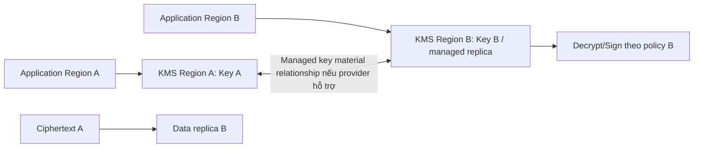
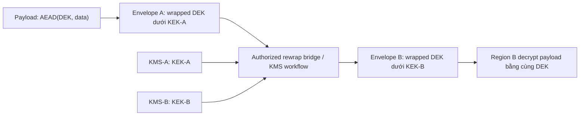
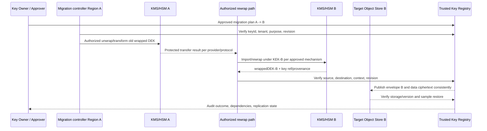

# Key distribution giữa region — Phân phối khóa mật mã an toàn giữa các vùng

Trong chương **Key distribution** của module **SECURITY_KEY_MANAGEMENT_FUNDAMENTALS**, **key distribution giữa region** là quá trình làm cho một khóa mật mã, khả năng sử dụng khóa, hoặc vật liệu khóa **đã được bảo vệ** có thể phục vụ các ứng dụng tại **nhiều vùng triển khai (region)** theo một chính sách đã được phê duyệt. Bài toán này phổ biến khi xây dựng hệ thống đa vùng để giảm độ trễ, mở rộng năng lực, bảo đảm tính sẵn sàng và khôi phục thảm họa.

Tuy nhiên, từ “phân phối khóa” rất dễ gây hiểu nhầm. **Không phải mọi khóa đều nên được copy thành cùng một secret ở nhiều nơi**. Đôi khi chỉ cần phân phối **public verification key**; đôi khi cần cho phép region B **unwrap một DEK** bằng KEK tại B; có hệ KMS hỗ trợ bản sao khóa liên vùng được quản lý; có HSM không cho export private key ở dạng rõ; có hệ thống chỉ được phép lưu và xử lý khóa trong một vùng pháp lý xác định.

**Nguyên tắc trung tâm:** lựa chọn cách phân phối phụ thuộc vào **loại khóa, mục đích, exportability, trust boundary, data residency, IAM, cryptoperiod và mô hình dự phòng**. Một khóa được bảo vệ tốt trong HSM/KMS vẫn có thể bị lạm dụng nếu tài khoản đa vùng có quyền `Sign` hoặc `Decrypt` quá rộng. Một bản sao được truyền bằng TLS cũng không tự an toàn nếu bên nhận không được xác thực hoặc khóa bị import vào một miền yếu hơn.

Bài học kết nối phân phối khóa giữa các region với **vòng đời khóa từ tạo, cấp phát, lưu trữ, sử dụng, xoay vòng, thu hồi đến hủy**, mật mã đối xứng/bất đối xứng, chữ ký số, KMS/HSM, **envelope encryption**, phân quyền và kiểm toán trong thiết kế hệ thống bảo vệ khóa.

## 1. Mục tiêu học tập

Sau bài học, bạn có thể:

- Phân biệt **replication của dữ liệu**, **replication của key material**, **rewrap DEK**, **key import/export**, **phân phối public key** và **ủy quyền sử dụng một khóa từ xa**.
- Chọn giữa **managed multi-region key**, **KEK độc lập theo region**, **key reference từ xa** và **HSM key ceremony** theo yêu cầu.
- Giải thích sự khác nhau giữa **DEK**, **KEK**, **private signing key**, **public verification key**, **HMAC key** và **key handle** khi phân phối.
- Mô tả luồng **regional rewrap** mà không xuất plaintext KEK/private key, cùng các giới hạn API/provider.
- Thiết kế xác thực giữa hệ thống, **mTLS, workload identity, IAM/ABAC, encryption context, key provenance** và metadata có integrity.
- Xử lý các vấn đề **version drift, rotation, revocation, failover, split-brain, replication lag, cache và AES-GCM nonce uniqueness** giữa nhiều region.
- Xác định **data/key residency**, phạm vi pháp lý, yêu cầu audit, backup/DR và điều kiện hủy key version cũ.
- Đọc ví dụ **Java 17** mô phỏng policy gate cho yêu cầu phân phối khóa và biết giới hạn của nó.
- Lập runbook và kiểm thử âm tính cho **key distribution đa vùng**.

## 2. Region là gì và phân phối cái gì?

Trong ngữ cảnh này, một **region** là một đơn vị triển khai tương đối độc lập về hạ tầng, mạng, failure domain, quyền vận hành hoặc địa lý. Một region cloud có thể chứa nhiều availability zone; một trung tâm dữ liệu tự quản cũng có thể được coi là một vùng vận hành. **Ranh giới region không nhất thiết trùng biên giới quốc gia**.

Một hệ thống có thể đặt dữ liệu ở:

```text
Region A — primary writer
  App-A, DataStore-A, KMS-A, KeyRegistry-A

Region B — warm standby
  App-B, DataStore-B, KMS-B, KeyRegistry-B

Region C — analytics hoặc audit
  App-C, DataStore-C, policy quyền riêng
```

Từ đây phát sinh ít nhất **sáu đối tượng phân phối** khác nhau:

| Đối tượng | Có phải key material bí mật? | Ví dụ | Cách xử lý thường gặp |
| --- | --- | --- | --- |
| **Ciphertext của dữ liệu** | Không phải key; nội dung vẫn nhạy cảm. | File hóa đơn đã mã hóa. | Replicate object/database theo data policy. |
| **Wrapped/encrypted DEK** | DEK đã bảo vệ, vẫn là tài sản bảo mật. | `wrappedDek` trong envelope. | Có thể replicate kèm ciphertext hoặc rewrap theo region. |
| **KEK/root key material** | **Có, nhạy cảm cao.** | KEK của KMS-A. | Không export raw mặc định; dùng replica được provider hỗ trợ hoặc key riêng ở B. |
| **Private signing/recipient key** | **Có, rất nhạy cảm.** | Private Ed25519/RSA. | HSM/KMS capability hoặc backup/import được phê duyệt; tránh copy file. |
| **Public key/certificate/JWKS** | Không phải bí mật, nhưng cần trust. | Public verification key của issuer. | Phân phối qua kênh đáng tin, kiểm tra nguồn gốc/phiên bản. |
| **Key reference và policy metadata** | Không phải raw secret; là metadata nhạy cảm. | Key ID, version, tenant, purpose. | Đồng bộ có xác thực, chống rollback và phân quyền. |

**Một bản dữ liệu được replicate sang B không có nghĩa B đã có quyền giải mã nó**. Ngược lại, nếu B được cấp quyền gọi `Decrypt` tới KEK ở A qua mạng, B có khả năng đọc dữ liệu **mà không cần có bản sao KEK tại B**. Hai kiến trúc có yêu cầu availability và residency rất khác nhau.

### 2.1. Đặt câu hỏi trước khi chọn kỹ thuật

1. Region B cần **mã hóa mới**, **giải mã lịch sử**, **ký mới**, **verify** hay chỉ giữ ciphertext để phục hồi?
2. Khóa cần phân phối là **DEK, KEK, private key, public key, HMAC secret hay một reference**?
3. Secret có được phép **export/import** không? Cấu hình KMS/HSM có hỗ trợ **managed replica** không?
4. Ràng buộc **quốc gia, tenant, hợp đồng, data residency và key sovereignty** cho phép thao tác gì?
5. Sau khi A mất hoàn toàn, B phải hoạt động độc lập trong bao lâu? Mục tiêu **RTO/RPO** ra sao?
6. Nếu một region bị xâm nhập, có chấp nhận **cùng key material** làm tăng blast radius trên các vùng còn lại không?
7. Policy có yêu cầu quorum/dual control, local approval hoặc tách key admin khỏi crypto user không?
8. Khi thu hồi quyền ở A, B phải dừng sử dụng khóa trong khoảng thời gian tối đa nào?

Các câu trả lời quyết định mô hình phân phối; không bắt đầu bằng câu “hãy copy keystore sang tất cả region”.

## 3. Bốn mô hình kiến trúc phổ biến

### 3.1. Mô hình A — Managed multi-region key / key replica

Một số KMS hỗ trợ một **nhóm khóa logic có bản sao tại nhiều vùng** theo khả năng cụ thể của provider. Provider chịu trách nhiệm tạo/đồng bộ material hoặc duy trì quan hệ replica. Cách triển khai và những thuộc tính có thể đồng bộ **không giống nhau giữa các nhà cung cấp**.



**Ưu điểm có thể có:** hoạt động cryptographic locally, giảm phụ thuộc network giữa vùng, hỗ trợ failover thuận tiện.

**Rủi ro và điều kiện:** phải xác minh **key material có thực sự giống nhau không**, identity của key, algorithm, quyền IAM, state, alias, rotation và policy **được replicate hay cần cấu hình riêng**. Không mặc định disable/deny ở A **tức thời** áp dụng cho B. Nếu key material trùng nhau, **compromise material** có thể ảnh hưởng tất cả replicas.

**Điểm kiểm chứng:** security policy/provider docs của đúng dịch vụ, vùng, API, mode, key type và trạng thái thực tế; không dùng cụm từ “multi-region” làm bằng chứng tính năng.

### 3.2. Mô hình B — KEK độc lập theo region + regional rewrap

Mỗi region giữ một **KEK khác nhau**; ciphertext dữ liệu dùng DEK, còn DEK được bọc theo KEK mà region cần sử dụng.



**Ưu điểm:** tách KEK theo vùng, policy/owner và quyền rõ ràng; có thể giữ **ciphertext payload không đổi** khi chỉ rewrap cùng DEK.

**Điều kiện:** phải có **đường chuyển DEK được bảo vệ thực sự**. Không được suy rằng một API `ReEncrypt` của provider tự động chuyển ciphertext giữa **hai KMS khác region hoặc khác tài khoản**. Một số dịch vụ hỗ trợ chuyển đổi trong phạm vi nhất định; ở trường hợp khác cần thiết kế một **secure rewrap bridge**, ví dụ KMS/HSM-to-HSM protected key transfer, key wrapping bằng public key được xác thực của đích, hoặc một workflow đã được đánh giá. **Không export plaintext KEK** và không truyền DEK rõ qua các hệ thống trung gian không được phép.

**Lưu ý:** B có thể có DEK rõ trong RAM khi decrypt payload theo quyền, dù KEK-B vẫn non-exportable.

### 3.3. Mô hình C — Không replicate secret; sử dụng KMS/HSM từ xa

Region B giữ **key reference** và gọi crypto operations qua KMS/HSM đặt ở A.

```text
App-B  -- authenticated API / policy --> KMS/HSM-A
  |
  +-- không có local KEK copy
  +-- vẫn có khả năng Sign/Decrypt nếu được cấp quyền
```

**Ưu điểm:** không mở rộng số bản sao material; phù hợp khi chính sách yêu cầu **khóa chỉ tồn tại ở một miền**.

**Đánh đổi:** region B phụ thuộc vào kết nối tới A, latency, quota, availability và chính sách cross-border processing. Trong một số trường hợp, B có thể đọc plaintext sau API ở A, nghĩa là **data residency/compliance** vẫn cần xem xét dù key material không rời A.

### 3.4. Mô hình D — Chỉ phân phối public key, certificate hoặc signed trust manifest

Trong hệ thống xác minh chữ ký, nhiều region chỉ cần **public verification key**, không cần private signing key.

```text
Signer (Region A):
  private signing key -> HSM/KMS-A

Verifiers (A, B, C):
  public key/certificate/JWKS từ nguồn tin cậy
  verify signature, issuer, algorithm, key version
```

**Ưu điểm:** không phải replicate private signing key, giảm blast radius. **Yêu cầu:** bảo vệ tính xác thực, integrity và freshness của public key/trust. Nếu attacker tráo JWKS/trust anchor ở B, họ có thể khiến B chấp nhận chữ ký sai nguồn.

### 3.5. Bảng lựa chọn nhanh

| Yêu cầu | Mô hình thường cân nhắc | Điều kiện giới hạn |
| --- | --- | --- |
| Hai region phải decrypt locally, provider có managed replication phù hợp. | **A — managed replica**. | Xác nhận policy, key states và material relationship của provider. |
| Muốn KEK tách theo từng region, ciphertext payload giữ nguyên. | **B — regional rewrap**. | Phải có cơ chế chuyển DEK được bảo vệ, IAM và metadata. |
| Key material không được rời một HSM/vùng. | **C — remote cryptographic operations** nếu compliance cho phép. | Tính sẵn sàng, latency và quyền truy cập từ vùng khác. |
| Region B chỉ verify JWT/artifact. | **D — public key/trust distribution**. | Nguồn public key, issuer và revocation freshness. |
| HSM private key cực nhạy, cần DR local. | **A hoặc backup/key ceremony chuyên biệt** nếu module hỗ trợ và policy cho phép. | Không thể tự copy plaintext private key. |
| Region B chỉ giữ cold ciphertext backup. | **Replicate ciphertext + wrapped DEK + metadata**. | Xác minh đường khôi phục KEK/DEK sau thảm họa. |

## 4. Nguyên tắc bảo mật khi truyền khóa qua trust boundary

“Region A và Region B cùng thuộc một công ty” **không có nghĩa mọi máy hai vùng thuộc cùng miền tin cậy**. Phân phối khóa là một **hành động đặc quyền**, cần xác định bên gửi, bên nhận, loại material và ranh giới được phép.

### 4.1. Sáu thuộc tính cần bảo đảm

- **Confidentiality:** DEK/KEK/private key không bị bên thứ ba đọc trong transit hoặc tại endpoint.
- **Integrity:** key material và metadata không bị sửa hoặc tráo trong quá trình chuyển.
- **Authentication:** nguồn và đích được xác thực; không tin endpoint chỉ qua tên DNS/region.
- **Authorization:** principal được phép chuyển **đúng key, đúng purpose, đúng region, đúng operation**.
- **Freshness/anti-replay:** không chấp nhận bản phân phối cũ đã thu hồi hoặc key version sai.
- **Audit/provenance:** biết ai phê duyệt, sử dụng API nào, key origin và kết quả ở region đích.

### 4.2. Transport security là cần nhưng chưa đủ

**TLS 1.3/mTLS** có thể giúp bảo vệ kênh truyền và xác thực service, nhưng:

- Nếu endpoint bị chiếm, attacker có thể lấy plaintext mà endpoint xử lý.
- Nếu private key mTLS bị lộ, attacker có thể giả danh service nếu không có kiểm soát bổ sung.
- TLS không tạo quyền nghiệp vụ trên mọi key.
- Lưu secret sau khi tải về vẫn cần KMS/HSM hoặc secret storage/OS security.
- Không được nhầm “traffic đã TLS” với “được phép export private key từ HSM”.

**Bảo vệ material ở tầng ứng dụng**, ví dụ dùng **destination wrapping key** và metadata có xác thực, có thể giảm rủi ro từ các hops trung gian. Nhưng khi dùng recipient public key để wrap, phải xác thực **public key thuộc đúng HSM/service của region B**, có purpose, version, attestation/provenance theo mức yêu cầu.

### 4.3. Không dùng các kênh phân phối không kiểm soát

Không nên gửi raw DEK/KEK/private key qua:

- Ticket, chat, email, spreadsheet hoặc file share thông thường.
- URL query string, command-line arguments, build log hoặc telemetry.
- Một Kubernetes Secret YAML đưa vào repository mà chỉ có Base64 encoding.
- Container image, package artifact, config snapshot hoặc sao lưu chung không có bảo vệ riêng.
- Một API “admin download key” không có IAM, approval, key scope và audit.
- SSH/SCP thủ công giữa hosts mà người vận hành không kiểm soát nơi file nằm, quyền file và bản sao còn sót.

**Một keystore có mật khẩu cũng không được coi an toàn nếu passphrase được phân phối qua cùng kênh và cùng quyền đọc.**

## 5. Key distribution theo từng loại khóa

| Loại khóa | Điều có thể phân phối | Điều cần tránh |
| --- | --- | --- |
| **AES DEK** | Wrapped/encrypted DEK hoặc DEK qua secure import protocol được phép. | Ghi raw DEK vào log/object store, dùng DEK cho quá nhiều tenant. |
| **Symmetric KEK** | Managed replica, HSM backup/import theo policy; tốt hơn là KEK riêng từng vùng khi phù hợp. | Export KEK plaintext để copy giữa KMS instances. |
| **HMAC key** | Secret được bảo vệ bằng kênh quản lý secret/wrap theo phiên bản và principal. | Chia sẻ cùng HMAC secret qua mọi tenant/region không có lý do. |
| **Private signing key** | Provider-managed replica hoặc secure HSM transfer theo capability; thường nên giữ ở vùng ký. | Copy file PEM ra các verifier chỉ để kiểm tra chữ ký. |
| **Public verification key** | Certificate, JWKS, signed trust manifest. | Tin mọi public key do client tự cung cấp hoặc endpoint bị thay. |
| **Recipient private key / KEM secret key** | Protected backup/import khi scheme/provider cho phép. | Nhầm key agreement public key với secret key; bỏ qua migration ciphertext cũ. |
| **KMS key ID/alias** | Metadata cấu hình có provenance và version. | Coi key ID là bằng chứng quyền hoặc alias là ref bất biến. |
| **Root/CA signing key** | Key ceremony/HSM backup theo các kiểm soát đặc biệt. | Dùng quy trình rollout như secret của ứng dụng thường. |

### 5.1. Public key không bí mật nhưng là đối tượng tấn công

Một hệ thống có thể đưa public key vào JWKS hoặc certificate store tại tất cả region. Nguy cơ không phải **lộ public key**, mà là **thay public key bằng khóa do attacker kiểm soát** hoặc phát lại một key cũ đã bị thu hồi.

Với JWT/signature verifier, phải kiểm tra:

1. **Issuer/trust anchor** được cấu hình đáng tin.
2. **Algorithm allowlist** và key type đúng.
3. `kid` chỉ là **gợi ý chọn khóa**, không tự xác minh danh tính.
4. Key version, certificate validity/revocation theo protocol và policy.
5. Trust update có version, bảo vệ chống rollback và caching đúng thời hạn.

Không tự động tải public key từ URL không tin cậy chỉ vì token tự chứa trường dẫn tới URL đó.

### 5.2. HMAC distribution đặc biệt hơn public-key crypto

Với HMAC, **tất cả bên có cùng secret đều có thể tạo MAC hợp lệ**. Nếu cả A và B cùng giữ HMAC secret, sự cố ở B có thể cho phép giả mạo thông điệp có vẻ đến từ A, trừ khi giao thức có ràng buộc sender/key scope khác.

Nên dùng **secret riêng theo partner, tenant, direction hoặc region** khi threat model yêu cầu, và có rotation/overlap giới hạn. Không mặc định một shared HMAC secret dùng cho mọi vùng làm giảm rủi ro chỉ vì nó được bọc trong KMS.

## 6. Envelope encryption và phân phối DEK giữa region

Đây là tình huống phổ biến: data ciphertext đã được replicate từ A sang B, nhưng wrapped DEK ban đầu được bảo vệ bởi KEK-A.

### 6.1. Phân biệt các đối tượng

```text
Region A:
  plaintext -- AES-GCM(DEK-42) --> dataCiphertext-42
  DEK-42   -- Wrap(KEK-A)     --> wrappedDEK-A

Region B:
  có thể nhận dataCiphertext-42 và wrappedDEK-A
  nhưng có mở được hay không tùy KEK availability và quyền

Regional migration:
  DEK-42   -- Wrap(KEK-B)     --> wrappedDEK-B
  dữ liệu đã mã hóa có thể KHÔNG ĐỔI
```

B là một miền bảo vệ mới. **Không được phép mặc định** B có thể unwrap `wrappedDEK-A` bằng `KEK-B`. Điều đó thường **không đúng** khi KEKs khác material, trừ khi provider thiết kế quan hệ đặc biệt.

### 6.2. Luồng regional rewrap được kiểm soát



**Sơ đồ mô tả hợp đồng bảo mật**, không khẳng định mọi KMS có sẵn một API “protected transfer result”. Tùy provider, một số bước sẽ là thao tác re-encrypt nội bộ, wrapping bằng khóa công khai của đích, HSM import/export được bảo vệ hoặc một migration service được phê duyệt. Có sản phẩm **không hỗ trợ chuyển material theo cách yêu cầu**, khi đó cần đổi kiến trúc hoặc **re-encrypt payload** trong miền tin cậy phù hợp.

### 6.3. Rewrap không đồng nghĩa thay DEK

- **Rewrap:** cùng DEK được bọc dưới KEK mới; data ciphertext có thể giữ nguyên.
- **Re-encrypt:** dùng DEK mới để mã hóa lại payload với nonce/tag và metadata mới.
- **Copy envelope:** mang nguyên wrapped DEK cũ sang B; vẫn cần đúng KEK hoặc key replica có khả năng unwrap nó.
- **Replicate KEK:** nếu provider thực sự hỗ trợ cùng material và scheme, B có thể unwrap ciphertext được tạo dưới một key tương thích; phải kiểm tra key IDs và API semantics.

Nếu **DEK đã lộ**, rewrap dưới KEK mới **không khôi phục confidentiality** của ciphertext lịch sử. Nếu **KEK-A đã lộ**, các wrapped DEK attacker có thể thu thập dưới KEK-A cần được đánh giá; chỉ tạo KEK-B mới không chữa được rủi ro quá khứ.

### 6.4. Bản ghi envelope ở region B cần những gì?

Ví dụ schema **minh họa**, không phải định dạng chuẩn của nhà cung cấp:

```json
{
  "schemaVersion": 2,
  "tenantId": "tenant-42",
  "objectId": "invoice-743",
  "contentVersion": 5,
  "dataKeyId": "dek/invoice-743/v1",
  "dataAlgorithm": "AES-256-GCM",
  "dataNonce": "<base64url>",
  "dataCiphertextAndTag": "<base64url>",
  "wrapAlgorithm": "approved-kms-wrap",
  "originRegion": "region-a",
  "destinationRegion": "region-b",
  "targetKekRef": "kms/region-b/billing-kek-v7",
  "wrappedDek": "<base64url>",
  "wrapRevision": 4,
  "migrationId": "mig-0081",
  "policyVersion": 9
}
```

Cần xác thực **tenant/object/dataKeyId/contentVersion** và so với registry; `originRegion`, `targetKekRef`, `wrapRevision` và `migrationId` phải có **provenance/integrity** của migration, không tin JSON client. Khi region B đọc, expected identity và target key policy đến từ hệ thống tin cậy.

### 6.5. Hai lớp AAD cần tách biệt

Đối với AEAD payload:

```text
dataAAD = canonicalEncode(
  "invoice-data:v2",
  tenantId, objectId, contentVersion, dataKeyId, dataAlgorithm
)
```

Đối với wrapped DEK (nếu dùng AEAD/key wrapping hỗ trợ context):

```text
wrapAAD = canonicalEncode(
  "invoice-wrap:v2",
  tenantId, objectId, contentVersion,
  dataKeyId, destinationRegion, targetKekRef, wrapRevision
)
```

**Tại sao không đưa `targetKekRef` vào data AAD?** Khi rewrap sang region B, `targetKekRef` thay đổi, trong khi payload không đổi. Nếu data AAD buộc vào KEK reference, quá trình rewrap có thể khiến data authentication tag không còn khớp và phải xử lý lại payload. Vì vậy **data AAD dùng các trường bất biến của nội dung**, còn **wrap AAD gắn với miền bọc khóa**.

**Ngoại lệ có chủ ý:** một hệ thống có thể muốn payload bị ràng buộc cryptographically với đúng region; khi đó migration có thể yêu cầu **re-encrypt hoặc retag hợp lệ**, không được tuyên bố rewrap độc lập. Thiết kế phải nêu rõ invariant mong muốn.

## 7. Secure key transfer và key provenance

Khi không có managed key replication, việc chuyển key material giữa trust boundaries cần một giao thức/khả năng đã được thiết kế, thay vì “giải mã ra file rồi copy”.

### 7.1. Destination wrapping key và public key trust

Một mẫu có thể dùng khóa công khai của đích:

1. HSM/KMS-B cung cấp **public wrapping key** hoặc certificate có thể xác minh thuộc đúng đích, đúng key usage và hạn hiệu lực.
2. A kiểm tra **identity, trust chain, fingerprint/attestation** khi policy yêu cầu.
3. A bảo vệ vật liệu được phép export bằng **approved key wrapping mechanism** phù hợp với public key của B.
4. Chỉ B có private wrapping key tương ứng mới có thể unwrap/import theo chính sách.
5. B tạo **actual target key ID**, ghi origin/provenance, policy và kết quả.
6. A/B cùng lưu audit, migration ID, approvals và bằng chứng hoàn tất.

Không tự kết luận **mTLS certificate** là public wrapping key hợp lệ. Key usage/algorithm, API và trust có thể khác. Cũng không dùng raw RSA encryption không padding; với RSA phải dùng **scheme phù hợp như OAEP** trong giao thức có đặc tả, còn KEM phải có KDF/AEAD và xác thực recipient.

### 7.2. Imported key và HSM non-exportable

Nếu key nguồn đánh dấu **non-exportable**, cần hiểu ý nghĩa theo module/provider:

- Có thể **không có đường xuất** raw key và không hỗ trợ chuyển sang một HSM bên ngoài.
- Có thể hỗ trợ **backup/clone/replication được kiểm soát** mà không lộ key rõ, tùy security policy.
- Có thể chỉ cho **remote operations** qua API chứ không chuyển material.
- Một số cơ chế chuyển bảo vệ có thể yêu cầu phiên bản firmware, key attributes và mối tin cậy module cụ thể.

**Không “đi vòng” bằng cách đọc memory dump, export keystore hoặc tắt policy** để copy key non-exportable. Nếu không có đường chuyển được phép, phải thiết kế phương án khác: **sinh key riêng ở đích**, re-encrypt dữ liệu trong miền được phép, hoặc chấp nhận phụ thuộc từ xa theo RTO/RPO.

### 7.3. Provenance và chain of custody

Bản ghi phân phối nên chứa:

| Trường | Chứng minh |
| --- | --- |
| `migrationId` / change ID | Tác vụ cụ thể đã được phê duyệt. |
| `sourceKeyId/sourceVersion` | Vật liệu hoặc bản bọc nguồn có danh tính nào. |
| `destinationKeyId/version` | Khóa/bản bọc đã ghi nhận tại region B. |
| `sourceRegion/destinationRegion` | Ranh giới đã chuyển. |
| `algorithm/keyPurpose` | Không bị đổi purpose/algorithm ngoài kế hoạch. |
| `actor/approverIds` | Ai yêu cầu, phê duyệt, thực thi và làm chứng. |
| `providerOperationId` | Tham chiếu thao tác thật trong KMS/HSM. |
| `policyVersion` | Điều kiện tại thời điểm chuyển. |
| `objectCount/hash/manifestRef` | Những data objects phụ thuộc đã được migrate. |
| `status/timestamp/result` | Kết quả và thời điểm của các bước. |

Không ghi raw DEK, KEK, private key, HMAC secret, PIN, wrapped key bytes không cần thiết hoặc bearer tokens vào audit. Một **key fingerprint** của public key có thể hỗ trợ nhận dạng; **không tự hash raw secret rồi công bố fingerprint** nếu chưa được đánh giá vì có thể lộ thêm thông tin trong một số bối cảnh.

## 8. Data residency, key sovereignty và quy định vùng

**Data residency** thường nói về vị trí xử lý/lưu dữ liệu; **key residency** nói về vị trí vật liệu khóa hoặc dịch vụ quản lý khóa; **key sovereignty** liên quan quyền kiểm soát, phạm vi pháp lý và khả năng can thiệp vào khóa. Đây là các thuộc tính **liên quan nhưng không đồng nhất**.

### 8.1. Những điều phải phân biệt

| Câu hỏi | Ví dụ | Rủi ro nếu nhầm |
| --- | --- | --- |
| Ciphertext có thể replicate sang region B không? | Backup mã hóa đặt tại vùng dự phòng. | Vi phạm yêu cầu dữ liệu nếu ciphertext cũng bị hạn chế lưu trú. |
| KEK material có được copy sang B? | Multi-region key replica cùng material. | Vi phạm chính sách key residency. |
| B có thể gọi KMS-A từ xa? | Remote unwrap để phục hồi. | Cross-border processing, latency hoặc access không được phép. |
| Plaintext DEK có thể xuất hiện trong RAM ở B? | B giải mã hóa đơn tại địa điểm khác. | Một chính sách “key không rời A” chưa chắc đủ. |
| Ai có quyền quản trị key ở B? | Role tổ chức khác hoặc nhà cung cấp khác. | Quyền gián tiếp/supply-chain control vượt giới hạn. |
| Backup HSM có được chuyển vùng? | Disaster recovery key ceremony. | Secret copy/approval không được kiểm soát. |

**Không suy ra yêu cầu pháp lý cụ thể chỉ từ tên quốc gia/region.** Khi thiết kế thật, Security/Legal/Compliance cần xác định quy tắc áp dụng theo dữ liệu, hợp đồng, lĩnh vực, nhà cung cấp và các nghĩa vụ hiện hành.

### 8.2. Phân loại dữ liệu và key-policy trước khi phân phối

```text
Key policy (ví dụ logic):
  keyId: billing/kek-a-v5
  purpose: wrap-billing-dek
  classification: confidential
  allowedSourceRegions: [region-a]
  allowedDestinationRegions: [region-a, region-b]
  permittedTransferMode: REGIONAL_REWRAP
  allowRawExport: false
  requireDualApproval: true
  residencyPolicyVersion: 7
```

Đây **không phải schema KMS chuẩn**. Thuộc tính cho phép/chặn phải được thực thi bằng **IAM/KMS policy, key-transfer workflow và organizational guardrails** đáng tin. Nếu chỉ viết vào JSON mà có đường API bypass, policy không có giá trị cưỡng chế.

## 9. IAM, key policy và separation of duties giữa region

Tại một hệ thống đa vùng, mỗi region có thể có **IAM role, key policy, grant, service account, workload identity và administrator** riêng. Đừng giả định quyền cấp ở A tự tồn tại hoặc tự bị thu hồi ở B.

### 9.1. Tách control plane và data plane

Áp dụng **least privilege** (nguyên tắc đặc quyền tối thiểu) theo từng region: một operator chỉ được thực hiện đúng key-management action và key scope đã duyệt; một workload được phép `Decrypt` ở region B không mặc nhiên có quyền `ExportKey`, thay grant, sửa key policy hoặc đọc dữ liệu tenant khác. Quyền đặc biệt cần được cấp có thời hạn, có audit và không có đường bypass trực tiếp tới KMS/HSM.

| Nhiệm vụ | Ai nên thực hiện? | Hạn chế |
| --- | --- | --- |
| Phê duyệt region đích/mục đích | Key Owner + Security/Compliance. | Không do migration process tự quyết. |
| Tạo KEK ở B | Regional key operator/CO. | Không tự động có `Decrypt` mọi dữ liệu. |
| Cấu hình grant/role | IAM/KMS admin theo approval. | Không tự cấp quyền export và xóa audit. |
| Chuyển protected DEK | Migration bridge có scope, TTL. | Không giữ plaintext DEK lâu và không truy cập mọi tenant. |
| Mã hóa/giải mã payload | Workload được cấp quyền theo object. | Không sửa policy, grant, replication topology. |
| Ký giao dịch | Signing service sau business authorization. | Không mặc định do CO/key admin thực hiện. |
| Đối soát/kiểm toán | Auditor độc lập. | Không có quyền đọc raw secret hoặc xóa logs. |

### 9.2. Phân quyền theo thuộc tính vùng

Một chính sách có thể yêu cầu:

```text
principal.role              == "RegionalKeyMigrationOperator"
principal.sourceRegion      == "region-a"
principal.allowedKeyScopes  contains actualKeyId
request.destinationRegion   in approvedPlan.allowedRegions
request.mode                == "REGIONAL_REWRAP"
approval.changeId           == request.changeId
approval.validUntil         > trustedNow
registry.keyState           == "APPROVED_FOR_MIGRATION"
policyVersion               == currentApprovedVersion
```

Tất cả giá trị quan trọng phải đến từ **nguồn đã xác thực**; không tin trực tiếp trường `role`, `approved=true` hoặc `destinationRegion` do client gửi. Kiểm tra cả **effective permissions** trên KMS thật, không chỉ policy ở registry.

### 9.3. Dual control và key ceremony

Những hành động nhạy cảm có thể yêu cầu **hai người phê duyệt độc lập** hoặc quorum **M-of-N**:

- Replica/import KEK có phạm vi ảnh hưởng lớn.
- Phục hồi root/CA signing key sang HSM khác.
- Bật quyền export/protected backup.
- Chuyển key ra khỏi security domain hoặc pháp lý.
- Hủy KEK nguồn sau khi migrate.

**Quorum approval** không mặc nhiên tương đương **secret sharing**. Nếu HSM yêu cầu M-of-N cho import/export, phải tuân thủ đúng tính năng và chứng từ của thiết bị; không tự tạo cơ chế chia secret kiểu cắt chuỗi byte.

## 10. Key versioning, replication lag và consistency

Trong hệ đa vùng, **độ trễ đồng bộ** là rủi ro bảo mật, không chỉ rủi ro availability.

### 10.1. Chuyện gì xảy ra khi hai region dùng phiên bản khác nhau?

```text
T0: Region A active KEK-v6.
T1: Region A rotate sang KEK-v7.
T2: Region B vẫn có policy/alias trỏ v6.
T3: Writer B tiếp tục wrap DEK mới dưới v6.
T4: Operator ở A tưởng không còn ai dùng v6 và lên lịch hủy.
```

Hậu quả: dữ liệu mới của B có thể bị bọc dưới key sắp retire; khi v6 bị hủy, dữ liệu/backup có thể mất khả năng giải mã.

### 10.2. Invariant nên thiết kế

- Mỗi ciphertext/wrapped DEK ghi **actual key ID/version**, không chỉ alias động.
- Quyền **new wrap** bị kiểm soát theo **key state/policy tại enforcement point** trong từng region.
- Writer chỉ chuyển sang key version được phép khi đã có **rollout marker** đáng tin.
- Một **global hoặc authoritative registry** giữ trạng thái migration/version theo policy; region có cache phải có TTL và semantics khi stale.
- Các thao tác phá hủy yêu cầu **dependency inventory** từ mọi region, backup và offline consumers.
- Nếu không thể đạt consistency cần thiết trong outage, quyết định rõ **fail closed** cho new sensitive operations.

### 10.3. Chống rollback metadata

Một envelope cũ có **AEAD tag hợp lệ** vẫn có thể bị attacker replay. Khi replicate, cần tránh việc region B chấp nhận **key policy cũ, trust manifest cũ hoặc revoked key version**.

Giải pháp có thể gồm:

- Monotonic revision/counter hoặc minimum accepted version lưu ở miền tin cậy.
- Signed/verified manifests, key-state proofs, không tin solely object metadata.
- Conditional update/CAS cho active version và migration completion.
- Audit có liên kết event ID, change ID và origin region.
- Explicit handling khi B chưa nhận được sự kiện revocation.

**Không thể tuyên bố “thu hồi toàn cầu tức thì” nếu replication thực tế bất đồng bộ và các region có thể hoạt động offline.** Chính sách phải nêu giới hạn độ trễ, khả năng stale read và mức giảm chức năng cho phép.

## 11. Khác biệt active-active và active-passive

### 11.1. Active-passive

A xử lý request bình thường; B chỉ nhận dữ liệu/khóa cần thiết và sẵn sàng failover.

**Ưu điểm:** dễ giữ một nguồn writer, đơn giản hơn về nonce và sequence, hạn chế split-brain.

**Điều kiện:** B phải có đủ key access và có thể khôi phục trong **RTO**, với dữ liệu và key state đạt **RPO**. B có thể còn thiếu một wrapped DEK hoặc approval event nếu replication lag.

### 11.2. Active-active

A và B cùng mã hóa hoặc ký dữ liệu mới.

**Thêm rủi ro:**

- Hai writer cùng dùng **một DEK** có thể tạo trùng **AES-GCM nonce** nếu không có cơ chế cấp phát toàn cục hoặc chia miền.
- Alias `current` có thể trỏ khác phiên bản ở hai vùng.
- Revocation và policy update có thể tới hai vùng khác thời điểm.
- Hai region tạo key version/ID khác nhau nhưng cùng ghi một logical object.
- Event ordering, replay/idempotency và split-brain có thể làm mất tính đúng đắn của state.

**Thiết kế ưu tiên:** key scope rõ theo region/writer hoặc dùng **DEK riêng theo object/region**, nonce strategy đã được kiểm chứng, authoritative versioning và conflict policy. Không dùng lại cùng DEK với bộ đếm nonce khởi đầu từ 0 độc lập trên hai region.

### 11.3. RPO/RTO cho cả dữ liệu lẫn khóa

- **RPO — Recovery Point Objective:** mức dữ liệu/metadata/key-state thay đổi được chấp nhận có thể mất sau sự cố.
- **RTO — Recovery Time Objective:** khoảng thời gian tối đa để khôi phục dịch vụ theo mục tiêu.

Khi tính RPO, không chỉ xét database replica mà còn **wrapped DEK, actual KEK ref, IAM/grants, key versions, certificate/trust state và migration approvals**. Khi tính RTO, không chỉ tính thời gian bật App-B mà còn **KMS-B availability, HSM quorum, rewrap/restore, workload identity và verification**.

## 12. Key rotation, revocation và phân phối key state

### 12.1. Xoay KEK đa vùng

Một runbook an toàn có thể theo thứ tự:

1. Inventory tất cả **data objects, wrapped DEK, regions, KEKs và backups**.
2. Key Owner/Security duyệt key version mới, scope và kế hoạch quay lui.
3. Tạo/activate KEK mới hoặc managed replica theo provider policy.
4. Cấp grants đúng cho từng workload và region, không dùng wildcard.
5. Với new writes, chuyển writer từng region sang key mới có **versioned rollout**.
6. Ngăn thao tác **new wrap** dưới KEK cũ tại mọi enforcement point có liên quan.
7. Rewrap các DEK cũ nếu cần; đối chiếu data AAD, metadata và restore test.
8. Kiểm tra replication lag, offline consumers, cold backups và lỗi.
9. Chỉ khi dependencies được giải quyết mới archive/destroy key cũ theo approval.
10. Audit kết quả từng region thay vì chỉ trạng thái ở primary.

### 12.2. Signing-key rotation và public-key distribution

Một hệ thống JWT hoặc artifact signing có thể chọn:

- **Giữ private signer ở A** và phân phối **public key** sang B/C.
- **Có signing key replica** trong HSM/KMS đa vùng nếu policy và provider hỗ trợ.
- **Tách signing keys theo issuer/region** để giảm blast radius, với verifier nhận diện issuer/key ID đúng.

Quy trình thường cần **publish public key trước khi signer sử dụng key mới**, giữ public verification key cũ trong khoảng cần xác minh chữ ký lịch sử. **Không giữ private signing key cũ chỉ vì cần `Verify`**. Nếu private key bị lộ, một số verifier offline có thể vẫn tin khóa cũ; cần quy trình **trust revocation/freshness**, không chỉ disable API `Sign`.

### 12.3. Revocation khi region bị cô lập

Nếu B không kết nối được authoritative policy service:

- Có được tiếp tục `Decrypt` dữ liệu cũ không?
- Có được tiếp tục tạo chữ ký/AEAD ciphertext mới không?
- Thời gian chấp nhận **stale permissions** tối đa là bao nhiêu?
- Có cơ chế emergency deny list được ký/xác thực ở B không?
- Khi reconnect, xử lý các operations đã diễn ra thế nào?

Không có câu trả lời chung; phải lựa chọn **availability versus security** theo threat model và loại thao tác. Với thao tác ký giao dịch nhạy cảm hoặc wrap mới, policy thường cần giới hạn mạnh hơn so với verify public signatures.

## 13. Nonce uniqueness và usage budget trên nhiều region

Một nguy cơ khó thấy là **key material đã được replicate đúng** nhưng **nonce state không được phân phối đúng**.

### 13.1. AES-GCM và cùng DEK đa vùng

Nếu A và B dùng **cùng DEK** để mã hóa nhiều thông điệp:

```text
Region A:
  DEK-X, nonce = 000000000001, message-1

Region B:
  DEK-X, nonce = 000000000001, message-2

Cùng DEK + cùng nonce => VI PHẠM uniqueness của AES-GCM
```

Hệ quả có thể nghiêm trọng đối với **confidentiality và integrity**. Điều này không được chữa bằng việc đặt file ciphertext ở vùng khác hay thay KEK chỉ bọc DEK.

### 13.2. Một số phương án kiểm soát

| Phương án | Ý tưởng | Cần kiểm tra |
| --- | --- | --- |
| **DEK riêng mỗi object** | Mỗi object dùng DEK mới; nonce dùng theo scheme phù hợp. | Không reuse DEK ngoài policy, kiểm tra RNG. |
| **DEK riêng mỗi region/writer** | Tách khóa để nonce namespace độc lập. | Key lifecycle/rewrap và metadata rõ. |
| **Nonce counter có partition** | Mỗi writer/region có miền giá trị nonce duy nhất. | Không collision, không reset sau failover/snapshot, giới hạn bit. |
| **Central allocation** | Cấp vùng nonce/counter từ coordinator. | Outage, split-brain, hiệu năng và độ bền state. |
| **AEAD scheme khác phù hợp** | Sử dụng thư viện/format đã được thiết kế với nonce policy phù hợp. | Interop/algorithm approval và phân tích bảo mật cụ thể. |

Không tự tuyên bố nonce 96 bit ngẫu nhiên “không thể trùng”. Phải đánh giá số lần mã hóa/usage budget và phương pháp cấp phát. **Một DEK được dùng chỉ để giải mã tại B không tạo thêm nonce encryption**, nhưng khi B trở thành writer sau failover, cần chiến lược đúng từ trước.

### 13.3. Key version và encryption context

Một số provider cho phép thêm **encryption context** gắn với tenant, object hoặc region. Điều này giúp **binding/authorization** nếu được API hỗ trợ, nhưng **không tự giải quyết nonce uniqueness** của phép AES-GCM do ứng dụng thực hiện. Phải kiểm tra tách rời hai vấn đề.

## 14. Java 17: policy gate cho phân phối khóa sang region khác

Ví dụ dưới đây minh họa **lớp ra quyết định** trước khi workflow gọi KMS/HSM:

- Key asset phải có type, region nguồn, allowed destinations, inventory revision và policy.
- Chỉ cho phép ba mode đã được thiết kế: `MANAGED_REPLICA`, `REGIONAL_REWRAP`, `PUBLIC_REFERENCE`.
- Không có mode `EXPORT_PLAINTEXT_KEY`.
- Kiểm tra provider capability, role của executor, key scope, change ID, TTL và phê duyệt độc lập.
- Phân biệt **key loại `WRAPPED_DEK` cần rewrap** với **`PUBLIC_KEY` chỉ cần public distribution**.
- Demo chỉ trả **policy decision**, không xử lý raw key material.

**Đây là ví dụ chạy độc lập trên Java 17, không phải một implementation thực thi API KMS.** `Approval` và `KeyAsset` phải được lấy từ **nguồn đáng tin phía server**, không nhận từ client tự khai.

```java
import java.time.Clock;
import java.time.Instant;
import java.time.ZoneOffset;
import java.util.ArrayList;
import java.util.HashSet;
import java.util.List;
import java.util.Objects;
import java.util.Set;

public final class RegionalKeyDistributionPolicyDemo {

    enum KeyType {
        WRAPPED_DEK, SYMMETRIC_KEK, PRIVATE_SIGNING, PUBLIC_KEY
    }

    enum Mode {
        MANAGED_REPLICA, REGIONAL_REWRAP, PUBLIC_REFERENCE
    }

    record Actor(String id, Set<String> roles, Set<String> keyScopes) {
        Actor {
            Objects.requireNonNull(id);
            roles = Set.copyOf(roles);
            keyScopes = Set.copyOf(keyScopes);
        }

        boolean mayOperate(String keyId) {
            return roles.contains("RegionalKeyOperator")
                    && keyScopes.contains(keyId);
        }
    }

    record KeyAsset(
            String actualKeyId,
            KeyType keyType,
            String sourceRegion,
            Set<String> permittedDestinations,
            boolean residencyApproved,
            long inventoryRevision) {
        KeyAsset {
            permittedDestinations = Set.copyOf(permittedDestinations);
        }
    }

    record ProviderCapabilities(
            boolean managedReplicaSupported,
            boolean secureCrossRegionRewrapSupported) {}

    record Change(
            String changeId,
            String keyId,
            String sourceRegion,
            String destinationRegion,
            Mode mode,
            long expectedInventoryRevision,
            String requestedBy,
            Instant expiresAt) {}

    record Approval(
            String approverId,
            String approverRole,
            String changeId,
            String keyId,
            String destinationRegion,
            Instant expiresAt) {}

    static boolean mayDistribute(
            Actor executor,
            KeyAsset key,
            Change change,
            ProviderCapabilities capabilities,
            List<Approval> approvals,
            Clock clock) {

        if (!executor.mayOperate(key.actualKeyId())) {
            return false;
        }

        if (!key.actualKeyId().equals(change.keyId())
                || !key.sourceRegion().equals(change.sourceRegion())
                || key.sourceRegion().equals(change.destinationRegion())
                || !key.permittedDestinations()
                        .contains(change.destinationRegion())
                || !key.residencyApproved()
                || key.inventoryRevision()
                        != change.expectedInventoryRevision()) {
            return false;
        }

        Instant now = clock.instant();
        if (!now.isBefore(change.expiresAt())) {
            return false;
        }

        boolean modeAllowed = switch (change.mode()) {
            case PUBLIC_REFERENCE ->
                    key.keyType() == KeyType.PUBLIC_KEY;
            case REGIONAL_REWRAP ->
                    key.keyType() == KeyType.WRAPPED_DEK
                    && capabilities.secureCrossRegionRewrapSupported();
            case MANAGED_REPLICA ->
                    capabilities.managedReplicaSupported()
                    && (key.keyType() == KeyType.SYMMETRIC_KEK
                        || key.keyType() == KeyType.PRIVATE_SIGNING);
        };

        if (!modeAllowed) {
            return false;
        }

        // Hai nhóm phê duyệt, hai danh tính khác nhau và không
        // trùng executor/requester; xác thực quyền approver ở
        // workflow thực tế, không dựa vào chuỗi role client gửi.
        Set<String> securityApprovers = new HashSet<>();
        Set<String> residencyApprovers = new HashSet<>();

        for (Approval a : approvals) {
            if (!a.changeId().equals(change.changeId())
                    || !a.keyId().equals(key.actualKeyId())
                    || !a.destinationRegion()
                            .equals(change.destinationRegion())
                    || !now.isBefore(a.expiresAt())
                    || a.approverId().equals(executor.id())
                    || a.approverId().equals(change.requestedBy())) {
                continue;
            }

            if (a.approverRole().equals("SecurityApprover")) {
                securityApprovers.add(a.approverId());
            }
            if (a.approverRole().equals("ResidencyApprover")) {
                residencyApprovers.add(a.approverId());
            }
        }

        for (String security : securityApprovers) {
            for (String residency : residencyApprovers) {
                if (!security.equals(residency)) {
                    return true;
                }
            }
        }
        return false;
    }

    public static void main(String[] args) {
        Clock clock = Clock.fixed(
                Instant.parse("2026-11-28T00:00:00Z"),
                ZoneOffset.UTC);

        KeyAsset key = new KeyAsset(
                "dek/invoice-42/v1",
                KeyType.WRAPPED_DEK,
                "region-a",
                Set.of("region-b"),
                true,
                17L);

        Actor executor = new Actor(
                "operator-01",
                Set.of("RegionalKeyOperator"),
                Set.of("dek/invoice-42/v1"));

        Change change = new Change(
                "chg-008",
                key.actualKeyId(),
                "region-a",
                "region-b",
                Mode.REGIONAL_REWRAP,
                17L,
                "owner-01",
                Instant.parse("2026-11-29T00:00:00Z"));

        ProviderCapabilities provider =
                new ProviderCapabilities(false, true);

        List<Approval> approvals = List.of(
                new Approval("security-01", "SecurityApprover",
                        "chg-008", key.actualKeyId(), "region-b",
                        Instant.parse("2026-11-29T00:00:00Z")),
                new Approval("residency-01", "ResidencyApprover",
                        "chg-008", key.actualKeyId(), "region-b",
                        Instant.parse("2026-11-29T00:00:00Z"))
        );

        System.out.println("Approved migration: "
                + mayDistribute(executor, key, change,
                        provider, approvals, clock));

        System.out.println("Missing second approval: "
                + mayDistribute(executor, key, change,
                        provider, approvals.subList(0, 1), clock));

        ProviderCapabilities unsupported =
                new ProviderCapabilities(false, false);
        System.out.println("Unsupported transfer mode: "
                + mayDistribute(executor, key, change,
                        unsupported, approvals, clock));

        KeyAsset stale = new KeyAsset(
                key.actualKeyId(), key.keyType(), key.sourceRegion(),
                key.permittedDestinations(), true, 18L);
        System.out.println("Stale inventory revision: "
                + mayDistribute(executor, stale, change,
                        provider, approvals, clock));
    }
}
```

Đầu ra dự kiến:

```text
Approved migration: true
Missing second approval: false
Unsupported transfer mode: false
Stale inventory revision: false
```

### 14.1. Điều ví dụ làm rõ

- `actualKeyId` được kiểm tra thay vì chỉ tin alias hoặc tên service.
- `permittedDestinations` và `residencyApproved` buộc request phù hợp scope đã duyệt.
- `expectedInventoryRevision` minh họa kiểm tra **optimistic concurrency/version** để giảm nguy cơ phân phối theo inventory cũ.
- `ProviderCapabilities` chặn một mode không được hệ thống hỗ trợ, thay vì tự fallback bằng việc export plaintext.
- `REGIONAL_REWRAP` chỉ nhận asset loại `WRAPPED_DEK`; `PUBLIC_REFERENCE` chỉ nhận `PUBLIC_KEY`.
- `MANAGED_REPLICA` yêu cầu provider có khả năng, **nhưng chưa chứng minh một key/private key cụ thể được phép replicate** — còn cần policy và provider-specific checks.
- Hai approver **Security** và **Residency** phải là **hai danh tính khác nhau** và không trùng operator/requester.

### 14.2. Các hạn chế phải giải quyết trước production

1. **Trust của đầu vào:** `Approval`, role, revision, residency và provider capabilities phải lấy từ IAM/registry/workflow đáng tin; demo nhận records giả lập.
2. **Effective permissions:** policy gate chỉ trả boolean; KMS/HSM và transport bridge vẫn cần IAM/permission boundary thực sự để ngăn gọi API bypass.
3. **Dual control:** hai account có thể do cùng một người kiểm soát; identity governance phải bảo đảm độc lập thật.
4. **TOCTOU:** key state, permissions, inventory, residency policy hoặc approval có thể đổi sau khi kiểm tra; cần **recheck tại commit/execution** với revision/transaction.
5. **Replay/idempotency:** change ID/approval phải có single-use hoặc idempotent semantics, revision, TTL và đúng key version.
6. **Provider capability:** kiểm tra key type/algorithm, material origin, exportability, region availability và replica policy thật; boolean demo chưa đủ.
7. **Cryptographic transfer:** code **không chuyển key material**. Cơ chế rewrap/import phải dùng API/phương thức được đánh giá.
8. **Atomic publish:** phải publish target wrapped DEK, key ref, metadata và registry state nhất quán; không để reader thấy bản ghi nửa chuyển.
9. **Failure recovery:** nếu KMS B thành công nhưng registry fail, phải reconcile orphan/provisional artifacts, không đánh dấu hoàn tất.
10. **Audit:** lưu operation IDs, actor, context và kết quả nhưng không ghi raw key.
11. **Break-glass:** nếu cần emergency distribution, phải có runbook riêng, scope hẹp, log/alert và hậu kiểm; không tự cấp quyền mọi vùng.
12. **Residency:** một flag đơn `residencyApproved` không thay thế đánh giá hợp đồng/pháp lý; phải version policy theo mục đích và môi trường.
13. **Data authenticity:** controller còn cần xác minh dữ liệu/ciphertext và AAD sau migration, không chỉ grant key.
14. **Cleanup:** tệp/secret tạm, session và grants phải được thu hồi đúng thời hạn, có chứng cứ.

**Kết luận từ demo:** **“Policy cho phép phân phối”** chưa đồng nghĩa **“khóa đã được chuyển, dữ liệu đã khôi phục được và hệ thống đã an toàn”**.

## 15. Reliability và disaster recovery cho khóa đa vùng

### 15.1. DR phải phục hồi được cả dữ liệu và khả năng giải mã

Một bản backup ciphertext ở B mà không có KEK hoặc đường unwrap phù hợp chỉ là **dữ liệu chưa thể sử dụng**. DR plan phải kiểm tra:

- Ciphertext/object store và wrapped DEK cùng phiên bản.
- Key ref thực tế, provider/region, encryption context và thuật toán.
- IAM/workload identity, grants, policy, key state, TTL.
- Public key/certificate/trust state của signer/verifier khi liên quan.
- Khả năng khôi phục key material hoặc key replica theo thiết bị.
- Nguồn entropy, nonce counter/usage state nếu B trở thành writer.
- Runbook quorum/dual control và khả năng tiếp cận người phê duyệt.
- Backup và replication state của chính key registry/audit.

### 15.2. Những sự cố cần diễn tập

| Sự cố | Câu hỏi bắt buộc |
| --- | --- |
| **Region A mất hoàn toàn** | B có thể decrypt/serve trong RTO mà không cần A online? |
| **Network partition** | B dùng key/policy cũ tới khi nào? Có fail-closed với new wraps/signs không? |
| **KMS B outage** | Có đường phục hồi được phê duyệt hay chỉ retry/backoff? |
| **Source KEK disabled** | Các wrapped DEK cũ còn mở được để migrate không? |
| **Target KEK replica stale** | B có khả năng verify đúng key version/permission? |
| **Region B bị chiếm** | Có thể revoke riêng B mà không phá dữ liệu của A? |
| **Split brain active-active** | Nonce và object version có thể trùng/xung đột không? |
| **Cold backup cũ** | Có cần KEK-A để đọc hay đã rewrap theo policy? |
| **HSM quorum holder không có mặt** | Recovery có kế hoạch thay thế hợp lệ và an toàn không? |
| **Resumption sau failover** | Làm sao trả quyền ghi về A mà không dùng lại state/nonce cũ? |

### 15.3. KMS outage không phải lý do bỏ encryption

Nếu KMS không sẵn sàng:

- Không sinh “fallback KEK” từ timestamp/password dễ đoán.
- Không ghi plaintext hoặc DEK rõ để chờ KMS khôi phục.
- Không cố dùng một key version bị thu hồi chỉ vì có trong cache.
- Retry có backoff/quota, dùng DR replica đã kiểm chứng và fail-closed theo mức rủi ro.
- Nếu dùng cache DEK, giới hạn TTL, byte/message budget, tenant scope và tình huống revocation. **Cache có thể mở rộng rủi ro khi principal bị thu hồi**.

## 16. Kiểm toán xuyên region và đối soát

Audit của hệ thống đa vùng thường phân tán; cần liên kết chúng bằng **trace/correlation IDs** và key references nhất quán mà không làm lộ secret.

### 16.1. Các sự kiện nên có

```text
KEY_DISTRIBUTION_REQUESTED
DISTRIBUTION_POLICY_APPROVED
DESTINATION_KMS_PREPARED
PROTECTED_KEY_TRANSFER_STARTED
PROTECTED_KEY_TRANSFER_COMPLETED
TARGET_KEY_MATERIAL_VERIFIED
REGIONAL_REWRAP_COMPLETED
TARGET_ENVELOPE_PUBLISHED
TARGET_RESTORE_VERIFIED
SOURCE_KEY_RETIRE_APPROVED
SOURCE_KEY_DESTRUCTION_COMPLETED
DISTRIBUTION_DENIED / FAILED / ROLLED_BACK
```

Các tên là **event mẫu**, không phải API log chuẩn của provider.

### 16.2. Trường audit quan trọng

| Trường | Lý do |
| --- | --- |
| `migrationId/changeId` | Nối quyết định với thao tác kỹ thuật. |
| `actor/workloadIdentity` | Ai thực thi tại A/B. |
| `sourceRegion/targetRegion` | Ranh giới thay đổi. |
| `sourceKeyId/targetKeyId` | Truy vết key versions thật. |
| `keyType/algorithm/purpose` | Phát hiện chuyển sai loại/sai mục đích. |
| `policyVersion/approvalRefs` | Kiểm tra thẩm quyền. |
| `providerOperationId` | Đối chiếu với KMS/HSM thực. |
| `envelopeRevision/dataRevision` | Kiểm tra migration atomic và rollback. |
| `result/reasonCode/timestamp` | Phân tích lỗi, incident và SLO. |

**Không log raw private key, KEK, DEK, HMAC secret, plaintext data, mật khẩu/PIN hoặc bearer token**. Các key IDs/tenant names vẫn có thể nhạy cảm về metadata; áp dụng quyền xem và retention cho audit.

### 16.3. Reconciliation định kỳ

Một job đối soát nên kiểm tra:

1. **Số lượng bản ghi** ở các region theo cùng data snapshot/version.
2. Mỗi wrapped DEK có actual KEK ref tồn tại và được phép unwrap theo policy.
3. Key state/alias/cryptoperiod không lệch quá mức chấp nhận.
4. Không còn new wraps/signs bằng key đã hết protection period.
5. KMS grants tại B đúng key scope, không mở rộng ngoài plan.
6. Public verification keys và trust manifest có version hợp lệ.
7. Backup/DR có thể khôi phục vài object mẫu ở mỗi region.
8. Các migration bị dừng giữa chừng hoặc orphan target keys được phát hiện.
9. Key versions cần giữ vì retention/legal hold được đánh dấu rõ.
10. Không có credential hoặc grants tạm sau khi job hoàn tất.

## 17. Kiểm thử bảo mật và lỗi âm tính

| Kiểm thử | Kết quả mong muốn |
| --- | --- |
| Copy wrapped DEK-A sang B nhưng chỉ có KEK-B độc lập | Không unwrap được; không fallback sang plaintext. |
| Target region không nằm trong allowlist | Từ chối trước khi thao tác KMS. |
| Source key version không khớp inventory | Từ chối/reconcile, không dùng alias động. |
| Destination public wrapping key bị tráo | Certificate/trust/provenance validation fail. |
| Không có approval độc lập | Từ chối. |
| Provider không hỗ trợ cross-region protected transfer | Từ chối mode; không tự export raw KEK. |
| KMS B import thành công nhưng registry update thất bại | Không publish như hoàn tất; workflow idempotent/reconcile. |
| AAD tenant/object khác expected | Decrypt/tag hoặc policy check fail. |
| B nhận envelope cũ với key version bị revoke | Anti-rollback/state policy fail. |
| B được cấp `Decrypt` nhưng caller không có quyền object | Business authorization từ chối plaintext. |
| Key policy của B chưa đồng bộ | New sensitive operation bị chặn hoặc xử lý theo stale-policy budget. |
| Active-active cùng DEK/counter nonce trùng | Test kiểm soát phát hiện/chặn cấu hình nguy hiểm. |
| B failover sau khi A dùng nonce N | B không tái dùng N dưới cùng DEK. |
| Old KEK bị disable trong khi cold backup còn dùng | Restore drill phát hiện dependency trước khi destroy. |
| Signing key v2 chưa tới verifier B | Signer chỉ chuyển khi publish-before-use đạt điều kiện. |
| KMS A bị compromise nhưng B có key replica cùng material | Incident đánh giá blast radius xuyên vùng. |
| KMS A outage trong mô hình remote access | RTO/availability test thể hiện đúng phụ thuộc. |
| Offboarding regional operator | IAM grants, HSM tokens và credentials bị thu hồi tại mọi vùng. |
| Rewrap thành công nhưng payload ciphertext bị hỏng | End-to-end AEAD/restore test phát hiện. |
| Bị replay migration request đã hoàn tất | Idempotency/change revision ngăn phân phối trùng. |

**Đừng đánh giá kết quả phân phối chỉ bằng “API trả 200 OK”.** Kiểm tra **khả năng giải mã đúng, dữ liệu toàn vẹn, quyền được giới hạn, trạng thái versions nhất quán và khả năng phục hồi khi nguồn không còn online**.

## 18. Tình huống thực tế: nền tảng hóa đơn chạy hai region

Giả sử dịch vụ hóa đơn ở region A đang dùng:

- **DEK AES-256-GCM riêng cho mỗi invoice**.
- **KEK-A** trong KMS-A, non-exportable theo policy.
- Data ciphertext và `wrappedDEK-A` lưu trong object store.
- **Region B** phải sẵn sàng khôi phục độc lập khi A mất, nhưng policy yêu cầu **KEK-B riêng**.

### 18.1. Phương án triển khai

**Giai đoạn 1 — Chuẩn bị**

- Security/Key Owner xác nhận B là destination được phép, loại dữ liệu có thể replicate và RTO/RPO.
- CO tạo **KEK-B** với key purpose và cryptoperiod đúng, cấp role migration hẹp.
- Thiết kế **protected DEK rewrap path** đã được provider hoặc giao thức kiểm chứng hỗ trợ.
- Khởi tạo authoritative manifest/registry theo object ID, source/target key references và revisions.

**Giai đoạn 2 — Migrate**

- Replicate ciphertext, data nonce/tag và metadata ổn định.
- Với từng wrapped DEK-A, dùng workflow đã duyệt để tạo **wrappedDEK-B** dưới KEK-B.
- Bind target tenant/object/version/KEK ref vào wrap context, không đổi **data AAD** khi payload không đổi.
- Publish envelope B và registry state theo transaction/idempotency.
- Kiểm tra random/sample hoặc toàn bộ restore theo mức bảo đảm yêu cầu.

**Giai đoạn 3 — Failover readiness**

- B được thử decrypt **khi KMS-A không truy cập được**.
- Workload B dùng chính xác IAM/tenant authz và key references ở B.
- Khi B trở thành writer, tạo **DEK mới per-invoice** để tránh nonce state dùng chung không kiểm soát.
- B chỉ cho phép new writes khi policy, grants và crypto profiles có revision hợp lệ.
- Các trust keys, certificate, JWT verifiers và audit cũng được cập nhật.

**Giai đoạn 4 — Rotation/retire**

- KEK-A và KEK-B có lịch rotation riêng theo policy.
- Không hủy KEK-A chỉ vì B đã có bản sao dữ liệu; phải kiểm tra backup và mọi wrapped DEK còn phụ thuộc A.
- Khi xóa KEK cũ, cần dual approval, legal hold review và destruction evidence.

### 18.2. Vì sao không copy thẳng KEK-A sang B?

Có thể vì **KEK-A non-exportable**, hoặc policy muốn tách blast radius, IAM và key residency. Copy plaintext KEK-A không chỉ làm suy yếu nguồn mà còn có thể vi phạm yêu cầu HSM/module security policy.

### 18.3. Khi nào nên cân nhắc managed replica thay vì KEK riêng?

Nếu provider hỗ trợ đúng **algorithm, key type, key material relationship, region, IAM/rotation semantics và residency**, một managed replica có thể giảm phức tạp rewrap và hỗ trợ availability tốt. Nhưng cần biết rõ **những thuộc tính được đồng bộ, những thuộc tính quản trị riêng và rủi ro compromise cùng material**. Không chọn managed replica chỉ vì tên tính năng.

## 19. Những lỗi thiết kế phổ biến

| Sai lầm | Hệ quả | Cách phòng ngừa |
| --- | --- | --- |
| Replicate ciphertext rồi tuyên bố B có thể đọc. | Không có KEK/unwrap path phù hợp. | Thử restore/decrypt ở B độc lập. |
| Copy raw KEK/private key qua file share. | Mở rộng rủi ro lộ key material và vi phạm policy. | Managed replica/secure transfer/KMS-HSM theo khả năng. |
| Coi mTLS là đủ cho mọi key transfer. | Không kiểm tra quyền, endpoint hay dữ liệu sau khi tới. | IAM, wrapping, provenance, audit, storage policy. |
| Coi KMS `ReEncrypt` luôn hỗ trợ cross-account/cross-region. | Migration thiết kế trên capability không tồn tại. | Xác minh API/provider và dùng đường được duyệt. |
| Cho mọi region cùng HMAC secret không hạn scope. | Một vùng bị chiếm có thể giả mạo vùng khác. | Phân tách secrets/purpose và authentication. |
| Phân phối private signing key cho verifier. | Tăng nguy cơ chữ ký giả. | Chỉ phân phối public key/trust. |
| Tin public key từ token/JWKS URL tự khai. | Key substitution. | Trusted issuer/configuration và algorithm allowlist. |
| Dùng alias động làm key ID lịch sử. | Unwrap sai sau rotation. | Lưu actual key ID/version. |
| Giữ cùng DEK cho active-active nhưng nonce counter mỗi vùng bắt đầu 0. | Nonce reuse AES-GCM. | DEK riêng hoặc nonce allocation được chứng minh unique. |
| B tiếp tục new wraps với key đã revoked do lag. | Bảo vệ mới bằng key không còn hợp lệ. | State synchronization và fail-closed theo policy. |
| Chỉ đồng bộ key material, quên IAM/key policies. | Quyền B rộng/hẹp bất ngờ. | Kiểm tra effective permissions mỗi vùng. |
| Coi tag/AAD đúng là đã chống rollback. | Envelope/key policy cũ hợp lệ vẫn có thể bị replay. | Trusted monotonic version/state. |
| Rewrap DEK rồi tuyên bố đã thay DEK. | Đánh giá sai lộ khóa. | Phân biệt rewrap và re-encrypt payload. |
| KEK bị lộ mà chỉ rotate alias. | Wrapped DEK cũ có thể tiếp tục bị khai thác. | Incident scope và đánh giá re-encrypt. |
| Hủy KEK nguồn khi còn cold backup. | Không thể giải mã dữ liệu lịch sử. | Dependency inventory và DR drill. |
| Bảo vệ key theo region nhưng plaintext xử lý qua biên giới không xét policy. | Sai đánh giá residency. | Xét cả key/data processing boundaries. |
| Thao tác import vào HSM không lưu provenance. | Không biết origin/owner của key sau chuyển. | Audit, ceremony và verified manifests. |
| Hai accounts “độc lập” do cùng một người quản lý. | Dual control trên giấy. | Identity governance và approver separation. |
| Không có idempotency cho migration. | Retry tạo bản ghi/key thừa hoặc trạng thái xung đột. | Migration IDs, CAS, reconciliation. |
| Chỉ kiểm thử khi A vẫn online. | DR thất bại khi primary thật sự mất. | Diễn tập B độc lập và đối chiếu RTO/RPO. |
| Disable key cũ mà không biết API chặn cả unwrap. | Outage và mất quyền đọc backup. | Kiểm tra provider semantics trước state transition. |
| Log DEK/KEK để đối chiếu bản sao. | Rò secret qua telemetry. | Key IDs, public evidence và provider operations. |

## 20. Checklist triển khai phân phối khóa giữa region

1. **Phân loại tài sản:** dữ liệu, wrapped DEK, KEK, private key, public key hay key reference?
2. **Purpose:** region đích cần decrypt, encrypt, sign, verify, store-only hay DR?
3. **Allowed regions:** có approval về data/key residency và owner/tenant scope?
4. **Key origin:** generated/imported/derived ở đâu; thuật toán và exportability của provider?
5. **Mô hình:** managed replica, independent KEK + rewrap, remote KMS hoặc public-only distribution?
6. **Capability:** provider hỗ trợ chính xác cơ chế chuyển, key type, region và phiên bản không?
7. **Secret protection:** raw KEK/private key có được giữ non-exportable, tránh file/log không kiểm soát?
8. **Transport:** mTLS/workload identity, destination key trust, chống replay và audit?
9. **IAM:** key admin, migration bridge, crypto user và auditor có tách quyền?
10. **Approval:** import/replica/destructive migration có dual control/quorum khi yêu cầu?
11. **Envelope:** data ciphertext/tag, wrapped DEK, algorithm, actual KEK ref/version đầy đủ?
12. **AAD:** data AAD bất biến; wrap AAD chứa destination/key context và có canonicalization?
13. **Integrity:** xác minh đúng key/tenant/object/version và provenance từ trusted registry?
14. **Anti-rollback:** policy, public-key trust và active key versions không bị replay khi B lag?
15. **Consistency:** version/alias state có quy trình đồng bộ, conflict resolution và fail closed?
16. **Nonce:** nếu active-active, tránh reuse cùng DEK/nonce ở mọi writer?
17. **Cryptoperiod:** thời hạn tạo bảo vệ mới tách khỏi historical decrypt/verify?
18. **Rotation:** có rollout theo vùng, rewrap/migration và chặn dùng key cũ tại enforcement point?
19. **Availability:** B có thể hoạt động độc lập với A trong RTO/RPO yêu cầu?
20. **Backup:** cold backups còn cần KEK nào, có manifest và restore drill?
21. **Revocation:** quyền/khóa bị thu hồi được áp dụng tại mọi region trong giới hạn đã định?
22. **Logging:** lưu operation refs, actor, approvals, policy/versions, không log raw key?
23. **Incident:** có chiến lược khi một vùng/KEK/DEK bị compromise và đánh giá blast radius?
24. **Destruction:** chỉ hủy source key khi không còn dependencies, retention/legal hold và có approval?
25. **Testing:** có negative tests cho sai key, sai region, stale policy, split-brain, KMS outage và rollback?

## 21. Câu hỏi tự kiểm tra

1. “Key distribution giữa region” có đồng nghĩa copy cùng một private key sang mọi region không? Vì sao?
2. Khác nhau giữa **replicate ciphertext**, **replicate key material**, **rewrap DEK** và **remote KMS usage**?
3. Khi KEK-A và KEK-B khác material, B có thể unwrap trực tiếp `wrappedDEK-A` không?
4. Managed multi-region key cần xác minh những thuộc tính provider nào trước khi sử dụng?
5. Vì sao copy một keystore encrypted qua TLS chưa chắc đáp ứng yêu cầu non-exportable hoặc residency?
6. Lý do nên phân phối **public verification key** thay vì private signing key đến các verifier?
7. Một public JWKS bị tráo có thể gây nguy cơ gì, dù public key không bí mật?
8. Phân phối HMAC secret cho hai region ảnh hưởng thế nào tới khả năng quy trách nhiệm nguồn tạo MAC?
9. Tại sao data AAD không nên buộc vào `targetKekRef` nếu thiết kế muốn rewrap không đổi payload?
10. KMS encryption context giúp gì và có thay business authorization hay không?
11. Làm sao chứng minh destination wrapping public key thực sự thuộc HSM ở region B?
12. Nếu HSM đánh dấu private key non-exportable, có nên dùng memory dump/keystore export để chuyển không?
13. Vì sao data residency, key residency và nơi xử lý plaintext là những câu hỏi khác nhau?
14. Tại sao thao tác `DisableKey` có thể làm dữ liệu backup lịch sử không giải mã được?
15. Trong active-active, hai region cùng dùng DEK nhưng nonce counter khởi đầu 0 nguy hiểm ra sao?
16. Tại sao thay KEK không xử lý được trường hợp DEK đã bị lộ từ trước?
17. Một key version bị revoked ở A nhưng B chưa nhận event thì nên xử lý theo những thông số policy nào?
18. RPO/RTO của key distribution cần xét những metadata/rights nào bên cạnh ciphertext?
19. Java 17 policy gate minh họa những kiểm tra nào, và tại sao `true` không chứng minh material đã tới region B?
20. Trong provider không hỗ trợ protected rewrap cross-region, những chiến lược khác có thể được xét?
21. Tại sao một migration cần idempotency, inventory revision và atomic publish?
22. Những bằng chứng nào giúp kiểm toán chuyển KEK/DEK mà không log raw secret?
23. Khi A mất hoàn toàn, một phép thử DR nào có giá trị hơn kiểm tra “tệp backup tồn tại ở B”?
24. Nếu một replica cùng material ở B bị compromise, A có còn được xem hoàn toàn độc lập về key confidentiality không?
25. Bạn sẽ thiết kế kế hoạch phân phối cho ba loại khóa: **AES DEK hóa đơn**, **JWT signing key** và **HMAC webhook secret** như thế nào để giảm blast radius?

**Ghi nhớ:** **Phân phối khóa giữa region là thiết kế lại ranh giới sử dụng và bảo vệ khóa, không chỉ copy bytes từ A sang B**. Với envelope encryption, có thể **replicate ciphertext và wrapped DEK**, rồi **rewrap DEK dưới KEK riêng của đích** nếu có cơ chế chuyển được bảo vệ; hoặc dùng managed key replica/remote crypto operation khi phù hợp và provider hỗ trợ. Phải xác minh **data/key residency, IAM, provenance, AAD/key ID, nonce uniqueness, policy consistency, rotation, revocation, audit và DR**. Một vùng chỉ thực sự dự phòng được nếu nó **mở được dữ liệu đúng quyền khi nguồn mất**, đồng thời không mở rộng bí mật hoặc cho phép khóa cũ bị lạm dụng ngoài chính sách.
