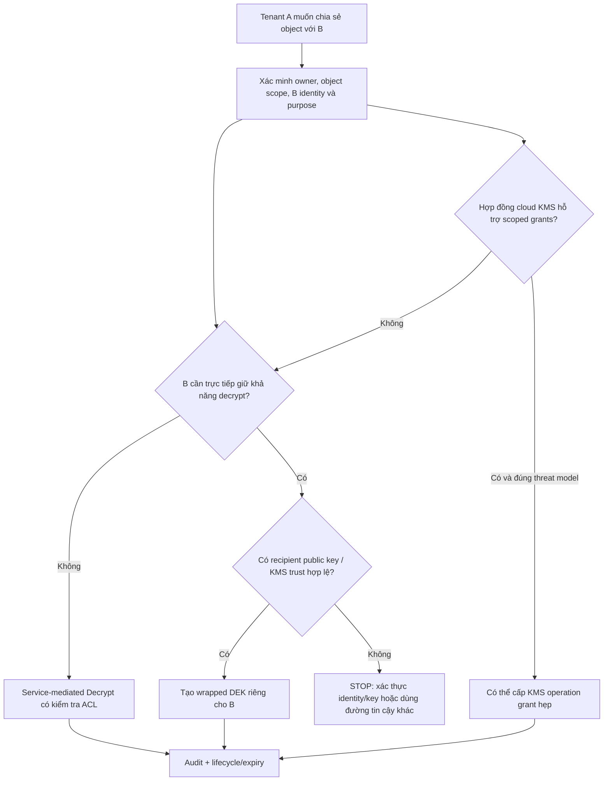
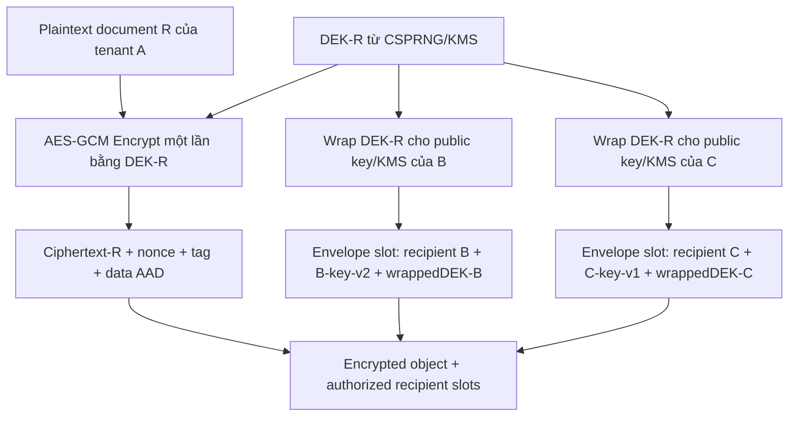
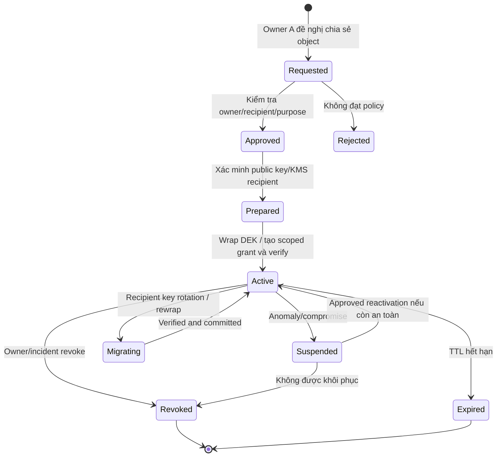
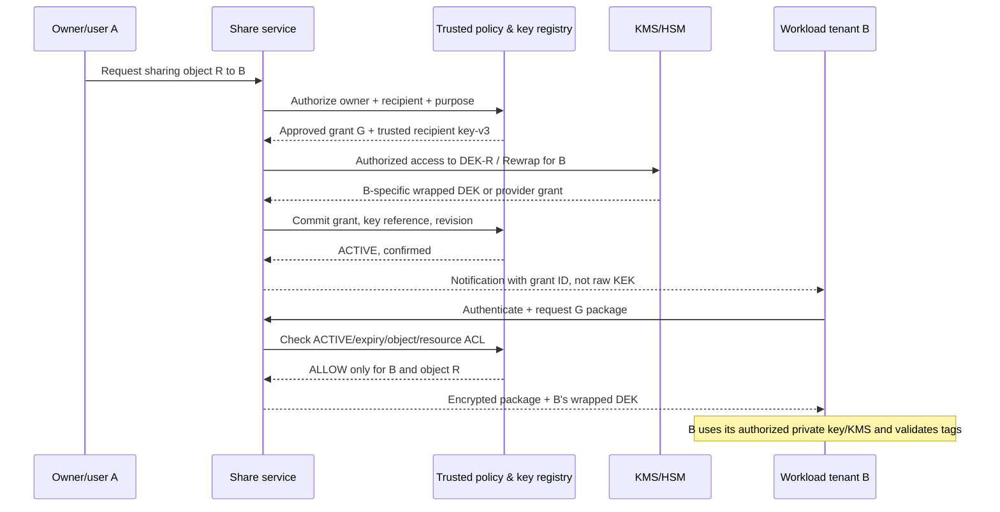

# Key distribution giữa tenant: phân phối quyền sử dụng khóa và dữ liệu mã hóa an toàn

> **Chương:** Key distribution  
> **Module:** SECURITY_KEY_MANAGEMENT_FUNDAMENTALS

Trong nền tảng SaaS nhiều khách hàng, mỗi **tenant** thường là một tổ chức hoặc miền quản trị có dữ liệu, người dùng và chính sách bảo mật riêng. Một tenant A có thể cần chia sẻ báo cáo với tenant B, hợp tác với đối tác C, hoặc chuyển quyền truy cập dữ liệu sang một tổ chức mới sau khi sáp nhập. Khi dữ liệu đã được mã hóa, câu hỏi trở nên khó hơn việc gửi file: **khóa nào được phép sử dụng, ai kiểm soát khóa, bên nhận xác thực ra sao, làm thế nào tránh mở dữ liệu của tenant khác và điều gì xảy ra khi thu hồi quyền?**

**Key distribution giữa tenant** là quá trình cho phép một tenant hoặc workload thuộc một miền tin cậy **nhận quyền sử dụng khóa, nhận một khóa được bảo vệ, hoặc truy cập dữ liệu có mã hóa** từ một tenant khác theo chính sách đã phê duyệt. Không phải lúc nào nó cũng đồng nghĩa **chuyển raw key bytes**. Trên thực tế, những mô hình an toàn thường ưu tiên **key references, KMS/HSM operations, encrypted data keys (wrapped DEK), recipient public keys** và **grant có phạm vi** thay vì trao trực tiếp plaintext DEK/KEK/private key.

Trong phạm vi **SECURITY_KEY_MANAGEMENT_FUNDAMENTALS**, bài học kết nối phân phối khóa giữa các tenant với mật mã đối xứng, bất đối xứng, chữ ký số, KMS/HSM, envelope encryption, kiểm soát truy cập, kiểm toán và toàn bộ vòng đời **tạo → cấp phát → lưu trữ → sử dụng → xoay vòng → thu hồi → hủy**.

Sau bài học, bạn có thể:

- Phân biệt **tenant identity**, **user/workload identity**, **key ownership**, **data ownership** và **quyền giải mã dữ liệu cụ thể**.
- Lựa chọn giữa **không chuyển khóa**, **KMS grant có giới hạn**, **wrapped DEK riêng cho mỗi tenant nhận**, và **public-key wrapping/KEM**.
- Thiết kế giao thức chia sẻ có **xác thực danh tính bên nhận, xác thực public key, phê duyệt của chủ dữ liệu và ràng buộc mục đích**.
- Dùng **encryption context/AAD**, IAM và resource authorization để giảm rủi ro **cross-tenant decryption oracle**.
- Phân biệt **onboarding, rotation, key version, rewrap, reencrypt, offboarding và revocation**.
- Hiểu giới hạn mật mã: **rút grant không thu hồi bản sao plaintext/DEK đã trao**, và hủy một bản wrap không tự xóa dữ liệu bên nhận đã sao chép.
- Đọc ví dụ Java 17 minh họa **AES-GCM DEK + RSA-OAEP wrapped DEK theo recipient**, cùng những giới hạn khiến demo không thay thế KMS/HSM production.
- Xây checklist, runbook, test cases và bằng chứng kiểm toán cho quy trình phân phối khóa nhiều tenant.

## 1. “Giữa tenant” nghĩa là những ranh giới nào?

**Tenant** là miền logic hoặc tổ chức mà nền tảng phải giữ độc lập về dữ liệu và quyền. Hai tenant có thể cùng chạy trên một cluster nhưng vẫn là **hai security principals và hai phạm vi quản trị**. Việc chúng dùng chung vật lý **không tạo quyền đọc lẫn nhau**.

Cần phân biệt năm danh tính:

| Đối tượng | Vai trò | Không được nhầm với |
|---|---|---|
| **Tenant A (data owner)** | Chủ thể quyết định chia sẻ một object/tập dữ liệu | Tài khoản KMS admin của toàn nền tảng |
| **Tenant B (recipient)** | Tổ chức được phép nhận dữ liệu hoặc khả năng giải mã | Bất kỳ user nào tự khai `tenantId=B` |
| **User/actor** | Cá nhân yêu cầu hoặc phê duyệt chia sẻ | Toàn bộ tenant tự động đồng ý |
| **Workload identity** | Service thực hiện rewrap, KMS Decrypt, transport hoặc consume | Danh tính người dùng cuối |
| **Key custodian/KMS principal** | Chủ thể quản lý hoặc thực thi phép toán khóa | Người có quyền trên object nghiệp vụ |

Ví dụ: một **report-sharing service** chạy bằng service account nội bộ có thể có quyền gọi KMS để phân phối DEK. Nhưng điều đó **không chứng minh** user của tenant A đã phê duyệt chia sẻ báo cáo cho B. Ngược lại, một user A có quyền đọc báo cáo không mặc định được quyền tạo key grant cho B.

### 1.1. Ba biên quyền khác nhau

Một lần chia sẻ an toàn thường cần đồng thời:

1. **Business/data authorization:** object nào được chủ sở hữu chia sẻ cho tenant B, scope và thời hạn nào.
2. **Cryptographic/key authorization:** principal hoặc recipient key nào được unwrap/decrypt DEK tương ứng.
3. **Transport/trust authorization:** bên nhận, endpoint, public key và ngữ cảnh phiên có được xác thực không.

Chỉ một điều đúng là chưa đủ. **KMS cho phép Unwrap không có nghĩa B có quyền xem mọi record**; một bản ghi chia sẻ trong database cũng không có nghĩa B có khả năng giải mã nếu chưa có wrapped DEK phù hợp.

### 1.2. Cross-tenant không nhất thiết cross-account

Nhiều tenant có thể chia sẻ một **cloud account/KMS service**, nhưng có **namespace, policy và key references** riêng. Ngược lại, hai tenant có thể ở **hai cloud accounts, regions, clusters hoặc tổ chức vận hành khác nhau**. Thiết kế cần ghi rõ cả **logical isolation** lẫn **infrastructure isolation**.

## 2. Phân phối cái gì: quyền, key handle, wrapped DEK hay raw key?

Thuật ngữ *key distribution* dễ dẫn tới giả định “phải gửi khóa”. Thực ra có nhiều mức chia sẻ:

| Đối tượng phân phối | Bên nhận có được raw secret? | Ví dụ |
|---|---|---|
| **Quyền truy cập object** | Không nhất thiết | Tenant A cấp B quyền đọc tài liệu; service thực hiện Decrypt và trả dữ liệu được phép |
| **Quyền KMS/HSM operation** | Không nhận raw KEK/private key | Scoped grant cho service được gọi Unwrap/Decrypt trên key đã định |
| **Key ID/handle** | Không, nếu chỉ là reference | B biết keyRef và gọi API đúng quyền |
| **Wrapped DEK** | Không phải plaintext khi nhận; có thể unwrap nếu được cấp khả năng | DEK được mã hóa riêng cho recipient B |
| **Public key/certificate** | Không bí mật | A dùng public key tin cậy của B để wrap DEK |
| **Raw DEK** | Có | Một số ứng dụng phải nhận plaintext DEK trong memory để AES Decrypt |
| **Raw KEK/private key** | Có và thường tác động rất rộng | Thường **không nên xuất/chuyển giữa tenants** |

**Mục tiêu ưu tiên:** trao **khả năng tối thiểu** để B mở đúng dữ liệu đã chia sẻ, không trao một KEK gốc có thể mở toàn bộ DEKs của tenant A.

### 2.1. Key ownership không phải data ownership

Một nhà cung cấp SaaS có thể là **KMS key administrator**, còn tenant là **data owner**. Một key có thể phục vụ nhiều objects/tenants tùy thiết kế. Không dựa vào việc tenant A là người tạo key resource để suy ra họ được đọc mọi ciphertext đang dùng key ấy; quyền đọc vẫn cần kiểm soát ở application/resource layer.

### 2.2. Không chuyển raw root key để “thuận tiện”

Nếu KEK-A bảo vệ hàng triệu DEK của tenant A, gửi raw KEK-A cho B sẽ cho B tiềm năng mở **tất cả wrapped DEKs mà B có được**, không chỉ một báo cáo. Một key leak của B có thể làm ảnh hưởng hàng loạt dữ liệu A. Phân phối **wrapped DEK theo từng object/nhóm object được phép** hoặc một khả năng KMS giới hạn sẽ giảm phạm vi ảnh hưởng.

## 3. Mục tiêu bảo mật và threat model

Thiết kế phải nêu rõ các thuộc tính cần bảo vệ:

- **Confidentiality:** tenant B không đọc dữ liệu không được chia sẻ; tenant C không đọc dữ liệu cấp cho B.
- **Integrity:** ciphertext, wrapped DEK, key references, object ID và policy không bị thay thế âm thầm.
- **Authenticity:** A biết public key thuộc B; B biết package/ủy quyền đến từ bên đáng tin.
- **Least privilege:** workload phân phối chỉ mở đúng key/DEK và object cần thiết.
- **Freshness / replay controls:** grant và message không bị tái sử dụng ngoài thời hạn/mục đích.
- **Isolation & availability:** lỗi/compromise của một tenant không gây rủi ro vô hạn cho tenant khác.
- **Auditability:** xác định được ai chia sẻ gì, cho ai, dưới key version nào và khi nào thu hồi.
- **Lifecycle control:** rotation/revocation/offboarding không làm mất dữ liệu của bên còn quyền.

| Mối đe dọa | Ví dụ | Kiểm soát trọng tâm |
|---|---|---|
| **Tenant impersonation** | Client tự đặt `tenantId=B` | Tenant từ authenticated identity/server-owned mapping |
| **Confused deputy** | Service có KMS Decrypt rộng mở DEK A theo lệnh của C | Kiểm tra object sharing policy trước KMS và hạn key operation |
| **Public-key substitution** | Attacker đổi recipient public key B thành key của mình | Authenticated key registry/PKI, fingerprint và key version |
| **Metadata tampering** | Đổi `recipientTenant` hoặc `keyRef` trong package | Canonical AAD/OAEP label, allowlist, integrity signature nếu cần |
| **Cross-tenant KEK leakage** | A gửi raw KEK-A cho B | Non-exportable KEK, per-recipient wrapped DEK hoặc KMS grant |
| **Replay of share grant** | Token cấp cho B được dùng lại sau revoke | Grant ID, expiry, status, idempotency/replay checks |
| **Overbroad IAM** | Role của B có `Decrypt` mọi key prod | Resource-specific policy, scope theo recipient và purpose |
| **Key version mismatch** | B dùng private key mới để unwrap DEK bọc cho public key cũ | Recipient key ID/version bất biến và retention có kiểm soát |
| **Compromised recipient** | B bị chiếm host, attacker lấy DEK đã unwrap | Giảm phạm vi, expiry, rekey khi cần; thừa nhận giới hạn thu hồi |
| **Backup/replication leak** | Package cũ còn ở DR hoặc logs | Encryption/retention/secure erase theo khả năng |
| **Unauthorized resharing** | B gửi plaintext hoặc DEK cho C | Policy, contractual controls, trusted execution khi phù hợp; mật mã cơ bản không cấm copy plaintext |

### 3.1. Khái niệm “tenant isolation” phải đo bằng quyền thực tế

Tách prefix secret hoặc dùng tên key `tenant-A-key` **không tự bảo đảm** isolation nếu một role có quyền `kms:Decrypt` hoặc `ReadSecret` trên tất cả keys. Đánh giá phải kiểm tra **effective IAM/resource grants**, data authorization và cả các đường truy cập trực tiếp ngoài service API.

### 3.2. Khi B được đọc dữ liệu, không thể giả định xóa được trí nhớ của B

Ngay cả với KMS/HSM rất tốt, sau khi tenant B nhận **plaintext hoặc raw DEK**, họ có thể lưu lại một bản sao. Thu hồi grant chỉ chặn **lần truy cập mới qua ranh giới kiểm soát**, không thể xóa dữ liệu B đã sao chép. Điều này phải được nói rõ trước khi thiết kế SLA về revoke, hợp đồng chia sẻ hoặc “cryptographic erasure”.

## 4. Các mô hình kiến trúc phân phối khóa giữa tenant

Không có một mô hình tối ưu cho mọi SaaS. Bốn cách phổ biến khác nhau về nơi plaintext xuất hiện, quyền và chi phí:

| Mô hình | Cách hoạt động | Ưu điểm | Hạn chế |
|---|---|---|---|
| **A. Server-mediated access** | B gọi service, service kiểm tra policy rồi decrypt/stream dữ liệu | Không phải chuyển key material cho B; revocation trực tuyến dễ hơn | Service trở thành nơi xử lý plaintext, cần trust/IAM/audit mạnh |
| **B. Scoped KMS/HSM grant** | B hoặc workload của B được quyền gọi phép toán key trên resource cụ thể | Key non-exportable; audit tập trung | Provider-specific; grant có thể rộng ở mức key, chưa biết object policy |
| **C. Per-recipient wrapped DEK** | Một DEK được wrap riêng cho mỗi tenant nhận | Granularity theo object/recipient, hỗ trợ offline transfer | Sau unwrap B có thể sao chép DEK/plaintext; metadata/version phức tạp |
| **D. Reencrypt/copy per tenant** | Tạo bản dữ liệu và DEK riêng cho B | Tách lifecycle/key budget tốt hơn | CPU, storage, migration và consistency tốn kém |

Một hệ thống có thể kết hợp: **B dùng service-mediated access khi online**, nhưng export một **package với wrapped DEK** cho workflow offline đã được phê duyệt.

### 4.1. Sơ đồ lựa chọn tổng quan



**Chọn một hướng chưa phải authorization**. Với bất kỳ phương án nào, cần sự phê duyệt của chủ dữ liệu, mapping tenant đáng tin và policy chống chia sẻ quá phạm vi.

## 5. Mô hình A: không trao khóa, chỉ trao quyền đọc qua service

Nếu B chỉ cần xem một báo cáo trong cổng SaaS, có thể **không cần phân phối DEK/KEK tới B**:

```text
Tenant B user --> authenticated application API
             --> check A->B share grant for report R
             --> data service uses KMS/HSM to Unwrap DEK-R
             --> AEAD Decrypt R inside trusted service
             --> return authorized fields over TLS to B
```

Ưu điểm:

- A có thể **rút grant application** và chặn các lần tải tiếp theo.
- B không nhận raw DEK/KEK, giảm nguy cơ key material bị copy.
- Nền tảng thống nhất authentication, rate limits, object access và audit.

Giới hạn:

- Nếu B đã tải plaintext về, revoke không xóa bản sao ấy.
- Service phải có quyền Unwrap/Decrypt, nên khi bị chiếm có thể trở thành **decryption oracle**.
- Plaintext xuất hiện trong service và kênh truyền tới B; phải giới hạn log, memory, export và cache.

### 5.1. Kiểm tra quyền trước khi chạm KMS

Trình tự đúng:

1. Authenticate user/workload của B.
2. Kiểm tra B có grant hợp lệ cho **object R của A**.
3. Chặn nếu grant expired/revoked hoặc vượt scope.
4. Chỉ sau đó dùng KMS key reference của record để unwrap.
5. AEAD decrypt và trả đúng dữ liệu B được phép thấy.

Một câu lệnh `KMS Decrypt success` không thay thế bước (2). KMS thường không biết mọi điều kiện nghiệp vụ như “B chỉ được xem báo cáo tháng 10, không được xem toàn bộ bảng lương”.

## 6. Mô hình B: scoped KMS/HSM grant giữa tenant

Trong một số mô hình cross-account/cross-project, tenant A hoặc platform có thể cho principal của tenant B **sử dụng một KMS key** theo một tập phép toán xác định, mà không xuất raw key material.

Các khía cạnh phải xác định:

- **Grantor** có thẩm quyền cấp quyền và được chủ dữ liệu ủy quyền?
- **Grantee principal** là workload identity nào, ở account/project/region nào?
- **Key resource** có phải chỉ bảo vệ dữ liệu đã chia sẻ không?
- **Allowed operations** có thể giới hạn Encrypt/Decrypt/GenerateDataKey/Unwrap/Sign theo tính năng không?
- **Encryption context/grant constraints** có hỗ trợ ràng buộc object/tenant/purpose trong provider không?
- Quyền hiệu lực có còn từ các IAM paths khác không?
- Có audit riêng cho grant create/use/revoke và khi nào revoke thực sự có hiệu lực?

### 6.1. Vấn đề shared KEK

Nếu KEK-A bảo vệ DEK của **mọi record tenant A**, cấp `Decrypt` trên KEK-A cho B có thể cho B khả năng unwrap **nhiều DEK hơn dự kiến** nếu B tìm được ciphertext/wrapped DEK tương ứng. Vì vậy không nên coi một grant KMS ở cấp key là tương đương **grant đọc một object**.

Các lựa chọn giảm phạm vi:

- KEK riêng cho **nhóm dữ liệu được chia sẻ** hoặc collaboration domain.
- Application broker kiểm tra object grant trước khi gọi KMS.
- KMS constraints dựa trên encryption context, **nếu cơ chế thực sự cưỡng chế** và context không bị client tự ý khai.
- Per-recipient wrapped DEK thay vì cấp quyền trực tiếp trên KEK lớn.

### 6.2. Cảnh giác với tên API/policy theo nhà cung cấp

AWS KMS, Azure Key Vault/Managed HSM, Google Cloud KMS và HSM riêng có **semantics** khác nhau về key grants, ciphertext blobs, cross-account access, exportability, automatic rotation và authentication context. Không lấy một ví dụ như `kms:Decrypt` hoặc `keyVersion=v3` để khẳng định mọi provider hỗ trợ chính xác cú pháp đó. Thiết kế cần căn cứ **hợp đồng API của hệ thống đang dùng** và integration tests.

## 7. Mô hình C: một DEK, nhiều bản wrapped DEK theo recipient

**Envelope encryption** dùng **DEK (Data Encryption Key)** để mã hóa dữ liệu và **KEK (Key Encryption Key)** hoặc public key để bảo vệ DEK. Khi A muốn chia sẻ cùng một ciphertext cho B và C, có thể tạo **hai bản wrap riêng của cùng DEK**:



Điểm mạnh: B và C không cần biết **KEK gốc của tenant A**, chỉ cần khả năng giải mã wrapped DEK của **riêng mình**. Object ciphertext được tái sử dụng, không nhất thiết nhân đôi dữ liệu.

### 7.1. Các điều kiện bắt buộc

1. **DEK-R được sinh với entropy đủ và đúng thuật toán**, ví dụ AES-256 theo policy.
2. Data ciphertext phải dùng AEAD với **nonce đúng quy tắc**, tag và AAD ràng buộc object.
3. **Public key của B/C được xác thực** trước khi wrap; không nhận key do một request giả mạo gửi tới.
4. Mỗi recipient slot phải có **recipient identity, immutable recipient key ID/version, scheme, wrapped DEK** và context.
5. Service phân phối phải kiểm tra grant của A cho đúng object/recipient trước khi tạo slot.
6. Tenant B được quyền **đọc slot của B**, không được tùy ý lấy slot của C và gọi KMS/Decrypt thay C.
7. Khi B đã unwrap DEK-R và đọc plaintext, **không thể thu hồi khả năng sao chép cũ bằng cách chỉ xóa slot B**.

### 7.2. Một ciphertext, nhiều recipient: lợi và hại

| Thuộc tính | Tác động |
|---|---|
| Dung lượng | Không nhân đôi ciphertext lớn; chỉ thêm các wrapped DEK slots |
| Quyền truy cập | Có thể chọn recipient dựa trên slot và grant; vẫn phải kiểm tra business ACL |
| Rotation public key B | Thường cần **rewrap DEK-R cho public key mới của B** |
| Thu hồi B | Có thể ngừng cung cấp slot/decrypt service trong tương lai; **B có thể đã copy DEK/plaintext** |
| DEK compromise | Có thể ảnh hưởng tất cả recipients cùng dùng DEK-R |
| Audit | Cần ghi từng lần add/remove slot và từng recipient key version |
| Storage migration | Phải cập nhật slots atomically hoặc version hóa container |

### 7.3. Tách data AAD và recipient wrapping context

Nếu AAD của **data ciphertext** chứa danh sách `[A,B,C]`, việc thêm D có thể khiến tag data cũ không hợp lệ nếu không mã hóa lại. Một format dễ rewrap hơn là:

- **Data AAD:** domain, object ID, owner tenant, data format version, immutable content revision.
- **Recipient wrap context:** owner tenant, object ID, recipient tenant, recipient key ID/version, purpose, wrap format.
- **Share-grant metadata:** grant ID, thời hạn và trạng thái thuộc authorization service; có thể được ký/xác thực theo chính sách.

Điều này **không tự cho B quyền**: metadata wrap chỉ giúp chống tráo context, còn grant phải được kiểm tra trước khi trả slot hoặc plaintext. **Nếu yêu cầu chính sách phải buộc phiên bản ACL vào data ciphertext**, cần cân nhắc reencrypt/tag update và trade-off khi grant thay đổi.

## 8. Mô hình D: reencrypt dữ liệu riêng cho từng tenant

Với dữ liệu cực kỳ nhạy cảm, đôi khi A tạo một **bản ciphertext riêng cho B**, dùng DEK-B và một metadata domain riêng:

```text
Document R (owner A)
  A's copy: DEK-A-R, ciphertext-A-R, KEK-A wrap
  B's copy: DEK-B-R, ciphertext-B-R, KEK-B/public-key-B wrap
```

Ưu điểm:

- DEK của bản B không dùng để giải mã bản A; giúp tách **key budgets, nonce strategy, rotation và blast radius**.
- B có thể áp dụng retention/lifecycle riêng theo thỏa thuận.
- Nếu B làm lộ DEK-B, **không tự suy ra** raw DEK-A bị lộ.

Hạn chế:

- Cần decrypt/reencrypt dữ liệu, có thể tốn CPU, storage và băng thông.
- Plaintext đi qua một nơi tin cậy để chuyển đổi; nơi này phải có quyền và bảo vệ memory/log.
- Nếu A cập nhật bản gốc, phải quyết định **snapshot vs live sync**; không ngầm ghi đè thay đổi của B.
- Revocation vẫn không thu hồi bản copy B đã có.

Chọn mô hình này khi cần **isolation mạnh hơn giữa bản dữ liệu của từng recipient** hoặc có chính sách độc lập về data lifetime. Không đánh đồng nó với việc tạo nhiều bản wrapped DEK cho **cùng một DEK**.

## 9. Định danh và xác thực recipient public key

Khi A dùng public key B để wrap DEK, **tính bí mật phụ thuộc vào việc khóa công khai thật sự thuộc B**. Nếu attacker thay key B bằng public key của họ, A sẽ mã hóa DEK cho attacker dù thuật toán RSA-OAEP hoặc KEM hoạt động hoàn hảo.

### 9.1. Nguồn public key đáng tin

Tùy mô hình:

- **PKI/certificate chain:** kiểm tra chữ ký CA, trust anchor, key usage/EKU, thời hạn và trạng thái revoke khi áp dụng.
- **Tenant key registry:** một mapping `tenantB → recipientKeyId/version → public key fingerprint` được quản trị bằng identity và approval.
- **Out-of-band fingerprint verification:** đối chiếu fingerprint qua kênh đã được xác thực, tránh tin cùng một kênh không đáng tin.
- **Pinning:** pin public key/fingerprint trong một trust relationship đã thiết lập, có quy trình rotate pin.
- **Federated trust:** tổ chức dùng một trust framework có issuer, audience, rotation và key lifecycle rõ.

**Public key không bí mật, nhưng tính xác thực của nó cực kỳ quan trọng.** Một chữ ký self-signed hoặc public key lấy từ request body không tự chứng minh danh tính B.

### 9.2. Recipient identity và key version là hai field độc lập

Ví dụ:

```json
{
  "recipientTenant": "tenant-B",
  "recipientKeyId": "tenant-B/data-receiver-v3",
  "recipientKeyFingerprint": "sha256:<trusted-fingerprint>",
  "recipientKeyPurpose": "DATA_KEY_UNWRAP",
  "recipientKeyStatus": "ACTIVE_FOR_NEW_SHARES"
}
```

Sau rotate, B có thể tạo `data-receiver-v4`, nhưng wrapped DEK cũ dưới v3 **không tự mở được bằng private key v4**. Cần giữ v3 cho legacy unwrap theo policy hoặc rewrap slots sang v4 trước khi hủy v3.

### 9.3. Tránh TOCTOU trong key lookup

Một lỗi **time-of-check to time-of-use**:

1. Kiểm tra B public key v3 hợp lệ.
2. Lookup lại `tenant-B/current` sau khi alias đổi sang v4.
3. Wrap bằng v4 nhưng ghi metadata v3.

Hệ thống nên **resolve và pin immutable key ID/fingerprint** cho toàn bộ một share operation; metadata phải mô tả **key thực sự được dùng**.

### 9.4. Quyền key usage

Không dùng **Ed25519 signing public key** như một RSA-OAEP encryption key; không đánh đồng **X25519 key agreement** với **RSA encryption** hoặc **ML-KEM encapsulation**. Recipient key algorithm/scheme phải được allowlist và hợp đồng protocol quy định rõ.

## 10. RSA-OAEP, HPKE/KEM và bảo mật của đường wrap

Một cách minh họa là **RSA-OAEP** dùng public key B để mã hóa **DEK có kích thước nhỏ phù hợp**. B dùng private key tương ứng để giải mã DEK.

Những ràng buộc quan trọng:

- Chọn RSA modulus/key size và **OAEP digest/MGF1 digest** theo policy; không ngầm dựa vào default của provider.
- RSA-OAEP chỉ phù hợp encrypt **secret ngắn**; dữ liệu lớn nên dùng AES-GCM qua DEK.
- Cần ràng buộc **tenant/object/recipient/key version** trong authenticated context/protocol. RSA-OAEP hỗ trợ label `PSource.PSpecified` trên một số API; các bên phải dùng đúng bytes khi decrypt.
- Không coi **public-key encryption tự chứng minh sender**: attacker cũng có thể encrypt cho public key B.
- Không xử lý lỗi padding khác biệt quá chi tiết cho caller bên ngoài; giới hạn rate và ngăn decryption oracle.

### 10.1. KEM/HPKE khác RSA-OAEP trực tiếp

Với **HPKE (Hybrid Public Key Encryption)** hoặc scheme KEM chuẩn, sender encapsulate một bí mật từ **recipient public key**, dùng **KDF/key schedule** để tạo key AEAD/wrapping thích hợp theo protocol. Các thuật toán và parameter sets phải được chỉ định cụ thể (ví dụ X25519 DHKEM, ML-KEM parameter sets khi hệ thống hỗ trợ). Không giả vờ một public key bất kỳ có thể dùng hoán đổi giữa RSA, X25519 và ML-KEM.

**Base KEM không cung cấp sender authentication**. Nếu B cần chứng minh package đến từ A, sử dụng **authenticated mode, chữ ký số hoặc protocol có sender identity** được thiết kế phù hợp, cộng với trust registry. Không tự tạo giao thức KEM bằng cách nối bừa các bytes.

### 10.2. Ký share manifest nếu cần sender authenticity

Một gói chia sẻ offline có thể chứa:

```text
SignedShareManifest
  ownerTenant: A
  recipientTenant: B
  objectId: R
  shareGrantId: G
  recipientKeyId: B-data-v3
  wrappedDekDigest: H(wrappedDEK)
  ciphertextDigest: H(data ciphertext + metadata)
  schemaVersion: 1
  expiresAt: ...
  signature: Sign_A(canonicalManifestBytes)
```

B phải **xác minh chữ ký bằng một public key của A đã được tin** và kiểm tra grant/expiry/audience. Nếu B chỉ tin public key do chính gói gửi kèm mà không có trust chain, chữ ký không chứng minh danh tính A. Manifest ký cũng **không bắt recipient xóa plaintext sau khi đọc**.

### 10.3. Replay và idempotency

Một share-grant token có thể bị gửi lại. Cần **grant ID, object revision, audience/recipient, expiry, purpose** và replay rules ở server. Việc wrap cùng một DEK nhiều lần bằng RSA-OAEP có thể tạo wrapped bytes khác do randomness; vì vậy **idempotency dựa trên grant/operation ID và trạng thái**, không phải so sánh chuỗi wrapped DEK bằng nhau.

## 11. Định dạng gói encrypted-share có thể version hóa

Một package chuyển từ A tới B nên có **data cipher metadata**, **recipient-specific wrap slot** và **authorization reference** được ràng buộc:

```json
{
  "formatVersion": 1,
  "object": {
    "ownerTenant": "tenant-A",
    "objectId": "document-729",
    "objectRevision": 8,
    "dataCipher": "AES-256-GCM",
    "dataNonceB64": "<base64-nonce>",
    "dataCiphertextAndTagB64": "<base64-ciphertext>",
    "dataAadSchema": "share:data:v1"
  },
  "recipientSlot": {
    "recipientTenant": "tenant-B",
    "recipientKeyId": "tenant-B/data-receiver-v3",
    "wrapScheme": "RSA-OAEP-SHA256-MGF1SHA256",
    "wrapContextSchema": "share:wrap:v1",
    "wrappedDekB64": "<base64-wrapped-dek>"
  },
  "authorization": {
    "shareGrantId": "grant-9918",
    "grantRevision": 4,
    "expiresAt": "2026-12-31T00:00:00Z",
    "purpose": "approved-document-review"
  }
}
```

Các giá trị trong dấu nhọn chỉ là placeholders. Một gói production cần **canonical serialization, kích thước fields tối đa, algorithm allowlist, authenticated metadata và sender trust**. Không nhận raw `recipientKeyId` hoặc `shareGrantId` từ client như bằng chứng đã được owner phê duyệt.

### 11.1. Điều gì được mã hóa, điều gì chỉ được xác thực?

| Trường | Có cần bí mật? | Có cần integrity/authentication? |
|---|---|---|
| Data plaintext | Có | Có |
| Data ciphertext | Không nhất thiết | **Có**, qua AEAD tag |
| Wrapped DEK | Không phải raw secret | **Có** ràng buộc scheme/context; phải chống tráo |
| Nonce | Không cần bí mật | Phải chính xác, được xử lý trong AEAD |
| Owner/recipient IDs | Thường là metadata | **Có** trong AAD/manifest/policy |
| Recipient public key | Không bí mật | **Có**, phải gắn với identity đáng tin |
| Recipient private key / raw DEK | **Có** | Bảo vệ bí mật và quyền sử dụng nghiêm ngặt |
| Grant ID/expiry | Thường không bí mật | **Có**: phải đến từ authorization service đáng tin |

### 11.2. Format version khác key version

Nên phân biệt:

- `formatVersion`: cách serialize package.
- `dataCipherFormat`: kiểu nonce/tag/AAD.
- `recipientKeyId`: phiên bản public/private key của B.
- `wrappingSchemeVersion`: bộ thuật toán/parameter set wrap.
- `shareGrantRevision`: vòng đời của **quyền chia sẻ**, không phải material version.

Một trường chung `version: 3` dễ gây lỗi khi chỉ một thành phần đổi.

## 12. Encryption context và AAD khi phân phối cross-tenant

**AAD (Additional Authenticated Data)** giúp ràng buộc metadata không bí mật với ciphertext. Trong kiến trúc multi-recipient cần tách **data AAD** khỏi **wrap AAD**:

```text
Data AAD:
  domain = "share:data:v1"
  ownerTenant = A
  objectId = R
  objectRevision = 8

Wrapped DEK context for B:
  domain = "share:wrap:v1"
  ownerTenant = A
  recipientTenant = B
  objectId = R
  recipientKeyId = B-data-v3
```

Lý do: muốn thêm recipient C hoặc rotate public key B, ta có thể **rewrap cùng DEK**, không phải thay data ciphertext chỉ vì danh sách recipients đổi. Nếu data AAD chứa **danh sách recipients đang thay đổi**, mỗi cập nhật ACL sẽ khiến data tag cũ không hợp lệ trừ khi mã hóa/tag lại.

### 12.1. Cách encode canonical

Không nối `owner + recipient + object` thiếu phân tách vì `"ab"+"c"` và `"a"+"bc"` có thể giống nhau. Dùng serialization canonical hoặc **length-prefix** (ví dụ mỗi field gồm độ dài + bytes UTF-8) và version hóa. Khi đổi Unicode normalization/serialization, phải giữ decoder cũ đủ lâu để đọc gói lịch sử.

### 12.2. AAD không thay thế ACL

Nếu attacker có quyền tạo một ciphertext mới với AAD `tenant=B`, tag vẫn có thể hợp lệ. Vì vậy:

1. Authenticate caller.
2. Authorize object/share grant.
3. Resolve key reference từ registry đáng tin.
4. Chỉ sau đó gọi KMS/HSM và AEAD.

Một metadata field do client tự khai không trở thành policy chỉ vì nó được gọi là `encryptionContext`.

### 12.3. Key-wrap scheme không hỗ trợ AAD thì sao?

Không phải mọi wrap primitive có AAD giống AES-GCM. Có thể:

- Dùng một **authenticated envelope format/manifest** ràng buộc key ID/recipient/object.
- Nếu scheme có **label/context** theo chuẩn (ví dụ RSA-OAEP label), sử dụng đúng hợp đồng của scheme.
- Dùng **HPKE authenticated info/AAD** theo API và suite.
- Giữ server-side policy mapping và không chấp nhận bản wrap không rõ nguồn.

Không tự “thêm AAD” bằng một bước hash không được kiểm tra hoặc tự sửa encrypted blob opaque của provider.

## 13. Chia sẻ qua API và network: TLS không đủ để chứng minh quyền

Khi package/wrapped DEK đi qua network:

- **TLS** bảo vệ đường truyền và xác thực endpoint theo trust được cấu hình.
- **mTLS** có thể xác thực hai phía ở tầng kết nối; **tenant mapping** vẫn phải được xác minh.
- **OIDC/JWT/workload identity** có thể đưa claims về issuer/audience/subject/tenant, nhưng không được tin claims không xác minh chữ ký và nguồn issuer.
- **Resource authorization** kiểm tra share grant và object ngay tại API, không chỉ thông tin “đã đăng nhập”.
- **KMS/HSM IAM** giới hạn phép Unwrap/Decrypt và key scope sau khi API cho phép.
- **Audit** kết hợp caller identity, grant ID, key version và kết quả.

### 13.1. Tránh “decrypt by arbitrary key ID”

API phản ví dụ:

```text
POST /tenant-share/decrypt
{
  "tenantId": "B",
  "keyId": "kms://some-key",
  "encryptedDEK": "...",
  "ciphertext": "..."
}
```

Nếu backend có IAM quyền giải mã nhiều keys, caller có thể lợi dụng nó như **cross-tenant decryption oracle**. API nên nhận **objectId hoặc grantId đã được kiểm chứng**, tải metadata từ nguồn server kiểm soát và chỉ giải mã đúng object được phép.

### 13.2. Mẫu API hợp lý hơn

```text
POST /shares/{shareGrantId}/accept
  -> authenticate tenant B's user/workload
  -> verify shareGrantId belongs to B, current and approved
  -> retrieve A-owned object R from trusted registry
  -> validate recipient key identity/version
  -> prepare B-specific wrapped DEK or broker access
  -> audit acceptance with correlation ID

GET /shares/{shareGrantId}/content
  -> repeat authz/expiry check
  -> return only authorized ciphertext slot or plaintext
```

Một grant đã được **accept** không đồng nghĩa vĩnh viễn có quyền tải dữ liệu; cần kiểm tra expiry/revocation và scope mỗi lần truy cập quan trọng.

## 14. Vòng đời của share grant: phê duyệt trước, wrap sau

Trong hệ thống chia sẻ nhiều tenant, việc phát sinh wrapped DEK hoặc KMS grant phải gắn với một **business sharing grant** được phê duyệt.

Một state machine minh họa:



**State machine chỉ diễn tả logic nghiệp vụ**; provider KMS có thể có trạng thái grant khác và độ trễ thu hồi. Phải đối soát hai lớp quyền.

### 14.1. Một grant cần tối thiểu những gì?

| Field | Ý nghĩa |
|---|---|
| `grantId` và revision | Identity/idempotency và chống ghi đè |
| `ownerTenant` | Tenant có thẩm quyền chia sẻ |
| `recipientTenant` | Tenant nhận đã xác thực |
| `objectId/objectRevision` | Tập dữ liệu được chia sẻ, tránh cấp quá rộng |
| `allowedPurpose/actions` | Chỉ view/download/processing theo chính sách |
| `recipientKeyId/version` | Public key/KMS key recipient đã tin |
| `notBefore/expiresAt` | Cửa sổ hiệu lực, giới hạn replay |
| `approver/approvalDigest` | Ai phê duyệt đúng nội dung |
| `status` | Requested, Active, Suspended, Revoked, Expired |
| `policyVersion` | Chính sách đã áp dụng tại thời điểm chuyển |

Không nên đưa **raw DEK** hoặc private recipient key vào grant record. Grant metadata cũng có thể chứa thông tin tổ chức nhạy cảm, cần IAM/audit phù hợp.

### 14.2. Chuỗi giao dịch phân phối



### 14.3. Xử lý trạng thái nửa chừng

Giả sử KMS đã tạo wrapped DEK cho B nhưng database ghi grant ACTIVE thất bại. B **không nên được cấp package** chỉ vì tồn tại wrapped bytes tại một object storage path chưa bảo vệ. Cần cơ chế:

- **Prepare → Verify → Commit** có expected grant revision.
- Artifact pending không public, có TTL và cleanup.
- **Idempotency key** để retry không tạo grant trùng hoặc cấp quyền cho sai tenant.
- Nếu KMS grant đã cấp nhưng commit thất bại, phải **revoke/compensate** theo provider.
- Audit các trạng thái **PENDING/FAILED/INDETERMINATE**, không gộp vào SUCCESS.

### 14.4. Thay đổi scope cần approval mới

Một grant “B được đọc document R trong 7 ngày” không tự cho B quyền “đọc mọi document của A trong 90 ngày”. Khi sửa owner, recipient, object set, key scope, purpose hoặc thời hạn, phải đối chiếu với approval version; không cho operator tự kéo dài thời hạn qua sửa database.

## 15. Rotation recipient key và version của wrapped DEK

Tenant B có thể rotate private recipient key từ `B-key-v3` sang `B-key-v4`. Những packages đã wrapped dưới public key v3 thường vẫn yêu cầu **private key v3** nếu chưa rewrap.

### 15.1. Kế hoạch rotation

1. B sinh recipient key v4 bằng nguồn/thiết bị đã phê duyệt, thiết lập đúng key usage và non-exportability khi cần.
2. B công bố public key v4 qua **registry/PKI tin cậy**, có timestamp và proof-of-possession/verification phù hợp.
3. A/Share service xác thực v4, pin fingerprint và kiểm tra trust/algorithm.
4. **New shares** gửi cho B dưới v4.
5. Với các shares cũ dưới v3, quyết định **giữ v3 legacy decrypt** hay rewrap DEKs sang v4 theo retention/compromise policy.
6. Rewrap với authorization, transaction/CAS và verification; cập nhật từng slot keyRef thực tế.
7. Chỉ retire/destroy v3 khi inventory/DR/backup không còn phụ thuộc hoặc retention kết thúc.

### 15.2. Không đổi metadata suông

Sai:

```text
recipientKeyId: B-key-v3
wrappedDEK: RSA-OAEP_encrypt(public-v3, DEK)

UPDATE recipientKeyId = B-key-v4
-- wrappedDEK vẫn là ciphertext cho v3: private-v4 không mở được.
```

Đúng là **tạo wrapped DEK mới thực sự cho v4**, sau đó commit `wrappedDEK/keyId/wrapScheme/context` atomically.

### 15.3. Multiple recipients và DEK version

Khi cùng DEK-R được cấp cho B và C:

- B rotate private key v3→v4 có thể rewrap **chỉ slot B**.
- Slot C có thể giữ key C-v1 nếu chưa đến hạn rotation.
- Data ciphertext vẫn giữ nguyên nếu DEK-R và data AAD ổn định.
- Nhưng **DEK-R bị lộ** sẽ ảnh hưởng **tất cả** recipient slots, không chỉ B.

Với key sharing qua KMS grants, quá trình có thể là đổi recipient principal/IAM hoặc key references; khác với public-key wrapping. Đừng áp thuật ngữ “rotate public key” lên một symmetric KMS key không có public key.

## 16. Revocation và offboarding: rút quyền gì, không thu hồi được gì?

Đây là phần quan trọng nhất để tránh kỳ vọng sai.

### 16.1. Ba cấp độ thu hồi

| Biện pháp | Ngăn được gì? | Không bảo đảm gì? |
|---|---|---|
| **Revoke application share grant** | Các lần fetch qua API có kiểm tra grant | B đã tải plaintext hoặc package trước đó |
| **Revoke KMS operation grant** | Các lời gọi KMS mới qua principal/grant đó theo semantics provider | Raw DEK/plaintext đã rời KMS; các IAM paths khác |
| **Xóa recipient wrapped-DEK slot** | B không nhận slot mới từ kho do A kiểm soát | B có bản sao slot + private key hoặc DEK đã cache |
| **Reencrypt object bằng DEK mới** | Giới hạn khả năng mở **phiên bản ciphertext mới** bởi DEK cũ | B đã có plaintext/ciphertext cũ và có thể giữ chúng |
| **Xóa key material được A quản lý** | Có thể tạo crypto erasure cho dữ liệu còn phụ thuộc, nếu không có copies | Không xóa các bản plaintext/raw keys đã bị export |

### 16.2. Revocation hữu hiệu trong online-access model

Với mô hình **server-mediated**, B không sở hữu DEK; A revoke grant và API không trả dữ liệu tiếp. Đây thường là mô hình có **khả năng kiểm soát truy cập tương lai tốt hơn**, dù không thể thu hồi file B đã tải.

Với package **offline** chứa wrapped DEK cho private key B, B có thể giữ package và private key, nên revoke ở server **không chặn B giải mã bản copy đã sở hữu**.

### 16.3. Offboarding tenant B

Một quy trình có thể gồm:

1. Dừng cấp share grants mới cho B.
2. Revoke API tokens, workload IAM roles và KMS grants của B.
3. Ẩn/gỡ các B-recipient slots khỏi online store.
4. Xác định những object đang chia sẻ với B và cần **rekey/reencrypt** để bảo vệ các phiên bản tương lai.
5. Xử lý tenant-scoped caches, snapshots, backups trong **phạm vi A/platform kiểm soát**.
6. Ghi thông báo và obligations về lưu/xóa dữ liệu của B theo hợp đồng/pháp luật áp dụng.
7. Audit kiểm tra B không còn gọi API/Unwrap mới; **không khẳng định tất cả bản copy ở B đã bị xóa**.

### 16.4. Crypto-erasure có điều kiện

Nếu **tất cả** các bản sao DEK, wrapped DEK/key material có khả năng mở dữ liệu đã bị hủy theo cơ chế được kiểm soát, ciphertext còn lại có thể trở nên không thể đọc về mặt thực tiễn. Nhưng khi B đã nhận raw DEK hoặc plaintext, hoặc còn backup/escrow chưa hủy, kết luận “đã crypto-shred hoàn toàn” **không có căn cứ**.

## 17. Key compromise và phản ứng khi một tenant bị chiếm

### 17.1. Tenant B bị lộ private key

Nếu private key B-v3 bị lộ, attacker có thể mở những wrapped DEK mà họ đã có hoặc lấy được dành cho B-v3. Quy trình:

1. Cô lập workload/credential bị chiếm, thu hồi grant/API access.
2. Xác định **share packages/objects** dùng recipientKeyId B-v3.
3. Đánh giá attacker có được wrapped DEK và data ciphertext tương ứng không.
4. Sinh key pair B-v4 trong ranh giới an toàn, xác thực/công bố qua registry.
5. **Rewrap** cho B-v4 để phục vụ future access, nhưng không coi rewrap xóa rủi ro v3 đã lộ.
6. Nếu DEK hoặc plaintext có thể đã lộ, đánh giá **reencrypt bằng DEK mới**, dữ liệu lịch sử và nghĩa vụ thông báo.
7. Giữ bằng chứng, audit và kiểm tra các trust bindings khác có bị thay thế không.

### 17.2. Tenant A bị chiếm service chia sẻ

Khi một service có quyền unwrap các DEKs của A bị chiếm:

- Attacker có thể gọi KMS như **decryption oracle** nếu application authorization yếu.
- Hạn chế principal/IAM, chặn requests, điều tra key use logs, actor và object scope.
- Không chỉ rotate credential của service rồi kết luận không có leak: **DEKs/plaintext có thể đã bị sao chép**.
- Kiểm tra integrity của key registry và public-key mappings: attacker có thể thay recipient B thành public key của mình.

### 17.3. Shared KEK bị compromise

Nếu một KEK dùng chung cho nhiều tenants bị lộ, phạm vi có thể rất lớn. **Rewrap** DEKs sang KEK mới là một bước khôi phục control plane; nếu attacker đã mở DEKs hoặc có ciphertext+wrapped DEKs cũ, cần xét **thay DEK/reencrypt data**, truy vết bản sao và ảnh hưởng liên tenant.

### 17.4. Chữ ký số giúp gì và không giúp gì?

Một **signed manifest** có thể cho B xác thực nguồn package nếu public signing key A được tin, và giúp phát hiện metadata bị sửa. Nhưng:

- Không ngăn attacker **sao chép plaintext** sau khi B đã decrypt.
- Không tự quyết định **user A đã có quyền chia sẻ**; cần business approval ràng buộc.
- Không thay TLS/authentication hoặc object authorization.
- Chữ ký hợp lệ bằng một key chưa được gắn danh tính A đáng tin không chứng minh issuer.

## 18. Rotation, rewrap và reencrypt trong môi trường multi-tenant

Ba phép thay đổi thường bị nhầm:

| Thao tác | Vật liệu DEK | Wrapped DEK/recipient slot | Data ciphertext |
|---|---|---|---|
| **Rotate recipient private/public key** | Có thể giữ nguyên | Rewrap slot B cho key B-v4 | Có thể giữ |
| **Rotate KEK của A/B** | Có thể giữ nguyên | Rewrap theo KEK mới | Có thể giữ |
| **Revoke grant ứng dụng** | Không đổi | Có thể gỡ slot mới khỏi store | Không đổi những bản copy cũ |
| **Reencrypt per-recipient** | **DEK mới** | Tạo slot/KEK mới | **Ciphertext mới** |
| **Reencrypt toàn object** | **DEK mới** | Recreate slots cho recipients vẫn được phép | **Ciphertext mới** |

### 18.1. Không “rename key version”

Chuyển alias `currentRecipientKey` từ v3 sang v4 không biến wrapped DEK cũ thành bản mã dành cho v4. Cần thực hiện đúng cryptographic operation và cập nhật metadata atomically.

### 18.2. Data AAD và kế hoạch rotation

Để rewrap recipient slots mà không đổi ciphertext dữ liệu, data AAD không nên phụ thuộc **recipient key version hoặc danh sách chia sẻ thay đổi liên tục**. Các metadata mutable như expiry/grant revision có thể được ràng buộc bằng **authenticated manifest hoặc wrapping context riêng** và được kiểm tra tại thời điểm truy cập.

### 18.3. DEK reuse và nonce budget

Nếu một DEK được dùng để AES-GCM mã hóa nhiều revisions, phải quản lý **nonce duy nhất cho mỗi encryption dưới cùng key** và key budget tính trên **tất cả writers/regions**. Việc thêm một recipient slot không phải Encrypt data mới; nhưng việc reencrypt bản cập nhật bằng cùng DEK cần nonce hợp lệ. Nếu xảy ra nonce reuse, **rotate KEK/recipient public key không tự khắc phục** nguy cơ của data ciphertext.

### 18.4. Migration nhiều worker

Một worker đọc grant revision 12, rewrap cho B-v4; worker khác đã revoke grant ở revision 13. Worker đầu **không được ghi ACTIVE slot v4 đè lên grant đã revoked**. Cần **CAS/transaction** trên grant + recipient key version + object revision, hoặc protocol đảm bảo không có race.

```text
Read: grant G revision=12, ACTIVE, recipientKey=B-v3
Prepare: new wrappedDEK for B-v4
Commit if grant G revision==12 and status==ACTIVE

If conflict:
  re-read G
  if REVOKED -> discard pending slot, no activation
  if KEY_CHANGED -> validate and retry under new approved plan
```

Không coi job chạy thành công là migration hoàn tất khi **không có readback và trạng thái hiệu lực đúng**.

## 19. Cross-account, multi-region, BYOK và data residency

Một nền tảng có thể phục vụ tenant A ở khu vực địa lý này và B ở khu vực khác. Khi đó phân phối key còn liên quan tới **nguồn gốc key material, thẩm quyền KMS, khả năng dùng xuyên region và giới hạn di chuyển dữ liệu**.

### 19.1. Cross-account không đồng nghĩa chia sẻ raw material

Hai cloud accounts có thể thiết lập trust/IAM và key resource policies để cho phép principal hợp lệ gọi một số phép toán KMS trên key do A quản lý, **nếu provider hỗ trợ**. Đây không phải tự động export key bytes.

Những câu hỏi thiết kế:

- B được cấp quyền qua **resource policy/grant, cross-account IAM**, hay qua broker service?
- Key được bảo vệ bằng **provider-managed material** hay BYOK/imported material?
- Có hỗ trợ dùng **data key encrypted blob** giữa accounts/regions không?
- Khi key A bị disable/destroy hoặc account A bị khóa, B có còn decrypt được dữ liệu đã lưu?
- Tenant A có quyền **thu hồi hiệu lực các lời gọi mới** nhưng không thể thu hồi cache/plaintext đã export ra ngoài như thế nào?

### 19.2. Multi-region và key replication

Không giả định copy `keyId=foo` sang region B tạo **cùng key material**. Một số KMS cung cấp mô hình multi-region key hoặc replica được hỗ trợ; một số không. Nếu cần B dùng key ở region khác:

1. Chọn mô hình được provider công bố: replica key, recipient-specific wrapping hoặc reencrypt.
2. Đảm bảo luật/data residency cho phép **ciphertext, wrapped DEK và secret material** lưu/chuyển như kế hoạch.
3. Giữ mapping **region/account/key version** chính xác, không tự suy ra version từ alias.
4. Test DR khi region A không khả dụng, kể cả provider/IAM và business grant.
5. Không tạo bản sao raw KEK ngoài HSM chỉ vì cần thuận tiện liên vùng.

### 19.3. BYOK/HYOK và quyền kiểm soát tenant

**BYOK (Bring Your Own Key)** có thể cho tenant nhập/cung cấp key material theo khả năng provider; **HYOK (Hold Your Own Key)** thường nhấn mạnh quyền giữ key bên ngoài nền tảng. Cách diễn giải cụ thể khác nhau theo sản phẩm và hợp đồng; không thể suy ra một mức bảo đảm chỉ từ tên mô hình.

Các câu hỏi bắt buộc:

- Ai có **raw material/backup** và có thể revoke/delete?
- Ai có quyền gọi **Unwrap/Decrypt/Sign** và có thể lạm dụng dù key non-exportable?
- Nếu B cần dữ liệu A chia sẻ, key của A hay B phải dùng trong ranh giới nào?
- A rút key thì ciphertext A/B đã export có thể vẫn tồn tại ra sao?
- Quy trình rotation/restore/DR có phụ thuộc một HSM bên ngoài do tenant vận hành không?

### 19.4. Key transport khác data residency

Một wrapped DEK dù không phải plaintext vẫn là **encrypted key material** và có thể chịu policy/hợp đồng về di chuyển dữ liệu. Không mặc định “đã mã hóa nên có thể chuyển mọi nơi”. Cần phân loại **plaintext, ciphertext, wrapped key, key metadata và trust evidence** theo quy định áp dụng.

## 20. Inventory, audit và trách nhiệm vận hành

Phân phối giữa tenant tạo ra **mối liên kết dài hạn** giữa object, owner, recipients, key versions và grants. Không có inventory, khó biết phải xử lý ai khi key rotate hoặc tenant offboard.

### 20.1. Metadata inventory cho một share

| Nhóm | Thông tin nên quản lý |
|---|---|
| **Đối tượng** | Object ID, owner tenant, immutable object revision, retention |
| **Business grant** | Grant ID, recipient tenant, allowed purpose, start/end, status |
| **Data crypto** | DEK ID/generation, AEAD format, nonce/key budget nếu DEK tái sử dụng |
| **Recipient wrap** | Recipient key ID/version, wrap suite, wrapped DEK digest/reference |
| **Key provenance** | Public key trust source, material generated/importedAt khi có |
| **Permissions** | KMS principal, grant/resource policy version, effective scope |
| **Migration** | Current/old slots, rewrap status, idempotency/operation IDs |
| **Audit** | Request identity, approval, producer/consumer events, correlation ID |
| **Dependencies** | Backups, offline packages, DR, delayed messages, third-party copies được biết |

Không tạo một “inventory” bằng cách lưu tất cả **plaintext DEKs/KEKs/private keys** vào bảng tổng hợp; đó sẽ là nguồn lộ bí mật diện rộng.

### 20.2. Audit event minh họa

```json
{
  "eventType": "CROSS_TENANT_KEY_DISTRIBUTION",
  "timestamp": "2026-11-28T09:40:00Z",
  "operation": "ADD_RECIPIENT_WRAPPED_DEK",
  "ownerTenant": "tenant-A",
  "recipientTenant": "tenant-B",
  "objectReference": "document-729",
  "shareGrantId": "grant-9918",
  "grantRevision": 4,
  "recipientKeyId": "tenant-B/data-receiver-v3",
  "dataCipherFormat": "AES-256-GCM",
  "wrapSuite": "RSA-OAEP-SHA256-MGF1SHA256",
  "actorIdentity": "share-service-prod",
  "approvalReference": "approval-305",
  "result": "SUCCESS",
  "rawDekLogged": false
}
```

Đây là event minh họa; không khẳng định một provider thực dùng các tên trường này. **Không log raw DEK, KEK, private key, plaintext object, bearer tokens hoặc unredacted wrapped-key context nhạy cảm**. Tenant/record IDs trong audit có thể vẫn là metadata cần hạn chế quyền.

### 20.3. Những dấu hiệu cần giám sát

| Tín hiệu | Cần điều tra |
|---|---|
| Wrapped DEK được tạo cho tenant chưa có grant | Bypass business authorization |
| Recipient public key/fingerprint đổi ngoài change window | Key substitution, registry compromise |
| KMS Unwrap/Decrypt tăng đột biến theo service | Decryption oracle hoặc job lỗi |
| Cross-tenant AccessDenied tăng | IAM drift, tenant mismatch, probing |
| Gói có recipient key ID retired | Stale cache, sai rollout |
| Grant revoked nhưng API vẫn phục vụ slot | Cache/replica stale, race hoặc thiếu enforcement |
| Cùng grant có nhiều versions ACTIVE không giải thích được | Rotation race, duplication |
| B được cấp quyền trên key bảo vệ mọi objects của A | Overbroad KMS grant |
| Rewrap jobs thất bại sau key rotation | Key version mismatch, wrong context, lost updates |
| Tenant offboard nhưng KMS grant còn | IAM orphan và compliance gap |

### 20.4. RACI tối giản

| Hoạt động | Tenant A owner | Tenant B recipient | Platform operator | Security approver |
|---|---|---|---|---|
| Phê duyệt object được chia sẻ | **A** | C | R triển khai | C theo rủi ro |
| Công bố recipient public key | C kiểm chứng | **A/R** theo khóa B | R duy trì registry | C |
| Tạo B-specific wrap/grant | A về business scope | I | **R** theo plan | C/approve khi nhạy cảm |
| Xác minh decrypt ở B | I | **R** | C | I |
| Rotation key B | I/đồng bộ | **A/R** | R hỗ trợ migrate | C |
| Offboarding/revoke | **A** | I | **R** hiệu lực và audit | C |
| Điều tra compromise liên tenant | C/R | C/R | R containment | **A** theo incident policy |

RACI mang tính tham khảo. **Thẩm quyền thực tế phụ thuộc hợp đồng và mô hình quản trị**; không mặc định platform có thể tự cấp quyền chia sẻ dữ liệu thay tenant owner.

## 21. Java 17: minh họa AES-GCM + RSA-OAEP wrapped DEK theo tenant

Ví dụ tự chứa dưới đây mô phỏng:

1. Tenant A có document D và một **DEK ngẫu nhiên**.
2. Dữ liệu được mã hóa bằng **AES-256-GCM** với data AAD ràng buộc owner/object/revision.
3. DEK được wrap bằng **RSA-OAEP (SHA-256, MGF1-SHA-256)** riêng cho owner A và tenant B có grant.
4. Khi B đọc, chương trình kiểm tra **grant/recipient slot**, dùng đúng private key B-v1 và xác minh GCM tag.
5. Khi B rotate sang B-v2, một service được ủy quyền **rewrap slot B**, không sửa data ciphertext.
6. Khi grant bị revoke, **các lần đọc qua service bị từ chối**, dù B có thể đã lưu plaintext trước đó.

**Giới hạn rất quan trọng:** ví dụ lưu RSA private keys trong bộ nhớ của tiến trình minh họa, không kết nối KMS/HSM, không xác thực user từ IdP, không có persistent ACL/audit hoặc transaction. Trong production, **private keys/KEKs có thể phải nằm trong HSM/KMS**, public keys phải được xác thực từ registry và business approval phải được cưỡng chế bởi service độc lập. Mã này **không phải một giao thức chia sẻ dữ liệu production**.

```java
import javax.crypto.AEADBadTagException;
import javax.crypto.Cipher;
import javax.crypto.KeyGenerator;
import javax.crypto.SecretKey;
import javax.crypto.spec.GCMParameterSpec;
import javax.crypto.spec.OAEPParameterSpec;
import javax.crypto.spec.PSource;
import javax.crypto.spec.SecretKeySpec;
import java.nio.ByteBuffer;
import java.nio.charset.StandardCharsets;
import java.security.Key;
import java.security.KeyPair;
import java.security.KeyPairGenerator;
import java.security.PrivateKey;
import java.security.PublicKey;
import java.security.SecureRandom;
import java.security.spec.MGF1ParameterSpec;
import java.util.Arrays;
import java.util.HashMap;
import java.util.HashSet;
import java.util.Map;
import java.util.Set;

public final class CrossTenantKeyDistributionDemo {
    private static final SecureRandom RNG = new SecureRandom();
    private static final String AES_GCM = "AES/GCM/NoPadding";
    private static final String RSA_OAEP =
            "RSA/ECB/OAEPWithSHA-256AndMGF1Padding";

    record TrustedRecipientKey(
            String tenant, String keyId, PublicKey publicKey) {}

    record RecipientSlot(
            String recipientTenant,
            String recipientKeyId,
            byte[] wrappedDek) {}

    record EncryptedPackage(
            String ownerTenant,
            String objectId,
            long objectRevision,
            byte[] dataNonce,
            byte[] ciphertextWithTag,
            Map<String, RecipientSlot> slots) {}

    // Giả lập trust registry. Production phải xác thực public key,
    // fingerprint, key purpose, version và nguồn xuất bản.
    static final class TrustedKeyRegistry {
        private final Map<String, TrustedRecipientKey> keys =
                new HashMap<>();

        private static String lookupKey(String tenant, String keyId) {
            return tenant + "/" + keyId;
        }

        void register(TrustedRecipientKey key) {
            String lookup = lookupKey(key.tenant(), key.keyId());
            if (keys.putIfAbsent(lookup, key) != null) {
                throw new IllegalArgumentException(
                        "Key identity already registered");
            }
        }

        TrustedRecipientKey require(String tenant, String keyId) {
            TrustedRecipientKey found =
                    keys.get(lookupKey(tenant, keyId));
            if (found == null) {
                throw new SecurityException("Recipient key not trusted");
            }
            return found;
        }
    }

    // Giả lập ACL từ database tin cậy. Không nhận tenantId/grant
    // do client tự khai thành bằng chứng được phê duyệt.
    static final class ShareGrants {
        private final Set<String> active = new HashSet<>();

        private static String key(
                String owner, String objectId, String recipient) {
            return owner + "|" + objectId + "|" + recipient;
        }

        void approve(String owner, String objectId, String recipient) {
            active.add(key(owner, objectId, recipient));
        }

        void revoke(String owner, String objectId, String recipient) {
            active.remove(key(owner, objectId, recipient));
        }

        void require(String owner, String objectId, String recipient) {
            if (!owner.equals(recipient)
                    && !active.contains(key(owner, objectId, recipient))) {
                throw new SecurityException("Share grant not active");
            }
        }
    }

    // Canonical length-prefix giúp các tổ hợp field không nhập nhằng.
    static byte[] context(String... fields) {
        byte[][] bytes = new byte[fields.length][];
        int size = 0;
        for (int i = 0; i < fields.length; i++) {
            bytes[i] = fields[i].getBytes(StandardCharsets.UTF_8);
            size += 4 + bytes[i].length;
        }
        ByteBuffer out = ByteBuffer.allocate(size);
        for (byte[] field : bytes) {
            out.putInt(field.length);
            out.put(field);
        }
        return out.array();
    }

    static byte[] dataAad(EncryptedPackage p) {
        return context(
                "share:data:v1", p.ownerTenant(), p.objectId(),
                Long.toString(p.objectRevision()));
    }

    static byte[] wrapLabel(
            EncryptedPackage p, String tenant, String keyId) {
        return context(
                "share:wrap:v1", p.ownerTenant(), p.objectId(),
                Long.toString(p.objectRevision()), tenant, keyId);
    }

    static Cipher rsaCipher(
            int mode, Key key, byte[] contextLabel) throws Exception {
        Cipher cipher = Cipher.getInstance(RSA_OAEP);
        OAEPParameterSpec parameters = new OAEPParameterSpec(
                "SHA-256", "MGF1", MGF1ParameterSpec.SHA256,
                new PSource.PSpecified(contextLabel));
        cipher.init(mode, key, parameters);
        return cipher;
    }

    static byte[] nonce() {
        byte[] n = new byte[12]; // AES-GCM nonce 96 bit.
        RNG.nextBytes(n);
        return n;
    }

    static RecipientSlot wrapFor(
            EncryptedPackage p,
            TrustedRecipientKey recipient,
            byte[] rawDek) throws Exception {
        Cipher cipher = rsaCipher(
                Cipher.ENCRYPT_MODE, recipient.publicKey(),
                wrapLabel(p, recipient.tenant(), recipient.keyId()));
        return new RecipientSlot(
                recipient.tenant(), recipient.keyId(),
                cipher.doFinal(rawDek));
    }

    static byte[] unwrapFor(
            EncryptedPackage p,
            String tenant,
            PrivateKey recipientPrivateKey,
            TrustedKeyRegistry trust,
            ShareGrants grants) throws Exception {
        // Quyền trên object phải được kiểm tra TRƯỚC giải mã.
        grants.require(p.ownerTenant(), p.objectId(), tenant);
        RecipientSlot slot = p.slots().get(tenant);
        if (slot == null || !slot.recipientTenant().equals(tenant)) {
            throw new SecurityException("Recipient slot unavailable");
        }
        trust.require(tenant, slot.recipientKeyId());

        Cipher cipher = rsaCipher(
                Cipher.DECRYPT_MODE, recipientPrivateKey,
                wrapLabel(p, tenant, slot.recipientKeyId()));
        byte[] rawDek = cipher.doFinal(slot.wrappedDek());
        if (rawDek.length != 32) {
            Arrays.fill(rawDek, (byte) 0);
            throw new SecurityException("Unexpected DEK length");
        }
        return rawDek;
    }

    static EncryptedPackage create(
            String owner,
            String objectId,
            long revision,
            byte[] plaintext,
            TrustedRecipientKey ownerKey,
            TrustedRecipientKey recipientKey,
            ShareGrants grants) throws Exception {
        if (!owner.equals(ownerKey.tenant())) {
            throw new SecurityException("Wrong owner key");
        }
        grants.require(owner, objectId, recipientKey.tenant());

        KeyGenerator generator = KeyGenerator.getInstance("AES");
        generator.init(256, RNG);
        SecretKey dek = generator.generateKey();
        byte[] rawDek = dek.getEncoded(); // Chỉ để demo.
        try {
            byte[] dataNonce = nonce();
            EncryptedPackage metadata = new EncryptedPackage(
                    owner, objectId, revision, dataNonce,
                    new byte[0], Map.of());
            Cipher dataCipher = Cipher.getInstance(AES_GCM);
            dataCipher.init(
                    Cipher.ENCRYPT_MODE,
                    new SecretKeySpec(rawDek, "AES"),
                    new GCMParameterSpec(128, dataNonce));
            dataCipher.updateAAD(dataAad(metadata));
            byte[] ciphertext = dataCipher.doFinal(plaintext);

            EncryptedPackage base = new EncryptedPackage(
                    owner, objectId, revision, dataNonce,
                    ciphertext, Map.of());
            RecipientSlot ownerSlot = wrapFor(
                    base, ownerKey, rawDek);
            RecipientSlot recipientSlot = wrapFor(
                    base, recipientKey, rawDek);
            return new EncryptedPackage(
                    owner, objectId, revision, dataNonce, ciphertext,
                    Map.of(
                            owner, ownerSlot,
                            recipientKey.tenant(), recipientSlot));
        } finally {
            Arrays.fill(rawDek, (byte) 0);
        }
    }

    static byte[] read(
            EncryptedPackage p,
            String authenticatedTenant,
            PrivateKey recipientPrivateKey,
            TrustedKeyRegistry trust,
            ShareGrants grants) throws Exception {
        byte[] rawDek = unwrapFor(
                p, authenticatedTenant, recipientPrivateKey,
                trust, grants);
        try {
            Cipher cipher = Cipher.getInstance(AES_GCM);
            cipher.init(
                    Cipher.DECRYPT_MODE,
                    new SecretKeySpec(rawDek, "AES"),
                    new GCMParameterSpec(128, p.dataNonce()));
            cipher.updateAAD(dataAad(p));
            return cipher.doFinal(p.ciphertextWithTag());
        } finally {
            Arrays.fill(rawDek, (byte) 0);
        }
    }

    static EncryptedPackage rewrapForNewRecipientKey(
            EncryptedPackage old,
            TrustedRecipientKey newRecipientKey,
            PrivateKey ownerPrivateKey,
            TrustedKeyRegistry trust,
            ShareGrants grants) throws Exception {
        grants.require(
                old.ownerTenant(), old.objectId(),
                newRecipientKey.tenant());

        // Fake migration: owner mở DEK qua slot của chính mình.
        // Production ưu tiên KMS/HSM rewrap không xuất raw DEK.
        byte[] rawDek = unwrapFor(
                old, old.ownerTenant(),
                ownerPrivateKey, trust, grants);
        try {
            RecipientSlot updated = wrapFor(
                    old, newRecipientKey, rawDek);
            Map<String, RecipientSlot> next =
                    new HashMap<>(old.slots());
            next.put(newRecipientKey.tenant(), updated);
            // Data ciphertext/nonce vẫn giữ nguyên.
            return new EncryptedPackage(
                    old.ownerTenant(), old.objectId(),
                    old.objectRevision(), old.dataNonce(),
                    old.ciphertextWithTag(), Map.copyOf(next));
        } finally {
            Arrays.fill(rawDek, (byte) 0);
        }
    }

    static KeyPair createRsaKeyPair() throws Exception {
        KeyPairGenerator generator = KeyPairGenerator.getInstance("RSA");
        generator.initialize(3072, RNG);
        return generator.generateKeyPair();
    }

    public static void main(String[] args) throws Exception {
        KeyPair ownerKeys = createRsaKeyPair();
        KeyPair bV1 = createRsaKeyPair();
        KeyPair bV2 = createRsaKeyPair();
        TrustedKeyRegistry trust = new TrustedKeyRegistry();
        TrustedRecipientKey ownerRef = new TrustedRecipientKey(
                "tenant-A", "A-receiver-v1", ownerKeys.getPublic());
        TrustedRecipientKey bRef1 = new TrustedRecipientKey(
                "tenant-B", "B-receiver-v1", bV1.getPublic());
        TrustedRecipientKey bRef2 = new TrustedRecipientKey(
                "tenant-B", "B-receiver-v2", bV2.getPublic());
        trust.register(ownerRef);
        trust.register(bRef1);
        trust.register(bRef2);

        ShareGrants grants = new ShareGrants();
        grants.approve("tenant-A", "doc-17", "tenant-B");

        byte[] plaintext =
                "Shared demo document".getBytes(StandardCharsets.UTF_8);
        EncryptedPackage first = create(
                "tenant-A", "doc-17", 1, plaintext,
                ownerRef, bRef1, grants);

        byte[] bReadV1 = read(
                first, "tenant-B", bV1.getPrivate(), trust, grants);
        System.out.println("B-v1 reads: "
                + Arrays.equals(plaintext, bReadV1));
        Arrays.fill(bReadV1, (byte) 0);

        EncryptedPackage moved = rewrapForNewRecipientKey(
                first, bRef2, ownerKeys.getPrivate(), trust, grants);
        System.out.println("B new key ID: "
                + moved.slots().get("tenant-B").recipientKeyId());
        System.out.println("Data ciphertext unchanged: "
                + Arrays.equals(
                        first.ciphertextWithTag(),
                        moved.ciphertextWithTag()));

        byte[] bReadV2 = read(
                moved, "tenant-B", bV2.getPrivate(), trust, grants);
        System.out.println("B-v2 reads: "
                + Arrays.equals(plaintext, bReadV2));
        Arrays.fill(bReadV2, (byte) 0);

        // Chứng minh data AEAD từ chối ciphertext bị thay đổi.
        byte[] corrupted = moved.ciphertextWithTag().clone();
        corrupted[0] ^= 0x01;
        EncryptedPackage tampered = new EncryptedPackage(
                moved.ownerTenant(), moved.objectId(),
                moved.objectRevision(), moved.dataNonce(),
                corrupted, moved.slots());
        try {
            read(tampered, "tenant-B",
                    bV2.getPrivate(), trust, grants);
            throw new AssertionError("Tampering was accepted");
        } catch (AEADBadTagException expected) {
            System.out.println("AEAD tampering rejected");
        }

        // Thu hồi chặn truy cập mới qua service.
        grants.revoke("tenant-A", "doc-17", "tenant-B");
        try {
            read(moved, "tenant-B", bV2.getPrivate(), trust, grants);
            throw new AssertionError("Revoked grant still accepted");
        } catch (SecurityException expected) {
            System.out.println("Revoked grant denied");
        }

        byte[] ownerRead = read(
                moved, "tenant-A", ownerKeys.getPrivate(),
                trust, grants);
        System.out.println("Owner still reads: "
                + Arrays.equals(plaintext, ownerRead));
        Arrays.fill(ownerRead, (byte) 0);
        Arrays.fill(plaintext, (byte) 0);
    }
}
```

### 21.1. Kết quả kỳ vọng

```text
B-v1 reads: true
B new key ID: B-receiver-v2
Data ciphertext unchanged: true
B-v2 reads: true
AEAD tampering rejected
Revoked grant denied
Owner still reads: true
```

Chương trình thể hiện bốn điểm:

- Cùng data ciphertext có thể có **nhiều recipient wraps** khác nhau.
- Rotation public key B-v1→B-v2 có thể **rewrap slot B** mà không đổi data ciphertext.
- AEAD tag từ chối ciphertext bị sửa.
- Khi grant revoked, **service đã kiểm tra grant** sẽ chặn lời gọi mới; bản plaintext B có thể đã lưu trước đó **không bị thu hồi bằng phép toán này**.

### 21.2. Những giới hạn phải ghi nhớ

1. **Cả private key owner và private key B đều tồn tại trong cùng JVM demo**, không phải kiến trúc cross-tenant đúng nghĩa. Production cần tách trust boundaries, IAM, KMS/HSM và quyền truy cập.
2. `TrustedKeyRegistry.register()` chỉ đưa public keys vào map, **không xác minh PKI/certificate/proof-of-possession**, cũng không xử lý key revocation hoặc authentic fingerprint.
3. `ShareGrants.approve()` là thao tác giả lập, **không xác minh requester có phải owner** và không hỗ trợ TTL/approval signatures/revisions.
4. `authenticatedTenant` là giả định từ identity layer; sản phẩm thật không được tin tham số do client tự khai.
5. Không có durable persistence, server authorization cho từng user, audit, quotas, transport security, nonce budget toàn cụm, canonical record serialization hay replay protection.
6. Mã dùng RSA-OAEP **có OAEP label** làm context ràng buộc recipient/object/version trong demo. Đầu nhận phải dùng **chính xác label bytes** đó; không tự đổi scheme hoặc digest defaults.
7. Java records chứa `byte[]` **có thể mutable**, cần defensive copies và validation kích thước/format. Thực tế `SecretKey.getEncoded()` và `SecretKeySpec` cũng có thể tạo bản sao raw DEK trong memory; việc xóa một buffer không bảo đảm xóa mọi bản copy.
8. Rewrap trong demo phải mở DEK bằng owner private key; production nên ưu tiên **server-side KMS/HSM rewrap** hoặc ít nhất xử lý raw DEK trong một migration worker có kiểm soát nếu protocol yêu cầu.
9. Revocation chỉ nằm trong **in-memory grants**; package offline đã lưu với wrapped DEK + private key tương ứng vẫn có thể được mở ngoài service.
10. Khi commit rewrap production, cần **atomic update/CAS** của slot và grant revision; code không xử lý race với revoke hoặc data revision thay đổi.

**Không dùng ví dụ này như một thư viện chia sẻ khóa production.** Mục tiêu là làm rõ luồng AEAD, RSA-OAEP, recipient key identity và giới hạn không thể thu hồi dữ liệu đã lộ.

## 22. Ma trận kiểm thử cross-tenant key distribution

Kiểm thử thành công là cần nhưng **negative tests** mới phát hiện nhiều lỗi isolation. Bài kiểm thử cần chạy với **identities, keys và IAM thực của môi trường test**, không chỉ unit test một hàm mã hóa.

| Tình huống | Kỳ vọng |
|---|---|
| Tenant A đã approve B đọc object R | B được nhận đúng slot hoặc service-mediated access |
| Tenant C không có grant nhưng gửi `recipientTenant=B` | **Từ chối trước Unwrap/Decrypt** |
| B tự thay `objectId` trong package | Context/AAD/manifest/ACL từ chối |
| B dùng private key B-v2 để unwrap slot dành cho B-v1 | Thất bại đúng chuẩn crypto |
| Attacker thay trusted B public key bằng key của mình | Registry/trust workflow từ chối hoặc phát hiện thay fingerprint |
| B rotate key v1→v2 và rewrap slot | Cùng data ciphertext vẫn mở được theo scheme |
| B bị revoke grant trên online API | Không tải/unwrap thêm qua service |
| B đã lưu package và raw DEK trước revoke | **Không được khẳng định bị thu hồi mật mã** |
| KMS role B có quyền quá rộng ngoài sharing API | Negative IAM test phát hiện bypass |
| A share R nhưng service xuất wrapped DEK cho toàn bộ document set | Từ chối sai object scope |
| Wrapped DEK slot có `recipientKeyId` bị sửa | OAEP label/context/manifest hoặc resolver từ chối |
| Data ciphertext/nonce/tag bị sửa | AEAD authentication error; không trả plaintext |
| Grant expiry khi download đang retry | Server thực hiện policy check theo thời điểm và trạng thái được định nghĩa |
| Owner A revoke song song worker rewrap | CAS/transaction tránh tái kích hoạt slot |
| Two-person approval bị một actor tự tạo hai tài khoản | Identity/SoD validation từ chối |
| Rewrap job crash sau KMS success, trước DB commit | Pending artifact không tự được publish, retry idempotent |
| Cross-region DR không có recipient private key hoặc KEK | Fail an toàn, báo dependency thiếu |
| Key bị compromise nhưng operator đổi alias để rollback | Từ chối theo incident policy |
| Backup phục hồi grant đã REVOKED thành ACTIVE | Reconciliation phát hiện và không cấp quyền |
| Một tenant lạm dụng nhiều requests Unwrap | Audit, throttling/rate limits/abuse detection |

### 22.1. Interoperability fixtures

Giữ các encrypted **test packages** từ nhiều suite/format/key versions để test sau upgrade SDK/HSM. Tránh lưu production private keys hoặc plaintext nhạy cảm trong repository. Với private key thuộc HSM, fixtures cần sử dụng **đúng key objects của môi trường test** hoặc một test harness được tách biệt.

### 22.2. Không chỉ test “B decrypt được”

Một bản thiết kế có thể mã hóa rất đúng nhưng cho tất cả tenant cùng có quyền đọc KEK. Do đó cần **effective-permission tests**, không chỉ xác nhận tag AES-GCM hợp lệ:

- Tenant C **không** truy cập được grant/slot của B.
- B **không** gọi KMS Unwrap cho toàn bộ KEK-A nếu chỉ được cấp object R.
- Admin service thiếu approval **không** tạo share G hợp lệ.
- Job rotation không thể tự xuất private key/KEK.
- Người quản trị audit không cần quyền đọc DEK/plaintext để xác minh bằng chứng.

## 23. Case study A: SaaS chia sẻ báo cáo giữa hai công ty

Nền tảng quản lý chuỗi cung ứng có tenant **Manufacturer A** và tenant **Distributor B**. A muốn B đọc một báo cáo `shipping-report-77` trong 14 ngày, còn các chứng từ lương/giá vốn khác của A phải giữ riêng.

### 23.1. Thiết kế ban đầu nguy hiểm

Đội phát triển định làm:

```text
Tạo một KEK-A bảo vệ tất cả tài liệu tenant A.
Cấp KMS Decrypt trên KEK-A cho service-account của B.
Gửi B danh sách object IDs được xem qua API.
```

Nếu B có được wrapped DEKs của những object ngoài danh sách do log, backup hoặc API lỗi, quyền Decrypt rộng trên KEK-A có thể cho phép mở chúng. Danh sách object ở ứng dụng **không tự cưỡng chế KMS grant** khi B có đường gọi KMS trực tiếp.

### 23.2. Thiết kế cải thiện

Chọn **server-mediated** cho tính năng xem online hoặc **per-recipient wrapped DEK** nếu B cần package offline:

1. User A có quyền `ShareReport` tạo request grant cho đúng report R.
2. Nền tảng xác thực B và lấy **public recipient key B-v3** đã được phê duyệt.
3. Service kiểm tra data owner, purpose, expiry và issuer trước khi Unwrap DEK-R.
4. Tạo **recipient slot B-v3** hoặc phục vụ dữ liệu online theo ACL; không export KEK-A.
5. Lưu grant ID, object revision, B key version và audit.
6. Khi hết 14 ngày, chặn API tải mới; nếu đã cho B package offline, thông báo đúng giới hạn thu hồi.

### 23.3. Sự cố khi B rotate khóa

Ngày thứ 7, B chuyển public recipient key v3→v4. Một consumer còn cache v3, dẫn tới wrapped DEK mới ghi `keyId=v4` nhưng thực tế encrypt dưới v3. B không unwrap được.

Cách khắc phục: **pin đúng public key reference** trong mỗi operation; dùng key ID/fingerprint **thực tế đã dùng**; rewrap slot khi cần với transaction và readback. Không đổi metadata sang v3/v4 tùy ý để che lỗi.

### 23.4. Lý do audit cần hai chiều

Nền tảng cần biết **A đã cho phép chia sẻ** và **B đã nhận/truy cập**; nhưng một download event chỉ chứng minh package được tải, không chắc B đã decrypt/đọc. Nếu cần receipt hoặc non-repudiation phù hợp, phải xây một protocol xác nhận riêng; không suy diễn từ KMS Decrypt event.

## 24. Case study B: tenant B rời nền tảng khi đã có dữ liệu offline

Tenant B đã nhận hàng nghìn documents từ A qua encrypted packages, mỗi package có một wrapped DEK cho private key B. Khi hợp đồng kết thúc, A yêu cầu “thu hồi mọi khả năng đọc dữ liệu ngay”.

### 24.1. Những điều nền tảng thực sự có thể làm

- Revoke share grants và KMS/IAM access để B không tải packages mới.
- Ngừng phát hành wrapped DEKs cho public key B.
- Xóa B slots trong **kho online được nền tảng kiểm soát** theo retention.
- Rotate keys/re-encrypt **các versions mới của dữ liệu A**, không cấp B quyền nữa.
- Hạn chế caches, snapshots và DR trong phạm vi có quyền quản lý.
- Audit các requests sau thời điểm offboarding.

### 24.2. Những điều không thể khẳng định

- Không chứng minh được mọi package B đã tải đều biến mất.
- Không thể dùng API revoke để xóa plaintext B đã copy.
- Nếu B còn private key và wrapped DEKs đã lưu, B có thể tiếp tục mở **các ciphertext cũ** phù hợp.
- Việc xóa public key B trong registry không phá private key B.

### 24.3. Thiết kế theo yêu cầu thu hồi

Nếu hợp đồng đòi **có thể chặn việc truy cập mới sau thời hạn**, nên ưu tiên **online service-mediated access** với ACL kiểm tra mỗi lần, thay vì phát package offline chứa khả năng Decrypt dài hạn.

Nếu cần offline access, phải **trình bày trước các giới hạn** và kết hợp thỏa thuận lưu/xóa dữ liệu, watermarking/audit hoặc trusted hardware khi thực sự phù hợp; không mô tả một biện pháp quản trị như bảo đảm crypto tuyệt đối.

### 24.4. Key separation giúp giảm blast radius

Nếu A dùng **DEK riêng cho mỗi object/recipient copy**, B compromise có thể chỉ ảnh hưởng bản copy B; với cùng DEK chia cho nhiều recipients, leak DEK-R ảnh hưởng mọi bản ciphertext dùng DEK-R. Đổi lại, reencrypt per recipient tốn storage/compute. Chọn theo mức nhạy cảm và nhu cầu revocation/isolation.

## 25. Runbook phân phối khóa giữa tenant

Quy trình dưới đây là mô hình tham khảo cho **owner A → recipient B**, phải điều chỉnh theo provider và threat model.

### Phase A — Tiếp nhận và phê duyệt

1. Authenticate actor A, xác nhận actor có quyền chia sẻ **object R**.
2. Xác định **recipient tenant B** bằng trusted identity, không lấy tự do từ client.
3. Xác nhận purpose, access scope, thời hạn, legal/data residency constraints.
4. Tạo grant ID/version, approval evidence và policy snapshot.
5. Chọn pattern: broker access, scoped KMS operation, per-recipient wrap hoặc reencrypt.
6. Xác định điều kiện dừng và phương án xử lý partial failure.

### Phase B — Trust và key readiness

7. Xác minh **recipient public key/KMS key** bằng registry/PKI đáng tin, đúng algorithm/key usage.
8. Pin immutable recipient key ID/version và fingerprint; kiểm tra key đang hợp lệ cho new shares.
9. Kiểm tra **source DEK/KEK** và object encryption metadata theo registry của A.
10. Kiểm tra effective IAM, data authorization, KMS grants/encryption context và audit readiness.
11. Nếu dùng KEM/HPKE, kiểm tra protocol/suite và sender authentication requirements.

### Phase C — Thực thi có kiểm soát

12. Chỉ Unwrap/Decrypt DEK-R **sau khi** object/grant authorization PASS.
13. Tạo recipient-specific wrapped DEK hoặc scoped KMS grant đúng policy.
14. Bảo đảm data AEAD/nonce/tag và wrap context được version hóa đúng.
15. Lưu grant/recipient slot bằng transaction/CAS, tránh race với revoke/rotation.
16. Không đưa raw KEK/private key vào package, log hoặc audit.
17. Public package chỉ sau khi metadata, recipient identity và grant state đã VERIFIED/ACTIVE.

### Phase D — Readback và bàn giao

18. Kiểm tra recipient key ID/algorithm, grant status, object revision và ciphertext metadata.
19. Test Decrypt bằng **test data** hoặc end-to-end controlled read với principal B đúng quyền.
20. Test **tenant C không thể đọc**, grant hết hạn bị từ chối, keyRef sai không được fallback.
21. Ghi audit/correlation ID, thông báo recipient qua kênh đã xác thực.
22. Cập nhật key inventory, owner/recipient dependencies và rotation obligations.

### Phase E — Rotation/thu hồi

23. Khi recipient key rotate, xác thực public key mới và thực hiện rewrap theo scope.
24. Khi grant expired/revoked, dừng cấp slot/Decrypt mới và rút các IAM paths liên quan.
25. Nếu một key bị compromise, đánh giá DEK/data đã có khả năng bị lộ để quyết định reencrypt.
26. Khi offboarding, kiểm tra snapshots, pending artifacts, queues và DR trong phạm vi kiểm soát.
27. Báo cáo rõ **những bản copy offline không thể thu hồi bằng crypto**, không đánh dấu success sai.

### 25.1. Điều kiện hoàn thành

Một share operation chỉ đạt **COMPLETED** khi:

- Grant có owner/recipient/object/purpose/expiry được phê duyệt và còn hiệu lực.
- Recipient key từ **trust source đúng**, đã pin version.
- Package/wrapped DEK hoặc KMS grant khớp chính xác scope.
- Truy cập của B thành công khi hợp lệ và C bị từ chối.
- Không có raw KEK/private key bị phát tán.
- Audit có request/approval/key IDs và trạng thái cuối; không log secret.
- Không còn pending artifacts/grants có quyền mở rộng ngoài ý định.

### 25.2. Điều kiện dừng

**STOP / BLOCK** nếu public key của B không xác thực được, owner A chưa duyệt, object ownership không rõ, key usage sai, KMS IAM quá rộng, context/metadata mâu thuẫn, key bị compromise, grant expired hoặc không thể đảm bảo atomic transition. Không tự mở quyền wildcard chỉ để vượt AccessDenied.

## 26. Anti-pattern: phân phối khóa giữa tenant sai cách

| Anti-pattern | Nguy cơ | Cách làm đúng |
|---|---|---|
| Gửi raw KEK-A cho B để B đọc một report | B có thể mở nhiều wrapped DEKs khác của A | Scoped operation hoặc per-object wrapped DEK |
| Đặt chung AES key cho tất cả tenants | Một leak ảnh hưởng diện rộng | Key separation theo tenant/domain hoặc kiểm soát blast radius rõ |
| Tin `tenantId` trong request body | Tenant impersonation | Xác thực identity và server-side tenant mapping |
| Cấp KMS Decrypt trên shared KEK nhưng chỉ bảo vệ object bằng frontend | B có thể bypass API và unwrap khác | Object authorization ở backend và quyền KMS hẹp |
| Lấy recipient public key từ input của caller | Attacker thay key, nhận DEK | Authenticated registry/PKI và pin fingerprint |
| Chỉ dùng HTTPS rồi kết luận B được quyền đọc | TLS không tự biết data ACL | Grant/owner approval và IAM/object policy |
| Mã hóa DEK bằng public key B nhưng không kiểm tra mục đích key | Sai scheme/trust hoặc key type | Key usage/suite allowlist và registry |
| Dùng Ed25519 key như KEM recipient key | Sai mục đích thuật toán | Dùng key đúng RSA-OAEP/HPKE/KEM scheme |
| Không ràng buộc object/recipient vào context | Dễ nhầm slot/metadata giữa documents | Canonical AAD/wrap label/manifest và ACL |
| Dùng một trường `version` cho grant, recipient key và cipher format | Rotation/migration nhầm | Tách từng version và immutable refs |
| Chỉ sửa `recipientKeyId` khi rotate | Wrapped DEK vẫn được tạo dưới key cũ | Rewrap thật và cập nhật atomically |
| Cho B quyền đọc slot của C vì cùng object | Cross-tenant metadata/ability leak | Recipient-specific authorization và policy |
| Ký manifest bằng private key tự khai rồi coi là A | Public key không có identity trust | Verify bằng trusted A signing key |
| Coi KEM Encaps tự xác thực sender | Ai có recipient public key cũng có thể encapsulate | Authenticated protocol/signature/identity |
| Tự viết KEM bằng hash và chuỗi byte ghép tùy ý | Khó chứng minh bảo mật, dễ lỗi encoding | Dùng chuẩn/thư viện đã được đánh giá |
| Ghi raw DEK vào audit để đối chiếu giữa tenants | Lộ dữ liệu và khóa | Log metadata/key references, request IDs |
| Grant revoked nhưng public package vẫn có thể được tải qua URL cũ | Cache/CDN/object ACL bypass | Authorization trên mọi đường truy cập, TTL và revoke |
| Xóa slot B rồi tuyên bố B không còn khả năng đọc | B có thể đã copy DEK/plaintext | Mô tả đúng giới hạn, rekey future data, contractual controls |
| Rotation private key B rồi hủy B-v1 ngay | Packages cũ không unwrap được | Legacy retention/rewrap + verify trước destroy |
| Rewrap slot nhưng data AAD phụ thuộc recipients list | AEAD tag cũ không hợp lệ | Tách data AAD ổn định khỏi wrap-specific context |
| Grant expiry lưu trong JSON nhưng không server-check | B vẫn tải sau expiry | Enforcement ở API/authorization service |
| Revoke song song rewrap không có CAS | Slot cũ tái được ACTIVE | Transaction/expected grant revision |
| Chia sẻ xuyên region bằng cách copy tên key ID | Material không nhất thiết giống | Provider-supported replication hoặc rewrap/re-encrypt |
| BYOK được hiểu là tenant luôn toàn quyền | Có thể provider/admin vẫn có access hoặc khả năng phục hồi | Kiểm tra custody, grants, backups và API thực |
| Không kiểm kê offline packages khi offboarding | Không nắm tồn đọng/vòng đời | Inventory, retention và giới hạn custody |
| Chỉ test B decrypt được | Tenant C có thể cũng mở được | Negative tests IAM, ACL, tampering, unauthorized key refs |
| Khi lỗi AccessDenied cấp wildcard rights | Phá tenant isolation | Sửa chính xác principal/action/key/tenant |
| Xem key material non-exportable là đủ | Sign/Decrypt oracle vẫn có thể bị lạm dụng | Authorization & audit trước phép toán |

## 27. Checklist triển khai phân phối khóa nhiều tenant

**A. Danh tính và quyền dữ liệu**

- [ ] Tenant A/B được xác thực từ **nguồn danh tính tin cậy**, không từ chuỗi tự khai.
- [ ] Actor A có quyền **chia sẻ object cụ thể**, khác quyền chỉ đọc.
- [ ] Grant có owner, recipient, object/revision, purpose, TTL và version rõ.
- [ ] Đã kiểm tra data residency, hợp đồng, yêu cầu retention và rủi ro chia sẻ offline.
- [ ] Có cơ chế revoke/offboarding, đồng thời mô tả chính xác giới hạn **không thu hồi bản copy đã trao**.
- [ ] Mọi đường fetch/download đều kiểm tra grant/authorization, kể cả cache/CDN/object storage.

**B. Key isolation và mô hình phân phối**

- [ ] Đã chọn server-mediated, scoped KMS grant, per-recipient wrap hoặc per-recipient reencrypt đúng threat model.
- [ ] Không phân phối raw KEK/root private key nếu chỉ cần quyền đọc một object.
- [ ] Key references, public key fingerprints và recipient versions lấy từ registry đã xác thực.
- [ ] KMS grant/IAM giới hạn **principal, operation, key resource, context** theo provider.
- [ ] Không cho một service role có quyền decrypt mọi tenant mà thiếu independent authorization.
- [ ] Có phân biệt **DEK generation/version** với **recipient wrapping key version** và **grant revision**.

**C. Mật mã và format**

- [ ] DEK được sinh bằng CSPRNG/KMS; không dùng seed từ thời gian, PID hoặc `Random`.
- [ ] Data dùng AEAD phù hợp, quản lý nonce duy nhất theo scheme và tag đầy đủ.
- [ ] RSA-OAEP/HPKE/KEM dùng đúng suite/key purpose; không tự trộn primitive.
- [ ] Data AAD ràng buộc owner/object/revision; wrap context ràng buộc recipient/keyId.
- [ ] Encoding context là **canonical/versioned**, không nối chuỗi nhập nhằng.
- [ ] Gói có schema version, data cipher info, recipient slot và grant reference riêng.
- [ ] Nếu cần sender authenticity, có **chữ ký hoặc authenticated protocol** với trusted sender public key.
- [ ] Không log raw DEK, KEK, private key hoặc plaintext.

**D. Vận hành và lifecycle**

- [ ] Recipient key rotation có kế hoạch rewrap hoặc giữ legacy private key theo retention.
- [ ] Rewrap slot và grant/key refs được cập nhật atomically/CAS.
- [ ] Các trạng thái PENDING/ACTIVE/REVOKED/EXPIRED được cưỡng chế, không chỉ hiển thị.
- [ ] KMS grant revoke và application grant revoke được đối soát effective access.
- [ ] Có key inventory và dependency graph cả live/backup/offline/DR.
- [ ] Cross-region/BYOK/HYOK đã được kiểm tra provider semantics và custody.
- [ ] Khi key bị compromise có kế hoạch đánh giá DEK/plaintext đã bị lộ và reencrypt khi cần.
- [ ] Destroy private/key material chỉ sau khi xác minh dependencies và phê duyệt.

**E. Kiểm thử và kiểm toán**

- [ ] B có grant mở được đúng object; C không grant bị từ chối trước KMS.
- [ ] Tamper owner/recipient/keyId/nonce/ciphertext/tag bị phát hiện.
- [ ] Wrong recipient private key không unwrap được.
- [ ] Rewrap B-v1→B-v2 thành công, data ciphertext giữ nguyên khi thiết kế cho phép.
- [ ] Revoke trong lúc rewrap không tạo lại ACTIVE grant.
- [ ] Audit ghi actor, owner, recipient, grant, key version, action, result, không ghi secret.
- [ ] DR/restore test có encrypted fixtures từ nhiều key versions và policies.
- [ ] Có alarm về grant orphan, key ID mismatch, IAM drift và unusual KMS decrypt traffic.

## 28. Câu hỏi tự kiểm tra

**1. “Key distribution giữa tenant” có bắt buộc gửi raw key từ A sang B không?**  
Không. Có thể dùng **server-mediated access, scoped KMS operations, wrapped DEK cho recipient hoặc reencrypt riêng** mà không trao raw KEK/private key.

**2. Tenant B được cấp quyền đọc một báo cáo. Có nên cấp B quyền Decrypt trên KEK-A bảo vệ toàn bộ A không?**  
Không mặc định. Grant cấp key rộng có thể cho B mở những DEK không thuộc báo cáo nếu B có ciphertext phù hợp. Nên kiểm soát **object scope** và chọn wrapping/grant có phạm vi.

**3. Public key của B không bí mật thì tại sao phải xác thực?**  
Vì attacker có thể tráo public key của mình rồi khiến A wrap DEK cho attacker. **Tính xác thực public key** quyết định bên thực sự nhận khả năng decrypt.

**4. DEK, KEK và recipient public key khác nhau thế nào?**  
DEK mã hóa dữ liệu; KEK bảo vệ DEK theo một mô hình đối xứng; recipient public key có thể được dùng để wrap/encapsulate bí mật cho recipient có private key tương ứng.

**5. Cùng một data ciphertext có thể được chia sẻ với B và C không?**  
Có. Có thể tạo **hai recipient-specific wrapped DEK slots của cùng DEK**. Mỗi slot dùng key/context riêng, nhưng nếu raw DEK chung bị lộ thì ciphertext dùng DEK đó đều bị ảnh hưởng.

**6. Rewrap slot B sau khi B đổi public key có buộc reencrypt data ciphertext không?**  
Không nhất thiết. Nếu raw DEK và data AAD không đổi, có thể tạo wrapped DEK mới dưới B-v4, giữ data ciphertext/nonce/tag cũ.

**7. Tại sao data AAD không nên chứa danh sách recipients dễ thay đổi nếu muốn hỗ trợ rewrap?**  
Vì thêm/xóa recipient làm AAD khác, authentication tag data cũ không còn hợp lệ. Có thể tách **data AAD ổn định** khỏi wrap/grant metadata.

**8. Ký share manifest có giúp ngăn B sao chép plaintext không?**  
Không. Chữ ký giúp xác thực nguồn/tính toàn vẹn nếu public signing key A đáng tin, nhưng **không kiểm soát được hành vi lưu bản sao plaintext** sau Decrypt.

**9. KEM Encaps có tự chứng minh sender là tenant A không?**  
Không. Base KEM cho phép bất kỳ ai biết public key recipient encapsulate. Cần sender authentication bổ sung theo protocol.

**10. Hết hạn grant trong database có làm wrapped DEK offline ngừng giải mã được không?**  
Không, nếu B còn package và private key phù hợp; grant TTL chỉ có hiệu lực nơi có **server-side enforcement**.

**11. Revoke KMS grant có xóa được DEK mà B đã lưu không?**  
Không. Thu hồi ngăn các lời gọi mới qua grant đó theo semantics provider, không thu hồi bytes đã export/copy.

**12. Khi B-v1 private key lộ, tạo B-v2 và rewrap có giải quyết hoàn toàn dữ liệu cũ không?**  
Không. Attacker có thể có wrapped DEK/ciphertext cũ dành cho v1. Phải đánh giá **khả năng DEK/data bị lộ**, reencrypt khi cần và xử lý trust/incident.

**13. Nếu B không có quyền trên object R nhưng server role được gọi KMS Decrypt, có thể gây lỗi gì?**  
**Confused deputy/decryption oracle**: service mở ciphertext ngoài quyền B. Phải kiểm tra object authorization trước KMS.

**14. Vì sao tenantId từ request chưa đủ để chọn recipient?**  
Client có thể tự khai tenant khác. Cần danh tính đã xác thực và mapping server-side; tenantId chỉ là field không tự mang thẩm quyền.

**15. Cross-account KMS grant có phải tính năng cú pháp giống nhau giữa mọi cloud provider không?**  
Không. IAM, key resource policy, ciphertext format và cross-region semantics khác nhau; phải kiểm tra API/documentation/provider test cho môi trường cụ thể.

**16. Một private key non-exportable có ngăn hoàn toàn lạm dụng Decrypt không?**  
Không. Principal có quyền dùng HSM/KMS API vẫn có thể tạo **decryption oracle** nếu quyền/authorization quá rộng.

**17. Sửa `recipientKeyId` từ v3 thành v4 có chuyển được wrapped DEK sang v4 không?**  
Không. Cần **cryptographic rewrap** dưới public key/KEK mới và cập nhật slot atomically.

**18. Nếu grant bị revoke đồng thời worker đang rewrap, làm sao tránh cấp lại?**  
Dùng **expected grant revision/CAS/transaction**, kiểm tra grant vẫn ACTIVE tại commit; xung đột thì bỏ kết quả pending hoặc điều phối lại.

**19. Bản copy offline làm thay đổi lời hứa revocation như thế nào?**  
Server có thể ngừng cấp package mới nhưng **không xóa plaintext/raw DEK/package** mà recipient đã tải và lưu.

**20. Có thể áp dụng key riêng cho mỗi tenant để giảm blast radius không?**  
Có; đó là một lựa chọn tốt khi cần isolation mạnh, nhưng tăng keys, quota, chi phí và complexity. Cần threat model và quyền/KMS capacity phù hợp.

**21. Khi B và C chia sẻ cùng DEK-R, B bị lộ DEK-R có ảnh hưởng C không?**  
Có thể. Bị lộ raw DEK-R làm nguy hiểm **mọi ciphertext mã hóa dưới DEK-R**, không chỉ slot B.

**22. Tại sao không chỉ dựa vào key name hay alias để xác định phiên bản dùng wrap?**  
Alias có thể thay đổi. Phải lưu **immutable key reference/version** thực sự được dùng và bảo vệ mapping trust.

**23. Khi restore ở region khác, copy key ID có đủ để mở ciphertext không?**  
Không. Phải có **khả năng sử dụng đúng material** theo cơ chế provider, đúng quyền/context, hoặc thực hiện rewrap/reencrypt đã chuẩn bị.

**24. Data residency áp dụng thế nào khi chỉ gửi wrapped DEK?**  
Wrapped DEK vẫn là encrypted key material có thể chịu ràng buộc về vị trí/custody; cần đánh giá hợp đồng/quy định, không mặc định ciphertext được phép chuyển mọi nơi.

**25. Khi raw KEK của A bị lộ, chỉ rewrap DEK sang KEK mới đã đủ chưa?**  
Không chắc. Attacker có thể đã mở DEK từ bản wrap cũ. Cần đánh giá dữ liệu bị ảnh hưởng và có thể **thay DEK/reencrypt**.

**26. Vì sao cần phân biệt grant revision với recipient key version?**  
Grant revision đại diện quyền chia sẻ, recipient key version đại diện vật liệu khóa. Một cái thay không đồng nghĩa cái kia thay; gộp dễ gây race và chọn sai key.

**27. Có nên log raw DEK để chứng minh đã phát cho B?**  
Không. Log key material biến audit thành nguồn rò rỉ. Dùng grant ID, owner/recipient, key ID/version, operation ID, result và bằng chứng kiểm chứng.

**28. Làm sao biết một share đã phân phối thành công?**  
Grant/policy đã được phê duyệt, recipient key đúng, slot hoặc KMS grant được tạo và readback, B được phép truy cập, C bị từ chối, audit đầy đủ; không chỉ HTTP 200 từ một bước.

**29. Nếu B đã tải file và sau đó A revoke, B có chắc không đọc được nữa không?**  
Không. Với offline package B có thể đã có key/DEK và ciphertext. Hệ thống chỉ có thể kiểm soát **đường truy cập vẫn thuộc quyền mình**, không thể thu hồi các bản plaintext B đã lưu.

**30. Nguyên tắc quan trọng nhất của cross-tenant key distribution là gì?**  
**Không trao một quyền mật mã rộng hơn object và mục đích đã phê duyệt**, luôn xác thực recipient key, giữ isolation giữa tenants và không nhầm **thu hồi quyền truy cập mới** với việc thu hồi dữ liệu đã rời ranh giới tin cậy.

## 29. Bảng thuật ngữ

| Thuật ngữ | Ý nghĩa |
|---|---|
| **Tenant** | Miền khách hàng/tổ chức có dữ liệu, quyền và chính sách riêng |
| **Owner/recipient tenant** | Bên sở hữu dữ liệu / bên được nhận quyền truy cập |
| **Data owner** | Chủ thể có thẩm quyền quyết định chia sẻ object |
| **Workload identity** | Danh tính của service/process được nền tảng xác thực |
| **Share grant** | Quyền chia sẻ có object/recipient/purpose/expiry/state |
| **DEK** | Data Encryption Key mã hóa dữ liệu |
| **KEK** | Key Encryption Key bảo vệ DEK |
| **Wrapped DEK** | DEK được mã hóa/bảo vệ bởi KEK hoặc recipient public key |
| **Recipient slot** | Bản wrapped DEK và metadata cho một recipient |
| **KMS/HSM** | Dịch vụ/thiết bị bảo vệ và thực hiện phép toán khóa |
| **Key handle/reference** | Định danh key; không phải raw secret material |
| **Non-exportable** | Không cho xuất raw key theo giới hạn API/thiết kế; vẫn có thể bị lạm dụng operations |
| **Public-key trust** | Bằng chứng khóa công khai thật sự thuộc identity được nhận diện |
| **RSA-OAEP** | Cơ chế mã hóa bất đối xứng phù hợp đóng gói bí mật ngắn dưới RSA |
| **KEM/HPKE** | Cơ chế đóng gói/thiết lập bí mật và mô hình mã hóa hybrid theo protocol |
| **AEAD/AES-GCM** | Mã hóa xác thực; nonce, tag và AAD cần đúng scheme |
| **AAD/encryption context** | Metadata được xác thực gắn ciphertext/DEK với context |
| **Domain separation** | Phân biệt ngữ cảnh sử dụng khóa và dữ liệu mật mã |
| **Rewrap** | Tạo bản wrap mới của cùng DEK dưới key recipient/KEK mới |
| **Reencrypt** | Mã hóa lại dữ liệu, thường với DEK/nonce/tag mới |
| **Key rotation** | Thay version/active key theo cryptoperiod và policy |
| **Revocation** | Thu hồi quyền sử dụng trong đường kiểm soát tương ứng |
| **Offboarding** | Chấm dứt quan hệ, grants, roles và quyền mới của một tenant |
| **Confused deputy** | Service quyền mạnh bị lợi dụng làm việc ngoài quyền caller |
| **Decryption oracle** | Dịch vụ bị lợi dụng để mở ciphertext trái phép |
| **CAS** | Compare-and-swap, ghi có điều kiện tránh đè version/race |
| **Data residency** | Yêu cầu giới hạn vị trí/cách lưu hoặc xử lý dữ liệu/khóa |
| **BYOK/HYOK** | Mô hình tenant đưa hoặc giữ quyền kiểm soát key theo sản phẩm |
| **Crypto-erasure** | Làm dữ liệu không còn giải mã được bằng hủy key material, với các giả định đầy đủ về copies |
| **Audit trail** | Bằng chứng ai làm gì, với object/key/grant nào, khi nào và kết quả |

## 30. Ghi nhớ

**Key distribution giữa tenant không nên được hiểu là gửi raw KEK/private key giữa các tổ chức.** Nhu cầu thực chất là cho **đúng tenant B** khả năng đọc **đúng object R của tenant A**, trong **đúng thời hạn và mục đích**, với quyền tối thiểu. Điều này có thể được thực hiện qua service-mediated access, scoped KMS operations, wrapped DEK riêng cho recipient hoặc reencrypt dữ liệu với key riêng.

Một giao thức an toàn bắt đầu bằng **authenticated tenant identities và owner approval**, tiếp theo là **trusted recipient public key/KMS key version**, lựa chọn wrap/encryption scheme đúng, **canonical metadata/AAD**, quyền hạn IAM/KMS và audit. Với envelope encryption, dữ liệu có thể mã hóa bằng DEK rồi tạo các **recipient-specific wrapped DEK slots** để chia sẻ mà không xuất KEK gốc. Khi rotate recipient key, phải **rewrap thật và commit atomically**, không chỉ sửa tên key ID.

**Rút grant chặn quyền truy cập mới ở nơi còn kiểm soát; nó không thu hồi raw DEK, plaintext hoặc encrypted packages mà bên nhận đã sao chép.** Khi key bị compromise, đánh giá phạm vi DEKs/ciphertexts có thể đã lộ và cân nhắc reencrypt. Khi offboarding, đối soát grants, IAM, key versions, caches, backups và các nghĩa vụ về dữ liệu, đồng thời trình bày trung thực những giới hạn của crypto.

Trong vòng đời **tạo → cấp phát → lưu trữ → sử dụng → xoay vòng → thu hồi → hủy**, hệ thống multi-tenant chỉ bảo vệ được ranh giới chia sẻ khi kết hợp **quyền nghiệp vụ trên object, key usage policy, KMS/HSM non-exportability, xác thực public keys, AEAD integrity, versioning, kiểm toán và khả năng phục hồi**. Mục tiêu cuối cùng là **phân phối quyền tối thiểu, không mở rộng bí mật gốc, và chứng minh được tenant nào có quyền trên dữ liệu nào**.
